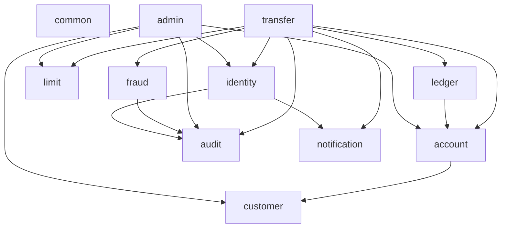

# 00. Architecture & Backend Conventions

> **Dự án:** Digital Banking MVP
> **Mã tài liệu:** `BE-ARCH-00`
> **Phiên bản:** 1.0
> **Ngày:** 07/11/2026
> **Trạng thái:** Hoàn thành
> **Nguồn tham chiếu:** [[digitalbanking-docs/docs-common/05. Technical stack.md]], [[digitalbanking-docs/docs-common/06. System architecture.md]], [[digitalbanking-docs/docs-common/design/02. consistency-concurrency.md]]

---

## 1. Mục đích

Tài liệu này quy định kiến trúc nội bộ, phiên bản công nghệ baseline, cấu trúc package, quy tắc phụ thuộc giữa các module và các quy ước bắt buộc khi lập trình Spring Boot/PostgreSQL cho Digital Banking MVP.

> [!IMPORTANT]
> Mọi Developer và Coding Agent phải đọc tài liệu này trước khi viết hoặc sửa code ở bất kỳ module nào.

---

## 2. Technology Stack Baseline

| Thành phần | Công nghệ | Phiên bản Baseline | Quy ước bắt buộc |
|---|---|---|---|
| **Language / Runtime** | Java | **21 LTS** | Dùng `record` cho DTO/Command/Event bất biến; bật `-parameters` |
| **Framework** | Spring Boot | **4.x** (fallback **3.5.x**) | Dùng **Spring MVC** (blocking servlet), **không** dùng WebFlux |
| **Persistence** | Spring Data JPA + JDBC | Theo Spring Boot BOM | Dùng JPA cho CRUD/Entity; dùng `JdbcTemplate`/`NamedParameterJdbcTemplate` cho khóa `FOR UPDATE`, `NOWAIT`, `SKIP LOCKED` và `ON CONFLICT` |
| **Database** | PostgreSQL | **16.x** | Schema `banking`; `snake_case`; tiền `NUMERIC(19,2)`; thời gian `TIMESTAMPTZ` (UTC) |
| **Migration** | Flyway | **11.x** | Đặt tại `src/main/resources/db/migration`; môi trường chung bắt buộc `ddl-auto: validate` |
| **Security** | Spring Security + Crypto | Theo Spring Boot BOM | Opaque session token (SHA-256 hash trong DB); Argon2id cho password; AES-256-GCM cho PII |
| **Validation** | Hibernate Validator | Theo Spring Boot BOM | Bean Validation trên Request DTO + Custom Validator cho nghiệp vụ |
| **Mapping & Codegen** | MapStruct + Lombok | MapStruct `1.6.x`, Lombok `1.18.x` | Cấu hình `lombok-mapstruct-binding`; `unmappedTargetPolicy = ERROR` |
| **API Contract** | springdoc-openapi | Tương thích Spring Boot | Khớp [[digitalbanking-docs/openapi/digital-banking-v1.yaml]]; lỗi theo RFC 9457 Problem Details |
| **Rate Limiting** | Bucket4j | Bản ổn định (in-memory) | Áp dụng cho Login, OTP, Step-up, Transfer; trả `429 RATE_LIMITED` |
| **Observability** | Actuator + Micrometer | Theo Spring Boot BOM | JSON structured log + MDC `correlation_id`; Prometheus metrics |
| **Testing** | JUnit 5, AssertJ, Testcontainers | PostgreSQL 16-alpine | **Cấm dùng H2** cho integration/concurrency/lock test |

---

## 3. Cấu trúc Package & Modular Monolith

### 3.1. Cấu trúc nội bộ của mỗi Module

Hệ thống được tổ chức theo hướng **Package-by-Feature** kết hợp **Hexagonal / Clean Layered Architecture** bên trong từng module:

```text
com.banking
├── common/                     # Cross-cutting: error RFC 9457, correlation, security filter, crypto, masking, clock
└── <module>/                   # Một trong 10 module nghiệp vụ
    ├── api/                    # Public interface/port + DTO để module khác gọi (nếu được phép)
    ├── adapter/
    │   ├── in/web/             # @RestController, Request/Response DTO, Web Mapper
    │   └── out/
    │       ├── persistence/    # JPA Entity, Spring Data Repository, JdbcRepository
    │       └── external/       # Adapter gọi Simulator (OTP, Notification, FIDO)
    ├── application/            # Use case service, @Transactional boundary, Orchestrator
    └── domain/                 # Domain model, Value Object, State Machine, Policy/Rule thuần Java
```

**Quy tắc phân tầng trong module:**
1. **`adapter/in/web`**: Chỉ parse/validate input, gọi `application` service và trả HTTP response. **Tuyệt đối không đặt `@Transactional` ở Controller.**
2. **`application`**: Sở hữu ranh giới transaction (`@Transactional` hoặc `TransactionTemplate`), điều phối luồng và gọi qua `domain` / `adapter/out` / `api` của module khác.
3. **`domain`**: Chứa logic nghiệp vụ, bất biến (invariants) và state machine thuần Java; không phụ thuộc trực tiếp vào Web/Controller.
4. **`adapter/out/persistence`**: Không được expose trực tiếp `JpaRepository` hay JPA `@Entity` sang module khác.

### 3.2. Danh mục 11 Modules & Quyền sở hữu Bảng (Table Ownership)

**Nguyên tắc cốt lõi:** Mỗi bảng trong schema `banking` chỉ có **duy nhất một module sở hữu quyền GHI (INSERT/UPDATE/DELETE)**. Các module khác muốn thay đổi dữ liệu phải gọi qua `api/` hoặc `application` service của module sở hữu.

| # | Module (`package`) | Bảng sở hữu độc quyền (Write Ownership) | Trách nhiệm cốt lõi |
|---|---|---|---|
| 1 | `common` | *(Không sở hữu bảng)* | Error handling RFC 9457, Correlation ID filter, AES-256-GCM, HMAC, PII Masking, Bucket4j, Clock |
| 2 | `identity` | `app_user`, `session`, `device`, `auth_challenge`, `auth_attempt`, `password_history`, `role`, `permission`, `user_role`, `role_permission`, `user_privilege` | Xác thực (Password/Passcode/FIDO), Session lifecycle, OTP/Step-up challenge, Lockout, RBAC |
| 3 | `customer` | `customer` | Hồ sơ khách hàng, mã hóa/giải mã PII, trạng thái khách hàng |
| 4 | `account` | `account` | Tài khoản, kiểm tra ownership, khóa dòng `FOR UPDATE`, cập nhật `available_balance` / `ledger_balance` |
| 5 | `transfer` | `transfer`, `idempotency_record` | Điều phối chuyển tiền `T0–T3`, Idempotency lifecycle, State machine, Lịch sử giao dịch, Reconciliation |
| 6 | `ledger` | `ledger_entry` | Ghi bút toán kép (Double-entry `DEBIT`/`CREDIT`), đối soát cân bằng sổ cái |
| 7 | `limit` | `limit_config`, `limit_usage` | Kiểm tra hạn mức giao dịch/ngày, khóa và cộng dồn `limit_usage` theo ngày nghiệp vụ |
| 8 | `audit` | `audit_log`, `legal_hold`, `retention_policy` | Ghi audit append-only, tính SHA-256 hash chain dưới `pg_advisory_xact_lock`, tra cứu/export, verify chain |
| 9 | `fraud` | `fraud_rule_config`, `fraud_flag` | Đánh giá rule gian lận đồng bộ trong `T2` (fail-open), lưu cờ vi phạm, xử lý review của Operations |
| 10 | `notification` | `notification` | Ghi transactional outbox (`PENDING` trong `T2`), worker quét `SKIP LOCKED` gửi thông báo sau commit |
| 11 | `admin` | `approval_request` | Luồng phê duyệt Maker-Checker (hạn mức, role/privilege), tra cứu vận hành cho Staff |

### 3.3. Ma trận Phụ thuộc Module (Dependency Rules)



- **Cấm phụ thuộc vòng (Circular Dependency):** Có thể kiểm chứng tự động bằng ArchUnit.
- **`common`** không được import bất kỳ module nghiệp vụ nào.
- **`identity`, `customer`, `account`, `limit`, `ledger`, `audit`** là các module nền tảng, **không** phụ thuộc ngược vào `transfer` hay `admin`.
- **Đọc chéo module (Read Path):** Chỉ đọc qua interface công khai hoặc read-only query projection đã khai báo; tuyệt đối không join tự do làm rò rỉ logic bảo mật/masking.

---

## 4. Quy ước Lập trình Cốt lõi (Coding Standards)

### 4.1. Tiền tệ, Thời gian và Kiểu dữ liệu
- **Tiền tệ (`Money`):**
  - Bắt buộc dùng `BigDecimal` trong Java và `NUMERIC(19,2)` trong PostgreSQL. **Cấm dùng `double` hoặc `float`.**
  - Trong JSON request/response, tiền luôn biểu diễn dạng **chuỗi thập phân** (ví dụ: `"150000.00"` hoặc `"150000"`) để tránh mất chính xác trên JavaScript.
  - Mọi phép chia/làm tròn (nếu có) phải chỉ định rõ `RoundingMode`; với VND trong MVP: `amount > 0`, `scale <= 2`, `currency = "VND"`, không thu phí (`debit_amount == credit_amount == transfer.amount`).
- **Thời gian (`Time` & `Clock`):**
  - Luôn inject `java.time.Clock` (mặc định `Clock.systemUTC()`) vào Service/Domain thay vì gọi trực tiếp `Instant.now()` hay `LocalDate.now()` để hỗ trợ kiểm thử boundary thời gian.
  - Lưu trữ trong DB dùng `TIMESTAMPTZ` (UTC).
  - Ngày nghiệp vụ (`usage_date` cho hạn mức ngày) được tính theo timezone cấu hình `app.time.business-zone` (mặc định `Asia/Ho_Chi_Minh`).

### 4.2. Quản lý Transaction & Concurrency (`T0–T3`)
1. **Tắt OSIV:** Bắt buộc cấu hình `spring.jpa.open-in-view: false` để không giữ DB connection ngoài phạm vi `@Transactional`.
2. **Tránh lỗi Self-Invocation của Spring Proxy:**
   - Không gọi method `@Transactional` từ một method khác trong cùng một class (`this.executeT2()`).
   - Phải tách thành các Spring Bean riêng biệt (ví dụ: `TransferOrchestrator` gọi `TransferT1Service` và `TransferT2Service`) hoặc dùng `TransactionTemplate`.
3. **Không gọi External I/O trong Transaction tiền (`T2`):**
   - Các lệnh gọi HTTP/Simulator (gửi SMS/Email OTP, gửi Notification) **cấm** nằm trong transaction giữ row lock tài khoản.
   - Fraud Engine là module in-process đọc DB nên được chạy trong `T2` nhưng phải bọc `try-catch` theo cơ chế **Fail-open** (budget ≤ 1s).
4. **Phân biệt Business Rejection và System Failure trong `T2`:**
   - **Lỗi nghiệp vụ dự kiến** phát hiện trong `T2` (không đủ số dư, tài khoản bị khóa, vượt hạn mức, bị `FRAUD_BLOCKED`): **Không được rollback `T2` về `PENDING`**. Phải cập nhật `transfer.status = 'FAILED'`, ghi `idempotency_record`, ghi `audit_log` (`TRANSFER_FAILED`), enqueue `notification` và **COMMIT `T2`**.
   - **Lỗi hệ thống / lỗi ghi Audit (`AuditWriteException`, `TransientDataAccessException`, DB crash):** Throw unchecked exception để **ROLLBACK toàn bộ `T2`**, giữ `transfer` ở trạng thái `PENDING` để client retry hoặc job Reconciliation xử lý.
5. **Thứ tự khóa cố định (Canonical Lock Order) chống Deadlock:**
   Khi một transaction cần khóa nhiều tài nguyên, bắt buộc tuân thủ đúng thứ tự sau:
   ```text
   1. banking.transfer          (FOR UPDATE NOWAIT / SKIP LOCKED)
   2. banking.auth_challenge    (FOR UPDATE)
   3. banking.account           (ORDER BY account_id ASC FOR UPDATE)
   4. banking.limit_usage       (Customer-level row -> Account-level row FOR UPDATE)
   5. pg_advisory_xact_lock     (hashtextextended('audit:chain', 0) — luôn ở cuối T1/T2)
   ```

### 4.3. Quy tắc sử dụng JPA, Lombok & MapStruct
- **Trên JPA `@Entity`:**
  - **Cấm dùng `@Data`, `@ToString` (trên trường quan hệ lazy), `@EqualsAndHashCode` mặc định.**
  - Chỉ dùng `@Getter`, `@Setter`, `@NoArgsConstructor(access = AccessLevel.PROTECTED)` và `@EqualsAndHashCode(onlyExplicitlyIncluded = true)` dựa trên ID khi thật sự cần.
  - Không dùng `@Version` (Optimistic Locking) cho bảng `account` và `limit_usage` vì hệ thống đã chuẩn hóa dùng Pessimistic Row Lock (`SELECT ... FOR UPDATE`) + Conditional Update.
- **Ưu tiên Native SQL / `JdbcTemplate` cho Money Path:**
  - Các câu lệnh nhạy cảm về khóa và nguyên tử như `SELECT ... ORDER BY account_id FOR UPDATE`, `INSERT ... ON CONFLICT DO NOTHING`, `FOR UPDATE NOWAIT`, `FOR UPDATE SKIP LOCKED` nên viết bằng `NamedParameterJdbcTemplate` để kiểm soát 100% câu SQL thực thi (xem chi tiết tại [[digitalbanking-docs/docs-backend/database/02-locking-and-sql-patterns.md]]).

---

## 5. Tham số Cấu hình Chuẩn hóa (`@ConfigurationProperties`)

Các ngưỡng nghiệp vụ và kỹ thuật (bao gồm các giá trị đánh dấu `[Đề xuất]` / `OI-*` trong `docs-common`) phải được gom vào các class `@ConfigurationProperties(prefix = "app...")` trong `application.yml`, tuyệt đối không hard-code trong logic:

```yaml
app:
  time:
    business-zone: "Asia/Ho_Chi_Minh"          # OI-003 / OI-CON-09: Timezone tính hạn mức ngày
  security:
    session:
      cookie-name: "DBANK_SESSION"
      idle-timeout: 15m                        # BRL-005: Hết hạn phiên do không hoạt động
      absolute-timeout: 8h                     # BRL-005: Thời hạn tối đa của một phiên
    auth:
      max-failed-attempts: 5                   # BRL-003: Số lần sai tối đa trước khi khóa tạm
      lockout-duration: 10m                    # BRL-003: Thời gian khóa tạm thời
      max-lockouts-per-day: 3                  # Khoá tài khoản nếu bị lockout 3 lần/24h
      password-history-size: 3                 # BRL-006: Không trùng 3 mật khẩu gần nhất
    otp:
      ttl: 5m                                  # BRL-004: Thời hạn hiệu lực của OTP/Challenge
      max-attempts: 5                          # BRL-004: Số lần nhập sai OTP tối đa
      resend-cooldown: 60s                     # Thời gian chờ tối thiểu giữa 2 lần gửi lại OTP
      max-resends: 3                           # Số lần gửi lại tối đa cho 1 challenge
    crypto:
      active-key-version: 1                    # Phiên bản khóa AES-256-GCM hiện hành
      aes-master-key-base64: "${APP_AES_KEY}"  # Inject từ biến môi trường (32 bytes)
      hmac-pepper-base64: "${APP_HMAC_PEPPER}" # Inject từ biến môi trường cho blind index *_hash
  transfer:
    idempotency-ttl: 24h                       # BRL-013 / OI-CON-01: Thời gian giữ idempotency key
    step-up-threshold: 10000000.00             # BRL-002: Ngưỡng giao dịch yêu cầu Step-up (10 triệu VND)
    reconciliation-stale-threshold: 5m         # Ngưỡng tuổi giao dịch PENDING để job đối soát quét
    max-deadlock-retries: 3                    # Số lần retry tối đa khi gặp SQLSTATE 40P01/40001
  fraud:
    eval-timeout: 1000ms                       # IC-003: Budget thời gian tối đa cho Fraud Engine
    large-value-threshold: 50000000.00         # BRL-029: Ngưỡng giao dịch giá trị lớn (50 triệu VND)
    high-frequency-count: 5                    # BRL-030: Số lượng giao dịch trong cửa sổ tần suất cao
    high-frequency-window: 10m                 # BRL-030: Cửa sổ thời gian tính tần suất cao (10 phút)
```

---

## 6. Checklist Tự kiểm tra trước khi Commit / PR

1. [ ] Có bất kỳ `@Transactional` nào đặt nhầm ở `@RestController` không?
2. [ ] Có lời gọi self-invocation (`this.method()`) làm mất hiệu lực `@Transactional` không?
3. [ ] Mọi truy vấn khóa nhiều tài khoản đã `ORDER BY account_id ASC FOR UPDATE` chưa?
4. [ ] Có gọi Simulator (OTP/Notification) bên trong transaction `T2` không?
5. [ ] Audit log cho thao tác tiền/nhạy cảm có được ghi **cùng transaction** (hoặc `REQUIRES_NEW` đối với sự kiện từ chối bảo mật) và lấy `pg_advisory_xact_lock` ở bước cuối cùng không?
6. [ ] Response DTO và Log đã che dấu (mask) số tài khoản (`**** **** 1234`), SĐT, Email và không trả về secret/hash chưa?
7. [ ] Integration test có chạy trên **Testcontainers PostgreSQL 16** thật thay vì H2 không?
