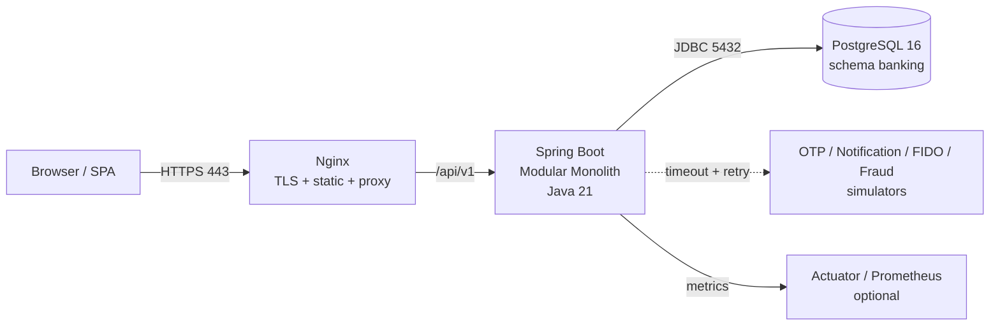
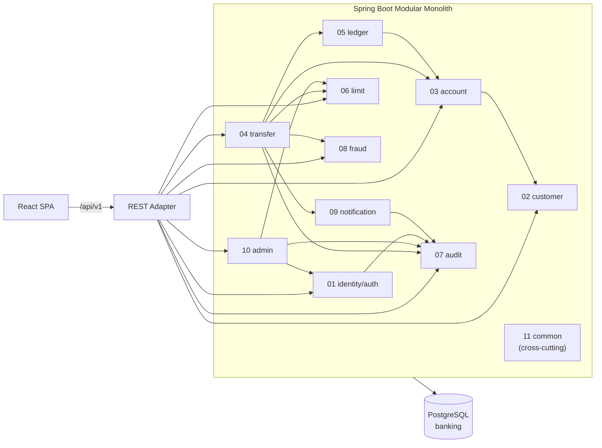

# 00. Architecture & Conventions (Backend)

> **Dự án:** Digital Banking MVP (Single-Bank, Core Simulated)
> **Mã tài liệu:** `BE-ARCH-00`
> **Phiên bản:** v1.1
> **Ngày cập nhật:** 12/11/2026
> **Trạng thái:** Hoàn thành — Chuẩn kiến trúc & quy ước bắt buộc cho toàn bộ `docs-backend/`
> **Owner:** Backend Lead
> **Reviewer:** Tech Lead (kiến trúc), QA (kiểm thử), Security (bảo mật)
> **Nguồn chuẩn (Source of Truth):** [[digitalbanking-docs/docs-common/03. SRS.md]], [[digitalbanking-docs/docs-common/04. Database design & analysis.md]], [[digitalbanking-docs/docs-common/05. Technical stack.md]], [[digitalbanking-docs/docs-common/06. System architecture.md]], [[digitalbanking-docs/docs-common/07. API contracts.md]], [[digitalbanking-docs/docs-common/08. Deployment infrastructure.md]], [[digitalbanking-docs/docs-common/09. Test plan.md]], [[digitalbanking-docs/docs-common/design/README.md]], [[digitalbanking-docs/openapi/digital-banking-v1.yaml]]

---

## Mục lục

- [1. Mục đích, Phạm vi và Thẩm quyền Tài liệu](#1-mục-đích-phạm-vi-và-thẩm-quyền-tài-liệu)
- [2. Kiến trúc Tổng quan](#2-kiến-trúc-tổng-quan)
- [3. Baseline Công nghệ](#3-baseline-công-nghệ)
- [4. Cấu trúc Code và Package](#4-cấu-trúc-code-và-package)
- [5. Danh mục 11 Module và Quyền Sở hữu Dữ liệu](#5-danh-mục-11-module-và-quyền-sở-hữu-dữ-liệu)
- [6. Quy ước Tầng và Mã nguồn](#6-quy-ước-tầng-và-mã-nguồn)
- [7. Quy ước API](#7-quy-ước-api)
- [8. Quy ước Dữ liệu và Cơ sở dữ liệu](#8-quy-ước-dữ-liệu-và-cơ-sở-dữ-liệu)
- [9. Quy ước Bảo mật](#9-quy-ước-bảo-mật)
- [10. Quy ước Audit và Observability](#10-quy-ước-audit-và-observability)
- [11. Quy ước Kiểm thử](#11-quy-ước-kiểm-thử)
- [12. Quy ước Viết Tài liệu Module](#12-quy-ước-viết-tài-liệu-module)
- [13. Checklist Tuân thủ và Traceability](#13-checklist-tuân-thủ-và-traceability)
- [Appendix A. Viết tắt](#appendix-a-viết-tắt)
- [Change Log](#change-log)

---

## 1. Mục đích, Phạm vi và Thẩm quyền Tài liệu

### 1.1. Mục đích

Tài liệu này là **chuẩn kiến trúc và quy ước bắt buộc** cho toàn bộ tài liệu triển khai và mã nguồn backend của Digital Banking MVP. Cụ thể:

1. Chốt **một bản diễn giải duy nhất** từ `docs-common/` thành các quy tắc áp dụng được khi thiết kế và viết code backend.
2. Cho phép **11 module owner** viết tài liệu chi tiết và triển khai code **không chồng chéo dữ liệu, không lệch luồng tích hợp**.
3. Cung cấp **mã quy ước ổn định** (`BE-CON-*`, `BE-API-*`, `BE-DAT-*`, `BE-SEC-*`, `BE-OBS-*`, `BE-TST-*`, `BE-DOC-*`) để module docs, PR và checklist nghiệm thu tham chiếu ngược.
4. Là đầu vào bắt buộc cho: `docs-backend/deployment/`, `docs-backend/modules/_overview/` và 11 thư mục module chi tiết.

### 1.2. Phạm vi

| Trong phạm vi | Ngoài phạm vi |
|---|---|
| Kiến trúc backend Spring Boot Modular Monolith và ranh giới module | Thiết kế UI/UX, design system (xem `docs-frontend/`) |
| Cấu trúc package, quy ước tầng, transaction, locking, error model | Cấu hình hạ tầng chi tiết (xem `docs-backend/deployment/` và `08`) |
| Quy ước API, dữ liệu, bảo mật, audit, observability, kiểm thử | CBS/payment gateway thật, PCI-DSS/ISO certification |
| Quy ước viết tài liệu module và traceability | Chứng từ pháp lý, hợp đồng, procurement |

### 1.3. Đối tượng đọc

| Đối tượng | Phần bắt buộc đọc trước khi code |
|---|---|
| Module owner (**Đạt, Vũ, Phương, Thịnh**) | §2, §4, §5, §6, §8, §9, §10, §11, §12 |
| Backend developer tham gia module | §4, §6, §7, §8, §9, §10, §11 |
| QA / reviewer | §7, §8.7–8.8, §9, §10, §11, §13 |
| DevOps | §2, §3, §8.5–8.6, §10 |

### 1.4. Quan hệ với `docs-common/` (nguồn chuẩn)

| Nội dung cần tra | Nguồn chuẩn | Mục tham chiếu chính |
|---|---|---|
| Yêu cầu `BR/FR/NFR/AC`, use case, state machine | [[digitalbanking-docs/docs-common/03. SRS.md]] | §2, §6 |
| Mô hình dữ liệu, DDL vật lý, constraint, hash chain | [[digitalbanking-docs/docs-common/04. Database design & analysis.md]] | §4, §7 |
| Công nghệ, baseline phiên bản, quyết định stack | [[digitalbanking-docs/docs-common/05. Technical stack.md]] | §4, §5, §8 |
| Kiến trúc C4, module, runtime, T0–T3, ADR | [[digitalbanking-docs/docs-common/06. System architecture.md]] | §6–§13 |
| Hợp đồng API, error catalog, idempotency, step-up | [[digitalbanking-docs/docs-common/07. API contracts.md]] | §2–§8 |
| Hạ tầng, migration, observability, runbook | [[digitalbanking-docs/docs-common/08. Deployment infrastructure.md]] | §6–§10 |
| Chiến lược và kịch bản kiểm thử `D1–D5` | [[digitalbanking-docs/docs-common/09. Test plan.md]] | §3–§11 |
| Audit & traceability (C1–C4, hash chain) | [[digitalbanking-docs/docs-common/design/01. audit-traceability.md]] | §5, §7 |
| Consistency & concurrency (T0–T3, lock order) | [[digitalbanking-docs/docs-common/design/02. consistency-concurrency.md]] | §5, §6 |
| Fraud rules, fail-open, auto-block | [[digitalbanking-docs/docs-common/design/03. fraud-detection-rules.md]] | Toàn bộ |
| Security architecture, threat model, PII | [[digitalbanking-docs/docs-common/design/04. security.md]] | §4–§9 |
| Hợp đồng OpenAPI máy đọc | [[digitalbanking-docs/openapi/digital-banking-v1.yaml]] | Toàn bộ |
| Phân công module, mốc thực hiện | [[digitalbanking-docs/docs-common/11. Resource & Staffing Plan.md]] | Toàn bộ |
| Tổng hợp 11 module, khung 7 phần | [[digitalbanking-docs/docs-backend/modules/_overview/README.md]] | §3–§5 |

### 1.5. Thứ tự thẩm quyền và quy tắc cập nhật

**Thứ tự thẩm quyền khi có mâu thuẫn:**

1. `docs-common/01–11` — nguồn ưu tiên cao nhất; `07` quyết định ngữ nghĩa/schema API.
2. `docs-common/design/` — bổ sung kỹ thuật khi không trái `01–11`; OpenAPI là bản máy đọc phải đồng bộ theo `07`, không ghi đè ngữ nghĩa nguồn.
3. **Tài liệu này (`BE-ARCH-00`)** — cho cách diễn giải và áp dụng vào backend.
4. Tài liệu module chi tiết (`docs-backend/modules/<module>/`) — chỉ được chi tiết hóa, **không được định nghĩa lại**.

Quyết định owner ngày 12/11/2026: không cần chọn lại nguồn khi `01–11` đã phân xử khác biệt với design/backend. Giữ nhãn Đề xuất/Deferred/Open của nguồn; chốt thứ tự ưu tiên không tự đóng OI nghiệp vụ. Không suy ra file số lớn/nhỏ hơn có thẩm quyền cao hơn trong nhóm `01–11`.

Khi phát hiện thiếu thiết kế hoặc mâu thuẫn giữa chính các tài liệu `01–11`:

- **Không tự xử lý riêng trong module docs/code.** Ghi nhận issue, đề xuất sửa `docs-common` hoặc tài liệu này.
- Nếu cần quyết định tạm thời để không chặn tiến độ, đánh dấu rõ `Đề xuất` và tạo mục open issue trong module docs, kèm người quyết định và hạn chốt.

**Quy tắc cập nhật:**

- Mọi thay đổi quy ước phải cập nhật tài liệu này trước hoặc cùng lúc với code; ghi `Change Log`.
- Thay đổi **breaking** với API phải tạo version mới (`/v2`) theo [[digitalbanking-docs/docs-common/07. API contracts.md]] §2.1.
- Không đổi nghĩa mã quy ước đã ban hành; nếu cần thay đổi, tạo mã mới và đánh dấu mã cũ `Deprecated`.

### 1.6. Quy ước mã tài liệu và liên kết

| Loại | Định dạng | Ví dụ |
|---|---|---|
| Kiến trúc & quy ước backend | `BE-ARCH-<NN>` | `BE-ARCH-00` |
| Triển khai & vận hành | `BE-DEP-<NN>` | `BE-DEP-01` |
| Tóm tắt module (trong `_overview/`) | `BE-MOD-SUM-<NN>` | `BE-MOD-SUM-11` |
| Chi tiết module (đề xuất) | `BE-MOD-<MODULE>-<NN>` | `BE-MOD-TRANSFER-01` |
| Quy ước trong tài liệu này | `BE-<GROUP>-<NN>` | `BE-CON-05`, `BE-API-12` |
| Quyết định kiến trúc nguồn | `AD-<NN>` | `AD-03` |
| Yêu cầu nguồn | `BR-*/FR-*/NFR-*/AC-*` | `NFR-009`, `AC-034` |

**Liên kết:** dùng wikilink Obsidian đầy đủ đường dẫn trong `docs-backend/` (ví dụ `[[digitalbanking-docs/docs-common/06. System architecture.md]]`); khi trích quy tắc phải kèm số mục nguồn (ví dụ `06 §8.3`). Không sao chép nguyên văn nội dung dài từ `docs-common`; chỉ trích quy tắc áp dụng và trỏ nguồn.

---

## 2. Kiến trúc Tổng quan

### 2.1. Kiến trúc đích

Backend là **một Spring Boot application (modular monolith)** với **một PostgreSQL** là system of record; frontend là React SPA; Nginx đảm nhận TLS, static và reverse proxy `/api`. Mỗi module là một package cấp cao, có ranh giới dữ liệu và giao tiếp nội bộ qua interface.



**Nguồn:** [[digitalbanking-docs/docs-common/06. System architecture.md]] §5, §11. Sơ đồ container gốc: `docs-common/diagrams/06-container-view.svg`.

### 2.2. Container và giao tiếp

| Container | Công nghệ | Trách nhiệm | Quy ước backend |
|---|---|---|---|
| Nginx | Nginx stable | TLS 1.2+, static SPA, proxy `/api` | Backend **không public trực tiếp**; security headers tại Nginx |
| Application | Spring Boot + Java 21 | Auth, nghiệp vụ, transaction, audit, API | Một deployable; package-by-feature; non-root container |
| Database | PostgreSQL 16 | System of record: tiền, trạng thái, audit, idempotency | Schema `banking`; Flyway; tài khoản DB tách quyền |
| Simulators | Adapter/service mô phỏng | OTP/SMS/Email, FIDO, fraud rule engine | Qua ports/adapters; không gọi trong transaction tiền (trừ fraud in-process) |
| Monitoring | Actuator + Prometheus/Grafana (optional) | Health, metrics, dashboard | Endpoint nội bộ; không lộ chi tiết hạ tầng |

**Quy tắc giao tiếp:**

- SPA → Nginx → Application: HTTPS ra ngoài, HTTP nội bộ.
- Application → PostgreSQL: JDBC qua HikariCP; `auto-commit = false`.
- Application → OTP/Notification/FIDO: timeout 5 giây (OTP/notification), 30 giây (FIDO); **không nằm trong T1/T2** (OTP/FIDO trước T1; notification delivery sau commit qua outbox).
- Application → Fraud: **in-process**, budget 1 giây trong T2, fail-open.
- Không dùng message broker, cache phân tán hoặc service discovery trong MVP.

### 2.3. Quyết định kiến trúc kế thừa (`AD-01` – `AD-14`)

| ID | Quyết định | Hệ quả bắt buộc cho backend |
|---|---|---|
| `AD-01` | Modular monolith thay vì microservices | Giữ ranh giới module nghiêm ngặt; không tách service trong MVP |
| `AD-02` | PostgreSQL là system of record duy nhất | Mọi trạng thái tiền/idempotency/audit nằm trong PostgreSQL; không cache làm nguồn |
| `AD-03` | Luồng transfer chia T0/T1/T2/T3 | Transaction boundary tường minh trong `application`; T3 sau commit |
| `AD-04` | `idempotency_record` tạo sau validation/step-up, trong T1 | Không tạo record trước `428`; `transfer_id` NOT NULL |
| `AD-05` | Audit completion nằm trong T2; audit fail → rollback T2 | Không trả `COMPLETED` khi audit chưa bền vững (`AC-034`) |
| `AD-06` | Opaque session token, lưu SHA-256 hash trong DB | Không dùng JWT mặc định; kiểm tra session mỗi request |
| `AD-07` | Step-up challenge gắn `request_hash` + idempotency key | Challenge dùng một lần; chống replay |
| `AD-08` | `READ COMMITTED` + explicit row lock + thứ tự khóa cố định | Không nâng isolation toàn cục; tuân thủ lock order §8.8 |
| `AD-09` | Ledger all-or-nothing; `FAILED` không có entry; balance materialized | Không ghi bù/compensation entry trong MVP |
| `AD-10` | Notification transactional outbox trong PostgreSQL | Insert `notification` PENDING trong T2; delivery sau commit |
| `AD-11` | Fraud in-process, đồng bộ trong T2, fail-open | Flag bền vững trong T2; engine lỗi không chặn tiền |
| `AD-12` | AES-256-GCM ở application layer + HMAC blind index | Không mã hóa bằng extension/trigger DB; key ngoài DB |
| `AD-13` | React SPA + REST API + Nginx; không BFF/SSR | API thuần REST/JSON; không template server-side |
| `AD-14` | Docker Compose, không Kubernetes | Một instance mặc định; scheduler cần lock khi scale |

**Nguồn:** `06 §3.2`, `§3.3`.

### 2.4. Phối hợp 11 module



**Quy tắc:** `common` là cross-cutting, **không** phụ thuộc module nghiệp vụ; mọi module nghiệp vụ được phụ thuộc `common`. Sơ đồ chỉ thể hiện dependency chính; ma trận đầy đủ tại §5.

### 2.5. Thành phần **không** dùng trong MVP

| Thành phần | Lý do | Trigger xem xét lại |
|---|---|---|
| Microservices / saga phân tán | Giao dịch tiền cần nhất quán mạnh; 20 RPS | Nhiều team/module độc lập; scale từng phần |
| Kafka / RabbitMQ | Outbox + scheduler đủ cho notification | Event volume lớn; tích hợp event bên ngoài |
| Redis | Session/idempotency/rate limit dùng PostgreSQL/in-memory | Rate limit cần shared; scale ngang nhiều instance |
| Kubernetes | Docker Compose đủ cho local/demo | Triển khai production |
| BFF / SSR | SPA nội bộ, không cần SEO | Yêu cầu SEO/đa kênh |
| Drools / ML fraud | Rule-based in-process đủ MVP | Yêu cầu mô hình fraud nâng cao |
| H2 database | Không mô phỏng đúng PostgreSQL (lock, trigger, partial index) | **Không bao giờ** dùng cho test transaction |

**Nguồn:** `06 §5.4`, `§11.6`; `09 §3.2`.

---

## 3. Baseline Công nghệ

### 3.1. Stack bắt buộc

| Thành phần | Công nghệ | Baseline | Quy tắc |
|---|---|---|---|
| Runtime | Java | **21 LTS** | Không dùng preview feature trong code nghiệp vụ |
| Framework | Spring Boot | **4.x** (fallback 3.5.x) | Chốt phiên bản ổn định; nếu lùi 3.5.x phải ghi lý do |
| Web | Spring MVC | Theo Boot | Không dùng WebFlux trong MVP |
| Persistence | Spring Data JPA + Hibernate | Theo Boot | Native SQL cho locking/aggregation đặc thù |
| Database | PostgreSQL | **16.x** | Không dùng H2 cho test transaction |
| Migration | Flyway | **11.x** | Forward-only; `validate-on-migrate = true` |
| Security | Spring Security | Theo Boot | Session opaque + CSRF; `@PreAuthorize` |
| Validation | Hibernate Validator | Theo Boot | Bean Validation trên request DTO |
| API contract | OpenAPI 3.x + springdoc-openapi | Tương thích Boot | Contract-first; Swagger UI chỉ dev/demo |
| Mapping | MapStruct | **1.6.x** | `componentModel = "spring"`, `unmappedTargetPolicy = ERROR` |
| Boilerplate | Lombok | **1.18.x** | Không `@Data` trên JPA entity |
| Build | Gradle Kotlin DSL | **8.14+ / 9.x** | Commit Gradle wrapper |
| Observability | Actuator + Micrometer | Theo Boot | Health, metrics, JSON log |
| Unit test | JUnit + Mockito + AssertJ | Theo Boot BOM | Bắt buộc cho rule nghiệp vụ |
| Integration test | Testcontainers PostgreSQL | Theo Boot BOM | Bắt buộc cho transaction/lock |
| API test | MockMvc hoặc REST Assured | Theo Boot BOM | Bắt buộc cho controller |
| External mock | WireMock | Bản ổn định | Giả lập OTP/notification |
| Async assertion | Awaitility | Bản ổn định | Test job/outbox |
| Coverage | JaCoCo | Bản ổn định | Ưu tiên critical path, không chạy theo % hình thức |
| Load test | k6 | Bản ổn định | 20 RPS × 10 phút (`D5`) |
| Container | Docker + Docker Compose | Bản ổn định | Non-root; healthcheck |
| Reverse proxy | Nginx | Bản ổn định | TLS, security headers, proxy `/api` |
| CI | GitHub Actions | — | Build/test/scan; branch `main` protected |

**Nguồn:** [[digitalbanking-docs/docs-common/05. Technical stack.md]] §4.1, §4.3, §8.1.

### 3.2. Quy tắc sử dụng công nghệ

- **BE-CON-01 — Không thêm công nghệ ngoài baseline** nếu chưa có quyết định kiến trúc và cập nhật `docs-common/05`. Không đưa thư viện mới chỉ để tiện cá nhân.
- **BE-CON-02 — Không dùng `double`/`float` cho tiền.** Dùng `BigDecimal`, ánh xạ `NUMERIC(19,2)`; amount so sánh bằng `compareTo`, không bằng `equals` (tránh khác scale).
- **BE-CON-03 — Không dùng `ddl-auto=update`** ở mọi môi trường dùng chung. Chỉ `validate`; schema do Flyway quản lý.
- **BE-CON-04 — Không dùng Envers làm audit nghiệp vụ.** Audit là module `audit` với append-only + hash chain.
- **BE-CON-05 — Không log/đưa PII vào metrics tag.** Tuân thủ §9.5 và §10.4.
- **BE-CON-06 — Phiên bản phải pin** qua BOM/Gradle catalog; `SNAPSHOT` chỉ dùng local, không lên `main`.
- **BE-CON-07 — Spring Boot 4.x chưa tương thích springdoc/MapStruct/Testcontainers** → tạm dùng 3.5.x, ghi lý do trong README backend và mở issue nâng cấp.

---

## 4. Cấu trúc Code và Package

### 4.1. Nguyên tắc package-by-feature

- Root package: `com.simulatedbank.banking`.
- Mỗi module là một package cấp cao: `com.simulatedbank.banking.<module>`.
- **Không** chia package thuần kỹ thuật toàn hệ thống (`controller`, `service`, `repository`); mỗi module tự chứa đủ 5 lớp.
- Tên package dùng `lowercase`, không dấu gạch dưới; tên class `PascalCase`; method/field `camelCase`.

### 4.2. Cấu trúc 5 lớp chuẩn của mỗi module

```text
com.simulatedbank.banking.<module>/
├── api/                  # Public Internal Interface + DTO cho module khác gọi
│   ├── <Module>Port.java            # Interface nghiệp vụ (nếu module khác cần)
│   └── dto/                         # Record/DTO bất biến, không lộ entity
├── adapter/
│   ├── in/                          # REST Controller, Request/Response DTO, Web Mapper
│   │   ├── <Entity>Controller.java
│   │   └── dto/
│   └── out/                         # Repository JPA/JDBC, gateway adapter
│       ├── <Entity>JpaRepository.java
│       └── <Port>Adapter.java
├── application/          # Use Case / Application Service, transaction boundary
│   ├── <UseCase>Service.java
│   └── port/                        # Outbound port interface (nếu cần)
└── domain/               # Entity, Value Object, State Machine, Pure Business Rules
    ├── <Entity>.java
    └── <Rule>.java
```

| Lớp | Trách nhiệm | Được phép | Không được phép |
|---|---|---|---|
| `api` | Hợp đồng nội bộ cho module khác | Interface + immutable DTO record | Entity, JPA annotation, logic DB |
| `adapter/in` | Nhận HTTP, parse/validate hình thức, map response | `@RestController`, Bean Validation, MapStruct web mapper | `@Transactional`, business rule, gọi repository trực tiếp |
| `application` | Điều phối use case, transaction boundary, orchestration | `@Transactional`, gọi `domain`, gọi outbound port, audit port | SQL native, HTTP client trực tiếp (phải qua port) |
| `domain` | Mô hình và rule nghiệp vụ thuần | Java thuần, `BigDecimal`, state machine, value object | Spring/JPA/Servlet, repository, transaction |
| `adapter/out` | Hiện thực persistence/gateway | JPA repository, `JdbcTemplate`, native SQL, locking | Business rule phức tạp, transaction boundary |

**Hướng phụ thuộc hợp lệ:**

```text
adapter/in ──> application ──> domain
                  │
                  ├──> api (implements port cho module khác)
                  └──> port (outbound) <── adapter/out
module khác ──> <target>.api.* (chỉ qua interface)
mọi module ──> common.* (một chiều)
```

### 4.3. Cấu trúc module `common`

`common` chứa cross-cutting concerns, **không sở hữu bảng nghiệp vụ** và **không phụ thuộc ngược** module nghiệp vụ (`06 §6.3`).

```text
com.simulatedbank.banking.common/
├── config/        # AppProperties, TimeConfig (Clock UTC + ZoneId), SecurityFilterChainConfig
├── context/       # CorrelationAndRequestIdFilter, RequestContext, RequestContextHolder
├── crypto/        # PiiCryptoService (AES-256-GCM), HmacService, JcsCanonicalizer, PiiMaskingUtils
└── error/         # ErrorCode, BankingBusinessException, ApiResponse, ProblemResponse,
                   # GlobalExceptionHandler
```

**Nguồn chi tiết:** [[digitalbanking-docs/docs-backend/modules/_overview/11-common.md]] §2–§4.

### 4.4. Quy tắc phụ thuộc giữa module

- **BE-CON-08 — `common` một chiều:** mọi module `01..10` được dùng `common`; `common` tuyệt đối không import module nghiệp vụ.
- **BE-CON-09 — Nền tảng không phụ thuộc orchestrator:** `identity`, `customer`, `account` không phụ thuộc `transfer`/`admin`.
- **BE-CON-10 — Orchestrator:** `transfer` điều phối qua `account`, `limit`, `ledger`, `audit`, `fraud`, `notification`; `admin` điều phối qua `identity`, `customer`, `account`, `limit`, `fraud`, `audit`.
- **BE-CON-11 — Không phụ thuộc vòng:** không import chéo tạo chu trình; class kiểm tra bằng ArchUnit (P1) trong CI.
- **BE-CON-12 — Không ghi chéo bảng:** không `INSERT/UPDATE/DELETE` bảng của module khác; mọi thay đổi qua `api` của owner (§5.2).
- **BE-CON-13 — Đọc chéo có kiểm soát:** chỉ qua interface/projection được khai báo; không join tùy tiện trong write path.
- **BE-CON-14 — Không lộ Entity:** `api` và REST DTO không trả JPA entity; map qua MapStruct/record.

### 4.5. Quy ước đặt tên mã nguồn

| Thành phần | Mẫu | Ví dụ |
|---|---|---|
| Controller | `<Danh từ>Controller` | `TransferController`, `AuditController` |
| Application service | `<UseCase>Service` / `<UseCase>Handler` | `CreateTransferService`, `VerifyStepUpHandler` |
| Interface nội bộ | `<Module>Port` hoặc `<Capability>Port` | `AccountBalancePort`, `AuditWriterPort` |
| Adapter outbound | `<Port>Adapter` | `NotificationGatewayAdapter` |
| Repository | `<Entity>Repository` | `TransferRepository` |
| Request/Response DTO | `<Action>Request`, `<Entity>Response` | `CreateTransferRequest`, `TransferResponse` |
| Domain entity | `<Entity>` (không hậu tố) | `Transfer`, `LedgerEntry` |
| Exception nghiệp vụ | `<Reason>Exception` kế thừa `BankingBusinessException` | `InsufficientBalanceException` |
| Error code | `UPPER_SNAKE_CASE` ổn định | `INSUFFICIENT_BALANCE` |
| Test | `<Class>Test`, `<Class>IT`, `<UseCase>ConcurrencyTest` | `TransferServiceTest`, `TransferLockIT` |

**Quy tắc:** không viết tắt mơ hồ (`mgr`, `svc`, `util2`); không đặt tên theo công nghệ nếu không cần (`XxxJpaImpl` chỉ dùng trong `adapter/out`).

### 4.6. Enforcement

- **ArchUnit (P1):** rule cấm `common → module`, cấm vòng lặp, cấm `adapter/in → adapter/out`, cấm `domain → org.springframework/jakarta.persistence`.
- **Review:** PR checklist phải xác nhận không vi phạm 5 quy tắc ranh giới tại §5.2.
- **CI:** build fail nếu vi phạm rule đã bật; không suppress ngoại lệ không có issue.

---

## 5. Danh mục 11 Module và Quyền Sở hữu Dữ liệu

### 5.1. Danh mục module

| # | Module / Package | Trách nhiệm chính | Bảng sở hữu (`banking.*`) | FR chính | Owner | Tài liệu tóm tắt |
|---:|---|---|---|---|---|---|
| 01 | `identity` / `auth` | Đăng nhập, passcode/FIDO/OTP, step-up, session, device, lockout, password history, RBAC | `app_user`, `role`, `permission`, `user_role`, `role_permission`, `user_privilege`, `device`, `session`, `auth_challenge`, `auth_attempt`, `password_history` | FR-001–007, FR-026, FR-040 | **Đạt** | [[digitalbanking-docs/docs-backend/modules/_overview/01-identity-auth.md]] |
| 02 | `customer` | Hồ sơ khách hàng, PII, trạng thái | `customer` | FR-008–011, FR-039 | **Đạt** | [[digitalbanking-docs/docs-backend/modules/_overview/02-customer.md]] |
| 03 | `account` | Tài khoản, số dư, ownership, trạng thái | `account` | FR-009–012, FR-015 | **Đạt** | [[digitalbanking-docs/docs-backend/modules/_overview/03-account.md]] |
| 04 | `transfer` | Tạo transfer, state machine, idempotency, step-up link, điều phối T1/T2 | `transfer`, `idempotency_record` | FR-013–026 | **Vũ** | [[digitalbanking-docs/docs-backend/modules/_overview/04-transfer.md]] |
| 05 | `ledger` | Bút toán debit/credit, double-entry, đối soát ledger | `ledger_entry` *(append-only)* | FR-019, FR-020, FR-034 | **Phương** | [[digitalbanking-docs/docs-backend/modules/_overview/05-ledger.md]] |
| 06 | `limit` | Hạn mức, usage ngày, enforcement | `limit_config`, `limit_usage` | FR-016, FR-031 | **Vũ** | [[digitalbanking-docs/docs-backend/modules/_overview/06-limit.md]] |
| 07 | `audit` | Audit append-only, hash chain, tra cứu, verification, retention/legal hold | `audit_log` *(append-only)*, `audit_chain_checkpoint`, `legal_hold`, `retention_policy` | FR-034–038, FR-053 | **Thịnh** | [[digitalbanking-docs/docs-backend/modules/_overview/07-audit.md]] |
| 08 | `fraud` | Rule engine, flag, review decision | `fraud_rule_config`, `fraud_flag` | FR-044–048 | **Thịnh** | [[digitalbanking-docs/docs-backend/modules/_overview/08-fraud.md]] |
| 09 | `notification` | Outbox/notification, gửi và retry | `notification` | FR-041–043 | **Thịnh** | [[digitalbanking-docs/docs-backend/modules/_overview/09-notification.md]] |
| 10 | `admin` | Quản trị user/role/quyền, approval maker/checker, tra cứu vận hành | `approval_request` | FR-032, FR-033, FR-049–051 | **Đạt** *(Thịnh đồng phát triển)* | [[digitalbanking-docs/docs-backend/modules/_overview/10-admin.md]] |
| 11 | `common` | Cross-cutting: error model, correlation, security config, crypto, validation, logging | *Không sở hữu bảng nghiệp vụ* | NFR-018, NFR-025 | **Phương** | [[digitalbanking-docs/docs-backend/modules/_overview/11-common.md]] |

**Nguồn:** `06 §6.2`, `§13.3`; phân công theo `11. Resource & Staffing Plan.md`.

### 5.2. Năm quy tắc ranh giới bất biến

1. **BE-CON-15 — Single Write-Owner per Table:** mỗi bảng có **đúng một** module được ghi. Module khác chỉ đọc qua `api` owner hoặc projection được khai báo.
2. **BE-CON-16 — Transaction boundary ở `application`:** Controller không mở transaction; không giữ lock khi chờ input người dùng.
3. **BE-CON-17 — Global Lock Ordering:** T2 tuân thủ thứ tự khóa toàn cục tại §8.8; không phát sinh lock mới ngoài thứ tự này.
4. **BE-CON-18 — `common` một chiều:** như `BE-CON-08`; không đặt business logic trong `common`.
5. **BE-CON-19 — No Circular Dependencies:** như `BE-CON-11`; `transfer`/`admin` là orchestrator, không bị module nghiệp vụ khác phụ thuộc ngược.

### 5.3. Ma trận quyền ghi (tóm tắt)

| Bảng | Module ghi duy nhất | Được đọc bởi (ví dụ) | Ghi chú |
|---|---|---|---|
| `app_user`, `session`, `device`, `auth_challenge`, `auth_attempt`, `password_history`, `role`, `permission`, `user_role`, `role_permission`, `user_privilege` | `identity` | `admin`, `audit`, `transfer` (qua port) | `admin` thay đổi role/permission **qua** `identity` |
| `customer` | `customer` | `account`, `admin` | PII mã hóa/mask |
| `account` | `account` | `transfer`, `ledger` (cập nhật balance qua `account` trong T2) | Balance chỉ đổi trong transaction tiền |
| `transfer`, `idempotency_record` | `transfer` | `notification`, `audit`, `admin` (read) | Idempotency insert-first |
| `ledger_entry` | `ledger` | `transfer`, `audit`, `admin` (read) | Append-only; cấm `UPDATE/DELETE` |
| `limit_config`, `limit_usage` | `limit` | `transfer`, `admin` | `admin` áp dụng sau approval qua `limit` |
| `audit_log`, `legal_hold`, `retention_policy` | `audit` | `admin` (read), auditor | Append-only; cấm `UPDATE/DELETE` |
| `fraud_rule_config`, `fraud_flag` | `fraud` | `transfer` (eval), `admin` (review qua `fraud`) | Flag insert trong T2 |
| `notification` | `notification` | `audit`, vận hành (read) | Outbox; worker cập nhật trạng thái |
| `approval_request` | `admin` | `limit`, `identity`, `fraud`, `audit` (read) | Maker ≠ checker |

**Nguồn:** `06 §6.2`, `§8.1`; `design/01 §6.6`.

### 5.4. Quy tắc dữ liệu dẫn xuất

- `account.available_balance`/`ledger_balance` là **materialized** từ `ledger_entry`; cập nhật trong T2 qua `account`; đối soát định kỳ.
- `limit_usage` là dữ liệu dẫn xuất từ transfer/ledger `COMPLETED`; reset theo `usage_date` (timezone cấu hình).
- `transfer` trạng thái terminal là nguồn cho history; không sửa trực tiếp bằng SQL vận hành.
- **BE-CON-20 — Không hard delete** dữ liệu tài chính/audit; dùng status/retention/legal hold.

---

## 6. Quy ước Tầng và Mã nguồn

### 6.1. Tầng `adapter/in` — REST Controller

- **BE-CON-21 — Controller mỏng:** chỉ parse request, Bean Validation hình thức, gọi **một** application service, map response; không business rule, không gọi repository.
- **BE-CON-22 — Không `@Transactional` trên Controller** (kể cả `readOnly`). Transaction do application service quyết định.
- **BE-CON-23 — Không trả entity:** response là DTO record theo `07 §7.2`/`§8`; map bằng MapStruct.
- **BE-CON-24 — Authorization tại cửa ngõ + service:** `@PreAuthorize` kiểm tra role/permission ở controller; ownership/data scope kiểm tra **lại** ở application service (defense in depth).
- **BE-CON-25 — Không nhận field ngoài contract:** Jackson `fail-on-unknown-properties: true` (chống mass assignment); DTO không dùng entity làm request body.
- **BE-CON-26 — Không tự bắt exception để trả lỗi riêng:** ném `BankingBusinessException`/để `GlobalExceptionHandler` map; controller không tự dựng Problem Details.

### 6.2. Tầng `application` — Use Case / Application Service

- **BE-CON-27 — Transaction boundary tại đây:** `@Transactional` cho write; `@Transactional(readOnly = true)` cho read; propagation mặc định `REQUIRED`.
- **BE-CON-28 — `REQUIRES_NEW` chỉ cho audit C3** (best-effort) hoặc job độc lập; C1/C2 dùng `MANDATORY` để **bắt buộc** nằm trong transaction nghiệp vụ (`design/01 §5.2`).
- **BE-CON-29 — Không gọi dịch vụ ngoài trong transaction tiền:** OTP/FIDO trước T1; notification delivery sau commit; fraud in-process là ngoại lệ có budget 1 giây.
- **BE-CON-30 — Không giữ lock khi chờ I/O người dùng:** tách pre-flight/T0 khỏi T1/T2; transaction ngắn.
- **BE-CON-31 — Orchestration rõ ràng:** mỗi use case gọi port theo thứ tự tài liệu; không gọi trực tiếp repository của module khác.
- **BE-CON-32 — Idempotency insert-first:** kiểm tra/insert `idempotency_record` theo `design/02 §6`; unique conflict quyết định replay/in-progress/conflict, không “select rồi insert”.
- **BE-CON-33 — Retry có kiểm soát:** chỉ retry thao tác an toàn/idempotent; deadlock/serialization retry tối đa 2–3 lần, backoff + jitter; retry transfer phải cùng `Idempotency-Key`.
- **BE-CON-34 — Set timeout trong T2:** `SET LOCAL lock_timeout = '2s'`, `SET LOCAL statement_timeout = '5s'` (giá trị cấu hình `app.transfer.*`); timeout map theo §6.7.

### 6.3. Tầng `domain`

- **BE-CON-35 — Domain thuần Java:** không import Spring/JPA/Servlet; không annotation persistence; không gọi repository.
- **BE-CON-36 — State machine tập trung:** trạng thái `transfer`/`auth_challenge`/`approval_request` chỉ chuyển qua method domain; không set status tùy tiện từ service.
- **BE-CON-37 — Bất biến nghiệp vụ trong domain:** amount > 0, scale ≤ 2, source ≠ destination, không âm số dư (kết hợp DB constraint), maker ≠ checker.
- **BE-CON-38 — Tiền và thời gian:** `BigDecimal` cho tiền; `Instant`/`OffsetDateTime` UTC cho thời gian; business date theo `ZoneId` cấu hình (`Asia/Ho_Chi_Minh`).

### 6.4. Tầng `adapter/out`

- **BE-CON-39 — Repository là adapter:** interface repository đặt tại `adapter/out` hoặc `application/port`; **không** expose JPA repository ra ngoài module.
- **BE-CON-40 — Native SQL chỉ ở adapter:** `FOR UPDATE`, `NOWAIT`, `SKIP LOCKED`, `ON CONFLICT`, câu lệnh đối soát đặt trong adapter/out; service không viết SQL.
- **BE-CON-41 — Row lock có chủ đích:** chỉ khóa dòng cần thiết; account khóa theo `ORDER BY account_id ASC`; `limit_usage` khóa customer trước, account sau.
- **BE-CON-42 — Map lỗi DB tại adapter:** SQLSTATE → `DataAccessException` có ngữ nghĩa hoặc `BankingBusinessException`; không để exception DB thô lọt ra API.

### 6.5. Tầng `api` — Internal Ports

- **BE-CON-43 — `api` là hợp đồng nội bộ:** interface + DTO record bất biến; không entity; mỗi method ghi rõ transaction expectation (gọi trong T2 hay ngoài T2).
- **BE-CON-44 — DTO nội bộ không tái sử dụng REST DTO:** tránh ràng buộc module owner vào JSON contract của module khác.
- **BE-CON-45 — Thay đổi `api` là thay đổi hợp đồng:** phải cập nhật module docs của cả bên gọi và bên cung cấp; kiểm tra bằng test tích hợp.

### 6.6. DTO, Entity và Mapping

- **BE-CON-46 — Request/Response dùng Java record** khi có thể; bất biến; validation annotation trên record component.
- **BE-CON-47 — MapStruct cho mapping:** `componentModel = "spring"`, `unmappedTargetPolicy = ERROR`; cấu hình `lombok-mapstruct-binding` đúng thứ tự.
- **BE-CON-48 — Không `@Data` trên JPA entity:** dùng `@Getter/@Setter`, `@EqualsAndHashCode(onlyExplicitlyIncluded = true)`; tránh lazy-loading ngoài transaction.
- **BE-CON-49 — Entity không dùng làm request/response:** không bind JSON trực tiếp vào entity.
- **BE-CON-50 — Enum API là `UPPER_SNAKE_CASE`, so sánh case-sensitive;** lưu DB dạng `VARCHAR` + `CHECK` (§8.2).
- **BE-CON-51 — Null semantics:** field vắng mặt = không áp dụng/không trả; `null` = có field nhưng không có giá trị (`07 §2.3`).

### 6.7. Exception và Error Handling

- **BE-CON-52 — Exception nghiệp vụ kế thừa `BankingBusinessException`** và mang `ErrorCode`; không ném `RuntimeException` chung cho lỗi nghiệp vụ.
- **BE-CON-53 — `GlobalExceptionHandler` là nơi duy nhất dựng response lỗi:** map exception + SQLSTATE → RFC 9457 Problem Details; không lộ stack trace, SQL, tên bảng/cột, provider.
- **BE-CON-54 — Mapping SQLSTATE chuẩn:**
  - `55P03`: owner xác định NOWAIT in-progress → `409 IDEMPOTENCY_IN_PROGRESS`; lock timeout khác → `503 SERVICE_UNAVAILABLE`, retryable. Không thêm RESOURCE_LOCKED ngoài catalog `07`; Retry-After theo ngữ cảnh.
  - `40P01` (deadlock) hoặc `57014` (statement timeout) → `503 SERVICE_UNAVAILABLE` (`retryable = true`).
  - `23505`: owner phân loại idempotency replay/conflict/in-progress, business code 409 có trong `07` nếu đúng ngữ cảnh; ledger/invariant hoặc mapping chưa xác định → `500 INTERNAL_ERROR`. Không thêm CONFLICT hoặc blanket-map unique thành 409. Không query/retry trong transaction đã aborted; chi tiết tại module common §4.4.
- **BE-CON-55 — Validation error có `errors[].field` dạng JSON path** tương đối (`amount`, `destination.accountNumber`); header dùng `field: "Idempotency-Key"`.
- **BE-CON-56 — Lỗi hệ thống không đổi trạng thái tiền:** không trả `COMPLETED` khi audit/ledger chưa bền vững; transfer giữ `PENDING`/`FAILED` và trả lỗi retryable theo `07 §4.4`.

### 6.8. Transaction và Locking

- **BE-CON-57 — Isolation mặc định `READ COMMITTED`** + explicit row lock; nếu dùng `SERIALIZABLE` phải có retry `40001`/`40P01` và được review.
- **BE-CON-58 — Bốn pha T0–T3 bất biến:** T0 step-up (transaction riêng), T1 tạo transfer PENDING + idempotency + audit `TRANSFER_CREATED`, T2 tiền + audit completion + outbox + terminal status, T3 delivery sau commit. Chi tiết §8.7.
- **BE-CON-59 — Cân bằng số dư bằng conditional update:** `UPDATE ... WHERE available_balance >= :amount AND status = 'ACTIVE'`; row count = 0 → `INSUFFICIENT_BALANCE`/`ACCOUNT_INACTIVE`; không “read-modify-write”.
- **BE-CON-60 — Không ghi ledger một chiều:** hai entry DEBIT/CREDIT trong cùng T2; `FAILED` không có entry; audit completion trong cùng T2.
- **BE-CON-61 — Audit advisory lock ở bước cuối:** `pg_advisory_xact_lock('audit:chain')` trước khi đọc last hash/insert `audit_log`, sau các lock nghiệp vụ.
- **BE-CON-62 — Notification insert trong T2:** `notification` PENDING là transactional outbox; delivery ngoài transaction; lỗi gửi không rollback tiền.
- **BE-CON-63 — Fraud eval trong T2 với budget 1 giây, fail-open;** flag insert cùng T2; auto-block → `FAILED` + `FRAUD_BLOCKED`, không ghi ledger.

### 6.9. Cấu hình và Secret

- **BE-CON-64 — Ngoại hóa cấu hình:** mọi ngưỡng nghiệp vụ/vận hành dùng `@ConfigurationProperties(prefix = "app")`; không hard-code ngưỡng trong code.
- **BE-CON-65 — Secret chỉ từ environment/GitHub Secrets:** không commit `.env`, khóa AES/HMAC, mật khẩu DB, token; chỉ commit `.env.example` với giá trị giả.
- **BE-CON-66 — Fail-fast khi thiếu secret bắt buộc** (`APP_PII_AES_KEY_BASE64`, `APP_HMAC_KEY_BASE64`, `DB_APP_PASSWORD`); ứng dụng dừng khởi động thay vì chạy sai.
- **BE-CON-67 — `application.yml` chuẩn:** `spring.jpa.open-in-view: false`, `ddl-auto: validate`, `hibernate.jdbc.time_zone: UTC`, Hikari `auto-commit: false`, Jackson `fail-on-unknown-properties: true`, `write-dates-as-timestamps: false`; tham chiếu [[digitalbanking-docs/docs-backend/deployment/README.md]] §4.2.
- **BE-CON-68 — Profile `local`/`test`/`demo`;** không có profile `production` cam kết trong MVP; Swagger UI chỉ bật dev/demo.

### 6.10. Async, Scheduler và Jobs

- **BE-CON-69 — Job phải idempotent** và có lock khi chạy nhiều instance (advisory lock hoặc ShedLock); scheduler chạy một instance mặc định.
- **BE-CON-70 — Outbox worker dùng `FOR UPDATE SKIP LOCKED`,** batch + lease timeout; retry exponential backoff; không gửi trùng gây side effect (template/payload idempotent).
- **BE-CON-71 — Reconciliation PENDING chạy startup + scheduler** (mặc định 30 giây); xác định trạng thái cuối theo `06 §7.4`; không “đoán” COMPLETED khi thiếu ledger/audit.
- **BE-CON-72 — Graceful shutdown:** hoàn tất transaction ngắn, dừng nhận request mới, không kill job giữa transaction tiền.

### 6.11. Logging trong code

- **BE-CON-73 — Structured JSON log** qua SLF4J + MDC; không nối chuỗi PII/secret vào message.
- **BE-CON-74 — Log theo ngữ cảnh:** mỗi log nghiệp vụ có `correlationId`, `requestId`, `userId` (nếu có), `action`, `outcome`; không log body auth/transfer.
- **BE-CON-75 — Log lỗi có `errorCode` và `audit_id` (nếu có);** không log stack trace ra response, chỉ log nội bộ ở mức phù hợp.

---

## 7. Quy ước API

### 7.1. Contract-first

- **BE-API-01 — Nguồn hợp đồng:** [[digitalbanking-docs/docs-common/07. API contracts.md]] là ngữ nghĩa; [[digitalbanking-docs/openapi/digital-banking-v1.yaml]] là hợp đồng máy đọc. Thay đổi API phải cập nhật **cả hai** trước/cùng lúc với code.
- **BE-API-02 — CI kiểm tra contract:** OpenAPI validation + schema check; lệch contract → fail build.
- **BE-API-03 — Breaking change tạo `/v2`;** trong `/v1` chỉ thêm field optional/enum mở rộng có tài liệu.

### 7.2. Base path, versioning, content type

| Chủ đề | Quy ước |
|---|---|
| Base path | `/api/v1` |
| Protocol | HTTPS bắt buộc; TLS 1.2+ (ưu tiên 1.3) |
| Request/response | `application/json; charset=utf-8` |
| Error response | `application/problem+json; charset=utf-8` |
| Versioning | URL `/v1`; breaking → `/v2` |
| Body tối đa | 64 KB (`413 REQUEST_TOO_LARGE`) |
| Timeout client | 10 giây API thường; transfer p95 ≤ 2 giây, p99 ≤ 5 giây |

**Nguồn:** `07 §2.1`.

### 7.3. Header chuẩn

| Header | Bắt buộc | Quy ước |
|---|---|---|
| `Cookie: DB_SESSION=<opaque>` | Tùy chọn (SPA) | `HttpOnly`, `Secure`, `SameSite=Strict` |
| `Authorization: Bearer <token>` | Tùy chọn (API client/test) | Token opaque như session token |
| `X-CSRF-Token` | **Bắt buộc** với cookie session + request thay đổi dữ liệu | Lấy từ login/session response |
| `X-Correlation-ID` | Không | Dùng lại nếu hợp lệ; nếu thiếu server sinh UUID; pattern `^[A-Za-z0-9._:-]{1,64}$` |
| `Idempotency-Key` | **Bắt buộc** với `POST /transfers` | 1–255 ký tự; pattern `^[A-Za-z0-9._:~-]{1,255}$`; không chứa PII |
| `X-Step-Up-Challenge` | Bắt buộc với hành động nhạy cảm sau `428` | `challengeId` đã `VERIFIED`, purpose `SENSITIVE_ACTION` |
| `Content-Type` | Khi có body | `application/json` |
| `Idempotent-Replayed` | Response header | `true` nếu replay từ idempotency record |

**Nguồn:** `07 §2.2`.

### 7.4. Kiểu dữ liệu JSON

| Kiểu | JSON | Quy tắc |
|---|---|---|
| `ID` | string | `^[1-9][0-9]{0,18}$`; BIGINT dạng chuỗi, không dùng number |
| `UUID` | string | RFC 4122 |
| `Money` | string | `^(0\|[1-9][0-9]{0,16})\.[0-9]{2}$`; tối đa 19 chữ số, đúng 2 decimals, không dấu phân cách |
| `Currency` | string | `VND` trong MVP |
| `Instant` | string | ISO 8601 UTC, hậu tố `Z` |
| `LocalDate` | string | `YYYY-MM-DD` cho `usageDate` |
| `Reference` | string | 16–32 ký tự; đề xuất `^TXN[0-9]{8}[A-Z0-9]{8,20}$` |
| `MaskedAccount` | string | `**** **** <last4>` |
| Enum | string | `UPPER_SNAKE_CASE`, case-sensitive |

**Quy tắc:** không dùng number JSON cho tiền/ID; boolean không dùng `0/1`; field vắng mặt ≠ `null` (`07 §2.3`).

### 7.5. Response thành công

- **BE-API-04 — Ưu tiên schema chuyên biệt:** endpoint có schema trong `07 §7.2`/`§8` trả **đúng schema đó**, không bọc thêm (ví dụ `AuthResponse`, `TransferResponse`, `PageResponse<T>`).
- **BE-API-05 — Envelope `ApiResponse<T>` (`data` + `meta`) không phải mặc định của API:** trả schema `07` cho từng endpoint, không auto wrap. Chỉ triển khai envelope nếu contract nguồn định nghĩa rõ nhu cầu; quy tắc này làm rõ phạm vi theo BE-API-04, không bổ sung envelope vào contract hiện có.
- **BE-API-06 — Danh sách dùng `PageResponse<T>`** với `items`, `page{number,size,totalElements,totalPages,first,last}`, `asOf`.
- **BE-API-07 — `correlationId` trong body** bắt buộc với `Problem`, `AuthResponse`, `TransferResponse`, `Audit*`, `Approval*`.
- **BE-API-08 — Header response:** mọi response có `X-Correlation-ID`; response có dữ liệu tài chính/PII có `Cache-Control: no-store`, `Pragma: no-cache`.

### 7.6. Mô hình lỗi

- **BE-API-09 — RFC 9457 Problem Details** với các field bắt buộc: `type`, `title`, `status`, `detail`, `instance`, `code`, `correlationId`, `timestamp`, `retryable`; field tùy chọn: `errors`, `challenge`, `reference`, `transferStatus`, `failureCode`, `lockedUntil`.
- **BE-API-10 — `code` là mã nghiệp vụ ổn định** từ catalog `07 §4.3`; không đổi nghĩa mã đã ban hành; không trả mã nội bộ (`NOTIFICATION_FAILED`, `FRAUD_ENGINE_UNAVAILABLE`, `RECONCILIATION_REQUIRED`) cho client.
- **BE-API-11 — `detail` tiếng Việt, an toàn, không PII/stack trace/SQL;** `title` tiếng Anh ngắn.
- **BE-API-12 — `retryable` + `Retry-After`:** `409 IDEMPOTENCY_IN_PROGRESS`, `429 RATE_LIMITED`, `503/504` có `Retry-After`; client retry theo `07 §4.4`.
- **BE-API-13 — Validation error:** `errors[].field` JSON path; `errors[].code` máy đọc; `errors[].message` tiếng Việt.

**Nhóm mã lỗi chính (tóm tắt — catalog đầy đủ tại `07 §4.3`):**

| Nhóm | Mã tiêu biểu | HTTP |
|---|---|---|
| Auth/session | `AUTH_INVALID_CREDENTIALS`, `AUTH_SESSION_EXPIRED`, `AUTH_ACCOUNT_LOCKED`, `STEP_UP_REQUIRED`, `AUTH_CHALLENGE_EXPIRED` | 401/403/410/423/428 |
| Request/validation | `VALIDATION_ERROR`, `MALFORMED_REQUEST`, `RATE_LIMITED`, `REQUEST_TOO_LARGE` | 400/413/415/429 |
| Business | `ACCOUNT_NOT_FOUND`, `ACCOUNT_INACTIVE`, `INSUFFICIENT_BALANCE`, `LIMIT_EXCEEDED`, `TRANSFER_FAILED`, `FRAUD_BLOCKED`, `INVALID_STATE_TRANSITION` | 404/409/422 |
| Idempotency | `IDEMPOTENCY_CONFLICT`, `IDEMPOTENCY_IN_PROGRESS` | 409 |
| Approval/admin | `APPROVAL_ALREADY_DECIDED`, `ROLE_CONFLICT`, `LEGAL_HOLD_ACTIVE` | 404/409 |
| System | `AUDIT_WRITE_FAILED`, `INTERNAL_ERROR`, `SERVICE_UNAVAILABLE`, `GATEWAY_TIMEOUT` | 500/503/504 |

### 7.7. Phân trang, lọc, sắp xếp

| Param | Mặc định | Ràng buộc |
|---|---|---|
| `page` | `0` | ≥ 0; 0-based |
| `size` | `20` | 1–100; vượt → `400 VALIDATION_ERROR` |
| `sort` | Theo endpoint | Whitelist; `field,asc\|desc` |
| `from` | `now - 30 days` (đề xuất) | `< to`; khoảng tối đa 366 ngày |
| `to` | `now` | Exclusive |

- **BE-API-14 — Sort whitelist bắt buộc:** `/transactions` (`createdAt`, `amount`), `/audit` (`occurredAt`), `/fraud-flags` (`createdAt`, `severity`), `/admin/approvals` (`createdAt`); ngoài whitelist → `400`.
- **BE-API-15 — `page` vượt `totalPages` trả `items: []`,** không lỗi; mọi endpoint lịch sử/audit bắt buộc phân trang.

### 7.8. Idempotency

- **BE-API-16 — Bắt buộc với `POST /transfers`;** key unique toàn cục; một key → tối đa một transfer; không áp dụng cho `GET`.
- **BE-API-17 — Canonical request hash:** tạo object chuẩn hóa (customerId, sourceAccountId, destination.type/value, amount, currency, description), serialize theo **RFC 8785 JCS**, `request_hash = lowercase_hex(SHA-256(UTF-8(JCS(payload))))`. Không đưa header/timestamp/correlation/device vào hash.
- **BE-API-18 — Chuẩn hóa trước khi hash:** amount 2 decimals bỏ leading zeros; currency uppercase; description trim; `null` và chuỗi rỗng cùng thành `""`.
- **BE-API-19 — Hành vi replay:**

| Tình huống | Trạng thái | Response | Hiệu ứng |
|---|---|---|---|
| Key mới, payload hợp lệ | Không có record | Tạo T1/T2, trả kết quả | Một transfer |
| Cùng key + cùng hash, terminal | `COMPLETED`/`FAILED` | Trả đúng status/body cũ + `Idempotent-Replayed: true` | Không tạo transfer/debit mới |
| Cùng key + cùng hash, đang xử lý | `RECEIVED`/`IN_PROGRESS` | `409 IDEMPOTENCY_IN_PROGRESS` + `Retry-After` | Client retry sau |
| Cùng key + payload khác | Bất kỳ | `409 IDEMPOTENCY_CONFLICT` | Không tạo transfer; audit security event |
| Key hết hạn (TTL 24 giờ, đề xuất) | Không còn record | Coi là request mới | Client nên query reference trước |
| Thiếu key | — | `400 VALIDATION_ERROR` | Không xử lý |
| Cần step-up | Chưa có record | `428 STEP_UP_REQUIRED` + challenge | **Không** tạo transfer/ledger/record |

- **BE-API-20 — Record tạo trong T1 sau validation/step-up;** `transfer_id` NOT NULL; response terminal lưu `response_status`/`response_body` đã mask.
- **BE-API-21 — Purge job xóa record hết hạn;** không ảnh hưởng transfer/ledger/audit.

### 7.9. Step-up authentication

- **BE-API-22 — `428 STEP_UP_REQUIRED` không tạo dữ liệu nghiệp vụ;** response kèm `challenge{challengeId, purpose, methods, expiresAt, maxAttempts, remainingAttempts, ...}`.
- **BE-API-23 — Challenge dùng một lần, gắn customer + `request_hash` + idempotency key + purpose;** hết hạn/TTL; verify sai quá số lần → `423 AUTH_CHALLENGE_LOCKED`.
- **BE-API-24 — Sau verify thành công, client retry cùng `Idempotency-Key`;** server consume challenge (`VERIFIED → CONSUMED`) trong T1 và xử lý đúng một lần.
- **BE-API-25 — Hành động nhạy cảm khác** (đổi role/quyền, limit, retention/legal hold) dùng `X-Step-Up-Challenge` với purpose `SENSITIVE_ACTION` theo `07 §6.5`.
- **BE-API-26 — Ngưỡng step-up cấu hình** (`app.transfer.single-step-up-threshold-vnd`, `daily-step-up-threshold-vnd`); không hard-code; giá trị cụ thể chốt theo SRS/OI-001.

### 7.10. Correlation và che dấu PII trong API

- **BE-API-27 — `X-Correlation-ID` trong mọi response kể cả lỗi;** propagate vào `transfer`, `ledger_entry`, `audit_log`, `notification`, `auth_challenge` và MDC.
- **BE-API-28 — Header sai định dạng → `400 VALIDATION_ERROR`** (chống log injection); không echo lại giá trị không hợp lệ.
- **BE-API-29 — PII masking theo `07 §2.6`:** số tài khoản `**** **** 1234`; phone `********123`; email `n***@example.com`; không trả full số tài khoản/CCCD; OTP/password/token/device fingerprint không bao giờ trả.
- **BE-API-30 — Audit `beforeState`/`afterState` và notification payload đã mask trước khi ghi/gửi.**
- **BE-API-31 — Log redaction:** `Authorization`, `Cookie`, `X-CSRF-Token`, body auth/transfer không được log raw.

### 7.11. Rate limit, cache và security header

| Nhóm | Giới hạn đề xuất | Mã lỗi |
|---|---|---|
| Request body | 64 KB | `413 REQUEST_TOO_LARGE` |
| Page size | 100 | `400 VALIDATION_ERROR` |
| Login | 10 request/phút/IP + username | `429 RATE_LIMITED` |
| OTP verify | 5 lần/challenge + 20 request/phút/user | `423 AUTH_CHALLENGE_LOCKED` |
| Transfer | 30 request/phút/customer | `429 RATE_LIMITED` |
| Audit export | 5 request/giờ/user | `429 RATE_LIMITED` |
| Global API | 120 request/phút/user/IP | `429 RATE_LIMITED` |

- **BE-API-32 — Rate limit không thay thế idempotency;** retry transfer vẫn dùng cùng key.
- **BE-API-33 — Security headers tại Nginx/backend:** HSTS, `X-Content-Type-Options: nosniff`, `X-Frame-Options: DENY`/`frame-ancestors 'none'`, `Referrer-Policy: no-referrer`, CSP phù hợp SPA; CORS chỉ origin cấu hình, không `*` khi gửi cookie.
- **BE-API-34 — CSRF:** cookie session + mutation bắt buộc `X-CSRF-Token`; CSRF token lưu hash, so sánh hằng thời gian.
- **BE-API-35 — Swagger UI chỉ bật dev/demo;** actuator ngoài `health`/`info` phải bảo vệ hoặc chỉ mạng nội bộ.

### 7.12. Role, permission và ownership

| Role | Quyền chính | Ghi chú |
|---|---|---|
| `CUSTOMER` | Dữ liệu của chính mình; transfer/history/limits | Ownership bắt buộc |
| `OPERATIONS` | Tra soát, fraud review, limit maker | Có thể có `CHECKER` |
| `ADMIN` | Quản trị role/permission/limit/retention | Có thể có `CHECKER` |
| `AUDITOR` | Audit read + export | Read-only |
| Privilege `CHECKER` | Duyệt approval | Không phải role; maker ≠ checker |

- **BE-API-36 — Kiểm tra quyền ở cả endpoint và service;** customer chỉ truy cập dữ liệu của mình (anti-IDOR); staff theo role + data scope.
- **BE-API-37 — Maker/checker:** cùng user không thể tự tạo và tự duyệt; checker phải xác thực mạnh trước khi duyệt; vi phạm → `ROLE_CONFLICT`/`INVALID_STATE_TRANSITION`.

---

## 8. Quy ước Dữ liệu và Cơ sở dữ liệu

### 8.1. Schema và đặt tên vật lý

| Quy ước | Áp dụng |
|---|---|
| Schema | `banking` cho toàn bộ bảng MVP |
| Tên bảng/cột | `snake_case`, số ít; FK `<entity>_id` |
| PK | `BIGINT GENERATED ALWAYS AS IDENTITY` |
| External ID | `reference_no`, `account_no_hash`, `challenge_ref UUID`, `device_ref UUID`, `session_token_hash` |
| Tiền | `NUMERIC(19,2)`; `currency CHAR(3)`, check `VND` |
| Thời gian | `TIMESTAMPTZ` UTC; business date `DATE` theo `Asia/Ho_Chi_Minh` |
| Enum | `VARCHAR` + `CHECK` constraint (không dùng PostgreSQL ENUM type) |
| JSONB | Chỉ snapshot/payload: audit before/after, approval payload, fraud matched value, notification payload, client info masked |
| Trường mã hóa | Hậu tố `_enc`, kiểu `BYTEA`, AES-256-GCM ở application |
| Blind index | Hậu tố `_hash`, `CHAR(64)`, HMAC-SHA-256 |
| Hash secret | `VARCHAR(255)` (Argon2id/bcrypt), không plaintext |
| Audit fields | `created_at`, `updated_at` cho bảng mutable; `created_by`/`updated_by` khi cần; ledger/audit chỉ append |
| Xóa | Không hard delete dữ liệu tài chính/audit |
| FK action | `ON DELETE RESTRICT`/`NO ACTION`; `ON UPDATE RESTRICT`; không `CASCADE` |
| Index naming | `uq_<table>_<cols>`, `ix_<table>_<cols>`, `ck_<table>_<rule>` |

**Nguồn:** `04 §4.1`; chi tiết DDL từng bảng tại `04 §4.2–4.7`.

### 8.2. Kiểu dữ liệu và ánh xạ Java

- **BE-DAT-01 — `BIGINT` ↔ `Long`;** API trả string; không dùng `int` cho ID.
- **BE-DAT-02 — Tiền ↔ `BigDecimal` ↔ `NUMERIC(19,2)`;** scale cố định 2; không làm tròn ngầm; sai scale → validation error.
- **BE-DAT-03 — Thời gian ↔ `Instant`/`OffsetDateTime` ↔ `TIMESTAMPTZ` UTC;** UI hiển thị theo timezone cấu hình; `usage_date` là `DATE` business date.
- **BE-DAT-04 — Enum DB là `VARCHAR` + `CHECK`;** không thêm giá trị mới mà không cập nhật migration + API enum + test.
- **BE-DAT-05 — JSONB chỉ cho snapshot/payload** được liệt kê; không dùng JSONB thay bảng quan hệ cho dữ liệu cần truy vấn/khóa.
- **BE-DAT-06 — Không lưu PII dạng plaintext:** `account_no_enc`, `national_id_enc`, `account_no_hash`, `national_id_hash` theo §8.4.

### 8.3. Entity và tính bất biến

- **BE-DAT-07 — Bảng mutable có `created_at`/`updated_at`;** cập nhật `updated_at` qua application/hàm DB thống nhất.
- **BE-DAT-08 — `ledger_entry` và `audit_log` append-only:** không `UPDATE/DELETE/TRUNCATE`; bảo vệ bằng trigger + quyền DB (`08 §8`).
- **BE-DAT-09 — Transfer terminal immutable:** `COMPLETED`/`FAILED` không đổi trạng thái; trigger/state machine chặn.
- **BE-DAT-10 — Optimistic locking (`@Version`) chỉ cho entity mutable không phải tiền** khi phù hợp; invariant tiền dựa trên row lock + constraint.
- **BE-DAT-11 — Không hard delete; retention/legal hold quyết định archive/purge;** job purge phải kiểm tra hold và ghi audit.

### 8.4. Mã hóa PII và blind index

| Dữ liệu | Cơ chế | Ghi chú |
|---|---|---|
| Số tài khoản | `AES-256-GCM` → `account_no_enc`; `HMAC-SHA256` → `account_no_hash`; `last4` hiển thị | IV 12B mới mỗi lần; ciphertext `IV \|\| CT \|\| Tag` |
| Số CCCD/CMND | `national_id_enc` + `national_id_hash` | Không log/không trả full |
| Device fingerprint | `HMAC-SHA256` → `device_fingerprint_hash` | Không log raw |
| OTP | Hash + `otp_hash` | Single-use; TTL cấu hình |
| Session/CSRF token | SHA-256 hash | So sánh hằng thời gian |
| Audit chain | SHA-256 canonical payload + prev hash | JCS RFC 8785 |
| Key | `APP_PII_AES_KEY_BASE64`, `APP_HMAC_KEY_BASE64` từ env | `APP_PII_AES_KEY_ID` cho rotation; fail-fast |

- **BE-DAT-12 — Mã hóa/giải mã chỉ tại `common.crypto`;** module nghiệp vụ không tự cài AES/HMAC.
- **BE-DAT-13 — Không đưa khóa vào DB/log/image;** rotation theo key id; dữ liệu cũ giữ key version tương ứng (đề xuất `OA-01`).
- **BE-DAT-14 — Mask trước khi ghi audit/notification/log;** PII allowlist theo `design/01 §5.6`.

**Nguồn:** `design/04 §6`; `design/01 §7`; `11-common.md §3.2`.

### 8.5. Flyway và chính sách migration

| Thứ tự | File chuẩn (gợi ý) | Nội dung |
|---|---|---|
| `V1` | `V1__init_schema_and_extensions.sql` | Schema `banking`, extension/hàm tiện ích |
| `V2` | `V2__create_identity_and_rbac_tables.sql` | Bảng identity/RBAC/session/device/auth |
| `V3` | `V3__create_customer_and_account_tables.sql` | `customer`, `account` + CHECK số dư |
| `V4` | `V4__create_transfer_ledger_and_idempotency_tables.sql` | `transfer`, `ledger_entry`, `idempotency_record` + unique cặp bút toán |
| `V5` | `V5__create_limit_admin_fraud_audit_notification_tables.sql` | `limit_*`, `approval_request`, `fraud_*`, `audit_log`, `audit_chain_checkpoint`, `legal_hold`, `retention_policy`, `notification` |
| `V6` | `V6__create_immutability_triggers_and_indexes.sql` | Trigger chặn UPDATE/DELETE ledger/audit; partial unique/composite index; grant `banking_app` |
| `R` | `db/seed/R__synthetic_demo_seed.sql` | Chỉ local/demo: roles, permissions, limits, fraud rules, tài khoản mẫu |

- **BE-DAT-15 — Forward-only:** không sửa file migration đã chạy; mọi thay đổi tạo `V<N+1>__...sql`; `out-of-order: false`.
- **BE-DAT-16 — `validate-on-migrate: true`, `ddl-auto: validate`;** migration phải chạy sạch từ DB trống trước khi merge.
- **BE-DAT-17 — Backup trước migration/demo;** khôi phục phải kiểm tra Flyway, bất biến tài chính và hash chain.
- **BE-DAT-18 — Rollback = forward compensating migration đã review;** không revert migration đã có dữ liệu; không sửa `transfer.status` thủ công.

**Nguồn:** [[digitalbanking-docs/docs-backend/deployment/README.md]] §5; `08 §8`.

### 8.6. Phân quyền tài khoản DB

```sql
GRANT USAGE ON SCHEMA banking TO banking_app;
GRANT SELECT, INSERT, UPDATE, DELETE ON ALL TABLES IN SCHEMA banking TO banking_app;
GRANT USAGE, SELECT ON ALL SEQUENCES IN SCHEMA banking TO banking_app;

-- Bắt buộc: thu hồi quyền sửa/xóa trên bảng bằng chứng bất biến
REVOKE UPDATE, DELETE, TRUNCATE ON banking.ledger_entry FROM banking_app;
REVOKE UPDATE, DELETE, TRUNCATE ON banking.audit_log FROM banking_app;
```

- **BE-DAT-19 — `banking_migrator` chỉ chạy Flyway (DDL);** `banking_app` least-privilege cho runtime; không dùng tài khoản migration cho ứng dụng.
- **BE-DAT-20 — Application vẫn enforce quyền;** DB privilege là lớp phòng thủ thứ hai, không thay thế `@PreAuthorize`/ownership.
- **BE-DAT-21 — Auditor read-only (nếu tách) chỉ `SELECT`;** không có quyền ghi audit.

### 8.7. Bốn pha giao dịch T0–T3

| Pha | Nội dung | Transaction | Quy tắc |
|---|---|---|---|
| **T0** | Tạo/verify `auth_challenge` step-up | Transaction ngắn riêng | Không tạo transfer/ledger/idempotency; trả `428` nếu chưa verify |
| **T1** | Insert `idempotency_record` + `transfer` PENDING + audit `TRANSFER_CREATED` | Một transaction | Unique key bảo vệ race; audit là insert cuối |
| **T2** | Lock/validate; fraud eval + flag/auto-block; ledger + balance; limit usage; notification PENDING; audit completion; terminal status; idempotency response | Một transaction | Audit fail → rollback toàn bộ T2; không trả `COMPLETED` |
| **T3** | Delivery notification PENDING → SENT/FAILED; retry | Sau commit | Lỗi gửi không ảnh hưởng tiền; at-least-once |

**Thứ tự trong T2:**

1. Khóa `transfer` (`FOR UPDATE NOWAIT`) khi cần cập nhật trạng thái.
2. Khóa `auth_challenge` nếu có step-up.
3. Khóa `account` theo `ORDER BY account_id ASC FOR UPDATE`.
4. Khóa/cập nhật `limit_usage`: customer → account (`FOR UPDATE`).
5. Đánh giá fraud (in-process, budget 1 giây, fail-open); insert `fraud_flag` nếu khớp; auto-block → `FAILED`, không ghi ledger.
6. Kiểm tra balance/limit; hai `ledger_entry` DEBIT/CREDIT; cập nhật balance.
7. Insert notification PENDING (outbox); cập nhật transfer terminal + idempotency response.
8. Ghi audit completion **sau cùng** dưới `pg_advisory_xact_lock('audit:chain')`; commit.

**Nguồn:** `06 §8.2`; `design/02 §5`.

### 8.8. Locking và deadlock

- **BE-DAT-22 — Thứ tự khóa toàn cục:** `transfer → auth_challenge → account (ORDER BY account_id ASC) → limit_usage (CUSTOMER → ACCOUNT) → pg_advisory_xact_lock('audit:chain')`.
- **BE-DAT-23 — Dùng `NOWAIT` cho transfer/approval khi phù hợp;** `55P03` map theo `BE-CON-54`; không chờ vô hạn.
- **BE-DAT-24 — `SELECT ... FOR UPDATE SKIP LOCKED` cho outbox/reconciliation;** worker không chặn nhau.
- **BE-DAT-25 — Conditional update cho balance:** row count = 0 quyết định lỗi nghiệp vụ; không đọc rồi ghi đè.
- **BE-DAT-26 — `lock_timeout = 2s`, `statement_timeout = 5s` trong T2** (cấu hình); timeout → rollback + retry có giới hạn.
- **BE-DAT-27 — Deadlock retry 2–3 lần, backoff + jitter;** chỉ retry thao tác an toàn/idempotent; log `40P01` + metric.
- **BE-DAT-28 — Không gọi dịch vụ ngoài trong T2;** ngoại lệ duy nhất là fraud in-process (fail-open, budget 1 giây).

### 8.9. Vòng đời, retention

| Dữ liệu | Retention đề xuất | Quy tắc |
|---|---|---|
| `transfer`, `ledger_entry`, `audit_log`, `fraud_flag`, `limit_*` history | 5 năm | Legal hold override |
| OTP hết hạn | 90 ngày | Không chứa plaintext OTP; challenge purge theo TTL |
| Session hết hạn | 30 ngày | Purge sau expiry |
| Notification | 90 ngày | Payload đã mask |
| `idempotency_record` | 24 giờ | Purge theo TTL; không ảnh hưởng tiền |
| Audit | 5 năm (đề xuất) | Verify chain định kỳ; không purge record đang hold |

- **BE-DAT-29 — Không purge khi `legal_hold` active;** job retention kiểm tra hold và ghi audit.
- **BE-DAT-30 — Dữ liệu demo tổng hợp;** không dùng PII thật trong seed/test/evidence.

### 8.10. Index, read model và caching

- **BE-DAT-31 — Index theo query pattern:** `reference`, `customer/account + time`, `status + time`, `correlation_id`, `audit entity/actor/action`; tên index theo `uq_/ix_`.
- **BE-DAT-32 — Không cache số dư/trạng thái giao dịch trong bộ nhớ server;** đọc từ DB; frontend cache ngắn và invalidate sau transfer.
- **BE-DAT-33 — Reference data (role/permission/fraud rule) có thể cache read-only;** thay đổi phải invalidate ngay.
- **BE-DAT-34 — Read model/projection phải được khai báo;** không join tùy tiện giữa module trong write path.

**Nguồn:** `06 §8.9`, `§7.7`; `design/02 §4.6`.

---

## 9. Quy ước Bảo mật

### 9.1. Xác thực và session

- **BE-SEC-01 — Password hash Argon2id** (fallback bcrypt nếu môi trường không hỗ trợ); password history 3 lần gần nhất; không log/không trả password.
- **BE-SEC-02 — OTP sinh bằng `SecureRandom`, lưu hash, single-use, TTL cấu hình (`app.security.otp.ttl-seconds`, baseline 120–300 giây), tối đa 5 lần thử.**
- **BE-SEC-03 — Session opaque token ngẫu nhiên; DB chỉ lưu SHA-256 hash;** idle timeout 15 phút, absolute 8 giờ (cấu hình); revoke theo user/device.
- **BE-SEC-04 — Cookie `HttpOnly`, `Secure`, `SameSite=Strict/Lax`;** CSRF token bắt buộc với mutation; CORS chỉ origin cấu hình.
- **BE-SEC-05 — Lockout:** 5 lần sai liên tiếp → khóa tạm thời theo `app.security.lockout.lock-duration-minutes`; khóa tài khoản theo 3 lần khóa/24 giờ (đề xuất); mọi lockout ghi audit C3.
- **BE-SEC-06 — Step-up challenge gắn purpose + request hash + idempotency key; dùng một lần;** không tái sử dụng challenge đã `CONSUMED`.

### 9.2. Phân quyền và ownership

- **BE-SEC-07 — RBAC + ownership + data scope;** `CUSTOMER` chỉ dữ liệu của mình; staff theo role và mục đích.
- **BE-SEC-08 — Maker/checker cho thay đổi hạn mức, role/quyền, retention/legal hold;** maker ≠ checker; checker xác thực mạnh.
- **BE-SEC-09 — Enforce ở endpoint (`@PreAuthorize`) và service (ownership);** DB privilege là lớp phòng thủ thứ hai (`06 §9.3`).
- **BE-SEC-10 — Truy cập bị từ chối ghi audit `SECURITY_ACCESS_DENIED` (C3)** với correlation ID; không lộ lý do chi tiết gây dò quyền.

### 9.3. Mã hóa và quản lý khóa

- **BE-SEC-11 — TLS 1.2+ tại Nginx; HSTS, CSP, security headers;** backend không public.
- **BE-SEC-12 — PII at rest mã hóa AES-256-GCM tại application;** blind index HMAC-SHA256; hash secret dùng SHA-256/Argon2id đúng mục đích.
- **BE-SEC-13 — Key lấy từ environment/GitHub Secrets; có key id cho rotation; fail-fast nếu thiếu;** không hard-code/không commit.
- **BE-SEC-14 — Không dùng mã hóa đối xứng tự chế;** chỉ dùng `common.crypto` và thư viện chuẩn (JCA).
- **BE-SEC-15 — So sánh hash/token bằng hằng thời gian** (`MessageDigest.isEqual`).

### 9.4. Bảo vệ dữ liệu và log

- **BE-SEC-16 — Mask PII theo §7.10 và `design/04 §7.2`;** audit/notification/log dùng dữ liệu đã mask.
- **BE-SEC-17 — Cấm log:** password, PIN, OTP, session token, CSRF token, khóa AES/HMAC, full account number, CCCD, phone/email đầy đủ.
- **BE-SEC-18 — Không trả stack trace/SQL/provider detail;** lỗi ra ngoài luôn qua Problem Details an toàn.
- **BE-SEC-19 — Rate limit/body limit/timeout/connection pool** theo §7.11; `429` kèm `Retry-After`.
- **BE-SEC-20 — Swagger UI chỉ dev/demo; actuator ngoài health/info bảo vệ;** không lộ chi tiết hạ tầng qua health public.

### 9.5. Secret và chuỗi cung ứng

- **BE-SEC-21 — `.env.example` thay `.env`; secret lấy từ environment/GitHub Secrets;** không bake secret vào image.
- **BE-SEC-22 — Quét dependency/image (Trivy/Dependabot);** Critical/High phải xử lý trước khi merge/release.
- **BE-SEC-23 — Không thêm dependency không rõ nguồn;** pin version; review license/known CVEs.
- **BE-SEC-24 — Container chạy non-root;** không mount secret vào filesystem dùng chung.

**Nguồn:** `06 §9`; `design/04 §4–§10`; `07 §3`; `08 §6`.

---

## 10. Quy ước Audit và Observability

### 10.1. Khi nào ghi audit

Ghi `audit_log` khi sự kiện thỏa **ít nhất một** tiêu chí (`design/01 §5.1`):

1. **Money movement:** tạo/hoàn tất/thất bại/đối soát transfer; thay đổi ledger/số dư.
2. **Sensitive action:** quyền, hạn mức, trạng thái tài khoản/user, retention/legal hold, fraud review.
3. **Security control:** login success/failure, lockout, step-up, logout, truy cập bị từ chối, idempotency conflict.
4. **Compliance/evidence:** export audit, retention/purge, legal hold, thay đổi policy.
5. **Reconciliation:** xác định lại trạng thái cuối của transfer PENDING.

**Không ghi audit cho:** request đọc thông thường; validation error trước khi có trạng thái nghiệp vụ; health/metrics/debug log; notification delivery retry (đã có trạng thái + technical log).

### 10.2. Criticality classes C1–C4

| Class | Ý nghĩa | Transaction | Khi audit fail | Ví dụ |
|---|---|---|---|---|
| **C1 — Financial atomic** | Money movement/ledger state | Cùng transaction nghiệp vụ (`MANDATORY`) | Rollback toàn bộ; không trả `COMPLETED` | `TRANSFER_CREATED`, `TRANSFER_COMPLETED`, `TRANSFER_FAILED`, `TRANSFER_RECONCILED` |
| **C2 — Sensitive state atomic** | Quyền/hạn mức/trạng thái/legal hold/retention/export | Cùng transaction state change (export: transaction riêng trước trả file) | Rollback state; export không trả file | `LIMIT_CHANGE_APPROVED`, `ROLE_CHANGE_APPROVED`, `ACCOUNT_STATUS_CHANGED`, `LEGAL_HOLD_PLACED`, `AUDIT_EXPORTED` |
| **C3 — Security best-effort** | Sự kiện bảo mật không đổi tiền | Transaction riêng (`REQUIRES_NEW`); state change commit trước | Không rollback; ghi security log + metric + alert | `AUTH_LOGIN_FAILED`, `AUTH_ACCOUNT_LOCKED`, `AUTH_SESSION_LOGOUT`, `AUTH_STEP_UP_FAILED`, `SECURITY_ACCESS_DENIED` |
| **C4 — Operational** | Job/telemetry | Transaction riêng của job | Job retry/alert; không ảnh hưởng response | `RETENTION_ARCHIVED`, `FRAUD_ENGINE_ERROR` |

- **BE-OBS-01 — Class quyết định transaction:** nếu audit fail có thể làm sai tiền/trạng thái → C1/C2; nếu security control vẫn phải tiếp tục → C3; nếu chỉ vận hành → C4/log.
- **BE-OBS-02 — C3 fallback:** audit C3 fail phải ghi security log JSON cùng `correlationId`, `action`, `actor`, `outcome` và phát alert; đây là bằng chứng dự phòng, **không thay thế** `audit_log`.
- **BE-OBS-03 — Action name ổn định, không chứa dữ liệu động;** lý do nằm trong `after_state.failureCode`.
- **BE-OBS-04 — Outcome:** `SUCCESS` chỉ khi state đã bền vững; `FAILURE` cho thất bại/rollback; `REJECTED` cho từ chối authorization/policy trước hiệu ứng.
- **BE-OBS-05 — Required fields:** actor, role snapshot, action, entity type/id, `before_state`/`after_state` đã mask, amount (nếu có), `correlation_id`, outcome, `created_at`.

**Catalog đầy đủ:** `design/01 §5.3` — module docs phải liệt kê action thuộc module mình và class tương ứng.

### 10.3. Audit hash chain

- **BE-OBS-06 — `record_hash = SHA-256(canonical_payload || prev_hash)`;** `hash_version` nằm trong canonical payload; canonicalization theo RFC 8785 JCS.
- **BE-OBS-07 — Writer lấy `pg_advisory_xact_lock('audit:chain')` trước khi đọc last hash/insert;** serialize ghi audit.
- **BE-OBS-08 — `audit_log` append-only;** không API update/delete; DB trigger + privilege bảo vệ.
- **BE-OBS-09 — Verification job định kỳ recompute chain;** phát hiện gap/tamper → alert `CRITICAL`, dừng retention/purge, điều tra.
- **BE-OBS-10 — Before/after snapshot đã mask; `actor_role` là snapshot tại thời điểm action;** không lưu full PII.

**Nguồn:** `design/01 §6–§7`; `06 §8.5`.

### 10.4. Correlation ID

- **BE-OBS-11 — Filter chạy `Ordered.HIGHEST_PRECEDENCE`** trước Spring Security để mọi lỗi `401/403` đều có correlation ID.
- **BE-OBS-12 — Kiểm tra `X-Correlation-ID`:** hợp lệ `^[A-Za-z0-9._:-]{1,64}$` → giữ; thiếu → sinh UUIDv4; sai → `400 VALIDATION_ERROR` (chống log injection).
- **BE-OBS-13 — Luôn sinh `requestId` mới;** đặt `correlationId` + `requestId` vào MDC; trả `X-Correlation-ID` trong mọi response; dọn MDC trong `finally`.
- **BE-OBS-14 — Propagate vào DB/log:** `transfer`, `ledger_entry`, `audit_log`, `notification`, `auth_challenge` và mọi log line.

### 10.5. Structured logging

**Trường bắt buộc trong JSON log (`08 §9.2`):**

| Trường | Ý nghĩa |
|---|---|
| `timestamp` | UTC ISO-8601 |
| `level` | Log level |
| `service`, `environment` | Định danh service/môi trường |
| `correlation_id`, `request_id` | Truy vết request |
| `user_id` | ID nội bộ hoặc đã ẩn |
| `route`, `http_status`, `latency_ms` | Ngữ cảnh HTTP |
| `action`, `outcome` | Hành động/kết quả nghiệp vụ |
| `error_code`, `audit_id` | Mã lỗi, ID audit nếu có |

- **BE-OBS-15 — JSON một dòng ra `stdout`;** không log nhiều dòng không cấu trúc cho luồng nghiệp vụ.
- **BE-OBS-16 — Không log nội dung cấm tại `BE-SEC-17`;** redaction tại filter/serializer.
- **BE-OBS-17 — Không dùng log thay audit;** audit là bản ghi nghiệp vụ, log là vận hành.

### 10.6. Metrics và alert

- **BE-OBS-18 — Không gắn `accountId`, `userId`, `correlationId`, `idempotencyKey`, `reference` vào tag metrics** (cardinality).
- **BE-OBS-19 — Metric chuẩn:** `http_server_requests_seconds`, `banking_transfer_total{status,failure_code}`, `banking_transfer_pending_oldest_age_seconds`, `banking_idempotency_events_total{outcome}`, `banking_db_lock_error_total{type}`, `hikaricp_connections_active`, `banking_audit_write_total{class,outcome}`, `banking_audit_chain_invalid_total`, `banking_fraud_evaluation_total{outcome}`, `banking_notification_backlog_count`.
- **BE-OBS-20 — Ngưỡng alert chính:** transfer p95 > 2 giây hoặc p99 > 5 giây hoặc lỗi > 1%/5 phút; PENDING > 5 phút; deadlock bất kỳ; pool active > 80%; audit write failure/chain invalid → `CRITICAL`; notification backlog tăng cao.

**Nguồn:** [[digitalbanking-docs/docs-backend/deployment/README.md]] §6.3; `06 §12.5`.

### 10.7. Health và jobs

- **BE-OBS-21 — Health:** `/api/v1/health` (và `/actuator/health`) trả `200 {"status":"UP"}` khi app + DB OK; `503 {"status":"DOWN"}` khi mất DB/pool cạn (fail-closed); `show-details: never`.
- **BE-OBS-22 — Job idempotent:** reconciliation PENDING (startup + mỗi 30 giây), balance/ledger reconciliation, audit verification (mỗi 15 phút), outbox delivery (mỗi 2 giây, batch 50, lease 30 giây), purge idempotency/session, retention/archival.
- **BE-OBS-23 — Runbook:** sự cố PENDING/deadlock/audit/notification/DB tuân theo `R-CON-01..08`, `R-AUD-01/02` tại [[digitalbanking-docs/docs-backend/deployment/README.md]] §8.

---

## 11. Quy ước Kiểm thử

### 11.1. Mức kiểm thử bắt buộc

| Mức | Mục đích | Bắt buộc | Nguồn nghiệm thu |
|---|---|---|---|
| Unit | Rule thuần, quyết định tất định | Có — cho critical rules | `05 §5.6.1`, `NFR-027` |
| Slice/component | Validation controller, error mapping, repository query, quyền | Có | `05 §5.6.1`, `07 §10` |
| Integration | Transaction/lock/constraint/migration thật | Có — Testcontainers PostgreSQL | `NFR-009–012`, `design/02` |
| Contract | OpenAPI, status, header, error, pagination, replay | Có | `07 §10`, OpenAPI |
| Concurrency | Race, isolation, daily limit, same-key | Có — `D1` | `NFR-009/010` |
| Failure/recovery | Credit fail, audit fail, timeout, restart, reconciliation | Có — `D3` | `NFR-006/008` |
| Security/audit | IDOR, RBAC, masking, rate limit, tamper, export | Có — `D4` | `NFR-013–023` |
| Load/performance | 20 RPS × 10 phút, latency, error rate | Có — `D5` | `NFR-001–004` |
| E2E/browser | Hành trình critical | Nên có (dependency FE) | `05 §5.6.1`, `docs-frontend/` |

### 11.2. Quy tắc không thương lượng

- **BE-TST-01 — Không dùng H2** cho transaction/locking/trigger/partial-index/PostgreSQL behavior.
- **BE-TST-02 — Testcontainers PostgreSQL, DB state dùng một lần;** mỗi test độc lập, có reset hoặc rollback.
- **BE-TST-03 — Clock/ID deterministic** khi cần lặp lại; inject `Clock` từ `common.config`.
- **BE-TST-04 — Concurrency test dùng connection/transaction độc lập;** đồng bộ bằng barrier/latch, không `sleep` tùy tiện; chạy lặp để phát hiện flaky.
- **BE-TST-05 — Retry phải cùng `Idempotency-Key`;** key mới là request nghiệp vụ mới.
- **BE-TST-06 — Không mock để chứng minh invariant DB/lock/ledger;** dùng DB thật.
- **BE-TST-07 — Dữ liệu tổng hợp, không PII thật;** evidence không chứa password/OTP/token/số tài khoản đầy đủ.
- **BE-TST-08 — Assert cả API output và invariant tài chính/audit;** giữ `correlationId` xuyên request → transfer → ledger → audit.
- **BE-TST-09 — Không gọi test là `Pass` khi thiếu evidence tái lập được;** trạng thái evidence theo `09 §2.2` (`Planned`, `Implemented`, `Verified`, `Blocked`, …).
- **BE-TST-10 — Giữ mã test `TC-*`/`D1–D5` từ nguồn;** không tạo mã trùng cho cùng behavior; module docs liên kết test ↔ `FR/NFR/AC`.

### 11.3. Definition of Done cho module

1. Build xanh (`./gradlew check`), không vi phạm ArchUnit.
2. Unit + slice + integration + contract test cho use case chính và lỗi biên.
3. Test concurrency/idempotency/failure cho luồng có tiền/khóa.
4. Test security: 401/403/ownership/masking/rate limit.
5. Evidence được lưu theo `09 §10`; không PII/secret.
6. Module docs cập nhật: 7 phần khung tại §12.3, action audit, test IDs.
7. Checklist §13 được điền đầy đủ và review.

---

## 12. Quy ước Viết Tài liệu Module

### 12.1. Metadata và trạng thái

Mọi tài liệu trong `docs-backend/` phải có khối metadata đầu tài liệu theo `docs-common/README.md §6`:

```markdown
> **Dự án:** Digital Banking MVP
> **Mã tài liệu:** BE-MOD-TRANSFER-01
> **Phiên bản:** v1.0
> **Ngày cập nhật:** dd/mm/yyyy
> **Trạng thái:** Hoàn thành | Draft — chờ review | Đang viết
> **Owner:** <tên>
> **Reviewer:** <tên>
> **Nguồn tham chiếu:** <wikilinks + số mục>
```

- **BE-DOC-01 — Trạng thái chuẩn:** `Hoàn thành`, `Draft — chờ review`, `Đang viết`; tài liệu rỗng phải ghi **Đang viết**, không để trống không chú thích.
- **BE-DOC-02 — Mã tài liệu:** `BE-MOD-SUM-<NN>` cho tóm tắt `_overview/`; `BE-MOD-<MODULE>-<NN>` cho chi tiết; `BE-DEP-01` cho deployment; không đổi mã đã ban hành.
- **BE-DOC-03 — Tên file:** tài liệu chính `NN. Tên tài liệu.md`; thiết kế chuyên sâu `NN. kebab-case.md`; module dùng `README.md` + file chủ đề khi cần.

### 12.2. Liên kết và traceability

- **BE-DOC-04 — Dùng wikilink đầy đủ đường dẫn** khi trỏ từ `docs-backend/` sang `docs-common/`; trích số mục nguồn kèm theo.
- **BE-DOC-05 — Mọi quyết định/thiết kế phải trace về `BR/FR/NFR/AC` hoặc `AD-*`;** không có yêu cầu “không nguồn”.
- **BE-DOC-06 — Không sao chép nội dung dài từ nguồn chuẩn;** tóm tắt quy tắc + link + số mục. Nếu cần bảng dữ liệu, trích đúng phần liên quan và ghi nguồn.
- **BE-DOC-07 — Sơ đồ dùng Mermaid** (flowchart/sequence/state); label thống nhất tiếng Việt hoặc thuật ngữ đã định nghĩa; không chứa PII/secret.
- **BE-DOC-08 — Cập nhật README chỉ mục** (`docs-backend/README.md`, `modules/_overview/README.md`) khi thêm/đổi trạng thái tài liệu.

### 12.3. Khung 7 phần cho tài liệu module chi tiết

Mỗi `docs-backend/modules/<module>/` mở rộng theo đúng 7 phần (`_overview/README.md §5`):

1. **Phạm vi & Truy vết Yêu cầu** — ánh xạ `BR-*`, `FR-*`, `NFR-*`, `AC-*` từ `03. SRS`.
2. **Thiết kế Class & Hợp đồng Interface** — chữ ký method của `api` ports và application services theo 5 lớp.
3. **Chi tiết Bảng Dữ liệu & SQL/Locking** — DDL, index, constraint, truy vấn native (`FOR UPDATE`, `NOWAIT`, `SKIP LOCKED`) từ `04` và `design/02`.
4. **Chi tiết Endpoint REST & Xử lý Lỗi** — path, `@PreAuthorize`, request/response JSON mẫu, mã lỗi, masking theo `07` + OpenAPI.
5. **Luồng Xử lý & Ranh giới Giao dịch** — sequence/state machine cho happy path và failure/rollback.
6. **Sự kiện Kiểm toán & Metrics** — danh sách `AuditAction` (C1–C4) gửi module `audit` theo `design/01`.
7. **Kịch bản Kiểm thử Module** — liên kết `TC-*` trong `09. Test plan` + test bổ sung của module.

- **BE-DOC-09 — Không lặp lại toàn bộ tài liệu nguồn;** mỗi phần chỉ chứa quyết định/chi tiết riêng của module + tham chiếu.
- **BE-DOC-10 — Change Log cuối tài liệu:** version, ngày, người sửa, mô tả.

---

## 13. Checklist Tuân thủ và Traceability

### 13.1. Checklist cho module owner (trước khi merge/nghiệm thu)

**Kiến trúc & ranh giới**

- [ ] Module nằm đúng package `com.simulatedbank.banking.<module>`; đủ 5 lớp `api/adapter-in/adapter-out/application/domain`.
- [ ] Không import module nghiệp vụ khác ngoài `api`; không vi phạm `common` một chiều; ArchUnit xanh.
- [ ] Không ghi trực tiếp bảng của module khác; đọc chéo qua interface/projection.
- [ ] Không lộ entity trong `api`/REST DTO.

**Dữ liệu & giao dịch**

- [ ] DDL/constraint/index đúng `04`; migration `V<N+1>` forward-only; `ddl-auto=validate`.
- [ ] Transaction boundary ở `application`; không `@Transactional` trên controller.
- [ ] T2 đúng thứ tự khóa; balance conditional update; ledger hai entry; audit completion cuối.
- [ ] Idempotency insert-first; replay/in-progress/conflict đúng `BE-API-19`.
- [ ] Không gọi dịch vụ ngoài trong T2; notification qua outbox.

**API**

- [ ] Endpoint/schema khớp `07` và OpenAPI; `correlationId` trong response theo quy ước.
- [ ] Error theo RFC 9457 + `code` catalog; không lộ stack trace/SQL/PII.
- [ ] Idempotency-Key/CSRF/step-up đúng phạm vi; pagination/sort whitelist.
- [ ] PII masking và `Cache-Control: no-store` cho dữ liệu tài chính.

**Bảo mật**

- [ ] `@PreAuthorize` + ownership ở service; maker ≠ checker cho hành động nhạy cảm.
- [ ] PII mã hóa/mask đúng; không log secret/PII; secret từ env.
- [ ] Không hard-code key/ngưỡng; fail-fast khi thiếu secret.

**Audit & observability**

- [ ] Action audit đúng class C1–C4; C3 có fallback security log + alert.
- [ ] Correlation ID propagate vào DB/log; JSON log đủ trường; metrics không tag ID.
- [ ] Health/job idempotent; runbook liên kết khi có sự cố.

**Kiểm thử & tài liệu**

- [ ] Unit + slice + integration + contract test; concurrency/failure cho luồng có tiền.
- [ ] Testcontainers, không H2; evidence đạt chuẩn `09`.
- [ ] Module docs đủ 7 phần; metadata/Change Log; liên kết traceability.

### 13.2. Bảng traceability quy ước → nguồn → bằng chứng

| Nhóm quy ước | Nguồn chuẩn | Bằng chứng tuân thủ |
|---|---|---|
| Kiến trúc, module boundary (`BE-CON-08..14`, `BE-CON-15..19`) | `06 §6`, `§3.2`; `design/02 §4.2` | ArchUnit report; code review |
| Transaction/locking (`BE-CON-27..34`, `BE-CON-57..63`, `BE-DAT-22..28`) | `06 §8.2–8.3`; `design/02 §5–§6` | Integration/concurrency test (`D1`); metric lock error |
| Idempotency (`BE-API-16..21`) | `07 §5`; `design/02 §6` | Test `D2`; replay evidence |
| API contract (`BE-API-01..15`, `BE-API-22..37`) | `07`; OpenAPI | Contract test; OpenAPI validation CI |
| Dữ liệu/migration (`BE-DAT-01..21`, `BE-DAT-29..34`) | `04`; `08 §8` | Flyway run sạch; schema review; reconciliation |
| Bảo mật (`BE-SEC-01..24`) | `06 §9`; `design/04`; `07 §3` | Security test (`D4`); checklist `AC-030` |
| Audit (`BE-OBS-01..10`) | `design/01`; `06 §8.5` | Audit catalog review; chain verification |
| Observability (`BE-OBS-11..23`) | `06 §12`; `08 §9` | Log/metric evidence; alert test |
| Kiểm thử (`BE-TST-01..10`) | `09` | Test report/evidence |
| Tài liệu (`BE-DOC-01..10`) | `docs-common/README.md §6`; `_overview/README.md §5` | Review checklist; README index |

### 13.3. Liên kết nghiệm thu tổng thể

- Điều kiện nghiệm thu kỹ thuật: `AC-026` (fraud flag/auto-block), `AC-028` (maker/checker), `AC-030` (security checklist), `AC-033` (step-up dùng một lần), `AC-034` (không `COMPLETED` khi audit fail), `AC-031` (load test).
- Nghiệm thu demo `D1–D5`: [[digitalbanking-docs/docs-common/09. Test plan.md]] §7.
- Kế hoạch tổng thể và phân công: [[digitalbanking-docs/docs-common/10 Master timelines.md]], [[digitalbanking-docs/docs-common/11. Resource & Staffing Plan.md]].

---

## Appendix A. Viết tắt

| Viết tắt | Diễn giải |
|---|---|
| AD | Architecture Decision |
| ADR | Architecture Decision Record |
| C1–C4 | Criticality class của audit (Financial / Sensitive / Security / Operational) |
| CSRF | Cross-Site Request Forgery |
| JCS | JSON Canonicalization Scheme (RFC 8785) |
| JPA | Jakarta Persistence API |
| PII | Personally Identifiable Information |
| RBAC | Role-Based Access Control |
| SPA | Single Page Application |
| T0–T3 | Các pha transaction của luồng transfer |
| TTL | Time To Live |
| IDOR | Insecure Direct Object Reference |

---

## Change Log

| Version | Ngày | Người cập nhật | Mô tả |
|---|---|---|---|
| 1.0 | 09/11/2026 | Backend Lead | Khởi tạo chuẩn kiến trúc & quy ước backend từ `docs-common/03–09`, `design/01–04` và `openapi/digital-banking-v1.yaml`; thiết lập mã quy ước `BE-*` và checklist tuân thủ cho 11 module |
| 1.1 | 12/11/2026 | Codex — theo quyết định owner | Sửa diễn giải thứ tự nguồn, SQLSTATE/catalog và phạm vi envelope theo docs-common/01–11; không đổi nghĩa contract nguồn hoặc sửa runtime |
