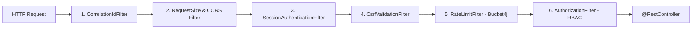

# API 01. REST Conventions, Filter Pipeline & Common Schemas

> **Dự án:** Digital Banking MVP
> **Mã tài liệu:** `BE-API-01`
> **Phiên bản:** 1.0
> **Ngày:** 07/11/2026
> **Trạng thái:** Hoàn thành
> **Nguồn tham chiếu:** [[digitalbanking-docs/docs-common/07. API contracts.md]], [[digitalbanking-docs/openapi/digital-banking-v1.yaml]]

---

## 1. Quy ước Giao thức & Kiểu dữ liệu JSON

| Chủ đề | Quy ước bắt buộc tại tầng `@RestController` / Jackson |
|---|---|
| **Base Path** | `/api/v1` |
| **Content-Type** | Request/Response thường: `application/json; charset=utf-8`<br/>Error response: `application/problem+json; charset=utf-8` |
| **ID (`BIGINT`)** | Luôn serialize thành **`String`** trong JSON (ví dụ `"3001"`, regex `^[1-9][0-9]{0,18}$`) để tránh tràn số `MAX_SAFE_INTEGER` của JavaScript |
| **Tiền tệ (`Money`)** | Luôn serialize/deserialize dạng **`String` thập phân** (ví dụ `"150000.00"`, regex `^(0\|[1-9][0-9]{0,16})\.[0-9]{2}$`). **Không tự động làm tròn** nếu client gửi quá 2 chữ số thập phân -> trả `400 VALIDATION_ERROR` |
| **Thời gian (`Instant`)** | ISO-8601 UTC có hậu tố `Z` (ví dụ `"2026-11-03T10:15:30Z"`) |
| **Ngày nghiệp vụ (`LocalDate`)** | `YYYY-MM-DD` (ví dụ `"2026-11-03"`, tính theo `Asia/Ho_Chi_Minh`) |
| **Cache Header** | Mọi API trả dữ liệu tài chính/PII phải gắn `Cache-Control: no-store`, `Pragma: no-cache` |

---

## 2. Thứ tự Chuỗi Filter (Spring Security & Servlet Filter Pipeline)

Mọi HTTP request đi vào `/api/v1/**` phải đi qua chuỗi filter theo đúng thứ tự ưu tiên sau:



### Chi tiết trách nhiệm từng Filter:
1. **`CorrelationIdFilter` (`Ordered.HIGHEST_PRECEDENCE`):**
   - Đọc header `X-Correlation-ID`.
   - Nếu có: kiểm tra regex `^[A-Za-z0-9._:-]{1,64}$`. Nếu sai định dạng -> trả ngay `400 VALIDATION_ERROR` (chống Log Injection).
   - Nếu không có: sinh `UUID.randomUUID().toString()`.
   - Đặt vào `MDC.put("correlationId", id)`, `RequestContext` và luôn gắn vào response header `X-Correlation-ID` (kể cả khi lỗi).
2. **`SessionAuthenticationFilter`:**
   - Trích xuất opaque session token từ Cookie `DB_SESSION` (ưu tiên cho SPA) hoặc header `Authorization: Bearer <token>` (cho API test/automation).
   - Tính `SHA-256` hex của token, tra bảng `banking.session`.
   - Kiểm tra `status == 'ACTIVE'`, `now < idle_expires_at` và `now < absolute_expires_at`.
   - Nếu quá hạn -> cập nhật `status = 'EXPIRED'`, trả `401 AUTH_SESSION_EXPIRED`.
   - Nếu hợp lệ -> trượt `last_activity_at = now` và `idle_expires_at = now + 15m`, nạp `AuthPrincipal(userId, customerId, userType, roles, privileges)` vào `SecurityContextHolder`.
3. **`CsrfValidationFilter`:**
   - Chỉ kích hoạt khi request xác thực bằng **Cookie `DB_SESSION`** và method là `POST`, `PUT`, `PATCH`, `DELETE` (trừ các endpoint public `/auth/login`, `/auth/passcode`, `/auth/fido/verify`, `/auth/otp/verify`).
   - So sánh header `X-CSRF-Token` với token gắn kèm session. Nếu thiếu hoặc sai -> trả `403 AUTH_FORBIDDEN`.
   - Nếu request xác thực bằng `Authorization: Bearer` -> bỏ qua kiểm tra CSRF.
4. **`RateLimitFilter` (Bucket4j):**
   - Áp dụng giới hạn theo cấu hình:
     - `POST /auth/login`: `10 req/phút` theo `IP + username`
     - `POST /auth/otp/verify`, `/auth/step-up/verify`: `20 req/phút` theo `user/IP`
     - `POST /transfers`: `30 req/phút` theo `customerId`
     - `GET /audit/export`: `5 req/giờ` theo `userId`
     - Global API: `120 req/phút` theo `userId/IP`
   - Khi vượt ngưỡng -> trả `429 RATE_LIMITED` kèm header `Retry-After: <seconds>`.

---

## 3. Quy ước Header Chuẩn

| Tên Header | Chiều | Bắt buộc? | Quy tắc kiểm tra / Xử lý |
|---|---|---|---|
| `X-Correlation-ID` | Req / Res | Bắt buộc ở Response | Regex `^[A-Za-z0-9._:-]{1,64}$` |
| `Idempotency-Key` | Request | Bắt buộc cho `POST /transfers` | Regex `^[A-Za-z0-9._:~-]{1,255}$`; thiếu hoặc sai -> `400 VALIDATION_ERROR` |
| `Idempotent-Replayed` | Response | Khi replay transfer | Giá trị `"true"` khi response lấy từ `idempotency_record` |
| `X-CSRF-Token` | Request | Khi dùng Cookie + State-changing | Khớp CSRF token của phiên hiện tại |
| `X-Step-Up-Challenge` | Request | Khi gọi lại Sensitive Action sau `428` | UUID của `auth_challenge` đã `VERIFIED` (`purpose = SENSITIVE_ACTION`) |
| `Retry-After` | Response | Khi trả `409 IN_PROGRESS` hoặc `429` | Số giây nguyên (ví dụ: `2` hoặc `60`) |

---

## 4. Danh mục Toàn bộ 30 Endpoints & Phân quyền

| API ID | Method | Path | Module xử lý | Role / Quyền truy cập |
|---|---|---|---|---|
| `API-AUTH-01` | `POST` | `/api/v1/auth/login` | `identity` | Public |
| `API-AUTH-02` | `POST` | `/api/v1/auth/passcode` | `identity` | Public (Trusted device) |
| `API-AUTH-03` | `POST` | `/api/v1/auth/fido/verify` | `identity` | Public (Trusted device) |
| `API-AUTH-04` | `POST` | `/api/v1/auth/otp/verify` | `identity` | Public (`LOGIN_NEW_DEVICE`) |
| `API-AUTH-05` | `POST` | `/api/v1/auth/step-up/verify` | `identity` | Authenticated (`self`) |
| `API-AUTH-06` | `POST` | `/api/v1/auth/logout` | `identity` | Authenticated (`self`) |
| `API-AUTH-07` | `GET` | `/api/v1/auth/session` | `identity` | Authenticated (`self`) |
| `API-AUTH-08` | `POST` | `/api/v1/auth/challenges/{challengeId}/resend` | `identity` | Public / Authenticated |
| `API-CUS-01` | `GET` | `/api/v1/customers/me` | `customer` | `CUSTOMER` (`self`) |
| `API-ACC-01` | `GET` | `/api/v1/accounts` | `account` | `CUSTOMER` (`self`) |
| `API-ACC-02` | `GET` | `/api/v1/accounts/{accountId}` | `account` | `CUSTOMER` (`self`), `OPERATIONS`, `ADMIN`, `AUDITOR` |
| `API-ADM-01` | `GET` | `/api/v1/admin/customers/{customerId}` | `admin` / `customer` | `OPERATIONS`, `ADMIN`, `AUDITOR` |
| `API-ADM-02` | `GET` | `/api/v1/admin/customers/{customerId}/accounts` | `admin` / `account` | `OPERATIONS`, `ADMIN`, `AUDITOR` |
| `API-TRF-01` | `POST` | `/api/v1/transfers` | `transfer` | `CUSTOMER` (`self` source account) |
| `API-TRF-02` | `GET` | `/api/v1/transfers/{reference}` | `transfer` | `CUSTOMER` (`self`), `OPERATIONS`, `ADMIN`, `AUDITOR` |
| `API-TXN-01` | `GET` | `/api/v1/transactions` | `transfer` | `CUSTOMER` (`self`), `OPERATIONS`, `ADMIN`, `AUDITOR` |
| `API-TXN-02` | `GET` | `/api/v1/transactions/{reference}` | `transfer` | `CUSTOMER` (`self`), `OPERATIONS`, `ADMIN`, `AUDITOR` |
| `API-LIM-01` | `GET` | `/api/v1/limits` | `limit` | `CUSTOMER` (`self`) |
| `API-LIM-02` | `POST` | `/api/v1/admin/limits` | `admin` / `limit` | `OPERATIONS`, `ADMIN` (Maker) |
| `API-LIM-03` | `POST` | `/api/v1/admin/limits/{id}/approve` | `admin` / `limit` | `OPERATIONS`, `ADMIN` + `CHECKER` privilege |
| `API-AUD-01` | `GET` | `/api/v1/audit` | `audit` | `OPERATIONS`, `ADMIN`, `AUDITOR` |
| `API-AUD-02` | `GET` | `/api/v1/audit/{auditId}` | `audit` | `OPERATIONS`, `ADMIN`, `AUDITOR` |
| `API-AUD-03` | `GET` | `/api/v1/audit/export` | `audit` | `AUDITOR` (`AUDIT_EXPORT`) |
| `API-FRD-01` | `GET` | `/api/v1/fraud-flags` | `fraud` | `OPERATIONS`, `ADMIN`, `AUDITOR` |
| `API-FRD-02` | `POST` | `/api/v1/fraud-flags/{id}/review` | `fraud` | `OPERATIONS` (`FRAUD_REVIEW`) |
| `API-ROL-01` | `POST` | `/api/v1/admin/roles` | `admin` / `identity` | `ADMIN` (Maker) |
| `API-ROL-02` | `POST` | `/api/v1/admin/roles/{id}/approve` | `admin` / `identity` | `ADMIN` + `CHECKER` privilege |
| `API-APR-01` | `GET` | `/api/v1/admin/approvals` | `admin` | `OPERATIONS`, `ADMIN` |
| `API-APR-02` | `GET` | `/api/v1/admin/approvals/{approvalId}` | `admin` | `OPERATIONS`, `ADMIN` |
| `API-HLT-01` | `GET` | `/api/v1/health` | `common` | `ADMIN`, `AUDITOR` (Actuator `/actuator/health` riêng cho Docker) |

---

## 5. Quy ước Phân trang (`PageResponse<T>`) & Lọc

### 5.1. Query Parameters chuẩn cho API danh sách
- `page`: `int`, mặc định `0` (`>= 0`, 0-based).
- `size`: `int`, mặc định `20` (`1 <= size <= 100`; vượt quá `100` -> `400 VALIDATION_ERROR`).
- `sort`: `String` theo cú pháp `field,asc|desc`. **Bắt buộc kiểm tra Whitelist theo từng endpoint** (nếu gửi field ngoài whitelist -> `400 VALIDATION_ERROR`):
  - `/api/v1/transactions`: `createdAt`, `amount` (mặc định `createdAt,desc`)
  - `/api/v1/audit`: `occurredAt` (mặc định `occurredAt,desc`)
  - `/api/v1/fraud-flags`: `createdAt`, `severity` (mặc định `createdAt,desc`)
  - `/api/v1/admin/approvals`: `createdAt` (mặc định `createdAt,desc`)
- `from`, `to`: `Instant` (`from < to`, khoảng cách tối đa `366 ngày`; `from` inclusive, `to` exclusive).

### 5.2. Cấu trúc JSON `PageResponse<T>`
```json
{
  "items": [ ... ],
  "page": {
    "number": 0,
    "size": 20,
    "totalElements": 42,
    "totalPages": 3,
    "first": true,
    "last": false
  },
  "asOf": "2026-11-03T10:15:30Z"
}
```
