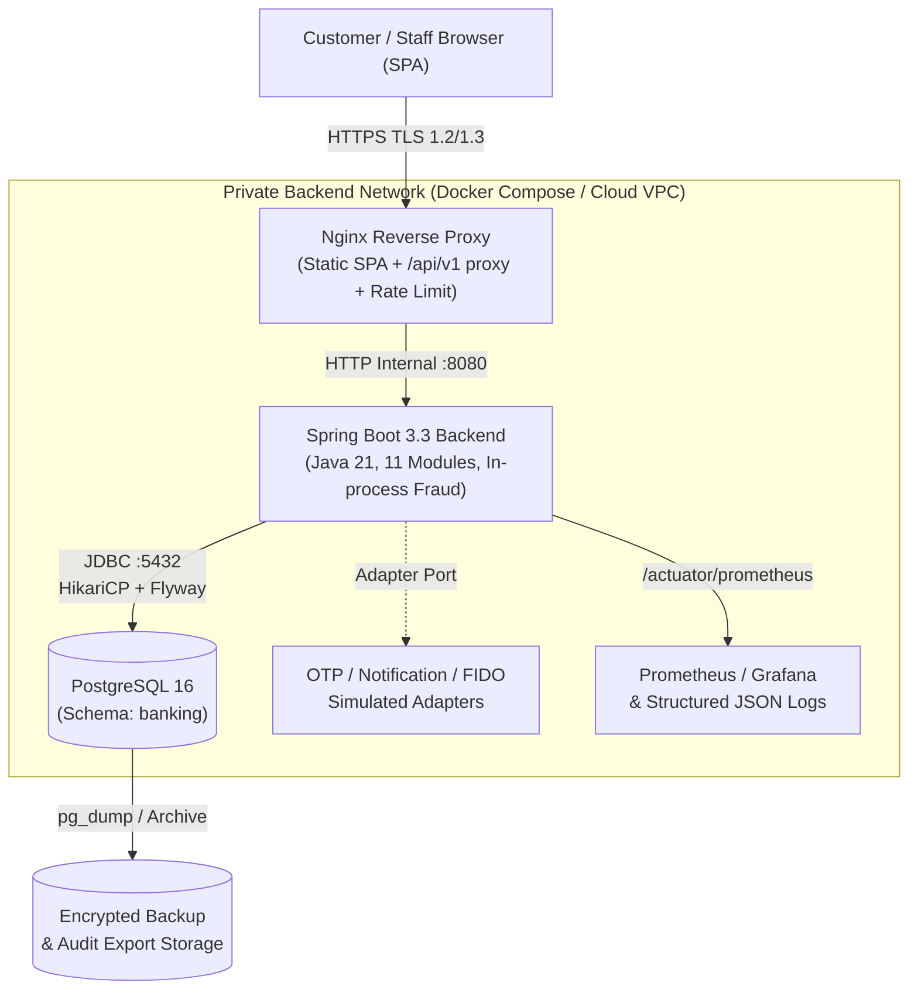

# Backend Deployment & Runtime Operations (`docs-backend/deployment/`)

> **Dự án:** Digital Banking MVP (Single-Bank, Core Simulated)
> **Mã tài liệu:** `BE-DEP-01`
> **Phiên bản:** v1.0
> **Ngày cập nhật:** 09/11/2026
> **Trạng thái:** Hoàn thành — Tài liệu triển khai & vận hành Backend chuẩn
> **Nguồn tham chiếu:** [[digitalbanking-docs/docs-common/05. Technical stack.md]], [[digitalbanking-docs/docs-common/06. System architecture.md]] (§11, §12), [[digitalbanking-docs/docs-common/08. Deployment infrastructure.md]], [[digitalbanking-docs/docs-common/10 Master timelines.md]] (W7–W8), [[digitalbanking-docs/docs-common/11. Resource & Staffing Plan.md]] (§8), [[digitalbanking-docs/docs-common/design/01. audit-traceability.md]] (§12), [[digitalbanking-docs/docs-common/design/02. consistency-concurrency.md]] (§11, §13), [[digitalbanking-docs/docs-common/design/04. security.md]] (§6, §9)

---

## 1. Mục đích và Phạm vi

Thư mục `docs-backend/deployment/` đặc tả cách ứng dụng **Backend Spring Boot Modular Monolith** và cơ sở dữ liệu **PostgreSQL 16** được cấu hình, đóng gói, khởi chạymigration, giám sát (observability), sao lưu/phục hồi và vận hành xử lý sự cố qua các môi trường `local`, `test` và `demo`/Cloud (theo mốc W7–W8 của [[digitalbanking-docs/docs-common/10 Master timelines.md]]).

Tài liệu này cụ thể hóa các yêu cầu và hợp đồng vận hành từ [[digitalbanking-docs/docs-common/08. Deployment infrastructure.md]] sang cấu hình thực thi của Backend mà không làm thay đổi bất kỳ quy tắc nghiệp vụ nào trong `docs-common/`.

---

## 2. Kiến trúc Triển khai & Ranh giới Mạng (`Logical Topology`)



### Quy tắc Ranh giới Mạng (`Network Boundary Rules` — `08` §3.3)
1. **Không phơi bày trực tiếp Backend & Database ra Public Internet:** Mọi lưu lượng từ trình duyệt đi qua HTTPS tại Nginx Reverse Proxy. PostgreSQL (`5432`) chỉ lắng nghe trong mạng nội bộ (`private service network`) và chỉ cho phép kết nối từ container/instance của Backend.
2. **Bảo vệ Actuator Endpoints (`06` §5.3, `08` §3.3):**
   - Chỉ mở công khai `/actuator/health` (hoặc `/api/v1/health`) với thông tin trạng thái tối giản (`UP`/`DOWN`), tuyệt đối không lộ cấu hình hay chuỗi kết nối.
   - Các endpoint `/actuator/prometheus`, `/actuator/metrics`, `/actuator/info` chỉ được truy cập từ mạng nội bộ hoặc yêu cầu quyền quản trị hệ thống.

---

## 3. Mô hình Môi trường (`Environment Matrix` — `08` §4)

| Môi trường | Spring Profile | Mục đích sử dụng | Đặc điểm Dữ liệu & Adapter | Quản lý Bí mật (Secrets) |
|---|---|---|---|---|
| **`local`** | `local` | Phát triển cá nhân trên máy lập trình viên | PostgreSQL Docker local; dữ liệu seed giả lập (synthetic); OTP/Notification ghi ra log/simulator | File `.env` cục bộ (nằm trong `.gitignore`, khởi tạo từ `.env.example`) |
| **`test`** | `test` | Chạy tự động Unit, Slice, Integration, Concurrency & Failure Injection tests | **Testcontainers PostgreSQL 16** dùng một lần (disposable); đồng hồ `Clock` cố định; cho phép tiêm lỗi (`@SpyBean`) | Sinh tự động trong bộ nhớ khi chạy test; cô lập hoàn toàn khỏi DB chung |
| **`demo` / Cloud** | `demo` | Triển khai W7–W8, chạy nghiệm thu `D1–D5` và trình diễn trên lớp | PostgreSQL bền vững có sao lưu trước giờ demo; dữ liệu hoàn toàn giả lập (`NFR-032`, `CON-006`) | Biến môi trường của nền tảng Cloud / Docker Secrets; kiểm tra **Fail-fast** khi khởi động |

---

## 4. Quản lý Cấu hình & Biến Môi trường (`.env` & `application.yml`)

### 4.1. Danh mục Biến Môi trường Chuẩn (`.env.example`)

Tuân thủ quy tắc bảo mật `08` §6.1 và `design/04` §6.4: Không bao giờ commit mật khẩu, khóa AES/HMAC hay token vào Git. Ứng dụng bắt buộc dừng khởi động ngay (**Fail-fast**) nếu thiếu các biến bắt buộc dưới đây trên môi trường `demo`:

```dotenv
# =====================================================================
# 1. RUNTIME & ENVIRONMENT
# =====================================================================
SPRING_PROFILES_ACTIVE=local
SERVER_PORT=8080
APP_TIMEZONE=Asia/Ho_Chi_Minh

# =====================================================================
# 2. POSTGRESQL DATABASE (Tách biệt tài khoản Migration và Runtime)
# =====================================================================
DB_HOST=localhost
DB_PORT=5432
DB_NAME=digital_banking

# Tài khoản runtime của ứng dụng (Least-privilege: KHÔNG có quyền DDL,
# KHÔNG có quyền UPDATE/DELETE trên ledger_entry và audit_log)
DB_APP_USER=banking_app
DB_APP_PASSWORD=change_me_local_app_pwd

# Tài khoản chuyên chạy Flyway migration lúc khởi động (Có quyền DDL trên schema banking)
DB_MIGRATION_USER=banking_migrator
DB_MIGRATION_PASSWORD=change_me_local_migrator_pwd

# =====================================================================
# 3. CRYPTOGRAPHIC KEYS (Base64-encoded 32-byte / 256-bit keys)
# Sinh khóa mới bằng lệnh: openssl rand -base64 32
# =====================================================================
APP_PII_AES_KEY_ID=k-v1
APP_PII_AES_KEY_BASE64=MDEyMzQ1Njc4OWFiY2RlZjAxMjM0NTY3ODlhYmNkZWY=
APP_HMAC_KEY_BASE64=fedcba9876543210fedcba9876543210fedcba98765=

# =====================================================================
# 4. WEB, SESSION & CORS BOUNDARY
# =====================================================================
APP_COOKIE_SECURE=false
APP_CORS_ALLOWED_ORIGINS=http://localhost:5173,https://localhost:8443
```

### 4.2. Cấu hình Chuẩn `src/main/resources/application.yml`

Toàn bộ các ngưỡng nghiệp vụ/vận hành có đánh dấu `(đề xuất)` trong `docs-common/` được ngoại hóa thành `@ConfigurationProperties(prefix = "app")` để server làm chủ chính sách (`08` §5.2) mà không hard-code trong mã nguồn:

```yaml
spring:
  application:
    name: digital-banking-backend

  datasource:
    url: jdbc:postgresql://${DB_HOST:localhost}:${DB_PORT:5432}/${DB_NAME:digital_banking}?currentSchema=banking
    username: ${DB_APP_USER}
    password: ${DB_APP_PASSWORD}
    hikari:
      pool-name: BankingHikariPool
      maximum-pool-size: ${DB_POOL_MAX_SIZE:20}
      minimum-idle: ${DB_POOL_MIN_IDLE:5}
      connection-timeout: 3000         # Chờ lấy connection tối đa 3 giây
      validation-timeout: 1000
      max-lifetime: 1800000            # 30 phút
      auto-commit: false               # Bắt buộc tắt auto-commit để kiểm soát rõ T0, T1, T2
      leak-detection-threshold: 10000  # Cảnh báo nếu giữ connection > 10 giây

  jpa:
    open-in-view: false                # BẮT BUỘC false: Tránh giữ connection DB ở tầng Controller/View
    hibernate:
      ddl-auto: validate               # BẮT BUỘC validate: Không bao giờ để Hibernate tự tạo/sửa bảng
    properties:
      hibernate.jdbc.time_zone: UTC

  flyway:
    enabled: true
    schemas: banking
    default-schema: banking
    user: ${DB_MIGRATION_USER}
    password: ${DB_MIGRATION_PASSWORD}
    locations: classpath:db/migration
    validate-on-migrate: true
    out-of-order: false

  jackson:
    deserialization:
      fail-on-unknown-properties: true # Chống Mass Assignment
    serialization:
      write-dates-as-timestamps: false

server:
  port: ${SERVER_PORT:8080}
  shutdown: graceful
  forward-headers-strategy: framework

management:
  endpoints:
    web:
      base-path: /actuator
      exposure:
        include: health,info,prometheus,metrics
  endpoint:
    health:
      show-details: never              # Không lộ chi tiết hạ tầng ra public health check
      probes:
        enabled: true

# =====================================================================
# CẤU HÌNH NGHIỆP VỤ & VẬN HÀNH NGOẠI HÓA (@ConfigurationProperties)
# =====================================================================
app:
  timezone: ${APP_TIMEZONE:Asia/Ho_Chi_Minh}
  crypto:
    aes-key-id: ${APP_PII_AES_KEY_ID:k-v1}
    aes-key-base64: ${APP_PII_AES_KEY_BASE64}
    hmac-key-base64: ${APP_HMAC_KEY_BASE64}
  security:
    cookie-secure: ${APP_COOKIE_SECURE:false}
    cors-allowed-origins: ${APP_CORS_ALLOWED_ORIGINS:http://localhost:5173}
    session:
      idle-timeout-minutes: 15
      absolute-timeout-hours: 8
      max-concurrent-sessions-customer: 3
      max-concurrent-sessions-staff: 1
    lockout:
      max-failed-attempts: 5
      lock-duration-minutes: 15
    otp:
      ttl-seconds: 120                 # Baseline OTP 120s-300s tùy loại challenge cấu hình
      max-verify-attempts: 5
      resend-cooldown-seconds: 60
      max-resend-count: 3
  transfer:
    min-amount-vnd: 2000               # Theo baseline 2,000 - 10,000,000 VND (có thể mở rộng theo limit_config)
    max-amount-vnd: 10000000
    single-step-up-threshold-vnd: 5000000
    daily-step-up-threshold-vnd: 20000000
    daily-cap-vnd: 50000000
    idempotency-ttl-hours: 24
    t2-lock-timeout-ms: 2000           # SET LOCAL lock_timeout = '2s'
    t2-statement-timeout-ms: 5000      # SET LOCAL statement_timeout = '5s'
    fraud-eval-timeout-ms: 1000        # Ngân sách tối đa 1s cho in-process fraud engine trong T2
  fraud:
    velocity-count: 3
    velocity-window-seconds: 120
    warning-ttl-minutes: 15
    review-timeout-minutes: 30
  jobs:
    reconciliation-interval-ms: 30000  # Quét transfer PENDING mỗi 30 giây
    pending-transfer-min-age-seconds: 15
    pending-transfer-max-age-seconds: 300
    outbox-poll-interval-ms: 2000      # Quét notification outbox mỗi 2 giây
    outbox-batch-size: 50
    outbox-lease-seconds: 30
    audit-verify-cron: "0 */15 * * * *" # Kiểm định chuỗi băm audit mỗi 15 phút
    retention-cleanup-cron: "0 0 * * * *"
```

---

## 5. Chính sách Database Migration, Phân quyền DB & Sao lưu Phục hồi (`08` §8)

### 5.1. Quy tắc Thứ tự Flyway Migration (`Forward-Only` — `08` §8.1)

Schema cơ sở dữ liệu được quản lý độc quyền bởi Flyway theo nguyên tắc **Forward-only** (tuyệt đối không sửa file migration đã chạy; mọi thay đổi phải tạo file `V<N+1>__...sql` mới):

| Thứ tự Migration | Tên File Chuẩn (Gợi ý) | Nội dung Thực thi (`08` §8.1) |
|---|---|---|
| `V1` | `V1__init_schema_and_extensions.sql` | Tạo schema `banking`, cài đặt extension `pgcrypto` (nếu cần), hàm tiện ích `updated_at`. |
| `V2` | `V2__create_identity_and_rbac_tables.sql` | Tạo các bảng định danh & phân quyền: `app_user` (`users`), `role`, `permission`, `user_role`, `role_permission`, `user_privilege`, `device`, `session`, `auth_challenge`, `auth_attempt`, `password_history`. |
| `V3` | `V3__create_customer_and_account_tables.sql` | Tạo bảng `customer` và `account` cùng các ràng buộc `CHECK (available_balance >= 0)`, `CHECK (ledger_balance >= 0)`. |
| `V4` | `V4__create_transfer_ledger_and_idempotency_tables.sql` | Tạo bảng `transfer`, `ledger_entry`, `idempotency_record` cùng ràng buộc cặp bút toán kép `(transfer_id, entry_seq)`. |
| `V5` | `V5__create_limit_admin_fraud_audit_notification_tables.sql` | Tạo bảng `limit_config`, `limit_usage`, `approval_request`, `fraud_rule_config`, `fraud_flag`, `audit_log`, `audit_chain_checkpoint`, `legal_hold`, `retention_policy`, `notification`. |
| `V6` | `V6__create_immutability_triggers_and_indexes.sql` | Tạo PL/pgSQL Triggers chặn `UPDATE`/`DELETE` trên `ledger_entry` và `audit_log`; tạo các Partial Unique Indexes và Composite Indexes; cấp quyền tối thiểu cho `banking_app`. |
| `R` / `dev-seed` | `db/seed/R__synthetic_demo_seed.sql` | Chỉ chạy trên môi trường `local`/`demo`: nạp dữ liệu giả lập (Roles, Permissions, Global Limits, Fraud Rules, tài khoản Customer & Staff mẫu). |

### 5.2. Phân tách Quyền hạn Tài khoản Database (`Least Privilege`)

```sql
-- Thực thi trong script khởi tạo DB container (init-db.sql)
GRANT USAGE ON SCHEMA banking TO banking_app;
GRANT SELECT, INSERT, UPDATE, DELETE ON ALL TABLES IN SCHEMA banking TO banking_app;
GRANT USAGE, SELECT ON ALL SEQUENCES IN SCHEMA banking TO banking_app;

-- BẮT BUỘC: Thu hồi quyền sửa/xóa trên 2 bảng bằng chứng bất biến (design/01 & design/02)
REVOKE UPDATE, DELETE, TRUNCATE ON banking.ledger_entry FROM banking_app;
REVOKE UPDATE, DELETE, TRUNCATE ON banking.audit_log FROM banking_app;
```

### 5.3. Quy trình Sao lưu & Phục hồi (`Backup & Disaster Recovery` — `08` §8.3–8.5)

1. **Sao lưu bắt buộc trước khi chạy Migration hoặc Demo (`Pre-Demo Backup`):**
   ```bash
   # Tạo bản sao lưu logic kèm mã kiểm tra SHA-256 bên ngoài runtime volume
   BACKUP_FILE="backups/digital_banking_$(date -u +%Y%m%dT%H%M%SZ).dump"
   pg_dump -h "$DB_HOST" -p "$DB_PORT" -U "$DB_MIGRATION_USER" -d "$DB_NAME" -n banking -Fc -f "$BACKUP_FILE"
   sha256sum "$BACKUP_FILE" > "${BACKUP_FILE}.sha256"
   ```
2. **Kiểm chứng sau khi Khôi phục (`Post-Restore Verification`):**
   Bất kỳ lần khôi phục DB nào cũng chỉ được coi là thành công sau khi chạy 3 bước kiểm tra:
   - Kiểm tra trạng thái Flyway: `./mvnw flyway:info` (không có migration lỗi hoặc lệch checksum).
   - Chạy truy vấn đối soát bất biến tài chính: không có tài khoản âm tiền, `available_balance == ledger_balance`, tổng `DEBIT == CREDIT` trên mọi giao dịch `COMPLETED`.
   - Chạy kiểm định chuỗi băm `audit_log` (`AuditVerificationJob`): xác nhận chuỗi `prev_hash -> record_hash` liên tục, không đứt gãy.

---

## 6. Hợp đồng Quan sát Hệ thống (`Observability Contract` — `08` §9)

### 6.1. Health Check Contract (`/api/v1/health` & `/actuator/health`)

- Khi ứng dụng và kết nối PostgreSQL hoạt động bình thường: trả về HTTP `200 OK` với `{"status": "UP"}`.
- Khi mất kết nối PostgreSQL hoặc pool cạn kiệt không thể thực thi truy vấn kiểm tra (`SELECT 1`): trả về HTTP `503 Service Unavailable` với `{"status": "DOWN"}` để Nginx ngừng định tuyến request mới và hệ thống chuyển sang trạng thái **Fail-closed**.

### 6.2. Chuẩn Structured JSON Logging & Vệ sinh Log (`Log Hygiene`)

Mọi dòng log xuất ra `stdout` phải ở dạng JSON 1 dòng kèm đầy đủ các trường truy vết từ MDC:
- **Các trường bắt buộc (`08` §9.2):** `timestamp` (UTC ISO-8601), `level`, `service`, `environment`, `correlation_id`, `request_id`, `user_id` (đã ẩn hoặc chỉ ID nội bộ), `route`, `http_status`, `action`, `outcome`, `latency_ms`, `error_code`, `audit_id` (nếu có).
- **Danh mục cấm tuyệt đối trong Log (`NFR-020`):** Mật khẩu, PIN, mã OTP, giá trị cookie `SESSION_TOKEN`, `X-CSRF-Token`, khóa mã hóa `APP_PII_AES_KEY_BASE64` / `APP_HMAC_KEY_BASE64`, số tài khoản đầy đủ, số CCCD/CMND, số điện thoại/email đầy đủ.

### 6.3. Danh mục Micrometer Metrics & Ngưỡng Cảnh báo (`Alerts` — `08` §9.3–9.4)

> **Quy tắc nhãn (Tag Cardinality):** Tuyệt đối không gắn `accountId`, `userId`, `correlationId`, `idempotencyKey` hay `reference` vào nhãn của Prometheus metrics.

| Nhóm | Tên Metric Chuẩn | Tín hiệu Đo lường | Ngưỡng Cảnh báo & Runbook |
|---|---|---|---|
| **HTTP & Latency** | `http_server_requests_seconds` | Tốc độ request, tỷ lệ lỗi 5xx, độ trễ `p95`/`p99` | Transfer `p95 > 2s` hoặc `p99 > 5s` hoặc lỗi `> 1%` trong 5 phút (`NFR-001..004`) |
| **Transfer** | `banking_transfer_total{status,failure_code}`<br>`banking_transfer_pending_oldest_age_seconds` | Số lượng giao dịch theo trạng thái; tuổi của giao dịch `PENDING` lâu nhất | Cảnh báo `HIGH` nếu `pending_oldest_age_seconds > 300s` $\rightarrow$ chạy **`R-CON-01`** |
| **Idempotency** | `banking_idempotency_events_total{outcome}` | Tỷ lệ `NEW`, `REPLAY`, `CONFLICT`, `IN_PROGRESS`, `STUCK` | Cảnh báo `HIGH` nếu bản ghi kẹt ở `RECEIVED`/`IN_PROGRESS` quá ngưỡng $\rightarrow$ chạy **`R-CON-02`** |
| **Concurrency & Pool** | `banking_db_lock_error_total{type}`<br>`hikaricp_connections_active` | Số lỗi `DEADLOCK` (`40P01`), `LOCK_TIMEOUT` (`55P03`); tỷ lệ sử dụng connection pool | Cảnh báo `HIGH` khi có deadlock hoặc pool active `> 80%` $\rightarrow$ chạy **`R-CON-03`**, **`R-CON-07`** |
| **Audit Integrity** | `banking_audit_write_total{class,outcome}`<br>`banking_audit_chain_invalid_total` | Lỗi ghi audit `C1`/`C2`/`C3`; phát hiện sai lệch chuỗi băm `record_hash` | Cảnh báo `CRITICAL` ngay khi `outcome="FAILURE"` hoặc `chain_invalid > 0` $\rightarrow$ chạy **`R-AUD-01`**, **`R-AUD-02`** |
| **Fraud & Outbox** | `banking_fraud_evaluation_total{outcome}`<br>`banking_notification_backlog_count` | Số cờ gian lận theo rule, lỗi engine (`FAIL_OPEN`); số thông báo tồn đọng | Cảnh báo `MEDIUM` khi backlog thông báo tăng cao $\rightarrow$ chạy **`R-CON-06`** |

---

## 7. Cổng Kiểm soát Phát hành (`Release Gates`) & Quy trình Rollback (`08` §7)

### 7.1. Danh mục Kiểm tra Trước Khi Deploy (`Pre-Release Gate Checklist`)

1. **Gate 1 — Hợp đồng API (`API Contract`):** Đặc tả trong `07. API contracts.md` và `openapi/digital-banking-v1.yaml` khớp với các Controller/DTO triển khai.
2. **Gate 2 — Database Migration:** Toàn bộ script Flyway chạy sạch từ đầu trên một PostgreSQL container trống và vượt qua kiểm tra `ddl-auto: validate`.
3. **Gate 3 — Kiểm thử Tự động & Bất biến Tài chính:** Vượt qua bộ test Unit, Integration, Concurrency (`D1`), Idempotency (`D2`), Recovery (`D3`) và Security/Audit (`D4`).
4. **Gate 4 — Kiểm tra Bảo mật Cấu hình (`DVT-001`, `DVT-008`):** Không có secret trong Git/Docker image; tài khoản DB runtime là `banking_app` (least privilege).
5. **Gate 5 — Smoke Test sau Deploy (`DVT-003`):** Kiểm tra `/api/v1/health` trả về `UP`, đăng nhập thử nghiệm thành công và thực hiện 1 giao dịch chuyển tiền mẫu ghi nhận đủ Ledger + Audit.

### 7.2. Chính sách Rollback An toàn (`Rollback Policy` — `08` §7.3)

- **Rollback Ứng dụng:** Chuyển về container image / bản build bất biến đã được nghiệm thu liền trước đó.
- **Không tự động đảo ngược Database Migration đã áp dụng:** Không bao giờ xóa hoặc sửa các bảng/cột đã có dữ liệu giao dịch bằng cách sửa migration cũ. Nếu bản phát hành mới gây lỗi tương thích schema, dừng nhận lưu lượng mới (bật chế độ bảo trì tại Nginx), lưu giữ toàn bộ bằng chứng log/audit và khôi phục từ bản sao lưu trước khi nâng cấp hoặc chạy một **forward compensating migration** đã được kiểm duyệt.
- **Nguyên tắc tối thượng về tiền tệ:** Không bao giờ dùng câu lệnh SQL thủ công để cập nhật `transfer.status = 'COMPLETED'` khi chưa có đủ cặp bút toán `ledger_entry` và bản ghi `audit_log` hợp lệ.

---

## 8. Tóm tắt Sổ tay Xử lý Sự cố (`Incident Runbooks` — `08` §10)

| Mã Runbook | Tình huống Sự cố | Quy trình Xử lý Chuẩn cho Backend Operator |
|---|---|---|
| **`R-CON-01`** | **Giao dịch kẹt ở `PENDING` quá 5 phút** | 1. Tra cứu `transfer`, `idempotency_record`, `ledger_entry`, `audit_log` theo `reference` / `correlation_id`.<br>2. Nếu chưa có `ledger_entry`: giữ nguyên trạng thái chưa hoàn tất, để `TransferReconciliationJob` chạy lại hoặc hướng dẫn client retry với cùng `Idempotency-Key`.<br>3. Tuyệt đối không báo thành công giả cho khách hàng. |
| **`R-CON-02`** | **Bản ghi Idempotency bị kẹt (`RECEIVED`)** | 1. Kiểm tra giao dịch liên kết đã commit hay rollback.<br>2. Không tạo lệnh chuyển tiền mới bằng `Idempotency-Key` khác khi chưa rõ kết quả của khóa cũ; sử dụng cơ chế Resume/Reconcile theo đúng khóa gốc. |
| **`R-CON-03`** | **Xảy ra Deadlock (`40P01`) hoặc Lock Timeout (`55P03`)** | 1. Kiểm tra mọi luồng khóa nhiều tài khoản đã tuân thủ `ORDER BY account_id ASC FOR UPDATE` chưa.<br>2. Kiểm tra khóa `limit_usage` đã theo thứ tự `CUSTOMER` trước, `ACCOUNT` sau chưa.<br>3. Chỉ cho phép retry có giới hạn với cùng `Idempotency-Key`. |
| **`R-CON-04`** | **Lệch số dư tài khoản và sổ cái (`Ledger Mismatch`)** | 1. Đóng băng ngay tài khoản bị ảnh hưởng (`FROZEN`) và bảo toàn bằng chứng.<br>2. Không sửa/xóa dòng trong `ledger_entry` hoặc `audit_log`. Thực hiện đối soát và báo cáo sự cố mức `Critical`. |
| **`R-CON-06`** | **Tồn đọng hàng đợi thông báo (`Notification Backlog`)** | 1. Kiểm tra trạng thái `NotificationOutboxWorker` và kết nối tới adapter thông báo.<br>2. Để worker tự động thử lại theo Exponential Backoff; **không bao giờ** đảo ngược hay rollback giao dịch chuyển tiền đã `COMPLETED` vì lỗi gửi thông báo. |
| **`R-CON-07` / `08`** | **Cạn kiệt Connection Pool hoặc Mất kết nối DB** | 1. Chuyển health check sang `DOWN`, trả về `503 SERVICE_UNAVAILABLE` (**Fail-closed**).<br>2. Tìm và hủy các truy vấn treo vượt `statement_timeout`; sau khi DB phục hồi, chạy kiểm tra bất biến trước khi mở lại lưu lượng. |
| **`R-AUD-01` / `02`** | **Lỗi ghi Audit (`AUDIT_WRITE_FAILED`) hoặc Đứt chuỗi băm** | 1. Với `R-AUD-01`: Giao dịch tiền tệ bắt buộc rollback về `PENDING`/`FAILED` (`AC-034`), không hoàn tất khi thiếu bằng chứng audit.<br>2. Với `R-AUD-02`: Dừng ngay lập tức tiến trình `Retention/Purge`, cô lập bản sao lưu `audit_log` và xác định `audit_id` đầu tiên bị lệch mã băm. |
