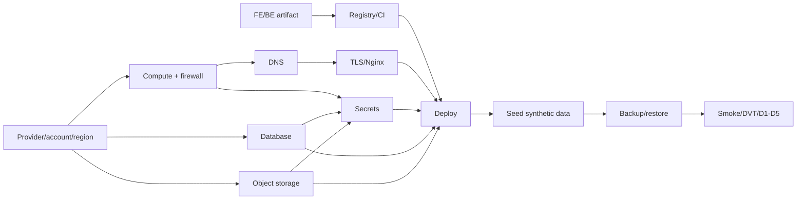

# Cloud Deployment Target — Kế hoạch

> **Mã:** BE-CLOUD-01  
> **Ngày:** 22/11/2026  
> **Trạng thái:** Proposed  
> **Owner:** Infrastructure Lead và Observability/Ops

## 1. Mục tiêu

Xây dựng một Cloud Deployment Target dùng chung cho deploy, demo, verification và handover. Target không phải commercial production; chỉ dùng dữ liệu synthetic, tải thấp và quy mô người dùng nhỏ.

Tài liệu này không thay đổi scope `local`, `test`, `demo`, `production` trong `docs-common`. Cloud target là cách hiện thực deployment cho mục tiêu hiện hành, không tạo thêm môi trường nghiệp vụ.

## 2. In-scope và out-of-scope

| In-scope | Out-of-scope |
|---|---|
| Chọn Cloud service theo capability | Commercial production hardening |
| Compute, PostgreSQL, storage, DNS, TLS | Kubernetes, service mesh |
| Secret, CI/CD, registry, monitoring | Kafka, RabbitMQ, Redis cluster |
| Backup, restore, rollback | Multi-region active-active |
| Health, smoke, DVT, D1–D5 evidence | PCI-DSS/ISO certification |
| Runbook và handover | Core Banking/payment gateway thật |

## 3. Nguyên tắc quyết định

1. Chọn theo capability, không ép dùng cùng một provider.
2. PostgreSQL phải giữ đúng semantics PostgreSQL 16: `JSONB`, advisory lock, `NOWAIT`, `SKIP LOCKED`, Flyway và transaction.
3. Không dùng mock để chứng minh persistence, locking, backup, restore hoặc release readiness.
4. Tối ưu tổng chi phí vận hành, không chỉ giá dịch vụ riêng lẻ.
5. Service phải có đường thay thế và cách kiểm chứng.
6. Không ghi secret, token, OTP, raw PII hoặc credential vào docs/evidence.

## 4. Target topology

```text
Browser
  -> Cloudflare DNS (DNS-only)
  -> AWS EC2 x86_64 public subnet
       -> Nginx + Let's Encrypt :443
            -> Frontend static files
            -> /api/v1 -> Spring Boot Docker container
                              -> Amazon RDS PostgreSQL 16
                              -> simulator adapters

RDS
  -> automated backup/PITR

PostgreSQL
  -> encrypted pg_dump with age
  -> private Amazon S3 bucket

GitHub Actions
  -> GitHub OIDC
  -> AWS IAM deploy role
  -> Amazon ECR immutable image
  -> AWS Systems Manager deployment

AWS CloudWatch
  -> EC2/RDS logs, metrics and alarms
```

EC2 public access exposes only Nginx `80/443`. Do not expose Backend `8080`, RDS `5432` or SSH `22`. RDS uses private subnets across two Availability Zones; baseline RDS deployment is Single-AZ and does not claim HA.

## 5. Dependency graph và thứ tự task



| Task | Depends on | Can run parallel |
|---|---|---|
| Provider/account/region | — | — |
| Compute/firewall | Provider | Database, storage |
| Database | Provider | Compute, storage |
| Object storage | Provider | Compute, database |
| Domain/DNS | Domain/account | Compute, database |
| TLS/Nginx | Compute + DNS | Artifact preparation |
| Secrets | Compute + database + storage | FE/BE build |
| FE/BE artifact | Source/contract | Infrastructure provisioning |
| CI/registry | Repository + artifact | DNS/database |
| Deploy | Compute, DB, DNS/TLS, secrets, artifact | — |
| Seed | Deploy + agreed fixture | — |
| Backup/restore | Seed + storage | — |
| Verification | Deploy + seed + backup/restore | — |

Estimated duration is intentionally not fixed before provider/account access is known. Evidence records actual start/end time and blockers.

### Synthetic seed procedure

- Use approved synthetic seed/API fixture; never production or real customer data.
- Prepare Customer, Operations, Auditor, Admin and separate maker/checker identities.
- Prepare OTP/notification simulator configuration through runtime secret/config channel.
- Record seed version and fixture identifier.
- Verify login, account masking, transfer, fraud and audit smoke after seed.
- Create backup after seed and before destructive verification.

## 6. Decision status

| Hạng mục | Trạng thái ban đầu | Điều kiện `Confirmed` |
|---|---|---|
| Core provider | AWS Managed Core — Proposed | Region, pricing, quota và account đã kiểm tra |
| Compute | AWS EC2 x86_64 — Proposed | Docker, Cloud Firewall/Security Group, SSM và snapshot pass |
| Database | Amazon RDS PostgreSQL 16 — Proposed/conditional | Role, private access, Flyway, locking và restore pass |
| Storage | Amazon S3 — Proposed | Private bucket, versioning, encryption, checksum và restore pass |
| DNS/TLS | Cloudflare DNS + Let's Encrypt/Nginx — Proposed | DNS, HTTPS, renewal và headers pass |
| Secrets | AWS Secrets Manager — Proposed | IAM access, versioning, fail-fast và redaction pass |
| CI/CD | GitHub Actions + OIDC + ECR — Proposed | Build, scan, digest, OIDC và deploy repeatable |
| Observability | CloudWatch + Actuator + k6 — Proposed | Health, log, metric, alarm và D5 evidence pass |


## 7. Acceptance criteria

- Có URL HTTPS ổn định.
- Frontend asset và SPA deep-link hoạt động.
- `/api/v1` proxy tới Backend.
- Artifact có FE SHA, BE SHA và image/JAR digest.
- Flyway chạy sạch trên PostgreSQL 16.
- PostgreSQL không public Internet.
- Secret không xuất hiện trong Git, image, log hoặc evidence.
- Login, account, transfer, step-up, history, fraud và audit chạy đúng phạm vi release.
- Có backup checksum và isolated restore evidence.
- Có restart, rollback và incident runbook.
- Known limitations được ghi rõ.

## 8. Cost control

Không ghi giá cố định nếu chưa kiểm tra pricing tại ngày provision. Evidence phải ghi provider, region, plan, billing unit và thời gian chạy.

```text
Monthly estimate
= compute
+ database
+ object storage
+ backup storage
+ outbound transfer
+ domain/certificate
+ monitoring/add-ons
```

Bật billing alert trước khi tạo resource. Baseline alert:

- `80%` monthly estimate: cảnh báo cho Infrastructure Lead.
- `100%` monthly estimate: cảnh báo và review resource ngay.
- `120%` monthly estimate: giữ trạng thái `NO-GO` cho resource mới, điều tra cost trước.

Recipient, timezone, estimate range và escalation channel phải ghi trong evidence sau khi provider account được tạo. Không tạo resource ngoài decision record.

## 9. Nguồn chuẩn

- `docs-common/05. Technical stack.md`
- `docs-common/06. System architecture.md`
- `docs-common/08. Deployment infrastructure.md`
- `docs-common/09. Test plan.md`
- `docs-backend/deployment/README.md`
- `docs-backend/deployment/configuration.md`
- `docs-backend/deployment/common-readiness.md`
