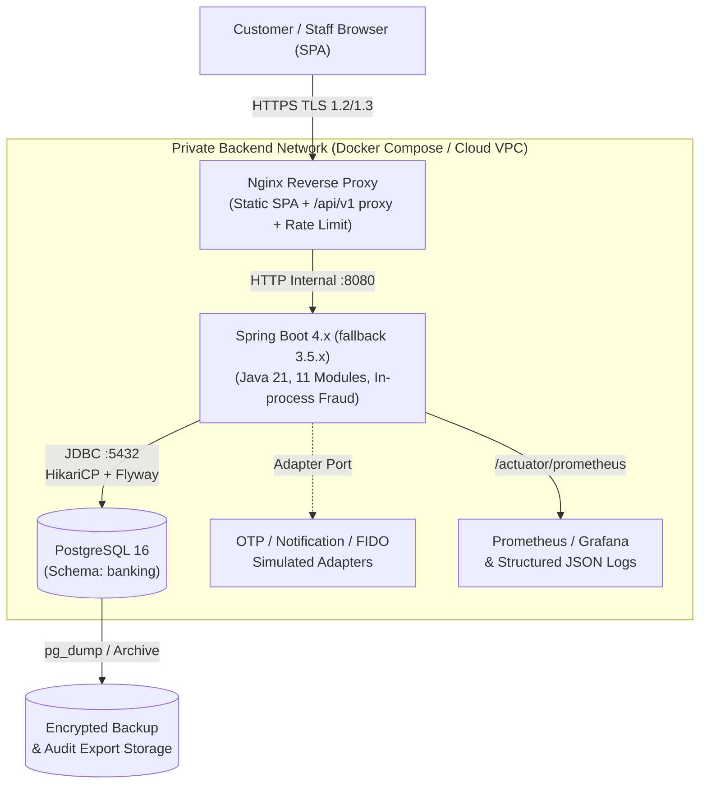

# Cấu hình Triển khai Backend (`docs-backend/deployment/configuration.md`)

> **Dự án:** Digital Banking MVP (Single-Bank, Core Simulated)
> **Mã tài liệu:** `BE-DEP-02`
> **Phiên bản:** 1.4
> **Ngày cập nhật:** 18/11/2026
> **Trạng thái:** Hoàn thành (Chuẩn hóa Baseline v1.1 theo `DEC-DOC-001` & `DEC-COM-001`)
> **Owner:** Phương (`common`), phối hợp các Module Owners
> **Nguồn tham chiếu:** [[digitalbanking-docs/docs-common/04. Database design & analysis.md]] (§3–§9), [[digitalbanking-docs/docs-common/05. Technical stack.md]] (§5.1.6, §5.2, §5.4, §5.7, §5.8), [[digitalbanking-docs/docs-common/06. System architecture.md]] (§5, §8.8, §9, §11, §12), [[digitalbanking-docs/docs-common/07. API contracts.md]] (§2.8, §3.2–§3.3, §3.7, §6.1, §8.9), [[digitalbanking-docs/docs-common/08. Deployment infrastructure.md]] (§3.3, §4–§6, §8–§9), [[digitalbanking-docs/docs-common/design/01. audit-traceability.md]] (§7.6, §10, §12), [[digitalbanking-docs/docs-common/design/02. consistency-concurrency.md]] (§7.10, §10.3, §13), [[digitalbanking-docs/docs-common/design/03. fraud-detection-rules.md]] (§4–§6), [[digitalbanking-docs/docs-common/design/04. security.md]] (§4–§6, §8–§9), [[DECISIONS.md]]
> **Tài liệu liên quan:** [[digitalbanking-docs/docs-backend/deployment/README.md]] (hướng dẫn triển khai & vận hành), [[digitalbanking-docs/docs-backend/deployment/common-readiness.md]], [[digitalbanking-docs/docs-backend/README.md]] (chỉ mục Backend)

---

## 1. Mục đích, phạm vi và nguyên tắc

### 1.1. Mục đích

Tài liệu này là **nguồn cấu hình tham chiếu duy nhất** cho việc triển khai Backend Spring Boot Modular Monolith và PostgreSQL 16 của Digital Banking MVP. Tài liệu tập trung các nội dung cần tra cứu khi cấu hình môi trường:

- Profile, biến môi trường và giá trị `application.yml`.
- Cấu hình kết nối PostgreSQL, Flyway migration và phân quyền tài khoản DB.
- Cấu hình bảo mật: session, OTP, lockout, khóa mã hóa, CORS, rate limit.
- Cấu hình nghiệp vụ/vận hành: hạn mức chuyển tiền, step-up, fraud rule, job nền.
- Hợp đồng observability: health, log, metric và ngưỡng cảnh báo.

`deployment/README.md` chỉ giữ **hướng dẫn triển khai, release gate, backup/restore, rollback và runbook**. Mọi bảng giá trị cấu hình được chuyển về tài liệu này để tránh phân mảnh và tránh sai lệch giữa hai tài liệu.

### 1.2. Phạm vi

| Trong phạm vi | Ngoài phạm vi |
|---|---|
| Cấu hình môi trường `local`, `test`, `demo`/Cloud | Production hardening, HA, multi-region DR |
| Biến môi trường, `application.yml`, secret bắt buộc | IaC/terraform và cấu hình provider cụ thể |
| Flyway migration, tài khoản DB, quyền tối thiểu | Viết mã nguồn, class cụ thể, DTO |
| Health, structured log, metric, alert threshold | Dashboard Prometheus/Grafana chi tiết |
| Giá trị nghiệp vụ/vận hành được ngoại hóa | Thay đổi quy tắc nghiệp vụ trong `docs-common/` |

### 1.3. Nguyên tắc cấu hình

1. **`docs-common/01–11` là ưu tiên cao nhất**, sau đó `docs-common/design/`, cuối cùng Backend. Quyết định owner 12/11/2026 áp dụng trước implement; ngưỡng còn Đề xuất trong nguồn giữ nguyên trạng thái, không tự đóng OI nghiệp vụ.
2. **Cấu hình nằm ngoài artifact.** Không đóng gói secret, mật khẩu, khóa AES/HMAC vào image hoặc Git (`05` §5.1.6, `08` §5.2).
3. **Server làm chủ chính sách.** Hạn mức, OTP, lockout, step-up, fraud threshold và retention do server quyết định; client không được ghi đè (`08` §5.2).
4. **Fail-fast.** Thiếu secret bắt buộc hoặc khóa sai độ dài thì ứng dụng dừng khởi động, đặc biệt trên `demo` (`design/04` §6.4).
5. **Thay đổi có kiểm soát.** Thay đổi cấu hình ảnh hưởng tiền, xác thực, retention hoặc fraud phải được review, audit và phát hành có kiểm soát (`08` §5.2).
6. **Pin phiên bản.** Không dùng `latest`/dynamic version cho dependency, image hoặc release artifact (`05` §8.2).

### 1.4. Quy ước trạng thái giá trị

| Nhãn | Ý nghĩa |
|---|---|
| **Chuẩn** | Giá trị được nêu trực tiếp trong `docs-common/` |
| **Đề xuất** | Giá trị baseline trong `docs-common/` nhưng chưa được chốt bằng đo lường/evidence |
| **Đề xuất vận hành** | Giá trị baseline do Backend đề xuất, chưa có trong `docs-common`; cần đo lường/chốt |
| **Mở** | Chưa có giá trị chuẩn; phải chốt trước khi coi là cấu hình phát hành |

---

## 2. Môi trường và Spring Profile

### 2.1. Ma trận môi trường

| Môi trường | Spring Profile | Mục đích | Dữ liệu & adapter | Secret |
|---|---|---|---|---|
| `local` | `local` | Phát triển cá nhân, chạy Docker Compose | PostgreSQL local; seed synthetic; OTP/notification simulator | `.env` cục bộ, không commit |
| `test` | `test` | Unit, slice, integration, concurrency, failure injection | Testcontainers PostgreSQL 16 dùng một lần; `Clock` cố định; cho phép tiêm lỗi | Sinh trong bộ nhớ khi chạy test; cô lập khỏi DB chung |
| `demo` / Cloud | `demo` | Triển khai W7–W8, nghiệm thu `D1–D5`, trình diễn | PostgreSQL bền vững; backup trước demo; dữ liệu synthetic | Environment variable/Docker Secret/Cloud secret store; fail-fast |
| `production` | — | Ngoài phạm vi MVP | Không cam kết | Không cam kết |

Nguồn: `08` §4, `06` §11.3, `10` §4.7–§4.8.

### 2.2. Quy tắc cô lập môi trường

- Không dùng dữ liệu khách hàng, tài chính hoặc credential thật trên `local`, `test`, `demo` (`NFR-032`, `CON-006`).
- Secret của từng môi trường không được sao chép vào tài liệu, source control hoặc evidence.
- Dữ liệu test phải disposable và deterministic; test transaction/lock/idempotency dùng PostgreSQL thật qua Testcontainers, không dùng H2 (`05` §5.2.5).
- Demo phải backup trước khi chuẩn bị dữ liệu có thao tác phá hủy (`08` §4.1).
- Một kết quả test chỉ hợp lệ khi ghi rõ môi trường, source revision, cấu hình liên quan và vị trí evidence (`08` §4.1).

---

## 3. Kiến trúc triển khai và ranh giới mạng

### 3.1. Topology logic



Nguồn: `05` §3.1, `06` §11.1, `08` §3.2.

### 3.2. Ranh giới mạng và endpoint công khai

1. **Không public Backend/PostgreSQL.** Mọi lưu lượng từ trình duyệt đi qua HTTPS tại Nginx. PostgreSQL chỉ lắng nghe trong mạng nội bộ và chỉ nhận kết nối từ Backend (`08` §3.3, `06` §9.1).
2. **Health công khai:** `/actuator/health` là probe hạ tầng, không yêu cầu xác thực; chỉ trả trạng thái `UP`/`DOWN` tối giản, không lộ connection string, secret hay chi tiết hạ tầng (`07` §8.9.1, `06` §12.3).
3. **Health API nghiệp vụ:** `/api/v1/health` yêu cầu quyền `Admin`/`Auditor`, dùng cho monitoring nội bộ; trả `503` khi `DOWN` (`07` §8.9.1).
4. **Actuator nội bộ:** `/actuator/prometheus`, `/actuator/metrics` chỉ truy cập từ mạng nội bộ hoặc yêu cầu quyền quản trị. `/actuator/info` chỉ public nếu không chứa thông tin nhạy cảm (`05` §5.8, `06` §12.3).
5. **TLS và header bảo mật:** TLS 1.2+ (ưu tiên 1.3), HSTS, CSP, `X-Content-Type-Options`, `X-Frame-Options`/`frame-ancestors`, `Cache-Control: no-store` cho `/api/v1/**` (`design/04` §6.1).
6. **CORS:** chỉ cho phép origin SPA tường minh, không dùng `*` khi gửi cookie; methods `GET, POST, OPTIONS`; headers gồm `Authorization`, `Content-Type`, `X-Correlation-ID`, `Idempotency-Key`, `X-CSRF-Token`, `X-Step-Up-Challenge` (`design/04` §8.2, `07` §3.3).

---

## 4. Biến môi trường bắt buộc

### 4.1. Danh mục biến môi trường

Cấu hình `application.yml` cung cấp giá trị nền dùng chung; `application-demo.yml` áp dụng cho môi trường `demo`/Cloud (bắt buộc `cookie.secure = true`, khai báo origin CORS tường minh và nạp khóa mật mã/mật khẩu DB từ secret store). Chi tiết kiểm tra sẵn sàng và vận hành gói ứng dụng xem tại [common-readiness.md](common-readiness.md) và [báo cáo kiểm chứng BE-COM-IMP-08](../modules/common/report/BE-COM-IMP-08-verification.md).

| Biến | Bắt buộc | Giá trị mặc định | Ý nghĩa |
|---|---|---|---|
| `SPRING_PROFILES_ACTIVE` | Có | `local` | Profile `local`, `test` hoặc `demo` |
| `SERVER_PORT` | Không | `8080` | Cổng HTTP nội bộ của Backend |
| `APP_TIMEZONE` | Không | `Asia/Ho_Chi_Minh` | ZoneId hợp lệ, không rỗng; timestamp vẫn UTC |
| `APP_LOCKOUT_MAX_FAILED_ATTEMPTS` | Không | `5` — Đề xuất | Số nguyên dương; config cho identity, chưa enforcement |
| `APP_LOCKOUT_DURATION_MINUTES` | Không | `10` — Đề xuất | Số nguyên dương; config cho identity, chưa enforcement |
| `APP_TRANSFER_RATE_LIMIT_PER_CUSTOMER_PER_MINUTE` | Không | `30` — Đề xuất | Số nguyên dương; consumer phải đếm theo customer |
| `DB_HOST` | Có trên `demo` | `localhost` | Host PostgreSQL |
| `DB_PORT` | Không | `5432` | Cổng PostgreSQL |
| `DB_NAME` | Không | `digital_banking` | Tên database |
| `DB_APP_USER` | Có | `banking_app` | Tài khoản runtime least-privilege |
| `DB_APP_PASSWORD` | Có | — | Mật khẩu runtime; lấy từ secret store |
| `DB_MIGRATION_USER` | Có | `banking_migrator` | Tài khoản chạy Flyway migration |
| `DB_MIGRATION_PASSWORD` | Có | — | Mật khẩu migration; lấy từ secret store |
| `DB_POOL_MAX_SIZE` | Không | `20` (đề xuất) | Kích thước tối đa HikariCP; chốt sau benchmark |
| `DB_POOL_MIN_IDLE` | Không | `5` (đề xuất) | Số connection idle tối thiểu |
| `APP_PII_AES_KEY_ID` | Không | `k-v1` | Key version đang dùng để mã hóa PII |
| `APP_PII_AES_KEY_BASE64` | Có | — | Khóa AES-256-GCM, Base64 của đúng 32 byte |
| `APP_HMAC_KEY_BASE64` | Có | — | Khóa HMAC-SHA-256, Base64 của đúng 32 byte |
| `APP_COOKIE_SECURE` | Không | `false` ở base/local; profile demo đặt property secure=true | Identity đọc cấu hình cookie; actual Set-Cookie cần identity/HTTPS verification |
| `APP_TRANSFER_ENABLED` | Không | `true` | Ghép Transfer, History và provider thật. Đặt `false` nếu chủ động tắt một dependency của Transfer. |
| `APP_TRANSFER_RECOVERY_ENABLED` | Không | `false` | Bật lịch recovery Transfer. Cấu hình QA local bật tường minh. |
| `APP_CORS_ALLOWED_ORIGINS` | Có trên demo | local: `http://localhost:5173`; demo: không fallback | Origin SPA tường minh; thiếu/wildcard fail startup demo |

### 4.2. Mẫu `.env.example`

```dotenv
# =====================================================================
# 1. RUNTIME & ENVIRONMENT
# =====================================================================
SPRING_PROFILES_ACTIVE=local
SERVER_PORT=8080
APP_TIMEZONE=Asia/Ho_Chi_Minh

# =====================================================================
# 2. POSTGRESQL DATABASE
# Tách biệt tài khoản migration (DDL) và runtime (DML least-privilege)
# =====================================================================
DB_HOST=localhost
DB_PORT=5432
DB_NAME=digital_banking

DB_APP_USER=banking_app
DB_APP_PASSWORD=change_me_local_app_pwd

DB_MIGRATION_USER=banking_migrator
DB_MIGRATION_PASSWORD=change_me_local_migrator_pwd

DB_POOL_MAX_SIZE=20
DB_POOL_MIN_IDLE=5

# =====================================================================
# 3. CRYPTOGRAPHIC KEYS (Base64-encoded 32-byte / 256-bit keys)
# Sinh khóa mới: openssl rand -base64 32
# Không dùng giá trị mẫu này trên demo/Cloud.
# =====================================================================
APP_PII_AES_KEY_ID=k-v1
APP_PII_AES_KEY_BASE64=MDEyMzQ1Njc4OWFiY2RlZjAxMjM0NTY3ODlhYmNkZWY=
APP_HMAC_KEY_BASE64=MTEyMzQ1Njc4OWFiY2RlZjAxMjM0NTY3ODlhYmNkZWY=

# =====================================================================
# 4. WEB, SESSION & CORS
# =====================================================================
APP_COOKIE_SECURE=false
APP_CORS_ALLOWED_ORIGINS=http://localhost:5173,https://localhost:8443
```

### 4.3. Quy tắc secret

- Không commit `.env`, mật khẩu, khóa AES/HMAC hoặc token vào Git/image (`08` §6.1, `design/04` §6.4).
- `APP_PII_AES_KEY_BASE64` và `APP_HMAC_KEY_BASE64` phải giải mã Base64 thành đúng **32 byte (256 bit)** và là hai khóa độc lập nhau; thiếu khóa, sai độ dài hoặc trùng khóa ở bất kỳ profile nào đều **fail-fast** lúc khởi động (`CryptoConfig`, `design/04` §6.4). Khóa mẫu chỉ được phép dùng trên profile `local`/`test`; trên `demo`/Cloud phải sinh khóa ngẫu nhiên riêng bằng `openssl rand -base64 32`.
- Danh sách `previous-keys` hiện phải giữ rỗng (xoay vòng nhiều khóa đồng thời thuộc phạm vi mở rộng sau MVP); `aes-key-id` đóng vai trò metadata phiên bản khóa. Xem [báo cáo kiểm chứng BE-COM-IMP-04](../modules/common/report/BE-COM-IMP-04-verification.md).
- `banking_app` và `banking_migrator` phải có mật khẩu khác nhau; không dùng tài khoản migration cho runtime (`design/04` §6.5).
- Trên `demo`/Cloud, ưu tiên Docker Secret hoặc secret store của nền tảng; không đưa secret vào biến môi trường hiển thị trong log/CI (`08` §6.1).
- Không ghi secret, cookie, OTP, token hoặc khóa vào log/evidence (`NFR-020`, `design/04` §9).

### 4.4. Ngữ cảnh request và ranh giới Reverse Proxy

- Mặc định ứng dụng đặt `server.forward-headers-strategy: none`, tức bỏ qua các header `Forwarded` / `X-Forwarded-*` do client gửi trực tiếp và lấy địa chỉ peer từ socket kết nối, chỉ lưu IPv4 đã che octet cuối (`203.0.113.***`) vào `RequestContext`.
- Khi đặt sau Nginx reverse proxy, chỉ bật xử lý forwarded headers sau khi đã cấu hình và kiểm chứng Nginx chặn truy cập trực tiếp vào cổng backend nội bộ và ghi đè hoàn toàn `X-Forwarded-For` / `X-Forwarded-Proto`. Xem hướng dẫn chi tiết tại [backend README](../../../digitalbanking-backend/README.md#request-context-and-propagation) và [báo cáo kiểm chứng BE-COM-IMP-03](../modules/common/report/BE-COM-IMP-03-verification.md).

---

## 5. Cấu hình `application.yml` chuẩn

### 5.1. Mẫu cấu hình

```yaml
spring:
  application:
    name: digital-banking-backend

  datasource:
    url: jdbc:postgresql://${DB_HOST:localhost}:${DB_PORT:5432}/${DB_NAME:digital_banking}?currentSchema=banking
    username: ${DB_APP_USER}
    password: ${DB_APP_PASSWORD}
    hikari:
      pool-name: BankingHikariPool
      maximum-pool-size: ${DB_POOL_MAX_SIZE:20}   # Đề xuất; chốt sau benchmark (08 §3.4)
      minimum-idle: ${DB_POOL_MIN_IDLE:5}         # Đề xuất vận hành
      connection-timeout: 3000                    # Đề xuất: chờ connection tối đa 3 giây
      validation-timeout: 1000
      max-lifetime: 1800000                       # 30 phút
      auto-commit: false                          # Kiểm soát transaction tường minh
      leak-detection-threshold: 10000              # Cảnh báo giữ connection > 10 giây

  jpa:
    open-in-view: false                           # Không giữ connection ở Controller/View
    hibernate:
      ddl-auto: validate                          # Không để Hibernate tự tạo/sửa bảng
    properties:
      hibernate.jdbc.time_zone: UTC

  flyway:
    enabled: true
    schemas: banking
    default-schema: banking
    user: ${DB_MIGRATION_USER}
    password: ${DB_MIGRATION_PASSWORD}
    locations: classpath:db/migration
    validate-on-migrate: true
    out-of-order: false

  jackson:
    deserialization:
      fail-on-unknown-properties: true            # Chống Mass Assignment (design/04 §8.1)
    serialization:
      write-dates-as-timestamps: false

server:
  port: ${SERVER_PORT:8080}
  shutdown: graceful
  forward-headers-strategy: none                   # IMP-03: chưa cấu hình trusted proxy boundary

management:
  endpoints:
    web:
      base-path: /actuator
      exposure:
        include: health,info,prometheus,metrics    # Bảo vệ metrics/prometheus ở network/Nginx
  endpoint:
    health:
      show-details: never                          # Không lộ chi tiết hạ tầng
      probes:
        enabled: true

# =====================================================================
# CẤU HÌNH NGHIỆP VỤ & VẬN HÀNH NGOẠI HÓA (@ConfigurationProperties)
# =====================================================================
app:
  timezone: ${APP_TIMEZONE:Asia/Ho_Chi_Minh}

  identity:
    otp-expiry-sweep-delay: ${APP_OTP_EXPIRY_SWEEP_DELAY:PT1M} # Chu kỳ quét hết hạn OTP challenge (DEC-ID-006)
    fido:
      enabled: ${APP_FIDO_ENABLED:false}
      rp-id: ${APP_FIDO_RP_ID:}
      allowed-origins: ${APP_FIDO_ALLOWED_ORIGINS:}
      challenge-ttl: ${APP_FIDO_CHALLENGE_TTL:PT30S}           # Thời hạn FIDO assertion challenge (DEC-ID-010)

  crypto:
    aes-key-id: ${APP_PII_AES_KEY_ID:k-v1}
    aes-key-base64: ${APP_PII_AES_KEY_BASE64}
    hmac-key-base64: ${APP_HMAC_KEY_BASE64}
    previous-keys: []                              # Giữ rỗng trong MVP

  security:
    cookie:
      name: DB_SESSION                              # Theo 07 §3.2 (DEC-DOC-001)
      secure: ${APP_COOKIE_SECURE:false}
      same-site: Strict
      path: /
      max-age-seconds: 28800                        # 8 giờ; khớp absolute timeout
    cors-allowed-origins: ${APP_CORS_ALLOWED_ORIGINS:http://localhost:5173}
    session:
      idle-timeout-minutes: 15                     # 07 §3.7
      absolute-timeout-hours: 8                    # 07 §3.7
    password:
      history-size: 3                              # 04 §4.2.7 / BRL-006: không trùng 3 mật khẩu gần nhất (DEC-ID-009)
      min-length: 8
      max-length: 128
    lockout:
      max-failed-attempts: ${APP_LOCKOUT_MAX_FAILED_ATTEMPTS:5} # 07 §3.7 (DEC-DOC-001)
      lock-duration-minutes: ${APP_LOCKOUT_DURATION_MINUTES:10} # 07 §3.7 (DEC-DOC-001)
    otp:
      ttl-seconds: 300                             # LOGIN_NEW_DEVICE/TRANSFER_STEP_UP/SENSITIVE_ACTION
      recovery-ttl-seconds: 120                    # Baseline OTP recovery (design/03 §4.1)
      max-verify-attempts: 5
      resend-cooldown-seconds: 60                  # 07 §8.1.8 (DEC-ID-012)
      max-resend-count: 3                          # 07 §8.1.8 (DEC-ID-012)
    http:
      max-request-body-bytes: ${APP_MAX_REQUEST_BODY_BYTES:65536}
      max-rate-limit-buckets: ${APP_MAX_RATE_LIMIT_BUCKETS:10000}
    rate-limit:
      login-per-ip-per-minute: ${APP_LOGIN_PER_IP_PER_MINUTE:10}                 # design/04 §8.3
      login-per-username-per-minute: ${APP_LOGIN_PER_USERNAME_PER_MINUTE:10}     # 07 §2.8 (DEC-ID-013)
      step-up-per-user-per-5-minutes: ${APP_STEP_UP_PER_USER_PER_5_MINUTES:10}   # design/04 §8.3
      otp-verify-per-user-per-minute: ${APP_OTP_VERIFY_PER_USER_PER_MINUTE:20}   # 07 §2.8
      transfer-per-customer-per-minute: ${APP_TRANSFER_RATE_LIMIT_PER_CUSTOMER_PER_MINUTE:30} # 07 §2.8 (DEC-DOC-001)
      audit-export-per-user-per-hour: ${APP_AUDIT_EXPORT_PER_USER_PER_HOUR:5}     # design/04 §8.3
      read-per-user-per-minute: ${APP_GLOBAL_API_PER_SUBJECT_PER_MINUTE:120}      # design/04 §8.3
    step-up:
      single-amount-vnd: 10000000                  # T0: amount >= 10.000.000 VND (DEC-TRF-002)
      daily-amount-vnd: 20000000                   # T0: tổng dự kiến > 20.000.000 VND (DEC-TRF-001/002)

  transfer:
    min-amount-vnd: 2000
    max-amount-vnd: 10000000
    pin-otp-threshold-vnd: 5000000                 # Thuộc tính tương thích cũ; ngưỡng step-up chính thức dùng app.security.step-up.*
    daily-cap-vnd: 50000000
    idempotency-ttl-hours: 24                      # Tối thiểu 24 giờ, dùng snapshot riêng tại T1 và terminal (DEC-TRF-005)
    t2-lock-timeout-ms: 2000                       # SET LOCAL lock_timeout = '2s'
    t2-statement-timeout-ms: 5000                  # statement_timeout và ngân sách T2
    fraud-eval-timeout-ms: 1000                    # Ngân sách Fraud kiểm tại mốc đọc/đánh giá/ghi; SQL theo deadline T2

  fraud:
    velocity-count: 5                              # DEC-TRF-009 / 04 §4.7.1: > 5 lệnh chuyển tiền
    velocity-window-seconds: 600                   # trong cửa sổ trượt 600 giây (10 phút)
    warning-ttl-minutes: 15                        # design/03 §6.1
    review-timeout-minutes: 30                     # design/03 §6.1

  jobs:
    reconciliation-on-startup: true
    reconciliation-interval-ms: 60000              # 60 giây / 1 phút (DEC-TRF-010)
    reconciliation-pending-age-seconds: 300        # PENDING >= 300 giây / 5 phút (DEC-TRF-010)
    outbox-poll-interval-ms: 2000                  # 2 giây (DEC-TRF-011)
    outbox-batch-size: 50                           # Lô 50 bản ghi (DEC-TRF-011)
    outbox-lease-seconds: 30                        # Lease 30 giây (DEC-TRF-011)
    audit-verify-incremental-cron: "0 */15 * * * *" # design/01 §7.6
    audit-verify-full-cron: "0 0 2 * * *"          # Hằng ngày, off-peak
    retention-cleanup-cron: "0 0 3 * * *"          # Hằng ngày (design/01 §7.6)
```

BE-INT-06 áp dụng lock timeout và statement timeout cục bộ trong claim và T2. T2 kiểm ngân sách trước và sau audit, đồng thời giảm statement/lock timeout của audit theo thời gian còn lại. Lock timeout/deadlock có tối đa hai lần T2 trên fence hợp lệ sau rollback được xác nhận.

### 5.2. Ghi chú cấu hình quan trọng

- `spring.jpa.open-in-view: false` và `ddl-auto: validate` là **bắt buộc** theo `05` §5.2.3 và `06` §8.8.
- `spring.flyway.user/password` là tài khoản migration (`banking_migrator`); `spring.datasource.username/password` là tài khoản runtime (`banking_app`). Không dùng chung (`DEC-COM-002`, `design/04` §6.5).
- `spring.jackson.deserialization.fail-on-unknown-properties=true` chống Mass Assignment (`design/04` §8.1).
- `management.endpoint.health.show-details=never` và chỉ public `/actuator/health`; không public `/actuator/metrics` và `/actuator/prometheus` ra Internet (`06` §12.3, `08` §3.3).
- BE-INT-05 lưu `ttl_t1_config_version=transfer-ttl-hours-<giá trị>` cùng TTL giây. T1 tính expiry từ `created_at`. Reservation lưu policy version gồm hai ngưỡng step-up để truy vết cấu hình đã dùng.
- Ngưỡng tiền kích hoạt Step-up cho giao dịch chuyển tiền được quy định duy nhất tại `app.security.step-up.single-amount-vnd` (`>= 10.000.000 VND`) và `app.security.step-up.daily-amount-vnd` (`> 20.000.000 VND`) theo `DEC-TRF-001/002/008`. Thuộc tính `app.transfer.pin-otp-threshold-vnd` chỉ giữ để tương thích cấu hình cũ và không dùng làm điều kiện kích hoạt OTP.
- `AppProperties` cung cấp giá trị mặc định an toàn và kiểm tra tính hợp lệ lúc khởi động (các trường giới hạn/timeout phải là số nguyên dương; `APP_TIMEZONE` phải là `ZoneId` hợp lệ). Inject `Clock` UTC (`clock.instant()`) cho mọi mốc thời gian hệ thống và `ZoneId businessZoneId` (`LocalDate.now(clock.withZone(businessZoneId))`) cho ngày nghiệp vụ; xem hướng dẫn tại [backend README](../../../digitalbanking-backend/README.md#common-configuration-and-time).

### 5.3. Cấu hình bảo mật HTTP và giới hạn tần suất (Rate Limiting)

Module `common` và `identity` thực thi giới hạn kích thước request body và giới hạn tần suất theo thuật toán Token Bucket (hợp đồng chi tiết tại [backend README](../../../digitalbanking-backend/README.md#http-security-and-identity-integration) và [báo cáo kiểm chứng BE-COM-IMP-05](../modules/common/report/BE-COM-IMP-05-verification.md)):

| Cấu hình | Biến môi trường | Giá trị chuẩn & Phạm vi áp dụng |
|---|---|---|
| `app.security.http.max-request-body-bytes` | `APP_MAX_REQUEST_BODY_BYTES` | `65536` bytes (64 KB, `07` §2.8); kiểm tra cả `Content-Length` và luồng dữ liệu chunked (`413 REQUEST_TOO_LARGE`). |
| `app.security.http.max-rate-limit-buckets` | `APP_MAX_RATE_LIMIT_BUCKETS` | `10000` buckets tối đa trong bộ nhớ tiến trình; khi đầy trả về `503 SERVICE_UNAVAILABLE`. |
| `login-per-ip-per-minute` | `APP_LOGIN_PER_IP_PER_MINUTE` | `10` req/phút/IP (`design/04` §8.3). |
| `login-per-username-per-minute` | `APP_LOGIN_PER_USERNAME_PER_MINUTE` | `10` req/phút/username đã chuẩn hóa chữ thường (`07` §2.8, `DEC-ID-013`). |
| `step-up-per-user-per-5-minutes` | `APP_STEP_UP_PER_USER_PER_5_MINUTES` | `10` req/5 phút/user (`design/04` §8.3). |
| `otp-verify-per-user-per-minute` | `APP_OTP_VERIFY_PER_USER_PER_MINUTE` | `20` req/phút/user (`07` §2.8). |
| `transfer-per-customer-per-minute` | `APP_TRANSFER_RATE_LIMIT_PER_CUSTOMER_PER_MINUTE` | `30` req/phút/customer (`07` §2.8, `DEC-DOC-001`). |
| `audit-export-per-user-per-hour` | `APP_AUDIT_EXPORT_PER_USER_PER_HOUR` | `5` req/giờ/user (`design/04` §8.3). |
| `read-per-user-per-minute` | `APP_GLOBAL_API_PER_SUBJECT_PER_MINUTE` | `120` req/phút/user (hoặc theo IP đối với endpoint công khai, `design/04` §8.3). |

Khi vượt ngưỡng, hệ thống trả về `429 RATE_LIMITED` kèm header `Retry-After` (số giây làm tròn lên tới thời điểm có token tiếp theo). Cấu hình CORS từ chối khởi động nếu origin chứa wildcard `*` hoặc sai định dạng URI; các header bảo mật (`Cache-Control: no-store`, `X-Content-Type-Options: nosniff`, `X-Frame-Options: DENY`, `Content-Security-Policy`) được gắn trên mọi phản hồi API kể cả phản hồi lỗi.

## 6. Cấu hình Database, Flyway và phân quyền

### 6.1. Schema và nguyên tắc migration

- Schema duy nhất: `banking`; tên bảng/cột `snake_case`; tiền `NUMERIC(19,2)`; thời gian `TIMESTAMPTZ` UTC (`04` §1, `05` §5.2.1, `06` §8.8).
- Flyway quản lý toàn bộ schema, trigger bất biến, partial index và seed demo (`05` §5.2.3).
- **Forward-only:** không sửa file migration đã chạy; mọi thay đổi schema tạo migration mới (`08` §8.1).
- Ứng dụng chỉ chạy `ddl-auto=validate`; migration failure chặn release (`08` §8.1).
- Không khẳng định tên file migration cụ thể trong tài liệu này. Tên file chính xác thuộc phạm vi implementation (`08` §8.1, `OI-DEP-03`).

### 6.2. Thứ tự Flyway migration chuẩn (`DEC-COM-001`, `DEC-ID-001`)

| Phiên bản | File migration tại `classpath:db/migration` | Nội dung chính |
|---|---|---|
| `V1` | `V1__init_schema.sql` | Khởi tạo schema `banking`. |
| `V2` | `V2__create_identity_and_rbac_tables.sql` | Bảng `app_user`, `device`, `session` (`csrf_token_hash`), `auth_challenge` (`resend_count`), `auth_attempt`, `password_history`, `role`, `permission`, `user_role`, `role_permission`, `user_privilege` và **seed danh mục RBAC chuẩn** (`DEC-ID-001`, V25 bổ sung `FRAUD_READ` cho `AUDITOR`). |
| `V3` | `V3__add_fido_verification_material.sql` | Bổ sung các cột xác thực FIDO2/WebAuthn trên `device` và `auth_challenge` (`DEC-ID-010`). |
| `V4` | `V4__add_role_assignment_version.sql` | Bổ sung `app_user.role_assignment_version` (`DEC-ID-011`). |
| `V5` | `V5__create_audit_log.sql` | Bảng `audit_log` (`canonical_payload`), `audit_chain_checkpoint`, `legal_hold`, `retention_policy`, trigger chặn `UPDATE/DELETE/TRUNCATE` và phân quyền `banking_app` (đánh số lại từ `V2__create_audit_log.sql` khi ghép tích hợp). |
| `V6` | `V6__create_customer_and_account_tables.sql` | Bảng `customer` và `account` (`available_balance >= 0`, `ledger_balance >= 0`). |
| `V7` | `V7__create_transfer_and_idempotency_tables.sql` | Bảng `transfer` (kèm cột fencing/recovery) và `idempotency_record` (kèm cột TTL snapshot) — chuyển từ `db/transfer-candidate/V2__transfer.sql` khi ghép tích hợp. |
| `V8` | `V8__create_ledger_entry.sql` | Bảng `ledger_entry`, unique `(transfer_id, entry_seq)`, trigger append-only và phân quyền `banking_app` — chuyển từ `db/ledger-candidate/V2__create_ledger_entry.sql` khi ghép tích hợp. |
| `V9` | `V9__create_limit_and_approval_tables.sql` | Bảng `limit_config`, `limit_usage`, `limit_reservation` và `approval_request`. |
| `V10` | `V10__create_fraud_and_notification_tables.sql` | Bảng `fraud_rule_config`, `fraud_flag` và `notification`. |
| `V25` | `V25__api_read_projections.sql` | Projection chỉ đọc cho Transaction History, Fraud và quyền `FRAUD_READ` của Auditor. |

Nguồn: `08` §8.1, `04` §3–§8, `DEC-COM-001`, `DEC-ID-001`. Trong giai đoạn phát triển độc lập từng module, SQL của `transfer` và `ledger` được đặt tại `db/transfer-candidate` và `db/ledger-candidate` để kiểm thử độc lập trước khi hợp nhất vào chuỗi `V1`–`V10`.

### 6.3. Tài khoản DB và quyền tối thiểu

| Tài khoản | Vai trò | Quyền |
|---|---|---|
| `banking_migrator` | Flyway DDL lúc khởi động | `CREATE`, `ALTER`, `DROP` trong schema `banking`; không dùng cho runtime |
| `banking_app` | Runtime DML | `SELECT`, `INSERT`, `UPDATE`, `DELETE` trên bảng nghiệp vụ; **chỉ `SELECT`, `INSERT`** trên `ledger_entry` và `audit_log`; không có DDL/`TRUNCATE`/`DROP` |

Ánh xạ vai trò logic trong `04` §9.2:

| Vai trò logic (`04` §9.2) | Ánh xạ MVP |
|---|---|
| `app_rw` | `banking_app` (DML, không sửa/xóa audit/ledger) |
| `audit_writer` | Mục tiêu tách role chỉ `INSERT` audit; MVP dùng `banking_app` với quyền `INSERT` trên `audit_log` |
| `auditor_ro` | Role read-only cho audit/transaction; triển khai khi có audit export/verification tách biệt |
| `migration` | `banking_migrator` |

Thiết kế chi tiết dùng hai credential `banking_app`/`banking_migrator` (`design/04` §6.5); việc tách đầy đủ `audit_writer`/`auditor_ro` là mục tiêu defense-in-depth, có thể bổ sung mà không đổi contract ứng dụng.

### 6.4. Script phân quyền mẫu

```sql
-- Thực thi trong init-db.sql hoặc migration bootstrap có kiểm soát
GRANT CONNECT ON DATABASE digital_banking TO banking_app, banking_migrator;
GRANT USAGE ON SCHEMA banking TO banking_app;
GRANT USAGE, CREATE ON SCHEMA banking TO banking_migrator;

GRANT SELECT, INSERT, UPDATE, DELETE ON ALL TABLES IN SCHEMA banking TO banking_app;
GRANT USAGE, SELECT ON ALL SEQUENCES IN SCHEMA banking TO banking_app;

-- Runtime không có DDL/TRUNCATE
REVOKE CREATE ON SCHEMA banking FROM banking_app;
REVOKE TRUNCATE ON ALL TABLES IN SCHEMA banking FROM banking_app;

-- Bằng chứng bất biến: chỉ SELECT/INSERT
REVOKE UPDATE, DELETE, TRUNCATE ON banking.ledger_entry, banking.audit_log FROM banking_app;
```

Nguồn: `design/04` §6.5, `04` §9.2, `06` §8.5. Không hard-code mật khẩu trong script; cấp mật khẩu qua secret store/init mechanism.

### 6.5. Seed dữ liệu RBAC và dữ liệu demo (`DEC-ID-001`)

- **Danh mục RBAC chuẩn (`role`, `permission`, `role_permission`):** được seed cố định ngay trong migration `V2__create_identity_and_rbac_tables.sql` cho mọi môi trường (`4` role: `CUSTOMER`, `OPERATIONS`, `ADMIN`, `AUDITOR` và `15` permission chuẩn theo `04` Appendix A.2, V25 bổ sung `FRAUD_READ` cho `AUDITOR`).
- **Dữ liệu mẫu:** chạy theo [QA backend local](qa-backend-local.md), với DB riêng và profile `local` bật tường minh. Demo/Cloud cần provision dữ liệu riêng.

### 6.6. Backup và phục hồi

- Bắt buộc backup logic trước mỗi demo và trước migration có thay đổi schema (`08` §8.3).
- Backup phải nằm ngoài volume runtime, được mã hóa, có checksum và phải được restore thử (`08` §8.3).
- RTO ≤ 30 phút và RPO ≤ 5 phút là **đề xuất** (NFR-007), chưa phải cam kết cho đến khi có đo lường (`08` §8.4).
- Quy trình backup/restore chi tiết nằm tại [[digitalbanking-docs/docs-backend/deployment/README.md]] §5.

---

## 7. Cấu hình Observability

### 7.1. Health contract

| Endpoint | Quyền truy cập | Mục đích | Hành vi |
|---|---|---|---|
| `/actuator/health` | Public (infra probe) | Docker/cloud healthcheck | `200 {"status":"UP"}` khi ứng dụng và DB sẵn sàng; `503 {"status":"DOWN"}` khi mất DB/pool cạn kiệt; không lộ chi tiết |
| `/api/v1/health` | `Admin`/`Auditor` | Health API nội bộ | `200` khi `UP`/`DEGRADED`; `503` khi `DOWN` (`07` §8.9.1) |
| `/actuator/metrics`, `/actuator/prometheus` | Nội bộ/quản trị | Metrics | Không public Internet |
| `/actuator/info` | Public nếu tối giản | Thông tin build/version | Không chứa secret/PII |

Ghi chú: `show-details: never`; health không chứng minh mọi capability nghiệp vụ hoạt động — vẫn cần smoke test và kiểm tra invariant (`08` §9.1).

### 7.2. Structured log

Mọi log ra `stdout` ở dạng JSON một dòng, tối thiểu gồm:

`timestamp` (UTC ISO-8601), `level`, `service`, `environment`, `correlation_id`, `request_id`, `user_id` (mask/ID nội bộ), `route`, `status`, `action`, `outcome`, `latency_ms`, `error_code`, `audit_id` (nếu có). Có thể bổ sung `transfer_id`, `reference`, `sqlstate`, `attempt` theo `design/02` §13.2.

**Cấm log:** mật khẩu, PIN, OTP, raw session/CSRF token, raw idempotency key, khóa AES/HMAC, số tài khoản/CCCD/số điện thoại/email đầy đủ, full payload chuyển tiền (`NFR-020`, `08` §9.2, `design/02` §13.2).

Hệ thống xuất JSON log qua `logback-spring.xml` và `SafeJsonLogEncoder`: sự kiện `HTTP_REQUEST_COMPLETED` ghi nhận route template (fallback `UNMATCHED`), HTTP status, độ trễ (`latency_ms`) và `correlation_id`/`request_id`; `user_id` nội bộ được băm ẩn danh `SHA-256`; sự kiện dự phòng kiểm toán bảo mật `SECURITY_AUDIT_FALLBACK` được ghi qua `SecurityAuditFallbackLog` và lọc qua `LogRedaction`. Encoder chỉ chấp nhận các trường trong allowlist và tự động loại bỏ thông điệp văn bản tự do, stack trace thô hoặc MDC tùy ý. Health API nghiệp vụ (`/api/v1/health`) trả về `HealthResponse` (trạng thái `database` và `application`); `/actuator/metrics` và `/actuator/prometheus` yêu cầu quyền `ADMIN` hoặc `AUDITOR`. Xem hướng dẫn chi tiết tại [backend README](../../../digitalbanking-backend/README.md#logs-http-metrics-and-health) và [báo cáo kiểm chứng BE-COM-IMP-06](../modules/common/report/BE-COM-IMP-06-verification.md).

### 7.3. Metrics chuẩn

| Nhóm | Metric | Ý nghĩa |
|---|---|---|
| HTTP | `http_server_requests_seconds` | Request rate, error rate, p95/p99 |
| Transfer | `transfer_created_total`, `transfer_completed_total`, `transfer_failed_total` | Vòng đời transfer |
| Transfer | `transfer_pending_age_seconds`, `transfer_t1_duration_seconds`, `transfer_t2_duration_seconds`, `transfer_retry_total` | Tuổi PENDING, latency T1/T2, retry |
| Idempotency | `idempotency_replay_total`, `idempotency_conflict_total`, `idempotency_in_progress_total`, `idempotency_stuck_total` | Replay/conflict/kẹt |
| Concurrency/DB | `db_deadlock_total`, `db_pool_active`, `db_pool_waiting` | Deadlock, pool |
| Audit | `audit_write_total{action,criticality,outcome}`, `audit_write_failure_total`, `audit_write_latency_seconds`, `audit_lock_wait_seconds` | Ghi audit/độ trễ/khóa |
| Audit integrity | `audit_chain_verify_failure_total`, `audit_gap_total` | Sai chuỗi/gap |
| Fraud | `banking_fraud_engine_error_total` | Tăng sau khi khôi phục phần Fraud và cho T2 tiếp tục. |
| Transfer Audit | `transfer_security_deny_fallback_total` | Tăng một lần khi C3 không ghi bền; cảnh báo `TransferSecurityAuditFallback` trong `ops/prometheus/transfer-audit-alerts.yml`. |
| Notification | `notification_backlog`, `notification_retry_total` | Backlog/retry |
| Jobs | `reconciliation_total{result}`, `reconciliation_duration_seconds` | Đối soát |

Nguồn: `design/02` §13.1, `design/01` §12.2, `design/04` §9. Không dùng label cardinality cao (`accountId`, `userId`, `correlationId`, `idempotencyKey`) (`08` §9.3).

### 7.4. Alert threshold và runbook

| Alert | Ngưỡng | Mức | Hành động |
|---|---|---|---|
| PENDING quá hạn | `transfer_pending_age_seconds > 300` | Page | `R-CON-01` |
| Idempotency kẹt | `idempotency_stuck_total > 0` trong 10 phút | Page | `R-CON-02` |
| Deadlock tăng | `db_deadlock_total > 5/phút` | Warn | `R-CON-03` |
| Lock wait cao | p95 > 500ms trong 5 phút | Warn | `R-CON-03` |
| Pool cạn | `db_pool_active` > 90% sức chứa pool trong 5 phút | Page | `R-CON-07` |
| Audit gap | `audit_gap_total > 0` | Page | `R-CON-05`/`R-AUD-03` |
| Audit chain invalid | `audit_chain_verify_failure_total > 0` | Critical | `R-AUD-02` |
| Ledger mismatch | Job đối soát phát hiện lệch | Critical | `R-CON-04` |
| Notification backlog | > 100 hoặc tuổi > 10 phút | Warn | `R-CON-06` |
| Reconciliation fail | Tỷ lệ fail > 1% | Warn | `R-CON-01` |
| Transfer error rate | > 1% trong 5 phút | High | Điều tra DB/adapter; giữ đúng kết quả transfer |
| Transfer p95 | > 2 giây trong 5 phút | Warn | Điều tra lock/DB/pool |
| Backup fail | Bất kỳ | High | Chạy lại, kiểm tra dung lượng, alert |

Nguồn: `design/02` §13.3, `design/01` §12.2, `06` §12.5, `08` §9.4. `06`/`08` đề xuất pool >80%; `design/02` dùng 90% trong 5 phút — cấu hình chi tiết lấy `design/02`, cần đồng bộ lại ngưỡng giữa các tài liệu.

### 7.5. Retention observability

- Log kỹ thuật: rotation/retention chưa chốt; phải định nghĩa trước demo (`08` §9.2).
- Audit: retention 5 năm (đề xuất), legal hold override (`design/01` §10).
- Metrics: giữ đủ lịch sử cho D5 và điều tra sự cố; giá trị cụ thể còn mở (`08` §9.2).
- Technical log không thay thế audit retention; log rotation không được xóa audit evidence (`08` §9.2).

---

## 8. Kiểm soát thay đổi cấu hình

### 8.1. Checklist trước khi deploy

- [ ] `SPRING_PROFILES_ACTIVE` đúng môi trường.
- [ ] Đủ secret bắt buộc; khóa AES/HMAC đúng 32 byte; không dùng placeholder trên `demo`.
- [ ] `banking_app` và `banking_migrator` tách biệt; quyền runtime đúng least-privilege.
- [ ] `ddl-auto=validate`; Flyway migration chạy sạch trên DB trống.
- [ ] CORS chỉ cho origin SPA; cookie `Secure` bật trên `demo`; CSRF header được kiểm tra.
- [ ] Chỉ public `/actuator/health` (và `/actuator/info` tối giản nếu cần); metrics/prometheus nội bộ.
- [ ] Backup trước demo/migration; đã restore thử.
- [ ] Cấu hình phiên bản (đã che secret) được lưu cùng release evidence.
- [ ] Không có secret/PII trong Git, image, log hoặc tài liệu.

### 8.2. Thay đổi cấu hình nhạy cảm

Thay đổi ảnh hưởng tiền, xác thực, retention hoặc fraud phải:

1. Có review của owner module/Technical Lead.
2. Được audit (nếu áp dụng qua admin/approval) và ghi phiên bản cấu hình.
3. Được kiểm thử trên `local`/`test` trước `demo`.
4. Có phương án rollback cấu hình (khôi phục phiên bản trước) và không làm mất evidence.

---

## 9. Đối chiếu `docs-common` và các điểm đã sửa

Bảng dưới ghi lại các điểm Backend từng mô tả chưa khớp hoặc `docs-common` còn khác biệt nội bộ. Đây là danh sách cần đồng bộ ngược lại tài liệu chuẩn khi có điều kiện.

| Chủ đề | `docs-common` | Cách Backend áp dụng |
|---|---|---|
| Framework/build | `05` §4.1/§8.1: Spring Boot 4.x (fallback 3.5.x), Java 21, Gradle Kotlin DSL | Sửa từ Spring Boot 3.3/Maven sang Spring Boot 4.x (fallback 3.5.x), lệnh `./gradlew` |
| Health công khai | `07` §8.9.1: `/actuator/health` là infra probe; `/api/v1/health` yêu cầu Admin/Auditor | Không mô tả `/api/v1/health` là public; tách hai endpoint |
| OTP TTL | `design/04` §4.2/§4.4: 5 phút; `design/03` §4.1: recovery OTP 120 giây | Mặc định 300 giây; recovery override 120 giây |
| Lockout | `03` §4.5/`06` §9.2/`07` §3.7: 5 lần/10 phút, Đề xuất; design/04 nêu 15 phút | Theo `01–11`: baseline 10 phút, giữ Đề xuất; IMP-01 đã đồng bộ config, chưa enforcement/đóng OI nghiệp vụ |
| Transfer rate | `07` §2.8: 30/phút/customer, Đề xuất; design/04 §8.3: 20/phút/user | Theo `07`: 30/customer/phút, giữ Đề xuất; IMP-01 đã đổi key/accessor thành transfer-per-customer-per-minute/30, chưa enforcement |
| Session đồng thời | `design/04` §4.3: Customer 3, Staff 1; `07` §3.2: nhiều session, thu hồi theo device/user Deferred | Theo `07`; IMP-01 bỏ keys trần 3/1 trong Java/YAML, không triển khai session/revocation |
| Cookie session | `07` §3.2: `DB_SESSION`, `Path=/`, `Max-Age=28800`; design/04: `SESSION_TOKEN`, `Path=/api` | Đã phân xử theo `07`; không chờ chọn lại tên/path, không tự đóng issue ở tài liệu nguồn |
| Step-up theo số tiền | `DEC-TRF-001/002/008`: `>= 10.000.000 VND`/lệnh hoặc tổng ngày dự kiến `> 20.000.000 VND` dưới customer guard. | `app.security.step-up.*` là cấu hình chuẩn duy nhất cho hai ngưỡng tiền; thuộc tính `app.transfer.pin-otp-threshold-vnd` chỉ giữ để tương thích cấu hình cũ. |
| Fraud velocity | V21 seed `HIGH_FREQUENCY_TRANSFER`: `> 5` intent trong `600 giây`. | T2 dùng version có hiệu lực từ `banking.fraud_rule_config` trên primary. Đổi ngưỡng bằng version và mốc cutover. |
| Tài khoản DB | `DEC-COM-002` & `design/04` §6.5: `banking_app` / `banking_migrator`; `04` §9.2: `app_rw` / `audit_writer` / `auditor_ro` / `migration`. | Dùng 2 tài khoản `banking_app` (runtime least-privilege) và `banking_migrator` (Flyway DDL). |
| Tên bảng | `DEC-DOC-001` & `04`/`06`: `app_user`, `device`, `session`, `auth_challenge`. | Sử dụng thống nhất tên bảng số ít chuẩn của `04`. |
| Reconciliation | `DEC-TRF-010` & `design/02` §10.3: chu kỳ `60 giây` (`60000 ms`); quét `PENDING` có tuổi `>= 300 giây` (5 phút). | Đồng bộ `reconciliation-interval-ms: 60000` và `reconciliation-pending-age-seconds: 300`. |
| Audit/retention job | `design/01` §7.6: incremental 15 phút, full verify hằng ngày, retention hằng ngày. | Cấu hình cron chuẩn tại `app.jobs.*`. |
| Metric names | `design/01` §12.2, `design/02` §13.1 dùng `transfer_*`, `idempotency_*`, `audit_*`, `db_*`. | Sử dụng tên metric chuẩn không gắn nhãn cardinality cao (`BE-OBS-18`). |
| Chuỗi Flyway Migration | `DEC-COM-001` & `DEC-ID-001`: chuỗi `V1`–`V10` và seed RBAC tại `V2`. | Đánh số chuẩn `V1` (schema) → `V2`–`V4` (identity/RBAC/FIDO/role version) → `V5` (audit) → `V6` (customer/account) → `V7` (transfer/idempotency) → `V8` (ledger) → `V9` (limit/approval) → `V10` (fraud/notification). |

---

## 10. Traceability cấu hình

Các quyết định cấu hình nền tảng được ghi nhận tại [[DECISIONS.md]] và [[digitalbanking-docs/docs-backend/modules/common/TKCT.md]] §1.5.

| Yêu cầu | Cấu hình liên quan | Mục |
|---|---|---|
| `TC-001` Spring Boot + PostgreSQL | Runtime, datasource, Flyway `V1`–`V10` | §3, §5, §6 |
| `TC-002` REST/JSON/HTTPS | Nginx TLS, CORS, security headers | §3.2, §5.3 |
| `NFR-007` RTO/RPO | Backup/restore, retention | §6.6, README §5 |
| `NFR-013`–`NFR-020` security | TLS, AES/HMAC, session, password, FIDO, OTP, lockout, rate limit, secret | §4, §5, §6.3 |
| `NFR-021`–`NFR-023` audit | Audit DB role, retention, verification job | §6, §7.4, §7.5 |
| `NFR-025` observability | Health, log, metrics, alert | §7 |
| `NFR-032` synthetic data | Seed demo, environment isolation | §2.2, §6.5 |
| `08` §5.2 config principles | Externalized config, server-owned policy | §1.3, §8 |

---

## 11. Tài liệu tham chiếu

- [[DECISIONS.md]]
- [[digitalbanking-docs/docs-common/04. Database design & analysis.md]]
- [[digitalbanking-docs/docs-common/05. Technical stack.md]]
- [[digitalbanking-docs/docs-common/06. System architecture.md]]
- [[digitalbanking-docs/docs-common/07. API contracts.md]]
- [[digitalbanking-docs/docs-common/08. Deployment infrastructure.md]]
- [[digitalbanking-docs/docs-common/09. Test plan.md]]
- [[digitalbanking-docs/docs-common/design/01. audit-traceability.md]]
- [[digitalbanking-docs/docs-common/design/02. consistency-concurrency.md]]
- [[digitalbanking-docs/docs-common/design/03. fraud-detection-rules.md]]
- [[digitalbanking-docs/docs-common/design/04. security.md]]
- [[digitalbanking-docs/openapi/digital-banking-v1.yaml]]

## Change Log

| Phiên bản | Ngày | Thay đổi |
|---|---|---|
| `v1.1` | 12/11/2026 | Đồng bộ các mục `common` về lockout, rate limit theo phạm vi customer, session/cookie và quy tắc khóa mật mã theo `docs-common/01–11`. |
| `v1.2` | 12/11/2026 | Đồng bộ cấu hình lockout/transfer/session, biến môi trường, validation/time contract và liên kết báo cáo kiểm chứng `BE-COM-IMP-01..08`. |
| `v1.3` | 15/11/2026 | Đồng bộ ngưỡng tiền Step-up theo `DEC-TRF-001/002`. |
| `v1.4` | 18/11/2026 | Chuẩn hóa Baseline v1.1: chuyển mục ngữ cảnh request/proxy về §4.4; bổ sung `app.identity.fido.*`, `app.identity.otp-expiry-sweep-delay`, `app.security.password.*`; cập nhật ngưỡng `app.fraud.velocity-*` (`5 / 600s` theo `DEC-TRF-009`); đồng bộ chuỗi Flyway `V1`–`V10` và seed RBAC tại `V2` (`DEC-COM-001`, `DEC-ID-001`). |
