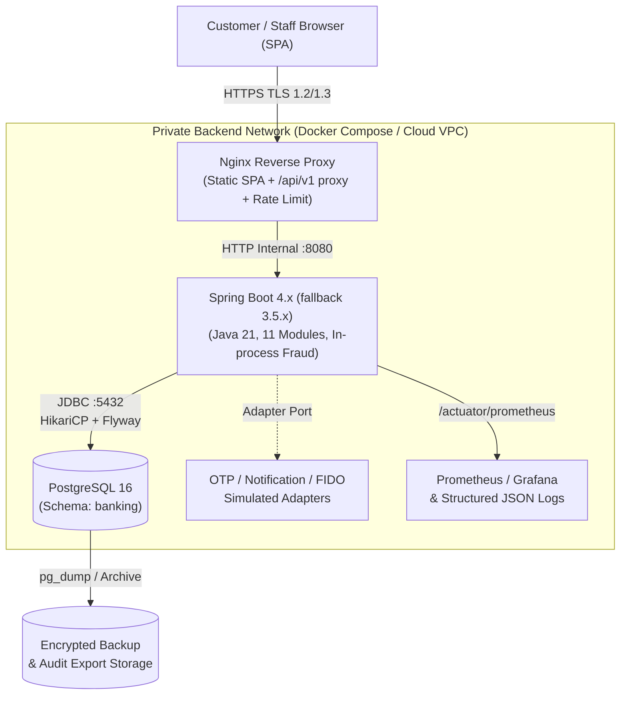

# Cấu hình Triển khai Backend (`docs-backend/deployment/configuration.md`)

> **Dự án:** Digital Banking MVP (Single-Bank, Core Simulated)
> **Mã tài liệu:** `BE-DEP-02`
> **Phiên bản:** v1.2
> **Ngày cập nhật:** 12/11/2026
> **Trạng thái:** Draft — Cấu hình nền/thời gian đã verified tại BE-COM-IMP-01; phần triển khai khác chưa xác nhận runtime
> **Nguồn tham chiếu:** [[digitalbanking-docs/docs-common/04. Database design & analysis.md]] (§3–§9), [[digitalbanking-docs/docs-common/05. Technical stack.md]] (§5.1.6, §5.2, §5.4, §5.7, §5.8), [[digitalbanking-docs/docs-common/06. System architecture.md]] (§5, §8.8, §9, §11, §12), [[digitalbanking-docs/docs-common/07. API contracts.md]] (§2.8, §3.2–§3.3, §3.7, §6.1, §8.9), [[digitalbanking-docs/docs-common/08. Deployment infrastructure.md]] (§3.3, §4–§6, §8–§9), [[digitalbanking-docs/docs-common/design/01. audit-traceability.md]] (§7.6, §10, §12), [[digitalbanking-docs/docs-common/design/02. consistency-concurrency.md]] (§7.10, §10.3, §13), [[digitalbanking-docs/docs-common/design/03. fraud-detection-rules.md]] (§4–§6), [[digitalbanking-docs/docs-common/design/04. security.md]] (§4–§6, §8–§9)
> **Tài liệu liên quan:** [[digitalbanking-docs/docs-backend/deployment/README.md]] (hướng dẫn triển khai & vận hành), [[digitalbanking-docs/docs-backend/README.md]] (chỉ mục Backend)

---

## 1. Mục đích, phạm vi và nguyên tắc

### 1.1. Mục đích

Tài liệu này là **nguồn cấu hình tham chiếu duy nhất** cho việc triển khai Backend Spring Boot Modular Monolith và PostgreSQL 16 của Digital Banking MVP. Tài liệu tập trung các nội dung cần tra cứu khi cấu hình môi trường:

- Profile, biến môi trường và giá trị `application.yml`.
- Cấu hình kết nối PostgreSQL, Flyway migration và phân quyền tài khoản DB.
- Cấu hình bảo mật: session, OTP, lockout, khóa mã hóa, CORS, rate limit.
- Cấu hình nghiệp vụ/vận hành: hạn mức chuyển tiền, step-up, fraud rule, job nền.
- Hợp đồng observability: health, log, metric và ngưỡng cảnh báo.

`deployment/README.md` chỉ giữ **hướng dẫn triển khai, release gate, backup/restore, rollback và runbook**. Mọi bảng giá trị cấu hình được chuyển về tài liệu này để tránh phân mảnh và tránh sai lệch giữa hai tài liệu.

### 1.2. Phạm vi

| Trong phạm vi | Ngoài phạm vi |
|---|---|
| Cấu hình môi trường `local`, `test`, `demo`/Cloud | Production hardening, HA, multi-region DR |
| Biến môi trường, `application.yml`, secret bắt buộc | IaC/terraform và cấu hình provider cụ thể |
| Flyway migration, tài khoản DB, quyền tối thiểu | Viết mã nguồn, class cụ thể, DTO |
| Health, structured log, metric, alert threshold | Dashboard Prometheus/Grafana chi tiết |
| Giá trị nghiệp vụ/vận hành được ngoại hóa | Thay đổi quy tắc nghiệp vụ trong `docs-common/` |

### 1.3. Nguyên tắc cấu hình

1. **`docs-common/01–11` là ưu tiên cao nhất**, sau đó `docs-common/design/`, cuối cùng Backend. Quyết định owner 12/11/2026 áp dụng trước implement; ngưỡng còn Đề xuất trong nguồn giữ nguyên trạng thái, không tự đóng OI nghiệp vụ.
2. **Cấu hình nằm ngoài artifact.** Không đóng gói secret, mật khẩu, khóa AES/HMAC vào image hoặc Git (`05` §5.1.6, `08` §5.2).
3. **Server làm chủ chính sách.** Hạn mức, OTP, lockout, step-up, fraud threshold và retention do server quyết định; client không được ghi đè (`08` §5.2).
4. **Fail-fast.** Thiếu secret bắt buộc hoặc khóa sai độ dài thì ứng dụng dừng khởi động, đặc biệt trên `demo` (`design/04` §6.4).
5. **Thay đổi có kiểm soát.** Thay đổi cấu hình ảnh hưởng tiền, xác thực, retention hoặc fraud phải được review, audit và phát hành có kiểm soát (`08` §5.2).
6. **Pin phiên bản.** Không dùng `latest`/dynamic version cho dependency, image hoặc release artifact (`05` §8.2).

### 1.4. Quy ước trạng thái giá trị

| Nhãn | Ý nghĩa |
|---|---|
| **Chuẩn** | Giá trị được nêu trực tiếp trong `docs-common/` |
| **Đề xuất** | Giá trị baseline trong `docs-common/` nhưng chưa được chốt bằng đo lường/evidence |
| **Đề xuất vận hành** | Giá trị baseline do Backend đề xuất, chưa có trong `docs-common`; cần đo lường/chốt |
| **Mở** | Chưa có giá trị chuẩn; phải chốt trước khi coi là cấu hình phát hành |

---

## 2. Môi trường và Spring Profile

### 2.1. Ma trận môi trường

| Môi trường | Spring Profile | Mục đích | Dữ liệu & adapter | Secret |
|---|---|---|---|---|
| `local` | `local` | Phát triển cá nhân, chạy Docker Compose | PostgreSQL local; seed synthetic; OTP/notification simulator | `.env` cục bộ, không commit |
| `test` | `test` | Unit, slice, integration, concurrency, failure injection | Testcontainers PostgreSQL 16 dùng một lần; `Clock` cố định; cho phép tiêm lỗi | Sinh trong bộ nhớ khi chạy test; cô lập khỏi DB chung |
| `demo` / Cloud | `demo` | Triển khai W7–W8, nghiệm thu `D1–D5`, trình diễn | PostgreSQL bền vững; backup trước demo; dữ liệu synthetic | Environment variable/Docker Secret/Cloud secret store; fail-fast |
| `production` | — | Ngoài phạm vi MVP | Không cam kết | Không cam kết |

Nguồn: `08` §4, `06` §11.3, `10` §4.7–§4.8.

### 2.2. Quy tắc cô lập môi trường

- Không dùng dữ liệu khách hàng, tài chính hoặc credential thật trên `local`, `test`, `demo` (`NFR-032`, `CON-006`).
- Secret của từng môi trường không được sao chép vào tài liệu, source control hoặc evidence.
- Dữ liệu test phải disposable và deterministic; test transaction/lock/idempotency dùng PostgreSQL thật qua Testcontainers, không dùng H2 (`05` §5.2.5).
- Demo phải backup trước khi chuẩn bị dữ liệu có thao tác phá hủy (`08` §4.1).
- Một kết quả test chỉ hợp lệ khi ghi rõ môi trường, source revision, cấu hình liên quan và vị trí evidence (`08` §4.1).

---

## 3. Kiến trúc triển khai và ranh giới mạng

### 3.1. Topology logic



Nguồn: `05` §3.1, `06` §11.1, `08` §3.2.

### 3.2. Ranh giới mạng và endpoint công khai

1. **Không public Backend/PostgreSQL.** Mọi lưu lượng từ trình duyệt đi qua HTTPS tại Nginx. PostgreSQL chỉ lắng nghe trong mạng nội bộ và chỉ nhận kết nối từ Backend (`08` §3.3, `06` §9.1).
2. **Health công khai:** `/actuator/health` là probe hạ tầng, không yêu cầu xác thực; chỉ trả trạng thái `UP`/`DOWN` tối giản, không lộ connection string, secret hay chi tiết hạ tầng (`07` §8.9.1, `06` §12.3).
3. **Health API nghiệp vụ:** `/api/v1/health` yêu cầu quyền `Admin`/`Auditor`, dùng cho monitoring nội bộ; trả `503` khi `DOWN` (`07` §8.9.1).
4. **Actuator nội bộ:** `/actuator/prometheus`, `/actuator/metrics` chỉ truy cập từ mạng nội bộ hoặc yêu cầu quyền quản trị. `/actuator/info` chỉ public nếu không chứa thông tin nhạy cảm (`05` §5.8, `06` §12.3).
5. **TLS và header bảo mật:** TLS 1.2+ (ưu tiên 1.3), HSTS, CSP, `X-Content-Type-Options`, `X-Frame-Options`/`frame-ancestors`, `Cache-Control: no-store` cho `/api/v1/**` (`design/04` §6.1).
6. **CORS:** chỉ cho phép origin SPA tường minh, không dùng `*` khi gửi cookie; methods `GET, POST, OPTIONS`; headers gồm `Authorization`, `Content-Type`, `X-Correlation-ID`, `Idempotency-Key`, `X-CSRF-Token`, `X-Step-Up-Challenge` (`design/04` §8.2, `07` §3.3).

---

## 4. Biến môi trường bắt buộc

### 4.1. Danh mục biến môi trường

| Biến | Bắt buộc | Giá trị mặc định | Ý nghĩa |
|---|---|---|---|
| `SPRING_PROFILES_ACTIVE` | Có | `local` | Profile `local`, `test` hoặc `demo` |
| `SERVER_PORT` | Không | `8080` | Cổng HTTP nội bộ của Backend |
| `APP_TIMEZONE` | Không | `Asia/Ho_Chi_Minh` | ZoneId hợp lệ, không rỗng; timestamp vẫn UTC |
| `APP_LOCKOUT_MAX_FAILED_ATTEMPTS` | Không | `5` — Đề xuất | Số nguyên dương; config cho identity, chưa enforcement |
| `APP_LOCKOUT_DURATION_MINUTES` | Không | `10` — Đề xuất | Số nguyên dương; config cho identity, chưa enforcement |
| `APP_TRANSFER_RATE_LIMIT_PER_CUSTOMER_PER_MINUTE` | Không | `30` — Đề xuất | Số nguyên dương; consumer phải đếm theo customer |
| `DB_HOST` | Có trên `demo` | `localhost` | Host PostgreSQL |
| `DB_PORT` | Không | `5432` | Cổng PostgreSQL |
| `DB_NAME` | Không | `digital_banking` | Tên database |
| `DB_APP_USER` | Có | `banking_app` | Tài khoản runtime least-privilege |
| `DB_APP_PASSWORD` | Có | — | Mật khẩu runtime; lấy từ secret store |
| `DB_MIGRATION_USER` | Có | `banking_migrator` | Tài khoản chạy Flyway migration |
| `DB_MIGRATION_PASSWORD` | Có | — | Mật khẩu migration; lấy từ secret store |
| `DB_POOL_MAX_SIZE` | Không | `20` (đề xuất) | Kích thước tối đa HikariCP; chốt sau benchmark |
| `DB_POOL_MIN_IDLE` | Không | `5` (đề xuất) | Số connection idle tối thiểu |
| `APP_PII_AES_KEY_ID` | Không | `k-v1` | Key version đang dùng để mã hóa PII |
| `APP_PII_AES_KEY_BASE64` | Có | — | Khóa AES-256-GCM, Base64 của đúng 32 byte |
| `APP_HMAC_KEY_BASE64` | Có | — | Khóa HMAC-SHA-256, Base64 của đúng 32 byte |
| `APP_COOKIE_SECURE` | Không | `false` ở `local`; `true` ở `demo` | Bật cờ `Secure` cho cookie session |
| `APP_CORS_ALLOWED_ORIGINS` | Không | `http://localhost:5173` | Danh sách origin SPA, phân tách bằng dấu phẩy |

### 4.2. Mẫu `.env.example`

```dotenv
# =====================================================================
# 1. RUNTIME & ENVIRONMENT
# =====================================================================
SPRING_PROFILES_ACTIVE=local
SERVER_PORT=8080
APP_TIMEZONE=Asia/Ho_Chi_Minh

# =====================================================================
# 2. POSTGRESQL DATABASE
# Tách biệt tài khoản migration (DDL) và runtime (DML least-privilege)
# =====================================================================
DB_HOST=localhost
DB_PORT=5432
DB_NAME=digital_banking

DB_APP_USER=banking_app
DB_APP_PASSWORD=change_me_local_app_pwd

DB_MIGRATION_USER=banking_migrator
DB_MIGRATION_PASSWORD=change_me_local_migrator_pwd

DB_POOL_MAX_SIZE=20
DB_POOL_MIN_IDLE=5

# =====================================================================
# 3. CRYPTOGRAPHIC KEYS (Base64-encoded 32-byte / 256-bit keys)
# Sinh khóa mới: openssl rand -base64 32
# Không dùng giá trị mẫu này trên demo/Cloud.
# =====================================================================
APP_PII_AES_KEY_ID=k-v1
APP_PII_AES_KEY_BASE64=MDEyMzQ1Njc4OWFiY2RlZjAxMjM0NTY3ODlhYmNkZWY=
APP_HMAC_KEY_BASE64=MTEyMzQ1Njc4OWFiY2RlZjAxMjM0NTY3ODlhYmNkZWY=

# =====================================================================
# 4. WEB, SESSION & CORS
# =====================================================================
APP_COOKIE_SECURE=false
APP_CORS_ALLOWED_ORIGINS=http://localhost:5173,https://localhost:8443
```

### 4.3. Quy tắc secret

- Không commit `.env`, mật khẩu, khóa AES/HMAC hoặc token vào Git/image (`08` §6.1, `design/04` §6.4).
- `APP_PII_AES_KEY_BASE64` và `APP_HMAC_KEY_BASE64` phải giải mã Base64 thành đúng **32 byte (256 bit)**; sai độ dài hoặc dùng placeholder trên `demo` phải **fail-fast** (`design/04` §6.4).
- Runtime `CryptoConfig` (IMP-04) từ chối thiếu/sai Base64/độ dài và hai khóa trùng nhau ở mọi profile. Khóa synthetic công khai và khóa lặp một byte chỉ được dùng khi mọi profile đều là local/test; demo/prod/cloud hoặc profile trộn đều từ chối. Validation không chứng minh entropy; tạo riêng mỗi khóa bằng `openssl rand -base64 32`. Không echo/log/serialize key accessors, không expose actuator env/configprops.
- `previous-keys` khác rỗng bị fail-fast vì chưa hỗ trợ rotation; `aes-key-id` chỉ là metadata, không thêm vào blob. Xem [verification IMP-04](../modules/common/report/BE-COM-IMP-04-verification.md).
- `banking_app` và `banking_migrator` phải có mật khẩu khác nhau; không dùng tài khoản migration cho runtime (`design/04` §6.5).
- Trên `demo`/Cloud, ưu tiên Docker Secret hoặc secret store của nền tảng; không đưa secret vào biến môi trường hiển thị trong log/CI (`08` §6.1).
- Không ghi secret, cookie, OTP, token hoặc khóa vào log/evidence (`NFR-020`, `design/04` §9).

---

## 5. Cấu hình `application.yml` chuẩn

### 5.1. Mẫu cấu hình

```yaml
spring:
  application:
    name: digital-banking-backend

  datasource:
    url: jdbc:postgresql://${DB_HOST:localhost}:${DB_PORT:5432}/${DB_NAME:digital_banking}?currentSchema=banking
    username: ${DB_APP_USER}
    password: ${DB_APP_PASSWORD}
    hikari:
      pool-name: BankingHikariPool
      maximum-pool-size: ${DB_POOL_MAX_SIZE:20}   # Đề xuất; chốt sau benchmark (08 §3.4)
      minimum-idle: ${DB_POOL_MIN_IDLE:5}         # Đề xuất vận hành
      connection-timeout: 3000                    # Đề xuất: chờ connection tối đa 3 giây
      validation-timeout: 1000
      max-lifetime: 1800000                       # 30 phút
      auto-commit: false                          # Kiểm soát transaction tường minh
      leak-detection-threshold: 10000              # Cảnh báo giữ connection > 10 giây

  jpa:
    open-in-view: false                           # Không giữ connection ở Controller/View
    hibernate:
      ddl-auto: validate                          # Không để Hibernate tự tạo/sửa bảng
    properties:
      hibernate.jdbc.time_zone: UTC

  flyway:
    enabled: true
    schemas: banking
    default-schema: banking
    user: ${DB_MIGRATION_USER}
    password: ${DB_MIGRATION_PASSWORD}
    locations: classpath:db/migration
    validate-on-migrate: true
    out-of-order: false

  jackson:
    deserialization:
      fail-on-unknown-properties: true            # Chống Mass Assignment (design/04 §8.1)
    serialization:
      write-dates-as-timestamps: false

server:
  port: ${SERVER_PORT:8080}
  shutdown: graceful
  forward-headers-strategy: none                   # IMP-03: chưa cấu hình trusted proxy boundary

management:
  endpoints:
    web:
      base-path: /actuator
      exposure:
        include: health,info,prometheus,metrics    # Bảo vệ metrics/prometheus ở network/Nginx
  endpoint:
    health:
      show-details: never                          # Không lộ chi tiết hạ tầng
      probes:
        enabled: true

# =====================================================================
# CẤU HÌNH NGHIỆP VỤ & VẬN HÀNH NGOẠI HÓA (@ConfigurationProperties)
# =====================================================================
app:
  timezone: ${APP_TIMEZONE:Asia/Ho_Chi_Minh}

  crypto:
    aes-key-id: ${APP_PII_AES_KEY_ID:k-v1}
    aes-key-base64: ${APP_PII_AES_KEY_BASE64}
    hmac-key-base64: ${APP_HMAC_KEY_BASE64}
    previous-keys: []                              # Rotation chưa đủ thiết kế: common OI-COM-05; không tự bật

  security:
    cookie:
      name: DB_SESSION                              # Theo 07 §3.2, ưu tiên hơn cookie khác trong design/04
      secure: ${APP_COOKIE_SECURE:false}
      same-site: Strict
      path: /
      max-age-seconds: 28800                        # 8 giờ; khớp absolute timeout
    cors-allowed-origins: ${APP_CORS_ALLOWED_ORIGINS:http://localhost:5173}
    session:
      idle-timeout-minutes: 15                     # 07 §3.7, Đề xuất
      absolute-timeout-hours: 8                    # 07 §3.7, Đề xuất
      # Theo 07 §3.2 cho phép nhiều session; không áp trần 3/1 từ design/04.
      # Thu hồi theo device/user là Deferred; đã bỏ keys trần session trong IMP-01.
    lockout:
      max-failed-attempts: ${APP_LOCKOUT_MAX_FAILED_ATTEMPTS:5} # 07 §3.7, Đề xuất
      lock-duration-minutes: ${APP_LOCKOUT_DURATION_MINUTES:10} # 07 §3.7, Đề xuất
    otp:
      ttl-seconds: 300                             # LOGIN_MFA/TRANSFER_STEP_UP/SENSITIVE_ACTION
      recovery-ttl-seconds: 120                    # Baseline OTP recovery (design/03 §4.1)
      max-verify-attempts: 5
      resend-cooldown-seconds: 60                  # Đề xuất vận hành; common chưa chốt
      max-resend-count: 3                          # 07 §8.1.8
    rate-limit:
      login-per-ip-per-minute: 10                  # design/04 §8.3
      login-per-username-per-minute: ${APP_LOGIN_PER_USERNAME_PER_MINUTE:10}             # design/04 §8.3
      step-up-per-user-per-5-minutes: 10            # design/04 §8.3
      otp-verify-per-user-per-minute: 20            # 07 §2.8
      transfer-per-customer-per-minute: ${APP_TRANSFER_RATE_LIMIT_PER_CUSTOMER_PER_MINUTE:30} # 07 §2.8, Đề xuất
      audit-export-per-user-per-hour: 5              # design/04 §8.3
      read-per-user-per-minute: 120                  # design/04 §8.3
    step-up:
      single-amount-vnd: 10000000                  # >= 10.000.000 VND (design/04 §4.4)
      daily-amount-vnd: 20000000                   # > 20.000.000 VND/ngày (design/04 §4.4)

  transfer:
    min-amount-vnd: 2000                           # design/03 §4.1
    max-amount-vnd: 10000000                       # design/03 §4.1
    pin-otp-threshold-vnd: 5000000                 # > 5.000.000 VND cần PIN + OTP (design/03 §4.2)
    daily-cap-vnd: 50000000                        # > 50.000.000 VND/ngày bị từ chối (design/03 §4.2)
    idempotency-ttl-hours: 24
    t2-lock-timeout-ms: 2000                       # SET LOCAL lock_timeout = '2s'
    t2-statement-timeout-ms: 5000                  # SET LOCAL statement_timeout = '5s'
    fraud-eval-timeout-ms: 1000                    # Ngân sách tối đa cho fraud engine trong T2

  fraud:
    velocity-count: 3                              # design/03 §4.2: giao dịch thứ 3
    velocity-window-seconds: 120                   # trong 120 giây
    warning-ttl-minutes: 15                        # design/03 §6.1
    review-timeout-minutes: 30                     # design/03 §6.1

  jobs:
    reconciliation-on-startup: true
    reconciliation-interval-ms: 60000              # Đề xuất 1 phút; common cho phép 1–5 phút
    reconciliation-pending-age-seconds: 300        # PENDING > 5 phút (design/02 §10.3)
    outbox-poll-interval-ms: 2000                  # Đề xuất vận hành; common chưa chốt
    outbox-batch-size: 50                           # Đề xuất vận hành; common chưa chốt
    outbox-lease-seconds: 30                        # Đề xuất vận hành; common chưa chốt
    audit-verify-incremental-cron: "0 */15 * * * *" # design/01 §7.6
    audit-verify-full-cron: "0 0 2 * * *"          # Hằng ngày, off-peak
    retention-cleanup-cron: "0 0 3 * * *"          # Hằng ngày (design/01 §7.6)
```

### 5.2. Ghi chú cấu hình quan trọng

- `spring.jpa.open-in-view: false` và `ddl-auto: validate` là **bắt buộc** theo `05` §5.2.3 và `06` §8.8.
- `spring.flyway.user/password` là tài khoản migration; `spring.datasource.username/password` là tài khoản runtime. Không dùng chung (`design/04` §6.5).
- `spring.jackson.deserialization.fail-on-unknown-properties=true` chống Mass Assignment (`design/04` §8.1).
- `management.endpoint.health.show-details=never` và chỉ public `/actuator/health`; không public metrics/prometheus (`06` §12.3, `08` §3.3).
- Các giá trị `(đề xuất)` về pool, outbox poll/batch/lease, resend cooldown chỉ là baseline vận hành; phải chốt bằng benchmark/evidence trước khi coi là cam kết.
- `app.security.step-up.*` (T0 challenge) **khác** với `app.transfer.pin-otp-threshold-vnd` (yêu cầu PIN + OTP). Hai ngưỡng này không được gộp chung.
- `AppProperties` cung cấp nested defaults cả khi không có YAML; profile override base YAML, env/CLI override theo Spring Boot. Ba biến lockout/transfer ở §4.1 và `APP_TIMEZONE` được chuyển tiếp trong Compose. Khởi động lại sau đổi cấu hình. Các trường số vừa nêu phải là số nguyên dương; timezone rỗng/sai làm khởi động thất bại với thông báo không echo giá trị timezone hoặc key.
- Consumer bỏ `transfer-per-user-per-minute` và keys `max-concurrent-sessions-customer/staff`; dùng `transferPerCustomerPerMinute()` và định danh customer. Không suy ra cap session mới. BE-COM-IMP-04 đã triển khai validation khóa; rotation vẫn Open (OQ-15/OI-COM-05), HTTP layer/enforcement common đã có ở 05; identity/transfer integration còn Blocked trong 05/07; task 01 chỉ bind config, không chạy session/OTP/rate limit/job.
- Inject `Clock` UTC và `ZoneId businessZoneId`: `clock.instant()` cho timestamp/TTL, `LocalDate.now(clock.withZone(businessZoneId))` cho ngày nghiệp vụ; test inject primary `Clock.fixed`. Hợp đồng và ví dụ override tại [backend README](../../../digitalbanking-backend/README.md#common-configuration-and-time).

---

### HTTP security — hiện trạng BE-COM-IMP-05

Common đã enforce body/token-bucket limits trong một process; identity thật và luồng cookie/session vẫn **Blocked**. Không xem cấu hình hoặc adapter test là bằng chứng persistence/xác thực thật. Contract/handoff: [backend README](../../../digitalbanking-backend/README.md#http-security-and-identity-integration); [verification](../modules/common/report/BE-COM-IMP-05-verification.md).

| Cấu hình | Env | Baseline / trách nhiệm |
|---|---|---|
| `app.security.http.max-request-body-bytes` | `APP_MAX_REQUEST_BODY_BYTES` | 65536 bytes, Đề xuất 07 §2.8; check cả Content-Length và stream/chunked |
| `app.security.http.max-rate-limit-buckets` | `APP_MAX_RATE_LIMIT_BUCKETS` | 10000, state bounded trong process; hết capacity trả 503 |
| `login-per-ip-per-minute` | `APP_LOGIN_PER_IP_PER_MINUTE` | 10, Đề xuất, HTTP enforce theo peer socket IP |
| `login-per-username-per-minute` | `APP_LOGIN_PER_USERNAME_PER_MINUTE` | 10 theo 07, thay baseline design 5; identity normalize và gọi limiter, chưa tích hợp |
| `step-up-per-user-per-5-minutes` | `APP_STEP_UP_PER_USER_PER_5_MINUTES` | 10, Đề xuất, sau xác thực |
| `otp-verify-per-user-per-minute` | `APP_OTP_VERIFY_PER_USER_PER_MINUTE` | 20, Đề xuất, HTTP sau xác thực; identity phụ trách user/challenge khi pre-login |
| `transfer-per-customer-per-minute` | `APP_TRANSFER_RATE_LIMIT_PER_CUSTOMER_PER_MINUTE` | 30, Đề xuất, không tách theo session/user |
| `audit-export-per-user-per-hour` | `APP_AUDIT_EXPORT_PER_USER_PER_HOUR` | 5, Đề xuất |
| `read-per-user-per-minute` | `APP_GLOBAL_API_PER_SUBJECT_PER_MINUTE` | 120, Đề xuất; key cũ dùng làm quota global API/user hoặc IP khi anonymous |

Các rate key ở dưới `app.security.rate-limit`. YAML, Compose và `.env.example` đồng bộ; giá trị enforced phải dương. Token bucket khởi đầu đầy, refill liên tục, Retry-After = ceil thời gian chờ token tiếp theo; không phải thời gian còn lại của phút cố định. Process restart reset quotas; triển khai nhiều replica cần edge/shared quota trước release, không claim cluster enforcement từ test local. Không tin Forwarded/X-Forwarded-For; khi sau proxy bucket IP là proxy cho đến task 08 xác minh trust boundary. Session resolver reject trước HTTP limiter; identity/edge cần chống flood lookup token.

CORS fail startup nếu wildcard/origin sai dạng; methods GET/POST/OPTIONS, credentials true, headers theo 07. Security/cache headers cả lỗi; HSTS chỉ request HTTPS thực. SPA CSP đầy đủ, redirect HTTP→HTTPS, proxy stripping, cookie Secure/HttpOnly/SameSite/Path/Max-Age qua identity và Cloud TLS còn cần kiểm chứng owner/08. `SessionCsrfTokens` chỉ đọc hash do identity trả; source schema session chưa có CSRF field, không tự thêm migration trong common.

## 6. Cấu hình Database, Flyway và phân quyền

### 6.1. Schema và nguyên tắc migration

- Schema duy nhất: `banking`; tên bảng/cột `snake_case`; tiền `NUMERIC(19,2)`; thời gian `TIMESTAMPTZ` UTC (`04` §1, `05` §5.2.1, `06` §8.8).
- Flyway quản lý toàn bộ schema, trigger bất biến, partial index và seed demo (`05` §5.2.3).
- **Forward-only:** không sửa file migration đã chạy; mọi thay đổi schema tạo migration mới (`08` §8.1).
- Ứng dụng chỉ chạy `ddl-auto=validate`; migration failure chặn release (`08` §8.1).
- Không khẳng định tên file migration cụ thể trong tài liệu này. Tên file chính xác thuộc phạm vi implementation (`08` §8.1, `OI-DEP-03`).

### 6.2. Thứ tự migration theo `08` §8.1

| Thứ tự | Nội dung | Ghi chú |
|---:|---|---|
| 1 | Tạo schema `banking`, metadata migration, extension/hàm tiện ích | `pgcrypto` chỉ thêm nếu thực sự cần |
| 2 | Bảng identity và RBAC | `app_user`, `role`, `permission`, `user_role`, `role_permission`, `user_privilege`, `device`, `session`, `auth_challenge`, `auth_attempt`, `password_history` |
| 3 | Bảng customer và account | Ràng buộc `available_balance >= 0`, `ledger_balance >= 0`, `available_balance <= ledger_balance` |
| 4 | Bảng transfer, ledger, idempotency | Ràng buộc cặp bút toán kép `(transfer_id, entry_seq)` |
| 5 | Bảng limit, usage, approval, fraud | `limit_config`, `limit_usage`, `approval_request`, `fraud_rule_config`, `fraud_flag` |
| 6 | Bảng audit, notification, retention, legal hold | `audit_log`, `audit_chain_checkpoint`, `legal_hold`, `retention_policy`, `notification` |
| 7 | Foreign key và ràng buộc xuyên domain | Thêm sau khi bảng được tham chiếu đã tồn tại |
| 8 | Trigger bất biến và bảo vệ append-only | `ledger_entry`, `audit_log`; trigger chặn UPDATE/DELETE/TRUNCATE |
| 9 | Index | Partial unique index, composite index theo query pattern |
| 10 | Seed dữ liệu synthetic | Repeatable migration `R__synthetic_demo_seed.sql`; chỉ `local`/`demo` |
| 11 | Backfill | Migration riêng, resumable, có evidence |
| 12 | Không sửa migration đã áp dụng | Mọi thay đổi phải là migration forward-only mới |

Nguồn: `08` §8.1, `04` §3–§8, `06` §8.1–§8.8. Tên bảng vật lý lấy theo `04`/`06` (`app_user`, `device`); `design/04` dùng `users`/`user_device` — cần đồng bộ thuật ngữ trong `docs-common/`.

### 6.3. Tài khoản DB và quyền tối thiểu

| Tài khoản | Vai trò | Quyền |
|---|---|---|
| `banking_migrator` | Flyway DDL lúc khởi động | `CREATE`, `ALTER`, `DROP` trong schema `banking`; không dùng cho runtime |
| `banking_app` | Runtime DML | `SELECT`, `INSERT`, `UPDATE`, `DELETE` trên bảng nghiệp vụ; **chỉ `SELECT`, `INSERT`** trên `ledger_entry` và `audit_log`; không có DDL/`TRUNCATE`/`DROP` |

Ánh xạ vai trò logic trong `04` §9.2:

| Vai trò logic (`04` §9.2) | Ánh xạ MVP |
|---|---|
| `app_rw` | `banking_app` (DML, không sửa/xóa audit/ledger) |
| `audit_writer` | Mục tiêu tách role chỉ `INSERT` audit; MVP dùng `banking_app` với quyền `INSERT` trên `audit_log` |
| `auditor_ro` | Role read-only cho audit/transaction; triển khai khi có audit export/verification tách biệt |
| `migration` | `banking_migrator` |

Thiết kế chi tiết dùng hai credential `banking_app`/`banking_migrator` (`design/04` §6.5); việc tách đầy đủ `audit_writer`/`auditor_ro` là mục tiêu defense-in-depth, có thể bổ sung mà không đổi contract ứng dụng.

### 6.4. Script phân quyền mẫu

```sql
-- Thực thi trong init-db.sql hoặc migration bootstrap có kiểm soát
GRANT CONNECT ON DATABASE digital_banking TO banking_app, banking_migrator;
GRANT USAGE ON SCHEMA banking TO banking_app;
GRANT USAGE, CREATE ON SCHEMA banking TO banking_migrator;

GRANT SELECT, INSERT, UPDATE, DELETE ON ALL TABLES IN SCHEMA banking TO banking_app;
GRANT USAGE, SELECT ON ALL SEQUENCES IN SCHEMA banking TO banking_app;

-- Runtime không có DDL/TRUNCATE
REVOKE CREATE ON SCHEMA banking FROM banking_app;
REVOKE TRUNCATE ON ALL TABLES IN SCHEMA banking FROM banking_app;

-- Bằng chứng bất biến: chỉ SELECT/INSERT
REVOKE UPDATE, DELETE, TRUNCATE ON banking.ledger_entry, banking.audit_log FROM banking_app;
```

Nguồn: `design/04` §6.5, `04` §9.2, `06` §8.5. Không hard-code mật khẩu trong script; cấp mật khẩu qua secret store/init mechanism.

### 6.5. Seed dữ liệu demo

- Seed synthetic gồm role/permission tối thiểu, global limit, fraud rule, customer/staff mẫu và tài khoản demo.
- Chỉ chạy trên `local`/`demo`; không dùng PII thật (`NFR-032`, `CON-006`).
- Dùng repeatable migration hoặc profile demo có kiểm soát; không đưa seed vào migration versioned dùng cho mọi môi trường (`05` §5.2.5, `08` §8.1).

### 6.6. Backup và phục hồi

- Bắt buộc backup logic trước mỗi demo và trước migration có thay đổi schema (`08` §8.3).
- Backup phải nằm ngoài volume runtime, được mã hóa, có checksum và phải được restore thử (`08` §8.3).
- RTO ≤ 30 phút và RPO ≤ 5 phút là **đề xuất** (NFR-007), chưa phải cam kết cho đến khi có đo lường (`08` §8.4).
- Quy trình backup/restore chi tiết nằm tại [[digitalbanking-docs/docs-backend/deployment/README.md]] §5.

---

## 7. Cấu hình Observability

### 7.1. Health contract

| Endpoint | Quyền truy cập | Mục đích | Hành vi |
|---|---|---|---|
| `/actuator/health` | Public (infra probe) | Docker/cloud healthcheck | `200 {"status":"UP"}` khi ứng dụng và DB sẵn sàng; `503 {"status":"DOWN"}` khi mất DB/pool cạn kiệt; không lộ chi tiết |
| `/api/v1/health` | `Admin`/`Auditor` | Health API nội bộ | `200` khi `UP`/`DEGRADED`; `503` khi `DOWN` (`07` §8.9.1) |
| `/actuator/metrics`, `/actuator/prometheus` | Nội bộ/quản trị | Metrics | Không public Internet |
| `/actuator/info` | Public nếu tối giản | Thông tin build/version | Không chứa secret/PII |

Ghi chú: `show-details: never`; health không chứng minh mọi capability nghiệp vụ hoạt động — vẫn cần smoke test và kiểm tra invariant (`08` §9.1).

### 7.2. Structured log

Mọi log ra `stdout` ở dạng JSON một dòng, tối thiểu gồm:

`timestamp` (UTC ISO-8601), `level`, `service`, `environment`, `correlation_id`, `request_id`, `user_id` (mask/ID nội bộ), `route`, `status`, `action`, `outcome`, `latency_ms`, `error_code`, `audit_id` (nếu có). Có thể bổ sung `transfer_id`, `reference`, `sqlstate`, `attempt` theo `design/02` §13.2.

**Cấm log:** mật khẩu, PIN, OTP, raw session/CSRF token, raw idempotency key, khóa AES/HMAC, số tài khoản/CCCD/số điện thoại/email đầy đủ, full payload chuyển tiền (`NFR-020`, `08` §9.2, `design/02` §13.2).

BE-COM-IMP-06 đã triển khai stdout qua `logback-spring.xml`/`SafeJsonLogEncoder`: event `HTTP_REQUEST_COMPLETED` dùng route template (fallback `UNMATCHED`), status/latency và trace trước cleanup; user ID nội bộ được SHA-256 mask. Đặt `APP_ENVIRONMENT` theo môi trường triển khai; profile test đặt `test`. Encoder chỉ nhận trường được phép của event HTTP, bỏ raw message/arguments, arbitrary MDC, exception message/stack trace và unknown structured fields cho cả third-party logger. Log chung còn logger/level/exception type; richer coded events của owner cần tích hợp được review, không bật raw fallback. Không coi technical log là audit/C3 fallback hoàn chỉnh.

Health API đã có `HealthResponse` gồm database/application; không giả lập outbox. Probe public có thể thêm tên nhóm liveness/readiness nhưng không có components/details. `/actuator/metrics` và `/actuator/prometheus` chỉ nhận Admin/Auditor qua SPI identity. HTTP histogram đã bật cho p95/p99; business metrics trong bảng dưới là hợp đồng owner, không phải tuyên bố đã emit. Xem [hướng dẫn runtime](../../../digitalbanking-backend/README.md#logs-http-metrics-and-health) và [verification 06](../modules/common/report/BE-COM-IMP-06-verification.md).

### 7.3. Metrics chuẩn

| Nhóm | Metric | Ý nghĩa |
|---|---|---|
| HTTP | `http_server_requests_seconds` | Request rate, error rate, p95/p99 |
| Transfer | `transfer_created_total`, `transfer_completed_total`, `transfer_failed_total` | Vòng đời transfer |
| Transfer | `transfer_pending_age_seconds`, `transfer_t1_duration_seconds`, `transfer_t2_duration_seconds`, `transfer_retry_total` | Tuổi PENDING, latency T1/T2, retry |
| Idempotency | `idempotency_replay_total`, `idempotency_conflict_total`, `idempotency_in_progress_total`, `idempotency_stuck_total` | Replay/conflict/kẹt |
| Concurrency/DB | `db_deadlock_total`, `db_pool_active`, `db_pool_waiting` | Deadlock, pool |
| Audit | `audit_write_total{action,criticality,outcome}`, `audit_write_failure_total`, `audit_write_latency_seconds`, `audit_lock_wait_seconds` | Ghi audit/độ trễ/khóa |
| Audit integrity | `audit_chain_verify_failure_total`, `audit_gap_total` | Sai chuỗi/gap |
| Fraud | `fraud_flag_total{rule}` | Flag theo rule |
| Notification | `notification_backlog`, `notification_retry_total` | Backlog/retry |
| Jobs | `reconciliation_total{result}`, `reconciliation_duration_seconds` | Đối soát |

Nguồn: `design/02` §13.1, `design/01` §12.2, `design/04` §9. Không dùng label cardinality cao (`accountId`, `userId`, `correlationId`, `idempotencyKey`) (`08` §9.3).

### 7.4. Alert threshold và runbook

| Alert | Ngưỡng | Mức | Hành động |
|---|---|---|---|
| PENDING quá hạn | `transfer_pending_age_seconds > 300` | Page | `R-CON-01` |
| Idempotency kẹt | `idempotency_stuck_total > 0` trong 10 phút | Page | `R-CON-02` |
| Deadlock tăng | `db_deadlock_total > 5/phút` | Warn | `R-CON-03` |
| Lock wait cao | p95 > 500ms trong 5 phút | Warn | `R-CON-03` |
| Pool cạn | `db_pool_active` > 90% sức chứa pool trong 5 phút | Page | `R-CON-07` |
| Audit gap | `audit_gap_total > 0` | Page | `R-CON-05`/`R-AUD-03` |
| Audit chain invalid | `audit_chain_verify_failure_total > 0` | Critical | `R-AUD-02` |
| Ledger mismatch | Job đối soát phát hiện lệch | Critical | `R-CON-04` |
| Notification backlog | > 100 hoặc tuổi > 10 phút | Warn | `R-CON-06` |
| Reconciliation fail | Tỷ lệ fail > 1% | Warn | `R-CON-01` |
| Transfer error rate | > 1% trong 5 phút | High | Điều tra DB/adapter; giữ đúng kết quả transfer |
| Transfer p95 | > 2 giây trong 5 phút | Warn | Điều tra lock/DB/pool |
| Backup fail | Bất kỳ | High | Chạy lại, kiểm tra dung lượng, alert |

Nguồn: `design/02` §13.3, `design/01` §12.2, `06` §12.5, `08` §9.4. `06`/`08` đề xuất pool >80%; `design/02` dùng 90% trong 5 phút — cấu hình chi tiết lấy `design/02`, cần đồng bộ lại ngưỡng giữa các tài liệu.

### 7.5. Retention observability

- Log kỹ thuật: rotation/retention chưa chốt; phải định nghĩa trước demo (`08` §9.2).
- Audit: retention 5 năm (đề xuất), legal hold override (`design/01` §10).
- Metrics: giữ đủ lịch sử cho D5 và điều tra sự cố; giá trị cụ thể còn mở (`08` §9.2).
- Technical log không thay thế audit retention; log rotation không được xóa audit evidence (`08` §9.2).

---

## 8. Kiểm soát thay đổi cấu hình

### 8.1. Checklist trước khi deploy

- [ ] `SPRING_PROFILES_ACTIVE` đúng môi trường.
- [ ] Đủ secret bắt buộc; khóa AES/HMAC đúng 32 byte; không dùng placeholder trên `demo`.
- [ ] `banking_app` và `banking_migrator` tách biệt; quyền runtime đúng least-privilege.
- [ ] `ddl-auto=validate`; Flyway migration chạy sạch trên DB trống.
- [ ] CORS chỉ cho origin SPA; cookie `Secure` bật trên `demo`; CSRF header được kiểm tra.
- [ ] Chỉ public `/actuator/health` (và `/actuator/info` tối giản nếu cần); metrics/prometheus nội bộ.
- [ ] Backup trước demo/migration; đã restore thử.
- [ ] Cấu hình phiên bản (đã che secret) được lưu cùng release evidence.
- [ ] Không có secret/PII trong Git, image, log hoặc tài liệu.

### 8.2. Thay đổi cấu hình nhạy cảm

Thay đổi ảnh hưởng tiền, xác thực, retention hoặc fraud phải:

1. Có review của owner module/Technical Lead.
2. Được audit (nếu áp dụng qua admin/approval) và ghi phiên bản cấu hình.
3. Được kiểm thử trên `local`/`test` trước `demo`.
4. Có phương án rollback cấu hình (khôi phục phiên bản trước) và không làm mất evidence.

---

## 9. Đối chiếu `docs-common` và các điểm đã sửa

Bảng dưới ghi lại các điểm Backend từng mô tả chưa khớp hoặc `docs-common` còn khác biệt nội bộ. Đây là danh sách cần đồng bộ ngược lại tài liệu chuẩn khi có điều kiện.

| Chủ đề | `docs-common` | Cách Backend áp dụng |
|---|---|---|
| Framework/build | `05` §4.1/§8.1: Spring Boot 4.x (fallback 3.5.x), Java 21, Gradle Kotlin DSL | Sửa từ Spring Boot 3.3/Maven sang Spring Boot 4.x (fallback 3.5.x), lệnh `./gradlew` |
| Health công khai | `07` §8.9.1: `/actuator/health` là infra probe; `/api/v1/health` yêu cầu Admin/Auditor | Không mô tả `/api/v1/health` là public; tách hai endpoint |
| OTP TTL | `design/04` §4.2/§4.4: 5 phút; `design/03` §4.1: recovery OTP 120 giây | Mặc định 300 giây; recovery override 120 giây |
| Lockout | `03` §4.5/`06` §9.2/`07` §3.7: 5 lần/10 phút, Đề xuất; design/04 nêu 15 phút | Theo `01–11`: baseline 10 phút, giữ Đề xuất; IMP-01 đã đồng bộ config, chưa enforcement/đóng OI nghiệp vụ |
| Transfer rate | `07` §2.8: 30/phút/customer, Đề xuất; design/04 §8.3: 20/phút/user | Theo `07`: 30/customer/phút, giữ Đề xuất; IMP-01 đã đổi key/accessor thành transfer-per-customer-per-minute/30, chưa enforcement |
| Session đồng thời | `design/04` §4.3: Customer 3, Staff 1; `07` §3.2: nhiều session, thu hồi theo device/user Deferred | Theo `07`; IMP-01 bỏ keys trần 3/1 trong Java/YAML, không triển khai session/revocation |
| Cookie session | `07` §3.2: `DB_SESSION`, `Path=/`, `Max-Age=28800`; design/04: `SESSION_TOKEN`, `Path=/api` | Đã phân xử theo `07`; không chờ chọn lại tên/path, không tự đóng issue ở tài liệu nguồn |
| Step-up và PIN+OTP | `design/04` §4.4: step-up khi `>= 10.000.000` hoặc ngày `> 20.000.000`; `design/03` §4.2: `> 5.000.000` cần PIN + OTP | Tách hai khóa: `app.security.step-up.*` và `app.transfer.pin-otp-threshold-vnd` |
| Fraud velocity | `design/03` §4.2/§5: giao dịch thứ 3 trong 120 giây; `06` §7.6: > 5 giao dịch/10 phút | Theo `design/03` 3/120 giây; cần đồng bộ `06` |
| Tài khoản DB | `design/04` §6.5: `banking_app`/`banking_migrator`; `04` §9.2: `app_rw`/`audit_writer`/`auditor_ro`/`migration` | Dùng 2 credential theo `design/04`; ánh xạ vai trò logic, tách đầy đủ là mục tiêu |
| Tên bảng | `04`/`06`: `app_user`, `device`; `design/04`: `users`, `user_device` | Theo `04`/`06` cho schema vật lý; cần đồng bộ `design/04` |
| Reconciliation | `design/02` §10.3: scheduler 1–5 phút; PENDING > 5 phút | Sửa từ 30 giây/15 giây sang 1 phút/5 phút |
| Audit/retention job | `design/01` §7.6: incremental 15 phút, full verify hằng ngày, retention hằng ngày | Sửa retention từ hằng giờ sang hằng ngày; thêm full verify |
| Metric names | `design/01` §12.2, `design/02` §13.1 dùng `transfer_*`, `idempotency_*`, `audit_*`, `db_*`; `design/04` §9.2 dùng `banking_audit_chain_tamper_detected_total` | Bỏ tiền tố `banking_*` tự đặt; dùng tên chuẩn `design/01`/`design/02`; cần đồng bộ tên metric audit với `design/04` |
| Trạng thái tài liệu | `08` v0.2 là Draft, chưa xác nhận runtime | Backend deployment docs để trạng thái Draft, không tuyên bố production-ready |

---

## 10. Traceability cấu hình

Các quyết định liên quan `common` được chốt tại [[digitalbanking-docs/docs-backend/modules/common/README.md]] §1.5. BE-COM-IMP-01 đã đồng bộ lockout 5/10, transfer 30/customer/phút và bỏ trần session trong application.yml/AppProperties; xem [verification](../modules/common/report/BE-COM-IMP-01-verification.md). Các phần khác của mẫu vẫn cần verification theo task sở hữu, không mặc nhiên là runtime đã hoạt động. Các khác biệt ngoài 8 nhóm common chưa được audit lại trong lần cập nhật này.

| Yêu cầu | Cấu hình liên quan | Mục |
|---|---|---|
| `TC-001` Spring Boot + PostgreSQL | Runtime, datasource, Flyway | §3, §5, §6 |
| `TC-002` REST/JSON/HTTPS | Nginx TLS, CORS, security headers | §3.2 |
| `NFR-007` RTO/RPO | Backup/restore, retention | §6.6, README §5 |
| `NFR-013`–`NFR-020` security | TLS, AES/HMAC, session, OTP, lockout, rate limit, secret | §4, §5, §6.3 |
| `NFR-021`–`NFR-023` audit | Audit DB role, retention, verification job | §6, §7.4, §7.5 |
| `NFR-025` observability | Health, log, metrics, alert | §7 |
| `NFR-032` synthetic data | Seed demo, environment isolation | §2.2, §6.5 |
| `08` §5.2 config principles | Externalized config, server-owned policy | §1.3, §8 |

---

## 11. Tài liệu tham chiếu

- [[digitalbanking-docs/docs-common/05. Technical stack.md]]
- [[digitalbanking-docs/docs-common/06. System architecture.md]]
- [[digitalbanking-docs/docs-common/07. API contracts.md]]
- [[digitalbanking-docs/docs-common/08. Deployment infrastructure.md]]
- [[digitalbanking-docs/docs-common/09. Test plan.md]]
- [[digitalbanking-docs/docs-common/design/01. audit-traceability.md]]
- [[digitalbanking-docs/docs-common/design/02. consistency-concurrency.md]]
- [[digitalbanking-docs/docs-common/design/03. fraud-detection-rules.md]]
- [[digitalbanking-docs/docs-common/design/04. security.md]]
- [[digitalbanking-docs/docs-common/04. Database design & analysis.md]]
- [[digitalbanking-docs/openapi/digital-banking-v1.yaml]]

## Change Log

| Phiên bản | Ngày | Thay đổi |
|---|---|---|
| v1.1 | 12/11/2026 | Đồng bộ các mục common về lockout/rate limit scope customer/session/cookie và giới hạn rotation theo ưu tiên 01–11; giữ nhãn Đề xuất, không sửa runtime |
| v1.2 | 12/11/2026 | BE-COM-IMP-01: đồng bộ lockout/transfer/session config, env override, validation/time contract và liên kết verification; giữ Đề xuất và giới hạn runtime |

### Request context / proxy boundary — BE-COM-IMP-03

Runtime bỏ qua Forwarded/X-Forwarded-*; context dùng socket peer, chỉ giữ IPv4 masked; IPv6/unknown là null. Sau Nginx, peer này là proxy, không phải IP end-user để rate-limit/audit. Chỉ bật hỗ trợ forwarded headers sau khi kiểm chứng ingress strip/overwrite header, chặn truy cập backend trực tiếp và HTTPS redirect (IMP-05/08); không dùng metadata masked làm khóa IP limiter. Xem [usage](../../../digitalbanking-backend/README.md#request-context-and-propagation) và [verification](../modules/common/report/BE-COM-IMP-03-verification.md).
