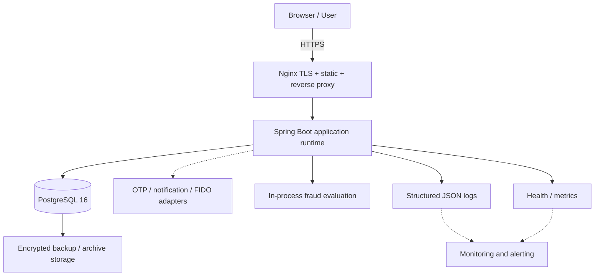

# 01. Môi trường, Mạng và Bí mật

> **Dự án:** Digital Banking MVP
> **Mã tài liệu:** `BE-DEP-CFG-01`
> **Phiên bản:** v2.0
> **Ngày cập nhật:** 09/11/2026
> **Trạng thái:** Baseline đã đối chiếu `docs-common/` — chưa có bằng chứng runtime
> **Nguồn chuẩn:** [[digitalbanking-docs/docs-common/08. Deployment infrastructure.md]] (§3–§6), [[digitalbanking-docs/docs-common/05. Technical stack.md]], [[digitalbanking-docs/docs-common/06. System architecture.md]] (§9–§11), [[digitalbanking-docs/docs-common/design/04. security.md]]

---

## 1. Mô hình môi trường

| Môi trường | Spring profile | Mục đích | Dữ liệu & adapter | Bí mật | Trạng thái |
|---|---|---|---|---|---|
| `local` | `local` | Phát triển cá nhân | PostgreSQL Docker local; seed tổng hợp; OTP/notification simulator | `.env` cục bộ, nằm trong `.gitignore`, tạo từ `.env.example` | Confirmed direction |
| `test` | `test` | Unit, slice, integration, contract, concurrency, failure test | Testcontainers PostgreSQL 16 dùng một lần; clock/doubles xác định; cho phép tiêm lỗi | Sinh trong bộ nhớ hoặc CI secret; không dùng chung DB | Confirmed direction |
| `demo` | `demo` | Trình diễn và nghiệm thu `D1–D5` | PostgreSQL bền vững; dữ liệu tổng hợp; backup trước demo | Environment/secret của nền tảng hoặc Docker secret; fail-fast nếu thiếu | Confirmed direction |
| `production` | — | Tương lai, không thuộc MVP | — | Cần hardening, managed service, KMS, HA, DR chính thức | **Out of scope** |

### 1.1. Cô lập môi trường

- Không dùng dữ liệu khách hàng, tài chính hoặc credential thật trong `local`, `test`, `demo` (`NFR-032`, `TC-010`, `RC-005`).
- Không sao chép secret giữa các môi trường hoặc vào tài liệu, source control, evidence.
- Dữ liệu test phải disposable và deterministic.
- Tạo backup trước mọi thao tác chuẩn bị demo có thể ghi đè dữ liệu.
- Kết quả test chỉ hợp lệ khi ghi rõ môi trường, source version, giả định cấu hình và vị trí evidence.

---

## 2. Topology và ranh giới mạng



### 2.1. Quy tắc ranh giới (`08` §3.3)

1. Người dùng chỉ vào qua HTTPS tại Nginx; không truy cập trực tiếp application runtime hoặc database.
2. Application runtime là thành phần duy nhất được truy cập dữ liệu nghiệp vụ.
3. PostgreSQL không phải endpoint công khai; chỉ lắng nghe trong mạng nội bộ và chỉ nhận kết nối từ application runtime.
4. Adapter bên ngoài chỉ truy cập qua port/adapter; lỗi adapter phải ánh xạ tới failure behavior đã định nghĩa.
5. Observability chỉ công khai health tối giản; metrics và dữ liệu vận hành phải được bảo vệ.
6. Hành động quản trị/audit phải qua kiểm tra role/permission và ghi audit.

CDN, WAF và external load balancer là capability tùy chọn, **chưa** thuộc topology MVP đã xác nhận.

---

## 3. Danh mục biến môi trường

### 3.1. Nguyên tắc

- `.env.example` chỉ chứa **tên biến** và placeholder không nhạy cảm.
- `.env` thật không được commit; phải nằm trong `.gitignore`.
- Trên `demo`, thiếu biến bắt buộc hoặc khóa không hợp lệ phải làm ứng dụng **dừng khởi động** (fail-fast).
- Không đặt secret thật trong Docker image, tài liệu, log, test report hoặc ảnh chụp.

### 3.2. `.env.example` (placeholder, không dùng cho demo)

```dotenv
# 1. RUNTIME
SPRING_PROFILES_ACTIVE=local
SERVER_PORT=8080
APP_TIMEZONE=Asia/Ho_Chi_Minh

# 2. POSTGRESQL
DB_HOST=localhost
DB_PORT=5432
DB_NAME=digital_banking

# Runtime account: no DDL, no UPDATE/DELETE on ledger_entry/audit_log
DB_APP_USER=banking_app
DB_APP_PASSWORD=<local-only-placeholder>

# Migration account: DDL only, not used by runtime pool
DB_MIGRATION_USER=banking_migrator
DB_MIGRATION_PASSWORD=<local-only-placeholder>

# 3. CRYPTOGRAPHY
# Generate with: openssl rand -base64 32
# Never commit real values. These placeholders are intentionally invalid.
APP_PII_AES_KEY_ID=k-v1
APP_PII_AES_KEY_BASE64=<base64-32-byte-placeholder>
APP_HMAC_KEY_BASE64=<base64-32-byte-placeholder>

# 4. WEB / CORS
APP_COOKIE_SECURE=false
APP_CORS_ALLOWED_ORIGINS=http://localhost:5173

# 5. OPEN DECISIONS (không phải baseline đã chốt)
# CFG-OPEN-01: 10 phút (SRS/BRD/06/07) vs 15 phút (design/04)
AUTH_LOCKOUT_MINUTES=15
# CFG-OPEN-02: 5.000.000 (design/03) vs 10.000.000 (design/04)
STEP_UP_SINGLE_VND=5000000
```

> `APP_COOKIE_SECURE=false` chỉ dùng cho `local` qua HTTP. Trên `demo`/HTTPS phải là `true`.

### 3.3. Phân loại biến

| Nhóm | Biến | Bắt buộc | Nhạy cảm | Ghi chú |
|---|---|---|---|---|
| Runtime | `SPRING_PROFILES_ACTIVE`, `SERVER_PORT`, `APP_TIMEZONE` | Có (profile/port có default) | Không | `APP_TIMEZONE` dùng cho hiển thị/ngày nghiệp vụ; DB lưu UTC. |
| Database | `DB_HOST`, `DB_PORT`, `DB_NAME` | Có | Không | |
| Database | `DB_APP_USER`, `DB_APP_PASSWORD` | Có | Có | Runtime pool; least privilege. |
| Database | `DB_MIGRATION_USER`, `DB_MIGRATION_PASSWORD` | Có khi chạy migration | Có | Chỉ dùng cho Flyway/release, không dùng cho runtime pool. |
| Crypto | `APP_PII_AES_KEY_ID`, `APP_PII_AES_KEY_BASE64`, `APP_HMAC_KEY_BASE64` | Có | Có | 32 byte sau giải mã Base64; fail-fast nếu sai độ dài/không decode được. |
| Web | `APP_COOKIE_SECURE`, `APP_CORS_ALLOWED_ORIGINS` | Có | Không | Không dùng wildcard CORS khi bật credential. |
| Quyết định mở | `AUTH_LOCKOUT_MINUTES`, `STEP_UP_SINGLE_VND` | Có trước demo | Không | Giá trị phải được chốt; xem `CFG-OPEN-01/02`. |

---

## 4. Quy tắc bí mật (`08` §6.1)

1. Không commit password, secret, OTP, token, khóa mã hóa hoặc credential của provider.
2. Chỉ cung cấp tên biến và placeholder an toàn trong cấu hình mẫu.
3. Fail-fast khi thiếu secret bắt buộc hoặc secret không hợp lệ.
4. Không in giá trị secret trong log, error response, test report hoặc screenshot.
5. Rotate secret qua thay đổi cấu hình có kiểm soát; ghi lại key version và môi trường bị ảnh hưởng.
6. Dùng credential riêng cho `local`, `test`, `demo`.
7. Giới hạn quyền DB theo nhu cầu; ứng dụng không được dùng tài khoản quản trị DB.

---

## 5. Khóa mã hóa và vòng đời

- Dữ liệu nhạy cảm dùng **AES-256-GCM**; kiểm tra toàn vẹn dùng **HMAC-SHA256** theo [[digitalbanking-docs/docs-common/design/04. security.md]].
- Khóa là **32 byte (256 bit)**, mã hóa Base64 khi truyền qua biến môi trường.
- Mỗi khóa có **key ID** (ví dụ `k-v1`) để hỗ trợ rotation.
- Khi rotation: giữ khóa active và previous trong thời gian chuyển đổi; re-encrypt/verify dữ liệu liên quan trước khi retire khóa cũ.
- Không dùng lại khóa giữa các môi trường.
- Không log khóa hoặc giá trị Base64 của khóa.
- KMS/Vault production và quy trình rotation tự động **ngoài phạm vi MVP** (`CFG-OPEN-07`).

---

## 6. Tài khoản DB và least privilege

| Role | Dùng cho | Quyền | Không được phép |
|---|---|---|---|
| `banking_migrator` | Flyway/release | DDL trên schema `banking`, tạo/sửa bảng, index, trigger, grant | Dùng cho runtime pool; thao tác nghiệp vụ thường xuyên |
| `banking_app` | Application runtime | `SELECT`, `INSERT`, `UPDATE`, `DELETE` trên bảng nghiệp vụ; `USAGE, SELECT` trên sequence | `SUPERUSER`, `CREATEDB`, `CREATEROLE`, `DROP`, `TRUNCATE`; `UPDATE`/`DELETE` trên `ledger_entry` và `audit_log` |

**Quy tắc bổ sung:**

- `banking_app` **không được là owner** của bảng; owner có thể bypass một phần kiểm soát quyền.
- Chỉ `SELECT, INSERT` trên `ledger_entry` và `audit_log` để bảo vệ append-only.
- Không cấp quyền cho `PUBLIC` trên schema `banking`.
- Bảng mới phải được grant/revoke tường minh; không dựa vào quyền mặc định rộng.
- Script dưới đây là baseline **Proposed** cho implementation, không phải bằng chứng đã chạy:

```sql
REVOKE ALL ON SCHEMA banking FROM PUBLIC;
GRANT USAGE ON SCHEMA banking TO banking_app;

GRANT SELECT, INSERT, UPDATE, DELETE ON ALL TABLES IN SCHEMA banking TO banking_app;
GRANT USAGE, SELECT ON ALL SEQUENCES IN SCHEMA banking TO banking_app;

-- Append-only evidence tables: read + insert only
REVOKE ALL ON banking.ledger_entry FROM banking_app;
GRANT SELECT, INSERT ON banking.ledger_entry TO banking_app;
REVOKE ALL ON banking.audit_log FROM banking_app;
GRANT SELECT, INSERT ON banking.audit_log TO banking_app;

-- Default privileges for tables created later by the migration role.
-- Re-apply the append-only revokes for any new evidence table.
ALTER DEFAULT PRIVILEGES FOR ROLE banking_migrator IN SCHEMA banking
    GRANT SELECT, INSERT, UPDATE, DELETE ON TABLES TO banking_app;
ALTER DEFAULT PRIVILEGES FOR ROLE banking_migrator IN SCHEMA banking
    GRANT USAGE, SELECT ON SEQUENCES TO banking_app;
```

> Cách chạy migration: Flyway dùng `banking_migrator`; application pool dùng `banking_app`. Nếu môi trường không cho phép migration lúc khởi động, chạy migration như một bước release riêng trước khi mở traffic. Chi tiết cách vận hành là **Proposed/implementation scope**.

---

## 7. Cấu hình thuộc sở hữu server

- Server quyết định transfer limit, OTP policy, fraud threshold và retention policy.
- Client input không được override security control hoặc monetary limit.
- Cấu hình theo môi trường chỉ được thay đổi **hành vi môi trường**, không được bypass business invariant.
- Thay đổi ảnh hưởng tiền, authorization, retention hoặc fraud phải được review, audit và release có kiểm soát.

---

## 8. Kiểm chứng

| ID | Kịch bản | Kỳ vọng | Trạng thái |
|---|---|---|---|
| `DVT-001` | Rà soát cấu hình môi trường | Biến bắt buộc, ranh giới và quy tắc secret được ghi nhận | **Not verified** (docs-only) |
| `DVT-008` | Rà soát cấu hình bảo mật | Secret/PII control được ghi nhận; không có secret thật trong tài liệu | **Not verified** (docs-only) |

---

## 9. Điểm mở liên quan

- `CFG-OPEN-01`: thời lượng lockout đăng nhập.
- `CFG-OPEN-02`: ngưỡng step-up đơn lẻ.
- `CFG-OPEN-07`: key lifecycle/KMS production.
