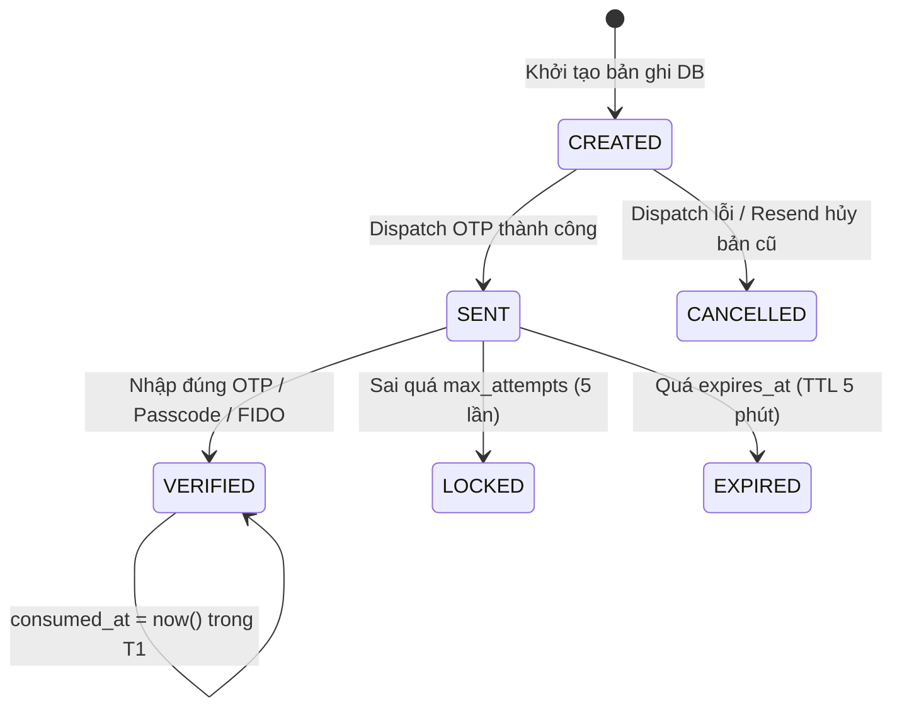

# Module 02: Identity, Session, Challenge & RBAC (`package: com.banking.identity`)

> **Dự án:** Digital Banking MVP
> **Mã tài liệu:** `BE-MOD-02`
> **Phiên bản:** 1.0
> **Ngày:** 07/11/2026
> **Trạng thái:** Hoàn thành
> **Nguồn tham chiếu:** [[digitalbanking-docs/docs-common/03. SRS.md]] (FR-001..007, FR-026, FR-040, §4), [[digitalbanking-docs/docs-common/04. Database design & analysis.md#4.2. Identity & Access]], [[digitalbanking-docs/docs-common/07. API contracts.md#8.1. Nhóm Auth]]

---

## 1. Trách nhiệm & Ranh giới (Scope & Boundaries)

- **Bảng sở hữu độc quyền (Write Ownership):**
  - `banking.app_user`, `banking.session`, `banking.device`, `banking.auth_challenge`, `banking.auth_attempt`, `banking.password_history`
  - `banking.role`, `banking.permission`, `banking.user_role`, `banking.role_permission`, `banking.user_privilege`
- **Public API cho Module khác gọi (`com.banking.identity.api.IdentityModuleApi`):**
  - Cung cấp cho `transfer` và `admin`:
    - `ChallengeDto createStepUpChallenge(StepUpRequest req)` (`T0` độc lập)
    - `VerifiedChallenge consumeStepUpChallengeInTx(UUID challengeRef, Long userId, String purpose, String idempotencyKey, String requestHash)` (Gọi trong `T1` hoặc khi apply `approval_request`, khóa `FOR UPDATE` trên `auth_challenge`)
    - `void applyRoleChangeInTx(RoleChangeCommand cmd)` (Được `admin` gọi khi Checker duyệt `ROLE_CHANGE`)
- **Phụ thuộc đầu ra:**
  - `audit` (`AuditModuleApi`) để ghi nhận sự kiện đăng nhập, khóa tài khoản, step-up.
  - `notification` / `OtpGateway` port để gửi mã OTP qua Simulator (luôn gọi **ngoài** transaction giữ khóa tiền).

---

## 2. Mô hình Dữ liệu & State Machines

### 2.1. Vòng đời `banking.session`
- `ACTIVE` → `LOGGED_OUT` (Người dùng gọi `POST /auth/logout` hoặc bị thu hồi khi thiết bị `REVOKED`).
- `ACTIVE` → `EXPIRED` (`now >= idle_expires_at` hoặc `now >= absolute_expires_at`).
- **Cookie Contract:**
  ```http
  Set-Cookie: DB_SESSION=<opaque_256bit_base64url>; HttpOnly; Secure; SameSite=Strict; Path=/; Max-Age=28800
  ```
  - Server **không lưu** `<opaque_256bit_base64url>`, chỉ lưu `SHA-256` hex vào `session.session_token_hash`.

### 2.2. Vòng đời `banking.auth_challenge`

- **Ràng buộc quan trọng:**
  - Một `auth_challenge` với `purpose = 'TRANSFER_STEP_UP'` gắn chặt với `(user_id, idempotency_key, request_hash)`.
  - Partial Unique Index `uq_auth_challenge_active_stepup` đảm bảo tại một thời điểm chỉ có tối đa 1 challenge active cho cặp `(idempotency_key, request_hash)` khi `consumed_at IS NULL`.
  - Khi `T1` tạo `transfer`, `auth_challenge` phải được khóa `SELECT ... FOR UPDATE`, kiểm tra `status == 'VERIFIED'`, `consumed_at IS NULL`, `expires_at > now()`, sau đó cập nhật `consumed_at = now()`.

---

## 3. Hợp đồng API thuộc Module (`API-AUTH-01` .. `API-AUTH-08`)

| API ID | Method & Path | Auth | Request Body chính | Success Response |
|---|---|---|---|---|
| `API-AUTH-01` | `POST /api/v1/auth/login` | Public | `{ username, password, deviceRef?, deviceName?, deviceFingerprint? }` | • Thiết bị tin cậy: `200 OK` (`AuthResponse` + `Set-Cookie`)<br/>• Thiết bị mới: `202 Accepted` (`ChallengeRequiredResponse` với `purpose = LOGIN_NEW_DEVICE`) |
| `API-AUTH-02` | `POST /api/v1/auth/passcode` | Public | `{ username, passcode, deviceRef, deviceFingerprint }` | `200 OK` (`AuthResponse` + `Set-Cookie`) |
| `API-AUTH-03` | `POST /api/v1/auth/fido/verify` | Public | • Begin: `{ username, deviceRef }`<br/>• Finish: `{ username, deviceRef, challengeId, fido }` | • Begin: `202 Accepted` (`fidoRequestOptions`)<br/>• Finish: `200 OK` (`AuthResponse` + `Set-Cookie`) |
| `API-AUTH-04` | `POST /api/v1/auth/otp/verify` | Public | `{ challengeId, otp }` | `200 OK` (`AuthResponse` + `Set-Cookie`) |
| `API-AUTH-05` | `POST /api/v1/auth/step-up/verify` | Auth | `{ challengeId, method, otp? / passcode? / fido? }` | `200 OK` (`{ challengeId, status: "VERIFIED", purpose, verifiedAt, expiresAt, correlationId }`) |
| `API-AUTH-06` | `POST /api/v1/auth/logout` | Auth | *(Empty)* + `X-CSRF-Token` | `204 No Content` + `Set-Cookie: DB_SESSION=; Max-Age=0` |
| `API-AUTH-07` | `GET /api/v1/auth/session` | Auth | *(Empty)* | `200 OK` (`AuthResponse` cấp lại `csrfToken`) |
| `API-AUTH-08` | `POST /api/v1/auth/challenges/{challengeId}/resend` | Public / Auth | `{ channel? }` | `202 Accepted` (`ChallengeRequiredResponse` cập nhật `expiresAt`) |

---

## 4. Luồng Nghiệp vụ & Ranh giới Transaction

### 4.1. Luồng Đăng nhập Password & Cơ chế Lockout (`API-AUTH-01`)
1. Normalize `username = username.trim().toLowerCase(Locale.ROOT)`.
2. Tìm `app_user` theo `username`.
   - Nếu không tồn tại: thực hiện dummy hash verify (chống timing attack), trả `401 AUTH_INVALID_CREDENTIALS`.
   - Nếu `status == 'DISABLED'`: trả `403 AUTH_FORBIDDEN`.
   - Nếu `status == 'LOCKED'` hoặc (`locked_until != null && locked_until > now`): trả `423 AUTH_ACCOUNT_LOCKED` kèm `lockedUntil`.
3. Kiểm tra `SecretHasher.matches(rawPassword, user.passwordHash)`:
   - **Nếu SAI (Chạy trong transaction `REQUIRES_NEW` để không bị rollback khi ném lỗi `401`/`423`):**
     - Ghi `auth_attempt (outcome = 'FAILURE')`.
     - Tăng `failed_attempt_count = failed_attempt_count + 1`, `last_failed_at = now`.
     - Nếu `failed_attempt_count >= 5` (`BRL-003`):
       - Đặt `locked_until = now + 10m`, ghi `auth_attempt (outcome = 'LOCKED')`, ghi audit `AUTH_ACCOUNT_LOCKED`.
       - Đếm số lần `outcome = 'LOCKED'` trong 24h qua từ `auth_attempt`: nếu `>= 3` lần -> cập nhật `app_user.status = 'LOCKED'`.
       - Trả `423 AUTH_ACCOUNT_LOCKED`.
     - Ghi audit `AUTH_LOGIN_FAILED`, trả `401 AUTH_INVALID_CREDENTIALS`.
4. **Nếu ĐÚNG:**
   - Reset `failed_attempt_count = 0`, `locked_until = null`.
   - Kiểm tra thiết bị (`deviceRef` + `HMAC(deviceFingerprint)`):
     - **Nếu khớp thiết bị `ACTIVE` và `trusted == true`:**
       - Cập nhật `last_login_at = now`, `device.last_seen_at = now`.
       - Tạo bản ghi `session` (`idle_expires_at = now + 15m`, `absolute_expires_at = now + 8h`).
       - Ghi `auth_attempt (SUCCESS)` và audit `AUTH_LOGIN_SUCCESS`.
       - Trả `200 OK` kèm cookie `DB_SESSION`.
     - **Nếu là thiết bị mới / chưa `trusted`:**
       - Tạo `auth_challenge` (`purpose = 'LOGIN_NEW_DEVICE'`, `method = 'OTP'`, `status = 'CREATED'`, `expires_at = now + 5m`) và commit.
       - Gọi `OtpGateway.sendOtp(...)` ngoài transaction:
         - Nếu gửi lỗi -> cập nhật challenge `CANCELLED`, trả `503 OTP_DISPATCH_FAILED` (không tạo session).
         - Nếu gửi thành công -> cập nhật challenge `SENT`, trả `202 Accepted` (`AUTH_CHALLENGE_REQUIRED`).

### 4.2. Luồng Verify OTP / Step-up (`API-AUTH-04`, `API-AUTH-05`)
1. Khóa dòng `SELECT ... FROM banking.auth_challenge WHERE challenge_ref = :ref FOR UPDATE`.
2. Kiểm tra chủ sở hữu (`user_id`), `purpose` và trạng thái:
   - Nếu không tìm thấy hoặc khác `user_id` -> `404 AUTH_CHALLENGE_NOT_FOUND` (hoặc `403 AUTH_FORBIDDEN`).
   - Nếu `status == 'LOCKED'` -> `423 AUTH_CHALLENGE_LOCKED`.
   - Nếu `status == 'EXPIRED'` hoặc `now >= expires_at` -> cập nhật `status = 'EXPIRED'`, commit và trả `410 AUTH_OTP_EXPIRED` / `AUTH_CHALLENGE_EXPIRED`.
   - Nếu `status != 'SENT'` (hoặc `'CREATED'` với FIDO/Passcode) -> `409 INVALID_STATE_TRANSITION`.
   - Với `API-AUTH-05`: nếu `request.method != challenge.method` -> `409 STEP_UP_CHALLENGE_MISMATCH`.
3. Kiểm tra mã xác thực (`otp_hash` / `passcode_hash` / `FidoVerifier`):
   - **Nếu SAI:**
     - Tăng `attempt_count = attempt_count + 1`.
     - Nếu `attempt_count >= max_attempts (5)` -> đặt `status = 'LOCKED'`, ghi audit, commit và trả `423 AUTH_CHALLENGE_LOCKED`.
     - Commit `attempt_count` mới và trả `401 AUTH_OTP_INVALID`.
   - **Nếu ĐÚNG:**
     - Cập nhật `status = 'VERIFIED'`, `verified_at = now`.
     - Nếu `purpose == 'LOGIN_NEW_DEVICE'` (`API-AUTH-04`): đánh dấu `device.trusted = true`, tạo `session`, ghi audit `AUTH_LOGIN_SUCCESS`, trả `200 OK` + `Set-Cookie`.
     - Nếu `purpose IN ('TRANSFER_STEP_UP', 'SENSITIVE_ACTION')` (`API-AUTH-05`): ghi audit `AUTH_STEP_UP_VERIFIED`, trả `200 OK` (chưa `consumed_at`; sẽ được consume trong `T1` của Transfer hoặc khi thực thi Approval).

---

## 5. Quy tắc Nghiệp vụ & Ánh xạ Lỗi (`SYS-RL`)

| Rule ID | Quy tắc kiểm tra | Mã lỗi & HTTP Status |
|---|---|---|
| `SYS-RL-013` | Kiểm tra Role/Permission trên endpoint và Ownership tại Service | `403 AUTH_FORBIDDEN` |
| `SYS-RL-014` | OTP TTL 5 phút, tối đa 5 lần thử, chỉ dùng 1 lần (`consumed_at`) | `401 AUTH_OTP_INVALID`, `410 AUTH_OTP_EXPIRED`, `423 AUTH_CHALLENGE_LOCKED` |
| `SYS-RL-015` | Sai mật khẩu/passcode 5 lần liên tiếp -> khóa tạm 10 phút; 3 lần khóa/24h -> khóa tài khoản | `423 AUTH_ACCOUNT_LOCKED` (kèm `lockedUntil`) |
| `SYS-RL-016` | Session không hoạt động quá 15 phút hoặc tổng thời gian quá 8 giờ; hoặc đã logout | `401 AUTH_SESSION_EXPIRED` |
| `SYS-RL-026` | Step-up challenge phải khớp `user_id`, `idempotency_key`, `request_hash` và chưa được consume | `409 STEP_UP_CHALLENGE_MISMATCH` |

---

## 6. Yêu cầu Audit & Bảo mật

- **Sự kiện Audit bắt buộc:**
  - `AUTH_LOGIN_SUCCESS`, `AUTH_LOGIN_FAILED`, `AUTH_ACCOUNT_LOCKED`, `AUTH_SESSION_LOGOUT`, `AUTH_STEP_UP_VERIFIED`, `SECURITY_ACCESS_DENIED`.
  - Lưu ý: `AUTH_LOGIN_FAILED`, `AUTH_ACCOUNT_LOCKED` và `SECURITY_ACCESS_DENIED` phải được ghi trong transaction độc lập (`Propagation.REQUIRES_NEW`) để không bị mất khi request trả về `401`/`403`/`423`.
- **Bảo vệ Secret:** Không bao giờ log hoặc đặt vào audit payload các trường `password`, `passcode`, `otp`, `session_token`, `csrfToken`, `deviceFingerprint`.

---

## 7. Checklist Kiểm thử Module `identity`

- [ ] **Integration Test (`AC-001`):** Đăng nhập đúng password tạo `session` hash trong DB và trả cookie `HttpOnly`; đăng nhập sai 5 lần liên tiếp chuyển trạng thái khóa tạm 10 phút (`423 AUTH_ACCOUNT_LOCKED`) và có bản ghi `audit_log`.
- [ ] **Integration Test (`AC-002`):** Passcode / FIDO thành công trên thiết bị `trusted = true`; trả `403 AUTH_DEVICE_NOT_TRUSTED` nếu thiết bị chưa trusted.
- [ ] **Concurrency Test (`T-STEP-02`):** 5 luồng gửi OTP sai đồng thời vào cùng 1 `challengeId` -> nhờ `SELECT ... FOR UPDATE`, `attempt_count` tăng chính xác lên 5 và chuyển sang `LOCKED`.
- [ ] **Integration Test (`AC-004`):** Gọi `POST /auth/logout` xóa hiệu lực session; gọi lại API bằng token cũ nhận `401 AUTH_SESSION_EXPIRED`.
