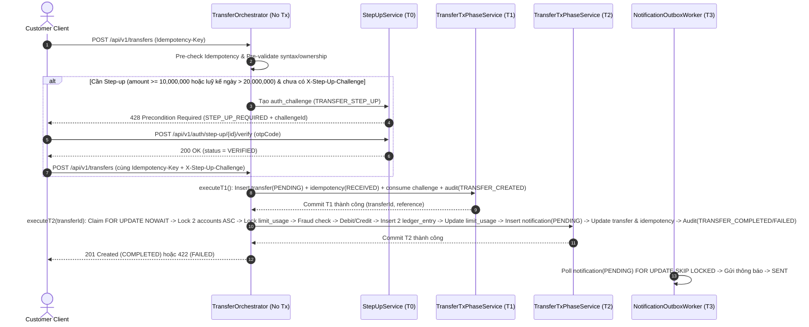

# Module 04: Transfer & Ledger (`transfer`, `ledger`)

| Trường | Giá trị |
|---|---|
| **Dự án** | Digital Banking Platform Simulator (Single-Bank, Core Simulated) |
| **Mã tài liệu** | `BE-MOD-04` |
| **Phiên bản** | v1.0 |
| **Ngày cập nhật** | 2026-11-07 |
| **Trạng thái** | Hoàn thành — Tài liệu tham chiếu chuẩn cho Backend Developer & Coding Agent |
| **Nguồn tham chiếu** | `[[digitalbanking-docs/docs-common/03. SRS]]` (§3.4, §3.5), `[[digitalbanking-docs/docs-common/04. Database design & analysis]]` (§5.3, §5.4), `[[digitalbanking-docs/docs-common/06. System architecture]]` (§5.2), `[[digitalbanking-docs/docs-common/07. API contracts]]` (§7, §8, §11.4, §11.5), `[[digitalbanking-docs/docs-common/design/02. consistency-concurrency]]` (§4–§11, Phụ lục A, B, C, D) |

---

## 1. Phạm vi & Trách nhiệm Module

Tài liệu này định nghĩa đặc tả thực thi đầy đủ cho trái tim tài chính của hệ thống:

1. **Module `transfer` (`com.simulatedbank.banking.transfer`):**
   - **Write-owner độc quyền** của 2 bảng: `banking.transfer` và `banking.idempotency_record`.
   - Điều phối toàn bộ quy trình chuyển tiền nội bộ theo mô hình **4 Pha Giao dịch (`T0 -> T1 -> T2 -> T3`)**.
   - Quản lý máy trạng thái **Idempotency (`Idempotency-Key`)** chống ghi nợ kép khi retry, timeout hoặc crash giữa chừng.
   - Cung cấp 2 REST API: `POST /api/v1/transfers` (`API-TRF-01`) và `GET /api/v1/transfers/{reference}` (`API-TRF-02`).
   - Vận hành **Pending Transfer Reconciliation Job** để tự động thu hồi/hoàn tất các giao dịch bị kẹt ở trạng thái `PENDING`.

2. **Module `ledger` (`com.simulatedbank.banking.ledger`):**
   - **Write-owner độc quyền** của bảng bất biến (append-only) `banking.ledger_entry`.
   - Cung cấp Internal Port `LedgerPostingPort` để ghi cặp bút toán kép (`seq 1: DEBIT`, `seq 2: CREDIT`) trong giao dịch `T2`.
   - Cung cấp 2 REST API tra cứu lịch sử giao dịch cho khách hàng: `GET /api/v1/transactions` (`API-TXN-01`) và `GET /api/v1/transactions/{reference}` (`API-TXN-02`).

---

## 2. Cấu trúc Package chuẩn

```text
com.simulatedbank.banking
├── transfer
│   ├── api
│   │   ├── TransferController.java               // POST /api/v1/transfers, GET /api/v1/transfers/{reference}
│   │   └── dto
│   │       ├── CreateTransferRequest.java
│   │       └── TransferResponse.java
│   ├── application
│   │   ├── TransferOrchestrator.java             // Không giữ @Transactional; điều phối T0 -> T1 -> T2
│   │   ├── TransferTxPhaseService.java           // Chứa executeT1() và executeT2() với TransactionTemplate
│   │   ├── IdempotencyService.java               // Tính JCS request_hash, kiểm tra replay/conflict/resume
│   │   └── TransferReconciliationScheduler.java  // Background job quét transfer PENDING quá hạn
│   └── infrastructure
│       ├── TransferEntity.java                   // Bảng banking.transfer
│       ├── IdempotencyRecordEntity.java          // Bảng banking.idempotency_record
│       └── TransferJdbcRepository.java           // Native SQL cho T1 ON CONFLICT, FOR UPDATE NOWAIT, SKIP LOCKED
│
└── ledger
    ├── api
    │   ├── TransactionController.java            // GET /api/v1/transactions, GET /api/v1/transactions/{reference}
    │   └── dto
    │       ├── TransactionSummaryResponse.java
    │       └── TransactionDetailResponse.java
    ├── application
    │   ├── LedgerPostingPort.java                // Internal SPI gọi từ TransferTxPhaseService trong T2
    │   └── TransactionQueryService.java          // Truy vấn lịch sử giao dịch & tính direction (DEBIT/CREDIT/INTERNAL)
    └── infrastructure
        ├── LedgerEntryEntity.java                // Bảng banking.ledger_entry (Immutable)
        └── LedgerJdbcRepository.java             // Batch insert 2 dòng DEBIT/CREDIT & Cursor/Offset pagination
```

---

## 3. Mô hình Dữ liệu & Ràng buộc Bất biến

### 3.1. Bảng `banking.transfer` (Write-owner: `transfer`)

| Cột | Kiểu dữ liệu | Ràng buộc | Ý nghĩa |
|---|---|---|---|
| `transfer_id` | `UUID` | `PK` | Định danh nội bộ của lệnh chuyển tiền. |
| `reference` | `VARCHAR(32)` | `UNIQUE NOT NULL` | Mã tham chiếu giao dịch hiển thị cho khách hàng (VD: `TRF2026110700012345`). |
| `idempotency_key` | `VARCHAR(100)` | `NOT NULL` | Giá trị header `Idempotency-Key` do client gửi. |
| `source_account_id` | `UUID` | `NOT NULL`, `FK -> account` | Tài khoản nguồn (bị trừ tiền). |
| `dest_account_id` | `UUID` | `NOT NULL`, `FK -> account`, `CHECK (source <> dest)` | Tài khoản đích (được cộng tiền). Cấm tự chuyển cho chính cùng 1 tài khoản. |
| `initiated_by_user_id` | `UUID` | `NOT NULL`, `FK -> users` | Người dùng khởi tạo lệnh chuyển tiền. |
| `amount` | `BIGINT` | `NOT NULL`, `CHECK (amount > 0)` | Số tiền chuyển (đơn vị đồng nguyên VND, tối thiểu `1,000 VND` theo rule nghiệp vụ). |
| `currency` | `CHAR(3)` | `CHECK (currency = 'VND')` | Luôn là `'VND'`. |
| `description` | `VARCHAR(255)` | `NOT NULL` | Nội dung chuyển tiền (đã qua sanitize). |
| `status` | `VARCHAR(20)` | `CHECK IN ('PENDING','COMPLETED','FAILED')` | Trạng thái vòng đời lệnh chuyển tiền. |
| `failure_code` | `VARCHAR(50)` | `NULL` | Mã lỗi nghiệp vụ khi `status = 'FAILED'` (ràng buộc `chk_transfer_terminal_fields`). |
| `failure_reason` | `VARCHAR(255)` | `NULL` | Mô tả lý do thất bại khi `status = 'FAILED'`. |
| `step_up_challenge_id` | `UUID` | `NULL`, `FK -> auth_challenge` | Tham chiếu tới challenge OTP đã dùng (nếu giao dịch yêu cầu Step-up). |
| `created_at` | `TIMESTAMPTZ` | `NOT NULL DEFAULT now()` | Thời điểm tạo trong `T1`. |
| `completed_at` | `TIMESTAMPTZ` | `NULL` | Thời điểm kết thúc trong `T2` (`NOT NULL` khi `status IN ('COMPLETED', 'FAILED')`). |

- **Unique Constraint chống trùng lặp Idempotency:** `uq_transfer_actor_idempotency UNIQUE (initiated_by_user_id, idempotency_key)`.

### 3.2. Bảng `banking.idempotency_record` (Write-owner: `transfer`)

| Cột | Kiểu dữ liệu | Ràng buộc | Ý nghĩa |
|---|---|---|---|
| `idempotency_id` | `UUID` | `PK` | Khóa chính bản ghi idempotency. |
| `actor_user_id` | `UUID` | `NOT NULL`, `FK -> users` | Định danh người gọi API. |
| `operation` | `VARCHAR(50)` | `NOT NULL` | Luôn là `'POST /api/v1/transfers'` cho chuyển tiền. |
| `idempotency_key` | `VARCHAR(100)` | `NOT NULL` | Khóa `Idempotency-Key` (`1..100` ký tự ASCII in được). |
| `request_hash` | `CHAR(64)` | `NOT NULL` | `SHA-256` hex của JSON Canonicalization Scheme (RFC 8785) trên body request. |
| `status` | `VARCHAR(20)` | `CHECK IN ('RECEIVED','COMPLETED','FAILED')` | Trạng thái xử lý của khóa idempotency. |
| `response_status` | `SMALLINT` | `NULL` | HTTP Status lưu lại (`201` khi `COMPLETED`, `422` khi `FAILED`). |
| `response_body` | `JSONB` | `NULL` | Snapshot response body để phát lại (replay) kèm header `Idempotent-Replayed: true`. |
| `transfer_id` | `UUID` | `NULL`, `FK -> transfer` | Liên kết tới `banking.transfer`. |
| `created_at`, `expires_at` | `TIMESTAMPTZ` | `NOT NULL` | `expires_at = created_at + INTERVAL '24 hours'`. |

- **Unique Constraint:** `uq_idempotency_scope UNIQUE (actor_user_id, operation, idempotency_key)`.

### 3.3. Bảng `banking.ledger_entry` (Write-owner: `ledger` — Append-only)

| Cột | Kiểu dữ liệu | Ràng buộc | Ý nghĩa |
|---|---|---|---|
| `entry_id` | `BIGSERIAL` | `PK` | Khóa chính tự tăng tuần tự. |
| `transfer_id` | `UUID` | `NOT NULL`, `FK -> transfer` | Lệnh chuyển tiền sinh ra bút toán này. |
| `reference` | `VARCHAR(32)` | `NOT NULL` | Sao chép từ `transfer.reference` để tăng tốc độ tra cứu. |
| `entry_seq` | `SMALLINT` | `CHECK IN (1, 2)` | Thứ tự trong cặp bút toán kép: `1` cho `DEBIT`, `2` cho `CREDIT`. |
| `account_id` | `UUID` | `NOT NULL`, `FK -> account` | Tài khoản bị ghi nợ (`seq 1`) hoặc ghi có (`seq 2`). |
| `counterparty_account_id` | `UUID` | `NOT NULL`, `FK -> account` | Tài khoản đối ứng trong giao dịch. |
| `entry_type` | `VARCHAR(10)` | `CHECK IN ('DEBIT','CREDIT')` | Ràng buộc `chk_ledger_seq_type`: `(seq=1 AND DEBIT) OR (seq=2 AND CREDIT)`. |
| `amount` | `BIGINT` | `NOT NULL`, `CHECK (amount > 0)` | Giá trị tuyệt đối luôn dương (`> 0`). |
| `currency` | `CHAR(3)` | `CHECK (currency = 'VND')` | `'VND'`. |
| `balance_after` | `BIGINT` | `NOT NULL`, `CHECK (balance_after >= 0)` | Số dư của `account_id` ngay sau khi thực hiện bút toán này. |
| `created_at` | `TIMESTAMPTZ` | `NOT NULL DEFAULT now()` | Thời điểm hạch toán. |

- **Unique Constraint chống ghi sổ kép:** `uq_ledger_transfer_seq UNIQUE (transfer_id, entry_seq)`.
- **Bảo vệ Append-only:** Database trigger `trg_ledger_entry_immutable` chặn mọi lệnh `UPDATE` và `DELETE` trên bảng `banking.ledger_entry` (mã lỗi SQLSTATE `55000`).

---

## 4. Quy tắc Tính `request_hash` & Máy trạng thái Idempotency

### 4.1. Công thức tính `request_hash` (`SYS-RL-IDEM-01`)

Để nhận diện chính xác một request retry có bị thay đổi nội dung hay không, `IdempotencyService` tính `request_hash` bằng `SHA-256` trên chuỗi JSON chuẩn hóa theo RFC 8785 (thứ tự key alphabet, không khoảng trắng thừa):

```json
{"amount":5000000,"currency":"VND","description":"Chuyen tien nha","destinationAccountNumber":"000100000002","sourceAccountId":"a1000000-0000-0000-0000-000000000001"}
```
- **Lưu ý quan trọng:** Header `X-Step-Up-Challenge` **không** được đưa vào `request_hash` để trường hợp client gọi lần 1 bị `428 STEP_UP_REQUIRED`, sau đó gọi lại lần 2 với cùng `Idempotency-Key` kèm `X-Step-Up-Challenge` vẫn hợp lệ và không bị báo lỗi `409 IDEMPOTENCY_KEY_CONFLICT`.

### 4.2. Bảng Quyết định Idempotency (`Idempotency State Machine`)

Khi nhận `POST /api/v1/transfers` từ `actor_user_id` với `Idempotency-Key = K`:

| Trạng thái hiện tại của `(actor_user_id, operation, K)` | Điều kiện `request_hash` | Trạng thái Lock trên `transfer` | Hành động của Backend | HTTP Status & Header |
|---|---|---|---|---|
| **Chưa tồn tại** (hoặc đã `expires_at <= now()`) | — | — | Đi tiếp vào kiểm tra Step-up (`T0`) -> Tạo mới trong `T1` -> Thực thi `T2`. | `201 Created` (hoặc `422` nếu lỗi nghiệp vụ) |
| **`COMPLETED`** | `== stored_hash` | — | **Replay kết quả thành công:** Trả về nguyên vẹn `response_body` đã lưu, **không** chạy lại `T1`/`T2`. | `201 Created` + `Idempotent-Replayed: true` |
| **`FAILED`** | `== stored_hash` | — | **Replay kết quả thất bại nghiệp vụ:** Trả về nguyên vẹn `response_body` lỗi đã lưu, **không** chạy lại `T1`/`T2`. | `422 Unprocessable Entity` + `Idempotent-Replayed: true` |
| **Bất kỳ (`RECEIVED` / `COMPLETED` / `FAILED`)** | `!= stored_hash` | — | Từ chối ngay lập tức do dùng lại khóa cho payload khác. | `409 Conflict` (`IDEMPOTENCY_KEY_CONFLICT`) |
| **`RECEIVED`** | `== stored_hash` | Đang bị khóa bởi tiến trình khác (`FOR UPDATE NOWAIT` ném `55P03`) | Giao dịch gốc đang chạy `T2`. Từ chối yêu cầu đồng thời để client đợi. | `409 Conflict` (`IDEMPOTENCY_IN_PROGRESS`) + `Retry-After: 2` |
| **`RECEIVED`** | `== stored_hash` | Không bị khóa (`FOR UPDATE NOWAIT` thành công) và `transfer.status == PENDING` | **Self-Healing Resume:** Tiến trình trước bị crash sau `T1` hoặc rollback `T2`. Tiến trình hiện tại tiếp quản và thực thi tiếp `T2` cho `transfer_id` đó! | `201 Created` (hoặc `422`) |

---

## 5. Kiến trúc Điều phối 4 Pha (`T0 -> T1 -> T2 -> T3`)



### 5.1. Quy tắc Đánh giá Step-up trước `T1` (`SYS-RL-STEP-01`)

Một lệnh chuyển tiền bắt buộc phải có xác thực Step-up (`TRANSFER_STEP_UP`) nếu thỏa mãn **một trong hai** điều kiện sau:
1. `amount >= app.security.step-up.single-transfer-threshold-vnd` (mặc định `10,000,000 VND`).
2. `(current_daily_used_amount + amount) > app.security.step-up.daily-cumulative-threshold-vnd` (mặc định `20,000,000 VND`).

- **Nguyên tắc vàng (`INV-STEP-01`):** Nếu cần Step-up mà request chưa kèm header `X-Step-Up-Challenge` hợp lệ, hệ thống trả về `428 STEP_UP_REQUIRED` ngay tại `T0`. **Tuyệt đối không** tạo dòng nào trong `banking.transfer`, `banking.idempotency_record`, hay `banking.ledger_entry` ở bước trả về `428`.

### 5.2. Chi tiết Pha `T1` — Ghi nhận Ý định Giao dịch (`executeT1`)

Thực thi trong một transaction ngắn (`timeout = 3s`, `ISOLATION_READ_COMMITTED`):
1. **Tiêu thụ Step-up Challenge (nếu có):**
   - Gọi `stepUpChallengePort.consumeVerifiedChallengeForTransfer(challengeId, userId, "TRANSFER_STEP_UP", payloadHash)`.
   - Câu lệnh `UPDATE banking.auth_challenge SET status = 'CONSUMED', consumed_at = now() WHERE challenge_id = :id AND status = 'VERIFIED' AND expires_at > now() ...`. Nếu `updatedRows == 0` -> ném lỗi để rollback `T1` (trả về `403 STEP_UP_INVALID` hoặc `428 STEP_UP_REQUIRED`).
2. **Chèn `idempotency_record` (`status = 'RECEIVED'`):**
   - Sử dụng `INSERT INTO banking.idempotency_record ... ON CONFLICT (actor_user_id, operation, idempotency_key) DO NOTHING RETURNING idempotency_id`.
   - Nếu không chèn được dòng mới -> đọc bản ghi hiện có để xử lý theo Bảng Quyết định Idempotency (Mục 4.2).
3. **Chèn `banking.transfer` (`status = 'PENDING'`):**
   - Sinh mã `reference` duy nhất: `"TRF" + yyyyMMdd + 8_chữ_số_ngẫu_nhiên_hoặc_sequence` (VD: `TRF2026110784920134`).
   - Cập nhật `idempotency_record.transfer_id = transfer.transfer_id`.
4. **Ghi Audit `TRANSFER_CREATED` (`C1` — Fail-closed):**
   - Gọi `auditInternalPort.appendInCurrentTx(...)` (lấy `pg_advisory_xact_lock`, nối chuỗi `record_hash`). Nếu ghi audit lỗi -> rollback toàn bộ `T1`.

### 5.3. Chi tiết Pha `T2` — Hạch toán Sổ cái Nguyên tử (`executeT2`)

Thực thi trong một transaction riêng biệt ngay sau khi `T1` vừa commit:

```java
// Trích lược cấu trúc chuẩn của executeT2(UUID transferId)
public TransferResult executeT2(UUID transferId, RequestContext ctx) {
    return transactionTemplate.execute(status -> {
        // Bước 0: Thiết lập timeout chống kẹt kết nối
        jdbcTemplate.execute("SET LOCAL lock_timeout = '2s'");
        jdbcTemplate.execute("SET LOCAL statement_timeout = '5s'");

        // Bước 1: Claim độc quyền bản ghi transfer PENDING bằng FOR UPDATE NOWAIT
        TransferEntity transfer = transferJdbcRepo.lockPendingTransferNowait(transferId);
        // Nếu đang bị tiến trình khác giữ khóa -> PostgreSQL ném 55P03 -> tầng ngoài map thành 409 IDEMPOTENCY_IN_PROGRESS
        // Nếu transfer.status != PENDING -> trả về kết quả terminal hiện có

        // Bước 2: Khóa bi quan 2 tài khoản theo thứ tự account_id ASC (Chống deadlock tuyệt đối)
        LockedAccountPair accounts = accountBalancePort.lockTransferAccountsInOrder(
            transfer.getSourceAccountId(), transfer.getDestAccountId()
        );

        // Bước 3: Kiểm tra trạng thái tài khoản & số dư ban đầu
        Optional<FailureSpec> preCheckFailure = validateLockedAccounts(transfer, accounts);
        if (preCheckFailure.isPresent()) {
            return completeAsBusinessFailureInT2(transfer, preCheckFailure.get(), ctx);
        }

        // Bước 4: Upsert & khóa bi quan 2 dòng limit_usage (Customer-level trước -> Account-level sau)
        LimitCheckResult limitResult = limitEvaluationPort.lockAndCheckLimitsInT2(
            accounts.source().customerId(), transfer.getSourceAccountId(), transfer.getAmount()
        );
        if (!limitResult.allowed()) {
            return completeAsBusinessFailureInT2(transfer, limitResult.toFailureSpec(), ctx);
        }

        // Bước 5: Đánh giá Fraud đồng bộ trong 1s budget (Fail-open nếu lỗi kỹ thuật, dừng nếu auto_block)
        FraudDecision fraudDecision = fraudEvaluationPort.evaluateTransferInT2(transfer, accounts);
        if (fraudDecision.autoBlock()) {
            return completeAsBusinessFailureInT2(
                transfer, new FailureSpec(ErrorCode.FRAUD_BLOCKED, fraudDecision.reason()), ctx
            );
        }

        // Bước 6: Thực hiện Debit nguồn và Credit đích có điều kiện
        AccountBalanceAfterMutation sourceAfter = accountBalancePort.debitConditional(
            transfer.getSourceAccountId(), transfer.getAmount()
        );
        AccountBalanceAfterMutation destAfter = accountBalancePort.creditConditional(
            transfer.getDestAccountId(), transfer.getAmount()
        );

        // Bước 7: Ghi cặp bút toán kép vào banking.ledger_entry (seq 1: DEBIT, seq 2: CREDIT)
        ledgerPostingPort.postDoubleEntryInT2(transfer, sourceAfter.availableBalanceAfter(), destAfter.availableBalanceAfter());

        // Bước 8: Cộng luỹ kế sử dụng hạn mức ngày (limit_usage)
        limitEvaluationPort.incrementUsageInT2(
            accounts.source().customerId(), transfer.getSourceAccountId(), transfer.getAmount()
        );

        // Bước 9: Ghi 2 thông báo (cho người gửi & người nhận) vào bảng outbox banking.notification (PENDING)
        notificationOutboxPort.enqueueTransferNotificationsInT2(transfer, accounts);

        // Bước 10: Cập nhật transfer -> COMPLETED và idempotency_record -> COMPLETED (HTTP 201)
        TransferResult completedResult = markTransferAndIdempotencyCompleted(transfer);

        // Bước 11: Ghi Audit TRANSFER_COMPLETED (C1 Fail-closed, giữ pg_advisory_xact_lock ở cuối T2)
        auditInternalPort.appendTransferCompletedInT2(transfer, sourceAfter, destAfter, ctx);

        return completedResult;
    });
}
```

> [!CAUTION]
> **Phân biệt rõ "Từ chối nghiệp vụ trong `T2`" và "Lỗi hệ thống/Audit trong `T2`":**
> 1. **Từ chối nghiệp vụ (`INSUFFICIENT_FUNDS`, `LIMIT_EXCEEDED_SINGLE`, `LIMIT_EXCEEDED_DAILY`, `ACCOUNT_NOT_ACTIVE`, `FRAUD_BLOCKED`):**
>    - **KHÔNG** ghi nợ/ghi có tài khoản, **KHÔNG** ghi `ledger_entry`, **KHÔNG** tăng `limit_usage`.
>    - **CÓ** cập nhật `transfer.status = 'FAILED'`, `failure_code = ...`, cập nhật `idempotency_record.status = 'FAILED'` (`response_status = 422`), ghi `audit_log` (`action = 'TRANSFER_FAILED'`, hoặc kèm `FRAUD_FLAG_CREATED` nếu bị chặn gian lận) và **COMMIT `T2`**.
>    - Nhờ commit trạng thái `FAILED`, nếu client retry cùng `Idempotency-Key`, hệ thống sẽ phát lại đúng kết quả `422` mà không chạy lại giao dịch.
> 2. **Lỗi kỹ thuật hoặc Lỗi ghi Audit (`AUDIT_WRITE_FAILED`, `LOCK_NOT_AVAILABLE`, `QUERY_TIMEOUT`, lỗi kết nối DB):**
>    - Ném exception để **ROLLBACK toàn bộ `T2`**.
>    - Bản ghi `transfer` quay về trạng thái `PENDING` và `idempotency_record` giữ trạng thái `RECEIVED` (đã commit ở `T1`).
>    - Trả về `500 AUDIT_WRITE_FAILED` hoặc `503 RESOURCE_LOCKED` (kèm `Retry-After: 2`). Khi client retry cùng `Idempotency-Key` (hoặc khi Reconciliation Job chạy), giao dịch sẽ được tiếp tục thực thi (`Resume`) an toàn.

---

## 6. Đặc tả Chi tiết API Endpoints

### 6.1. `API-TRF-01` — Khởi tạo Chuyển tiền (`POST /api/v1/transfers`)

- **Quyền truy cập:** Chỉ `CUSTOMER` (`@PreAuthorize("hasRole('CUSTOMER')")`).
- **Headers:**
  - `Idempotency-Key` (bắt buộc): `1..100` ký tự ASCII. Thiếu hoặc rỗng -> `400 IDEMPOTENCY_KEY_INVALID`.
  - `X-CSRF-Token` (bắt buộc): Khớp với session CSRF token.
  - `X-Step-Up-Challenge` (bắt buộc khi giao dịch vượt ngưỡng Step-up): UUID của challenge đã `VERIFIED`.
- **Request Body:**
```json
{
  "sourceAccountId": "a1000000-0000-0000-0000-000000000001",
  "destinationAccountNumber": "000100000002",
  "amount": 5000000,
  "currency": "VND",
  "description": "Chuyen tien thanh toan hoa don"
}
```
- **Validation đầu vào (`400 VALIDATION_ERROR` hoặc `422 SELF_TRANSFER_NOT_ALLOWED`):**
  - `amount`: Số nguyên dương, tối thiểu `1,000` VND (`>= 1000`).
  - `currency`: Bắt buộc bằng `"VND"`.
  - `description`: `1..255` ký tự sau khi `trim()`, chỉ chứa ký tự văn bản hợp lệ.
  - Sau khi phân giải `destinationAccountNumber` qua `account_no_hash` ra `destAccountId`: nếu `sourceAccountId.equals(destAccountId)` -> trả về `422 SELF_TRANSFER_NOT_ALLOWED`.
- **Response `201 Created`:**
```json
{
  "data": {
    "transferId": "7f9c2b10-4455-4a11-9b22-112233445566",
    "reference": "TRF2026110784920134",
    "sourceAccountId": "a1000000-0000-0000-0000-000000000001",
    "destinationAccountId": "a1000000-0000-0000-0000-000000000002",
    "destinationMaskedAccountNumber": "******0002",
    "destinationCustomerName": "Tran Thi B",
    "amount": 5000000,
    "currency": "VND",
    "description": "Chuyen tien thanh toan hoa don",
    "status": "COMPLETED",
    "balanceAfter": 45000000,
    "createdAt": "2026-11-07T10:20:00Z",
    "completedAt": "2026-11-07T10:20:00.125Z"
  },
  "meta": {
    "requestId": "req-77889900",
    "timestamp": "2026-11-07T10:20:00.130Z"
  }
}
```

### 6.2. `API-TRF-02` — Tra cứu Trạng thái Lệnh Chuyển tiền (`GET /api/v1/transfers/{reference}`)

- **Quyền truy cập:**
  - `CUSTOMER`: Chỉ được xem nếu `transfer.source_account_id` hoặc `transfer.dest_account_id` thuộc sở hữu của `principal.customerId`. Nếu không thuộc sở hữu -> ghi audit `SECURITY_ACCESS_DENIED` và trả về `403 AUTH_FORBIDDEN`.
  - `STAFF` (`OPERATIONS`, `RISK_COMPLIANCE`, `ADMIN_SECURITY`): Được phép xem để hỗ trợ tra soát.
- **Lưu ý bảo mật dữ liệu:** Nếu người xem là người nhận tiền (`dest_account_id` thuộc khách hàng đó nhưng `source_account_id` của khách hàng khác), **không** trả về `balanceAfter` của tài khoản nguồn!

### 6.3. `API-TXN-01` & `API-TXN-02` — Lịch sử Giao dịch Sổ cái (`GET /api/v1/transactions`, `GET /api/v1/transactions/{reference}`)

- **Quyền truy cập:** `CUSTOMER` (chỉ xem giao dịch trên các tài khoản của mình) hoặc `STAFF` có quyền `TRANSACTION_READ`.
- **Query Parameters (`GET /api/v1/transactions`):**
  - `accountId` (optional cho Customer — nếu bỏ trống sẽ lấy trên tất cả tài khoản của Customer đó; bắt buộc kiểm tra ownership nếu truyền vào).
  - `entryType` (optional): `DEBIT`, `CREDIT`.
  - `from`, `to` (optional): Khoảng thời gian ISO-8601 UTC (tối đa 90 ngày mỗi lần truy vấn).
  - `page` (default `0`), `size` (default `20`, max `100`).
- **Quy tắc tính trường `direction` trong API Chi tiết Giao dịch (`GET /api/v1/transactions/{reference}`):**
  Khi một khách hàng sở hữu tập tài khoản $A_{user}$ xem chi tiết giao dịch theo `reference`:
  - Nếu `source_account_id` $\in A_{user}$ và `dest_account_id` $\notin A_{user}$ $\rightarrow$ `direction = "DEBIT"` (Chuyển tiền đi).
  - Nếu `dest_account_id` $\in A_{user}$ và `source_account_id` $\notin A_{user}$ $\rightarrow$ `direction = "CREDIT"` (Nhận tiền đến).
  - Nếu **cả hai** `source_account_id` $\in A_{user}$ và `dest_account_id` $\in A_{user}$ (Khách hàng chuyển tiền giữa 2 tài khoản của chính mình) $\rightarrow$ `direction = "INTERNAL"` và trả về cả 2 bút toán `DEBIT` & `CREDIT` trong danh sách `ledgerEntries`.

---

## 7. Tiến trình Tự phục hồi Giao dịch Treo (`Pending Transfer Reconciliation Job`)

Trong trường hợp JVM bị sập hoặc mất kết nối DB ngay sau khi commit `T1` nhưng trước khi `T2` hoàn tất, bản ghi `banking.transfer` sẽ nằm ở trạng thái `PENDING`.

- **Cấu hình Lập lịch:** Chạy định kỳ mỗi `30 giây` (`app.reconciliation.pending-transfer-interval-ms: 30000`).
- **Truy vấn Quét (`Pattern A.12` — `FOR UPDATE SKIP LOCKED`):**
  ```sql
  SELECT transfer_id
  FROM banking.transfer
  WHERE status = 'PENDING'
    AND created_at <= clock_timestamp() - INTERVAL '15 seconds'
  ORDER BY created_at ASC
  LIMIT 50
  FOR UPDATE SKIP LOCKED;
  ```
- **Quy tắc Xử lý từng `transfer_id`:**
  1. Kiểm tra xem đã có bút toán nào trong `banking.ledger_entry` cho `transfer_id` này chưa (`SELECT COUNT(*) FROM banking.ledger_entry WHERE transfer_id = :id`).
     - *(Do thiết kế `T2` nguyên tử, `ledger_entry` và `transfer.status = COMPLETED` luôn đi cùng nhau; nếu phát hiện bất biến bị phá vỡ, bắn metric `banking_reconciliation_anomaly_total` và cảnh báo `CRITICAL`).*
  2. Nếu `created_at` chưa quá ngưỡng hết hạn tối đa (`max-pending-age = 5 phút`):
     - Gọi lại `transferTxPhaseService.executeT2(transferId, systemReconciliationContext)` để hoàn tất giao dịch (`Resume`).
  3. Nếu giao dịch vẫn không thể hoàn tất sau khi đã quá `5 phút` (ví dụ do lỗi dữ liệu hoặc tài khoản bị đóng băng):
     - Chuyển `transfer.status = 'FAILED'`, `failure_code = 'RECONCILIATION_EXPIRED'`, cập nhật `idempotency_record.status = 'FAILED'`, và ghi `audit_log` (`TRANSFER_FAILED`) trong một transaction ngắn.

---

## 8. Checklist Kiểm thử cho Developer & Coding Agent

- [ ] **Double-entry Invariant (`T-CON-01`):** Sau mọi giao dịch `COMPLETED`, kiểm tra bảng `banking.ledger_entry` luôn có đúng 2 dòng (`entry_seq = 1, DEBIT` và `entry_seq = 2, CREDIT`) với tổng đại số bằng `0`.
- [ ] **Idempotency Replay (`T-IDEM-01`, `T-IDEM-02`):** Gửi lại cùng `Idempotency-Key` và cùng body cho giao dịch đã `COMPLETED` (nhận `201` + `Idempotent-Replayed: true`) hoặc đã `FAILED` (nhận `422` + `Idempotent-Replayed: true`), số dư không đổi.
- [ ] **Idempotency Payload Mismatch (`T-IDEM-03`):** Gửi lại cùng `Idempotency-Key` nhưng thay đổi `amount` từ `500,000` thành `600,000` -> nhận `409 IDEMPOTENCY_KEY_CONFLICT`.
- [ ] **Concurrent Duplicate Request (`T-IDEM-04`):** Bắn 2 request trùng hệt `Idempotency-Key` vào cùng một thời điểm -> 1 request xử lý `T2`, request kia nhận `409 IDEMPOTENCY_IN_PROGRESS` (nhờ `FOR UPDATE NOWAIT`).
- [ ] **Crash Recovery / Resume (`T-IDEM-05`, `T-REC-01`):** Giả lập lỗi sau khi `T1` commit (`transfer = PENDING`), sau đó gọi lại API với cùng `Idempotency-Key` (hoặc chạy `TransferReconciliationScheduler`) -> giao dịch được tiếp tục thực thi `T2` thành công lên `COMPLETED` đúng 1 lần.
- [ ] **Audit Fail-closed Rollback (`T-AUD-01`):** Giả lập lỗi khi ghi `audit_log` ở Bước 11 của `T2` -> toàn bộ `T2` bị rollback (không trừ tiền, không có `ledger_entry`, `transfer` quay về `PENDING`), API trả về `500 AUDIT_WRITE_FAILED`.
