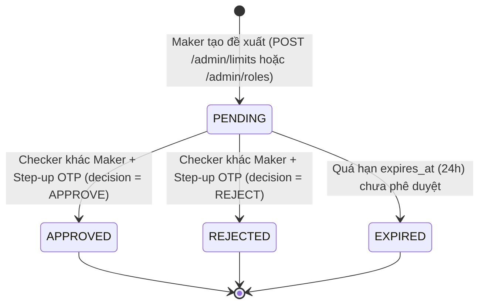

# Module 05: Limit & Admin Maker-Checker Approval (`limit`, `admin`)

| Trường | Giá trị |
|---|---|
| **Dự án** | Digital Banking Platform Simulator (Single-Bank, Core Simulated) |
| **Mã tài liệu** | `BE-MOD-05` |
| **Phiên bản** | v1.0 |
| **Ngày cập nhật** | 2026-11-07 |
| **Trạng thái** | Hoàn thành — Tài liệu tham chiếu chuẩn cho Backend Developer & Coding Agent |
| **Nguồn tham chiếu** | `[[digitalbanking-docs/docs-common/03. SRS]]` (§3.6, §3.9), `[[digitalbanking-docs/docs-common/04. Database design & analysis]]` (§5.5, §5.8), `[[digitalbanking-docs/docs-common/06. System architecture]]` (§4.3, §5.3), `[[digitalbanking-docs/docs-common/07. API contracts]]` (§11.6, §11.9, §11.10), `[[digitalbanking-docs/docs-common/design/02. consistency-concurrency]]` (§5.5, §A.4, §A.5, §A.8, §A.14, §B.7) |

---

## 1. Phạm vi & Trách nhiệm Module

Tài liệu này định nghĩa đặc tả kỹ thuật cho 2 module kiểm soát hạn mức và phê duyệt quản trị 4 mắt (Maker-Checker):

1. **Module `limit` (`com.simulatedbank.banking.limit`):**
   - **Write-owner độc quyền** của 2 bảng: `banking.limit_config` và `banking.limit_usage`.
   - Cung cấp API cho khách hàng tra cứu hạn mức hiệu lực và mức đã sử dụng trong ngày (`GET /api/v1/limits` — `API-LIM-01`).
   - Cung cấp Internal Port `LimitEvaluationPort` cho module `transfer` để kiểm tra hạn mức từng lần (`per_tx_limit`), khóa bi quan bộ đếm hạn mức ngày (`daily_limit`) theo thứ tự chống deadlock, và cộng dồn mức sử dụng trong giao dịch `T2`.
   - Cung cấp Internal Port `LimitConfigMutationPort` để module `admin` kích hoạt cấu hình hạn mức mới (`ACTIVE` / `SUPERSEDED`) sau khi Checker phê duyệt.

2. **Module `admin` (`com.simulatedbank.banking.admin`):**
   - **Write-owner độc quyền** của bảng `banking.approval_request`.
   - Quản lý quy trình **Maker-Checker (Dual Control / Four-Eyes Principle)** cho mọi thay đổi nhạy cảm của nhân viên ngân hàng:
     - Đề xuất & phê duyệt thay đổi hạn mức (`LIMIT_CHANGE`: `POST /api/v1/admin/limits`, `POST /api/v1/admin/limits/{id}/approve`).
     - Đề xuất & phê duyệt thay đổi phân quyền RBAC (`ROLE_CHANGE`: `POST /api/v1/admin/roles`, `POST /api/v1/admin/roles/{id}/approve`).
     - Tra cứu danh sách và chi tiết yêu cầu phê duyệt (`GET /api/v1/admin/approvals`, `GET /api/v1/admin/approvals/{approvalId}`).

---

## 2. Cấu trúc Package chuẩn

```text
com.simulatedbank.banking
├── limit
│   ├── api
│   │   ├── LimitController.java                 // GET /api/v1/limits
│   │   └── dto
│   │       └── CustomerLimitResponse.java
│   ├── application
│   │   ├── LimitEvaluationPort.java             // SPI cho module transfer (lock & check trong T2)
│   │   ├── LimitConfigMutationPort.java         // SPI cho module admin (apply approved LIMIT_CHANGE)
│   │   └── LimitService.java
│   └── infrastructure
│       ├── LimitConfigEntity.java               // Bảng banking.limit_config
│       ├── LimitUsageEntity.java                // Bảng banking.limit_usage
│       └── LimitJdbcRepository.java             // Native SQL ON CONFLICT DO NOTHING + FOR UPDATE
│
└── admin
    ├── api
    │   ├── AdminLimitApprovalController.java    // POST /admin/limits, POST /admin/limits/{id}/approve
    │   ├── AdminRoleApprovalController.java     // POST /admin/roles, POST /admin/roles/{id}/approve
    │   ├── AdminApprovalQueryController.java    // GET /admin/approvals, GET /admin/approvals/{approvalId}
    │   └── dto
    │       ├── CreateLimitChangeRequest.java
    │       ├── CreateRoleChangeRequest.java
    │       ├── ApprovalDecisionRequest.java
    │       └── ApprovalRequestResponse.java
    ├── application
    │   └── MakerCheckerApprovalService.java     // Điều phối Maker tạo PENDING & Checker APPROVE/REJECT nguyên tử
    └── infrastructure
        ├── ApprovalRequestEntity.java           // Bảng banking.approval_request
        └── ApprovalJdbcRepository.java          // SELECT ... FOR UPDATE NOWAIT
```

---

## 3. Mô hình Dữ liệu & Ràng buộc Bất biến

### 3.1. Bảng `banking.limit_config` (Write-owner: `limit`)

| Cột | Kiểu dữ liệu | Ràng buộc | Ý nghĩa |
|---|---|---|---|
| `limit_config_id` | `UUID` | `PK` | Định danh phiên bản cấu hình hạn mức. |
| `scope_type` | `VARCHAR(20)` | `CHECK IN ('GLOBAL','CUSTOMER','ACCOUNT')` | Phạm vi áp dụng hạn mức. |
| `scope_id` | `UUID` | `NULL` | `NULL` nếu `scope_type = 'GLOBAL'`; bằng `customer_id` hoặc `account_id` tương ứng (`chk_limit_config_scope`). |
| `per_tx_limit` | `BIGINT` | `NOT NULL`, `CHECK (> 0)` | Hạn mức tối đa cho 1 lần chuyển tiền (VND). |
| `daily_limit` | `BIGINT` | `NOT NULL`, `CHECK (>= per_tx_limit)` | Tổng hạn mức chuyển tiền tối đa trong 1 ngày (VND). |
| `status` | `VARCHAR(20)` | `CHECK IN ('ACTIVE','SUPERSEDED','INACTIVE')` | Trạng thái phiên bản cấu hình. |
| `version_no` | `INTEGER` | `NOT NULL DEFAULT 1` | Số thứ tự phiên bản tăng dần trên mỗi `(scope_type, scope_id)`. |
| `approval_request_id` | `UUID` | `NULL`, `FK -> approval_request` | Tham chiếu yêu cầu Maker-Checker đã phê duyệt cấu hình này. |
| `effective_from`, `effective_to` | `TIMESTAMPTZ` | `effective_from NOT NULL` | Khoảng thời gian có hiệu lực. |

- **Partial Unique Index bảo vệ duy nhất 1 cấu hình ACTIVE cho mỗi Scope (`SYS-RL-LIM-01`):**
  - `uq_limit_config_active_global ON banking.limit_config (scope_type) WHERE status = 'ACTIVE' AND scope_type = 'GLOBAL'`
  - `uq_limit_config_active_scoped ON banking.limit_config (scope_type, scope_id) WHERE status = 'ACTIVE' AND scope_id IS NOT NULL`

### 3.2. Bảng `banking.limit_usage` (Write-owner: `limit`)

| Cột | Kiểu dữ liệu | Ràng buộc | Ý nghĩa |
|---|---|---|---|
| `limit_usage_id` | `UUID` | `PK` | Khóa chính bản ghi bộ đếm hạn mức ngày. |
| `scope_type` | `VARCHAR(20)` | `CHECK IN ('CUSTOMER','ACCOUNT')` | Bộ đếm luôn theo dõi ở cả 2 cấp: `CUSTOMER` và `ACCOUNT`. |
| `scope_id` | `UUID` | `NOT NULL` | `customer_id` (khi `scope_type = 'CUSTOMER'`) hoặc `account_id` (khi `scope_type = 'ACCOUNT'`). |
| `usage_date` | `DATE` | `NOT NULL` | Ngày giao dịch tính theo múi giờ ngân hàng **`Asia/Ho_Chi_Minh` (`UTC+7`)**. |
| `used_amount` | `BIGINT` | `NOT NULL DEFAULT 0`, `CHECK (>= 0)` | Tổng số tiền đã chuyển thành công trong ngày `usage_date`. |
| `tx_count` | `INTEGER` | `NOT NULL DEFAULT 0`, `CHECK (>= 0)` | Tổng số giao dịch chuyển tiền thành công trong ngày. |
| `updated_at` | `TIMESTAMPTZ` | `NOT NULL DEFAULT now()` | Thời điểm cập nhật gần nhất. |

- **Unique Constraint:** `uq_limit_usage_scope_date UNIQUE (scope_type, scope_id, usage_date)`.

### 3.3. Bảng `banking.approval_request` (Write-owner: `admin`)

| Cột | Kiểu dữ liệu | Ràng buộc | Ý nghĩa |
|---|---|---|---|
| `approval_id` | `UUID` | `PK` | Định danh yêu cầu phê duyệt. |
| `request_type` | `VARCHAR(30)` | `CHECK IN ('LIMIT_CHANGE','ROLE_CHANGE')` | Loại thay đổi nhạy cảm cần Maker-Checker. |
| `target_type` | `VARCHAR(30)` | `NOT NULL` | `'LIMIT_CONFIG'` hoặc `'USER_ROLE'`. |
| `target_id` | `VARCHAR(64)` | `NOT NULL` | Định danh đối tượng tác động (`GLOBAL`, `customerId`, `accountId`, hoặc `staffUserId`). |
| `payload` | `JSONB` | `NOT NULL` | Chi tiết đề xuất thay đổi (chứa giá trị mới và snapshot giá trị cũ tại thời điểm đề xuất). |
| `status` | `VARCHAR(20)` | `CHECK IN ('PENDING','APPROVED','REJECTED','CANCELLED','EXPIRED')` | Trạng thái yêu cầu phê duyệt. |
| `maker_id` | `UUID` | `NOT NULL`, `FK -> users` | Nhân viên tạo đề xuất (`MAKER`). |
| `maker_reason` | `VARCHAR(255)` | `NOT NULL` | Lý do đề xuất thay đổi. |
| `checker_id` | `UUID` | `NULL`, `FK -> users` | Nhân viên phê duyệt/từ chối (`CHECKER`). |
| `checker_reason` | `VARCHAR(255)` | `NULL` | Lý do phê duyệt hoặc từ chối (`NOT NULL` khi `APPROVED`/`REJECTED`). |
| `step_up_challenge_id` | `UUID` | `NULL`, `FK -> auth_challenge` | Challenge Step-up (`purpose = 'SENSITIVE_ACTION'`) bắt buộc khi Checker thực hiện quyết định. |
| `created_at`, `decided_at`, `expires_at` | `TIMESTAMPTZ` | `created_at, expires_at NOT NULL` | Thời điểm tạo, quyết định và hết hạn (mặc định `24 giờ`). |

- **Database Constraint bảo vệ nguyên tắc 4 mắt (`INV-MC-01`):**
  - `chk_approval_maker_ne_checker CHECK (checker_id IS NULL OR maker_id <> checker_id)`
- **Partial Unique Index chống tạo nhiều đề xuất PENDING chồng chéo trên cùng một đối tượng:**
  - `uq_approval_pending_target ON banking.approval_request (request_type, target_type, target_id) WHERE status = 'PENDING'`

---

## 4. Thuật toán Tính Hạn mức Hiệu lực & Khóa Bộ đếm trong `T2`

### 4.1. Thứ tự Ưu tiên & Giao cắt Hạn mức (`Effective Limit Resolution`)

Một khách hàng `C` chuyển tiền từ tài khoản nguồn `A` chịu sự kiểm soát đồng thời của 2 cấp hạn mức:
1. **Cấp Tài khoản (`Account Effective Limit`):**
   - Nếu tồn tại `limit_config` có `(scope_type = 'ACCOUNT', scope_id = A, status = 'ACTIVE')` -> dùng cấu hình này.
   - Ngược lại -> fallback về cấu hình `(scope_type = 'GLOBAL', scope_id IS NULL, status = 'ACTIVE')`.
2. **Cấp Khách hàng (`Customer Effective Limit`):**
   - Nếu tồn tại `limit_config` có `(scope_type = 'CUSTOMER', scope_id = C, status = 'ACTIVE')` -> dùng cấu hình này.
   - Ngược lại -> fallback về cấu hình `(scope_type = 'GLOBAL', scope_id IS NULL, status = 'ACTIVE')`.

- **Giá trị hạn mức mặc định (`GLOBAL` seed ban đầu):**
  - `per_tx_limit = 50,000,000 VND` (`50 triệu đồng / giao dịch`).
  - `daily_limit = 200,000,000 VND` (`200 triệu đồng / ngày`).
- **Hạn mức hiệu lực cuối cùng cho giao dịch từ tài khoản `A` của khách hàng `C`:**
  $$\text{Effective Per-Tx Limit} = \min(\text{per\_tx\_limit}_{\text{Account } A}, \text{per\_tx\_limit}_{\text{Customer } C})$$
  $$\text{Remaining Daily Limit} = \min\left(\text{daily\_limit}_{\text{Account } A} - \text{used}_{\text{Account } A}, \text{daily\_limit}_{\text{Customer } C} - \text{used}_{\text{Customer } C}\right)$$

### 4.2. Thứ tự Khóa Bi quan `limit_usage` trong Giao dịch `T2` (`Pattern A.4`, `A.5`, `A.8`)

Để ngăn chặn race condition khi 1 khách hàng mở 2 tab chuyển tiền đồng thời từ cùng 1 tài khoản (hoặc từ 2 tài khoản khác nhau thuộc cùng 1 khách hàng) nhằm vượt hạn mức ngày, `LimitEvaluationPort.lockAndCheckLimitsInT2(...)` thực hiện đúng 4 bước sau:

1. **Xác định ngày giao dịch theo múi giờ Việt Nam:**
   ```java
   LocalDate usageDate = LocalDate.now(ZoneId.of("Asia/Ho_Chi_Minh"));
   ```
2. **Upsert khởi tạo 2 dòng bộ đếm ngày (nếu là giao dịch đầu tiên trong ngày):**
   ```sql
   INSERT INTO banking.limit_usage (limit_usage_id, scope_type, scope_id, usage_date, used_amount, tx_count)
   VALUES (:customerUsageId, 'CUSTOMER', :customerId, :usageDate, 0, 0),
          (:accountUsageId,  'ACCOUNT',  :accountId,  :usageDate, 0, 0)
   ON CONFLICT (scope_type, scope_id, usage_date) DO NOTHING;
   ```
3. **Khóa bi quan 2 dòng `limit_usage` theo thứ tự định sẵn (`CUSTOMER` trước, `ACCOUNT` sau):**
   ```sql
   SELECT limit_usage_id, scope_type, scope_id, usage_date, used_amount, tx_count
   FROM banking.limit_usage
   WHERE usage_date = :usageDate
     AND ((scope_type = 'CUSTOMER' AND scope_id = :customerId)
       OR (scope_type = 'ACCOUNT'  AND scope_id = :accountId))
   ORDER BY CASE scope_type WHEN 'CUSTOMER' THEN 1 WHEN 'ACCOUNT' THEN 2 END ASC,
            scope_id ASC
   FOR UPDATE;
   ```
4. **Kiểm tra ngưỡng hạn mức:**
   - Nếu `amount > effectivePerTxLimit` -> trả về kết quả từ chối `LIMIT_EXCEEDED_SINGLE`.
   - Nếu `(customerUsedAmount + amount > customerDailyLimit)` hoặc `(accountUsedAmount + amount > accountDailyLimit)` -> trả về kết quả từ chối `LIMIT_EXCEEDED_DAILY`.
   - Nếu hợp lệ và sau khi ghi nợ/ghi có thành công, gọi `incrementUsageInT2`:
     ```sql
     UPDATE banking.limit_usage
     SET used_amount = used_amount + :amount,
         tx_count    = tx_count + 1,
         updated_at  = clock_timestamp()
     WHERE usage_date = :usageDate
       AND ((scope_type = 'CUSTOMER' AND scope_id = :customerId)
         OR (scope_type = 'ACCOUNT'  AND scope_id = :accountId));
     ```

---

## 5. Quy trình Phê duyệt 4 Mắt (`Maker-Checker Workflow`)



### 5.1. Các Quy tắc Bất biến của Maker-Checker (`SYS-RL-MC-01..04`)

1. **Tách biệt quyền đề xuất và quyền duyệt:**
   - Tạo đề xuất (`POST /api/v1/admin/limits`, `POST /api/v1/admin/roles`): yêu cầu nhân viên (`user_type = STAFF`) có quyền `LIMIT_PROPOSE` hoặc `ROLE_PROPOSE` (roles: `OPERATIONS` đối với Limit, `ADMIN_SECURITY` đối với Role/Limit).
   - Phê duyệt đề xuất (`POST /api/v1/admin/limits/{id}/approve`, `POST /api/v1/admin/roles/{id}/approve`): yêu cầu nhân viên có quyền `LIMIT_APPROVE` hoặc `ROLE_APPROVE` (roles: `RISK_COMPLIANCE`, `ADMIN_SECURITY`).
2. **Cấm tự duyệt (`Self-Approval Prohibition`):**
   - Nếu `checkerUserId.equals(approvalRequest.getMakerId())`, từ chối ngay lập tức với `403 MAKER_CHECKER_VIOLATION` và ghi `audit_log` (`SECURITY_ACCESS_DENIED`).
3. **Bắt buộc Step-up Challenge (`SENSITIVE_ACTION`) khi Checker phê duyệt/từ chối:**
   - Mọi lệnh gọi `POST .../approve` bắt buộc kèm header `X-Step-Up-Challenge` đã `VERIFIED` với `purpose = 'SENSITIVE_ACTION'`.
   - Nếu chưa có header `X-Step-Up-Challenge`, hệ thống tạo challenge tại `T0` và trả về `428 STEP_UP_REQUIRED` (tương tự luồng Step-up của chuyển tiền).
4. **Thực thi nguyên tử khi `APPROVE` (`Pattern B.7`):**
   Trong cùng một transaction khi Checker gửi `decision = "APPROVE"`:
   - Bước 1: `SELECT * FROM banking.approval_request WHERE approval_id = :id FOR UPDATE NOWAIT`.
   - Bước 2: Kiểm tra `status == 'PENDING'` và `expires_at > now()`. Nếu đã khác `PENDING` -> trả về `409 APPROVAL_INVALID_STATE`.
   - Bước 3: Tiêu thụ `auth_challenge` (`status = 'CONSUMED'`).
   - Bước 4: Áp dụng thay đổi vào bảng đích:
     - Với `LIMIT_CHANGE`: Chuyển cấu hình `ACTIVE` hiện tại của `(scope_type, scope_id)` sang `status = 'SUPERSEDED', effective_to = now()`, đồng thời chèn dòng `limit_config` mới với `status = 'ACTIVE', version_no = old_version + 1, approval_request_id = :approvalId`.
     - Với `ROLE_CHANGE`: Cập nhật bảng `banking.user_role` của `targetUserId` (thêm/xóa role theo `payload`), đồng thời **thu hồi toàn bộ phiên đăng nhập (`sessions`) đang mở** của `targetUserId` (`revoked_reason = 'ROLE_CHANGED'`) để quyền mới có hiệu lực tức thì.
   - Bước 5: Cập nhật `approval_request` sang `status = 'APPROVED'`, `checker_id = :checkerId`, `decided_at = now()`.
   - Bước 6: Ghi `audit_log` phân loại `C2` (Fail-closed): `LIMIT_CHANGE_APPROVED` hoặc `ROLE_CHANGE_APPROVED` kèm snapshot `before` và `after`.

---

## 6. Đặc tả Chi tiết API Endpoints

### 6.1. `API-LIM-01` — Khách hàng Xem Hạn mức (`GET /api/v1/limits`)

- **Quyền truy cập:** `CUSTOMER`.
- **Query Parameters:** `accountId` (optional — nếu truyền vào sẽ trả về hạn mức hiệu lực và mức sử dụng của tài khoản đó kèm cấp khách hàng).
- **Response `200 OK`:**
```json
{
  "data": {
    "usageDate": "2026-11-07",
    "timezone": "Asia/Ho_Chi_Minh",
    "customerLimit": {
      "sourceScope": "GLOBAL",
      "perTxLimit": 50000000,
      "dailyLimit": 200000000,
      "usedAmountToday": 15000000,
      "remainingDailyLimit": 185000000,
      "txCountToday": 2
    },
    "accountLimits": [
      {
        "accountId": "a1000000-0000-0000-0000-000000000001",
        "maskedAccountNumber": "******1001",
        "sourceScope": "ACCOUNT",
        "perTxLimit": 30000000,
        "dailyLimit": 100000000,
        "usedAmountToday": 15000000,
        "remainingDailyLimit": 85000000,
        "effectivePerTxLimit": 30000000,
        "effectiveRemainingDailyLimit": 85000000
      }
    ]
  },
  "meta": {
    "requestId": "req-55667788",
    "timestamp": "2026-11-07T10:30:00Z"
  }
}
```

### 6.2. `API-LIM-02` & `API-LIM-03` — Đề xuất & Phê duyệt Thay đổi Hạn mức

1. **Maker tạo đề xuất (`POST /api/v1/admin/limits`):**
   - **Request Body:**
     ```json
     {
       "scopeType": "CUSTOMER",
       "scopeId": "c1000000-0000-0000-0000-000000000001",
       "perTxLimit": 100000000,
       "dailyLimit": 500000000,
       "reason": "Nang han muc theo de nghi cua khach hang VIP da xac minh tai quay"
     }
     ```
   - **Validation:** `perTxLimit > 0`, `dailyLimit >= perTxLimit`. Nếu `scopeType == 'GLOBAL'` thì `scopeId` phải `null`; ngược lại `scopeId` phải tồn tại trong `customer` hoặc `account`. Nếu đã có đề xuất `PENDING` cho cùng `(scopeType, scopeId)` -> trả về `409 APPROVAL_ALREADY_PENDING`.
   - **Response:** `202 Accepted` trả về `ApprovalRequestResponse` với `status = "PENDING"` và ghi audit `LIMIT_CHANGE_REQUESTED`.

2. **Checker phê duyệt/từ chối (`POST /api/v1/admin/limits/{id}/approve`):**
   - **Headers:** `X-CSRF-Token`, `X-Step-Up-Challenge` (bắt buộc).
   - **Request Body:**
     ```json
     {
       "decision": "APPROVE",
       "reason": "Da kiem tra ho so KYC va don de nghi hop le"
     }
     ```
   - **Response:** `200 OK` trả về `ApprovalRequestResponse` với `status = "APPROVED"` (hoặc `"REJECTED"`).

### 6.3. `API-ROL-01` & `API-ROL-02` — Đề xuất & Phê duyệt Thay đổi Role Nhân viên

1. **Maker tạo đề xuất (`POST /api/v1/admin/roles`):**
   - **Request Body:**
     ```json
     {
       "targetUserId": "u2000000-0000-0000-0000-000000000002",
       "action": "GRANT",
       "roleCode": "RISK_COMPLIANCE",
       "reason": "Bo sung quyen kieman rui ro theo quyet dinh dieu chuyen nhan su"
     }
     ```
   - **Validation:** `targetUserId` phải là tài khoản `STAFF` (`user_type == 'STAFF'`). Không cho phép gán role `CUSTOMER` cho `STAFF` hoặc ngược lại. Maker không được tự tạo đề xuất nâng quyền cho chính mình (`targetUserId != makerId`).
   - **Response:** `202 Accepted` (`status = "PENDING"`, audit `ROLE_CHANGE_REQUESTED`).

2. **Checker phê duyệt/từ chối (`POST /api/v1/admin/roles/{id}/approve`):**
   - Tương tự `API-LIM-03`: kiểm tra `maker_id != checker_id`, tiêu thụ `X-Step-Up-Challenge`, cập nhật `banking.user_role`, thu hồi session của `targetUserId`, và ghi audit `ROLE_CHANGE_APPROVED` / `ROLE_CHANGE_REJECTED`.

### 6.4. `API-APR-01` & `API-APR-02` — Tra cứu Yêu cầu Phê duyệt (`GET /api/v1/admin/approvals`, `GET /api/v1/admin/approvals/{approvalId}`)

- **Quyền truy cập:** Nhân viên có quyền `APPROVAL_READ` (`OPERATIONS`, `RISK_COMPLIANCE`, `ADMIN_SECURITY`).
- **Bộ lọc hỗ trợ (`GET /api/v1/admin/approvals`):** `status` (`PENDING`, `APPROVED`, `REJECTED`), `requestType` (`LIMIT_CHANGE`, `ROLE_CHANGE`), `makerId`, `from`, `to`, `page`, `size`.

---

## 7. Checklist Kiểm thử cho Developer & Coding Agent

- [ ] **Daily Limit Race Condition (`T-LIM-01`):** Tài khoản có hạn mức ngày còn lại `15,000,000 VND`. Bắn đồng thời 2 lệnh chuyển tiền `10,000,000 VND` -> nhờ `SELECT ... FOR UPDATE` trên `limit_usage`, chỉ 1 lệnh `COMPLETED`, lệnh thứ 2 nhận `422 LIMIT_EXCEEDED_DAILY`.
- [ ] **Cross-Account Customer Limit (`T-LIM-02`):** Khách hàng có 2 tài khoản `A1` và `A2`, hạn mức ngày cấp khách hàng là `200,000,000 VND`. Chuyển `150,000,000 VND` từ `A1` và đồng thời chuyển `100,000,000 VND` từ `A2` -> tổng vượt hạn mức cấp khách hàng nên lệnh thứ 2 bị chặn với `422 LIMIT_EXCEEDED_DAILY`.
- [ ] **Maker-Checker Self-Approval Blocked (`T-MC-01`):** Nhân viên `Staff 1` vừa có quyền Maker vừa có quyền Checker tạo đề xuất `POST /api/v1/admin/limits`, sau đó chính `Staff 1` gọi `POST /api/v1/admin/limits/{id}/approve` -> nhận `403 MAKER_CHECKER_VIOLATION` + ghi audit `SECURITY_ACCESS_DENIED`.
- [ ] **Checker Step-up Enforcement (`T-MC-02`):** Nhân viên `Staff 2` gọi `POST /api/v1/admin/limits/{id}/approve` mà không có `X-Step-Up-Challenge` -> nhận `428 STEP_UP_REQUIRED`, trạng thái `approval_request` vẫn giữ nguyên `PENDING`.
- [ ] **Atomic Version Superseding (`T-MC-03`):** Khi `Staff 2` phê duyệt thay đổi hạn mức thành công, kiểm tra DB chỉ có duy nhất 1 dòng `ACTIVE` (`version_no = N + 1`) và dòng cũ chuyển sang `SUPERSEDED`.
