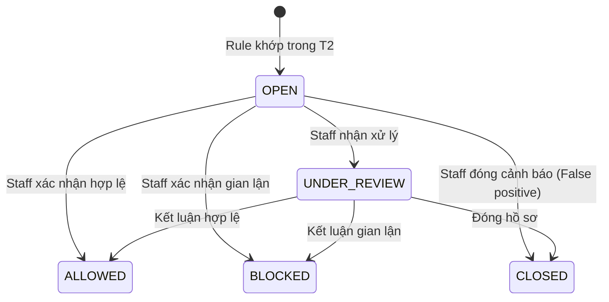

# Module 07: Fraud Detection & Notification Outbox (`fraud`, `notification`)

| Trường | Giá trị |
|---|---|
| **Dự án** | Digital Banking Platform Simulator (Single-Bank, Core Simulated) |
| **Mã tài liệu** | `BE-MOD-07` |
| **Phiên bản** | v1.0 |
| **Ngày cập nhật** | 2026-11-07 |
| **Trạng thái** | Hoàn thành — Tài liệu tham chiếu chuẩn cho Backend Developer & Coding Agent |
| **Nguồn tham chiếu** | `[[digitalbanking-docs/docs-common/03. SRS]]` (§3.8), `[[digitalbanking-docs/docs-common/04. Database design & analysis]]` (§5.7, §5.9), `[[digitalbanking-docs/docs-common/06. System architecture]]` (§4.3, §5.2), `[[digitalbanking-docs/docs-common/07. API contracts]]` (§11.8), `[[digitalbanking-docs/docs-common/design/02. consistency-concurrency]]` (§5.6, §5.10, §A.10, §A.13, §A.15, §B.6), `[[digitalbanking-docs/docs-common/design/03. fraud-detection-rules]]` |

---

## 1. Phạm vi & Trách nhiệm Module

Tài liệu này tổng hợp đầy đủ đặc tả kỹ thuật cho 2 module hỗ trợ kiểm soát rủi ro gian lận và phát thông báo sự kiện bất đồng bộ:

1. **Module `fraud` (`com.simulatedbank.banking.fraud`):**
   - **Write-owner độc quyền** của 2 bảng: `banking.fraud_rule_config` và `banking.fraud_flag`.
   - Cung cấp **In-Process Fraud Rule Engine (`FraudEvaluationPort`)** chạy đồng bộ bên trong giao dịch `T2` với ngân sách thời gian tối đa `1 giây` (`1000 ms`) và cơ chế **Fail-open có kiểm soát** khi gặp lỗi kỹ thuật.
   - Thực thi bộ 3 quy tắc phát hiện gian lận cốt lõi: `LARGE_TRANSFER`, `HIGH_FREQUENCY_10M`, và `UNUSUAL_RAPID_DRAIN`.
   - Cung cấp 2 REST API cho nhân viên Vận hành / Kiểm soát rủi ro (`OPERATIONS`, `RISK_COMPLIANCE`, `ADMIN_SECURITY`):
     - `GET /api/v1/fraud-flags` (`API-FRD-01`): Tra cứu danh sách cờ cảnh báo gian lận.
     - `POST /api/v1/fraud-flags/{id}/review` (`API-FRD-02`): Thẩm định và cập nhật trạng thái xử lý cờ gian lận.

2. **Module `notification` (`com.simulatedbank.banking.notification`):**
   - **Write-owner độc quyền** của bảng `banking.notification`.
   - Triển khai mẫu **Transactional Outbox (`T2` enqueue -> `T3` async worker dispatch)** đảm bảo không bao giờ gửi thông báo biến động số dư giả (khi giao dịch bị rollback) và không bao giờ làm chậm/lỗi giao dịch chuyển tiền vì cổng gửi SMS/Email bên ngoài.

---

## 2. Cấu trúc Package chuẩn

```text
com.simulatedbank.banking
├── fraud
│   ├── api
│   │   ├── FraudFlagController.java              // GET /api/v1/fraud-flags, POST /api/v1/fraud-flags/{id}/review
│   │   └── dto
│   │       ├── FraudFlagSummaryResponse.java
│   │       └── ReviewFraudFlagRequest.java
│   ├── application
│   │   ├── FraudEvaluationPort.java              // SPI gọi từ TransferTxPhaseService trong T2
│   │   ├── FraudRuleEngineService.java           // Đánh giá 3 rules với Savepoint / Fail-open isolation
│   │   └── FraudReviewService.java               // Xử lý máy trạng thái review cờ gian lận
│   └── infrastructure
│       ├── FraudRuleConfigEntity.java            // Bảng banking.fraud_rule_config
│       ├── FraudFlagEntity.java                  // Bảng banking.fraud_flag
│       └── FraudJdbcRepository.java              // Native SQL đếm tần suất 10 phút & FOR UPDATE NOWAIT
│
└── notification
    ├── application
    │   ├── NotificationOutboxPort.java           // SPI gọi từ TransferTxPhaseService trong T2 (enqueue PENDING)
    │   ├── NotificationOutboxWorker.java         // Background poller (T3) dùng FOR UPDATE SKIP LOCKED
    │   └── SimulatedNotificationSender.java      // Adapter gửi thông báo mô phỏng (Log / Webhook / MailHog)
    └── infrastructure
        ├── NotificationEntity.java               // Bảng banking.notification
        └── NotificationJdbcRepository.java       // Claim batch SKIP LOCKED & cập nhật SENT / FAILED retry
```

---

## 3. Phần A — Thiết kế Chi tiết Module `fraud`

### 3.1. Mô hình Dữ liệu (`banking.fraud_rule_config` & `banking.fraud_flag`)

#### Bảng `banking.fraud_rule_config`
| Cột | Kiểu dữ liệu | Ràng buộc | Ý nghĩa |
|---|---|---|---|
| `rule_code` | `VARCHAR(50)` | `PK` | Mã quy tắc (`LARGE_TRANSFER`, `HIGH_FREQUENCY_10M`, `UNUSUAL_RAPID_DRAIN`). |
| `rule_name` | `VARCHAR(150)` | `NOT NULL` | Tên hiển thị của quy tắc. |
| `severity` | `VARCHAR(20)` | `CHECK IN ('LOW','MEDIUM','HIGH','CRITICAL')` | Mức độ nghiêm trọng mặc định khi khớp quy tắc. |
| `threshold_json` | `JSONB` | `NOT NULL` | Tham số ngưỡng cấu hình động (không hard-code trong code). |
| `auto_block` | `BOOLEAN` | `NOT NULL DEFAULT false` | Nếu `true`: chặn đứng giao dịch ngay trong `T2` (`status = 'FAILED', failure_code = 'FRAUD_BLOCKED'`). Nếu `false`: vẫn cho phép giao dịch hoàn tất nhưng gắn cờ `fraud_flag (OPEN)` để hậu kiểm. |
| `enabled` | `BOOLEAN` | `NOT NULL DEFAULT true` | Bật/tắt quy tắc. |
| `version_no` | `INTEGER` | `NOT NULL DEFAULT 1` | Phiên bản cấu hình quy tắc (lưu vào `fraud_flag` khi khớp). |
| `updated_at` | `TIMESTAMPTZ` | `NOT NULL DEFAULT now()` | Thời điểm cập nhật. |

#### Bảng `banking.fraud_flag`
| Cột | Kiểu dữ liệu | Ràng buộc | Ý nghĩa |
|---|---|---|---|
| `fraud_flag_id` | `UUID` | `PK` | Định danh cờ cảnh báo gian lận. |
| `transfer_id` | `UUID` | `NOT NULL`, `FK -> transfer` | Giao dịch chuyển tiền phát sinh cảnh báo. |
| `rule_code` | `VARCHAR(50)` | `NOT NULL`, `FK -> fraud_rule_config` | Mã quy tắc đã khớp. |
| `rule_version` | `INTEGER` | `NOT NULL` | Phiên bản quy tắc tại thời điểm đánh giá. |
| `severity` | `VARCHAR(20)` | `CHECK IN ('LOW','MEDIUM','HIGH','CRITICAL')` | Độ nghiêm trọng của cờ. |
| `status` | `VARCHAR(20)` | `CHECK IN ('OPEN','UNDER_REVIEW','ALLOWED','BLOCKED','CLOSED')` | Trạng thái vòng đời thẩm định cờ gian lận. |
| `score_details` | `JSONB` | `NOT NULL` | Chi tiết chỉ số khớp quy tắc (VD: `{"amount": 85000000, "threshold": 50000000}`). |
| `reviewed_by` | `UUID` | `NULL`, `FK -> users` | Nhân viên thực hiện thẩm định. |
| `review_note` | `VARCHAR(500)` | `NULL` | Ghi chú kết luận thẩm định (`NOT NULL` khi đã chuyển khỏi `OPEN`). |
| `reviewed_at` | `TIMESTAMPTZ` | `NULL` | Thời điểm thẩm định. |
| `created_at` | `TIMESTAMPTZ` | `NOT NULL DEFAULT now()` | Thời điểm tạo cờ trong `T2`. |

- **Unique Constraint chống trùng cờ:** `uq_fraud_flag_transfer_rule UNIQUE (transfer_id, rule_code)`.

---

### 3.2. Đặc tả Bộ 3 Quy tắc Phát hiện Gian lận (`Fraud Rule Catalog`)

Dưới đây là cấu hình chuẩn của 3 quy tắc được seed sẵn trong bảng `banking.fraud_rule_config` và thuật toán đánh giá trong `FraudRuleEngineService`:

| Mã Quy tắc (`rule_code`) | `severity` mặc định | `auto_block` mặc định | Cấu hình `threshold_json` mặc định | Điều kiện Khớp (`Match Condition`) & Truy vấn Đánh giá |
|---|---|---|---|---|
| **`LARGE_TRANSFER`** | `HIGH` | `false` *(Flag-only)* | `{"minAmountVnd": 40000000, "autoBlockAmountVnd": 100000000}` | **Giao dịch giá trị lớn bất thường:**<br>- Nếu `transfer.amount >= minAmountVnd` (`40,000,000 VND`) -> Tạo `fraud_flag`.<br>- Nếu `transfer.amount >= autoBlockAmountVnd` (`100,000,000 VND`) hoặc `rule.auto_block == true` -> Trả về quyết định chặn tự động (`autoBlock = true`). |
| **`HIGH_FREQUENCY_10M`** | `MEDIUM` | `false` *(Flag-only)* | `{"windowMinutes": 10, "maxTxCount": 5}` | **Tần suất chuyển tiền dày đặc trong cửa sổ 10 phút:**<br>Đếm số giao dịch từ cùng `source_account_id` trong 10 phút gần nhất:<br>`SELECT COUNT(*) FROM banking.transfer WHERE source_account_id = :sourceId AND status = 'COMPLETED' AND created_at >= clock_timestamp() - INTERVAL '10 minutes'`<br>- Nếu `(recentCount + 1) > maxTxCount` (`> 5` giao dịch / 10 phút) -> Tạo `fraud_flag`. |
| **`UNUSUAL_RAPID_DRAIN`** | `CRITICAL` | `true` *(Auto-block)* | `{"windowMinutes": 15, "minDrainRatioPercent": 90, "minDrainAmountVnd": 20000000}` | **Rút cạn số dư tài khoản đột ngột:**<br>Tính tổng tiền đã chuyển đi trong 15 phút qua (`recentOutflow`) cộng với `transfer.amount` hiện tại so với số dư đầu kỳ 15 phút trước (`initialBalance = currentAvailableBalance + recentOutflow`):<br>- Nếu `(recentOutflow + transfer.amount) >= 20,000,000 VND` **VÀ** tỷ lệ rút `((recentOutflow + transfer.amount) * 100 / initialBalance) >= 90%` -> Tạo `fraud_flag (CRITICAL)` và kích hoạt **`autoBlock = true`** (`422 FRAUD_BLOCKED`). |

---

### 3.3. Cơ chế Thực thi Đồng bộ trong `T2` & Cô lập Lỗi `Fail-Open` (`SYS-RL-FRD-01..03`)

Trong pha `T2` (`TransferTxPhaseService`), việc đánh giá gian lận phải tuân thủ nghiêm ngặt 3 quy tắc sau:

1. **Cô lập bằng JDBC Savepoint để bảo vệ Transaction `T2` khi `Fail-Open`:**
   - Trong PostgreSQL, nếu một câu lệnh SQL bên trong transaction bị lỗi (ví dụ timeout `57014` khi chạy câu truy vấn thống kê của Fraud), toàn bộ transaction hiện tại sẽ rơi vào trạng thái `aborted` (`25P02`) trừ khi dùng `SAVEPOINT`.
   - Do đó, `FraudRuleEngineService.evaluateTransferInT2(...)` **bắt buộc** bọc khối đánh giá quy tắc trong một `SAVEPOINT fraud_eval_sp` (hoặc `TransactionTemplate` với `PROPAGATION_NESTED`) kèm `SET LOCAL statement_timeout = '1000ms'`:
     ```java
     // Minh họa sử dụng PROPAGATION_NESTED (tương đương JDBC Savepoint) trong T2
     public FraudDecision evaluateTransferInT2(TransferEntity transfer, LockedAccountPair accounts) {
         try {
             return nestedTransactionTemplate.execute(status -> {
                 jdbcTemplate.execute("SET LOCAL statement_timeout = '1000ms'");
                 List<MatchedRule> matchedRules = evaluateAllActiveRules(transfer, accounts);
                 // Ghi các dòng banking.fraud_flag (status = 'OPEN') và audit FRAUD_FLAG_CREATED (C2)
                 for (MatchedRule match : matchedRules) {
                     fraudJdbcRepo.insertFraudFlagOnConflictDoNothing(transfer.getTransferId(), match);
                     auditInternalPort.appendFraudFlagCreatedInT2(transfer, match);
                 }
                 boolean shouldBlock = matchedRules.stream().anyMatch(MatchedRule::autoBlock);
                 return shouldBlock
                     ? FraudDecision.block("Transaction blocked by fraud rule: " + matchedRules.get(0).ruleCode())
                     : FraudDecision.allow(matchedRules.size());
             });
         } catch (Exception ex) {
             // FAIL-OPEN: Rollback về savepoint fraud_eval_sp, khôi phục statement_timeout = '5s',
             // ghi metric + log cảnh báo C4 (FRAUD_ENGINE_ERROR) và CHO PHÉP giao dịch tiếp tục!
             jdbcTemplate.execute("SET LOCAL statement_timeout = '5s'");
             fraudMetrics.incrementEngineError();
             auditInternalPort.recordStandaloneFraudEngineError(transfer, ex.getMessage());
             return FraudDecision.allowOnFailOpen();
         }
     }
     ```
2. **Hành vi khi `FraudDecision.autoBlock() == true`:**
   - Giao dịch **không** thực hiện trừ/cộng tiền và **không** ghi `ledger_entry`.
   - Tuy nhiên, bản ghi `banking.fraud_flag (status = 'OPEN')`, bản ghi `audit_log (FRAUD_FLAG_CREATED)`, bản ghi `banking.transfer (status = 'FAILED', failure_code = 'FRAUD_BLOCKED')`, `banking.idempotency_record (status = 'FAILED', response_status = 422)` và `audit_log (TRANSFER_FAILED)` **đều được COMMIT trong cùng transaction `T2`**.
   - Client nhận `422 Unprocessable Entity` với `error.code = "FRAUD_BLOCKED"`.

---

### 3.4. Máy trạng thái Thẩm định Cờ Gian lận & API (`API-FRD-01`, `API-FRD-02`)



1. **`GET /api/v1/fraud-flags` (`API-FRD-01`):**
   - **Quyền truy cập:** Nhân viên có quyền `FRAUD_READ` (`OPERATIONS`, `RISK_COMPLIANCE`, `ADMIN_SECURITY`).
   - **Query Parameters:** `status` (`OPEN`, `UNDER_REVIEW`, `ALLOWED`, `BLOCKED`, `CLOSED`), `severity` (`LOW`, `MEDIUM`, `HIGH`, `CRITICAL`), `ruleCode`, `transferReference`, `from`, `to`, `page`, `size`.
2. **`POST /api/v1/fraud-flags/{id}/review` (`API-FRD-02`):**
   - **Quyền truy cập:** Nhân viên có quyền `FRAUD_REVIEW` (`OPERATIONS`, `RISK_COMPLIANCE`, `ADMIN_SECURITY`).
   - **Request Body:**
     ```json
     {
       "status": "ALLOWED",
       "reviewNote": "Da goi dien xac minh voi chu tai khoan, giao dich mua xe hop le"
     }
     ```
   - **Xử lý đồng bộ & khóa (`Pattern A.15`):**
     - `SELECT * FROM banking.fraud_flag WHERE fraud_flag_id = :id FOR UPDATE NOWAIT`.
     - Kiểm tra chuyển trạng thái hợp lệ: chỉ cho phép chuyển từ `OPEN` sang `{UNDER_REVIEW, ALLOWED, BLOCKED, CLOSED}` hoặc từ `UNDER_REVIEW` sang `{ALLOWED, BLOCKED, CLOSED}`. Các trạng thái `ALLOWED`, `BLOCKED`, `CLOSED` là trạng thái kết thúc (terminal), nếu gọi review lại sẽ trả về `409 CONFLICT`.
     - Cập nhật `status`, `reviewed_by = principal.userId`, `review_note`, `reviewed_at = now()`.
     - Ghi `audit_log` phân loại `C2` (`action = 'FRAUD_FLAG_REVIEWED'`).

---

## 4. Phần B — Thiết kế Chi tiết Module `notification` (Transactional Outbox)

### 4.1. Mô hình Dữ liệu Bảng `banking.notification` (Write-owner: `notification`)

| Cột | Kiểu dữ liệu | Ràng buộc | Ý nghĩa |
|---|---|---|---|
| `notification_id` | `UUID` | `PK` | Định danh bản ghi thông báo outbox. |
| `user_id` | `UUID` | `NOT NULL`, `FK -> users` | Người dùng nhận thông báo (người chuyển hoặc người nhận). |
| `transfer_id` | `UUID` | `NULL`, `FK -> transfer` | Giao dịch liên quan. |
| `channel` | `VARCHAR(20)` | `CHECK IN ('IN_APP','EMAIL','SMS')` | Kênh thông báo (mặc định `'IN_APP'` hoặc `'EMAIL'`). |
| `template_code` | `VARCHAR(50)` | `NOT NULL` | Mã mẫu thông báo: `'TRANSFER_DEBIT_ALERT'`, `'TRANSFER_CREDIT_ALERT'`. |
| `payload` | `JSONB` | `NOT NULL` | Dữ liệu hiển thị đã được che dấu PII (`reference`, `amount`, `currency`, `maskedCounterpartyAccount`, `balanceAfter`). |
| `status` | `VARCHAR(20)` | `CHECK IN ('PENDING','PROCESSING','SENT','FAILED')` | Trạng thái gửi thông báo. |
| `attempt_count` | `SMALLINT` | `NOT NULL DEFAULT 0` | Số lần đã thử gửi. |
| `max_attempts` | `SMALLINT` | `NOT NULL DEFAULT 5` | Số lần thử tối đa trước khi chuyển sang `FAILED` vĩnh viễn (Dead-letter). |
| `next_retry_at` | `TIMESTAMPTZ` | `NOT NULL DEFAULT now()` | Thời điểm được phép lấy ra thử gửi tiếp theo. |
| `locked_by` | `VARCHAR(64)` | `NULL` | Định danh worker instance đang giữ lease (`PROCESSING`). |
| `locked_until` | `TIMESTAMPTZ` | `NULL` | Thời điểm hết hạn lease (chống kẹt khi worker crash). |
| `last_error` | `VARCHAR(255)` | `NULL` | Lý do lỗi của lần gửi gần nhất. |
| `created_at`, `sent_at` | `TIMESTAMPTZ` | `created_at NOT NULL` | Thời điểm tạo trong `T2` và thời điểm gửi thành công trong `T3`. |

- **Unique Constraint chống nhân bản thông báo:** `uq_notification_transfer_user_template UNIQUE (transfer_id, user_id, template_code)`.

---

### 4.2. Pha `T2` Enqueue & Pha `T3` Outbox Lease Worker (`Pattern A.10`, `A.13`, `B.6`)

1. **Trong Pha `T2` (`NotificationOutboxPort.enqueueTransferNotificationsInT2`):**
   - Sau khi ghi cặp bút toán sổ cái thành công, chèn 2 dòng vào `banking.notification` với `status = 'PENDING'`, `next_retry_at = clock_timestamp()`:
     - Dòng 1: `user_id` của chủ tài khoản nguồn, `template_code = 'TRANSFER_DEBIT_ALERT'`.
     - Dòng 2: `user_id` của chủ tài khoản đích, `template_code = 'TRANSFER_CREDIT_ALERT'`.
   - Sử dụng `ON CONFLICT (transfer_id, user_id, template_code) DO NOTHING` để đảm bảo tính idempotent tuyệt đối.

2. **Trong Pha `T3` (`NotificationOutboxWorker` chạy mỗi `2 giây`):**
   - **Bước 1 — Claim Batch với Lease (`Transaction ngắn #1`):**
     ```sql
     UPDATE banking.notification
     SET status       = 'PROCESSING',
         locked_by    = :workerInstanceId,
         locked_until = clock_timestamp() + INTERVAL '30 seconds'
     WHERE notification_id IN (
         SELECT notification_id
         FROM banking.notification
         WHERE (status = 'PENDING' AND next_retry_at <= clock_timestamp())
            OR (status = 'PROCESSING' AND locked_until <= clock_timestamp())
         ORDER BY next_retry_at ASC, created_at ASC
         LIMIT 50
         FOR UPDATE SKIP LOCKED
     )
     RETURNING *;
     ```
   - **Bước 2 — Gửi thông báo bên ngoài DB Transaction:**
     - Với từng bản ghi đã claim, gọi `SimulatedNotificationSender.send(notification)` (không giữ kết nối DB trong lúc gọi I/O).
   - **Bước 3 — Cập nhật kết quả (`Transaction ngắn #2`):**
     - **Nếu gửi thành công:**
       ```sql
       UPDATE banking.notification
       SET status       = 'SENT',
           sent_at      = clock_timestamp(),
           locked_by    = NULL,
           locked_until = NULL
       WHERE notification_id = :id;
       ```
     - **Nếu gửi thất bại:** Tăng `attempt_count = attempt_count + 1`.
       - Nếu `attempt_count >= max_attempts` (`5` lần): chuyển `status = 'FAILED'` (Dead-letter), xóa `locked_by`/`locked_until`, bắn metric `banking_notification_dead_letter_total`.
       - Nếu `attempt_count < max_attempts`: chuyển về `status = 'PENDING'`, tính thời gian thử lại theo **Exponential Backoff**:
         $$\text{backoff\_seconds} = 5 \times 2^{\text{attempt\_count} - 1} \quad (\text{5s, 10s, 20s, 40s})$$
         và cập nhật `next_retry_at = clock_timestamp() + backoff_seconds`.

---

## 5. Checklist Kiểm thử cho Developer & Coding Agent

- [ ] **Fraud Rule Flag-Only (`T-FRAUD-01`):** Chuyển `45,000,000 VND` (khớp `LARGE_TRANSFER` với `auto_block = false`) -> giao dịch vẫn `COMPLETED` (`201 Created`), bảng `banking.fraud_flag` có 1 dòng `status = 'OPEN'` và `banking.audit_log` có `FRAUD_FLAG_CREATED`.
- [ ] **Fraud Rule Auto-Block (`T-FRAUD-02`):** Thực hiện giao dịch rút `95%` số dư với số tiền `>= 20,000,000 VND` (khớp `UNUSUAL_RAPID_DRAIN` với `auto_block = true`) -> giao dịch trả về `422 FRAUD_BLOCKED`, không có dòng `ledger_entry` nào được tạo, số dư giữ nguyên, nhưng `banking.transfer` lưu `FAILED (FRAUD_BLOCKED)` và `banking.fraud_flag` lưu `OPEN`.
- [ ] **Fraud Engine Fail-Open (`T-FRAUD-03`):** Giả lập ném `QueryTimeoutException` bên trong `FraudRuleEngineService` khi đang chạy `T2` -> nhờ `PROPAGATION_NESTED` (Savepoint), transaction `T2` không bị abort mà tiếp tục ghi nợ/ghi có và hoàn tất `COMPLETED` bình thường, đồng thời ghi nhận sự kiện `FRAUD_ENGINE_ERROR`.
- [ ] **Outbox Rollback Safety (`T-OUT-01`):** Khi `T2` bị rollback ở bước cuối (ví dụ do `AUDIT_WRITE_FAILED`), kiểm tra bảng `banking.notification` không có dòng nào được commit và khách hàng không nhận được thông báo biến động số dư giả.
- [ ] **Outbox Retry & Lease Recovery (`T-OUT-02`):** Giả lập `SimulatedNotificationSender` lỗi ở 2 lần đầu và thành công ở lần thứ 3 -> bản ghi `notification` tăng `attempt_count = 2` rồi lên `status = 'SENT'` ở lần thử thứ 3.
