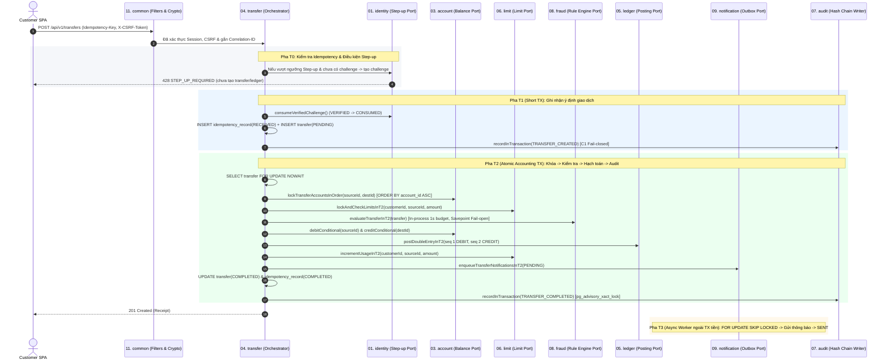

# Tổng hợp 11 Module Backend (`docs-backend/modules/_overview/`)

> **Dự án:** Digital Banking MVP (Single-Bank, Core Simulated)
> **Mã tài liệu:** `BE-MOD-COMMON`
> **Phiên bản:** v1.0
> **Ngày cập nhật:** 09/11/2026
> **Trạng thái:** Hoàn thành — Chỉ mục tổng hợp & tham chiếu cho 11 Module Backend
> **Nguồn tham chiếu:** [[digitalbanking-docs/docs-common/03. SRS.md]], [[digitalbanking-docs/docs-common/04. Database design & analysis.md]], [[digitalbanking-docs/docs-common/06. System architecture.md]] (§6, §7), [[digitalbanking-docs/docs-common/07. API contracts.md]], [[digitalbanking-docs/docs-common/10 Master timelines.md]], [[digitalbanking-docs/docs-common/11. Resource & Staffing Plan.md]], [[digitalbanking-docs/docs-common/design/README.md]]

---

## 1. Mục đích và Cách sử dụng Thư mục `modules/_overview/`

Thư mục `docs-backend/modules/_overview/` là **tài liệu tổng hợp trung tâm (Master Module Reference)** cho toàn bộ **11 module** trong kiến trúc **Spring Boot Modular Monolith** của hệ thống Digital Banking MVP:

- File **`README.md`** này đóng vai trò là **chỉ mục tham chiếu chung**, quy định cấu trúc package chuẩn, các quy tắc ranh giới bất biến giữa các module, sơ đồ phối hợp xuyên module (`T0 -> T1 -> T2 -> T3`) và bảng điều hướng tới 11 file tóm tắt module.
- **11 file riêng biệt (`01` đến `11`)** trong thư mục này tóm tắt rõ ràng: **Mục tiêu**, **Bảng DB sở hữu độc quyền (`Write-Owner`)**, **Hợp đồng REST API**, **Hợp đồng giao tiếp nội bộ (`Internal Ports`)** và **Danh sách công việc cần làm** của từng module.
- Dựa trên bản tóm tắt chuẩn tại đây, từng thành viên (Owner của mỗi module theo [[digitalbanking-docs/docs-common/11. Resource & Staffing Plan.md]]) sẽ phát triển tài liệu thiết kế chi tiết cho module mình phụ trách ở các thư mục module riêng biệt mà không bị chồng chéo dữ liệu hay lệch luồng tích hợp.

---

## 2. Bản đồ Điều hướng 11 File Tóm tắt Module trong `modules/_overview/`

| # | Module | File Tóm tắt Tham chiếu | Owner chính (`11. Staffing`) | Phối hợp bắt buộc | Mốc tập trung | Bảng DB sở hữu độc quyền (`banking.*`) |
|---:|---|---|---|---|---:|---|
| **01** | **`identity`** (`auth`) | [[digitalbanking-docs/docs-backend/modules/_overview/01-identity-auth.md]] | **Đạt** | Thắng (FE), Thịnh (`audit`), Vũ (`transfer`) | **W3** | `app_user` (`users`), `role`, `permission`, `user_role`, `role_permission`, `user_privilege`, `device`, `session`, `auth_challenge`, `auth_attempt`, `password_history` |
| **02** | **`customer`** | [[digitalbanking-docs/docs-backend/modules/_overview/02-customer.md]] | **Đạt** | Thắng (FE), Phương (`common`) | **W3** | `customer` |
| **03** | **`account`** | [[digitalbanking-docs/docs-backend/modules/_overview/03-account.md]] | **Đạt** | Phương (`ledger`), Vũ (`transfer`), Thắng (FE) | **W3–W4** | `account` |
| **04** | **`transfer`** | [[digitalbanking-docs/docs-backend/modules/_overview/04-transfer.md]] | **Vũ** | Phương (`ledger`), Đạt (`account`, `identity`), Thịnh (`fraud`, `audit`, `notification`), Thắng (FE) | **W4** | `transfer`, `idempotency_record` |
| **05** | **`ledger`** | [[digitalbanking-docs/docs-backend/modules/_overview/05-ledger.md]] | **Phương** | Vũ (`transfer`), Đạt (`account`) | **W4** | `ledger_entry` *(Append-only)* |
| **06** | **`limit`** | [[digitalbanking-docs/docs-backend/modules/_overview/06-limit.md]] | **Vũ** | Phương (`ledger`), Đạt (`admin`), Thắng (FE) | **W4–W5** | `limit_config`, `limit_usage` |
| **07** | **`audit`** | [[digitalbanking-docs/docs-backend/modules/_overview/07-audit.md]] | **Thịnh** | Đạt (`identity`, `admin`), Vũ & Phương (`transfer`/`ledger`) | **W3–W5** | `audit_log` *(Append-only)*, `legal_hold`, `retention_policy` *(+ `audit_chain_checkpoint`)* |
| **08** | **`fraud`** | [[digitalbanking-docs/docs-backend/modules/_overview/08-fraud.md]] | **Thịnh** | Vũ (`transfer`, `limit`), Đạt (`admin`), Thắng (FE) | **W5** | `fraud_rule_config`, `fraud_flag` |
| **09** | **`notification`** | [[digitalbanking-docs/docs-backend/modules/_overview/09-notification.md]] | **Thịnh** | Đạt (`identity`), Vũ (`transfer`), Thắng (FE) | **W4–W5** | `notification` |
| **10** | **`admin`** | [[digitalbanking-docs/docs-backend/modules/_overview/10-admin.md]] | **Đạt** *(Thịnh đồng phát triển)* | Thịnh (`fraud`, `audit`), Vũ (`limit`), Thắng (FE) | **W5** | `approval_request` |
| **11** | **`common`** | [[digitalbanking-docs/docs-backend/modules/_overview/11-common.md]] | **Phương** | Vũ, Đạt, Thịnh (nhu cầu dùng chung) | **W2–W3** *(Duy trì)* | *Không sở hữu bảng nghiệp vụ* |

---

## 3. Quy ước Kiến trúc Chung cho cả 11 Module (`06. System architecture.md` §6.1–6.3)

### 3.1. Cấu trúc Package Chuẩn của mỗi Module (`Package-by-Feature`)

Mỗi module là một package cấp cao dưới `com.simulatedbank.banking.<module>` và tuân thủ cấu trúc 5 lớp chuẩn:

```text
com.simulatedbank.banking.<module>/
├── api/            # Public Internal Interface / Port + DTO cung cấp cho các module khác gọi
├── adapter/
│   ├── in/         # REST Controller, Request/Response DTO, Web Mapper
│   └── out/        # Spring Data JPA / JDBC Repository, External Gateway Adapter
├── application/    # Use Case / Application Service, @Transactional / TransactionTemplate boundary
└── domain/         # Domain Entity, Value Object, State Machine, Pure Business Rules
```

### 3.2. 5 Quy tắc Ranh giới Bất biến (`Module Boundary Rules`)

1. **Một chủ sở hữu ghi duy nhất cho mỗi bảng (`Single Write-Owner per Table`):** Không một module nào được phép `INSERT`, `UPDATE`, `DELETE` trực tiếp vào bảng thuộc sở hữu của module khác. Mọi thay đổi trạng thái chéo phải gọi qua interface trong gói `<target_module>.api.*`.
2. **Đặt ranh giới Transaction ở tầng `application`:** Controller (`adapter/in`) chỉ kiểm tra cú pháp đầu vào, gọi `application` service và trả kết quả. Không gắn `@Transactional` trên Controller.
3. **Thứ tự khóa toàn cục chống Deadlock (`Global Lock Ordering` — `design/02` §6.2):**
   - Trong pha hạch toán `T2`: `transfer (FOR UPDATE NOWAIT)` $\rightarrow$ `account (ORDER BY account_id ASC FOR UPDATE)` $\rightarrow$ `limit_usage (CUSTOMER trước -> ACCOUNT sau FOR UPDATE)` $\rightarrow$ `pg_advisory_xact_lock('audit:chain')` ở bước cuối cùng trước khi commit.
4. **Module `common` là nền tảng một chiều:** Tất cả các module nghiệp vụ (`01..10`) được phép phụ thuộc vào `common` ([[digitalbanking-docs/docs-backend/modules/_overview/11-common.md]]), nhưng `common` **tuyệt đối không** phụ thuộc ngược vào bất kỳ module nghiệp vụ nào.
5. **Không phụ thuộc vòng (`No Circular Dependencies`):**
   - `identity`, `customer`, `account` là lớp nền tảng, không phụ thuộc `transfer`.
   - `transfer` điều phối luồng chuyển tiền thông qua các Port của `identity`, `account`, `limit`, `fraud`, `ledger`, `notification` và `audit`.
   - `admin` điều phối luồng vận hành và Maker-Checker thông qua các Port của `identity`, `customer`, `account`, `limit`, `fraud` và `audit`.

---

## 4. Sơ đồ Luồng Phối hợp Xuyên Module trong Giao dịch Chuyển tiền (`T0 -> T1 -> T2 -> T3`)



---

## 5. Khung Chuẩn dành cho các Thành viên khi Viết Tài liệu Chi tiết Từng Module

Khi từng Owner (**Vũ, Phương, Đạt, Thịnh**) triển khai tài liệu chi tiết cho module mình phụ trách trong thư mục riêng (ví dụ `docs-backend/modules/<ten-module>/`), hãy bám sát file tóm tắt tương ứng tại `modules/_overview/01..11-*.md` và mở rộng theo 7 phần chuẩn sau:

1. **Phạm vi & Truy vết Yêu cầu:** Ánh xạ tới các mã `BR-*`, `FR-*`, `NFR-*`, `AC-*` trong `docs-common/03. SRS.md`.
2. **Thiết kế Class & Hợp đồng Interface (`api`, `adapter/in`, `application`, `domain`, `adapter/out`):** Chữ ký phương thức (method signatures) của các Internal Ports và Application Services.
3. **Chi tiết Bảng Dữ liệu & Câu lệnh SQL/Locking:** DDL, Index, Constraint và các câu truy vấn native SQL (`FOR UPDATE`, `NOWAIT`, `SKIP LOCKED`) trích từ `04. Database design & analysis.md` và `design/02. consistency-concurrency.md`.
4. **Chi tiết Endpoint REST API & Xử lý Lỗi:** Đường dẫn, quyền `@PreAuthorize`, Request/Response JSON mẫu, quy tắc che dấu PII và bảng mã lỗi trả về theo `07. API contracts.md` & `openapi/digital-banking-v1.yaml`.
5. **Luồng Xử lý & Ranh giới Giao dịch:** Sơ đồ tuần tự/máy trạng thái cho luồng thành công và các kịch bản lỗi/rollback.
6. **Sự kiện Kiểm toán (`AuditAction`) & Metrics:** Danh sách các action `C1`–`C4` gửi sang module `audit` theo `design/01. audit-traceability.md`.
7. **Kịch bản Kiểm thử Module (`Test Cases`):** Liên kết tới các mã kiểm thử trong `09. Test plan.md`.
