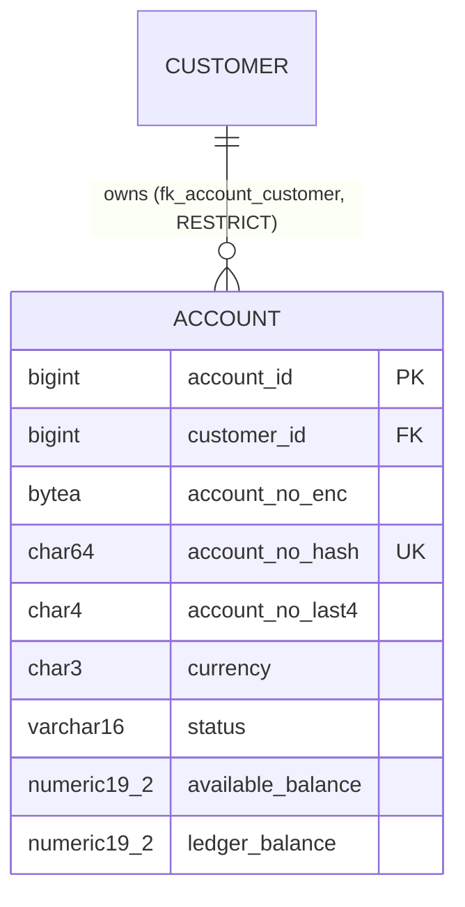

# BE-ACC-02 — Account Flyway schema, constraints & indexes

> **Dự án:** Digital Banking MVP
> **Mã tài liệu:** BE-ACC-02
> **Phiên bản:** v1.0
> **Ngày cập nhật:** 17/11/2026
> **Trạng thái:** **VERIFIED** — migration `V8` chạy sạch trên PostgreSQL 16 (fresh + upgrade từ `V7`), constraint/index được kiểm bằng metadata thật
> **Owner:** Đạt (Account)
> **Reviewer:** Chưa sign-off — cần DBA và Architect
> **Branch:** `datht-backend-rework` (baseline `4d0ed75`), không tạo/không switch branch, không commit/push
> **Nguồn tham chiếu:** [[digitalbanking-docs/docs-common/04. Database design & analysis.md]] §4.1/§4.3.1/§4.5/§4.5 FK standard, §9.6; [[digitalbanking-docs/docs-common/07. API contracts.md]] §7.2.7–7.2.8; [[digitalbanking-docs/docs-common/design/02. consistency-concurrency.md]] Appendix A.3/A.4; [[digitalbanking-docs/docs-common/design/05. Modules contract.md]] §7; [[digitalbanking-docs/docs-backend/00. architecture & conventions.md]] §8.5–§8.6; [[BE-ACC-01]] §B; [DEC-ACC-001](../../../../DECISIONS.md); [DEC-ACC-002](../../../../DECISIONS.md)

---

## A. Phạm vi và trạng thái đầu vào

| Hạng mục | Trước task | Sau task |
|---|---|---|
| Migration | `V1`–`V7`; không có `banking.account`; `V8` chưa dùng | `V8__create_account_table.sql` — bảng + constraint + index canonical |
| Account entity/repository | Chưa có (BE-ACC-03) | Không đổi — DDL đã sẵn cho entity `BIGINT`/`BigDecimal` (xem §F) |
| Trạng thái task | `BLOCKED` (schema decisions) | `VERIFIED` |

Bảng `account` **chưa** tồn tại ở bất kỳ migration nào trước `V8`, nên không có bảng/cột/constraint/index trùng lặp cần xử lý.

---

## B. Schema decisions — blocker ban đầu và cách giải

Trạng thái `BLOCKED` của BE-ACC-02 xuất phát từ việc tài liệu mô tả Account khác nhau (`_overview/03-account.md` bản nháp ghi `FROZEN`, `UUID`, `account_type CHECKING/SAVINGS`, balance `BIGINT`) trong khi `04` §4.3.1/`07` §8.2/OpenAPI là nguồn canonical. BE-ACC-01 đã phân xử toàn bộ các điểm này (DEC-ACC-001, §B/§E của [BE-ACC-01](BE-ACC-01.md)). BE-ACC-02 chỉ hiện thực đúng phần đã chốt:

| Decision | Nội dung | Nguồn | Ảnh hưởng DDL |
|---|---|---|---|
| ACC-DR-01 | Status `ACTIVE\|LOCKED\|CLOSED`; `FROZEN` là tài liệu lỗi thời | `04` §4.3.1 CHECK, `07` §7.2.7, OpenAPI `AccountStatus` | `ck_account_status` đúng 3 giá trị |
| ACC-DR-02 | PK `BIGINT GENERATED ALWAYS AS IDENTITY`; ra HTTP là decimal string | `04` §4.3.1, OpenAPI `ID` | `account_id BIGINT IDENTITY` |
| ACC-DR-03 | MVP **không** có `account_type` | `04` §4.3.1, `07` §7.2.7–7.2.8, OpenAPI | Không tạo cột/enum |
| ACC-DR-05 | Balance `NUMERIC(19,2)`, NOT NULL default 0, `>= 0`, `available <= ledger` | `04` §4.3.1, `design/02` A.4, `design/05` §7.2 | 2 cột + 3 CHECK |
| ACC-DR-07 | Không `version`/optimistic locking; pessimistic lock + conditional UPDATE | `04` §4.3.1 (chỉ `created_at/updated_at/closed_at`) | Không có cột `version` |
| ACC-DR-08 | FK `RESTRICT`, không cascade, 3 index canonical | `04` §4.3.1, §4.1 FK standard | `fk_account_customer`, `ix_account_customer`, `ix_account_status`, `uq_account_no_hash` |
| ACC-DR-14 | Port `account.api` chỉ cần cột đã có; `resolveDestination` tra `account_no_hash` | `design/05` §7.1, BE-ACC-01 §D | Unique index blind index |

### B.1. Quyết định vẫn **BLOCKED** (không tạo cột, không suy diễn)

| Decision | Nội dung | Vì sao không ảnh hưởng V8 |
|---|---|---|
| ACC-DR-04 | Thuật toán sinh số tài khoản/prefix/checksum + provisioning idempotency | V8 chỉ lưu ciphertext/blind-index/last4; không có cột `account_no` plaintext, không cột idempotency trên `account`. Write path chưa mở |
| ACC-DR-06 | Opening balance provenance/reconciliation | Canonical không có cột opening; V8 không thêm cột, không seed số dư |
| ACC-DR-10 | `AccountDetail.owner.fullName` + 404 `CUSTOMER_NOT_FOUND` (Customer `getCustomerView`) | Thuộc API composition (BE-ACC-05), không phải DDL |
| ACC-DR-12 | Status transition matrix + audit `ACCOUNT_STATUS_CHANGED` | V8 chỉ có CHECK giá trị; không có endpoint/state machine, không trigger |
| ACC-DR-13 | Staff data scope (chi nhánh/segment) | Chưa có model scope; không thêm cột `branch_id`/`segment` |
| ACC-DR-15 | Durable audit C3 | Audit không lưu trong bảng `account`; module Audit sở hữu |

Không có quyết định nào cần approval mới để hoàn thành DDL: mọi cột/constraint/index của V8 đều có nguồn canonical ở `04` §4.3.1 + BE-ACC-01 §B.

---

## C. Migration đã hiện thực

| File | Vai trò | SHA-256 |
|---|---|---|
| `digitalbanking-backend/src/main/resources/db/migration/V8__create_account_table.sql` | Canonical DDL cho `banking.account` | `6b397b7c4ba218b534e379dbd54626dcca3e642c761a4241086772b3a0e5885a` |

Nguyên tắc: forward-only (BE-DAT-15), `out-of-order: false`, không sửa `V1`–`V7`, không destructive statement, không seed dữ liệu, không trigger/grant (grant `banking_app` thuộc deployment §8.6, ngoài phạm vi MVP migration hiện có).

### C.1. Bảng `banking.account`

| Column | Type | Null | Default | Constraint |
|---|---|---|---|---|
| `account_id` | `BIGINT GENERATED ALWAYS AS IDENTITY` | NO | identity | PK |
| `customer_id` | `BIGINT` | NO | — | FK `fk_account_customer` → `banking.customer(customer_id)` `ON DELETE/UPDATE RESTRICT` |
| `account_no_enc` | `BYTEA` | NO | — | ciphertext AES-256-GCM (application) |
| `account_no_hash` | `CHAR(64)` | NO | — | `uq_account_no_hash` UNIQUE, `ck_account_no_hash_hex` |
| `account_no_last4` | `CHAR(4)` | NO | — | `ck_account_no_last4_digits` |
| `currency` | `CHAR(3)` | NO | `'VND'` | `ck_account_currency` |
| `status` | `VARCHAR(16)` | NO | `'ACTIVE'` | `ck_account_status` |
| `available_balance` | `NUMERIC(19,2)` | NO | `0` | `ck_account_available_balance_non_negative`, `ck_account_balance_within_ledger` |
| `ledger_balance` | `NUMERIC(19,2)` | NO | `0` | `ck_account_ledger_balance_non_negative`, `ck_account_balance_within_ledger` |
| `closed_at` | `TIMESTAMPTZ` | YES | — | `ck_account_closed_at_required` |
| `created_at` | `TIMESTAMPTZ` | NO | `now()` | — |
| `updated_at` | `TIMESTAMPTZ` | NO | `now()` | — |

`account_no_last4` là `CHAR(4)` và được kiểm `^[0-9]{4}$` — suy ra trực tiếp từ format số tài khoản đã duyệt `^[0-9]{6,20}$` (OpenAPI `DestinationAccountNumber`): 4 ký tự cuối của một chuỗi chỉ gồm chữ số. Không thêm business rule mới.

### C.2. Quan hệ



`CUSTOMER` sở hữu 1..N `ACCOUNT`; xoá/đổi khoá `customer_id` bị `RESTRICT` khi còn account (không cascade mất financial record — `04` §7 countermeasure "Delete account làm mất lịch sử"). Không có FK ngược nào từ bảng khác vào `account` trong phạm vi MVP hiện tại (`transfer`, `ledger_entry` chưa được tạo).

---

## D. Constraints đã hiện thực và lý do

| Constraint | Định nghĩa | Nguồn / lý do | Test phủ |
|---|---|---|---|
| `account_pkey` | PK (`account_id`) | `04` §4.3.1 PK IDENTITY | metadata + insert |
| `fk_account_customer` | FK `customer_id` → `banking.customer` `ON DELETE RESTRICT ON UPDATE RESTRICT` | `04` §4.1/§4.3.1; không cascade tài chính | FK `23503` khi customer không tồn tại; delete/update customer bị chặn |
| `uq_account_no_hash` | UNIQUE (`account_no_hash`) | natural key immutable; blind index là lookup duy nhất cho số tài khoản | duplicate `23505` |
| `ck_account_no_hash_hex` | `account_no_hash ~ '^[0-9a-f]{64}$'` | HMAC-SHA-256 lowercase hex (`HmacService.hmacSha256Hex`), cùng quy ước `ck_admin_idempotency_request_hash` (V7) | hash uppercase / 63 ký tự bị từ chối |
| `ck_account_no_last4_digits` | `account_no_last4 ~ '^[0-9]{4}$'` | `04` §4.3.1 "độ dài 4" + format số tài khoản digits-only | `10a1` bị từ chối |
| `ck_account_currency` | `currency = 'VND'` | `04` §4.3.1; MVP chỉ VND | `USD` bị từ chối |
| `ck_account_status` | `status IN ('ACTIVE','LOCKED','CLOSED')` | `04` §4.3.1, `07` §7.2.7, OpenAPI | `FROZEN` bị từ chối |
| `ck_account_available_balance_non_negative` | `available_balance >= 0` | INV-BAL-01; `design/02` A.4 | `-1.00` bị từ chối |
| `ck_account_ledger_balance_non_negative` | `ledger_balance >= 0` | INV-BAL-02 | row âm ledger bị từ chối (xem §H.1) |
| `ck_account_balance_within_ledger` | `available_balance <= ledger_balance` | `04` §4.3.1 "MVP không có hold"; chặn available > ledger | `100.00/50.00` bị từ chối |
| `ck_account_closed_at_required` | `status <> 'CLOSED' OR closed_at IS NOT NULL` | `04` §4.3.1 "đóng bằng `CLOSED` + `closed_at`" | `CLOSED` thiếu `closed_at` bị từ chối |

Ghi chú có chủ đích:

- **Không** có CHECK `closed_at IS NULL` khi status khác `CLOSED`: tài liệu chỉ yêu cầu `closed_at` **bắt buộc khi CLOSED**, không cấm set sớm; thêm điều kiện ngược sẽ là business rule tự phát.
- **Không** có trigger `updated_at`: canonical không quy định trigger; mọi conditional UPDATE trong T2 tự set `updated_at` (BE-ACC-06/07).
- **Không** có constraint `status='ACTIVE'` cho debit/credit ở DB: đây là điều kiện của conditional UPDATE (BE-ACC-06/07), không phải bất biến toàn bảng — thêm CHECK sẽ chặn việc lock/close account.
- CHECK không xung đột lifecycle: `LOCKED`/`CLOSED` vẫn insert/update hợp lệ, chỉ `CLOSED` cần `closed_at`.

---

## E. Indexes đã hiện thực và rationale

| Index | Cột | Unique | Query pattern | Lý do |
|---|---|---|---|---|
| `account_pkey` | `(account_id)` | Có (PK) | `WHERE account_id = ?`, `WHERE account_id IN (?,?) ORDER BY account_id FOR UPDATE` | Định danh nội bộ; phục vụ lookup chi tiết, lock T2 |
| `uq_account_no_hash` | `(account_no_hash)` | Có | `resolveDestination`: HMAC(number) → account; chống trùng số tài khoản | Enforce uniqueness **và** là access path duy nhất; không tạo thêm index thường trùng cột |
| `ix_account_customer` | `(customer_id)` | Không | `GET /api/v1/accounts` (self list), `API-ADM-02` staff list, ownership check | Prefix `customer_id` khớp predicate; kết quả sắp theo PK nên không cần cột sort |
| `ix_account_status` | `(status)` | Không | Lọc staff/ops theo status, thống kê lifecycle | Canonical `04` §4.3.1; cardinality thấp, chỉ hữu ích cho scan diện rộng — **không** dùng làm access path cho một customer |

Không thêm:

- Composite `(customer_id, status)`: chưa có query đã duyệt nào lọc đồng thời cả hai cho một customer (`07` §8.2.2 chỉ có `status` optional) → sẽ là index thừa, tăng write cost.
- Index trên `account_no_last4`/`closed_at`: không có query pattern được duyệt.
- Partial index: không có trong canonical; không có unique scope cần partial.
- Không trùng lặp: `uq_account_no_hash` đã tạo index B-tree unique trên `account_no_hash` nên không tạo `ix_account_no_hash` riêng (đã kiểm bằng metadata: chỉ một index chứa `(account_no_hash)`).

---

## F. Đối chiếu entity/repository

Baseline chưa có `AccountEntity`/`AccountRepository` (BE-ACC-03 sở hữu). Vì vậy:

- Không có mapping JPA nào cần sửa; `hibernate.ddl-auto: validate` không thấy entity `account` nên không fail.
- Kiểu dữ liệu đã chọn tương thích mapping dự kiến: `BIGINT IDENTITY` → `Long` + `@GeneratedValue(strategy = IDENTITY)`; `NUMERIC(19,2)` → `BigDecimal`; `CHAR(3)/CHAR(64)/CHAR(4)` → `String` (Hibernate map `bpchar` → `String`); `TIMESTAMPTZ` → `Instant`/`OffsetDateTime` với `hibernate.jdbc.time_zone=UTC`.
- Enum persistence: `VARCHAR(16)` + CHECK, không dùng `@Enumerated(ORDINAL)`; status map sang `account.api.AccountQuery.Status` (`ACTIVE|LOCKED|CLOSED`) — BE-ACC-03 phải dùng `EnumType.STRING`.
- Không có cột `version` → entity không dùng `@Version`; khoá bi quan/conditional UPDATE thuộc BE-ACC-06/07.
- `uq_account_no_hash` không phải unique constraint JPA trên field plaintext nào (plaintext không tồn tại trong DB) — BE-ACC-03 chỉ map cột hash.

Không sửa source Account nào khác trong task này.

---

## G. Kiểm thử và kết quả thực tế

### G.1. Lệnh đã chạy

```bash
cd digitalbanking-backend
./gradlew test --tests 'com.simulatedbank.banking.migration.*' --console=plain
./gradlew build --max-workers=1 --console=plain
```

`./gradlew flywayValidate` **không tồn tại** trong project: `build.gradle.kts` không áp dụng Flyway Gradle plugin (chỉ có `flyway-core` + `flyway-database-postgresql` runtime, migration chạy qua Spring Boot/`Flyway` API). Thay thế tương đương đã dùng:

- `Flyway.configure().validateOnMigrate(true)` (đúng cấu hình `application.yml`) và gọi `flyway.validate()` trực tiếp trên PostgreSQL 16 thật;
- `PostgreSqlFreshMigrationIntegrationTest` chạy toàn chuỗi `V1`–`V8` từ DB trống rồi migrate lại (idempotent, schema fingerprint không đổi);
- `./gradlew build` chạy `hibernate.ddl-auto=validate` trên context test.

### G.2. Kết quả

| Suite | Kết quả |
|---|---|
| `AccountV8MigrationPostgreSqlIntegrationTest` (mới) | **10/10 PASS**, 0 skip/failure/error |
| `FlywayMigrationTest` | **5/5 PASS** (thêm 1 test static cho `V8`) |
| Toàn bộ `com.simulatedbank.banking.migration.*` (7 class) | **43/43 PASS**, 0 failure/error/skip — gồm `PostgreSqlFreshMigrationIntegrationTest` (8 migration, fingerprint ổn định khi rerun), `CustomerV5MigrationPostgreSqlIntegrationTest`, `IdentityV2MigrationPostgreSqlIntegrationTest`, `ApprovalRequestV6MigrationPostgreSqlIntegrationTest` (cập nhật version hiện tại `8`), `PostgreSqlFlywayMigrationIntegrationTest` |
| `./gradlew build --max-workers=1` | **BUILD SUCCESSFUL** (6m59s) — **87 classes / 1055 tests / 0 failure / 0 error / 0 skip**; đóng góp của task: +1 class / +11 test (`AccountV8…` 10 + `FlywayMigrationTest` +1), phần tăng còn lại đến từ thay đổi chưa commit của module khác trong cùng working tree |

### G.3. Nội dung test `V8`

| Test | Nội dung |
|---|---|
| `freshMigrationAppliesV8OnceAndValidationSucceeds` | 8 migration, history `1..8` đúng thứ tự, không trùng version, mọi checksum non-null, `validate()` OK |
| `columnsTypesLengthsNullabilityDefaultsAndIdentityMatchCanonicalSchema` | 12 cột đúng thứ tự/type/length/precision 19,2/nullability (chỉ `closed_at` nullable)/default (`VND`, `ACTIVE`, `0`, `now()`)/identity `ALWAYS`; không có `account_type`/`version`/plaintext `account_no` |
| `primaryForeignUniqueAndCheckConstraintsMatchApprovedDesign` | PK, FK `RESTRICT` tới `banking.customer`, unique `account_no_hash`, đúng 8 CHECK cùng định nghĩa |
| `canonicalIndexesExistWithoutDuplicatesOrPartialPredicates` | Đúng 4 index, không partial, không index trùng trên `account_no_hash` |
| `validAccountUsesApprovedDefaultsAndSupportsClosedLifecycle` | Insert tối thiểu dùng default; `LOCKED`/`CLOSED` + `closed_at` hợp lệ; timestamptz |
| `duplicateAccountNumberBlindIndexIsRejected` | Trùng `account_no_hash` → `23505` `uq_account_no_hash` |
| `missingRequiredColumnsAndInvalidDomainValuesAreRejected` | NULL các cột bắt buộc → `23502`; `FROZEN`, `USD`, balance âm, `available > ledger`, `CLOSED` thiếu `closed_at`, last4 không phải 4 số, hash không phải hex 64 → `23514` đúng constraint |
| `invalidCustomerReferenceIsRejected` | `customer_id` không tồn tại → `23503` `fk_account_customer` |
| `customerDeleteAndKeyUpdateAreRestrictedByAccountForeignKey` | Xoá/đổi `customer_id` khi còn account bị chặn; dữ liệu còn nguyên |
| `upgradeFromV7PreservesCustomerDataAndAddsAccountTable` | DB mới migrate tới `V7` (7 migration), insert customer, migrate `V8` (1 migration): dữ liệu customer còn nguyên, `account` insert được, `validate()` OK |

Không dùng H2; mọi test chạy PostgreSQL 16 thật qua Testcontainers. Không có test nào được đánh dấu pass khi chưa chạy.

---

## H. Deviations / ghi chú kỹ thuật

1. **`ck_account_ledger_balance_non_negative` có thể bị che bởi `ck_account_balance_within_ledger`:** khi `ledger_balance < 0`, PostgreSQL báo một constraint vi phạm (thường là `within_ledger` vì `available >= 0 > ledger`). Vẫn giữ cả hai vì đây là hai bất biến canonical (`>= 0` từng cột và quan hệ `available <= ledger`); test khẳng định row bị từ chối với `SQLSTATE 23514` thay vì phụ thuộc thứ tự báo lỗi.
2. **`ck_account_no_last4_digits`** là suy ra trực tiếp từ format số tài khoản đã duyệt; nếu tương lai format cho phép ký tự khác, phải sửa `04` + OpenAPI + migration mới (forward compensating).
3. **`ix_account_status`** giữ theo canonical dù cardinality thấp; đã ghi rõ giới hạn sử dụng trong migration comment.
4. **Không có bảng/thứ tự migration mới nào khác bị ảnh hưởng**: `V8` chỉ `CREATE TABLE`/`CREATE INDEX`, không `ALTER`, không `DROP`.
5. **Cập nhật test version-coupled:** `PostgreSqlFreshMigrationIntegrationTest` (7→8 + assert bảng/index/constraint account) và `ApprovalRequestV6MigrationPostgreSqlIntegrationTest` (`EXPECTED_MIGRATIONS` 7→8, current version `8`). Đây là maintenance bắt buộc khi thêm version migration, không nới lỏng assertion.
6. **Môi trường:** lần chạy `./gradlew build` đầu tiên trong working tree fail ở bước *ghi XML test result* (`Could not write XML test results for …`) vì một tiến trình `gradlew cleanTest build` khác đang chạy đồng thời trên cùng thư mục `build/` (xác nhận qua `ps`); không có test nào fail. Lần chạy lại khi không còn tiến trình đồng thời: **BUILD SUCCESSFUL** với 1055 test PASS. Một lần chạy bản copy chỉ-backend (không có `../digitalbanking-docs`) pass 1050 test và 10 lỗi `NoSuchFileException` cho OpenAPI/docs — artifact của bản copy, không phải lỗi sản phẩm.

---

## I. Việc còn lại (ngoài BE-ACC-02)

| Việc | Task | Trạng thái |
|---|---|---|
| `AccountEntity`/`AccountRepository`, crypto/blind-index cho số tài khoản | BE-ACC-03 | Chưa làm; DDL đã sẵn |
| Read service/ownership/resolve | BE-ACC-04 | Chưa làm |
| Row lock `FOR UPDATE`, conditional debit/credit, test concurrency PostgreSQL | BE-ACC-06/07 | Chưa làm; `ix`/PK đã đủ cho `ORDER BY account_id ASC FOR UPDATE` |
| Provisioning/account number generation + idempotency (ACC-DR-04) | BA/Security/Product | **BLOCKED** — không ảnh hưởng DDL |
| Opening balance provenance (ACC-DR-06) | Ledger + DBA | **BLOCKED** |
| Status transition + C2 audit (ACC-DR-12) | Account + Audit + BA | **BLOCKED** |
| Durable audit C3 (ACC-DR-15) | Audit | **BLOCKED** |
| DBA/Architect sign-off migration | Quy trình | Chờ review |

---

## J. Change log

| Version | Ngày | Nội dung |
|---|---|---|
| v1.0 | 17/11/2026 | Thêm `V8__create_account_table.sql`, test PostgreSQL 16 (fresh/upgrade/constraint/index), cập nhật test version-coupled, báo cáo + checklist + `DEC-ACC-002` |
