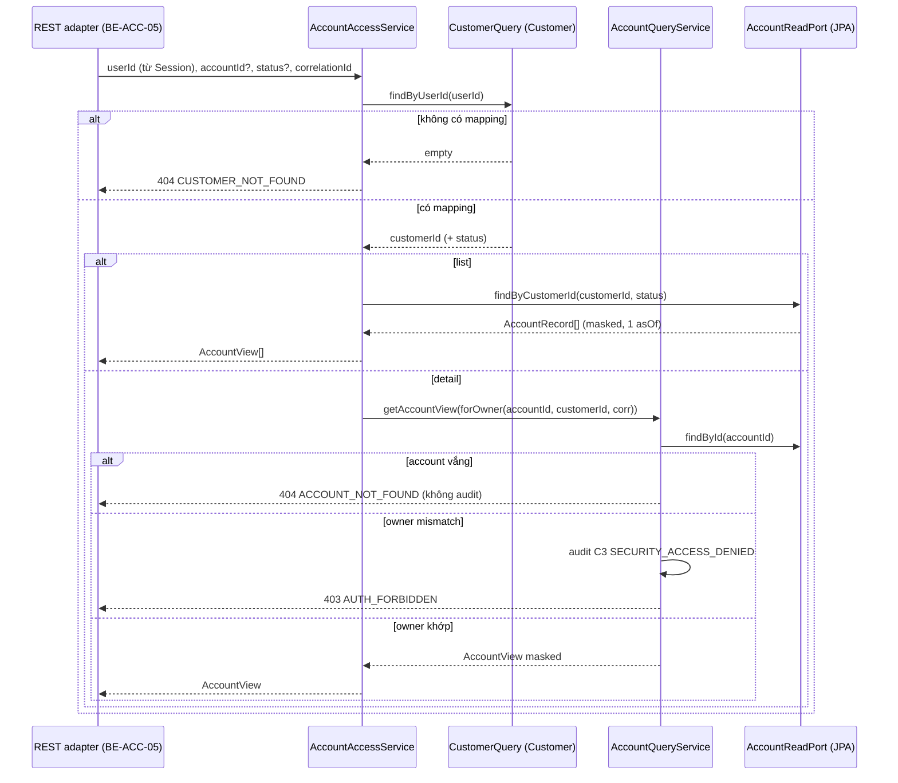

# BE-ACC-04 — Account Read / Ownership / Resolve

> **Dự án:** Digital Banking MVP
> **Mã tài liệu:** BE-ACC-04
> **Phiên bản:** v1.0
> **Ngày cập nhật:** 17/11/2026
> **Trạng thái:** **COMPLETED** (application read/ownership/resolve) — REST adapter `API-ACC-01/02`, security chain 401 và durable audit C3 thuộc BE-ACC-05/ACC-DR-15
> **Owner:** Đạt (Account)
> **Reviewer:** Chưa sign-off — cần Security và Architect
> **Branch:** `datht-backend-rework`, không tạo/không switch branch, không commit/push
> **Nguồn tham chiếu:** [[digitalbanking-docs/docs-common/design/05. Modules contract.md]] §7.1; [[digitalbanking-docs/docs-common/07. API contracts.md]] §7.2.7–7.2.8, §8.2.2–8.2.3; [[digitalbanking-docs/docs-common/03. SRS.md]] AC-023/AC-024; [[digitalbanking-docs/docs-common/design/01. audit-traceability.md]] §5.3/§5.6/§5.7; [[digitalbanking-docs/docs-common/design/04. security.md]]; [[BE-ACC-01]] §C/§D; [[BE-ACC-03]]; [DEC-ACC-001](../../../../DECISIONS.md); [DEC-ACC-004](../../../../DECISIONS.md)

---

## A. Phạm vi

| Hạng mục | Kết quả |
|---|---|
| `account.api.AccountQuery` | Có implementor duy nhất: `application.AccountQueryService` |
| `findAccount` / `resolveDestination` | Đọc snapshot masked; resolve bằng HMAC blind index; validate format trước DB |
| `getAccountView` / `assertOwnership` | Owner scope/staff scope, 403 + C3 khi mismatch, 404 khi vắng |
| Identity resolution | `application.AccountAccessService` nhận `userId` từ principal server-side, resolve `userId → customerId` qua `customer.api.CustomerQuery` |
| Customer resolution | Dùng `CustomerQuery.findByUserId`; mapping vắng → `404 CUSTOMER_NOT_FOUND`; `INACTIVE` không tự chặn (CUS-OI-06 chưa duyệt) |
| REST adapter `GET /api/v1/accounts*` | **Không thuộc task này** — BE-ACC-05 (security chain/401/header/cache/HTTP test) |
| Durable audit C3 | Structured security log + metric như DEC-ID-003/DEC-CUS-005; `audit_log` vẫn BLOCKED (ACC-DR-15) |

---

## B. Quyết định triển khai (DEC-ACC-004)

| # | Quyết định | Căn cứ | Hệ quả |
|---|---|---|---|
| 1 | Tách 2 lớp: `AccountQueryService` (port cross-module, không biết session) và `AccountAccessService` (use case self read, nhận `userId` principal) | design/05 §3.1/§7.1; BE-ACC-DOC-01 §6 (BE-ACC-04 = query/resolve/ownership service) | Consumer Transfer/Ledger dùng `AccountQuery`; REST adapter BE-ACC-05 gọi `AccountAccessService` với `Session.userId()` |
| 2 | Không nhận `customerId`/`userId` từ client ở use case self read; chỉ `userId` server-side | AC-024; design/05 §3.1 "không tin body client" | IDOR không thể khai thác bằng cách đổi query/body; ownership suy ra từ mapping |
| 3 | Mapping vắng → `404 CUSTOMER_NOT_FOUND`, không trả list rỗng giả | Tiền lệ `CustomerProfileService`; design/05 §6 | Không che giấu lỗi cấu hình principal; fail closed |
| 4 | `INACTIVE` customer **không** bị chặn đọc account | CUS-OI-06 chưa duyệt; `CustomerQuery` trả status thật | Không tự tạo business rule; khi policy được duyệt, thêm tại đây + test |
| 5 | Không tồn tại account → `404 ACCOUNT_NOT_FOUND`, **không** audit; owner mismatch → `403 AUTH_FORBIDDEN` + audit C3 | `07` §8.2.3; design/01 §5.7 | Đúng contract; không lộ dữ liệu trước khi kiểm quyền |
| 6 | Audit C3 best-effort ở cả adapter và service; lỗi audit không đổi 403, không rollback | design/01 §5.3; DEC-ID-003 | Response 403 ổn định kể cả khi audit/metric lỗi |
| 7 | `asOf` lấy `Clock.instant()` một lần cho cả list | `07` §7.2.7/§8.2.2 | Snapshot nhất quán trong một response list |
| 8 | Staff scope (`forStaff`) không kiểm ownership cá nhân; data scope chưa có model | ACC-DR-13 BLOCKED; `07` §8.2.5 | BE-ACC-05/09 phải enforce `ACCOUNT_READ`/scope trước khi gọi; provider không tự chế scope |

---

## C. Luồng đọc và ownership

### C.1. Self read (`AccountAccessService`)



### C.2. Port `AccountQuery`

| Operation | Hành vi | Lỗi |
|---|---|---|
| `findAccount(id)` | `id <= 0` → validate; đọc; map mask | `400`, persistence lỗi lan truyền |
| `resolveDestination(number)` | `AccountNumber.parse` strict; HMAC-SHA256; tra `account_no_hash` | `400` sai format; `500` crypto lỗi; empty khi không khớp |
| `getAccountView(query)` | đọc; owner scope kiểm `customer_id`; staff scope bỏ kiểm ownership | `404`, `403` + C3, `500` masking lỗi |
| `assertOwnership(id, customerId, corr)` | đọc; so owner | `404`, `403` + C3, `400` input sai |

Không decrypt `account_no_enc`, không trả `account_no_hash`, `account_no_enc`, khóa hay metadata nội bộ. `AccountView`/`AccountSnapshot` chỉ chứa masked number + last4 (contract guard BE-ACC-01).

---

## D. Customer / Identity resolution

| Tình huống | Kết quả | Test |
|---|---|---|
| `userId` hợp lệ, có Customer row | Resolve `customerId` + status, đọc account của chính customer đó | `listsOnlyAccountsOfTheResolvedCustomerWithStableOrderAndOneAsOf`, `selfDetailReturnsMaskedOwnerViewFromTheRealCustomerMapping` |
| `userId` không có Customer row | `404 CUSTOMER_NOT_FOUND`; không truy vấn account | `missingCustomerMappingIsNotFoundAndNeverQueriesAccounts`, `principalWithoutCustomerMappingIsCustomerNotFound` |
| `userId <= 0` | `400 VALIDATION_ERROR` trước CustomerQuery | `invalidUserIdOrCorrelationIsRejectedBeforeCustomerLookup` |
| Customer `INACTIVE` | Vẫn đọc account kèm status thật (CUS-OI-06 chưa duyệt) | `inactiveCustomerKeepsReadingItsAccountsBecauseEligibilityIsUnapproved`, `inactiveCustomerStillReadsItsAccountsBecauseDownstreamEligibilityIsUnapproved` |
| Cross-customer `accountId` | `403 AUTH_FORBIDDEN` + C3; không lộ masked number/balance | `crossCustomerAccessIsRejectedAsForbiddenWithoutLeakingAccountData`, `crossCustomerDetailIsForbiddenAuditedAndDoesNotTouchForeignData` |
| Account không tồn tại | `404 ACCOUNT_NOT_FOUND`; không audit | `unknownAccountIsNotFoundForAnAuthenticatedOwner`, `missingAccountIsNotFoundAndNotAudited` |

Customer provider theo `customer.api.CustomerQuery` (không đọc bảng/entity/PII Customer). `AccountDetail.owner.fullName` vẫn **BLOCKED** (ACC-DR-10): Account không decrypt PII Customer và BE-ACC-05 sẽ ghép khi `getCustomerView` được duyệt.

---

## E. Error handling

| Failure | HTTP | ErrorCode | Audit |
|---|---|---|---|
| Account vắng | 404 | `ACCOUNT_NOT_FOUND` | Không |
| Account thuộc customer khác | 403 | `AUTH_FORBIDDEN` | C3 `SECURITY_ACCESS_DENIED` |
| Principal không có Customer mapping | 404 | `CUSTOMER_NOT_FOUND` | Không |
| ID/correlation/số tài khoản sai | 400 | `VALIDATION_ERROR` | Không |
| Crypto/masking lỗi (dữ liệu hỏng, key lỗi runtime) | 500 | `INTERNAL_ERROR` | Không |
| SQL/technical failure | lan truyền | (global mapper) | Không nuốt |

Không trả danh sách rỗng khi persistence/authorization lỗi; không đổi lỗi kỹ thuật thành 404.

---

## F. Kiểm thử và kết quả

```bash
cd digitalbanking-backend
./gradlew test --tests 'com.simulatedbank.banking.account.application.*' \
  --tests 'com.simulatedbank.banking.architecture.ModuleBoundaryArchTest' --console=plain
```

| Suite | Kết quả |
|---|---|
| `AccountQueryServiceTest` | **14/14 PASS** — find/resolve/view/ownership, enum scope, invalid input, technical failure, crypto failure, audit best-effort |
| `AccountAccessServiceTest` | **8/8 PASS** — userId→customer, missing/inactive mapping, status filter, cross-customer, invalid input |
| `AccountReadPostgreSqlIntegrationTest` (PostgreSQL 16 + Flyway + CustomerQuery thật) | **10/10 PASS** — self list/detail, masking, cross-customer 403 + metric C3, 404 không audit, missing mapping, inactive, resolveDestination, assertOwnership, findAccount |
| `ModuleBoundaryArchTest` | **18/18 PASS** — không import internals module khác, `account.api` entity-free, port chỉ implement ở `application` |
| `AccountApiContractTest` / BE-ACC-03 suites | PASS (regression) |

Full `./gradlew build --max-workers=1` **BUILD SUCCESSFUL** (6m30s): **93 classes / 1110 tests / 0 failure / 0 error / 0 skip**. Không có endpoint HTTP nào được thêm trong task này. Bằng chứng 401/HTTP header/cache/`ACCOUNT_READ` chain sẽ do BE-ACC-05 cung cấp.

---

## G. Việc còn lại / blockers

| Blocker | Ảnh hưởng | Owner | Trạng thái |
|---|---|---|---|
| BE-ACC-05 | REST `GET /api/v1/accounts`, `/accounts/{id}`, 401/403/404 HTTP, `Cache-Control`, OpenAPI | Account | Chưa làm — service đã sẵn |
| ACC-DR-10 | `AccountDetail.owner.fullName`, 404 `CUSTOMER_NOT_FOUND` cho `API-ADM-02` | Customer | **BLOCKED** |
| ACC-DR-13 | Staff data scope | BA/Security/Admin | **BLOCKED** |
| ACC-DR-15 | Durable audit C3 | Audit | **BLOCKED** (đang dùng structured log + metric) |
| CUS-OI-06 | Customer `INACTIVE` ảnh hưởng Account/Transfer | BA/Account/Transfer | **BLOCKED** — hiện không chặn |
| BE-ACC-06/07 | Row lock + debit/credit | Account/Transfer | Chưa làm |

---

## H. Change log

| Version | Ngày | Nội dung |
|---|---|---|
| v1.0 | 17/11/2026 | `AccountQueryService` + `AccountAccessService`, ownership/C3, Customer/Identity resolution, unit + PostgreSQL 16 tests, [DEC-ACC-004](../../../../DECISIONS.md) |
