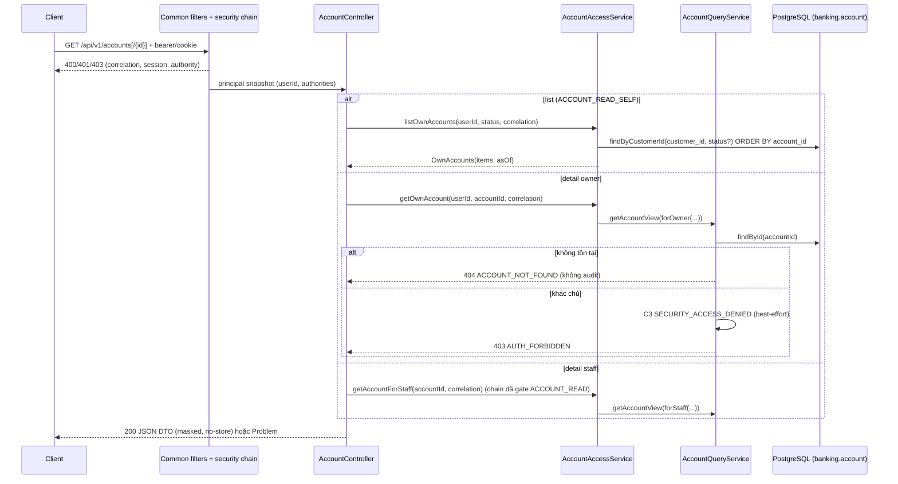

# BE-ACC-05 — GET Account APIs + security/C3

> **Dự án:** Digital Banking MVP
> **Mã tài liệu:** BE-ACC-05
> **Phiên bản:** v1.0
> **Ngày cập nhật:** 18/11/2026
> **Trạng thái:** **COMPLETED** (REST `API-ACC-01`/`API-ACC-02`, security/ownership/C3 runtime) — còn 3 limitation đã biết: `owner.fullName` (ACC-DR-10), durable audit C3 (ACC-DR-15), staff data scope (ACC-DR-13)
> **Owner:** Đạt (Account)
> **Reviewer:** Chưa sign-off — cần Security và Architect
> **Branch:** `datht-backend-rework`, không tạo/không switch branch, không commit/push
> **Nguồn tham chiếu:** [[digitalbanking-docs/docs-common/07. API contracts.md]] §7.2.7–7.2.8, §8.2.2–8.2.3; [[digitalbanking-docs/docs-common/04. Database design & analysis.md]] §4.3.1; `docs-common/design/05. Modules contract.md` §3.1/§7.1; [[digitalbanking-docs/docs-common/03. SRS.md]] AC-023/AC-024; `docs-common/design/01. audit-traceability.md` §5.3/§5.6/§5.7; `docs-common/design/04. security.md` §IDOR/`SEC-CHK-04`; OpenAPI `/accounts`, `/accounts/{accountId}`, `AccountSummary`, `AccountDetail`, `AccountsResponse`; [BE-ACC-01](BE-ACC-01.md) §C; [BE-ACC-04](BE-ACC-04.md); [DEC-ACC-001/004/005](../../../../DECISIONS.md)

---

## A. Phạm vi

| Hạng mục | Kết quả |
|---|---|
| `GET /api/v1/accounts` (`API-ACC-01`) | Có runtime: self-only list, `status` filter tùy chọn, `items`/`asOf`, masked number, money dạng chuỗi |
| `GET /api/v1/accounts/{accountId}` (`API-ACC-02`) | Có runtime: owner scope + staff read scope đã qua `ACCOUNT_READ`, 400/401/403/404 theo hợp đồng |
| Security chain | Dùng rule sẵn có của `SecurityFilterChainConfig` — không thêm cơ chế auth mới, không sửa Identity |
| Ownership/C3 | Service layer đã có từ BE-ACC-04; HTTP test chứng minh 403 + audit C3 best-effort (structured log + metric) không đổi response |
| Response DTO | `AccountSummaryResponse`, `AccountsResponse`, `AccountDetailResponse` trong `account.adapter.in`; không trả entity/JPA projection |
| `owner.fullName` | **KHÔNG trả** — ACC-DR-10 BLOCKED (xem §E) |
| `API-ADM-02` (`/admin/customers/{id}/accounts`) | Không thuộc task này — BE-ACC-09 (P1, staff scoped list) |
| Durable `audit_log` C3 | **BLOCKED** ACC-DR-15; dùng security log + metric theo DEC-ID-003/DEC-CUS-005 |

---

## B. Quyết định triển khai (DEC-ACC-005)

| # | Quyết định | Căn cứ | Hệ quả |
|---|---|---|---|
| 1 | Controller mỏng trong `adapter.in`, gọi `AccountAccessService`; không gọi repository/entity | 00 §Architecture, BE-CON-21, BE-ACC-04 §B | Không lặp business logic; DTO không phụ thuộc JPA |
| 2 | Scope detail chọn từ **authority server-side**: có `ACCOUNT_READ_SELF` → owner; ngược lại có `ACCOUNT_READ` → staff | `07` §8.2.3; `JpaAuthorityReader` user-type isolation; BE-ACC-04 §B.8 | Client không thể chọn scope; CUSTOMER không bao giờ có `ACCOUNT_READ` |
| 3 | Staff detail dùng `AccountViewQuery.forStaff` sau gate của chain; **không** tự chế data scope | ACC-DR-13 BLOCKED; `07` §8.2.5; tiền lệ `StaffCustomerDetailService` | Đúng permission đã duyệt; phần chi nhánh/segment ghi BLOCKED |
| 4 | `status` query parse thủ công sang enum; giá trị lạ/rỗng → `400 VALIDATION_ERROR` | `07` §8.2.2; Spring type-mismatch mặc định rơi vào 500 | Không biến input sai thành internal error |
| 5 | `accountId` theo OpenAPI `ID` `[1-9][0-9]{0,18}`; overflow → 400 trước persistence | OpenAPI `AccountIdPath`, `07` §8.2.3 | Không chạm DB với ID sai; chống enumeration |
| 6 | Money luôn serialize dạng chuỗi scale 2 (`"12500000.00"`), ID dạng chuỗi | OpenAPI `Money`/`ID`; `07` §2 | Khớp contract máy đọc; không mất precision |
| 7 | `asOf` sinh một lần cho list (kể cả list rỗng) qua `AccountAccessService.OwnAccounts` | `07` §8.2.2 | Snapshot nhất quán; không dùng `Instant.now()` rải rác |
| 8 | `Cache-Control: no-store` + `X-Correlation-ID` do Common filter/response bảo đảm; không nhân bản filter | `design/04`, `ApiSecurityHeadersFilter` | Header an toàn cho dữ liệu tài chính |
| 9 | C3 vẫn best-effort như BE-ACC-04; lỗi audit không đổi 403 | `design/01` §5.3; DEC-ID-003/DEC-CUS-005 | Response ổn định; metric `account.audit.events{action,outcome}` |
| 10 | `owner.fullName` bị **bỏ khỏi response** thay vì bịa/mask không có nguồn | ACC-DR-10; ArchUnit `customerApiMustNotCarryTextualPiiFields` | Deviation có kiểm soát; mở lại khi Customer có `getCustomerView` được duyệt |

---

## C. Luồng request



---

## D. Hợp đồng HTTP đã hiện thực

### D.1. `GET /api/v1/accounts`

- Query: `status` optional ∈ `ACTIVE|LOCKED|CLOSED`.
- 200:

```json
{
  "items": [
    {
      "accountId": "3001",
      "accountNumberMasked": "**** **** 3001",
      "accountNumberLast4": "3001",
      "currency": "VND",
      "status": "ACTIVE",
      "availableBalance": "12500000.00",
      "ledgerBalance": "12500000.00",
      "asOf": "2026-11-03T10:15:30Z"
    }
  ],
  "asOf": "2026-11-03T10:15:30Z"
}
```

- Chỉ account thuộc `customer_id` resolve từ principal; unknown status → 400; staff (`ACCOUNT_READ` nhưng không `ACCOUNT_READ_SELF`) → 403 từ chain; user chưa có Customer row → 404 `CUSTOMER_NOT_FOUND`.

### D.2. `GET /api/v1/accounts/{accountId}`

- 200: `AccountSummary` + `owner{customerId, status}` + `createdAt/updatedAt`.
- `owner.fullName` **không có** (ACC-DR-10) — xem §E.
- 400 `VALIDATION_ERROR` (ID sai), 401 `AUTH_SESSION_EXPIRED`, 403 `AUTH_FORBIDDEN` (owner mismatch + C3; thiếu authority), 404 `ACCOUNT_NOT_FOUND`, 404 `CUSTOMER_NOT_FOUND` (owner không có mapping).

### D.3. Lỗi và audit

| Failure | HTTP | ErrorCode | Audit/metric |
|---|---|---|---|
| Thiếu/invalid/expired credential | 401 | `AUTH_SESSION_EXPIRED` | Security middleware (không phải Account C3) |
| Thiếu authority trên route | 403 | `AUTH_FORBIDDEN` | Security chain |
| Account khác chủ | 403 | `AUTH_FORBIDDEN` | C3 `SECURITY_ACCESS_DENIED` + metric `account.audit.events` |
| Account vắng | 404 | `ACCOUNT_NOT_FOUND` | Không audit |
| Principal chưa có Customer row | 404 | `CUSTOMER_NOT_FOUND` | Không audit |
| ID/status/correlation sai | 400 | `VALIDATION_ERROR` | Không audit |
| Crypto/masking lỗi | 500 | `INTERNAL_ERROR` | Fail closed |
| SQL/timeout/deadlock | 5xx | `DatabaseErrorMapper` (`SERVICE_UNAVAILABLE` cho 55P03/40P01/40001/57014) | Không nuốt |

---

## E. Deviation & blocker: `owner.fullName`

`07` §7.2.8/OpenAPI `AccountDetail.owner` yêu cầu `CustomerSummary{customerId, fullName, status}`. Account **không thể** tạo `fullName` một cách hợp lệ:

1. Account không đọc/decrypt PII Customer (design/05 §6.2; BE-ACC-01 §D).
2. `customer.api.CustomerQuery` hiện chỉ trả `customerId/userId/status`; ArchUnit rule `customerApiMustNotCarryTextualPiiFields` **cấm** field PII dạng text trong `customer.api`.
3. Provider `getCustomerView(customerId)` + mask oracle theo role **chưa được duyệt/triển khai** (ACC-DR-10).

Quyết định: trả `owner{customerId, status}` và ghi rõ deviation; **không** bịa/mask fullName bằng nguồn không có thẩm quyền. Khi Customer cung cấp `getCustomerView` được duyệt, thêm field vào `AccountDetailResponse.Owner` + mapping, không đổi route/status/error. Đã ghi vào `design/05` §7.1 (ghi chú BE-ACC-05).

Các blocker còn lại: **ACC-DR-15** (durable `audit_log` C3 — hiện structured log + metric), **ACC-DR-13** (staff data scope — hiện chỉ enforce `ACCOUNT_READ`), **ACC-DR-10** (owner PII).

---

## F. Kiểm thử và kết quả

```bash
cd digitalbanking-backend
./gradlew test \
  --tests 'com.simulatedbank.banking.account.adapter.in.AccountControllerPostgreSqlIntegrationTest' \
  --tests 'com.simulatedbank.banking.account.application.*' \
  --tests 'com.simulatedbank.banking.account.adapter.out.*' \
  --tests 'com.simulatedbank.banking.account.api.*' --console=plain
```

Environment: PostgreSQL 16 (Testcontainers, Flyway `V1`–`V8`, Hibernate `validate`), security chain + Identity `JpaAuthorityReader` thật, AES-GCM/HMAC thật. Không mock security.

| Suite | Kết quả |
|---|---|
| `AccountControllerPostgreSqlIntegrationTest` (mới) | **17/17 PASS** |
| `AccountQueryServiceTest` / `AccountAccessServiceTest` | 14/14, 8/8 PASS (regression; `listOwnAccounts` trả `OwnAccounts`) |
| `AccountReadPostgreSqlIntegrationTest` / `AccountPersistencePostgreSqlIntegrationTest` | 10/10, 5/5 PASS |
| `AccountApiContractTest` / `CommonAccountNumberProtectionAdapterTest` | 6/6, 7/7 PASS |
| `AccountLockPostgreSqlIntegrationTest` (BE-ACC-06) | 11/11 PASS |
| **Account module total** | **78/78 PASS**, 0 failure/error/skip |

`AccountControllerPostgreSqlIntegrationTest` phủ: list owner-only + thứ tự + đúng field set + money string; filter status; filter sai → 400; list rỗng có `asOf`; detail đúng `AccountDetail` (masked, owner, timestamps) và read-only (row không đổi); LOCKED/CLOSED đọc được; cross-owner → 403 + C3 metric + không lộ dữ liệu; 404 không audit; ID sai → 400 (0/-1/abc/1.5/01/overflow); identity chưa có Customer → 404; staff `ACCOUNT_READ` đọc detail theo scope đã duyệt; 401 thiếu/invalid/expired credential; staff không có `ACCOUNT_READ_SELF` không list được (403); customer không đọc được account người khác; credential malformed không lộ dữ liệu; `Cache-Control: no-store` + `X-Correlation-ID` + `application/problem+json`.

**Regression đã điều chỉnh:** `ObservabilityIntegrationTest` (Common) trước đây lấy `/api/v1/accounts` làm path *unmapped* để kiểm label bounded `UNKNOWN`/401. Từ BE-ACC-05 route này có handler nên 401 mang label `/api/v1/accounts`; test được cập nhật dùng thêm path thật sự unmapped (`/api/v1/unmapped/<id>`) — giữ nguyên assertion và mục tiêu bounded-label, không nới lỏng security/metrics.

---

## G. Việc còn lại

| Blocker | Ảnh hưởng | Owner | Trạng thái |
|---|---|---|---|
| ACC-DR-10 | `AccountDetail.owner.fullName` | Customer (+BA/Security) | **BLOCKED** — deviation đã ghi §E |
| ACC-DR-13 | Staff data scope cho `API-ACC-02`/`API-ADM-02` | BA/Security/Admin | **BLOCKED** — hiện chỉ enforce `ACCOUNT_READ` |
| ACC-DR-15 | Durable `audit_log` C3 | Audit | **BLOCKED** — structured log + metric |
| BE-ACC-07/08 | Debit/credit + T2 integration | Account/Transfer | Chưa làm |
| BE-ACC-09 | `API-ADM-02` staff scoped list | Account/Admin | Chưa làm (P1) |

---

## H. Change log

| Version | Ngày | Nội dung |
|---|---|---|
| v1.0 | 18/11/2026 | `AccountController` + DTO `AccountSummary`/`AccountDetail`/`AccountsResponse`, owner/staff dispatch, 17 HTTP tests trên PostgreSQL 16; full `./gradlew build --max-workers=1` **BUILD SUCCESSFUL**: 98 classes / 1166 tests / 0 failure/error/skip; [DEC-ACC-005](../../../../DECISIONS.md) |
