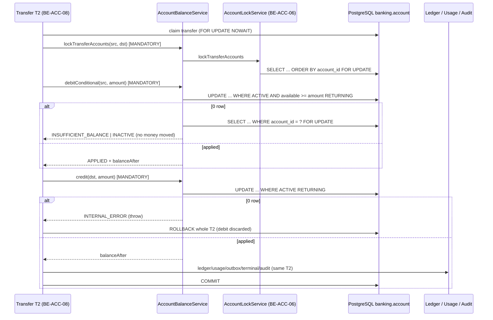

# BE-ACC-07 — Conditional debit/credit và rollback

> **Dự án:** Digital Banking MVP
> **Mã tài liệu:** BE-ACC-07
> **Phiên bản:** v1.0
> **Ngày cập nhật:** 18/11/2026
> **Trạng thái:** **COMPLETED** (`AccountBalanceService` implement `account.api.AccountBalance`; conditional debit/credit trên PostgreSQL 16, rollback same-transaction, `MANDATORY`, concurrency evidence) — T2 end-to-end với Transfer/Ledger vẫn BLOCKED ở BE-ACC-08 vì chưa có consumer/orchestrator
> **Owner:** Đạt (Account)
> **Reviewer:** Chưa sign-off — cần Architect + DBA + owner Transfer/Ledger
> **Branch:** `datht-backend-rework`, không tạo/không switch branch, không commit/push
> **Nguồn tham chiếu:** `docs-common/design/02. consistency-concurrency.md` §5.3 bước 3/6/7, §7.3/§7.4, §8.1–§8.3, §8.6, §11.1–§11.6, Appendix A.3/A.4; `docs-common/design/05. Modules contract.md` §3.2/§7.2; `docs-common/04. Database design & analysis.md` §4.3.1; `docs-common/07. API contracts.md` §2.3 (`Money`), §7.2.7–7.2.8; `docs-common/03. SRS.md` FR-012/FR-015, SYS-RL-001–003; [BE-ACC-01](BE-ACC-01.md); [BE-ACC-02](BE-ACC-02.md); [BE-ACC-06](BE-ACC-06.md); [DEC-ACC-007](../../../../DECISIONS.md)

---

## A. Phạm vi

| Hạng mục | Kết quả |
|---|---|
| Implementation `account.api.AccountBalance` | `account.application.AccountBalanceService` — implementor duy nhất (ArchUnit `accountPortsAreImplementedOnlyByItsApplicationLayer`) |
| Persistence | `account.application.AccountBalancePort` + `account.adapter.out.JdbcAccountBalanceAdapter` (native SQL, `RETURNING`, `MANDATORY`) |
| `lockTransferAccounts` | Ủy quyền primitive BE-ACC-06 (`AccountLockService`), không duplicate SQL/lock order |
| `debitConditional` | Conditional UPDATE cả `available_balance` + `ledger_balance`, `status='ACTIVE' AND available_balance >= amount`; 0 row → `INACTIVE`/`INSUFFICIENT_BALANCE` |
| `credit` | Conditional UPDATE `status='ACTIVE'`; 0 row → `INTERNAL_ERROR` (system error, rollback T2) |
| Rollback | Spring transaction của orchestrator; không compensating entry, không Saga, không retry từng câu SQL |
| Idempotency | **Không** thuộc Account — T1 idempotency + transfer state guard (BE-ACC-08); không thêm bảng/cột mới |
| HTTP API | Không thêm route; `API-ACC-01/02` giữ nguyên (BE-ACC-05) |
| Migration | Không có migration mới (`V8` đã đủ CHECK/NUMERIC); không sửa `V1`–`V8` |
| T2 end-to-end với Transfer/Ledger | **BLOCKED** — BE-ACC-08 (chưa có consumer/orchestrator) |
| T-CON-01/T-CON-03 đầy đủ | **BLOCKED** — BE-ACC-11 (cần BE-ACC-07 + 08); BE-ACC-07 chỉ cung cấp money-path evidence |

---

## B. Quyết định triển khai (DEC-ACC-007)

| # | Quyết định | Căn cứ | Hệ quả |
|---|---|---|---|
| 1 | Một application service duy nhất implement `AccountBalance`; lock ủy quyền BE-ACC-06 | `design/05` §7.2.1; BE-ACC-06 DEC-ACC-006 quyết định 1 | Không có hai nguồn SQL lock; consumer chỉ thấy `account.api` |
| 2 | Port riêng `AccountBalancePort` thay vì thêm mutation vào `AccountLockPort` | Tách primitive lock (SELECT) khỏi mutation (UPDATE) theo `design/02` §11.3 | Adapter lock giữ nguyên hành vi; test BE-ACC-06 không đổi semantic |
| 3 | Conditional UPDATE native SQL + `RETURNING`, không read-modify-write, không JPQL bulk update | `design/02` §8.2/A.4; §11.3 | Một câu atomic; 0 row là kết quả, không phải lỗi SQL; `balance_after` lấy từ `RETURNING` |
| 4 | Debit 0 row → đọc lại `FOR UPDATE`: non-`ACTIVE` → `INACTIVE`, còn lại → `INSUFFICIENT_BALANCE` | `design/02` §7.4/§8.2 | Business outcome, không throw; chưa có tiền di chuyển; phân loại dựa trên bản committed mới nhất dưới lock |
| 5 | Credit 0 row → `INTERNAL_ERROR` | `design/02` §5.3 bước 6.3/§8.2 | Throw unchecked → rollback toàn T2, không commit FAILED sau debit; alert qua 5xx |
| 6 | `MANDATORY` ở service và adapter; caller sở hữu transaction | `design/05` §3.2/§7.2; `design/02` §11.1 | Gọi ngoài T2 fail fast; provider không mở/commit/rollback, không retry, không compensation |
| 7 | Validation `Money` + ID trước SQL | `07` §2.3; SYS-RL-001; BE-ACC-01 contract | `VALIDATION_ERROR` (400): `amount` null/≤ 0/scale > 2/> 17 chữ số nguyên, `accountId` ≤ 0; không lock row nào |
| 8 | Bounded `lock_timeout` dùng chung helper với BE-ACC-06 | `design/02` §7.10/§11.2 | `SET LOCAL` 2s chỉ khi caller chưa đặt; 55P03 lan truyền technical |
| 9 | Không thêm idempotency key/compensating entry vào Account | `design/02` §6/§8.3; BE-ACC-01 | Retry an toàn nhờ rollback toàn T2 + idempotency/state guard của Transfer; Account không tự dedup |
| 10 | Không đổi signature `AccountBalance` | BE-CON-45 | Không phá consumer hợp đồng; ownership do T2 re-check qua `LockedAccount.customerId()` |

---

## C. Transaction boundaries



- **Một transaction duy nhất (T2)**: lock → re-check → debit → credit → ledger/usage/terminal/audit. Account không tạo transaction riêng, không `REQUIRES_NEW`.
- `@Transactional(propagation = MANDATORY)` ở `AccountBalanceService` và `JdbcAccountBalanceAdapter`; gọi ngoài T2 → `IllegalTransactionStateException` (fail fast, không mở transaction).
- Lock được PostgreSQL giữ tới commit/rollback của T2; không unlock thủ công, không cache snapshot.
- Business outcome (`INSUFFICIENT_BALANCE`/`INACTIVE`) **không** throw: orchestrator quyết định commit nhánh FAILED (không ledger/usage) theo `design/02` §5.3 bước 7.
- System error (credit 0 row, 23514/22003, 55P03/40P01/57014, mất connection) → throw unchecked → rollback toàn T2; transfer giữ `PENDING`; retry một transaction mới.

---

## D. Debit/credit validation

| Input | Rule | Kết quả |
|---|---|---|
| `accountId` | `> 0` (BIGINT đã chốt, không UUID) | `VALIDATION_ERROR` trước SQL |
| `amount` null/`0.00`/âm | `Money > 0` | `VALIDATION_ERROR` |
| `amount` scale > 2 | `Money` tối đa 2 decimals; không round | `VALIDATION_ERROR` |
| `amount` > 17 chữ số phần nguyên | `NUMERIC(19,2)` | `VALIDATION_ERROR` (không để PostgreSQL overflow) |
| Account không tồn tại | Debit: 0 row + re-read empty | `ACCOUNT_NOT_FOUND` (404) |
| Account `LOCKED`/`CLOSED` | Debit: 0 row + status non-ACTIVE | `DebitOutcome.INACTIVE` — business outcome |
| `available_balance < amount` | Điều kiện `WHERE` của UPDATE | `DebitOutcome.INSUFFICIENT_BALANCE` |
| Credit vào account non-ACTIVE/không tồn tại | 0 row | `INTERNAL_ERROR` — system error, rollback |
| `available_balance`/`ledger_balance` âm hoặc `available > ledger` | CHECK `ck_account_*` | PostgreSQL 23514 → `DataAccessException` → rollback |
| Tổng vượt `NUMERIC(19,2)` | Kiểu cột | PostgreSQL 22003 → `DataAccessException` → rollback |

- Debit trừ **cả hai** cột cùng amount → giữ `available_balance = ledger_balance` (MVP không hold) và không thể âm vì `available >= amount` kéo theo `ledger >= available >= amount`.
- Credit cộng cả hai cột → `available <= ledger` tiếp tục đúng.
- Currency: bảng chỉ có `VND` (CHECK `ck_account_currency`); port không nhận currency để tránh hai nguồn sự thật.
- `status`/ownership: SQL là authoritative check dưới lock; ownership source do T2 so `LockedAccount.customerId()` với `transfer.customer_id` (và `AccountQuery.assertOwnership` preflight) — Account không nhận `customerId` trong `debitConditional` theo hợp đồng đã chốt.

---

## E. Concurrency và financial integrity

| Yêu cầu | Cơ chế | Bằng chứng PostgreSQL 16 |
|---|---|---|
| Concurrent debit cùng account | Row lock `FOR UPDATE` (BE-ACC-06) + conditional UPDATE atomic | `concurrentDebitsNeverOverdrawAndNeverLoseAnUpdate`: 12 worker × 150.00 trên 1000.00 → đúng 6 `APPLIED`, 6 `INSUFFICIENT_BALANCE`, còn `100.00` |
| Concurrent credit + debit | Cùng row lock cho cả hai chiều, thứ tự `account_id ASC` | `concurrentCreditsAndDebitsKeepTheTotalBalanceConstant`: 8 transfer A→B song song, tổng 2000.00 không đổi, `A=200.00`, `B=1800.00` |
| Insufficient đồng thời | Điều kiện `available_balance >= amount` trong chính câu UPDATE | Cùng test 12 worker — không có bản ghi âm/không lost update |
| Duplicate/retry request | Không dedup ở Account; retry chỉ an toàn sau rollback | `rolledBackAttemptCanBeRetriedWithoutDuplicatingTheDebit`: attempt 1 debit rồi fail trước commit → rollback; retry debit đúng một lần (còn `900.00`) |
| Optimistic conflict | Không dùng `@Version` (ACC-DR-07) — không có optimistic conflict | `ck_account_*` là chốt cuối; không thêm cột `version` |
| Pessimistic conflict | Chờ có bound `lock_timeout` 2s; 55P03 technical | BE-ACC-06 `AccountLockPostgreSqlIntegrationTest` (giữ nguyên) |
| DB exception giữa debit/credit | Throw → Spring rollback toàn T2 | `creditFailureAfterDebitRollsBackTheWholeTransaction`, `databaseFailureAfterDebitRollsBackTheWholeTransaction` |
| Partial processing | Không có money change ngoài transaction; `RETURNING` là nguồn `balance_after` | `assertNoBrokenInvariant` sau mọi kịch bản concurrency |
| Precision biên | Exact `NUMERIC(19,2)`, không round | `exactBoundaryAmountsNeverOverdrawAndKeepScaleTwo` (999.99 → 0.01 → 0.00), `maximumNumericBalanceDebitsToZeroAndCreditOverflowFailsClosed` |

Không dùng `SERIALIZABLE`, `SKIP LOCKED`, Redis lock, in-memory lock hay retry tự động từng câu SQL — theo `design/02` §7.2/§7.14.

---

## F. Rollback semantics, retry và ranh giới distributed

- **Local rollback (đã hiện thực):** mọi mutation tiền nằm trong T2; credit fail/DB fail/constraint/timeout → unchecked exception → Spring rollback toàn bộ (debit + credit + mọi thứ khác trong T2). Không có "commit một phía", không có trạng thái tiền dở dang.
- **Không compensating credit/debit:** MVP một DB, `design/02` §8.3 cấm compensating entry khi transfer FAILED (FAILED không có ledger). Không có API đảo tiền tự động.
- **Retry:** retry phải bao ngoài transaction, mỗi attempt là transaction mới (`design/02` §11.6). Account không retry; orchestrator retry cùng idempotency key/transfer `PENDING`. Vì attempt lỗi đã rollback, retry không nhân đôi financial effect.
- **Idempotency thuộc Transfer (BLOCKED ở BE-ACC-08):** `AccountBalance` không có tham số idempotency key; duplicate HTTP request được chặn bởi unique idempotency record + `SELECT … FOR UPDATE NOWAIT` trên transfer row + replay khi terminal (`design/02` §6). Account **không thể** tự dedup mà không đổi hợp đồng/schema — đã ghi nhận, không tự thêm.
- **Distributed boundary:** Transfer/Ledger/Account cùng một PostgreSQL trong MVP nên một ACID transaction là đủ. Nếu tương lai tách external ledger/CBS, cần Saga + outbox + compensating entry và cập nhật invariant — ngoài MVP, không giả định Transfer/Ledger là service riêng tham gia ACID.
- **Timeout mơ hồ (commit không rõ):** connection loss sau `COMMIT` gửi đi có thể khiến client không biết kết quả; reconciliation dùng ledger + `balance_after` để xác định (BE-ACC-10/11), không tự đoán.

---

## G. Integration dependencies

| Module | Hợp đồng dùng | Trạng thái |
|---|---|---|
| Identity | Authority/principal do security chain cung cấp; Account không đọc token | Đã có (BE-ACC-05); không thay đổi |
| Customer | `customer.api.CustomerQuery` cho `userId → customerId` (REST read) | Đã có; BE-ACC-07 không gọi Customer |
| Transfer | Consumer của `account.api.AccountBalance` trong T2; re-check ownership source/status/currency; gọi debit → credit theo thứ tự + idempotency/state guard | **BLOCKED** — chưa có runtime, BE-ACC-08 |
| Ledger | Nhận `BalanceAfter` từ Account (`RETURNING`) để ghi 2 entry; không tự update account | **BLOCKED** — chưa có runtime; hợp đồng `design/05` §9 |
| Limit/Usage | Không thuộc Account; T2 increment sau khi money thành công | **BLOCKED** — BE-ACC-08/limit |
| Audit | `TRANSFER_COMPLETED/FAILED` do Transfer cùng T2 | **BLOCKED** — BE-ACC-08 |

Không sửa `AccountQuery`/REST DTO; không thêm phụ thuộc module khác vào `account` (ArchUnit `accountMustNotReachSiblingOrOrchestratorInternals` vẫn PASS).

---

## H. Kiểm thử và kết quả

```bash
cd digitalbanking-backend
./gradlew test \
  --tests 'com.simulatedbank.banking.account.application.AccountBalanceServiceTest' \
  --tests 'com.simulatedbank.banking.account.application.AccountBalancePostgreSqlIntegrationTest' \
  --console=plain

./gradlew test --tests 'com.simulatedbank.banking.account.*' \
  --tests 'com.simulatedbank.banking.architecture.*' \
  --tests 'com.simulatedbank.banking.BackendApplicationContextTest' --console=plain
```

| Suite | Kết quả |
|---|---|
| `AccountBalanceServiceTest` (mới, unit) | **10/10 PASS** |
| `AccountBalancePostgreSqlIntegrationTest` (mới, PostgreSQL 16 Testcontainers) | **14/14 PASS**, 0 failure/error/skip |
| Account module regression (10 suite) | **102/102 PASS** (trước BE-ACC-07: 78/78) |
| `ModuleBoundaryArchTest` | **18/18 PASS** |
| `BackendApplicationContextTest` | **1/1 PASS** (bean mới wire được) |
| `AccountLockPostgreSqlIntegrationTest` (BE-ACC-06) | 11/11 PASS — không regression sau khi tách helper `lock_timeout` |
| Full `./gradlew build --max-workers=1` | **FAILED** — 1196 test, 4 fail **ngoài phạm vi Account**: `ApprovalStepUpPostgreSqlIntegrationTest` (3, NPE/mất audit event trong test admin đang được chỉnh sửa song song trong working tree) + `PackagedApplicationReadinessIntegrationTest` (1, timeout 45s khi chạy full suite). Chạy riêng cả hai suite **PASS** (22/22 và 4/4) → flaky dưới tải full suite, không do thay đổi Account; không có test Account nào fail |

Môi trường: PostgreSQL 16 (`postgres:16-alpine`) qua Testcontainers, Flyway `V1`–`V8`, Hibernate `validate`, Hikari `auto-commit=false` (DML test phải qua `TransactionTemplate`); không H2/mock DB.

### H.1. Coverage theo yêu cầu

| Yêu cầu | Test |
|---|---|
| Conditional debit thành công | `debitReducesAvailableAndLedgerAndReturnsPostMutationBalances` |
| Conditional credit thành công | `creditIncreasesAvailableAndLedgerAndReturnsPostMutationBalances` |
| Insufficient funds | `insufficientFundsIsABusinessOutcomeThatLeavesBalancesUntouched`, `exactBoundaryAmountsNeverOverdrawAndKeepScaleTwo` |
| Invalid account state | `nonActiveSourceIsInactiveForDebitAndSystemErrorForCredit` (`LOCKED`, `CLOSED`) |
| Invalid amount | `invalidAmountsAreRejectedBeforeAnySqlAndWithoutTakingLocks` (+ unit `invalidAmountsAreRejectedBeforeAnyPersistenceCall`) |
| Missing account | `missingAccountIsNotFoundOnDebitAndSystemErrorOnCredit` |
| Concurrent debit | `concurrentDebitsNeverOverdrawAndNeverLoseAnUpdate` |
| Duplicate/retry | `rolledBackAttemptCanBeRetriedWithoutDuplicatingTheDebit`; dedup owner = Transfer (BE-ACC-08) |
| Rollback sau DB failure | `databaseFailureAfterDebitRollsBackTheWholeTransaction` |
| Rollback sau credit failure | `creditFailureAfterDebitRollsBackTheWholeTransaction` |
| Transaction bắt buộc | `moneyOperationsRequireAnActiveTransactionAndFailFast` |
| Precision biên | `exactBoundaryAmountsNeverOverdrawAndKeepScaleTwo`, `maximumNumericBalanceDebitsToZeroAndCreditOverflowFailsClosed` |

---

## I. Việc còn lại

| Blocker | Ảnh hưởng | Owner | Trạng thái |
|---|---|---|---|
| BE-ACC-08 — T2 end-to-end | Chưa chứng minh debit/credit + ledger/usage/transfer/idempotency trong một T2 thật | Transfer/Account | **BLOCKED** — chưa có consumer/orchestrator |
| BE-ACC-11 — T-CON-01–04 & failure injection | Cần BE-ACC-08; BE-ACC-07 mới có money-path evidence | Account/Transfer | **BLOCKED** |
| Ownership trong money path | `debitConditional` không nhận `customerId` (hợp đồng chốt); T2 phải re-check từ `LockedAccount.customerId()` | Transfer (BE-ACC-08) | **BLOCKED** — thiếu consumer |
| Idempotency/duplicate request | Bảng idempotency + transfer state guard thuộc T1/Transfer | Transfer (BE-ACC-08) | **BLOCKED** |
| Recon sau commit không rõ | Cần Ledger + reconciliation | BE-ACC-10/11 | **BLOCKED** |

---

## J. Change log

| Version | Ngày | Nội dung |
|---|---|---|
| v1.0 | 18/11/2026 | `AccountBalanceService` + `AccountBalancePort` + `JdbcAccountBalanceAdapter`; conditional debit/credit `RETURNING`, classification 0-row, `MANDATORY`, bounded `lock_timeout` dùng chung với BE-ACC-06; 10 unit + 14 PostgreSQL 16 integration tests; Account 102/102, ArchUnit 18/18; không migration mới; [DEC-ACC-007](../../../../DECISIONS.md) |
