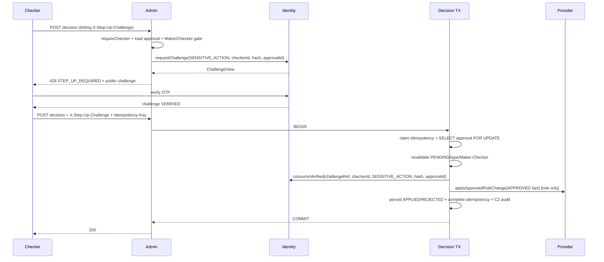

# BE-ADM-APP-03 — Step-Up và provider integration

> **Mã task:** `BE-ADM-APP-03` (P0)  
> **Ngày:** 18/11/2026  
> **Branch:** `datht-backend-rework` (không tạo branch, không push)  
> **Trạng thái:** **PARTIAL** — Identity role provider (`ApprovedRoleChange`) và `StepUpChallengePort.consumeVerified`
> đã tích hợp thật trong transaction quyết định; rollback provider/audit hoàn challenge có test PostgreSQL. Limit
> provider (`applyApprovedLimitChange`) **BLOCKED** vì module `limit` chưa có runtime/contract (`ADM-OI-05`);
> durable Audit vẫn **BLOCKED** (`ADM-OI-07`).  
> **Nguồn:** `design/05` §5.2/§10/§12.1, `07` §6.2–§6.6/§8.5.3/§8.8.2, `04` §4.2.5/§4.5.3,
> `design/02` §5.1–§5.2/§7.9/§9.6, `BE-ADM-CON-02/03`, source Identity/Admin hiện hữu.

## 1. Kết luận

- `ApprovalStepUpService` cấp challenge `SENSITIVE_ACTION` gắn `bindingKey = approvalId`, `userId = checker` và
  `requestHash` canonical của quyết định; không bao giờ nhận hash/binding từ client.
- `ApprovalStepUpService.consumeForDecision` gọi đúng port hiện có:
  `StepUpChallengePort.consumeVerified(new ConsumeCommand(challengeRef, checkerId,
  ChallengePurpose.SENSITIVE_ACTION, hash, approvalId))`.
- Lời gọi consume nằm trong transaction `MANDATORY`/JOIN của Identity; rollback của Admin hoàn
  `auth_challenge.consumed_at` về `NULL` (`VERIFIED`), nên retry được với cùng proof nhưng proof đã commit không
  thể dùng cho approval/decision khác.
- Với `ROLE_CHANGE`, Admin gọi `IdentityRoleCommand.applyApprovedRoleChange(ApprovedRoleChange(...))` trong cùng
  transaction. Identity sở hữu kiểm tra quyền/version, mutate role/privilege, tăng version và revoke session.
- Với `LIMIT_CHANGE`, chưa có `limit.api.applyApprovedLimitChange`; approve fail-closed `503`, không ghi `APPLIED`,
  không gọi provider giả. Reject limit không gọi provider và đã chạy.

## 2. Hợp đồng Step-Up thực tế

### 2.1. Port và record

Source: `identity/api/StepUpChallengePort.java`.

```java
ChallengeView requestChallenge(ChallengeRequest request);
VerifiedChallenge verifyChallenge(VerifyCommand command);
ConsumedChallenge consumeVerified(ConsumeCommand command);
```

```java
record ChallengeRequest(ChallengePurpose purpose, long userId, String requestHash,
        String bindingKey, String correlationId) { }
record ConsumeCommand(String challengeRef, long userId, ChallengePurpose purpose,
        String requestHash, String bindingKey) { }
```

- `consumeVerified` là **JOIN/T1**, annotation `@Transactional(propagation = MANDATORY)` trong implementation
  Identity; gọi ngoài transaction sẽ fail fast.
- `requestChallenge` là **OWN/T0** (transaction ngắn riêng), nên challenge 428 vẫn tồn tại dù transaction quyết
  định chưa mở.
- `ChallengePurpose.SENSITIVE_ACTION` là purpose duy nhất Admin dùng cho Maker proposal và Checker decision.

### 2.2. Binding của Checker decision

Source: `admin/application/stepup/ApprovalStepUpBinding.java`.

| Field | Giá trị | Nguồn tin cậy |
|---|---|---|
| `purpose` | `SENSITIVE_ACTION` | Server chọn |
| `bindingKey` | chuỗi decimal của `approvalId` | Approval đã persist; `approvalId <= 0` bị từ chối trước khi gọi Identity |
| `userId` | checker ID | `SessionAuthenticator.Session` qua `AdminAuthorization.requireChecker` |
| `requestHash` | SHA-256 hex của canonical decision | Tính từ row đã lock + principal + decision hiện tại |
| `correlationId` | correlation hiện hành | Request context server |

Canonical hash `ADM-APPROVAL-STEPUP-V1` gồm: approvalId, requestType, targetType/targetId, makerId, payload JCS,
checkerId, decision, decisionNote. Mỗi field length-prefixed UTF-8; payload dùng RFC 8785 JCS. Đổi bất kỳ field
payload (gồm `expectedVersion` của role), decision, note hoặc approval → hash khác → `409 STEP_UP_CHALLENGE_MISMATCH`.

## 3. Luồng issue → verify → consume



Các trường hợp lỗi:

| Tình huống | Kết quả | State |
|---|---|---|
| Không gửi `X-Step-Up-Challenge` | `428 STEP_UP_REQUIRED` + challenge public | Không lock/claim, approval `PENDING` |
| Challenge không tồn tại hoặc thuộc user khác | `404 AUTH_CHALLENGE_NOT_FOUND` | Không consume |
| Wrong purpose/approval/hash/binding/decision/note | `409 STEP_UP_CHALLENGE_MISMATCH` | Không consume |
| Challenge hết hạn | `410 AUTH_CHALLENGE_EXPIRED` | Không consume |
| Challenge đã consume | `409 INVALID_STATE_TRANSITION` | Không transition |
| Chưa verify | `428 STEP_UP_REQUIRED` | Không transition |
| Concurrent consume | Conditional UPDATE chỉ một winner | Loser rollback |

Public 428 chỉ chứa `challengeId`, `purpose`, `methods`, `expiresAt`, `maxAttempts`, `remainingAttempts`,
`channel`; không có OTP, `request_hash` hoặc `bindingKey`.

## 4. Identity role provider

### 4.1. Command thực tế

Source: `identity/api/IdentityRoleCommand.java`.

```java
record ApprovedRoleChange(long approvalId, long makerUserId, long checkerUserId,
        ApprovalState approvalState, long targetUserId, Operation operation, String roleCode,
        String privilegeCode, long expectedVersion, String correlationId, String requestId) { }

RoleChangeResult applyApprovedRoleChange(ApprovedRoleChange command);
```

Admin gửi:

- `approvalState = APPROVED` (fact checker đã duyệt; Admin persist `APPLIED`);
- `makerUserId`/`checkerUserId` từ approval row và trusted session;
- `targetUserId`, `operation`, `roleCode`/`privilegeCode`, `expectedVersion` từ typed payload đã persist;
- correlation/request ID hiện hành.

### 4.2. Provider owns validation và mutation

`IdentityRoleCommandService.applyApprovedRoleChange`:

- `@Transactional(propagation = MANDATORY)` — bắt buộc join transaction Admin.
- Verify session user = `checkerUserId`; verify lại `ROLE_ADMIN` + `ROLE_MANAGE` + `CHECKER` từ DB (không tin
  authority snapshot cũ).
- Reject `PENDING`/`APPLIED`/`REJECTED`/`CANCELLED`, maker = checker, target trùng maker/checker.
- Lock maker/checker/target theo thứ tự ID; kiểm tra target `ACTIVE`, `role_assignment_version == expectedVersion`
  (stale → `409 ROLE_CONFLICT`).
- Assign/revoke role hoặc grant/revoke privilege bằng store của Identity; advance version với conditional update;
  revoke active sessions.
- Trả `RoleChangeResult` (previous/resulting version, revoked session count) để Admin đưa vào response `result`.

Admin **không** đọc/ghi bảng `user_role`, `user_privilege`, `app_user` hoặc `session`; không tái triển khai
business rule role.

## 5. Limit provider

- Contract `design/05` §10 mô tả `applyApprovedLimitChange(approvalId, scope, new values, expectedVersion, actor)`
  nhưng module `limit` hiện chỉ có `.gitkeep`; không có `limit.api`, entity, repository hay migration
  `limit_config`.
- Vì vậy:
  - `ApprovalProposalService.proposeLimit` validate shape rồi trả `503 SERVICE_UNAVAILABLE`, không tạo approval/
    idempotency;
  - `ApprovalDecisionService.applyApprovedChange` chỉ nhận `RoleChangePayload`; payload limit → `503` trước khi
    persist `APPLIED`;
  - limit **reject** không gọi provider và chạy đầy đủ.
- Không tạo fake provider production hoặc tự ghi bảng Limit. Điều kiện mở: Limit owner cung cấp đúng contract,
  transaction `JOIN`, version/policy semantics và test rollback (`ADM-OI-05`).

## 6. Transaction boundary và rollback

Các thành phần tham gia cùng transaction:

| Thành phần | Propagation | Ghi chú |
|---|---|---|
| `ApprovalDecisionService` `TransactionTemplate` | REQUIRED | Mở transaction duy nhất |
| `ApprovalRequestStore.lockById`/`update` | MANDATORY | Cùng `DataSource`/JPA |
| `StepUpChallengePort.consumeVerified` | MANDATORY | Identity join |
| `IdentityRoleCommand.applyApprovedRoleChange` | MANDATORY | Identity join |
| `AdminIdempotencyService.claim/complete` | MANDATORY | Admin record join |
| `AdminAuditPort.recordInTransaction` | join | C2 cuối transaction |

Do modular monolith dùng chung transaction manager, không tuyên bố distributed atomicity. Nếu tương lai provider
tách datasource, cần outbox/saga riêng — hiện tại không có.

Rollback được chứng minh:

- Provider stale `expectedVersion` → approval `PENDING`, role/version không đổi, challenge `VERIFIED`, claim biến
  mất; retry cùng key thành công sau khi version được sửa.
- C2 audit failure (`doThrow` trên `AdminAuditPort.recordInTransaction`) → rollback cả approval, idempotency,
  role mutation và challenge consumption.
- Limit approve chưa có provider → `503`, approval `PENDING`, challenge `VERIFIED`, không record.

## 7. Chống gọi provider lặp

- Idempotency same key: terminal replay trả body cũ, không consume/provider.
- Idempotency same key khác hash: `409 IDEMPOTENCY_CONFLICT`.
- Key khác trên approval terminal: `409 APPROVAL_ALREADY_DECIDED` sau lock.
- Concurrent same/different key: row lock + unique index; provider chỉ chạy một lần.
- Retry sau provider failure: transaction rollback xóa claim, nên retry là attempt mới; nếu provider đã commit thì
  transaction không thể rollback riêng Admin — nhưng provider và Admin cùng transaction, nên không có trạng thái
  provider-committed/Admin-rolled-back.
- Không có retry tự động bên trong transaction; HTTP client retry phải dùng cùng key.

## 8. Bảo mật và dữ liệu nhạy cảm

- `checkerId` chỉ từ session; request body không có field actor.
- Challenge hash recompute từ row đã lock; client hash bị bỏ qua.
- Không log OTP, `request_hash`, `bindingKey`, token, challenge ref thô hoặc payload PII.
- C3 audit `SECURITY_ACCESS_DENIED` dùng `reasonCode = ErrorCode.name()`; không chứa message/exception.
- 428 public view không lộ secret.
- Identity re-check quyền từ DB khi apply, nên revoke quyền giữa login và approve vẫn bị chặn.

## 9. Test coverage

| Lớp | Nội dung |
|---|---|
| `ApprovalStepUpBindingTest` | Determinism, SHA-256 hex, binding key, `approvalId <= 0`, độ nhạy từng field, payload change, note length |
| `ApprovalStepUpPostgreSqlIntegrationTest` | Valid approve/reject; missing/unknown approval; 428; wrong purpose/checker/approval/decision/binding key; expired/consumed/replay; payload/version change; provider failure rollback; concurrent consume; 2 checker race; approve/reject race |
| `ApprovalDecisionIdempotencyPostgreSqlIntegrationTest` | Provider failure + same-key retry; limit approve fail closed; limit reject; C2 audit failure rollback; duplicate no re-execute |
| `ApprovalProposalPostgreSqlIntegrationTest` | Maker step-up, challenge binding, provider/step-up rollback, replay |
| Identity suite | `OtpChallengePostgreSqlIntegrationTest`, `IdentityRoleCommand` tests hiện hữu |

Các test dùng PostgreSQL 16 Testcontainers + Flyway thật, Identity challenge/role implementation thật; chỉ OTP
plaintext generator là test seam.

## 10. Kết quả thực thi

Targeted suite (PostgreSQL 16 Testcontainers + Identity implementation thật; chạy trong bản copy sạch để tránh
Gradle build đồng thời trên worktree chia sẻ):

```bash
./gradlew test \
  --tests 'com.simulatedbank.banking.admin.ApprovalStepUpPostgreSqlIntegrationTest' \
  --tests 'com.simulatedbank.banking.admin.ApprovalDecisionIdempotencyPostgreSqlIntegrationTest' \
  --tests 'com.simulatedbank.banking.admin.application.ApprovalDecisionServiceTest' \
  --console=plain --no-daemon
```

**BUILD SUCCESSFUL** — **41 tests / 0 failure / 0 error / 0 skip**:

| Class | Tests | Kết quả |
|---|---:|---|
| `ApprovalStepUpPostgreSqlIntegrationTest` | 22 | PASS |
| `ApprovalDecisionIdempotencyPostgreSqlIntegrationTest` | 11 | PASS |
| `ApprovalDecisionServiceTest` | 8 | PASS |

Evidence chính:

- `validStepUpApprovesOnceAndAppliesTheRole`: role `AUDITOR` được assign đúng một lần, version `0→1`,
  challenge `consumed_at` set, C2 `ROLE_CHANGE_APPROVED`.
- `twoCheckersRacingApproveApplyTheRoleOnce`: đúng một winner, role/version chỉ đổi một lần, một idempotency
  record.
- `concurrentApproveAndRejectLeaveOneTerminalDecision`: approval chỉ `APPLIED` hoặc `REJECTED`; provider chỉ chạy
  nếu approve thắng; challenge của bên thua vẫn `VERIFIED`.
- `providerFailureRollsBackConsumptionAndKeepsTheApprovalPending`: stale `role_assignment_version` →
  `ROLE_CONFLICT`, approval `PENDING`, challenge `VERIFIED`, role/version không đổi.
- `c2AuditFailureRollsBackApprovalProviderAndChallengeConsumption`: C2 audit throw → rollback approval,
  idempotency record, role mutation và challenge consumption.
- `limitApproveFailsClosedAndRejectIsIdempotent`: limit approve `503`, không record/không mutate; limit reject +
  replay PASS.
- `successfulChallengeCannotBeReplayedForASecondDecision`: challenge đã consume không dùng lại; duplicate trả
  `APPROVAL_ALREADY_DECIDED`.

Full backend suite (bản copy có sibling `digitalbanking-docs`):

```bash
./gradlew cleanTest build --console=plain --no-daemon
```

**BUILD SUCCESSFUL** (7m02s) — **1197 tests / 0 failure / 0 error / 0 skip**. Không có failure thuộc Admin;
12 failure của lần chạy đầu là do bản copy thiếu `digitalbanking-docs` (contract test đọc file) và đã PASS sau khi
bổ sung sibling docs.

## 11. Blockers còn lại

| Blocker | Owner | Điều kiện mở |
|---|---|---|
| Limit provider `applyApprovedLimitChange`/`limit_config` | Limit owner | `ADM-OI-05`: contract + runtime + version/rollback tests |
| Durable Audit `AuditModuleApi` | Audit owner | `ADM-OI-07`: thay security-log adapter, C2 fail-closed thật |
| Durable audit C3 và hash-chain | Audit owner | Cùng `ADM-OI-07` |
| HTTP contract test đầy đủ | API/Security/QA | `BE-ADM-TST-04` |
