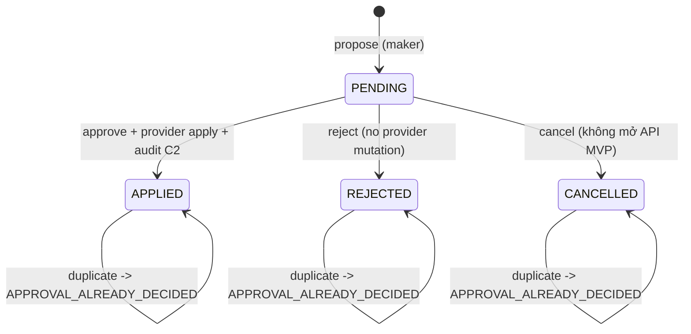

# BE-ADM-CON-01 — Chốt hợp đồng Admin cho `LIMIT_CHANGE` và `ROLE_CHANGE`

> **Mã task:** `BE-ADM-CON-01` (P0)  
> **Ngày:** 17/11/2026  
> **Branch:** `datht-backend-rework`  
> **Trạng thái tổng:** **PARTIAL** — domain/persistence Admin đã triển khai và kiểm chứng; REST proposal/decision, step-up Maker, idempotency, Limit provider và durable Audit còn BLOCKED.  
> **Cập nhật 17/11/2026:** `BE-ADM-CON-03` đã xử lý idempotency và Maker step-up; REST ROLE proposal/decision + reject limit đã mở. Các mục BLOCKED còn lại là Limit provider (`ADM-OI-05`), durable Audit (`ADM-OI-07`) và approval read/scope.  
> **Nguồn ưu tiên:** `docs-common/03–09` > `docs-common/design/` > `docs-backend/`. Tài liệu này không thay thế SRS/API contract; chỉ chốt cách Admin áp dụng các nguồn đã có.

## 1. Phạm vi và quyền sở hữu

### 1.1. Admin sở hữu

- `banking.approval_request`: schema, entity, repository, typed payload, state machine, maker/checker invariant.
- Điều phối một approval xuyên module: khóa row, kiểm tra trạng thái/actor, gọi provider, cập nhật `APPLIED`/`REJECTED`.
- Ghi audit C2 của Admin: `*_CHANGE_REQUESTED/APPROVED/REJECTED`; C3 `SECURITY_ACCESS_DENIED` thuộc security/Audit.
- Response approval đã mask; không trả entity, secret, token, OTP, hash, full PII.

### 1.2. Admin không sở hữu

| Dữ liệu/hành vi | Owner | Admin dùng qua |
|---|---|---|
| `app_user`, `role`, `permission`, `user_role`, `user_privilege`, `session` | Identity | `identity.api.IdentityRoleCommand`, `StepUpChallengePort` |
| Catalog role/permission và kiểm tra role/user type | Identity | Provider validate khi apply; Admin chỉ dùng enum đã công bố |
| `limit_config`, `limit_usage`, policy/version/transition limit | Limit | `limit.api.applyApprovedLimitChange` (chưa có runtime) |
| `audit_log`, hash chain, retention | Audit | `audit.api.AuditModuleApi` (chưa có runtime) |
| Customer/Account lookup, ownership, data scope | Customer/Account | Provider read contract (Account chưa có runtime) |

**Không có write chéo bảng.** Admin không đọc/ghi trực tiếp bảng Identity, Limit, Customer, Account hoặc Audit.

## 2. Actor/scope matrix

Permission lấy đúng `07` §3.4–§3.5. `CHECKER` là **privilege**, không phải role.

| Hành vi | Role/permission bắt buộc | Target | Được phép | Bị cấm |
|---|---|---|---|---|
| Tạo `LIMIT_CHANGE` | `LIMIT_MAKER` hoặc `LIMIT_MANAGE` | `CUSTOMER` nếu không có `accountId`; `ACCOUNT` nếu có | Maker ghi proposed values, reason; chưa apply limit | Tự approve; tạo approval đã `APPLIED`; sửa payload sau khi tạo |
| Tạo `ROLE_CHANGE` | `ROLE_MANAGE` + `ROLE_ADMIN` (Identity provider re-check) | `APP_USER` | Gán/thu role trong 4 role đã công bố; cấp/thu privilege `CHECKER` | Tự cấp quyền cho chính maker; đổi định nghĩa role/permission; target không `ACTIVE` |
| Approve/reject limit | `CHECKER` + (`LIMIT_MAKER` hoặc `LIMIT_MANAGE`) | Approval `LIMIT_CHANGE` | Approve → Limit apply + approval `APPLIED`; reject → `REJECTED` | Maker = checker; approve lần hai; approve khi version/policy stale |
| Approve/reject role | `CHECKER` + `ROLE_MANAGE` | Approval `ROLE_CHANGE` | Approve → Identity apply + revoke session + `APPLIED`; reject → `REJECTED` | Maker/checker = target; tự nâng quyền; approve lần hai |
| Đọc approval | `APPROVAL_READ`/role `OPERATIONS`/`ADMIN` theo chain hiện hữu | Approval trong scope | Maker thấy request của mình; checker thấy request được duyệt | Đọc chéo actor/scope; trả payload chưa mask |
| Customer/Account lookup | `CUSTOMER_READ`/`ACCOUNT_READ` | Provider resource | Provider-owned read | Search/full PII; bypass data scope |

**Self-approval/SOD:** maker ≠ checker ở domain và DB; với `ROLE_CHANGE`, maker và checker đều ≠ target. Checker Identity command còn re-check từ DB, không tin session snapshot.

**Tenant isolation:** schema v1 không có cột tenant. Cô lập dựa trên ownership `app_user ↔ customer` 1:1 và provider scope. Staff data-scope chưa có model/runtime (`ADM-OI-06`) → giữ **BLOCKED**, không mở unrestricted lookup.

## 3. `LIMIT_CHANGE` contract

### 3.1. Trạng thái hợp đồng

| Hạng mục | Trạng thái | Ghi chú |
|---|---|---|
| Request/response schema | **DONE trong tài liệu** | `07` §8.5.2/§7.2.14; OpenAPI `LimitChangeRequest` khớp field |
| Domain payload + validation | **DONE** | `LimitChangePayload`; tiền VND, scale tối đa 2, `perTransactionLimit <= dailyLimit` |
| Persistence approval | **DONE** | `approval_request` JSONB |
| Proposal/decision REST | **BLOCKED** | Thiếu Limit provider (`limit_config PENDING_APPROVAL`) và Maker step-up binding |
| Provider apply | **BLOCKED** | `limit.api.applyApprovedLimitChange` chưa có runtime/expectedVersion input |
| Audit C2 | **BLOCKED** | `AuditModuleApi` chưa có runtime |

### 3.2. Request fields

| Field | Kiểu | Bắt buộc | Validation đã chốt |
|---|---|---|---|
| `customerId` | ID `[1-9][0-9]{0,18}` | Có | > 0; customer tồn tại do Customer provider xác nhận (chưa tích hợp) |
| `accountId` | ID/null | Không | Nếu có: > 0 và thuộc `customerId` (Account provider) |
| `perTransactionLimit` | Money | Có | > 0; scale tối đa 2; `<= dailyLimit`; tối đa 17 chữ số phần nguyên |
| `dailyLimit` | Money | Có | > 0; scale tối đa 2; `>= perTransactionLimit` |
| `currency` | `VND` | Không | Mặc định `VND`; giá trị khác bị từ chối |
| `effectiveFrom` | Instant/null | Không | Chưa áp policy quá khứ/tương lai; provider/BA chưa chốt |
| `reason` | string/null | Không | ≤ 500; cấm control char; **không tự phát hiện PII/secret** |

**Target mapping đã chốt:** không `accountId` → `target_type=CUSTOMER,target_id=customerId`; có `accountId` → `target_type=ACCOUNT,target_id=accountId`. Payload vẫn giữ `customerId` để provider kiểm ownership.

**Không thêm field chưa được duyệt:** `supportingReference`/ticket ID, `currentLimit`, `expectedVersion`, `limitId`, kết quả apply. `07` không có các input này và Limit provider chưa có contract runtime (`ADM-OI-05`). Không suy diễn.

### 3.3. Response/error

- Success tạo: `201 ApprovalSummary` `status=PENDING`, `requestType=LIMIT_CHANGE`, `Location`.
- Success quyết định: `200 ApprovalDetail` `status=APPLIED` hoặc `REJECTED`; `result` do Limit provider trả (`limitId`, `version`, `effectiveFrom`).
- Lỗi: `400 VALIDATION_ERROR`, `401 AUTH_SESSION_EXPIRED`, `403 AUTH_FORBIDDEN`, `404 CUSTOMER_NOT_FOUND`/`ACCOUNT_NOT_FOUND`/`APPROVAL_NOT_FOUND`, `409 APPROVAL_ALREADY_DECIDED`/`ROLE_CONFLICT`/`INVALID_STATE_TRANSITION`, `422 LIMIT_OUT_OF_POLICY`, `428 STEP_UP_REQUIRED`, `429 RATE_LIMITED`, `500/503` technical.

## 4. `ROLE_CHANGE` contract

### 4.1. Trạng thái hợp đồng

| Hạng mục | Trạng thái | Ghi chú |
|---|---|---|
| Request schema | **DONE trong tài liệu** | `07` §8.8.1; OpenAPI `RoleChangeRequest` oneOf |
| Domain payload + validation | **DONE** | `RoleChangePayload`; operation conditional fields; role enum; privilege `CHECKER` |
| `expectedVersion` capture | **PARTIAL** | Identity có `getRoleAssignmentVersion`, nhưng proposal application service chưa mở |
| Persistence approval | **DONE** | JSONB |
| Proposal REST + Maker step-up | **BLOCKED** | `MOD-OI-10`: approvalId chưa tồn tại khi Maker verify |
| Checker decision REST | **BLOCKED** | Phụ thuộc approval tạo được; audit C2 chưa durable |
| Identity apply | **DONE (provider)** | `IdentityRoleCommandService`; version/revoke/rollback đã có test |
| Audit C2 | **BLOCKED** | `AuditModuleApi` chưa có runtime |

### 4.2. Request fields

| Field | Kiểu | Bắt buộc | Validation đã chốt |
|---|---|---|---|
| `operation` | `ASSIGN_ROLE`,`REVOKE_ROLE`,`GRANT_PRIVILEGE`,`REVOKE_PRIVILEGE` | Có | Enum đúng `07`/OpenAPI |
| `targetUserId` | ID | Có | > 0; tồn tại + `ACTIVE` do Identity xác nhận; maker ≠ target |
| `roleCode` | `CUSTOMER`,`OPERATIONS`,`ADMIN`,`AUDITOR` | Có với role operation | Không được đồng thời có `privilegeCode` |
| `privilegeCode` | `CHECKER` | Có với privilege operation | Không được đồng thời có `roleCode` |
| `reason` | string/null | Không | ≤ 500; cấm control char |

**Server-captured, không nhận từ client:** `targetUserId` version (`expectedVersion`) lấy từ `IdentityRoleCommand.getRoleAssignmentVersion` tại thời điểm tạo. Nếu client gửi field này, request schema `additionalProperties:false` phải từ chối.

**Existing role assignments/current snapshot:** `07` không công bố endpoint/field trả danh sách role hiện tại của target. Không query chéo bảng hoặc thêm field vào payload; checker review dựa trên `operation`, `roleCode`/`privilegeCode`, `expectedVersion` và provider result. Nếu BA/API yêu cầu hiển thị current assignment, cần contract read riêng (`ADM-OI-09`).

**Checker binding:** `X-Step-Up-Challenge` phải bind `purpose=SENSITIVE_ACTION`, user=checker, `bindingKey=approvalId`, `requestHash` của decision payload (`decision` + `decisionNote`). Identity `consumeVerified` chạy JOIN/MANDATORY trong transaction Admin.

### 4.3. Response/error

- Success tạo: `201 ApprovalSummary` `ROLE_CHANGE/PENDING`.
- Success quyết định: `200 ApprovalDetail`; `result` gồm `targetUserId`, `operation`, `roleCode`/`privilegeCode`, `previousVersion`, `resultingVersion`, `revokedSessionCount` (provider result, không lưu bảng Admin).
- Lỗi: `400`, `401`, `403`, `404 USER_NOT_FOUND`/`ROLE_NOT_FOUND`/`APPROVAL_NOT_FOUND`, `409 ROLE_CONFLICT`/`APPROVAL_ALREADY_DECIDED`/`STEP_UP_CHALLENGE_MISMATCH`, `428 STEP_UP_REQUIRED`, `429`, `500/503`.

## 5. Payload schema (persisted `approval_request.payload`)

JSONB được encode theo thứ tự field cố định; ID/money là string, timestamp ISO-8601 UTC.

### 5.1. `LIMIT_CHANGE`

```json
{
  "customerId": "2001",
  "accountId": null,
  "perTransactionLimit": "5000000.00",
  "dailyLimit": "20000000.00",
  "currency": "VND",
  "effectiveFrom": "2026-11-18T00:00:00Z",
  "reason": "Điều chỉnh theo yêu cầu khách hàng"
}
```

### 5.2. `ROLE_CHANGE`

```json
{
  "operation": "GRANT_PRIVILEGE",
  "targetUserId": "1005",
  "roleCode": null,
  "privilegeCode": "CHECKER",
  "expectedVersion": 7,
  "reason": "Bổ sung quyền kiểm soát theo phân công"
}
```

**Không có trong payload:** OTP, token, password, hash, full PII, full account number, entity provider. `maker_id`, `checker_id`, `correlation_id`, timestamp là cột, không lặp trong payload.

## 6. State machine



| Transition | Actor | Precondition | Side effect | Invalid handling |
|---|---|---|---|---|
| `propose` | Maker | Permission, payload hợp lệ, maker ≠ role target, correlation | Insert `PENDING` + audit `*_REQUESTED` | `400/403/409/422/428`; không ghi row khi fail |
| `approve` | Checker | Row lock; `PENDING`; checker ≠ maker; role checker ≠ target; step-up verified; provider version/policy hợp lệ | Provider mutation JOIN; status `APPLIED`; `decided_at=applied_at`; audit C2 cuối TX | `409 ROLE_CONFLICT`/`APPROVAL_ALREADY_DECIDED`; rollback toàn bộ |
| `reject` | Checker | Row lock; `PENDING`; checker ≠ maker; step-up verified | Status `REJECTED`; `decided_at`; không gọi provider; audit C2 | `409`; rollback |
| `cancel` | Maker/system (chưa mở API) | `PENDING` | `CANCELLED`; `decided_at`; không provider | `409 APPROVAL_ALREADY_DECIDED` |

**Quyết định `APPROVED` vs `APPLIED` (`ADM-OI-04`):** MVP synchronous, DB chỉ commit `APPLIED` khi provider apply + audit thành công. `APPROVED` giữ trong schema cho tương lai async; không có transition nào tạo `APPROVED` trong MVP. Provider command nhận fact `APPROVED` (theo `IdentityRoleCommand.ApprovalState`) trong khi Admin persist `APPLIED` — mapping này là chủ đích, không phải hai trạng thái nghiệp vụ.

**Concurrency:** mọi decision phải `SELECT … FOR UPDATE` row approval trước khi đọc trạng thái. Hai checker song song: một giữ lock và commit; người sau đọc `APPLIED` và nhận `APPROVAL_ALREADY_DECIDED`, không apply/consume lần hai. PostgreSQL là nguồn duy nhất; không distributed lock.

## 7. API endpoints và OpenAPI

| API | Method/path | Permission | Trạng thái implementation |
|---|---|---|---|
| `API-LIM-02` | `POST /api/v1/admin/limits` | `LIMIT_MAKER`/`LIMIT_MANAGE` | **BLOCKED** (Limit provider + Maker step-up) |
| `API-LIM-03` | `POST /api/v1/admin/limits/{id}/approve` | `CHECKER` + limit permission | **BLOCKED** (Limit provider + Audit) |
| `API-ROL-01` | `POST /api/v1/admin/roles` | `ROLE_MANAGE` | **BLOCKED** (Maker step-up binding) |
| `API-ROL-02` | `POST /api/v1/admin/roles/{id}/approve` | `CHECKER` + `ROLE_MANAGE` | **BLOCKED** (phụ thuộc proposal + Audit) |
| `API-APR-01` | `GET /api/v1/admin/approvals` | `OPERATIONS`/`ADMIN` + scope | **NOT_STARTED** (scope chưa chốt) |
| `API-APR-02` | `GET /api/v1/admin/approvals/{approvalId}` | `OPERATIONS`/`ADMIN` + scope | **NOT_STARTED** (scope/masking) |

- Không thêm endpoint/permission mới. Security chain hiện hữu đã có rule cho 4 route write và 2 route read.
- OpenAPI `digital-banking-v1.yaml` đã có schema/response/error cho các route trên; **không sửa** vì contract field không đổi. Khi mở endpoint, controller phải khớp đúng schema hiện có.
- Correlation header do `CorrelationAndRequestIdFilter`; lỗi qua `ProblemWriter`; không tạo handler/catalog thứ hai.

## 8. Authorization và security

- **Authentication:** dùng opaque session + CSRF của project (`SessionAuthenticationFilter`, `SessionAuthenticator`). Không có JWT/refresh-token trong kiến trúc đã duyệt; Admin không tạo cơ chế auth song song.
- **Authorization:** chain gate + service re-check permission/scope; actor lấy từ `SessionAuthenticationFilter.session`, không tin `makerId/checkerId` trong body. Identity provider re-check quyền từ DB khi apply role.
- **Object-level:** approval lookup theo `approvalId`; maker/checker/scope phải khớp; không trả `APPROVAL_NOT_FOUND` khác nhau để lộ tồn tại ngoài scope (anti-enumeration).
- **Privilege escalation:** cấm maker/checker thay đổi quyền của chính mình; cấm target = maker/checker; role catalog giới hạn 4 role; privilege giới hạn `CHECKER`; Identity re-check user `ACTIVE/STAFF` và role/user-type tương thích.
- **Step-up:** checker bắt buộc `SENSITIVE_ACTION` bind approvalId + decision hash. Maker step-up theo `07` chưa triển khai được vì chưa có approvalId — **BLOCKED** tại `MOD-OI-10`/`ADM-OI-01`.
- **PII/secret:** payload chỉ có field nghiệp vụ đã mask/allowlist; response `Cache-Control: no-store`; log/audit không chứa token/OTP/hash/full PII. Reason không được dùng làm nơi lưu PII; chưa có scanner tự động.

## 9. Database schema

Migration: `V6__create_approval_request_table.sql` (forward-only, sau V1–V5; không sửa migration cũ).

| Column | Type | Null | Ghi chú |
|---|---|---|---|
| `approval_id` | `BIGINT IDENTITY` PK | NO | API serialize string |
| `request_type` | `VARCHAR(32)` | NO | `LIMIT_CHANGE`,`ROLE_CHANGE`,`RETENTION_HOLD`,`RETENTION_POLICY_CHANGE` |
| `target_type` | `VARCHAR(32)` | NO | `CUSTOMER`,`ACCOUNT`,`APP_USER`,`DATA_SCOPE`,`RETENTION_POLICY` |
| `target_id` | `VARCHAR(64)` | NO | length 1–64 |
| `payload` | `JSONB` | NO | typed theo request type; validate ở application |
| `status` | `VARCHAR(16)` | NO | default `PENDING`; 5 giá trị canonical |
| `maker_id` | `BIGINT` FK | NO | `app_user` |
| `checker_id` | `BIGINT` FK | YES | `app_user`; `checker_id <> maker_id` |
| `decision_note` | `VARCHAR(500)` | YES | — |
| `correlation_id` | `VARCHAR(64)` | NO | length 1–64 |
| `created_at` | `TIMESTAMPTZ` | NO | default `now()` |
| `decided_at` | `TIMESTAMPTZ` | YES | bắt buộc với `APPROVED/REJECTED/APPLIED` |
| `applied_at` | `TIMESTAMPTZ` | YES | bắt buộc với `APPLIED` |

**Checks:** maker≠checker; decided states có checker+decided_at; `APPLIED` có `applied_at`.
**Indexes:** `(status, created_at)`, `(request_type, status)`, `(target_type, target_id)`, `maker_id`, `checker_id`.
**Không có:** `expires_at`, `step_up_challenge_id`, `version`, `result`, `idempotency_key`, partial unique PENDING. Các mục này chưa được duyệt hoặc thuộc open issue; không thêm migration trước khi owner chốt.

## 10. Transaction và failure handling

| Bước | Transaction | Failure behavior |
|---|---|---|
| Tạo approval | OWN ngắn: insert approval + audit C2 cùng commit | Validation/permission fail → không ghi row; audit fail → rollback |
| Checker decision | Một transaction: lock approval → consume step-up → provider apply → update `APPLIED` → audit C2 cuối | Bất kỳ lỗi DB/provider/audit → rollback toàn bộ; challenge consume được hoàn lại theo contract Identity |
| Reject | Một transaction: lock → update `REJECTED` → audit C2 | Không gọi provider; audit fail → rollback |
| Provider stale/version | Provider trả conflict; Admin rollback | `409 ROLE_CONFLICT`/`LIMIT_OUT_OF_POLICY`; không partial apply |
| Timeout sau commit | Client retry cùng `Idempotency-Key` (khi được duyệt) hoặc đọc approval | **Idempotency BLOCKED** (`OI-API-19`/`MOD-OI-11`); hiện không hứa replay |
| Audit C2 fail | Exception lan truyền, transaction rollback | Không trả `APPLIED`; `AUDIT_WRITE_FAILED`/5xx |
| C3 deny audit fail | Standalone best-effort | Giữ 403; security log + metric + alert |

Không có distributed transaction. Identity và Limit là provider JOIN cùng datasource/transaction manager; nếu provider tương lai tách transaction, phải thiết kế outbox/recovery riêng, không giả định atomic.

## 11. Integration dependencies

| Provider | Interface cần | Trạng thái | Thiếu/blocker | Owner |
|---|---|---|---|---|
| Identity | `StepUpChallengePort.consumeVerified`, `IdentityRoleCommand.getRoleAssignmentVersion/applyApprovedRoleChange` | **DONE** (runtime + PostgreSQL tests) | Maker step-up binding; proposal orchestration | Identity/Admin/API/Security |
| Limit | `limit.api.applyApprovedLimitChange` | **BLOCKED** | Không có runtime/schema/expectedVersion; `limit_config`/`limit_usage` chưa có | Limit |
| Audit | `audit.api.AuditModuleApi.recordInTransaction/recordStandalone` | **BLOCKED** | Không có `audit_log`/hash chain/runtime | Audit |
| Customer | masked exact-ID read | **PARTIAL** | Data scope staff `CUS-OI-05` | Customer/Admin/Security |
| Account | masked account view/ownership | **BLOCKED** | `account.api` chưa có runtime | Account |
| Common | session/error/context/security/time | **DONE** | Data scope không thuộc common | Common |

## 12. Test coverage và kết quả

Đã chạy (PostgreSQL 16 Testcontainers, Flyway V1–V6, JPA/Hibernate thật):

```bash
./gradlew test \
  --tests 'com.simulatedbank.banking.admin.domain.ApprovalRequestTest' \
  --tests 'com.simulatedbank.banking.admin.adapter.out.ApprovalRequestPostgreSqlIntegrationTest' \
  --tests 'com.simulatedbank.banking.migration.PostgreSqlFreshMigrationIntegrationTest' \
  --tests 'com.simulatedbank.banking.migration.FlywayMigrationTest' \
  --console=plain
```

Kết quả: **29 tests, 0 failure, 0 error, 0 skip**.

| Lớp test | Số test | Nội dung |
|---|---:|---|
| `ApprovalRequestTest` | 17 | Payload/limit money, role conditional fields, target mapping, maker≠target, correlation/reason bounds, approve/reject/cancel, terminal transition, restore invariants |
| `ApprovalRequestPostgreSqlIntegrationTest` | 8 | JSONB round-trip cả hai payload; APPLIED/REJECTED persist; duplicate decision; hai checker tranh lock chỉ một apply; DB check/FK/length; target column/payload mismatch; MANDATORY transaction |
| `PostgreSqlFreshMigrationIntegrationTest` | 1 | Flyway V1–V6 từ DB rỗng, bảng/constraint/index approval, rerun không đổi schema |
| `FlywayMigrationTest` | 3 | Khai báo bảng approval, canonical columns, không có cột overview-only |

Sáu Spring context test hiện hữu (không nạp JPA/Flyway) được thêm `app.admin.enabled=false`; trước đó chúng fail vì component Admin cố inject repository khi JPA bị exclude. Đây là test-profile adjustment, không phải production fallback.

Heap test worker mặc định 512 MB không đủ cho 5 Argon2id đồng thời (`IdentityAuthPostgreSqlIntegrationTest.t11` OOM, không phải lỗi Admin). `build.gradle.kts` đặt `maxHeapSize = "1g"` cho `Test`; chạy riêng lớp Identity PASS trong 41 s. Đây là test-infra fix, không thay production runtime.

**Full build cuối:** `./gradlew cleanTest build --console=plain` → **BUILD SUCCESSFUL** (7m40s), **928 tests / 72 classes / 0 failure / 0 error / 0 skip**. Lần chạy trước đó fail 17 context test vì Admin repository bị inject khi JPA bị exclude (đã thêm `app.admin.enabled=false`) và 1 OOM Argon2 (đã tăng heap test). Không có failure Admin trong lần cuối.

**Chưa chứng minh (vì dependency/contract thiếu):** REST 201/200, 401/403/428/409/422, OpenAPI runtime, Maker step-up mismatch/replay, idempotent create/replay, Limit provider apply/rollback, durable audit C2 rollback, C3 durable fallback, staff data scope, REST approval list/detail pagination/scope (persistence list/detail đã có ở `BE-ADM-DB-02`).

## 13. Trạng thái, quyết định mở và blocker

### 13.1. Trạng thái theo hạng mục

| Hạng mục | Trạng thái | Bằng chứng |
|---|---|---|
| Scope/ownership, actor/scope matrix | **DONE (tài liệu)** | §1–§2 |
| `LIMIT_CHANGE` payload/validation | **DONE** | `LimitChangePayload`, unit + PostgreSQL tests |
| `ROLE_CHANGE` payload/validation | **DONE** | `RoleChangePayload`, unit + PostgreSQL tests |
| State machine + maker/checker + concurrent decision | **DONE (domain/persistence)** | `ApprovalRequest`, concurrency PostgreSQL test |
| Canonical DB schema | **DONE** | `V6`, fresh migration test |
| Proposal/decision application service + REST | **BLOCKED** | `MOD-OI-10`, `MOD-OI-11`, Audit/Limit provider |
| Idempotency | **BLOCKED** | `OI-API-19`, `MOD-OI-11` |
| Maker step-up binding | **BLOCKED** | `MOD-OI-10`, `ADM-OI-01` |
| Durable audit C2/C3 | **BLOCKED** | `ADM-OI-07` |
| Limit apply/version | **BLOCKED** | `ADM-OI-05` |
| Approval read/list + data scope | **BLOCKED** | `ADM-OI-06` |
| Retention/legal hold | **NOT_STARTED (out of scope)** | `OI-API-07`, `ADM-OI-08` |

### 13.2. Quyết định đã chốt trong task này

1. `04` §4.5.3 là DDL canonical; không dùng UUID/`EXPIRED`/expiry/`step_up_challenge_id`/`result` từ overview.
2. MVP commit `APPLIED` đồng bộ; `APPROVED` chỉ là schema-reserved.
3. Target mapping: limit không account → `CUSTOMER`; có account → `ACCOUNT`; role → `APP_USER`.
4. Role payload chứa `expectedVersion` do server capture từ Identity; không nhận từ client.
5. `reason`/`decisionNote` chỉ validate length/control char; không tự nhận diện PII/secret.
6. Không thêm idempotency table, partial unique PENDING, scope model hoặc Audit table khi chưa có quyết định của owner.

### 13.3. Blocker còn lại

| ID | Vấn đề | Owner cần chốt | Điều kiện mở |
|---|---|---|---|
| `MOD-OI-10`/`ADM-OI-01` | Maker step-up trước khi có `approvalId` | Admin + Identity + API + Security | Canonical proposal hash + idempotency key/action ref, test mismatch/replay, cập nhật `07`/OpenAPI |
| `MOD-OI-11`/`ADM-OI-02` | Idempotency cho POST proposal | API + Admin + DB + BA | Key scope/hash/replay/conflict/TTL/schema/concurrent test |
| `ADM-OI-05` | Limit `expectedVersion`/current snapshot/apply contract | Limit + Admin + API | Provider-owned command, stale test, rollback |
| `ADM-OI-06` | Staff data scope cho approval/customer/account | Admin + Security + BA + Customer/Account | Scope model/permission/purpose/anti-enumeration |
| `ADM-OI-07` | Durable Audit C2/C3 | Audit + Admin + Security | `AuditModuleApi`, `audit_log`, hash chain, failure tests |
| `ADM-OI-09` | Role proposal user/role validation | Identity + Admin + API | Approved read contract hoặc server-side selection; không query chéo bảng |
| `ADM-OI-11` | Approval `result` read model: `04` không có cột result; sau `APPLIED`, `GET /admin/approvals/{id}` không tái tạo được `limitId/version/role result` nếu provider không đọc ngược theo approvalId | Admin + API + DB + Identity/Limit | Chốt persist result JSONB/cột riêng hoặc provider read-by-approvalId; migration/review trước khi mở API-APR-02 |
| `OI-API-07` | Retention/legal hold | Audit + Admin + BA | Contract riêng trước khi mở request type/API |

## 14. Next step an toàn

1. **BE-ADM-CON-02** — chốt step-up binding cho Maker/Checker (`MOD-OI-10`), test vectors mismatch/replay/expiry; chưa mở REST trước khi chốt.
2. **BE-ADM-CON-03** — chốt idempotency (`OI-API-19`/`MOD-OI-11`), schema/hash/replay/TTL.
3. Khi CON-02/03 đóng: triển khai `BE-ADM-APP-01/02` (proposal/decision service) cho `ROLE_CHANGE` trước, vì Identity provider đã có runtime; `LIMIT_CHANGE` chờ Limit provider.
4. Audit provider là gate bắt buộc trước khi trả `APPLIED` production.
