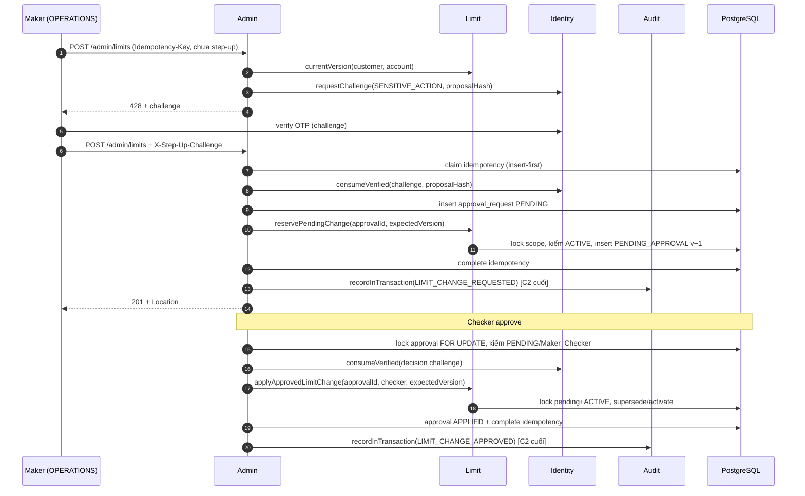

# BE-ADM-INT-01 — Tích hợp thật Identity + Limit + Audit cho luồng phê duyệt

> **Trạng thái:** **DONE (18/11/2026)** — phần runtime có thể kiểm chứng trong repository.
> **Tích hợp hiện hành:** xem [BE-INT-09](../../workofteam/integration%20modules/BE-INT-09.md) và [báo cáo](../../workofteam/integration%20modules/BE-INT-09-verification.md). Các kết quả bên dưới là lịch sử module; BE-INT-09 kiểm lại với `banking_app`, provider thật và V23, sửa khóa role SELECT-only và ORM flush sau Audit theo DEC-INT-018.
> **Phạm vi:** Admin điều phối phê duyệt `ROLE_CHANGE`/`LIMIT_CHANGE`; provider thật Identity, Limit, Audit; transaction,
> version, idempotency và bằng chứng audit.
> **Nguồn chuẩn:** `docs-common/design/05. Modules contract.md` §9/§10/§12.1, `docs-common/04. Database design & analysis.md`
> §4.5.1/§4.5.3/§4.6.1, `docs-common/design/01. audit-traceability.md` §4.3/§5.2–§5.6/§6.1/§7, `07. API contracts.md`
> §8.5.2/§8.5.3/§8.8, `DEC-ADM-010`.

## 1. Tóm tắt triển khai

| Hạng mục | Trước task | Sau task |
|---|---|---|
| Role approval | Identity runtime thật (`IdentityRoleCommand`) | Giữ nguyên + audit C2/C3 bền vững; `expectedVersion` và revoke session đã có test |
| Limit proposal | Fail-closed `503` vì thiếu provider | `201` tạo `approval_request` + `limit_config PENDING_APPROVAL` trong cùng transaction |
| Limit approve | Fail-closed `503` | Áp dụng thật: `SUPERSEDED` bản ACTIVE cũ, `ACTIVE` version mới, kiểm `expectedVersion` + policy dưới lock |
| Limit reject | Chỉ đổi approval | Đánh dấu `limit_config REJECTED` trong cùng transaction, không tạo orphan |
| Audit C2/C3 | Structured security log + metric (tạm thời) | `audit.api.AuditModuleApi` ghi `banking.audit_log` append-only + hash chain; log/metric vẫn là mirror vận hành |
| Retry/stuck | Chưa có bằng chứng bền | `banking.admin_approval_attempt` (V11) + job cảnh báo read-only (BE-ADM-OPS-01) |

## 2. Contract provider thật đã dùng

### 2.1. Identity (đã có, không đổi)

`identity.api.IdentityRoleCommand`:

- `long getRoleAssignmentVersion(long targetUserId)` — Maker đọc version trước step-up; giá trị được lưu trong payload.
- `RoleChangeResult applyApprovedRoleChange(ApprovedRoleChange)` — `Propagation.MANDATORY`, khóa user theo thứ tự ID,
  kiểm `expectedVersion`, áp role/privilege, `revokeActiveSessions(target)`, trả `revokedSessionCount`.
- Lỗi: `USER_NOT_FOUND` (404), `ROLE_NOT_FOUND` (404), `ROLE_CONFLICT` (409 — stale version/role target), `AUTH_FORBIDDEN`.

### 2.2. Limit (mới — `limit.api.LimitConfigMutationPort`)

| Operation | Transaction | Bất biến |
|---|---|---|
| `currentVersion(customerId, accountId)` | read-only | `0` khi chưa có ACTIVE; dùng làm `expectedVersion` trước step-up |
| `reservePendingChange(LimitChangeRequest)` | `MANDATORY` | Lock scope → yêu cầu ACTIVE đúng `expectedVersion` → insert `PENDING_APPROVAL` version `expectedVersion+1`; `approval_id` UNIQUE |
| `applyApprovedLimitChange(ApprovedLimitChange)` | `MANDATORY` | Lock pending + ACTIVE, kiểm `pending.version == expectedVersion+1`, policy, `SUPERSEDED` bản cũ rồi `ACTIVE` bản mới |
| `rejectPendingChange(approvalId, checkerId, correlationId)` | `MANDATORY` | `PENDING_APPROVAL → REJECTED`, không có bản ACTIVE mới |

Lỗi và mã: `CUSTOMER_NOT_FOUND`/`ACCOUNT_NOT_FOUND` (404), `AUTH_FORBIDDEN` (account không thuộc customer),
`LIMIT_OUT_OF_POLICY` (422), `ROLE_CONFLICT` (409 — stale version; catalog chưa có mã conflict riêng cho Limit),
`INVALID_STATE_TRANSITION` (409 — apply/reject lần hai, pending không tồn tại).

Policy OI-API-05 vẫn **chưa có giá trị chính thức**: provider chỉ áp `app.limit.policy.max-per-transaction` /
`app.limit.policy.max-daily` khi được cấu hình; không tự đặt ngưỡng production.

### 2.3. Audit (mới — `audit.api.AuditModuleApi`)

- `recordInTransaction(AuditEvent)` — `MANDATORY`, insert trong transaction nghiệp vụ, fail-closed (`AUDIT_WRITE_FAILED`).
- `recordStandalone(AuditEvent)` — `REQUIRES_NEW`, chỉ C3, không ném lỗi; trả `Optional.empty()` khi thất bại.
- Writer: `pg_advisory_xact_lock` → đọc `record_hash` cuối (genesis 64 số `0`) → JCS RFC 8785 → SHA-256
  `JCS(canonical_payload) || "|" || prev_hash` → insert; `hash_version` nằm trong payload (design/01 §7.3).
- Validator: catalog action, actor/entity allowlist (§6.3), state allowlist (§5.6 + field Limit/Role theo §5.5),
  scanner PII/secret, giới hạn 32 KB.

## 3. Thay đổi source

### 3.1. Admin

| File | Thay đổi |
|---|---|
| `admin/application/AdminAuditPort.java` | Event mang `actorRole`, `entityType/entityId`, target/maker/checker/decision, `beforeState/afterState`; factory `requested/decided/denied/deniedForActor` |
| `admin/adapter/out/DurableAdminAuditAdapter.java` | **Mới** — adapter production gọi `AuditModuleApi`; C2 fail-closed, C3 best-effort; mirror log chỉ sau commit (giữ BE-ADM-TST-05) |
| `admin/adapter/out/SecurityLogAdminAuditAdapter.java` | **Đã xóa** — thay bằng adapter bền vững, không còn hai nguồn bằng chứng |
| `admin/application/ApprovalProposalService.java` | `proposeLimit` thật (version + step-up + reserve + audit); inject `LimitConfigMutationPort`, metrics/workflow |
| `admin/application/ApprovalDecisionService.java` | Approve/reject Limit qua provider; audit state Limit/Role; version-conflict metric; attempt evidence |
| `admin/domain/LimitChangePayload.java` | Thêm `expectedVersion` (server-captured, mặc định `0` phía client) |
| `admin/adapter/out/AdminPayloadJsonCodec.java` | Persist `expectedVersion` Limit, mask khỏi public payload |
| `admin/adapter/in/LimitAdminController.java` | Bỏ mô tả fail-closed; hai route chạy thật |
| `admin/application/AdminAuthorization.java` | `actorRole()` cho audit snapshot |

### 3.2. Limit

`limit/api/LimitConfigMutationPort.java`; `limit/domain/LimitConfig.java`, `LimitConfigStatus.java`;
`limit/application/LimitConfigMutationService.java`, `LimitConfigStore.java`, `LimitPolicy.java`, `LimitPolicyProperties.java`;
`limit/adapter/out/JdbcLimitConfigStore.java`.

### 3.3. Audit

`audit/api/*` (7 file contract); `audit/domain/AuditChain.java`, `ValidatedAuditEvent.java`;
`audit/application/AuditEventValidator.java`, `AuditChainWriter.java`, `AuditModuleService.java`;
`audit/adapter/out/JdbcAuditWriter.java`.

### 3.4. Migration (forward-only, không sửa V1–V8)

| Version | Nội dung |
|---|---|
| `V9__create_limit_config_table.sql` | `limit_config` canonical 04 §4.5.1, 2 partial unique ACTIVE, `UNIQUE (approval_id)` chống áp dụng trùng |
| `V10__create_audit_log_table.sql` | `audit_log` 04 §4.6.1 + trigger chặn UPDATE/DELETE/TRUNCATE |
| `V11__create_admin_approval_attempt_table.sql` | Bằng chứng retry/thất bại (OPS-01), FK `approval_request`/`app_user`, mã bounded |

## 4. Workflow và xử lý thất bại



| Tình huống | Hành vi | Bằng chứng |
|---|---|---|
| Provider/version/policy/audit lỗi | Rollback toàn transaction: approval vẫn `PENDING`, pending limit rollback, challenge hoàn, claim biến mất | `LimitApprovalHttpPostgreSqlIntegrationTest`, `ApprovalDecisionServiceTest` |
| Stale `expectedVersion` | `409 ROLE_CONFLICT`, không áp dụng; ghi attempt `VERSION_CONFLICT` | `staleExpectedVersionIsRejected` |
| Apply/reject lần hai | `409 APPROVAL_ALREADY_DECIDED`/`INVALID_STATE_TRANSITION`; `limit_config.approval_id` UNIQUE | `approvalActivatesOnceAndIsIdempotent` |
| Replay cùng key | Trả lại đúng body đã lưu, không ghi audit/limit lần hai | `ApprovalDecisionIdempotencyPostgreSqlIntegrationTest` |
| Audit C2 lỗi | Approval/provider/limit/idempotency rollback | `AdminPersistencePostgreSqlIntegrationTest`, `AdminFailureRecoveryPostgreSqlIntegrationTest` |
| Audit C3 lỗi | 403/409 giữ nguyên; metric `admin.audit.failures` + log `SECURITY_AUDIT_WRITE_FAILED` | `DurableAdminAuditAdapterTest` |
| Crash sau commit | Retry cùng key replay response; không áp dụng lại | `AdminIdempotencyRestartPostgreSqlIntegrationTest` |

### 4.1. Phân loại bằng chứng (audit catalog vs operational telemetry)

`design/01 §5.3` là catalog action chuẩn và **không** có action cho retry/provider failure/session-revocation
requested/completed/failed. Theo `§5.7`, sự kiện kỹ thuật/telemetry không ghi vào `audit_log`. Vì vậy:

| Sự kiện | Bằng chứng |
|---|---|
| Approval requested/accepted/rejected, role/limit applied, access denied | `audit_log` C2/C3 (hash chain) |
| Session revocation sau role change | Kết quả provider (`revokedSessionCount`) + test HTTP: session `LOGGED_OUT`, request kế tiếp `401`; không tạo action audit mới ngoài catalog |
| Provider failure, retry scheduled/attempted/exhausted, recovery/manual resolution | `admin_approval_attempt` (bounded), workflow log `ADMIN_APPROVAL_WORKFLOW`, metric `admin.approval.*`; audit nghiệp vụ chỉ ghi khi có thay đổi state hợp lệ |

Không thêm action ngoài catalog để “đủ danh sách”; nếu Audit owner bổ sung action chính thức, Admin chỉ cần map thêm.

## 5. Kiểm thử

### 5.1. Test mới/được cập nhật

| Test | Nội dung |
|---|---|
| `LimitApprovalHttpPostgreSqlIntegrationTest` (8) | Proposal 201 + pending row + audit; approve APPLIED một lần; version 2; stale version 409 + attempt; reject; checker thiếu quyền 403 + C3; policy 422 no state; C2 audit failure rollback + retry; stale-version recovery; hash-chain linkage |
| `ApprovalDecisionServiceTest` (14) | Audit event mới (actorRole/target/state), provider Limit không gọi khi reject; conflict vẫn PENDING |
| `ApprovalDecisionHttpPostgreSqlIntegrationTest` (+2) | Role approval revoke session target (session `LOGGED_OUT`, request kế tiếp `401`); revoke failure rollback role/approval/session |
| `ApprovalProposalServiceTest` (11) | Contract audit mới; limit proposal step-up/idempotency (nhánh role giữ nguyên) |
| `DurableAdminAuditAdapterTest` (5) | Mapping Audit v1, C2 fail-closed, C3 best-effort/absent, metric bounded |
| `LimitConfigMutationPostgreSqlIntegrationTest` (15) | Reserve/apply/supersede/version/race/policy/ownership, dữ liệu DB thật |
| `AuditModulePostgreSqlIntegrationTest` (7) | C2 commit/rollback, C3 độc lập, append-only, chain concurrent 2×12 |
| `AuditEventValidatorTest` (14), `AuditChainTest` (6) | Allowlist/PII/hash/JCS vector |
| `LimitConfigTest` (10), `LimitPolicyTest` (5) | State machine, version successor, policy config |

Không có provider fake production; OTP gateway là test double duy nhất ở HTTP test.

### 5.2. Lệnh chạy (xem §7 cho kết quả cuối)

```bash
./gradlew test --tests 'com.simulatedbank.banking.admin.*' \
  --tests 'com.simulatedbank.banking.limit.*' \
  --tests 'com.simulatedbank.banking.audit.*' \
  --tests 'com.simulatedbank.banking.migration.*' \
  --tests 'com.simulatedbank.banking.architecture.*' --console=plain --max-workers=1
```

## 6. Kiểm soát bảo mật và nhất quán

- Không tin `checkerId`/`makerId` từ body/header: luôn lấy từ session tin cậy; `assertCanReview` chặn checker thiếu quyền loại.
- Maker–Checker: aggregate + DB check + Identity re-check; maker self-target/self-approve `409 ROLE_CONFLICT` + C3.
- Step-up binding: `bindingKey=approvalId` (decision) hoặc idempotency key (proposal); payload/decision hash canonical;
  đổi `decisionNote` sau khi cấp challenge ⇒ `STEP_UP_CHALLENGE_MISMATCH`.
- Version: `expectedVersion` bắt buộc đi qua payload → provider; lock hàng trước khi so sánh; lost update không thể xảy ra.
- Duplicate: idempotency insert-first toàn cục + `UNIQUE (approval_id)` + transition một lần.
- Audit: append-only trigger; hash chain dưới advisory lock; allowlist field/giá trị; không log payload/note/token.
- Không lộ `expectedVersion` trong response/replay body.

## 7. Kết quả build/test

> Ghi nhận từ lần chạy cuối trong working tree ngày 18/11/2026. Số liệu lấy từ Gradle output/XML.

- **Targeted INT-01**: `LimitApprovalHttpPostgreSqlIntegrationTest` **8/8 PASS**; `ApprovalDecisionHttpPostgreSqlIntegrationTest` 8/8 PASS (thêm revoke-session + revoke-failure).
- **Provider**: limit 30 test PASS; audit 27 test PASS.
- **Admin + ArchUnit + migration rộng**: 47 classes / 356 tests PASS.
- **Provider**: Limit 30 + Audit 27 + OPS 19 = 76 tests PASS.
- **Full backend** `./gradlew test`: 1563 tests / 13 failure, tất cả là `TransferCandidateMigrationPostgresTest`/`TransferJpaCandidatePostgresTest` (Flyway trùng version V6 giữa `db/transfer-candidate` và `db/migration`, tồn tại trước task). Admin/Limit/Audit/OPS 0 failure. Chi tiết: `tasks/README.md` §0.17.

## 8. Blockers/giới hạn còn lại

| Hạng mục | Trạng thái | Owner/điều kiện mở |
|---|---|---|
| Ngưỡng policy Limit (OI-API-05) | OPEN | BA chốt giá trị; runtime đã hỗ trợ config, không tự đặt default |
| `rejected_by`/`rejected_at` trên `limit_config` | Không có trong 04 canonical | Giữ ở `approval_request`; nếu cần cột phải sửa DB design + migration mới |
| Chuẩn hoá `04 §4.6.1` (công thức hash) | Tài liệu lệch design/01 §7.3 | DB owner cập nhật câu chữ; code theo design/01 |
| Retention/legal hold/export của Audit | Ngoài phạm vi INT-01 | Task Audit riêng |
| C3 từ security chain (403 trước khi vào service) | Vẫn structured log + metric `security.audit.events` (common không phụ thuộc `audit.api`) | DEC-ID-013; nếu cần durable, Audit cung cấp SPI/event cho common, không import chéo |
| Multi-tenant/data scope (`ADM-OI-06`) | OPEN | Schema v1 không có tenant |
| `result` lưu bền trong `approval_request` | Không có cột canonical | Đọc từ `approval_id` + provider; `ADM-OI-11` vẫn OPEN |
