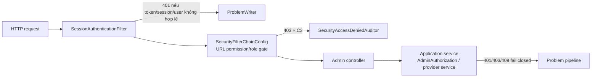

# BE-ADM-SEC-01 — Service authorization và actor/data-scope matrix

> **Trạng thái:** **DONE (18/11/2026, `datht-backend-rework`)** — endpoint gate + service re-check, forged-claim protection, CUSTOMER isolation, session lifecycle, Maker–Checker/self-escalation và fail-closed đã có source + test (unit, HTTP security chain thật, PostgreSQL 16 + Identity thật) PASS.
>
> **Giới hạn còn mở:** `ADM-OI-06` (data scope staff theo chi nhánh/segment/tenant) và `ADM-OI-07` (durable audit) — xem §8. Không claim các phần này đã đóng.
>
> **Task liên quan:** `BE-ADM-API-04`, `BE-ADM-APP-02/03/04`, `BE-ADM-API-01/02/03`.

## 1. Nguồn contract

- `docs-common/07. API contracts.md` §3.4 (role/permission seed, `CHECKER` là privilege), §3.5 (endpoint–role matrix), §3.6 (ownership/data scope), §4.3 (error catalog).
- `docs-common/03. SRS.md` §4.2/§4.3/§4.4 (`DAR-001…006`, Segregation of Duties), `FR-049–052`, `AC-027/028`.
- `docs-common/design/04. security.md` §5.1 (RBAC + user_type isolation), §5.2 (anti-IDOR `DAR-001`), §5.3 (`INV-MC-01`, cấm maker tự nâng quyền, step-up).
- `docs-common/design/05. Modules contract.md` §5.3 (Identity authority/session), §12.1 (Admin orchestrator).
- Quyết định: `DEC-ADM-002/003/007/009/010`, `DEC-ID-003/011`, `DEC-ID-013`.

## 2. Kiến trúc authorization hiện có (không tạo cơ chế thứ hai)



- **Tầng 1 — security chain:** `SecurityFilterChainConfig` giữ toàn bộ gate URL (không nhân bản ở controller).
- **Tầng 2 — service:** `AdminAuthorization` (Admin) và re-check permission trong `StaffCustomerDetailService`/`AccountAccessService` (provider). Service bảo vệ cả khi được gọi trực tiếp, không qua controller.
- **Nguyên tắc:** actor/role/permission chỉ lấy từ `SessionAuthenticator.Session` (do Identity resolve từ DB mỗi request) và authority snapshot của `Authentication`; body/header/query không bao giờ là nguồn quyền.

## 3. Ma trận actor × operation

| Operation | Endpoint gate (chain) | Service re-check | CUSTOMER | OPERATIONS | ADMIN | AUDITOR |
|---|---|---|---|---|---|---|
| Customer masked lookup | `CUSTOMER_READ` | `StaffCustomerDetailService` (permission + không `ROLE_CUSTOMER`) | 403 | 200 | 200 | 403 (không có `CUSTOMER_READ`) |
| Customer accounts list | `ACCOUNT_READ` | `AccountAccessService` (permission + không `ROLE_CUSTOMER`) | 403 | 200 | 200 | 200 |
| Approval list/detail | `ROLE_OPERATIONS`/`ROLE_ADMIN` | `ApprovalReadAuthorization` + SQL scope (`ApprovalVisibility`) | 403 | own + reviewable types | own + reviewable types | 403 |
| Role proposal | `ROLE_MANAGE` | `AdminAuthorization.requireAuthority("ROLE_MANAGE")` | 403 | 403 | 201/428 | 403 |
| Role decision | `CHECKER` + `ROLE_MANAGE` | `requireChecker` + `assertCanReview(ROLE_CHANGE)` | 403 | 403 | 200/409/428 | 403 |
| Limit proposal | `LIMIT_MAKER`/`LIMIT_MANAGE` | `requireAnyAuthority("LIMIT_MAKER","LIMIT_MANAGE")` rồi 503 fail-closed | 403 | 503 | 503 | 403 |
| Limit decision | `CHECKER` + (`LIMIT_MAKER`/`LIMIT_MANAGE`) | `requireChecker` + `assertCanReview(LIMIT_CHANGE)` | 403 | reject 200 / approve 503 | reject 200 / approve 503 | 403 |

Ghi chú: `07` §3.5 ghi AUDITOR "read" cho `/admin/customers/{id}` nhưng bảng permission seed §3.4 không cấp `CUSTOMER_READ` cho AUDITOR. Hệ thống giữ nguyên permission seed (không tự nới quyền); xung đột được ghi nhận, không tự sửa.

## 4. Thay đổi triển khai trong task

| File | Thay đổi |
|---|---|
| `admin/application/AdminAuthorization.java` | đọc `SecurityContext` **một lần** cho mỗi check (`requireAuthentication` → principal + authorities cùng snapshot); loại bỏ khả năng principal và authority đến từ hai lần đọc khác nhau; non-`Session` principal / `isAuthenticated=false` / userId overflow → `401 AUTH_SESSION_EXPIRED` |
| `admin/application/ApprovalStepUpService.java` | `requestDecisionChallenge` re-check `assertCanReview(approval.requestType())` trước `assertCheckerEligible` — một `CHECKER` không có quyền loại approval không nhận được challenge dù gọi service trực tiếp |
| `customer/application/StaffCustomerDetailService.java` | fail-closed `ROLE_CUSTOMER` + permission staff (identity context không nhất quán) |
| `account/application/AccountAccessService.java` | `requireStaffScope` tập trung (`ACCOUNT_READ` + không `ROLE_CUSTOMER`) |
| `src/test/.../AdminAuthorizationTest.java` | **mới** — 8 test service-layer |
| `src/test/.../AdminSecurityMatrixPostgreSqlIntegrationTest.java` | **mới** — 8 test HTTP + PostgreSQL 16 + Identity thật |

Không sửa `SecurityFilterChainConfig`, không thêm dependency, không đổi error catalog.

## 5. Trusted authentication context và forged claims

- Actor id chỉ từ `Session.userId()`; header `X-User-Id`, `X-Role`, `X-Actor-User-Id`, `X-Permissions` **không** được đọc ở bất kỳ filter/controller/service nào.
- Body `makerId`/`checkerId`/`actorUserId` không thuộc schema DTO đã duyệt → Jackson `fail-on-unknown-properties=true` → `400 MALFORMED_REQUEST`, không có state nào được tạo.
- Principal không phải `Session` (ví dụ token do internal caller dựng) → `401 AUTH_SESSION_EXPIRED`, không fallback sang authority của `Authentication`.
- `roleCodes` trong audit là metadata suy ra từ authority snapshot, không phải input.
- Identity resolve lại authority từ DB mỗi request (`JpaAuthorityReader`) và lọc permission theo `user_type`, nên role assignment lẫn (`CUSTOMER` + `OPERATIONS`) không cấp được permission staff.

## 6. Session lifecycle (disabled / expired / revoked)

`IdentitySessionAuthenticator` + `JdbcSessionRepository` kiểm tra trong **một** câu `UPDATE … RETURNING`:

- `session.status = 'ACTIVE'`;
- `idle_expires_at > now()` và `absolute_expires_at > now()`;
- device (nếu có) `ACTIVE` và thuộc đúng user;
- sau đó `users.findById` phải `ACTIVE`.

Mọi trường hợp còn lại → `Optional.empty()` → `401 AUTH_SESSION_EXPIRED`, không chạm controller. Session là opaque server-side (không JWT), nên revoke/disable có hiệu lực ngay với request kế tiếp; task **không** claim bất kỳ cơ chế JWT blacklist nào (không tồn tại theo `DD-SEC-01`). Storage failure của Identity → `503` fail-closed, không cấp phiên.

## 7. Maker–Checker, self-escalation, fail-closed

- `approval_request` có DB check `checker_id IS NULL OR checker_id <> maker_id`; service kiểm lại qua `ApprovalRequest.assertCheckerEligible` **sau khi lock `FOR UPDATE`** (revalidate ở transaction boundary, không tin preflight).
- `ApprovalRequest.propose` từ chối `targetUserId == makerId` (`409 ROLE_CONFLICT`) trước khi tạo challenge/approval/idempotency.
- Với `ROLE_CHANGE`, cả maker và checker đều không được là target user.
- Checker phải có `CHECKER` **và** permission theo loại approval; thiếu → `403` trước lock/provider (không lộ approval).
- Step-up `SENSITIVE_ACTION` bind `approvalId` / proposal key + canonical hash, consume trong transaction quyết định (`MANDATORY`); rollback hoàn challenge. Đổi payload/decision/checker giữa issue và consume → mismatch.
- Approve/reject lock row; hai checker đồng thời chỉ một winner; terminal state không transition lại.
- Audit C2 là write cuối transaction; lỗi audit rollback cả approval/provider/idempotency.

Fail-closed matrix:

| Thiếu/không hợp lệ | Kết quả |
|---|---|
| Không có credential | `401 AUTH_SESSION_EXPIRED`, không audit 403 |
| Token/session/user disabled/expired/revoked | `401`, không vào controller |
| Principal không phải trusted session | `401` |
| Authority snapshot thiếu permission | `403 AUTH_FORBIDDEN` + C3 |
| Identity context không nhất quán (`ROLE_CUSTOMER` + staff permission) | `403` |
| Maker == checker / maker == target | `409 ROLE_CONFLICT` + C3 |
| Thiếu step-up | `428 STEP_UP_REQUIRED` (không phải denial, không C3) |
| Authorization/Identity storage không khả dụng | `503` (không cấp quyền) |

## 8. Test coverage và kết quả

| Yêu cầu | Test |
|---|---|
| Endpoint authorization | `AdminSecurityMatrixPostgreSqlIntegrationTest` (7 route × CUSTOMER, AUDITOR, checker-thiếu-quyền), `HttpSecurityTest` (chain dùng chung) |
| Service authorization | `AdminAuthorizationTest` 8, `ApprovalReadAuthorizationTest` 8, `ApprovalProposalServiceTest` 11, `ApprovalDecisionServiceTest` 11 |
| Forged role/user id | `AdminSecurityMatrixPostgreSqlIntegrationTest#forgedActorClaimsDoNotEscalate`, `AdminAuthorizationTest#forgedRolesOnANonSessionPrincipalNeverAuthorize` |
| CUSTOMER restrictions | `AdminSecurityMatrixPostgreSqlIntegrationTest#customerActorIsDeniedEveryAdminRoute` + `403` + C3 metric |
| Disabled/expired/revoked | `AdminSecurityMatrixPostgreSqlIntegrationTest#disabledExpiredAndRevokedSessionsAreRejected`, `#missingOrUnverifiableCredentialsAre401` |
| Data scope trái phép | provider owner mismatch (`AccountControllerPostgreSqlIntegrationTest`), staff permission gate ở trên |
| Maker/checker + self-approval | `#makerCannotApproveOwnRequest`, `#makerCannotProposeRoleForSelf`, `ApprovalStepUpPostgreSqlIntegrationTest` 22, `ApprovalDecisionServiceTest#makerCannotDecideOwnRequestEvenWithACheckedChallenge` |
| Self-escalation | `#makerCannotProposeRoleForSelf`, `ApprovalRequestTest` (target rules), `RoleChangePostgreSqlIntegrationTest` (Identity) |
| Fail-closed | trực tiếp trong các test trên + `IdentityAuthDbFailureIntegrationTest` (storage outage) |

Lệnh và kết quả:

```bash
cd digitalbanking-backend
./gradlew test \
  --tests 'com.simulatedbank.banking.admin.application.*' \
  --tests 'com.simulatedbank.banking.admin.adapter.in.AdminSecurityMatrixPostgreSqlIntegrationTest' \
  --tests 'com.simulatedbank.banking.architecture.ModuleBoundaryArchTest' \
  --console=plain --max-workers=1
```

- `AdminAuthorizationTest` **8/8 PASS**, `AccountAccessServiceTest` **14/14 PASS**, `CustomerQueryServiceTest` **9/9 PASS**, `StaffCustomerDetailServiceTest` **9/9 PASS**.
- `AdminSecurityMatrixPostgreSqlIntegrationTest` **8/8 PASS** (PostgreSQL 16 Testcontainers + Flyway `V1`–`V8` + security chain/Identity thật; OTP transport là test double duy nhất).
- Chi tiết lần chạy rộng hơn (Admin + Customer + Account + ArchUnit + migration) ghi ở `tasks/README.md` §0.10.

## 9. Files thay đổi

- Source: `admin/application/AdminAuthorization.java`, `admin/application/ApprovalStepUpService.java`, `customer/application/StaffCustomerDetailService.java`, `account/application/AccountAccessService.java` (+ `customer.api`, `customer.application`, `customer.adapter.out` cho `BE-ADM-API-04`).
- Test: `admin/application/AdminAuthorizationTest.java` (**mới**), `admin/adapter/in/AdminSecurityMatrixPostgreSqlIntegrationTest.java` (**mới**), `customer/application/StaffCustomerDetailServiceTest.java`, `account/application/AccountAccessServiceTest.java`.
- Không sửa security chain, migration, OpenAPI.

## 10. Blocker còn mở

- `ADM-OI-06` — data scope staff theo chi nhánh/segment/tenant chưa có model được duyệt; hiện tại authorization dừng ở permission + user-type isolation + anti-IDOR. Không claim "least privilege theo phòng ban" đã đóng.
- `ADM-OI-07` — durable `AuditModuleApi`/`audit_log`/hash chain chưa có; C3 hiện là structured security log + metric theo `DEC-ID-003`/`DEC-ADM-007`.
- `ADM-OI-05` — Limit provider chưa có runtime, nên limit approve vẫn `503` fail-closed (đúng contract, không phải lỗi authorization).
- Xung đột tài liệu AUDITOR `CUSTOMER_READ` (`07` §3.4 vs §3.5) cần API/BA phân xử; hệ thống đang giữ permission seed chặt hơn.
