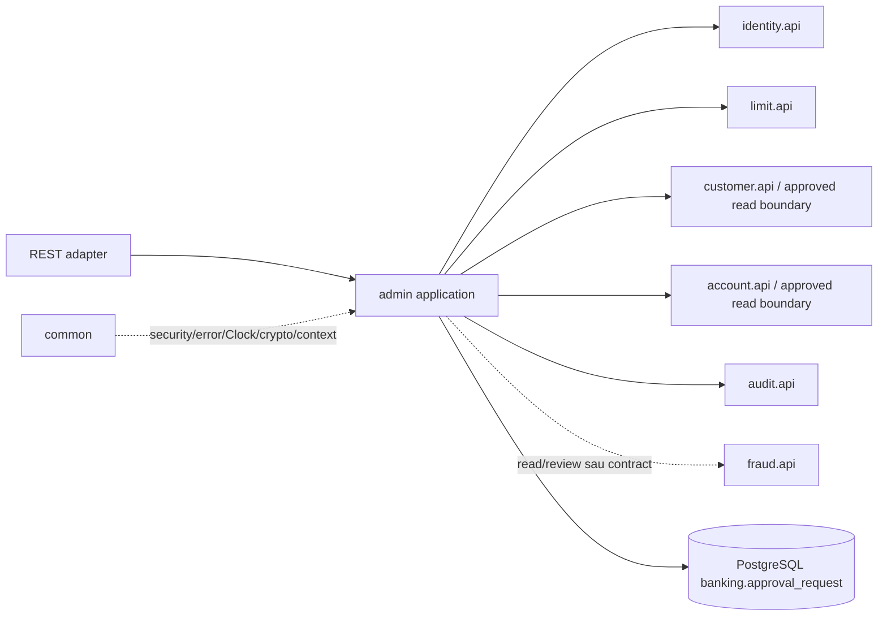
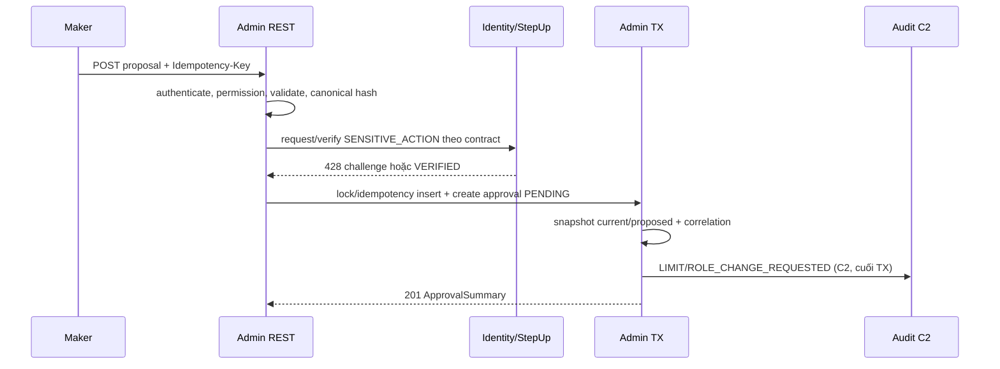

# Admin module — Thiết kế triển khai (`BE-ADM-DOC-01`)

> **Trạng thái:** PARTIAL — DOC-01 đã được cập nhật bởi `BE-ADM-CON-01/02/03` và `BE-ADM-APP-02/03`: Admin domain/persistence, Checker step-up, idempotency (V7), ROLE_CHANGE proposal/decision, checker lock/revalidate/rollback và Identity provider integration đã triển khai; LIMIT_CHANGE proposal/approve, durable Audit và HTTP security contract đầy đủ còn BLOCKED.
> **Baseline:** nhánh `datht-backend-rework`; source hiện tại được rà soát để tránh lặp lại implementation đã có.
> **Thẩm quyền:** `docs-common/01–11` > `docs-common/design/` > `docs-backend/`; mâu thuẫn chưa được chốt phải đi qua owner/reviewer tương ứng.

## 1. Căn cứ và nguyên tắc nguồn

Nguồn bắt buộc:

- `docs-common/03. SRS.md`: `FR-032–033`, `FR-049–053`, `UC-011–013`, `AC-017`, `AC-027–029`.
- `docs-common/04. Database design & analysis.md`: §4.5.3 `approval_request`, §4.6 audit/compliance.
- `docs-common/06. System architecture.md`: ranh giới modular monolith, package-by-feature, transaction boundary.
- `docs-common/07. API contracts.md`: §3 RBAC, §4 error catalog, §6 step-up, §7.2.14 approval schema, §8.5/§8.8 admin API, §11 open issues.
- `docs-common/09. Test plan.md`: test levels, PostgreSQL/Testcontainers, failure injection và evidence rules.
- `docs-common/design/01. audit-traceability.md`: C2/C3, audit action catalog, hash chain và correlation.
- `docs-common/design/02. consistency-concurrency.md`: transaction/locking/concurrency; approval contract được mô tả tại `design/05 §12.1`.
- `docs-common/design/04. security.md`: RBAC, step-up, Maker-Checker, masking và fail-safe.
- `docs-common/design/05. Modules contract.md`: §2 dependency direction, §3 transaction/error, §5 Identity, §6 Customer, §7 Account, §10 Limit, §11 Audit/Fraud, §12.1 Admin, §13 contract test.
- `docs-backend/00. architecture & conventions.md`: package, persistence, Flyway, security, audit/observability và testing conventions.

### 1.1. Quy tắc không được suy diễn

1. `admin` không ghi trực tiếp bảng của `identity`, `limit`, `customer`, `account`, `fraud` hoặc `audit`.
2. Consumer chỉ gọi `<provider>.api`; không import `application`, `domain`, `adapter` hoặc entity của provider.
3. C2 audit và state mutation phải cùng transaction; audit failure rollback state. Không bắt exception persistence rồi tiếp tục trong transaction rollback-only.
4. `APPROVED`, `EXPIRED` hoặc `step_up_challenge_id` xuất hiện khác nhau giữa overview/design và schema chuẩn. `04` và `07` có ưu tiên cao hơn; các điểm này là contract gates, không tự sửa bằng migration.
5. Tài liệu chỉ ghi `Planned`, `Blocked`, `Not verified` cho phần chưa có evidence. Không ghi `DONE` chỉ vì interface hoặc route gate đã tồn tại.

## 2. Kết quả rà soát hiện trạng

| Khu vực | Đã có trong source hiện tại | Kết luận cho Admin |
|---|---|---|
| Package admin | CON-01 đã thêm `admin.domain`, `admin.application.port`, `admin.adapter.out`; CON-02 thêm `ApprovalStepUpBinding/Service`, `ApprovalDecisionService`, `AdminAuthorization`, `AdminAuditPort` | Còn proposal application service + REST adapter; không tạo lại domain/persistence |
| DDL/admin persistence | `V6__create_approval_request_table.sql` đã có; fresh migration V1–V6 pass | Không sửa V6 sau khi áp dụng; thay đổi schema phải forward-only + review DB owner |
| HTTP route security | Common đã khai báo permission/role gates cho limit, role, approvals và customer/account lookup | Tái sử dụng security chain; service re-check privilege `CHECKER` đã có cho decision |
| Error catalog | Common đã có `APPROVAL_NOT_FOUND`, `APPROVAL_ALREADY_DECIDED`, `ROLE_CONFLICT`, `STEP_UP_*` và Problem pipeline | Không tạo error handler/catalog thứ hai; map provider outcome qua Common |
| Step-up | `identity.api.StepUpChallengePort` có `SENSITIVE_ACTION`, binding hash/key, `consumeVerified` JOIN/MANDATORY; CON-02 đã bind Checker theo `approvalId` + canonical hash | Checker binding DONE; Maker binding trước proposal chưa chốt (`MOD-OI-10`) |
| Role mutation | `identity.api.IdentityRoleCommand` và `IdentityRoleCommandService` đã có expected version, role mutation và session revoke | Không tạo role repository/service thứ hai trong Admin; `ApprovalDecisionService` tạo trusted command rồi gọi provider |
| Customer lookup | Exact-ID masked `API-ADM-01` (Customer adapter) đã kiểm chứng trên PostgreSQL/HTTP thật; `403`+C3 cho CUSTOMER/thiếu quyền, `404 CUSTOMER_NOT_FOUND`; data-scope staff/durable audit còn BLOCKED | Không duplicate controller/customer PII service; integration là provider-owned route + `customer.api` (BE-ADM-API-04) |
| Account lookup | `API-ADM-02` (Account adapter) masked list/status/ownership runtime thật; `404 CUSTOMER_NOT_FOUND` qua `customer.api.CustomerQuery.findByCustomerId`; staff data scope BLOCKED | Không đọc bảng account từ Admin/Customer; provider contract thật, không fake production (BE-ADM-API-04) |
| Limit/Audit | Limit provider và durable `AuditModuleApi` vẫn chưa có runtime | Dùng provider contract fixture chỉ ở test; không fake production bean |
| Tests | CON-01: 29 test Admin/migration; CON-02: 31 test step-up/decision (7 unit binding, 7 unit gate, 17 PostgreSQL/Identity) pass | Bổ sung HTTP/limit/durable-audit tests khi contract gate mở |

## 3. Scope và trách nhiệm

### 3.1. Trong phạm vi MVP

1. Sở hữu độc quyền `banking.approval_request` và vòng đời approval.
2. Maker tạo đề xuất `LIMIT_CHANGE` và `ROLE_CHANGE`, chưa áp dụng thay đổi ngay.
3. Checker approve/reject trong cơ chế Four-Eyes; maker không được là checker.
4. Bắt buộc `SENSITIVE_ACTION` step-up trước quyết định của Checker; binding phải chống đổi payload/đổi approval.
5. Gọi `limit.api` để áp dụng version limit và `identity.api` để apply role/privilege; update approval và ghi C2 audit trong cùng transaction.
6. Danh sách/chi tiết approval read-only theo actor scope; payload/result phải mask.
7. Điều phối các lookup vận hành đã có contract: customer exact-ID masked view và account view; quyền/scope vẫn thuộc provider và policy được duyệt.
8. Correlation/request context, structured log, metric bounded label và failure evidence theo Common/Audit conventions.

### 3.2. Ngoài phạm vi hoặc bị chặn

- Tự quản lý `app_user`, role catalog, permission catalog, `user_role`, `user_privilege`, session hoặc `auth_challenge`.
- Thay đổi định nghĩa role/permission (`target_type=ROLE`), đang là `OI-API-10`.
- Search customer diện rộng, full PII, staff data-scope chưa chốt (`OI-API-08`, `OI-API-09`, `CUS-OI-05`).
- Retention/legal-hold API/workflow chi tiết (`OI-API-07`), dù schema `approval_request` dành chỗ cho loại request này.
- Fraud rule engine hoặc fraud flag review state machine; Admin chỉ tích hợp read/review contract sau khi Fraud/Audit owner cung cấp.
- Real notification/OTP provider; Admin dùng Step-up provider, không tự tạo OTP.
- Microservice, message broker, distributed lock hoặc cache thay cho PostgreSQL transaction/row lock.

## 4. Business requirements và traceability

| Requirement | Hành vi Admin | Evidence cần có |
|---|---|---|
| `FR-032/033`, `UC-011`, `AC-017/028` | Maker đề xuất limit; Checker approve/reject; policy/version/audit đúng | API + DB + concurrent checker + rollback + audit C2 |
| `FR-049`, `UC-010/012`, `AC-027` | Staff tra cứu customer/account/transaction trong scope | Provider API thật, 403 anti-enumeration, masked projection, scope test |
| `FR-050`, `UC-013`, `AC-028` | Maker tạo role/privilege request; Identity apply khi approve | role contract, expected version, revoke sessions, audit |
| `FR-051`, `BRL-008`, `AC-028` | Four-Eyes, maker khác checker, step-up bắt buộc | DB check, service check, two-checker race, challenge single-use |
| `FR-052`, `NFR-030` | PII/financial/audit payload phân loại và least privilege | log/response/audit scan, scope/permission matrix |
| `FR-053`, `AC-029` | Approval path cho retention/legal hold chỉ mở sau contract | Không triển khai giả; gate OI-API-07 |
| `FR-038` | Correlation xuyên HTTP → approval → provider → audit | header/body/DB/log assertion |

## 5. Kiến trúc module và dependency

Admin nằm trong Spring Boot modular monolith:



| Provider | Operation Admin cần | TX/ownership | Readiness/gate |
|---|---|---|---|
| `identity` | `SessionAuthenticator`; `StepUpChallengePort.consumeVerified`; `IdentityRoleCommand.getRoleAssignmentVersion`; `applyApprovedRoleChange` | Step-up consume và role apply `JOIN/MANDATORY`; Identity giữ user/role/session | Contract/source đã có một phần; cần Admin integration thật |
| `limit` | `applyApprovedLimitChange(approvalId, scope, new values, expectedVersion, actor)` | `JOIN`; Limit giữ `limit_config`/version/policy | Provider runtime/contract cần hoàn thiện |
| `audit` | C2 `recordInTransaction`, C3 deny `recordStandalone` | C2 là cuối transaction; hash-chain writer do Audit sở hữu | Durable `AuditModuleApi`/`audit_log` còn BLOCKED |
| `customer` | exact-ID masked customer view | Read-only; Customer kiểm PII/mask, Admin kiểm use-case scope | API có nhưng staff data-scope còn BLOCKED |
| `account` | masked account list/view, ownership/scope result | Read-only; Account giữ ownership/status | Runtime chưa có |
| `fraud` | flag/rule read/review nếu được giao | Fraud giữ rule/flag; không Admin ghi bảng Fraud | Contract/use case chưa đủ cho core approval |
| `common` | session context, `Clock`, Problem/RFC 9457, correlation, rate limit, crypto/masking primitives | Không business table/transaction | Đã có; tái sử dụng |

Không tạo dependency ngược: `identity`, `customer`, `account`, `limit`, `audit`, `fraud` không import `admin` internals. Provider trả immutable record/DTO thuộc provider; DTO REST/approval thuộc `admin`.

## 6. Domain và database design

### 6.1. Canonical `approval_request`

Theo `04 §4.5.3`, Admin là write-owner của bảng sau; entity không lộ qua REST:

| Field | Quy tắc triển khai |
|---|---|
| `approval_id` | `BIGINT` identity PK; API serialize dạng string `ID` |
| `request_type` | `LIMIT_CHANGE`, `ROLE_CHANGE`; giữ các loại retention theo schema chuẩn nhưng không mở API khi OI-API-07 chưa đóng |
| `target_type`, `target_id` | Schema chuẩn giới hạn `CUSTOMER`, `ACCOUNT`, `APP_USER`, `DATA_SCOPE`, `RETENTION_POLICY`; validate pair theo request type |
| `payload` | JSONB theo typed schema của request type; gồm current snapshot, proposed change, expected provider version, reason đã validate; không secret/full PII |
| `status` | Canonical: `PENDING`, `APPROVED`, `REJECTED`, `APPLIED`, `CANCELLED`. MVP synchronous nên approve thành công phải commit `APPLIED`; `APPROVED` chỉ là trạng thái trung gian nếu provider/contract sau này tách apply |
| `maker_id` / `checker_id` | FK `app_user`; `checker_id` nullable khi PENDING; DB check `checker_id IS NULL OR checker_id <> maker_id` |
| `decision_note` | Nullable, tối đa 500 ký tự |
| `correlation_id` | Bắt buộc, tối đa 64, không PII |
| `created_at` / `decided_at` / `applied_at` | UTC `TIMESTAMPTZ`; invariant timestamp theo status |

Index bắt buộc theo `04` §4.5.3: status+created time, type+status, target, maker, checker; **không** có partial index và không có unique constraint ngoài PK. `ADM-OI-03` (partial unique PENDING trên logical target) là extension ngoài canonical, chưa được DB owner duyệt; nếu duyệt phải thêm migration mới (`V8`), không sửa `V6`. Không dựa vào application pre-check để chống race.

**Đã triển khai (DB-01):** `V6__create_approval_request_table.sql` + `ApprovalRequestEntity`/`ApprovalRequestJpaRepository`/`JpaApprovalRequestStore`; fresh PostgreSQL 16 metadata + positive/negative tests PASS (`ApprovalRequestV6MigrationPostgreSqlIntegrationTest`). Constraint/index đúng bảng trên; typed payload JSONB dùng `LimitChangePayload`/`RoleChangePayload`. Chưa có `result`/`idempotency`/version column.

### 6.2. Mâu thuẫn schema — trạng thái sau CON-01

| Gap | Evidence | Kết quả CON-01 |
|---|---|---|
| Overview nêu `UUID/BIGINT`, `EXPIRED`, `expires_at`, `step_up_challenge_id`; `04` chuẩn hóa `BIGINT`, không có `EXPIRED`/expiry/challenge column | `_overview/10-admin.md` vs `04 §4.5.3` | **Đã chốt:** dùng `04`; V6 chỉ có cột canonical. Không thêm expiry/challenge/result column. |
| `04` cho status `APPROVED` và `APPLIED`, trong khi contract apply cùng TX | `04 §4.5.3`, `design/05 §12.1` | **Đã chốt:** MVP `PENDING→APPLIED`/`REJECTED`; `APPROVED` schema-reserved, không có transition. Provider command nhận `APPROVED`, Admin persist `APPLIED`. |
| Generic JSONB thiếu DB-level schema | `04 §4.5.3` | **Đã xử lý một phần:** typed payload + validation domain; DB vẫn chỉ có `NOT NULL`, không JSON Schema constraint. |
| POST proposal chưa có semantics idempotency | `07 §5.6` | **Đã xử lý bởi CON-03:** V7 `admin_idempotency_record`, unique actor+operation+resource+key, insert-first, replay/conflict/in-progress, TTL/purge; ROLE proposal/decision mở, LIMIT proposal/approve fail-closed. |

Migration `V6` đã chạy sau V1–V5, forward-only; không sửa migration cũ. Partial unique PENDING trên logical target vẫn **chưa được duyệt** và chưa có trong V6; không dựa vào application pre-check để tuyên bố chống race.

## 7. API design

### 7.1. Public endpoints trong baseline

| API | Method/path | Quyền | Side effect |
|---|---|---|---|
| `API-LIM-02` | `POST /api/v1/admin/limits` | `LIMIT_MAKER`/`LIMIT_MANAGE` | Tạo PENDING limit approval; không apply limit |
| `API-LIM-03` | `POST /api/v1/admin/limits/{approvalId}/approve` | `CHECKER` + limit approval permission | Approve/reject; apply provider nếu APPROVE |
| `API-ROL-01` | `POST /api/v1/admin/roles` | `ROLE_MANAGE` | Tạo PENDING role approval |
| `API-ROL-02` | `POST /api/v1/admin/roles/{approvalId}/approve` | `CHECKER` + `ROLE_MANAGE` | Approve/reject; apply Identity nếu APPROVE |
| `API-APR-01` | `GET /api/v1/admin/approvals` | `APPROVAL_READ`/scope | Read-only page |
| `API-APR-02` | `GET /api/v1/admin/approvals/{approvalId}` | `APPROVAL_READ`/scope | Read-only masked detail |
| `API-ADM-01` | `GET /api/v1/admin/customers/{customerId}` | `CUSTOMER_READ`/scope | Provider-owned read; không duplicate |
| `API-ADM-02` | `GET /api/v1/admin/customers/{customerId}/accounts` | `ACCOUNT_READ`/scope | Provider/composition-owned read |

`07` là semantic source; OpenAPI phải được cập nhật đồng thời trước code. Các API bổ sung và permission/scope vẫn có trạng thái review chưa hoàn tất. Không mở search customer, full PII, retention/legal-hold hoặc user search trong task core.

### 7.2. Validation và response contract

- ID/money/Instant/currency theo `07 §2`; money là string `BigDecimal`, VND, tối đa 2 decimals, không dùng `double`.
- `reason`/`decisionNote` tối đa 500, reject secret/PII; normalize trim/null theo contract.
- Limit: customer tồn tại; account nếu có phải thuộc customer; `perTransactionLimit > 0`, `dailyLimit >= perTransactionLimit`, policy/provider re-check khi approve; effective time hợp lệ.
- Role: target là `ACTIVE` staff phù hợp; operation quyết định roleCode/privilegeCode bắt buộc; `CHECKER` là privilege, không phải role; maker không tự cấp role cho chính mình nếu policy cấm; target không được là maker trong self-escalation case.
- Approval detail chỉ trả `payload` đã mask, current/proposed cần cho checker; không trả OTP, token, hash, full PII, account number đầy đủ hoặc provider entity.
- Mọi response có `X-Correlation-ID`; response approval có `correlationId`; dữ liệu tài chính/PII dùng `Cache-Control: no-store`.
- Lỗi map qua Common RFC 9457: `400 VALIDATION_ERROR`, `401 AUTH_SESSION_EXPIRED`, `403 AUTH_FORBIDDEN`, `404 APPROVAL_NOT_FOUND`/provider not found, `409 APPROVAL_ALREADY_DECIDED`/`ROLE_CONFLICT`/`INVALID_STATE_TRANSITION`, `422 LIMIT_OUT_OF_POLICY`, `428 STEP_UP_REQUIRED`, `429 RATE_LIMITED`, `500/503` technical/provider failure. Không tạo `MAKER_CHECKER_VIOLATION` riêng nếu catalog `07` đã dùng `ROLE_CONFLICT`.

### 7.3. Idempotency contract (đã triển khai — `BE-ADM-CON-03`)

Hợp đồng đầy đủ nằm tại `07 §5.6`; quyết định tại `DEC-ADM-003`. Tóm tắt:

1. `Idempotency-Key` bắt buộc cho `POST /admin/limits|roles` và hai endpoint approve; 1–255 ký tự,
   pattern `^[A-Za-z0-9._:~-]{1,255}$`.
2. Admin sở hữu `banking.admin_idempotency_record` (V7), unique
   `(actor_id, operation, scope_key, idempotency_key)`; `scope_key=''` cho proposal, `approvalId` cho decision.
   Không reuse `transfer.idempotency_record`.
3. Canonical hash `ADM-IDEMPOTENCY-V1` + RFC 8785 JCS SHA-256; role proposal loại trừ `expectedVersion`
   server-capture (step-up hash `ADM-PROPOSAL-STEPUP-V1` bao gồm nó).
4. Cùng key + cùng hash terminal → replay đúng status/body gốc + `Idempotent-Replayed: true`; khác hash →
   `409 IDEMPOTENCY_CONFLICT` + C3 security audit; `RECEIVED` → `409 IDEMPOTENCY_IN_PROGRESS` + `Retry-After`.
5. Insert-first `ON CONFLICT DO NOTHING` trong transaction business; loser block rồi replay/conflict; winner
   rollback thì loser claim được. Không select-then-insert.
6. Decision dùng lock `FOR UPDATE` + terminal state; replay không consume challenge/apply provider lần hai.
7. TTL 24h từ `completed_at` (04 §9.6/BRL-013), purge cron retention, batch, `SKIP LOCKED`, chỉ terminal quá hạn;
   `RECEIVED` không bao giờ bị purge. Record hết hạn vẫn replay cho tới khi purge.

Maker step-up bind `bindingKey=Idempotency-Key` + proposal hash; Checker decision giữ bind `approvalId` của
CON-02. `LIMIT_CHANGE` proposal/approve chạy thật qua `limit.api.LimitConfigMutationPort` từ BE-ADM-INT-01
(`PENDING_APPROVAL`/`ACTIVE`/`SUPERSEDED`/`REJECTED`, `expectedVersion`); policy numeric vẫn chờ OI-API-05.

## 8. Workflow admin end-to-end

### 8.1. Maker propose



Quy tắc: không tạo approval, limit pending row hoặc idempotency record trước khi step-up requirement/contract đã qua; validation thất bại không ghi audit nghiệp vụ. Nếu source owner giữ semantics `428` cho maker như `07 §8.5/§8.8`, phải chốt binding challenge khi `approvalId` chưa tồn tại; phương án an toàn là binding bằng canonical proposal hash + approved idempotency key hoặc action reference được tạo trước. Không tự đưa `approvalId = 0` hay binding lỏng.

### 8.2. Checker approve/reject

```mermaid
sequenceDiagram
    participant C as Checker
    participant API as Admin REST
    participant TX as Approval transaction
    participant ID as Identity
    participant LIM as Limit provider
    participant AUD as Audit C2

    C->>API: POST /approvals/{id}/approve + decision + challenge
    API->>API: auth + CHECKER + scope + input validation
    API->>TX: begin; lock approval FOR UPDATE/NOWAIT
    TX->>TX: status=PENDING, maker!=checker, type/target/version check
    TX->>ID: consumeVerified(SENSITIVE_ACTION), JOIN/MANDATORY
    alt APPROVE LIMIT_CHANGE
        TX->>LIM: applyApprovedLimitChange(...), JOIN
    else APPROVE ROLE_CHANGE
        TX->>ID: applyApprovedRoleChange(...), JOIN/MANDATORY
    else REJECT
        TX->>TX: no provider mutation
    end
    TX->>TX: set APPLIED or REJECTED + timestamps
    TX->>AUD: *_APPROVED or *_REJECTED, C2, cuối TX
    TX-->>API: 200 ApprovalDetail
```

Bất biến:

- Lock approval trước khi đọc/validate trạng thái; nếu `NOWAIT` thất bại trả in-progress/conflict theo catalog đã chốt, không coi là reject.
- Re-check status, maker/checker, target state và provider expected version dưới transaction; preflight read không thay authoritative check.
- `consumeVerified` chỉ được gọi trong transaction Admin; rollback apply phải hoàn lại consume theo contract.
- `APPROVE` chỉ trả success sau provider mutation, approval state và C2 audit cùng commit. `REJECT` không gọi provider, vẫn ghi audit C2 và commit decision.
- Hai Checker song song: một người thắng lock và commit; người còn lại không được apply lần hai, không consume challenge thành công lần hai.
- Identity role apply nhận `ApprovedRoleChange` do Admin dựng từ approval đã lock/validate; không nhận raw HTTP object. `expectedVersion` lấy từ payload authoritative do Maker capture, không đọc trực tiếp bảng Identity trong Admin.

### 8.3. Read approval và operational lookup

Read API chỉ dùng transaction read-only, page/sort whitelist và actor scope. Maker chỉ thấy request của mình; Checker/Operations/Admin thấy request được policy cho phép. Không join entity chéo trong write path. Customer/account lookup gọi provider public contract, không lộ approval payload hoặc bypass scope.

**Đã triển khai persistence (`BE-ADM-DB-02`):** `ApprovalQueryService` (`@Transactional(readOnly = true)`) + `ApprovalRequestReader`/`JpaApprovalRequestReader`; list trả `ApprovalPage<ApprovalSummaryProjection>` bằng constructor projection **không đọc JSONB `payload`**, detail trả `ApprovalDetailProjection` với payload typed đã mask/bỏ `expectedVersion`. Filter `requestType/status/makerId/checkerId/from` (inclusive)/`to` (exclusive), `page` 0-based mặc định 0, `size` 1–100 mặc định 20, sort whitelist duy nhất `createdAt` (mặc định `desc`, tie-breaker `approvalId`). Sort/filter sai → `400 VALIDATION_ERROR`; page vượt cuối trả `items: []`. **Đã mở REST (`BE-ADM-API-03`, 18/11/2026):** `ApprovalAdminController` cho `API-APR-01/02`; scope server-side theo `DEC-ADM-009` (maker thấy request của mình; checker thấy loại mình được duyệt) nằm trong JPQL cùng filter và `countQuery`; detail ngoài scope = `404 APPROVAL_NOT_FOUND`; read-only, không audit C2/C3 thường. `ApprovalDetail.result` chưa có nguồn persist canonical (`ADM-OI-11`); phân công checker/tenant vẫn mở (`ADM-OI-06`).

## 9. Validation, control và failure handling

| Điểm | Kiểm soát | Failure behavior |
|---|---|---|
| Authentication/session | Principal do Identity/Common tạo; không tin `makerId/checkerId` từ body | `401`; không lookup/ghi business state |
| Endpoint permission | URL gate + service-level permission/scope | `403` + C3 `SECURITY_ACCESS_DENIED` khi đã xác thực; anti-enumeration |
| Maker proposal | request schema, target/status/policy, idempotency, step-up binding | `400/404/422/428`; chưa tạo approval nếu chưa qua gate |
| Checker decision | `CHECKER`, maker khác checker, target khác actor theo policy, status PENDING | `409 ROLE_CONFLICT`/`APPROVAL_ALREADY_DECIDED`; không provider side effect |
| Step-up | purpose `SENSITIVE_ACTION`, actor, hash/key, expiry, single-use | `428` nếu thiếu; mismatch/expired theo Identity catalog; rollback caller nếu consume fail |
| Provider stale version | Limit/Identity authoritative version/status check dưới lock | `409` conflict; rollback approval/provider/audit; không trả success giả |
| DB unique/lock | insert-first idempotency, row lock, fixed order, PostgreSQL thật | retry toàn transaction mới nếu safe; không retry statement trong TX aborted |
| Audit C2 lỗi | `recordInTransaction` mandatory, audit cuối transaction | rollback toàn state; 5xx/503; không trả APPLIED |
| C3 deny audit lỗi | `recordStandalone` best-effort | quyết định 403 vẫn giữ; structured security log + metric + alert |
| Timeout sau commit | Client retry cùng idempotency key / đọc approval | replay hoặc trạng thái bền vững; không tạo approval thứ hai |
| Timeout trước commit | transaction rollback; không có approval | retry an toàn theo key sau khi contract idempotency hoàn tất |
| Crash giữa provider và approval | cùng transaction JOIN nên rollback atomically | không có partial APPLIED; recovery kiểm tra row/status/provider evidence theo runbook |
| Dependency unavailable | fail closed cho mutation nhạy cảm | `503`; không commit PENDING/role/limit nửa vời |
| Payload/log leakage | mask trước response/audit/log; không raw token/OTP/full PII | reject/fail closed; security alert nếu phát hiện leak |

## 10. Security và audit

### 10.1. Authorization

- Staff phải là `STAFF`, permission snapshot lấy từ Identity; client không được gửi role/permission để override.
- `ROLE_MANAGE`, `LIMIT_MAKER/LIMIT_MANAGE`, `CHECKER`, `APPROVAL_READ` chỉ là endpoint gate; service vẫn kiểm actor, request type, target scope và maker/checker rule.
- Cấm maker tự approve mọi approval. Cấm self-escalation role/privilege theo `design/04 §5.3`; target/maker/checker phải là các principal hợp lệ.
- Lookup customer/account phải enforce data-scope ở owner/provider. Chưa có scope contract thì giữ `BLOCKED`, không mở unrestricted lookup.

### 10.2. Audit action mapping

| Action | Class | Khi nào | Transaction |
|---|---|---|---|
| `LIMIT_CHANGE_REQUESTED` | C2 | Maker tạo limit approval | Cùng TX create approval |
| `LIMIT_CHANGE_APPROVED` | C2 | Limit apply thành công | Cuối TX apply + APPLIED |
| `LIMIT_CHANGE_REJECTED` | C2 | Checker reject | Cuối TX REJECTED |
| `ROLE_CHANGE_REQUESTED` | C2 | Maker tạo role approval | Cùng TX create approval |
| `ROLE_CHANGE_APPROVED` | C2 | Identity apply thành công | Cuối TX role + revoke + APPLIED |
| `ROLE_CHANGE_REJECTED` | C2 | Checker reject | Cuối TX REJECTED |
| `SECURITY_ACCESS_DENIED` | C3 | Permission/scope/maker-checker deny sau auth | Standalone; fallback log/metric/alert |

Audit facts tối thiểu: actor, role snapshot, action, entity `APPROVAL_REQUEST`, approval ID, target type/id, before/after đã mask, outcome, correlation ID, request ID, timestamp. Identity không tự ghi duplicate `ROLE_CHANGE_*`; Admin là orchestrator ghi event cuối theo contract. Không audit validation error trước khi có state, read approval thường hoặc health/metrics.

**Đã triển khai (APP-04 → INT-01, 18/11/2026):** `AdminAuditPort` là boundary duy nhất; C2 (`recordInTransaction`) là write cuối transaction quyết định và fail-closed, C3 (`recordStandalone`) best-effort nhưng phát `admin.audit.failures` + `SECURITY_AUDIT_WRITE_FAILED`. Từ BE-ADM-INT-01 adapter production là `DurableAdminAuditAdapter` gọi `audit.api.AuditModuleApi` ghi `banking.audit_log` append-only + hash chain (V10); structured log `SECURITY_AUDIT`/metric `admin.audit.events{action,class,outcome}` chỉ là mirror sau commit. C3 từ security chain dùng entity `APPROVAL_REQUEST` cho `/api/v1/admin/{limits|roles|approvals}[/{id}][/approve]`; 401/428 không audit. Chi tiết: [BE-ADM-APP-04.md](BE-ADM-APP-04.md), [BE-ADM-INT-01.md](BE-ADM-INT-01.md).

**Đã triển khai (SEC-02, 18/11/2026):** `ApiSecurityHeadersFilter` bổ sung `Expires: 0` cạnh `Cache-Control: no-store`/`Pragma: no-cache`; `CorrelationAndRequestIdFilter` trả `X-Request-ID` server-generated (không nhận từ client). `AdminPayloadJsonCodec.publicPayload` và `AdminApprovalView` scrub free-text `reason`/`decisionNote`/payload/result bằng `LogRedaction` (bỏ `expectedVersion`, không echo assignment secret); `ApprovalDecisionService` ghi đúng một C3 khi provider trả `ROLE_CONFLICT` (stale version). Regression: `AdminHttpAuditPostgreSqlIntegrationTest` 9, `AdminDtoValidationTest` 6, `ApprovalDecisionServiceTest` 14. Chi tiết: [BE-ADM-SEC-02.md](BE-ADM-SEC-02.md), [BE-ADM-TST-01.md](BE-ADM-TST-01.md).

## 11. Package/code plan phù hợp architecture

Khi các contract gates đóng, package đề xuất:

```text
com.simulatedbank.banking.admin/
├── api/                    # Admin public internal ports/immutable DTO nếu consumer cần
├── adapter/in/
│   ├── ApprovalController.java
│   ├── LimitAdminController.java
│   ├── RoleAdminController.java
│   └── dto/                # REST request/response, không phải entity
├── adapter/out/
│   ├── ApprovalJpaRepository.java
│   ├── ApprovalEntity.java
│   └── provider adapters/  # chỉ bind provider.api/audit.api
├── application/
│   ├── MakerCheckerApprovalService.java
│   ├── ApprovalQueryService.java
│   ├── AdminIdempotencyService.java  # chỉ nếu OI-API-19 duyệt
│   └── ports/              # testable outbound boundaries
├── domain/
│   ├── ApprovalState.java
│   ├── ApprovalType.java
│   └── typed payload/value validation
└── ...
```

REST DTO, entity, domain value và provider DTO phải tách biệt. Application mở transaction; controller không gọi repository/provider trực tiếp. Dùng Spring Data JPA theo convention, native SQL chỉ cho lock/partial-index query đặc thù. `open-in-view=false`, Flyway `validate`, PostgreSQL 16/Testcontainers; không H2 cho lock/constraint test.

## 12. Testing và acceptance strategy

### 12.1. Test bắt buộc

- **Unit:** typed payload validation, state transitions, maker/checker rule, canonical hash, mask/redaction, error mapping.
- **Controller/contract:** OpenAPI path/schema/header/status, CSRF/correlation, `428` challenge flow, `409` conflicts, pagination/sort whitelist, no-store.
- **PostgreSQL migration:** PK/FK/check/index/status timestamp constraints, maker≠checker, duplicate PENDING race, JSON payload boundary, forward-only migration.
- **Transaction integration:** request audit atomicity; approve limit/role + approval + C2 audit commit; reject no provider mutation; audit/provider failure rollback; challenge consume rollback.
- **Concurrency:** two checker transactions; same-key proposal; same target proposals; stale limit/role version; lock timeout/NOWAIT; no double apply/session revoke.
- **Security:** anonymous/expired/disabled session, forged headers, missing permission, customer cross-scope, maker self-approve, self-escalation, step-up purpose/hash/key mismatch, replay consumed challenge, response/log/audit secret/PII scan.
- **Provider contract:** Identity/Limit/Audit real implementation; fixture chỉ khi provider chưa có và phải ghi `Blocked`. Không dùng mock để chứng minh lock, unique, commit/rollback hoặc audit durability.
- **Failure/recovery:** DB outage, provider timeout, audit C2 failure, response timeout after commit, crash before/after approval commit; retry semantics theo idempotency decision.
- **Observability:** bounded metrics (không userId/approvalId/correlation làm label), structured logs có correlation/request/error, security fallback khi C3 audit fail.

**Đã triển khai (TST-02/TST-03, 18/11/2026):** `AdminPersistencePostgreSqlIntegrationTest` (6 test) phủ duplicate PENDING canonical, unique idempotency scope, FK rollback/no-partial, CHECK không mutate row và C2 audit rollback + retry; `AdminConcurrencyPostgreSqlIntegrationTest` (4 test) dùng connection/transaction độc lập + `CyclicBarrier` cho same key/khác hash, hai PENDING cùng target, hai PENDING apply race và một challenge một consumer. Chi tiết: [BE-ADM-TST-02.md](BE-ADM-TST-02.md), [BE-ADM-TST-03.md](BE-ADM-TST-03.md).

### 12.2. Acceptance gate cho release Admin

1. Contract API + OpenAPI + error catalog + idempotency semantics được API/BA/Security review.
2. Migration fresh PostgreSQL pass; schema không mâu thuẫn `04`; không có hard delete.
3. `AC-028`: approve/reject, maker=checker bị chặn, concurrent checker chỉ một apply, audit đầy đủ.
4. C2 audit fail không để approval/limit/role/session ở trạng thái partial.
5. Role apply kiểm expected version và revoke session theo Identity contract; limit apply kiểm version/policy theo Limit contract.
6. Mọi endpoint có authorization + service scope + masked response; no raw secret/PII trong response/log/audit.
7. Integration thật với Identity, Limit, Audit; Customer/Account lookup chỉ sign-off khi scope/provider runtime có evidence.
8. Evidence ghi revision, lệnh test, PostgreSQL version, test IDs, kết quả và blockers; không ghi `DONE` cho dependency chưa verified.

## 13. Open issues và quyết định cần phối hợp

| ID | Vấn đề | Mức | Owner cần chốt | Điều kiện đóng |
|---|---|---:|---|---|
| `ADM-OI-01` | Step-up Maker theo `07` xảy ra trước approval nhưng Identity binding cho Admin nêu `approvalId` | P0 | API, Identity, Security, Admin | **Đã xử lý bởi CON-03:** binding `SENSITIVE_ACTION` với `bindingKey=Idempotency-Key` + `ADM-PROPOSAL-STEPUP-V1` proposal hash; API/OpenAPI/§5.6 đồng bộ; owner review vẫn cần ký |
| `ADM-OI-02` | Idempotency Admin proposal/decision (`OI-API-19`) | P0 | API, DB, BA, Admin | **Đã xử lý bởi CON-03:** V7 unique scope, canonical hash, insert-first, replay/conflict/in-progress, TTL/purge, concurrent tests; LIMIT proposal/approve vẫn phụ thuộc `ADM-OI-05` |
| `ADM-OI-03` | `approval_request` overview vs `04`: UUID/BIGINT, EXPIRED, expiry/challenge columns | P0 | DB, API, Security, Architect | **Đã chốt CON-01/DB-01:** `04` canonical, `V6` verified trên fresh PostgreSQL; partial unique PENDING không thuộc canonical, nếu duyệt cần migration mới; reviewer DB/Architect vẫn cần ký |
| `ADM-OI-04` | Persist `APPROVED` hay synchronous `APPLIED` | P0 | Admin, Limit, Identity, Architect | **Đã chốt CON-01:** synchronous `APPLIED`; `APPROVED` schema-reserved; recovery async chưa mở |
| `ADM-OI-05` | Limit `expectedVersion` và current snapshot chưa có input public rõ | P0 | Limit, Admin, API | **Đã xử lý runtime bởi INT-01:** `LimitConfigMutationPort` + `limit_config` V9, version/current/policy re-check dưới lock, stale test. Còn OPEN: **giá trị numeric policy** (OI-API-05) và sign-off Limit owner |
| `ADM-OI-06` | Staff data scope cho customer/account/approval chưa có authoritative model | P1 | Admin, Security, BA, Customer, Account | Scope contract, permission/purpose, anti-enumeration và tests |
| `ADM-OI-07` | Durable AuditModuleApi/audit_log/hash chain chưa có runtime | P0 | Audit, Admin, Security | **Đã xử lý runtime bởi INT-01:** `AuditModuleApi` + `audit_log` V10 (append-only, advisory lock, SHA-256 JCS chain), C2 rollback/C3 fallback evidence; search/export/retention vẫn thuộc task Audit |
| `ADM-OI-08` | Retention/legal-hold workflow/API còn `OI-API-07` | P2 | Audit, Admin, BA | Contract riêng trước khi mở request type/API |
| `ADM-OI-09` | User/staff lookup cho role proposal chưa có API (`OI-API-18`) | P1 | Identity, Admin, API | Approved read contract hoặc server-side selection policy; không query chéo bảng |
| `ADM-OI-10` | Limit/Account/Fraud runtime chưa đủ trên baseline | P0/P1 | Provider owners | Contract test → integration thật; fixture không được đóng gate |
| `ADM-OI-11` | `GET /admin/approvals/{id}` cần `result` sau `APPLIED` nhưng `04` không có cột result; Identity không có read-by-approvalId | P1 | Admin, API, DB, Identity/Limit | Chốt persist result/correlation hoặc provider read contract trước API-APR-02; không suy diễn từ bảng provider |

## 14. Implementation gates

- **Gate A — Contract:** đóng `ADM-OI-01..05`, permission/scope và OpenAPI/API error semantics; review provider owners. **CON-01: ADM-OI-03/04 chốt; ADM-OI-01/02/05 còn BLOCKED.**
- **Gate B — Data:** canonical DDL/migration/idempotency decision, entity/repository/constraints/indexes, migration tests. **CON-01: DDL canonical + entity/repository + V6 fresh test DONE; idempotency BLOCKED.**
- **Gate C — Core approval:** proposal service, typed payload, lock/state machine, step-up consume, idempotency, audit port; unit + PostgreSQL transaction tests. **CON-01: typed payload + lock/state machine DONE; service/step-up/idempotency/audit BLOCKED.**
- **Gate D — Provider integration:** Limit/Identity/Audit thật; rollback/concurrency/session revoke; không fake production. **Identity DONE; Limit/Audit BLOCKED.**
- **Gate E — REST/read/security:** controllers, Problem mapping, Customer/Account scope, response/log masking, contract/security tests. **Đã mở (18/11/2026): API-01..04, SEC-01/02, TST-01..05 có evidence; tenant scope `ADM-OI-06` vẫn BLOCKED.**
- **Gate F — Recovery/release:** timeout/crash/retry evidence, observability, OpenAPI validation, AC-028 test evidence và owner sign-off. **Technical evidence PASS (18/11/2026); owner sign-off PENDING → gate BLOCKED.** Xem [BE-ADM-REL-01.md](BE-ADM-REL-01.md).

Thứ tự này là dependency plan, không phải tuyên bố runtime đã sẵn sàng.
