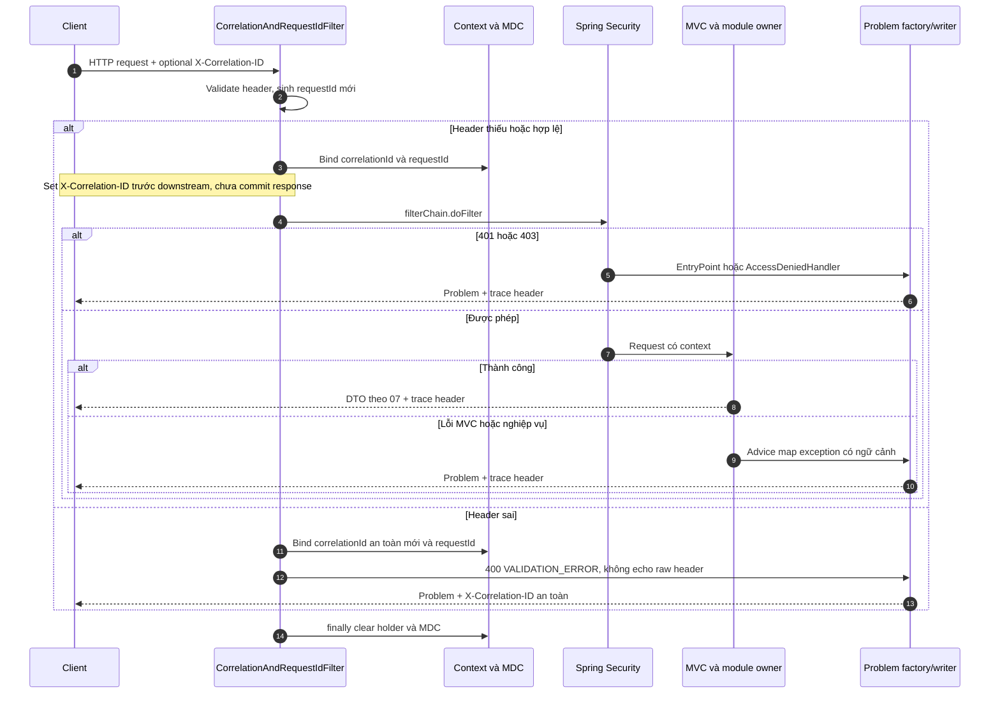

# Module `common` — Thiết kế chi tiết

> **Dự án:** Digital Banking MVP
> **Mã tài liệu:** `BE-MOD-COMMON-01`
> **Phiên bản:** v1.8
> **Ngày:** 12/11/2026
> **Trạng thái:** Hoàn thành — nội dung thiết kế; chưa sign-off hoặc xác nhận triển khai
> **Owner:** Phương
> **Reviewer:** Backend Lead, QA, Security (chờ review)
> **Nguồn tham chiếu:** [[digitalbanking-docs/docs-common/03. SRS.md]] (§2.13, §3, §10), [[digitalbanking-docs/docs-common/06. System architecture.md]] (§6, §9, §12), [[digitalbanking-docs/docs-common/07. API contracts.md]] (§2–§5, §7.2, §10), [[digitalbanking-docs/docs-common/design/01. audit-traceability.md]] (§4.6, §5–§7), [[digitalbanking-docs/docs-common/design/02. consistency-concurrency.md]] (§7.10, §11, Appendix C), [[digitalbanking-docs/docs-common/design/04. security.md]] (§4–§8).

## 1. Phạm vi & Truy vết Yêu cầu

### 1.1. Vai trò và ranh giới

`com.simulatedbank.banking.common` cung cấp cấu hình, thời gian, ngữ cảnh request, truy vết, mật mã, che dấu PII và xử lý lỗi cho 10 module nghiệp vụ. Đây là nền tảng của modular monolith, không phải một bước nghiệp vụ độc lập trong T0–T3.

- Mọi module được dùng `common.*`; `common` không import ngược `identity`, `customer`, `account`, `transfer`, `ledger`, `limit`, `audit`, `fraud`, `notification`, `admin`.
- Không sở hữu bảng/repository/migration nghiệp vụ, không mở transaction tiền; không đặt rule số dư, hạn mức, step-up, maker/checker tại đây.
- `identity` sở hữu session/OTP/RBAC; `audit` sở hữu ghi audit/hash chain; `transfer` sở hữu idempotency. `common` chỉ cung cấp primitive và chuẩn HTTP.
- Dùng 4 gói `config/context/crypto/error`, không ép thành 5 lớp nghiệp vụ.

Nguồn: `06` §6.1–§6.4; [[digitalbanking-docs/docs-backend/00. architecture & conventions.md]] §4.3–§5.2; [[digitalbanking-docs/docs-backend/modules/_overview/11-common.md]] §1–§2.

### 1.2. Cách tra cứu

| Câu hỏi | Nguồn chuẩn và mục cần đọc | Áp dụng tại đây |
|---|---|---|
| Yêu cầu/tiêu chí nghiệm thu? | `03. SRS` §2.13, §3.1, §10; `09. Test plan` §4, §6, §8 | §1.3, §7 |
| Ranh giới module? | `06. System architecture` §6.1–§6.3, §9, §12 | §1, §2, §6 |
| HTTP header/body/error? | `07. API contracts` §2–§4, §7.2, §10; OpenAPI đối chiếu máy đọc | §4, §5 |
| Correlation/audit payload/JCS? | `design/01` §4.6, §5.6–§5.7, §7.2–§7.3 | §2.2–§2.3, §5–§6 |
| Lock/constraint/error DB? | `design/02` §7.10, §11.5–§11.6, Appendix C; `04` §4 | §3, §4.4 |
| Encryption/secret/masking/CORS? | `design/04` §6–§8; `07` §2.6, §3.3 | §2, §4.5 |
| Env/runtime configuration? | `docs-backend/deployment/configuration.md` §4–§5, §9; đối chiếu lại nguồn chuẩn | §2.1, §1.5 |

Theo quyết định của owner ngày 12/11/2026, thứ tự ưu tiên là **`docs-common/01–11` → `docs-common/design/` → `docs-backend/`**. Thiết kế chuyên sâu chỉ bổ sung chi tiết khi không trái `01–11`; backend docs chỉ chi tiết hóa triển khai. Theo `07` §10.1, `07` quyết định ngữ nghĩa API, YAML là bản máy đọc cần đồng bộ theo `07`. `work/`, `tasks/`, `report/` là kế hoạch/bằng chứng, không thay đặc tả. Không suy ra thứ tự thẩm quyền giữa các file `01–11` từ số thứ tự; nếu chính các file này trái nhau thì ghi rõ để chốt riêng.

Nguồn bổ sung: [[digitalbanking-docs/docs-common/04. Database design & analysis.md]], [[digitalbanking-docs/docs-common/09. Test plan.md]], [[digitalbanking-docs/openapi/digital-banking-v1.yaml]], [[digitalbanking-docs/docs-backend/deployment/configuration.md]].

### 1.3. Traceability và trách nhiệm

| Yêu cầu SRS | BR liên quan | Trách nhiệm `common` | Phối hợp / ngoài phạm vi | AC và test (§7) |
|---|---|---|---|---|
| `NFR-013` — TLS | `BR-029` | Security headers, bảo vệ HTTP | Nginx/DevOps kết thúc TLS 1.2+ | `AC-030`; COM-CFG-02 |
| `NFR-014` — Encryption at rest | `BR-030` | AES-256-GCM, HMAC blind index | account/customer chuẩn hóa và lưu; disk/backup thuộc vận hành | `AC-030`; COM-CRY-01..03 |
| `NFR-015` — Password storage | `BR-001`, `BR-030` | Không lộ credential/log | identity sở hữu Argon2id/bcrypt; SHA/HMAC không thay password hash | `AC-030`; COM-SEC-01 |
| `NFR-016` — OTP security | `BRL-004`, `BR-034` | HMAC và Clock UTC | identity sinh/bind OTP, TTL/attempt/single-use | `AC-003`, `AC-030`, `AC-033`; COM-CRY-04 |
| `NFR-017` — RBAC | `BR-004`, `BR-007` | Security chain/method security, 401/403 có trace | identity cung cấp principal/quyền; owner kiểm tra ownership | `AC-024`, `AC-030`; COM-HTTP-03 |
| `NFR-018` — Web security | `BR-032` | CORS, CSRF integration, validation/error format, chống log injection | Owner kiểm tra nghiệp vụ; rate limit theo policy | `AC-030`; COM-CTX-03, COM-CFG-02 |
| `NFR-019` — Secrets | `BR-031` | Khóa ngoài code, fail-fast, không log key | DevOps cấp secret/rotation, owner review dữ liệu | `AC-030`; COM-CRY-02 |
| `NFR-020` — PII masking | `BR-030`, `BR-034` | Utility masking, safe error/log redaction | Owner áp dụng response/outbox; audit enforce allowlist | `AC-023`, `AC-030`; COM-PII-01..03 |
| `NFR-025` — Observability | `BR-027`, `BR-042` | Context/MDC, HTTP log/metric nền | Owner phát metric nghiệp vụ; DevOps thu thập/cảnh báo | `AC-022`, `AC-032`; COM-CTX-01..06, COM-OBS-01 |
| `FR-038` — Correlation | `BR-027` | Sinh/validate ID và trace response | Owner copy vào transfer/ledger/audit/notification/challenge | `AC-022`; COM-CTX-01..06 |
| `FR-039` — Masking | `BR-030` | Chuẩn hiển thị an toàn | Owner quyết định data scope; utility không cấp quyền | `AC-023`; COM-PII-01..03 |

Hoàn thiện `common` không tự chứng minh toàn hệ thống đạt các NFR: TLS, storage, password hash, RBAC, lifecycle OTP còn cần kiểm thử cùng owner.

### 1.4. Trạng thái so với code

Khảo sát 12/11/2026: source có `config/AppProperties`, `TimeConfig`, `SecurityFilterChainConfig`; `context` đã triển khai sau BE-COM-IMP-03; `crypto` đã triển khai sau BE-COM-IMP-04; error layer đã có sau BE-COM-IMP-02. BE-COM-IMP-05 đã nối security chain với Problem/trace, bật CSRF theo credential source, CORS và body/rate limits; identity thật chưa có adapter nên task 05 còn Blocked.

Chữ ký Java mới ở §2 là **đề xuất triển khai**, trừ chữ ký config/context/crypto/error đã triển khai; owner review trước tích hợp. Hành vi bắt buộc vẫn theo nguồn chuẩn. BE-COM-DOC-02 không sửa Java, cấu hình hoặc OpenAPI. BE-COM-IMP-01 đã bổ sung nested defaults, validation cho trường thay đổi, đồng bộ lockout/transfer/session và kiểm chứng Clock; xem [report](report/BE-COM-IMP-01-verification.md). BE-COM-IMP-02 đã triển khai catalog/Problem/writer và MVC/DB mapping, kiểm chứng bằng contract/component tests; xem [report](report/BE-COM-IMP-02-verification.md). BE-COM-IMP-03 đã kiểm chứng context/MDC, trace header, servlet registration và lifecycle thành phần; xem [report](report/BE-COM-IMP-03-verification.md). BE-COM-IMP-04 đã triển khai crypto/JCS/masking và validation khóa; xem [report](report/BE-COM-IMP-04-verification.md). Security chain thật đã tích hợp writer trong IMP-05; session/cookie identity và DB propagation vẫn cần owner tích hợp ở 05/07. Xem [report IMP-05](report/BE-COM-IMP-05-verification.md). BE-COM-IMP-06 đã triển khai logging/HTTP metrics/health; kết quả local và giới hạn theo [report IMP-06](report/BE-COM-IMP-06-verification.md), không đóng blocker identity hoặc xác nhận Cloud.

### 1.5. Quyết định trước implement và phần còn thiếu thiết kế

Owner đã chốt **cách phân xử tài liệu** theo `01–11`; các quyết định dưới đây là căn cứ cho thiết kế/implementation tiếp theo, không phải yêu cầu chọn lại giữa backend và nguồn chuẩn. Giữ ID cũ để truy vết; “Đã phân xử” không đồng nghĩa đã sửa mọi file nguồn hoặc runtime.

| ID | Vấn đề đã ghi nhận | Quyết định theo `01–11` | Trạng thái / nguồn |
|---|---|---|---|
| `OI-COM-01` | Phạm vi success envelope chưa rõ trong tóm tắt | Trả DTO đúng schema endpoint, không auto wrap `data/meta`. ApiResponse không nằm trong phạm vi triển khai hiện tại nếu chưa có contract cần nó | Đã phân xử — `07` §7.2/§8 |
| `OI-COM-02` | `message/details/requestId` khác Problem | Dùng `detail/errors` và các field RFC 9457 theo `07`; requestId giữ context/log, không field body bắt buộc | Đã phân xử — `07` §4.1–§4.2 |
| `OI-COM-03` | RESOURCE_LOCKED/CONFLICT ngoài catalog | Lock timeout → SERVICE_UNAVAILABLE; unique phân loại theo owner/§4.4. Không thêm mã generic; không gộp invariant thành 409 | Đã phân xử — `07` §4.3–§4.4; design/02 chỉ bổ sung SQLSTATE không trái catalog |
| `OI-COM-04` | Hai format mask account | Khi hiển thị số account đã mask dùng `**** **** 1234`; audit vẫn chỉ lưu field được allowlist như ID/last4, không thêm full account | Đã phân xử — `03` §2.13.4, `07` §2.6; không theo format trái nguồn của design/04 |
| `OI-COM-05` | Thiếu cách nhận diện khóa cho ciphertext cũ/rotation HMAC index | Không tự thêm key ID vào blob/schema hoặc thử tuần tự khóa. Thiết kế primitive với một active key giữ nguyên; chưa thiết kế/triển khai rotation nhiều khóa | **Còn mở — thiếu thiết kế**, `04` §11.2 OQ-15; Security + account/customer chốt trước rotation |
| `OI-COM-06` | Lockout/rate limit trái baseline `01–11` | Theo baseline nguồn: 5 lần sai → khóa **10 phút**; transfer **30 request/phút/customer**. Giữ nhãn **Đề xuất** và khóa cấu hình theo scope customer, không lấy 15 phút/20 mỗi user từ design/04 | Đã phân xử nguồn — `03` §4.5, `06` §9.2, `07` §3.7/§2.8; chưa đóng OI ngưỡng nghiệp vụ |
| `OI-COM-07` | Error aliases khác `07`; tóm tắt JCS thiếu chi tiết | Dùng STEP_UP_CHALLENGE_MISMATCH/ROLE_CONFLICT đúng catalog/ngữ cảnh; JCS đầy đủ theo RFC 8785 được `07` yêu cầu, design/01 bổ sung UTF-16/number/escape | Đã phân xử — `07` §4.3/§5.2 |
| `OI-COM-08` | Cookie/session defaults từ thiết kế cấp dưới | DB_SESSION, Path=/, CSRF cookie theo `07`; không áp trần 3/1 session từ design/04 khi `07` cho phép nhiều session và để thu hồi theo device/user Deferred | Đã phân xử — `07` §3.2–§3.3; AppProperties không tự quyết định nghiệp vụ |

Kết quả: **7 nhóm đã phân xử, 1 nhóm thiếu thiết kế rotation còn mở**. Các ngưỡng `01–11` ghi “Đề xuất” vẫn là baseline thiết kế/cấu hình tham chiếu, chưa tự trở thành policy release đã phê duyệt; theo SRS §8.5 cần đóng OI tương ứng trước khi coi là policy có hiệu lực. Không còn yêu cầu owner chọn lại giữa các nguồn cho 7 nhóm đã phân xử.

Snapshot BE-COM-DOC-02 ghi nhận lockout 15 phút, transfer 20 mỗi user và trần session 3/1. BE-COM-IMP-01 đã sửa thành 5 lần/10 phút, 30/phút/customer (đều Đề xuất) và bỏ keys trần session; đây chỉ là config, chưa enforcement. Không sửa nội dung `docs-common/01–11`/`design/`. Chỉ đồng bộ các đoạn backend liên quan đến 8 nhóm trên, không tuyên bố đã audit mọi khác biệt của toàn bộ kho tài liệu.

## 2. Thiết kế Class & Hợp đồng Interface

```text
com.simulatedbank.banking.common/
├── config/   AppProperties, TimeConfig, SecurityFilterChainConfig
├── context/  CorrelationAndRequestIdFilter, RequestContext, RequestContextHolder
├── crypto/   PiiCryptoService, HmacService, JcsCanonicalizer, PiiMaskingUtils
└── error/    ErrorCode, BankingBusinessException, ProblemResponse,
              ProblemWriter, GlobalExceptionHandler, DatabaseErrorMapper
```

Giao tiếp Java in-process; không thêm REST/entity/business port. DTO/extension không chứa entity hoặc class của module nghiệp vụ. Chữ ký minh họa bỏ imports/annotations/thân hàm, không phải code để copy nguyên khối.

### 2.1. Gói `config`

Chữ ký hiện có (không đồng nghĩa cấu hình hiện đã đáp ứng toàn bộ security):

```java
public record AppProperties(String timezone, Crypto crypto, Security security,
                            Transfer transfer, Fraud fraud, Jobs jobs) {}
// Nested records và accessor do Java record cung cấp.
public class TimeConfig {
    public Clock clock();
    public ZoneId businessZoneId(AppProperties appProperties);
}
public class SecurityFilterChainConfig {
    public SecurityFilterChain securityFilterChain(HttpSecurity http, AppProperties properties,
            ObjectProvider<SessionAuthenticator> authenticators, RequestRateLimiter limiter, ProblemWriter writer) throws Exception;
    public CorsConfigurationSource corsConfigurationSource(AppProperties appProperties);
}
```

| Class / accessor | Hợp đồng |
|---|---|
| `AppProperties.timezone()` | APP_TIMEZONE, baseline Asia/Ho_Chi_Minh; rỗng/ZoneId sai fail startup không echo input; không đổi UTC timestamp API/DB |
| `AppProperties.crypto()` | Nested Crypto(aesKeyId, aesKeyBase64, hmacKeyBase64, previousKeys), bind `app.crypto.*`; IMP-01 redact toString; không log/serialize accessor khóa. CryptoConfig kiểm tra khóa Base64 32 byte, AES/HMAC tách biệt; rotation còn mở, previousKeys phải rỗng |
| `AppProperties.security()` | Nested Cookie, Session, Lockout, Otp, RateLimit, StepUp và corsAllowedOrigins; nested defaults sẵn cả khi không có YAML; lockout và transfer rate phải là số nguyên dương. Baseline cấu hình: lockout 10 phút, rate limit transfer 30/customer/phút (đề xuất theo `07`); nhiều session theo `07`, không tự áp trần 3/1 |
| `transfer()/fraud()/jobs()` | Bind cấu hình để owner dùng, không thực thi rule/job ở common |
| `TimeConfig.clock()` | Bean Clock.systemUTC(); inject Clock.fixed để kiểm thử TTL/timestamp |
| `TimeConfig.businessZoneId(...)` | Bean ZoneId từ cấu hình; limit owner dùng tính business day |
| `securityFilterChain(...)` | Method security, CORS, headers, session/CSRF integration; entry point/access denied handler dùng Problem chung, identity cung cấp xác thực |
| `corsConfigurationSource(...)` | Explicit origins, credentials true/không wildcard; methods GET/POST/OPTIONS, headers `07` §3.3; expose trace/retry/replay/export theo `design/04` §8.2 |

Servlet registration đã nằm trong `RequestContextConfig` sau IMP-03:

```java
public FilterRegistrationBean<CorrelationAndRequestIdFilter> correlationAndRequestIdFilter(
        ProblemWriter writer);
```

RequestContextConfig đăng ký servlet filter ở `SecurityProperties.DEFAULT_FILTER_ORDER - 1` trước Spring Security (REQUEST/ASYNC/ERROR, async supported), tránh đăng ký kép servlet/security chain. Cookie session mutation bắt buộc CSRF, Bearer miễn theo `07` §3.3; preflight không yêu cầu CSRF. IMP-05 dùng native CsrfFilter so SHA-256 header với session hash qua SessionAuthenticator; token lifecycle thuộc identity, không tạo HttpSession. Chưa có adapter thật; không dùng harness để nghiệm thu identity.

APP_PII_AES_KEY_BASE64 → `app.crypto.aes-key-base64`, APP_HMAC_KEY_BASE64 → `app.crypto.hmac-key-base64`: Base64 decode đúng 32 byte, tách khóa AES/HMAC; thiếu/sai phải fail-fast, thông báo không chứa key. Rotation bị ràng buộc OI-COM-05.

Nguồn: `06` §9/§12; `07` §2.4/§2.9/§3.2–§3.3; `design/04` §6/§8; configuration backend §4–§5. Source: [AppProperties.java](../../../../digitalbanking-backend/src/main/java/com/simulatedbank/banking/common/config/AppProperties.java), [TimeConfig.java](../../../../digitalbanking-backend/src/main/java/com/simulatedbank/banking/common/config/TimeConfig.java), [SecurityFilterChainConfig.java](../../../../digitalbanking-backend/src/main/java/com/simulatedbank/banking/common/config/SecurityFilterChainConfig.java).

### 2.2. Gói `context`

```java
public record RequestContext(String correlationId, String requestId,
                             String clientIp, String userAgent) {}
public final class RequestContextHolder {
    public static Scope bind(RequestContext context); // try-with-resources; restore binding trước đó
    public static Optional<RequestContext> current();
    public static void clear();
}
public class CorrelationAndRequestIdFilter extends OncePerRequestFilter {
    public CorrelationAndRequestIdFilter(ProblemWriter problemWriter);
    protected void doFilterInternal(HttpServletRequest request,
            HttpServletResponse response, FilterChain filterChain)
            throws ServletException, IOException;
}
```

- Context bất biến theo request, holder dùng ThreadLocal, không chia sẻ mutable context. `current()` empty ngoài request/job đã bind.
- correlationId: giữ header hợp lệ `^[A-Za-z0-9._:-]{1,64}$`, thiếu sinh UUIDv4; header rỗng/sai bị 400. Header sai hoặc lặp nhiều giá trị: sinh UUID an toàn mới để trả lỗi (quyết định IMP-03); không log/echo giá trị sai.
- requestId luôn UUIDv4 mới do server sinh, không nhận ID client. Bind holder và MDC correlationId/requestId; set X-Correlation-ID trước downstream và dọn holder/MDC trong `finally` kể cả lỗi.
- Runtime chưa cấu hình trusted proxy: `server.forward-headers-strategy: none`, lấy peer từ `getRemoteAddr()`, bỏ qua Forwarded/X-Forwarded-For. Context chỉ giữ IPv4 đã che octet cuối; IPv6/unknown trả null đến khi có policy. UA bỏ control/format/line-separator characters, tối đa 256 ký tự; không log/serialize metadata, `toString()` chỉ có IDs. Nginx phải strip/overwrite forwarding headers và hạn chế truy cập trực tiếp trước khi bật proxy support; task 05/08 kiểm chứng ranh giới này.
- ThreadLocal không tự truyền async/job: caller capture `current().orElseThrow()` trước enqueue, `try (var scope = RequestContextHolder.bind(snapshot))` trên worker; đóng scope phục hồi context/MDC cũ, giữ các MDC key khác. ASYNC/ERROR redispatch dùng cùng snapshot trên request; lỗi trước MVC dùng writer an toàn, không viết lại response đã commit/đã xử lý. Không tạo executor/job production trong task này. [Usage](../../../../digitalbanking-backend/README.md#request-context-and-propagation).

Nguồn: `design/01` §4.6/§5.6; `design/04` §8.1; `07` §2.2/§2.7; BE-ARCH-00 §10.4.

### 2.3. Gói `crypto`

```java
public class PiiCryptoService {
    public PiiCryptoService(byte[] key); // Runtime inject bean từ CryptoConfig
    public byte[] encrypt(String plaintext);
    public String decrypt(byte[] ciphertextBlob);
}
public class HmacService {
    public HmacService(byte[] key); // Runtime inject bean từ CryptoConfig
    public String hmacSha256Hex(String normalizedInput);
    public static String sha256Hex(String input);
    public static String sha256Hex(byte[] input);
    public static boolean constantTimeEquals(byte[] expected, byte[] actual);
}
public class JcsCanonicalizer {
    public byte[] canonicalize(String rawJson); // Giữ duplicate keys đến strict parser
}
public final class PiiMaskingUtils {
    public static String maskAccountLast4(String last4);
    public static String maskNationalIdLast4(String last4);
    public static String maskPhone(String phone);
    public static String maskEmail(String email);
    public static String maskIp(String ip);
}
```

| Thành phần | Input / output và lỗi |
|---|---|
| PiiCryptoService | UTF-8 plaintext → IV 12B + ciphertext + auth tag 16B; AES-256-GCM/JCA, IV mới bằng SecureRandom mỗi lần. Decrypt xác thực tag; sai khóa/tamper/truncated blob không trả plaintext một phần hoặc provider detail |
| hmacSha256Hex | HMAC-SHA256 UTF-8 → 64 hex lowercase. Caller normalize account/CCCD/fingerprint; không tự trim/chuyển số làm mất leading zero |
| sha256Hex | SHA-256 UTF-8 → 64 hex lowercase cho token/request/audit input đã chuẩn; không dùng hash password |
| constantTimeEquals | Dùng MessageDigest.isEqual trên bytes; caller decode hex/Base64 nhất quán, không dùng String.equals cho token/hash |
| canonicalize | RFC 8785 JCS → canonical UTF-8 bytes: sort UTF-16 code units, number ECMAScript, escape đúng chuẩn, giữ null/array order, không tự normalize Unicode. Reject ngoài miền JCS; strict streaming parser reject duplicate keys trước mọi tree/Map; dùng thư viện JCS 1.1 và hỗ trợ scalar root bằng singleton-array wrapper |
| PiiMaskingUtils | Hàm thuần, ưu tiên cột last4 để không decrypt khi hiển thị; account API `**** **** 1234`, CCCD `********1234`, phone last3, email ký tự đầu + domain, IP audit ví dụ `203.0.113.***`. IPv6 cần chốt policy, không trả nguyên địa chỉ khi chưa có policy |

**Biên input đã triển khai theo ủy quyền owner trong IMP-04:** masking trả null khi thiếu dữ liệu; last4 không đúng 4 chữ số/email/IP sai ném IllegalArgumentException an toàn, không trả input gốc. Phone nhận 4–15 chữ số ASCII, tùy chọn dấu + đầu; email nhận dạng ASCII đơn giản có domain chứa dấu chấm; đây là biên display bảo thủ, không phải validator nghiệp vụ. IPv6 trả null; chưa có thuật toán masking họ tên theo role trong common. Caller xử lý input ngoài biên an toàn, không fallback plaintext. Crypto yêu cầu non-null; lỗi hợp đồng nội bộ không tự thành validation error client. Xem [handoff](../../../../digitalbanking-backend/README.md#crypto-canonicalization-and-masking) và [quyết định](report/BE-COM-IMP-04-verification.md).

Chuẩn hóa nghiệp vụ trước JCS: transfer xây payload theo `07` §5.2 (amount 2 decimals dạng string, description trim/null→empty, không correlation/timestamp); audit xây field set cố định theo hash_version, timestamp UTC 6 fractional digits theo `design/01` §7.2. Common không xây payload nghiệp vụ.

```text
request_hash = lowercase_hex(SHA-256(UTF8(JCS(payload))))
record_hash = lowercase_hex(SHA-256(UTF8(JCS(canonical_payload)) || "|" || prev_hash))
```

hash_version nằm trong audit payload, không nối lần hai; genesis prev_hash là 64 ký tự `0`. Hash chain writer/lock thuộc audit. Không triển khai JCS bằng sort map + serializer mặc định. Không tự thiết kế rotation format khi OI-COM-05 còn mở.

Nguồn: `design/04` §6.2–§6.4/§7.2; `design/01` §7.2–§7.3; `07` §5.2.

### 2.4. Gói `error`

Chữ ký dưới đây phản ánh implementation BE-COM-IMP-02; nguồn hành vi vẫn là `07` §4, không phải tên class. `DatabaseErrorMapper` package-private, chỉ phân loại lỗi SQLSTATE cho advice, không retry/query/ghi DB.

```java
public enum ErrorCode {
    // 46 mã public theo §4.3; không chứa internal codes hoặc alias.
    public int httpStatus();
    public boolean retryable();
    public URI type();
    public String title();
    public String detail();
}
public class BankingBusinessException extends RuntimeException {
    public BankingBusinessException(ErrorCode code);
    public BankingBusinessException(ErrorCode code, String safeDetail);
    public BankingBusinessException(ErrorCode code, String safeDetail, Map<String, Object> safeExtensions);
    public BankingBusinessException(ErrorCode code, String safeDetail,
            Map<String, Object> safeExtensions, Throwable cause);
    public ErrorCode code();
    public String safeDetail();
    public Map<String, Object> extensions();
}
public record ProblemResponse(URI type, String title, int status, String detail,
        String instance, String code, String correlationId, Instant timestamp,
        boolean retryable, List<FieldError> errors, Map<String, Object> extensions) {
    public record FieldError(String field, String code, String message) {}
}
public class ProblemWriter {
    public ProblemWriter(Clock clock, ObjectMapper objectMapper);
    public ProblemResponse create(ErrorCode code, String safeDetail, HttpServletRequest request,
            List<ProblemResponse.FieldError> errors, Map<String, Object> safeExtensions);
    public ResponseEntity<ProblemResponse> response(ProblemResponse problem);
    public void write(HttpServletResponse response, ProblemResponse problem) throws IOException;
    public void write(HttpServletResponse response, ProblemResponse problem, Long retryAfterSeconds) throws IOException;
}
public class GlobalExceptionHandler extends ResponseEntityExceptionHandler {
    public GlobalExceptionHandler(ProblemWriter writer);
    public ResponseEntity<ProblemResponse> handleFailure(Exception ex, HttpServletRequest request);
    public ResponseEntity<ProblemResponse> handleConstraintValidation(
            ConstraintViolationException ex, HttpServletRequest request);
}
```

Không triển khai ApiResponse/success wrapper (OI-COM-01). `ProblemResponse` flatten extensions ra root bằng allowlist challenge/reference/transferStatus/failureCode/lockedUntil, không ghi đè core; errors chỉ dùng với VALIDATION_ERROR. Challenge bắt buộc với STEP_UP_REQUIRED, dùng JSON-ready Map theo schema `07` §7.2.4; lockedUntil là Instant chỉ với AUTH_ACCOUNT_LOCKED; transfer outcome phải có reference, status chỉ PENDING/FAILED. Common kiểm ngữ cảnh, reference/failure/status và các trường bắt buộc của challenge; owner vẫn chịu trách nhiệm giá trị extension/detail đã an toàn, maskedDestination đã mask và FIDO options đúng contract. Không truyền entity, Throwable, raw provider message hoặc dữ liệu chưa mask vào các tham số `safe*`.

`ProblemWriter` dùng Clock đã inject và ObjectMapper của ứng dụng (ISO-8601). Đọc attribute request `correlationId` đã validate; nếu thiếu/sai thì tạo UUID an toàn và lưu lại attribute. Không tin trực tiếp header client. IMP-03 cần dùng chung attribute này và hoàn thiện header/context/cleanup trên mọi response; fallback của writer không thay pipeline trace thật. Instance lấy request URI, không query string. Log error layer chỉ có code/status/correlationId, không Throwable/detail/path/extensions.

Advice map MVC validation/JSON/media/method/route và 401/403, giữ Allow cho 405. HandlerMethodValidationException/ConstraintViolationException ở return-value thành INTERNAL_ERROR; input validation dùng errors với field an toàn và thông điệp cố định, không echo annotation/rejected value. Lỗi đã được owner bọc BankingBusinessException được giữ trước generic SQLSTATE, kể cả bọc trong DataAccessException. Mọi handler không query owner, ghi audit hoặc đổi trạng thái transfer.

Filter, AuthenticationEntryPoint và AccessDeniedHandler gọi writer vì lỗi trước MVC không tự vào advice. Writer không ghi lại response đã committed, dùng application/problem+json, X-Correlation-ID, WWW-Authenticate cho 401. Retry-After fallback 2 giây cho in-progress/rate-limit/service-unavailable đã được chốt cho error layer theo ủy quyền owner ngày 12/11/2026 ([report DEC-02](report/BE-COM-IMP-02-verification.md#51-quyết-định-đã-chốt-theo-ủy-quyền-owner)); khoảng 1–5s trong design/02 §7.10 vẫn mang nhãn đề xuất tại nguồn. IMP-05 token bucket đã truyền thời gian chờ token thực qua overload write(response, problem, retryAfterSeconds); fallback 2s không chứng minh enforcement owner đã tích hợp. Security wiring/body-limit đã có trong IMP-05; identity/cookie integration còn Blocked; hành vi lock/rollback/retry PostgreSQL thật do IMP-07.

### 2.5. HTTP security đã triển khai, identity còn thiếu

`SessionAuthenticator` là điểm nối common để owner identity triển khai, chưa có adapter production. Snapshot nội bộ gồm `userId`, `customerId`, authorities (permission + `ROLE_*`) và SHA-256 CSRF hash, không raw token. Chain reject duplicate/mixed credentials, không fallback Bearer lỗi sang cookie; cookie inactive chỉ được bỏ qua trên POST auth public để cho phép đăng nhập lại. Valid cookie mutation vẫn yêu cầu CSRF. Method security và permission URL gates không thay ownership/maker-checker ở owner.

Header filter đặt trước correlation; CORS chạy một lần bên trong Spring Security và mọi rejection dùng Problem. Body limit 65536 bytes đề xuất kiểm declared/streamed/chunked. Token buckets có burst bằng quota, refill liên tục, đồng bộ theo Clock UTC; global user/IP, login peer IP, OTP/step-up user, transfer customer, audit export user. Retry-After tính ceil đến token kế tiếp; map bounded 10000 bucket, hết dung lượng trả 503. State chỉ trong một process, không tổng hợp qua replicas. Identity phải gọi limiter cho username chuẩn hóa (10/min theo 07) và quota OTP/challenge trước xác thực; phần này còn Blocked. Sau resolver reject, HTTP post-auth limiter chưa chạy; bảo vệ lookup token cần identity/edge bổ sung. Không trust X-Forwarded-For.

Cấu hình `app.security.http.*`, rate-limit env và contract/case đầy đủ tại [handoff backend](../../../../digitalbanking-backend/README.md#http-security-and-identity-integration), [verification](report/BE-COM-IMP-05-verification.md). Set-Cookie/CSRF persistence chưa có code identity; không tự thêm schema session. Header HSTS chỉ khi request thực secure; TLS/full SPA CSP/proxy cần 08. Không đánh dấu Done cho task 05 chỉ vì harness/build pass.

## 3. Chi tiết Bảng Dữ liệu & SQL/Locking

### 3.1. Dữ liệu do owner sử dụng

Không có DDL/index/repository của common; không tạo bảng context hoặc lưu khóa trong DB. ThreadLocal/MDC là ngữ cảnh tiến trình. Crypto/hash được caller gọi trước persistence, không tự ghi chéo bảng.

| Dữ liệu được primitive common hỗ trợ | Owner ghi | Chuẩn áp dụng |
|---|---|---|
| account.account_no_enc/hash/last4 | account | AES blob, HMAC normalized account; giữ leading zero |
| customer.national_id_enc/hash/last4 | customer | AES blob, blind index theo mô hình dữ liệu |
| device.device_fingerprint_hash, auth_challenge.otp_hash | identity | Fingerprint HMAC; OTP input `challengeId + ":" + otp` |
| Session token/CSRF hash | identity | SHA-256; tên cột vật lý tra `04`, không suy từ tên rút gọn `sessions` trong security design |
| Correlation ở transfer/ledger_entry/audit_log/notification/auth_challenge | Owner mỗi bảng | Copy context/flow ID theo design/01 §4.6 |
| Request hash / record hash | transfer / audit | Payload do owner xây, JCS + SHA-256 theo §2.3 |

Nguồn: `04` §4/§9; `06` §6.2/§8.1; `design/04` §6.2–§6.3; `design/01` §4.6. Bảng mô tả dependency, không cấp quyền ghi cho common.

### 3.2. Transaction, lock và constraint

Không đặt Transactional lên filter/crypto/handler, không lấy account/audit lock, không tự retry SQL. Boundary thuộc application service của owner. `design/02` §7.10 đề xuất `lock_timeout=2s`, `statement_timeout=5s` trong T2; owner đặt SET LOCAL trong transaction. Mapper chỉ diễn giải lỗi sau rollback, không đổi lock order hoặc status transfer.

`23505` không luôn là 409 của client: `uq_ledger_transfer_seq` là invariant ledger, `uq_account_no_hash` là unique account, key idempotency là PK `idempotency_record` (`04` §4). Owner đối chiếu tên constraint với migration khi triển khai; không trả tên constraint cho client. Race idempotency do transfer xử lý sau rollback/transaction mới: có thể replay thành công, conflict hoặc in-progress. Generic handler không query bảng owner, không parse SQL text để đoán rule. Bảng mapping ở §4.4.

## 4. Chi tiết Endpoint REST & Xử lý Lỗi

### 4.1. Hợp đồng HTTP chung

Common không có endpoint riêng, không định nghĩa quyền mới; controller giữ path/role/ownership theo `07` §7–§8. `/api/v1/health` chỉ Admin/Auditor, `/actuator/health` là infrastructure probe. Health DOWN dùng HealthResponse + 503 theo `07` §8.9.1, không cưỡng chế thành Problem.

- Success trả DTO endpoint trực tiếp, tiền/ID dạng chuỗi, thời gian ISO 8601 UTC; không bọc data/meta.
- Error Content-Type `application/problem+json`; bắt buộc type/title/status/detail/instance/code/correlationId/timestamp/retryable. Title tiếng Anh, detail tiếng Việt an toàn. Type là URI ổn định theo code, instance là path không raw query có PII.
- errors[] có field/code/message; header validation dùng field như Idempotency-Key. Không echo rejected value, SQL, constraint, provider detail, stack trace hoặc secret.
- X-Correlation-ID ở mọi response kể cả trước MVC/error dispatch. Nếu expose X-Request-ID thì phải là ID server, không thay nghĩa correlation.
- Retry-After cho 409 in-progress/429 theo `07` §4.4. Lock 503 có thể dùng 2 giây theo đề xuất tóm tắt/`design/02` §7.10 (khoảng 1–5s); không gắn cho mọi 409.
- Cache-Control no-store cho `/api/v1/**` theo design/04 §6.1; PII/financial thêm Pragma no-cache theo `07` §2.9.

### 4.2. Ví dụ lỗi an toàn

Header correlation sai bị chặn trước security; server dùng ID an toàn mới cho response:

```http
HTTP/1.1 400 Bad Request
Content-Type: application/problem+json
X-Correlation-ID: 0f8fad5b-d9cb-469f-a165-70867728950e
Cache-Control: no-store
```

```json
{
  "type": "https://api.demo.local/problems/validation-error",
  "title": "Validation failed",
  "status": 400,
  "detail": "Dữ liệu yêu cầu không hợp lệ.",
  "instance": "/api/v1/transfers",
  "code": "VALIDATION_ERROR",
  "correlationId": "0f8fad5b-d9cb-469f-a165-70867728950e",
  "timestamp": "2026-11-12T02:00:00Z",
  "retryable": false,
  "errors": [
    {"field": "X-Correlation-ID", "code": "PATTERN", "message": "Header truy vết không hợp lệ."}
  ]
}
```

PATTERN là đề xuất mã field validation, không thêm vào ErrorCode. Không echo raw header sai. Success giữ schema `07`, filter chỉ thêm trace header.

### 4.3. Catalog ErrorCode → HTTP/retry

Toàn bộ mã public từ `07` §4.3; boolean theo catalog, điều kiện là hành động client cần thực hiện. Common sở hữu format/catalog, owner quyết định lúc phát sinh lỗi nghiệp vụ.

| Code | HTTP | Retryable | Điều kiện / xử lý |
|---|---|---|---|
| `AUTH_INVALID_CREDENTIALS` | 401 | false | Không tiết lộ user có tồn tại |
| `AUTH_ACCOUNT_LOCKED` | 423 | false | Chờ lockedUntil nếu khóa tạm |
| `AUTH_SESSION_EXPIRED` | 401 | true | Đăng nhập lại |
| `AUTH_FORBIDDEN` | 403 | false | Thiếu quyền/sai CSRF/ngoài scope |
| `AUTH_DEVICE_NOT_TRUSTED` | 403 | false | Thiết bị chưa trust |
| `AUTH_CHALLENGE_NOT_FOUND` | 404 | false | Không có/không thuộc user |
| `AUTH_CHALLENGE_EXPIRED` | 410 | true | Tạo challenge mới |
| `AUTH_CHALLENGE_LOCKED` | 423 | false | Vượt attempts |
| `AUTH_OTP_INVALID` | 401 | true | Chỉ trong attempt còn lại |
| `AUTH_OTP_EXPIRED` | 410 | true | Gửi lại/tạo challenge mới |
| `STEP_UP_REQUIRED` | 428 | true | Challenge; verify trước retry |
| `STEP_UP_CHALLENGE_MISMATCH` | 409 | false | Sai user/purpose/hash/key |
| `OTP_DISPATCH_FAILED` | 503 | true | Gateway OTP tạm lỗi |
| `VALIDATION_ERROR` | 400 | false | DTO/header/query sai |
| `MALFORMED_REQUEST` | 400 | false | JSON không đọc được |
| `UNSUPPORTED_MEDIA_TYPE` | 415 | false | Content type sai |
| `REQUEST_TOO_LARGE` | 413 | false | Body vượt giới hạn |
| `METHOD_NOT_ALLOWED` | 405 | false | Method sai |
| `NOT_FOUND` | 404 | false | Route không có |
| `RATE_LIMITED` | 429 | true | Backoff theo Retry-After |
| `ACCOUNT_NOT_FOUND` | 404 | false | Account nguồn/đích không có |
| `ACCOUNT_INACTIVE` | 409 | false | Account LOCKED/CLOSED |
| `INSUFFICIENT_BALANCE` | 422 | false | Không đủ số dư |
| `LIMIT_EXCEEDED` | 422 | false | Vượt hạn mức |
| `LIMIT_OUT_OF_POLICY` | 422 | false | Limit ngoài policy |
| `TRANSFER_NOT_FOUND` | 404 | false | Không có transfer |
| `TRANSFER_FAILED` | 422 | false | Transfer terminal FAILED |
| `FRAUD_BLOCKED` | 422 | false | Auto-block, không ledger |
| `FRAUD_FLAG_NOT_FOUND` | 404 | false | Không có flag |
| `FRAUD_FLAG_ALREADY_CLOSED` | 409 | false | Flag đã terminal |
| `INVALID_STATE_TRANSITION` | 409 | false | State/purpose sai |
| `CUSTOMER_NOT_FOUND` | 404 | false | Không có customer |
| `AUDIT_NOT_FOUND` | 404 | false | Không có audit record |
| `EXPORT_TOO_LARGE` | 413 | false | Thu hẹp filter |
| `IDEMPOTENCY_CONFLICT` | 409 | false | Cùng key, payload khác |
| `IDEMPOTENCY_IN_PROGRESS` | 409 | true | Retry-After, cùng key/payload |
| `APPROVAL_NOT_FOUND` | 404 | false | Không có approval |
| `APPROVAL_ALREADY_DECIDED` | 409 | false | Không còn PENDING |
| `ROLE_CONFLICT` | 409 | false | Maker=checker hoặc xung đột quyền |
| `ROLE_NOT_FOUND` | 404 | false | Role không có/không active |
| `USER_NOT_FOUND` | 404 | false | User đích không có |
| `LEGAL_HOLD_ACTIVE` | 409 | false | Không purge/archive khi hold |
| `AUDIT_WRITE_FAILED` | 500 | true | Cùng key, không tạo transfer mới |
| `INTERNAL_ERROR` | 500 | true | Chỉ retry thao tác idempotent |
| `SERVICE_UNAVAILABLE` | 503 | true | DB/lock/service tạm lỗi |
| `GATEWAY_TIMEOUT` | 504 | true | Timeout gateway |

NOTIFICATION_FAILED, FRAUD_ENGINE_UNAVAILABLE, RECONCILIATION_REQUIRED là internal theo `07` §4.3.7, chỉ log/audit/metric. Không thêm RESOURCE_LOCKED, CONFLICT, STEP_UP_INVALID, MAKER_CHECKER_VIOLATION vào wire catalog.

### 4.4. Exception & SQLSTATE mapping

MVC: Bean Validation → VALIDATION_ERROR; JSON lỗi → MALFORMED_REQUEST; media/method/route theo §4.3. Body limit có thể chặn ở Nginx/servlet, phải kiểm thử cả biên này. Crypto/unexpected exception → INTERNAL_ERROR thông điệp generic, không leak raw cause.

| SQLSTATE / ngữ cảnh | Kết quả HTTP | Retry / trách nhiệm |
|---|---|---|
| `55P03` — NOWAIT trên transfer/approval đang xử lý | 409 IDEMPOTENCY_IN_PROGRESS khi owner xác định đúng in-progress | true + Retry-After; không suy từ SQLSTATE đơn độc |
| `55P03` — lock_timeout tài nguyên khác | 503 SERVICE_UNAVAILABLE | true; đề xuất Retry-After: 2; rollback trước phản hồi |
| `40P01` — deadlock | 503 SERVICE_UNAVAILABLE sau hết retry application owner | true; retry cả TX mới, giới hạn/backoff |
| `40001` — serialization failure | 503 SERVICE_UNAVAILABLE sau retry có giới hạn | true; chỉ khi isolation/luồng có dùng |
| `57014` — query canceled do statement_timeout | 503 SERVICE_UNAVAILABLE | true; rollback, không đoán lỗi client |
| `23505` — idempotency key | Owner chọn replay success, 409 IDEMPOTENCY_CONFLICT hoặc IDEMPOTENCY_IN_PROGRESS | Không retry blind; đọc lại ở TX hợp lệ sau rollback |
| `23505` — unique nghiệp vụ đã nhận diện | Mã business 409 đã có khi owner xác định được, ví dụ ROLE_CONFLICT đúng ngữ cảnh; chưa có mapping → 500 INTERNAL_ERROR | Không tự tạo CONFLICT; bổ sung ngữ nghĩa nguồn trước mã mới |
| `23505` — uq_ledger_transfer_seq/invariant khác | 500 INTERNAL_ERROR | Rollback + alert; không retry che lỗi invariant |
| `23514` — check violation | 500 INTERNAL_ERROR | Rollback + alert; không retry tự động |
| Lỗi audit C1/C2 đã được owner xác định, kể cả audit lock | 500 AUDIT_WRITE_FAILED | Ngữ cảnh audit ưu tiên generic SQLSTATE; rollback nghiệp vụ, không COMPLETED |
| Mất kết nối trước/không rõ commit | 503 SERVICE_UNAVAILABLE nếu còn trả response được | Không đoán FAILED/COMPLETED; owner retry cùng key/query/reconcile |
| SQLSTATE lạ hoặc thiếu operation context | 500 INTERNAL_ERROR | Không parse SQL text đoán business rule |

Nguồn: `design/02` §7.10/§11.5–§11.6/Appendix C; `07` §4.3–§4.4; `04` §4. Generic advice không cập nhật transfer, query bảng owner hoặc mở TX retry. Giữ exception AUDIT_WRITE_FAILED đã wrap trước khi xét SQL cause. Retryable=true không cho phép retry mọi POST; caller tuân thủ cùng key/payload.

### 4.5. PII và dữ liệu nhạy cảm

| Dữ liệu / kênh | Quy tắc | Nguồn |
|---|---|---|
| Account API | Last4, format `**** **** 1234`, không full number | SRS §2.13.4, `07` §2.6; OI-COM-04 |
| CCCD | Encrypt storage, display last4 theo policy | design/04 §6.2/§7.2 |
| Phone/email/name | Phone last3, email ký tự đầu+domain; tên đầy đủ chỉ owner/người có quyền | `07` §2.6 |
| Audit before/after | Entity allowlist, không serialize entity; không description/name/phone/email tự do dù mask | design/01 §5.6 |
| IP/UA | Mask IP; UA tối đa 256 ký tự; không control characters/raw fingerprint | design/01 §5.6, design/04 §7.2 |
| Password/PIN/OTP/token/key | Không log/audit/echo lỗi; token/CSRF chỉ cấp qua auth response theo contract | design/04 §7.1, `07` §7.2 |
| Header/body log | Redact Authorization/Cookie/X-CSRF-Token; không full auth/transfer body hoặc free text chứa PII | `07` §2.6, design/02 §13.2 |
| Notification | Mask payload trước enqueue, không log raw delivery payload | SRS §2.13.4 |

Masking không thay authorization/encryption; utility lỗi không fallback plaintext. Test/evidence chỉ dùng synthetic, không secret thật.

## 5. Luồng Xử lý & Ranh giới Giao dịch

### 5.1. Filter truy vết



Outer filter giữ header khi downstream trả lỗi. Lỗi ngoài MVC/security cần error dispatch/writer an toàn, không serialize Servlet exception thô. Không viết body lần hai khi response đã commit; vẫn cleanup/log an toàn. Error/async dispatch phải được kiểm thử trước khi xác nhận mọi response đều có trace.

### 5.2. Propagation và job

| Luồng | Hành vi |
|---|---|
| HTTP bình thường | Header hợp lệ giữ; thiếu sinh UUIDv4; requestId mới mỗi request |
| Retry/step-up | Có thể reuse correlationId cho cùng flow, requestId khác; owner xử lý key/challenge |
| Transfer/ledger/audit/outbox/challenge | Owner copy ID theo design/01 §4.6, không tùy ý sinh lại giữa money path |
| Job xử lý transfer | CorrelationId gốc transfer; requestId là job run ID |
| Job độc lập | CorrelationId là job run ID; bind/clear execution thread |

### 5.3. T0–T3 và failure

- T0: filter/security/validation/step-up trước TX tiền; 400/401/403/428 không tự tạo transfer/ledger/idempotency record.
- T1/T2: owner mở TX, gọi primitive/context; common không commit/rollback hộ. C1/C2 audit cùng TX, lỗi audit không được trả COMPLETED.
- Sau rollback: owner phân loại/retry/recovery; handler chỉ dựng HTTP. Không báo FAILED khi outcome commit chưa biết.
- T3: delivery sau commit/outbox; lỗi notification không đổi receipt tài chính. Worker tự truyền/dọn context.

Nguồn: `06` §7–§8; `design/02` §5–§7/§10–§11; `design/01` §5.2/§8. Filter/crypto/error rendering không cần TX DB.

## 6. Sự kiện Kiểm toán & Metrics

### 6.1. Ownership audit, không phụ thuộc ngược

Common không import audit.api/ghi audit_log để audit lỗi filter. Tầng tích hợp identity/security/transfer dùng context do common cấp và gọi audit port; cấu hình nền có thể nhận handler đã tích hợp từ owner, không hard-code class module nghiệp vụ trong common.

| Sự kiện liên quan | Class | Owner phát / transaction | Common cung cấp |
|---|---|---|---|
| SECURITY_ACCESS_DENIED | C3 | Owner quyền/identity, standalone; audit fail không đổi từ chối | 403 Problem, context an toàn |
| SECURITY_IDEMPOTENCY_CONFLICT | C3 | transfer, standalone | JCS/hash, serialize 409 |
| AUTH_LOGIN_FAILED, AUTH_STEP_UP_FAILED, AUTH_ACCOUNT_LOCKED, AUTH_SESSION_LOGOUT | C3 | identity; lock/revoke commit trước, audit REQUIRES_NEW | Primitive/context, không own lifecycle |
| AUTH_LOGIN_SUCCESS, AUTH_CHALLENGE_CREATED, AUTH_STEP_UP_VERIFIED | C2 | identity, cùng TX state change | Context/crypto; audit fail rollback state owner |
| TRANSFER_CREATED, TRANSFER_COMPLETED, TRANSFER_FAILED, TRANSFER_RECONCILED | C1 | transfer + audit, cùng TX nghiệp vụ | Context/JCS/hash; không insert/lock chain |
| FRAUD_ENGINE_ERROR / vận hành | C4 | fraud/job owner, TX riêng/log theo catalog | Context/log; không đổi response tiền |

Validation trước state, health/metrics, rate limit, notification retry không tự thêm action audit; theo `design/01` §5.7 dùng technical log/metric hoặc security log. C3 audit fail cần fallback security log với correlationId/action/actor/outcome + alert, do owner tích hợp đảm nhiệm. Common không tạo catalog action riêng.

### 6.2. Logs/metrics/health

JSON log một dòng stdout: UTC timestamp, level, service/environment, correlation/request ID, user ID nội bộ nếu có, route/status/latency, action/outcome/error code khi có. Map MDC camelCase sang log correlation_id/request_id nhất quán; không log raw query/path chứa PII. Ghi log kết thúc request trước cleanup.

| Tín hiệu | Chuẩn / trách nhiệm |
|---|---|
| HTTP count/latency/error rate | Actuator/Micrometer timer, http_server_requests_seconds sau export; route/status/method low-cardinality |
| Lock/deadlock/audit failure | Owner emit theo design/02 §13.1, design/01 §12.2; tránh generic handler đếm lặp |
| Correlation sai/validation/rate limit | HTTP status đủ baseline; chỉ thêm counter khi có nhu cầu và thống nhất tên |
| Health | App/DB status, không secret; phân biệt infra probe và API Admin/Auditor theo `07` §8.9.1 |

BE-COM-IMP-06 đã triển khai `SafeJsonLogEncoder` (one-line JSON stdout, global allowlist, bỏ free-text message/stack/arguments/unknown MDC), `HttpRequestLog` (một completion trước cleanup, kể cả async; route template/UNMATCHED, status/latency/error code, SHA-256 masked user ID), timer HTTP/histogram Micrometer và safe `HealthController` tại common/config. `/api/v1/health` trả HealthResponse + 503 khi DOWN; missing DB contributor cũng DOWN. Probe anonymous chỉ status/tên nhóm, operational metrics yêu cầu Admin/Auditor. Không tạo business counters/audit hoặc outbox health giả. Generic logger chỉ còn level/logger/exception class; richer owner-coded technical event integration và C3 fallback vẫn thuộc owner. [Hướng dẫn runtime](../../../../digitalbanking-backend/README.md#logs-http-metrics-and-health), [verification](report/BE-COM-IMP-06-verification.md). Task 05 identity thật vẫn Blocked, test 06 chỉ dùng test-only resolver để chứng minh wiring common.

Không dùng accountId/userId/correlationId/requestId/idempotencyKey làm metric label. Tên banking_* trong backend không tự thay tên nguồn; tra configuration backend §9 và thiết kế nguồn. Log không thay audit.

Nguồn: SRS NFR-025; `06` §12; `design/01` §5.2–§5.7/§12; `design/02` §13; BE-ARCH-00 §10 (đọc kèm khác biệt metric).

## 7. Kịch bản Kiểm thử Module

### 7.1. Nguyên tắc / trạng thái

Đây là **danh mục thiết kế test**; kết quả thực chạy từng task nằm trong verification report, không suy nghiệm thu toàn bộ từ danh mục này. COM-OBS-01 có verification BE-COM-IMP-06 trong phạm vi common/local; các ca xuyên nghiệp vụ vẫn cần evidence của owner. Giữ mã CT-API-*/T-AUD-*/T-LOCK-* khi cùng behavior; COM-* là ca thành phần bổ sung/phân rã cho common, không thay/định nghĩa lại mã nguồn. Evidence theo `09. Test plan` §2.2/§6/§10.

Lưu ý mã nguồn bị trùng nghĩa: T-AUD-01 của design/01 là canonicalization, của design/02 là audit completion fail; T-AUD-02 cũng khác nhau. Khi viện dẫn dùng cả tên nguồn và ID. Bảng dưới dùng design/01:T-AUD-01 cho JCS, design/01:T-AUD-06/07 cho audit failure; không tự đổi ID trong nguồn.

Unit dùng JUnit/AssertJ, Clock.fixed/synthetic. Slice/MockMvc kiểm tra wire/filter/security. Lock/SQLSTATE/constraint phải integration Testcontainers PostgreSQL 16; mock exception chỉ kiểm formatter, không chứng minh DB; không H2. TLS/header qua Nginx cần evidence môi trường, không chỉ unit config.

### 7.2. Danh mục và oracle

| ID thành phần | Mức | Input / kích hoạt | Kỳ vọng | Trace nguồn |
|---|---|---|---|---|
| COM-CFG-01 | Unit/context | Clock.fixed, zone, sát nửa đêm business zone | Timestamp UTC; ngày nghiệp vụ đúng zone, độc lập giờ máy | NFR-016/025/029; `07` §2.4 |
| COM-CFG-02 | Slice + môi trường | Origin allow/deny, preflight, HTTPS, security/cache headers | Allowlist/credentials đúng; TLS1.2+; no-store/headers cả success/lỗi | NFR-013/018, AC-030; design/04 §6.1/§8.2 |
| COM-CFG-03 | Unit + integration | Baseline lockout 10 phút; 30 transfer/phút/customer; request từ nhiều session của một customer; kiểm khóa bucket là customerId | Bind theo baseline Đề xuất của `01–11`; bucket gộp đúng customer, không per-user/20; không áp trần session 3/1; chưa xem policy release đã phê duyệt khi OI nguồn còn mở | `03` §4.5/§8.5; `07` §2.8/§3.2/§3.7; OI-COM-06/08 |
| COM-CTX-01 | Slice | Header thiếu | UUIDv4 correlation/request ID; context/MDC/response nhất quán | FR-038, AC-022; design/01 §4.6 |
| COM-CTX-02 | Slice | Header hợp lệ dài 1/64; retry cùng ID | Giữ correlation, requestId mới; bỏ qua request ID client | AC-022; `07` §2.2/§2.7 |
| COM-CTX-03 | Slice | Rỗng/65 ký tự/CR-LF/ký tự ngoài pattern | 400; không downstream/DB; ID an toàn, không raw header trong log/body | NFR-018/020; `07` §2.2 |
| COM-CTX-04 | Unit/slice concurrency | Request song song, nối tiếp cùng thread, exception | Không lẫn context; MDC/holder sạch sau mọi nhánh | NFR-025, AC-022 |
| COM-CTX-05 | Slice | 401/403/JSON lỗi/404, error/async redispatch | Trace header, Problem đúng nơi áp dụng; không double write; cleanup thread | CT-API-015/016; `07` §10.2 |
| COM-CTX-06 | Integration | Retry/step-up, transfer→ledger/audit/outbox, job | ID xuyên flow; job requestId riêng; không sinh ID mới giữa money path | AC-022; design/01 §4.6; D3/D4 |
| COM-CRY-01 | Unit | Encrypt cùng UTF-8 hai lần, decrypt roundtrip | Blob IV12B+ciphertext+tag16B; IV khác; plaintext khôi phục đúng | NFR-014; design/04 §6.2 |
| COM-CRY-02 | Context | Khóa thiếu/invalid Base64/31 hoặc 33 byte/placeholder demo | Fail-fast, không log giá trị khóa | NFR-019, AC-030; design/04 §6.4 |
| COM-CRY-03 | Unit | Sửa IV/ciphertext/tag, wrong key, blob ngắn | Reject, không plaintext một phần/provider detail | NFR-014/020 |
| COM-CRY-04 | Unit + identity | Known-answer HMAC/SHA, cùng OTP khác challengeId, equal/unequal bytes | Hash đúng, challenge binding khác hash, delegate constant-time compare | NFR-015/016; design/04 §6.3 |
| COM-JCS-01 | Unit | RFC8785 vectors, nested/null/array, Unicode ngoài BMP, number/escape | Canonical bytes đúng vector, UTF-16 sort, array order giữ | design/01 §7.2; `07` §5.2 |
| COM-JCS-02 | Unit/component | Raw duplicate keys, ngoài miền JCS, fixed transfer/audit payload | Reject trước JsonNode mất duplicate; hash deterministic, delimiter/hash_version đúng | `07` §5.2; design/01 §7.2–§7.3; design/01:T-AUD-01 |
| COM-PII-01 | Unit | Last4/phone/email/IP, null/invalid, IPv6 | Format API đúng, không fallback plaintext; IPv6 fail-closed đến khi chốt policy | FR-039, NFR-020, AC-023; CT-API-017 |
| COM-PII-02 | Integration | Synthetic PII trong response/log/outbox/audit | Không full PII/secret; audit reject description/email/phone dù mask | CT-API-017, T-AUD-16; design/01 §5.6 |
| COM-PII-03 | Slice | JDBC/crypto/provider/validation chứa giá trị nhạy cảm | Không SQL/constraint/secret/rejected value hoặc stack trace chưa redaction | NFR-020/028; `07` §4.2 |
| COM-HTTP-01 | Slice/contract | Validation/JSON/media/method/route/body limit | 400/413/415/405/404 đúng schema/content type/trace; success không wrap | `07` §4/§10.2 |
| COM-HTTP-02 | Unit/contract | Mỗi error catalog và extension hợp lệ/sai | Status/retryable đúng; required fields đủ; extension allowlist không override core | `07` §4; OpenAPI Problem/ErrorCode |
| COM-HTTP-03 | Security slice | Anonymous/expired/thiếu quyền, sai CSRF cookie, Bearer, preflight | 401/403 đúng; không HTML/redirect; CSRF mutation cookie/Bearer miễn | NFR-017/018; CT-API-004/015/016 |
| COM-DB-01 | PostgreSQL integration | NOWAIT conflict và lock timeout bằng TX độc lập | 55P03 phân biệt 409 in-progress/503 service đúng context, rollback/retry header | T-LOCK-01; design/02 §7.10 |
| COM-DB-02 | PostgreSQL integration | Deadlock/serialization/statement timeout, hết retry | 40P01/40001/57014 đúng mapping; retry cả TX mới, có giới hạn | T-LOCK-02; design/02 §7.10/§11.6 |
| COM-DB-03 | PostgreSQL integration | Unique idempotency/ledger seq/check violation | 23505 phân biệt replay/conflict/in-progress/invariant; 23514 rollback/alert | CT-API-007/008/009; design/02 Appendix C |
| COM-DB-04 | Failure integration | Audit C1/C2 fail, C3 fail, connection loss commit không rõ | AUDIT_WRITE_FAILED đúng context, không COMPLETED; C3 control giữ + fallback; không đoán outcome | CT-API-013; design/01:T-AUD-06/07, §5.2; D3 |
| COM-SEC-01 | Review + integration | Secret/credential trong dump/toString/exception/log | Không expose; password vẫn do identity dùng Argon2id/bcrypt | NFR-015/019/020; AC-030; D4 |
| COM-OBS-01 | Integration | Success/validation/security/server error, health | Log đủ trace/status/latency; không metric tag ID; health không secret | NFR-025; CT-API-023; `06` §12 |
| COM-ARCH-01 | ArchUnit | Common import business, dependency vòng | Rule reject; review không DB write/transaction nghiệp vụ | `06` §6.3; BE-CON-08/18/19 |

Known-answer JCS/hash tra design/01 Appendix B và RFC8785 vectors khi triển khai; task này chưa chạy primitive. Không dùng đo thời gian unit test để chứng minh constant-time; review MessageDigest.isEqual + kiểm giá trị.

### 7.3. Evidence và nghiệm thu triển khai

- Unit/slice/ArchUnit/PostgreSQL integration phù hợp phải pass, report có revision/môi trường/command/kết quả; không ghi Verified khi chỉ có thiết kế.
- Contract test kiểm status/header/body/retryable/masking với cả `07` và YAML; ghi issue nếu lệch, kiểm cả success/lỗi trước MVC.
- C1/C2 rollback, C3 fallback, propagation/PII cần evidence xuyên module, không chỉ utility unit test.
- Áp dụng 7 quyết định đã phân xử tại §1.5, không xin chọn lại nguồn; rotation còn thiếu thiết kế phải được giải quyết trước khi triển khai phần rotation. Ngưỡng nguồn còn Đề xuất cần đóng OI nghiệp vụ trước release; chữ ký mới và evidence vẫn cần Security/QA/owner review. Hoàn thành tài liệu không đồng nghĩa hoàn thành module/D3/D4 toàn hệ thống.

Nguồn: [[digitalbanking-docs/docs-common/09. Test plan.md]] §2.2/§4/§6/§8/§10; `07` §10; BE-ARCH-00 §11–§13.

### 7.4. Hồ sơ Task 1

- Công việc: [[digitalbanking-docs/docs-backend/modules/common/tasks/BE-COM-DOC-01.md]].
- Verification: [[digitalbanking-docs/docs-backend/modules/common/report/BE-COM-DOC-01-verification.md]].
- Chốt ưu tiên trước implement: [[digitalbanking-docs/docs-backend/modules/common/tasks/BE-COM-DOC-02.md]] và [[digitalbanking-docs/docs-backend/modules/common/report/BE-COM-DOC-02-verification.md]].

### 7.5. Task triển khai và mẫu verification

- [[digitalbanking-docs/docs-backend/modules/common/tasks/README.md]] — 8 task BE-COM-IMP-01..08, phụ thuộc, mốc W2–W8 và tiêu chí chấp nhận chung; trạng thái ban đầu Planned.
- [[digitalbanking-docs/docs-backend/modules/common/report/VERIFICATION-TEMPLATE.md]] — mẫu report cho từng task, ánh xạ AC → kết quả thực tế → evidence; không chứa kết quả runtime có sẵn.

## Change Log

| Phiên bản | Ngày | Người thực hiện | Thay đổi |
|---|---|---|---|
| v1.0 | 12/11/2026 | Codex — theo Task 1 của owner | Hoàn thiện 7 phần, traceability, chữ ký 4 gói, lỗi/SQLSTATE, trace/PII/crypto, tests Planned và issue nguồn; không sửa runtime |
| v1.1 | 12/11/2026 | Codex — theo quyết định ưu tiên của owner | Phân xử 7 nhóm theo docs-common/01–11, giữ rotation còn mở và nhãn Đề xuất của nguồn; đồng bộ các mục backend liên quan trước implement |
| v1.2 | 12/11/2026 | Codex — theo yêu cầu chia task của owner | Bổ sung chỉ mục 8 task implementation và mẫu verification; không sửa thiết kế hành vi hoặc xác nhận runtime |
| v1.3 | 12/11/2026 | Codex — BE-COM-IMP-01 | Đồng bộ cấu hình/thời gian đã kiểm chứng; liên kết report; chưa xác nhận HTTP security, enforcement hoặc toàn module |
| v1.4 | 12/11/2026 | Codex — BE-COM-IMP-02 | Đồng bộ error API, trust boundary, mapper/writer đã kiểm chứng và report; chưa xác nhận pipeline trace/security hoặc lock/transaction thật |
| v1.5 | 12/11/2026 | Codex — BE-COM-IMP-03 | Đồng bộ context/filter/scope API, proxy trust boundary và metadata, liên kết verification; security identity và propagation DB bàn giao 05/07 |
| v1.6 | 12/11/2026 | Codex — BE-COM-IMP-04 | Đồng bộ crypto/JCS/masking đã kiểm chứng, biên raw JSON và cấu hình khóa, handoff và verification; rotation/PII xuyên kênh vẫn bàn giao owner |
| v1.7 | 12/11/2026 | Codex — BE-COM-IMP-05 | Triển khai security chain, SPI identity, CSRF/CORS/headers và body/token-bucket limits; report giữ Blocked cho tích hợp session/cookie/username/challenge/proxy chưa có evidence |
| v1.8 | 12/11/2026 | Codex — BE-COM-IMP-06 | Triển khai JSON log allowlist/completion, HTTP histogram, protected operational metrics và HealthResponse app/DB; kiểm thử local HTTP/PostgreSQL và handoff owner/07/08 trong report, chưa xác nhận Cloud/toàn NFR-025 |
