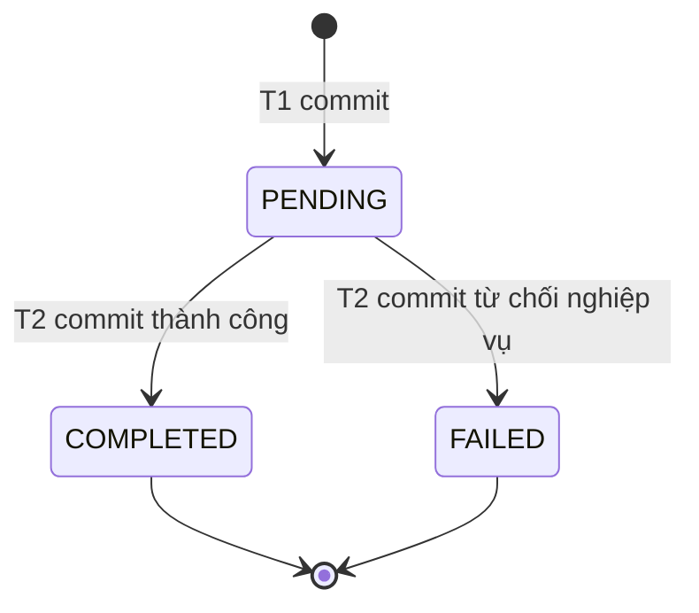

# Module `transfer` — Thiết kế chi tiết

> **Dự án:** Digital Banking MVP
> **Mã tài liệu:** `BE-MOD-TRANSFER-01`
> **Phiên bản:** v1.6 — quyết định thiết kế, chờ review và kiểm chứng
> **Ngày cập nhật:** 16/11/2026
> **Trạng thái:** Draft — có candidate chưa nối runtime; chờ review và sign-off
> **Owner:** Vũ
> **Reviewer:** Backend Lead, chủ module phụ thuộc, QA, Security — chờ review
> **Nguồn tham chiếu:** [[digitalbanking-docs/docs-common/03. SRS.md]] §2.4, §2.13; [[digitalbanking-docs/docs-common/04. Database design & analysis.md]] §4.4; [[digitalbanking-docs/docs-common/06. System architecture.md]] §6–§8; [[digitalbanking-docs/docs-common/07. API contracts.md]] §4–§6, §7.2, §8.3; [[digitalbanking-docs/docs-common/design/02. consistency-concurrency.md]] §5–§10; [[digitalbanking-docs/docs-common/09. Test plan.md]] §7; [[digitalbanking-docs/docs-backend/00. architecture & conventions.md]] §12.

Tài liệu này là kế hoạch thiết kế, không phải bằng chứng runtime. Thứ tự nguồn là `docs-common/01–11` → `docs-common/design/` → `docs-backend/`; `07` quyết định ngữ nghĩa API, OpenAPI là hợp đồng máy đọc cần đồng bộ. Không tự phân xử khi các nguồn `01–11` mâu thuẫn; đề xuất và thiết kế chuyên sâu chưa được phê duyệt vẫn giữ nhãn đó. [Checklist](tasks/README.md) là nguồn theo dõi task; kiểm tra lại code và quyết định trước mỗi task.

## 1. Phạm vi & Truy vết Yêu cầu

### 1.1. Trách nhiệm

- Tạo chuyển tiền own-account và intra-bank giữa các khách hàng trong hệ thống; kiểm tra quyền tài khoản nguồn, tài khoản đích, số tiền, trạng thái và hạn mức; điều phối step-up khi cần.
- Cấp reference duy nhất; quản lý `PENDING → COMPLETED/FAILED`, idempotency, tra cứu trạng thái/biên nhận, retry và reconciliation. Không cho terminal chuyển trạng thái khác.
- Điều phối debit/credit và hạch toán cân bằng trong cùng PostgreSQL transaction; ghi audit bắt buộc, tạo notification outbox và duy trì correlation ID. Chỉ công bố thành công sau commit.
- Ngoài MVP: liên ngân hàng/quốc tế, CBS/gateway thật, tiền thật, phí/tỷ giá và reversal/refund. Không tự mở rộng sang những nghiệp vụ này.

| Truy vết | Nội dung | Thiết kế / kiểm thử |
|---|---|---|
| BR-009–015; FR-012–022; AC-006–013 | Own/intra-bank, validation, limit, idempotency, atomicity, recovery | §3–§5; D1–D3 |
| FR-023–026; AC-014, AC-018, AC-033 | Detail/receipt, description, step-up một lần | §4–§5; contract, ownership và step-up |
| FR-034, FR-038–039; AC-022–023, AC-034 | Audit, correlation, masking; không thành công nếu audit lỗi | §5–§7; D3/D4 |
| FR-041, FR-044–046; AC-025–026 | Notification, fraud evaluation/auto-block | §2, §5–§7; D4/outbox |
| NFR-001, 006, 009–012, 013–020, 025 | Hiệu năng, phục hồi, nhất quán, bảo mật, quan sát | §3, §6–§7; D1–D5. Mục tiêu p95 ≤ 2s, p99 ≤ 5s tại 20 RPS là mục tiêu đề xuất; TTL mặc định 24h từ terminal theo DEC-TRF-005. |

### 1.2. Ranh giới và phụ thuộc

| Module / owner theo kế hoạch | Hợp đồng cần phối hợp | Điều kiện để nghiệm thu |
|---|---|---|
| Identity — Đạt | Session, permission, CSRF; challenge bind user/hash/key, verify/consume một lần trong T1 | Principal thật và step-up race/expiry; không thay bằng mock để nghiệm thu |
| Account/Customer — Đạt | Resolve account number bằng blind index, ownership/status; lock hai account theo ID, debit có điều kiện và credit trong T2 | API tham gia cùng transaction, trạng thái/số dư được kiểm tra lại dưới lock |
| Ledger — Phương | Post hai entry append-only, cùng amount/currency/transfer trong T2; truy vấn phục vụ reconciliation | Không ghi trực tiếp bảng ledger từ Transfer; invariant được chứng minh trên PostgreSQL |
| Limit — Vũ | Lock/check usage theo customer rồi account; update usage trong T2; business date/config | Race và chính sách step-up lũy kế được chốt; không check rồi cộng ngoài lock |
| Audit — Thịnh | C1 CREATED/COMPLETED/FAILED trong transaction; C3 conflict; correlation và hash chain | T1/T2 fail-closed; audit là thao tác DB cuối theo lock order |
| Fraud — Thịnh | In-process evaluation, flag/auto-block trong T2; lỗi engine fail-open theo policy | Savepoint cô lập lỗi DB và test không làm transaction rollback-only |
| Notification — Thịnh | Insert outbox cùng T2, gửi T3 qua worker, retry/lease | Delivery lỗi không rollback tiền; at-least-once và dedupe được kiểm thử |
| Common — Phương | Problem/error, context, JCS/SHA, masking, Clock, HTTP security/metrics | Dùng API hiện có; integration thật với identity/transfer còn thiếu |
| Admin/Operations, FE/QA | Quyền đọc, xử lý incident, client retry/challenge và evidence | Contract, runbook, security scope và D1–D5 được xác nhận liên module |

Nguồn phân công và thời gian: [[digitalbanking-docs/docs-common/11. Resource & Staffing Plan.md]] và [[digitalbanking-docs/docs-common/10 Master timelines.md]]; mốc chỉ mang tính kế hoạch.

### 1.3. Hiện trạng và phần tái sử dụng

Rà soát source ngày 16/11/2026: Transfer có domain/value objects, `TransferPersistence` SQL primitives, JPA mapping/terminal adapter candidate trong `com.simulatedbank.transfercandidate.persistence` và migration candidate `db/transfer-candidate/V2__transfer.sql` ngoài Flyway production; các adapter chưa đăng ký runtime (package `transfercandidate` ngoài component-scan, `ddl-auto=validate`), fixture provider là synthetic và `V1__init_schema.sql` production vẫn chỉ tạo schema. Các primitive `TransferRequestHash`, `IdempotencyDecision`, `StepUpAmountPolicy`, `IdempotencyRetention` chưa được nối runtime và không thay lookup/authorization, guard/reservation, transaction hoặc purge dưới lock. `TransferCreateInput` là parser với 10 test đạt về shape JSON, UTF-8, byte limit, header, validation và `errors[].field` an toàn; đã nối vào controller candidate (BE-TRF-03) nhưng chưa kích hoạt production. Parser không thực thi policy cấm PII trong description/key, không thay authorization, HTTP security hoặc kiểm thử thực tế.

`TransferPreflightCandidate` có 13 test fake cho lookup trước preflight, đọc lại khi từ chối, binding command T1, `ChallengeRequired` mang hash và `Settlement` receipt; `TransferIntentCandidate` có 14 test fake cho T1 (boundary challenge UUID→BIGINT attach FK, rollback, TTL fail-closed); `TransferSettlementCandidate` có 19 test fake cho T2, gồm gọi trong transaction recovery `MANDATORY`. Các candidate không đăng ký bean production. Preflight candidate dùng payload immutable, tự tính hash và kiểm tra binding actor/customer/key/hash, source, destination đã resolve, amount/currency và description với command T1. Resolution theo số tài khoản phụ thuộc cổng Account và chưa có provider thật; caller vẫn phải xác thực và phân quyền, security/contract tests và HTTP boundary thật vẫn cần hoàn thiện trước activation. `TransferCreateOrchestrator` (candidate, DEC-TRF-017) hiện thực seam `TransferOrchestrator` cho boundary 03: map `Result` sang `TransferCreateOutcome`, T0 `requestChallenge` qua `StepUpChallengePort` sau gate, map lỗi challenge/audit/dispatch; gap UUID/BIGINT `05` §13.4 đã đóng trong candidate. `TransferReferenceGenerator` sinh reference theo đề xuất OQ-02 (chưa chốt).

Năm test T2 dùng PostgreSQL với provider/table synthetic kiểm tra thành công, rollback, thất bại nghiệp vụ, cạnh tranh và recovery rollback-only trong fixture; mười hai test migration và tám test JPA dùng PostgreSQL và fixture synthetic, kèm hai test boundary ArchUnit có fixture âm. Lượt full `check` sau BE-TRF-04 có **366 test backend, 163 test Transfer**, 0 failure/error/skip theo [BE-TRF-03](tasks/evidence/BE-TRF-03-candidate-verification.md), [BE-TRF-04/05](tasks/evidence/BE-TRF-04-05-candidate.md) và [BE-TRF-02](tasks/evidence/BE-TRF-02-candidate-verification.md). Đây không là bằng chứng provider thật hoặc money path hoàn chỉnh. Candidate chưa thực hiện fraud fail-open savepoint, credit savepoint, Tfail, retry T2 độc lập hay recovery production đầy đủ; thiếu adapter provider, authorization/PII/security, bằng chứng integration transaction/lock với provider thật và xử lý commit chưa rõ. Test fake hoặc fixture không thay các bằng chứng đó. Evidence domain/schema xem [BE-TRF-02](tasks/BE-TRF-02.md).

Boundary HTTP BE-TRF-03 (DEC-TRF-016) đã triển khai dạng candidate: `TransferController`/`TransferHttpConfiguration` trong `com.simulatedbank.transfercandidate.web` (ngoài scan root, đăng ký tường minh khi orchestrator 04/05 + provider thật + migration sẵn sàng), DTO record `TransferResponse`/`TransferDetail`/`AccountRef`/`FraudFlagSummary`, `TransferCreateService` (re-check quyền + C3 deny + seam `TransferOrchestrator`), `TransferQueryService` (read-only, ownership nguồn/đích, fraud flags theo quyền) và `SecurityDenyAudit` (C3 best-effort + fallback). Port consumer `AccountOwnershipPort`/`AuditEventPort`/`TransferReadPort`/`FraudFlagReadPort`/`TransferOrchestrator` thuộc `transfer.application` ánh xạ `05` §13.4; fake chỉ trong test. 38 test mới (service/query/HTTP/contract OpenAPI) đạt. Chưa kích hoạt production; PII policy, scope staff, reference OQ-02, provider thật, orchestrator và quota shared vẫn Blocked.

Common đã có `JcsCanonicalizer`, `HmacService` (bao gồm SHA), masking, `Clock`, request context, Problem/error catalog, security filter và ArchUnit. Security filter đã khai báo quyền route, CSRF/CORS và rate limit trong process; `SessionAuthenticator` thật và kiểm tra ownership vẫn phụ thuộc identity/owner. Rate limit trong process không chứng minh quota phân tán. Đối chiếu [[digitalbanking-docs/docs-backend/modules/common/CURRENT-STATE.md]] và report 05/07/08: common integration với consumer và release/Cloud còn blocked. Tái sử dụng primitive; Transfer tự chuẩn hóa business payload, không viết lại JCS, error stack hay session.

### 1.4. Quyết định và kiểm chứng còn thiếu

[DEC-TRF-001–012](../../../../DECISIONS.md) là quyết định theo chỉ đạo người điều hành, không phải xác nhận provider/QA/Security đã review hay runtime đã hoạt động.

| Phạm vi | Quyết định thiết kế | Evidence/review còn thiếu |
|---|---|---|
| Idempotency và HTTP | Key global; terminal replay status/body gốc 201/422; nonterminal trả 409 + Retry-After, worker recovery nội bộ. TTL mặc định 24h tính từ `completed_at`; còn record vẫn replay, chỉ purge terminal hết hạn (DEC-TRF-004/005). | Test PostgreSQL same-key/actor/hash, long-PENDING, concurrent purge/recovery; API/FE/QA review OpenAPI và correlation. |
| Step-up | DEC-TRF-001/002/008: mặc định amount ≥ 10 triệu hoặc tổng dự kiến > 20 triệu; guard theo CUSTOMER, tính completed ngày hiện tại + mọi reservation PENDING kể cả hôm trước + lệnh đang xét, không đếm trùng; business zone mặc định `Asia/Ho_Chi_Minh` cấu hình. | P0: review guard, lock order, migration config 5 triệu legacy và proof race/428/qua ngày trên PostgreSQL/provider thật; không coi thiết kế là runtime. |
| Validation và credit | DEC-TRF-003: lỗi phát hiện trước T1 không tạo intent; điều kiện đổi sau T1 ghi FAILED atomic; credit fail sau debit rollback savepoint và FAILED cùng T2 khi an toàn, hoặc Tfail chỉ với rollback xác minh + durable fence/evidence. | BA/QA/Account/Transfer test preflight/race, savepoint, fence/worker, crash và unknown commit; thiếu proof giữ thực trạng + alert. |
| Recovery | DEC-TRF-006: đủ evidence Account/Ledger/Limit/Audit và response an toàn mới hoàn tất atomic status/idempotency/settlement/audit, không money/ledger kép; thiếu/lệch/error giữ thực trạng alert/manual. | Ledger/Account/Limit/Audit/Ops review API evidence, response và T-REC-01–04 trên DB thật; không suy từ balance hiện tại. |
| Audit C2/C1 | DEC-TRF-007 chọn gom descriptor, flush business rồi append từng C2 flag ID ASC và C1 cuối trong cùng T2, fail-closed. | Audit/Fraud/Transfer chứng minh savepoint, chain, deferred triggers/ORM, rollback và concurrency; API runtime chưa có. |
| Security, đọc và interface | Quyết định thiết kế về key global, quota, scope đọc, replay correlation, OTP lifecycle và version/enforcement theo DEC-TRF-004/011/012 và `05`; chi tiết §2, §4–§6. | Provider/consumer, Security, QA và Ops review; migration, thực thi, test đa instance, scope và boundary chưa có bằng chứng. |
| Các policy và proof khác | OI-CON-02, 05–13 và MOD-OI-06–07 còn phần cấu hình, risk, worker, notification và proof theo `05` §14. | Đối chiếu từng owner, không tự gán sign-off hoặc coi quyết định thiết kế là implementation. |

## 2. Thiết kế Class & Hợp đồng Interface

Theo [[digitalbanking-docs/docs-backend/00. architecture & conventions.md]] §4–§6: modular monolith, `api`, `application`, `domain`, `adapter/in`, `adapter/out`; chỉ gọi module khác qua public `api`, không lộ entity/JPA qua DTO, không ghi trực tiếp bảng owner khác. Tên và chữ ký dưới đây là hợp đồng **đề xuất**, thống nhất với owner khi triển khai, không khẳng định đã tồn tại.

| Thành phần | Hợp đồng khái niệm / trách nhiệm |
|---|---|
| `TransferController` (`adapter/in`) | `create(request, key, principal)` và `get(reference, principal)`; validate HTTP, phân quyền, DTO, không giữ transaction |
| `TransferOrchestrator` (`application`) | `create(command, actor, key) → outcome`; preflight/T0, T1, T2, mapping replay; không bọc T1+T2 trong outer transaction |
| `TransferT1Service` | `createPending(command, hash, challenge) → reference`; transaction riêng; insert-first, consume challenge và audit CREATED |
| `TransferT2Service` | `execute(transferId) → terminal outcome`; transaction riêng hoặc tham gia transaction reconciliation; lock, kiểm tra và điều phối owner APIs |
| `IdempotencyService` | Chuẩn hóa/hash, tìm key; phân biệt conflict, terminal replay và trạng thái chưa terminal (HTTP 409); không log raw key |
| `TransferQueryService` | `get(reference, actor) → masked detail`; kiểm tra participant hoặc quyền staff có scope |
| `TransferReconciliationJob` | Discovery không lock; transaction claim ghi fence bền và commit; transaction xử lý lấy lại guard/transfer/fence, đọc evidence và gọi executor cùng transaction; báo bất thường, không ghi đè terminal (DEC-TRF-014) |
| `TransferAttemptFence` | Contract claim/epoch/lease bền do Transfer sở hữu; T2/Tfail/recovery CAS token dưới guard + transfer, token stale không ghi money/terminal. Metadata có trong migration candidate; protocol runtime và test crash/fence còn cần thực hiện. |
| `domain` | State transition, amount/command validation và outcome thuần; không phụ thuộc web/persistence |

Ports khái niệm: identity `verifyBinding/consumeInT1`, account `resolve/lockOrdered/debitConditional/credit`, limit `lockCheck/increment`, ledger `postDoubleEntry`, audit `recordInTransaction`, fraud `evaluateInT2`, notification `enqueueInT2`. Các lệnh tham gia T2 phải cùng datasource và transaction `REQUIRED`; không gọi HTTP hay broker trong money path. Cần xác nhận signature, propagation, lỗi và ownership với từng owner, không dùng internal repository của module khác.

**Boundary và version:** MVP dùng contract nội bộ `v1` do provider sở hữu; interface và DTO immutable, nêu nullability, lỗi, transaction, side effects và compatibility theo `05` §13. Consumer chỉ import `provider.api`, không dùng entity, repository hoặc bảng private của module khác. Thay đổi phá tương thích tạo `v2` và kế hoạch chuyển consumer; thêm trường vào Java record có thể phá constructor/binary và không mặc định là tương thích. CI phải có ArchUnit rule chặn import internals và fixture âm chứng minh rule bắt được vi phạm; contract test chạy cùng vector cho provider và fake, PostgreSQL thật chứng minh transaction/lock/unique. ArchUnit hiện có chưa chứng minh rule consumer-only-api, không coi test pass với package rỗng là bằng chứng. Đây là yêu cầu triển khai, không phải xác nhận test hoặc interface đã tồn tại.

## 3. Chi tiết Bảng Dữ liệu & SQL/Locking

Nguồn schema chuẩn [[digitalbanking-docs/docs-common/04. Database design & analysis.md]] §4.4, §5; concurrency [[digitalbanking-docs/docs-common/design/02. consistency-concurrency.md]] §5–§7, §12. Tạo migration Flyway forward-only sau V1 theo dependency/FK thật; `ddl-auto=validate`, không sửa V1. Các bảng sau có DDL candidate ngoài Flyway production; chưa có migration production được kích hoạt.

| Bảng do Transfer sở hữu | Dữ liệu/ràng buộc cần triển khai và đối chiếu DDL nguồn |
|---|---|
| `banking.transfer` | PK `transfer_id`; `reference_no` unique, immutable; customer/initiator, source/destination FK, amount `> 0`, currency VND, description, status, failure, challenge/correlation, timestamps. Check source ≠ destination; chỉ PENDING → terminal; partial unique challenge nếu có. Index theo reference, customer/history và PENDING/created_at theo `04`. |
| `banking.idempotency_record` | `idempotency_key` PK global; `request_hash` SHA-256 hex 64; `transfer_id` NOT NULL UNIQUE/FK; status, response status/body, timestamps/expiry. Chỉ terminal mới có response được replay; bảo vệ record PENDING khỏi purge. |

T1 insert transfer PENDING trước do FK NOT NULL; `INSERT ... ON CONFLICT DO NOTHING RETURNING` cho key. Request thua unique phải rollback toàn bộ T1 kể cả transfer vừa insert, rồi đọc lại record trong transaction mới; không để orphan. Reference collision xử lý như lỗi unique riêng, không nhầm với replay. Constraint DB là lớp bảo vệ bổ sung, không thay kiểm tra nghiệp vụ.

T2 `READ COMMITTED`; timeout theo cấu hình (`lock_timeout` 2s, `statement_timeout` 5s là baseline thiết kế). Plain-read immutable customer/context trên primary không lock; lock guard CUSTOMER → transfer/attempt fence và đọc lại/verify → account `account_id ASC` → usage CUSTOMER → ACCOUNT → hoàn tất và flush business → audit lock/append cuối (DEC-TRF-008). T1 lấy guard trước insert/consume challenge; recovery chỉ claim transfer `SKIP LOCKED` sau guard. Rà FK/unique/trigger/lease/fence và kiểm nhiều connection PostgreSQL; thứ tự này chưa chứng minh deadlock-free. Debit conditional và credit/ledger đi cùng TX; không dùng `double`. Timeout/deadlock rollback, retry có giới hạn toàn transaction mới; không network dưới lock.

## 4. Chi tiết Endpoint REST & Xử lý Lỗi

Theo [[digitalbanking-docs/docs-common/07. API contracts.md]] §2–§6, §7.2, §8.3 và [[digitalbanking-docs/openapi/digital-banking-v1.yaml]].

| API | Quyền, input và output |
|---|---|
| `POST /api/v1/transfers` | `CUSTOMER` + `TRANSFER_CREATE`, session và CSRF; `Idempotency-Key` bắt buộc 1–255 ký tự `[A-Za-z0-9._:~-]`, không PII. `X-Correlation-ID` tùy chọn. Nhận `sourceAccountId`, đúng một `destination.accountId` hoặc `accountNumber`, `amount` decimal string > 0 tối đa 2 chữ số thập phân, `currency` VND mặc định, `description` tối đa 255 ký tự, trim và từ chối control characters/PII. Customer lấy từ session. |
| `GET /api/v1/transfers/{reference}` | Customer tham gia transfer hoặc staff có quyền/scope đọc theo `07` §3.5–§3.6, §8.3; kiểm tra ở service, không chỉ role. Trả trạng thái, reference, amount, masked account, timestamps, correlation; fraud flags chỉ staff có quyền. `Cache-Control: no-store`. |

**Đọc theo scope:** CUSTOMER cần `TRANSACTION_READ_SELF` và Account API xác nhận là chủ source hoặc destination; staff cần `TRANSACTION_READ` và scope được cấp. Lấy actor/scope từ principal đã xác thực; customer/account filter của history không được vượt scope. `fraudFlags` chỉ trả cho staff có `FRAUD_READ` hoặc `FRAUD_REVIEW`. History/projection ghép qua public API của các provider, không query bảng private/cycle và phải giữ filter, phân trang và totals đúng scope. `07` quy định tài nguyên có thật ngoài scope là 403, không tồn tại là 404; khác biệt này có thể làm lộ sự tồn tại, cần reference khó đoán, rate limit, C3 và lỗi không lộ chi tiết. Không coi 403/404 là biện pháp loại bỏ enumeration.

**Key và quota:** Client sinh key CSPRNG mới cho mỗi yêu cầu logic, ví dụ UUIDv4, và giữ key/payload khi retry; định dạng hợp lệ không chứng minh entropy. Server giữ global namespace và ràng buộc actor/customer/hash theo DEC-TRF-004; mismatch trả conflict chung, không lộ chủ sở hữu, hash hay kết quả. Chống preclaim chỉ là giảm rủi ro, không thể bảo đảm khi client dùng key dễ đoán. `POST /transfers` mặc định 30 request/phút/customer; khi nhiều instance phục vụ cần quota shared atomic, lỗi quota fail-closed 503, vượt quota 429 + `Retry-After`. In-memory limiter hiện tại chỉ theo từng instance. Cần triển khai và test trước khi vận hành đa instance.

Ví dụ request synthetic:

```json
{"sourceAccountId":"3001","destination":{"accountNumber":"0123456789"},"amount":"150000.00","currency":"VND","description":"Chuyen tien"}
```

POST thành công `201` + `Location` + `TransferResponse` COMPLETED; FAILED nghiệp vụ sau T1 trả Problem theo catalog `07` có reference/transferStatus/failureCode. Replay terminal giữ status/body gốc và thêm `Idempotent-Replayed: true`; response body lưu đã mask. Theo DEC-TRF-004, body giữ correlation gốc, header phản ánh request hiện tại; API/FE cần review và kiểm chứng correlation. `202` async không thuộc phương án MVP đồng bộ hiện tại. Lỗi pre-T1 không chứa reference/transferStatus. Không có success envelope chung ngoài schema endpoint.

| HTTP | Hành vi | Retry |
|---|---|---|
| 400 / 401 / 403 | Validation, session, quyền/ownership; không tạo transfer | Sửa request hoặc xác thực |
| 404 / 409 | Account không tồn tại/inactive; hoặc `IDEMPOTENCY_CONFLICT` khi payload/key khác, không lộ dữ liệu customer khác | Không retry conflict với payload khác |
| 409 `IDEMPOTENCY_IN_PROGRESS` | Cùng key/hash tại `RECEIVED`/`IN_PROGRESS`, kể cả stale; HTTP không tự chạy T2 (DEC-TRF-004). | Cùng key/payload sau `Retry-After`; scheduler nội bộ recovery. |
| 422 | Thiếu balance/limit hoặc fraud block, theo nhánh nghiệp vụ và catalog `07` | Không tự retry business failure |
| 428 `STEP_UP_REQUIRED` | Request này không tạo transfer/idempotency/ledger/reservation; một request cùng key khác có thể đã commit trước response. | Verify rồi gửi cùng key/payload; retry theo idempotency, challenge dư expire/invalidate an toàn. |
| 429 / 500 `AUDIT_WRITE_FAILED` / 503 | Rate limit hoặc lỗi audit/hệ thống; không báo false success | Theo `Retry-After`/`retryable`, cùng key; query reference nếu có |

Mọi lỗi dùng RFC 9457 Problem và catalog common/`07` §4; không trả SQL, stack trace, số tài khoản đầy đủ hay secret. Tách validation trước T1 khỏi business rejection trong T2 để không gán reference giả.

## 5. Luồng Xử lý & Ranh giới Giao dịch



1. **Preflight/T0:** authenticate/authorize, validate schema, normalize/hash theo `07` §5.2 rồi tra key global trước resolve account có trạng thái thay đổi: terminal cùng actor/customer/hash replay, khác actor/hash conflict, chưa terminal 409. Chỉ với key vắng, resolve và kiểm tra ownership/status/balance. Nếu preflight từ chối nghiệp vụ, đọc lại key trên primary: record đã xuất hiện → xử lý idempotency, vẫn vắng → trả lỗi không tạo intent, tuyến tính hóa tại lần đọc vắng; DB error fail-closed. Đánh giá step-up dưới guard CUSTOMER theo `05` §10.1; lấy completed ngày hiện tại + mọi PENDING reservation kể cả ngày trước + amount lệnh mới. Recheck key dưới guard, không giữ transaction qua OTP. Request nhận 428 không tự tạo transfer/idempotency/ledger/reservation; request khác cùng key có thể commit trước response, challenge dư hết hạn/invalidate an toàn, retry xử lý idempotency.
2. **T1:** cùng guard transaction tạo transfer PENDING rồi idempotency RECEIVED, reservation, consume challenge VERIFIED bind đúng user/purpose/hash/key/expiry khi cần, audit CREATED phase cuối; tất cả commit hoặc rollback cùng nhau. Unique thua rollback toàn T1 rồi đọc lại. Lưu policy/version, ngày T1 để trace; reservation PENDING không release vì TTL hoặc qua nửa đêm. Expiry idempotency ban đầu `created_at + TTL`.
3. **T2:** lấy attempt fence bền và thực thi theo guard CUSTOMER → transfer/fence → account ASC → limit CUSTOMER/ACCOUNT → fraud → money/ledger/usage/terminal/outbox → flush → audit. Revalidate dưới lock. Sau guard CUSTOMER và lock transfer/account, **trước khi lock usage theo business date**, lấy `terminal_at` logic một lần bằng PostgreSQL primary `clock_timestamp()`, lưu UTC và suy business date cấu hình `Asia/Ho_Chi_Minh` để chọn usage row; giữ locks tới commit. Dùng cùng timestamp/date cho COMPLETED, settlement usage, C1 và response. Reservation chuyển thành usage ngày logic đó đúng một lần trong cùng transaction. Đây không phải thời điểm commit: `terminal_at` trước 00:00 nhưng commit sau 00:00 vẫn thuộc ngày cũ, PENDING tiếp tục được tính tới commit atomic. Test cả hai phía mốc ngày và race với request khác. Fraud fail-open chỉ sau rollback savepoint an toàn cho transaction/persistence context. Gom descriptors flag còn tồn tại; audit C2 flag ID ASC rồi C1 qua `recordInTransaction` MANDATORY dưới cùng audit lock cuối (DEC-TRF-007). Mọi C1/C2 lỗi rollback T2, không nuốt vào fraud fail-open. Không business SQL/ORM deferred flush/trigger business hay network sau audit lock; proof thực tế bắt buộc.
4. **Business/failure:** điều kiện đổi sau T1 → FAILED atomic, response/idempotency + release reservation + audit + outbox theo policy, không money/ledger/usage. Credit lỗi sau debit: rollback mọi money/ledger về savepoint; chỉ nếu transaction/context usable và không sót money mới ghi FAILED trong cùng T2. Nếu T2 abort, Tfail chỉ khi rollback xác minh, fence bền hợp lệ ngăn worker và evidence per-transfer đủ; CAS token stale không được ghi money/terminal. Chưa chứng minh được rollback/fence/evidence → không đoán PENDING/FAILED, giữ thực trạng alert/manual. Không retry statement riêng trong transaction đã lỗi.
5. **T3:** notification worker claim/lease sau T2 commit, gửi gateway ngoài DB transaction, retry/dedupe theo policy; gateway fail không đổi kết quả tiền.

**OTP dispatch DEC-TRF-011:** Identity gửi OTP sau commit T0, ngoài transaction; destination thực tế lấy tạm qua Customer-owned `resolveNotificationDestination` với actor SYSTEM và purpose `OTP_DELIVERY`. Không lưu/log destination hoặc OTP plaintext. Chỉ `SENT` sau gateway ACK đã persist đúng generation; chỉ challenge `SENT` hợp lệ được verify và chỉ trả 428 sau ACK đã persist. Timeout, ACK không rõ hoặc lỗi persist fail-closed `503 OTP_DISPATCH_FAILED`. Resend/verify/consume dùng cùng row lock, invalidate generation bền trước cấp mã mới, fencing/CAS ngăn ACK trễ hồi sinh generation cũ; DB lỗi thì không giả định invalidate thành công và không reissue tới khi DB/fence an toàn. Resend tối đa 3, cooldown 60 giây, TTL 5 phút theo `07`, giữ số lần nhập sai. Cần migration và contract/integration test với Identity, Customer, Notification và gateway; không coi mock là proof.

**Idempotency và crash:** chỉ request cùng `userId`, `customerId` và hash mới replay; khác user (kể cả cùng customer), customer hoặc hash conflict an toàn. Nonterminal cùng actor/hash luôn HTTP 409 + `Retry-After`; recovery nội bộ xử lý, terminal replay status/body gốc. Nếu commit T1/T2 chưa rõ, đọc primary và khóa/reread theo global order, terminal giữ nguyên/replay; không mặc định rollback hay tạo mới. TTL mặc định/tối thiểu 24h: T1 dùng snapshot/version `TTL_T1` hợp lệ đặt expiry `created_at + TTL_T1`; terminal đọc snapshot/version `TTL_terminal` hợp lệ và atomically ghi version, `completed_at`, response masked và `expires_at=max(expires_at hiện có,completed_at+TTL_terminal)`. Giảm TTL không rút ngắn expiry, cả hai snapshot ≥24h; config không hợp lệ/không đọc được fail-closed, không commit terminal với TTL đoán. Metadata TTL có trong migration candidate; terminal snapshot, migration production và test thay đổi cấu hình còn thiếu. Chỉ purge terminal sau expiry, recheck dưới lock. Còn record dù quá expiry vẫn replay/conflict; sau purge key có thể tạo giao dịch mới, client query reference hoặc liên hệ Ops trước khi tạo lại. Không purge PENDING.

**Recovery DEC-TRF-006/014:** discovery candidate không lock → transaction claim lấy guard CUSTOMER → lock transfer `FOR UPDATE SKIP LOCKED`, reread và ghi epoch/token/lease bền rồi commit. Transaction xử lý tiếp theo lấy lại guard → transfer/fence, xác minh context và claim, đọc evidence và chạy executor cùng transaction; kết quả chỉ có hiệu lực sau commit. Terminal không ghi đè. Không ledger/audit completion và outcome/fence chứng minh safe → resume T2 theo protocol; không chỉ dựa vào ledger vắng. PENDING có ledger/audit là incident: đối chiếu đủ đúng hai entry seq/type/account/amount/currency, audit completion/linkage, Account movement evidence per-transfer, Limit reservation/settlement evidence/mode và response gốc (hoặc response có thể tái tạo an toàn nếu chứng minh chưa từng trả). Nếu và chỉ nếu đủ evidence, atomic cập nhật COMPLETED, idempotency status/response/TTL, settlement cần thiết và audit RECONCILED cuối; không debit/credit/post ledger lại. Mất response có thể đã trả, evidence thiếu/trùng/lệch, lỗi DB hoặc commit chưa xác định → giữ thực trạng, alert/manual, không sửa ledger hoặc giả định state. Provider API `findTransferMovementEvidence` và `findReservationSettlementEvidence` còn phải thiết kế/migration/review, fake không chứng minh proof.

### 5.1. Oracle và failure fencing

| Tình huống | Oracle thiết kế | Evidence cần kiểm chứng |
|---|---|---|
| Invalid/inactive/insufficient đã biết trước T1 | Trả lỗi, không transfer/idempotency/ledger hay tiền. | HTTP + DB; kiểm concurrent thay đổi và preflight. |
| Điều kiện đổi sau T1 | Revalidate dưới lock, FAILED atomic + response/audit/outbox/release reservation; không debit/credit/ledger/usage. | Nhiều connection, failure injection; AC-006 theo DEC-TRF-003. |
| Credit lỗi sau debit | Rollback savepoint rồi FAILED cùng T2 nếu usable; Tfail riêng chỉ khi rollback xác minh + fence/evidence đủ. Unknown/crash không suy đoán. | Inject lỗi SQL/connection, persistence context, crash giữa rollback/Tfail, stale token/lease, hai worker. |
| Recovery có đủ evidence | Claim theo guard, complete status/idempotency/response/settlement + audit atomic không post lại tiền. | T-REC-02, response replay, Account/Ledger/Limit/Audit thật, crash và concurrency. |
| Evidence thiếu/lệch/DB error, commit không rõ | Không tự ghi state/tiền, giữ thực trạng, alert/manual; terminal đã commit giữ nguyên. | T-REC-03/04, verify primary, lock/timeout và audit rollback. |

Fence owner Transfer gồm claim/epoch/token/lease bền, CAS và protocol chặn stale token trong T2/Tfail/recovery; expiry lease không đủ chứng minh rollback, không tự chạy lại khi failure pending/commit chưa rõ. Nếu chưa có fence/evidence, không tự Tfail; alert/manual. Metadata fencing có trong migration candidate theo DEC-TRF-013, nhưng operation, protocol và migration production chưa được chứng minh; test fake theo contract, provider thật + PostgreSQL bắt buộc cho proof.

### 5.2. Candidate BE-TRF-06

`TransferRecoveryJob` điều phối scan startup/60s và purge theo batch qua `TransferRecoveryCandidate`. `TransferRecoveryPersistence` là port nội bộ. JDBC dùng primary clock, cursor theo tuổi/ID, guard CUSTOMER trước `SKIP LOCKED`, commit claim rồi kiểm lại epoch/token/context/lease trong transaction xử lý. Resume sử dụng T2 JOIN. Reconciliation đủ proof chỉ sửa transfer/idempotency, settle reservation khi cần và ghi C1 cuối. Purge chỉ xóa idempotency terminal hết hạn của transfer terminal cùng outcome. Hết lease/unknown giữ thực trạng và alert/manual. [BE-TRF-06](tasks/BE-TRF-06.md) có quyết định chi tiết, runbook và evidence. Runtime chờ provider thật, migration, review và Tfail/rearm an toàn.

## 6. Sự kiện Kiểm toán, Security & Metrics

- `TRANSFER_CREATED`, `TRANSFER_COMPLETED`, `TRANSFER_FAILED`: C1, ghi đồng transaction T1/T2, fail-closed; `TRANSFER_RECONCILED` theo [[digitalbanking-docs/docs-common/design/01. audit-traceability.md]] và runbook. Conflict key/ownership: C3 security audit, fallback security log + alert theo policy; không làm lộ transfer khác. Không dùng log thay audit.
- Propagate correlation qua challenge/transfer/ledger/audit/outbox; structured logs không chứa raw key, OTP, cookie, body hoặc số tài khoản đầy đủ. Validate input, IDOR, session/CSRF, role **và** ownership, masking response/audit/outbox. Không cho client cung cấp actor/customer. Dùng cấu hình, secret và crypto common, không hard-code.
- Theo dõi `banking_transfer_total{status,failure_code}`, pending oldest age, idempotency outcomes, DB lock errors, audit failures, notification backlog, latency; không gắn user/account/reference/key/correlation làm metric label. Alert PENDING quá ngưỡng, audit failure, deadlock, backlog; ngưỡng vận hành theo [[digitalbanking-docs/docs-backend/deployment/README.md]] §6, §8.

### 6.1. Candidate BE-TRF-07

`TransferStaffScope` là port bắt buộc của HTTP candidate cho staff read. Query kiểm role, permission và scope trước khi trả receipt hoặc đọc fraud flags. POST vẫn qua Common session/CSRF/quota, yêu cầu CUSTOMER ở service. Scope thật và quota atomic nhiều instance là điều kiện activation.

T1 kiểm correlation từ actor; T2 và recovery dùng correlation đã lưu với request ID từng lần thực thi. Candidate recovery bind Common context theo bản ghi, không mang theo session hoặc HTTP metadata. C3 có cùng fallback cho empty và exception. Required audit vẫn nằm cuối business transaction và lỗi được quan sát độc lập với commit. Terminal metrics chỉ tăng sau commit; pending snapshot lấy theo lịch từ primary, kể cả MANUAL, và giữ mẫu cũ khi lỗi kèm dấu unavailable/tuổi dữ liệu.

T2 adapter dùng `TransferSettlementCandidate.NotificationPorts` để ghi terminal/replay, trả facts đã mask cho `TransferNotifications` và enqueue JOIN trước flush/audit. Policy do adapter cung cấp, T3 và durable dedupe thuộc Notification. Xem [BE-TRF-07](tasks/BE-TRF-07.md) và [dashboard/rules](tasks/ops/README.md).

## 7. Kịch bản Kiểm thử Module

Dùng test synthetic, unit cho state/hash/rule, slice cho controller/security, contract đối chiếu `07` và OpenAPI đã phân xử. Test transaction/locking/FK/constraints dùng Testcontainers PostgreSQL, connection độc lập và barrier/latch; không dùng H2 hay mock làm bằng chứng invariant. Evidence gồm lệnh, revision, cấu hình, dữ liệu an toàn, output, test ID và trạng thái theo [[digitalbanking-docs/docs-common/09. Test plan.md]] §7, §10.

| Nhóm / nguồn | Điều kiện cần chứng minh |
|---|---|
| D1 `T-CON-01–04`, `T-LIM-01–03` | Race cùng nguồn, vượt balance, A→B/B→A, tài khoản độc lập và usage đồng thời: không âm, không vượt limit, tổng tiền/ledger cân bằng; lock timeout/deadlock retry bounded. |
| D2 `T-IDEM-01–06` | Cùng key concurrent một debit, conflict khác hash, replay 201/422, in-progress, crash-resume, cross-customer không lộ dữ liệu; TTL/purge và hash vectors. |
| D3 `T-REC-01–04`, `T-AUD-06`, `T-OUT-01–02` | Crash trước/sau T1/T2, mất response, lỗi credit/audit, hai worker, ledger/audit bất thường, notification fail/retry; assert DB, audit, response và không side effect kép. |
| Step-up/security `AC-030`, `AC-033–034`, `T-STEP-01–02` | 428 không có transfer/key/ledger; consume một lần, binding/expiry và race; hai transfer lũy kế cạnh ngưỡng theo protocol đã chốt; IDOR/CSRF/permission, masking, log leak. |
| Contract/functional `AC-006–010`, `AC-014`, `AC-018`, `AC-022–026` | Own/intra-bank, input boundaries, reference/receipt, error/header/status và correlation xuyên module; fraud fail-open/auto-block, notification. |
| Scope, quota, OTP, boundary | Customer source/destination, staff scope và fraud permission; lỗi 403/404 không lộ nội dung; quota atomic nhiều instance/503 khi unavailable; preclaim và key mismatch an toàn; gateway ACK trễ, DB lỗi, resend đồng thời; ArchUnit fixture âm và provider/fake vectors. Các test này là yêu cầu, chưa có kết quả. |
| D5 `AC-031` | Load 20 RPS × 10 phút, p95/p99, error rate và invariant sau load theo `09`; mục tiêu và môi trường được duyệt, không suy từ unit test. |

Release gate: `./gradlew check`, ArchUnit, migration sạch và upgrade, contract/security/integration cùng module thật; D1–D5 có evidence tương ứng, các quyết định §1.4 được xử lý, QA/Security/owner review. Dependency hoặc môi trường thiếu ghi **Blocked**, không dùng mock để tự đóng gate. Xem [checklist](tasks/README.md).

## Change Log

| Version | Ngày | Người cập nhật | Mô tả |
|---|---|---|---|
| 1.6 draft | 16/11/2026 | Qoder | Ghi boundary HTTP candidate BE-TRF-03 (controller/DTO/query/service/C3, port consumer `05` §13.4) theo DEC-TRF-016; cập nhật hiện trạng parser 10 test và check 338/135 Transfer; chưa kích hoạt production, provider thật/review vẫn Blocked. |
| 1.5 draft | 16/11/2026 | Codex | Đồng bộ preflight, T2/recovery candidate, evidence synthetic và các giới hạn bảo mật. |
| 1.4 draft | 16/11/2026 | Codex | Cập nhật hiện trạng primitive độc lập, T1/T2 candidate và metadata TTL/fencing theo DEC-TRF-013; chưa xác nhận money path hoặc tích hợp provider. |
| 1.3 draft | 16/11/2026 | Codex | Chốt thiết kế key/quota, scope đọc, version boundary và lifecycle OTP; implementation, integration, security/owner review vẫn chờ evidence. |
| 1.2 draft | 16/11/2026 | Codex | Đồng bộ DEC-TRF-003–008, guard customer, fencing, retry/TTL/recovery và audit; chưa có bằng chứng integration hay owner review. |
| 1.1 draft | 15/11/2026 | Codex | Làm rõ khác biệt `03`/`07` và `04`/`07`, bổ sung oracle theo thời điểm và phương án recovery cần owner review; không thay quyết định hay trạng thái phê duyệt. |
| 1.0 | 15/11/2026 | Codex | Thiết kế và truy vết Transfer theo nguồn dự án; ghi các sai lệch và cổng quyết định chưa chốt. |
