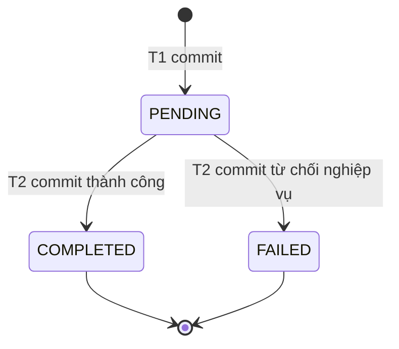

# Module `transfer` — Thiết kế chi tiết

> **Dự án:** Digital Banking MVP
> **Mã tài liệu:** `BE-MOD-TRANSFER-01`
> **Phiên bản:** v1.0
> **Ngày cập nhật:** 15/11/2026
> **Trạng thái:** Draft — chờ review; chưa triển khai và chưa sign-off
> **Owner:** Vũ
> **Reviewer:** Backend Lead, chủ module phụ thuộc, QA, Security — chờ review
> **Nguồn tham chiếu:** [[digitalbanking-docs/docs-common/03. SRS.md]] §2.4, §2.13; [[digitalbanking-docs/docs-common/04. Database design & analysis.md]] §4.4; [[digitalbanking-docs/docs-common/06. System architecture.md]] §6–§8; [[digitalbanking-docs/docs-common/07. API contracts.md]] §4–§6, §7.2, §8.3; [[digitalbanking-docs/docs-common/design/02. consistency-concurrency.md]] §5–§10; [[digitalbanking-docs/docs-common/09. Test plan.md]] §7; [[digitalbanking-docs/docs-backend/00. architecture & conventions.md]] §12.

Tài liệu này là kế hoạch thiết kế, không phải bằng chứng runtime. Thứ tự nguồn là `docs-common/01–11` → `docs-common/design/` → `docs-backend/`; `07` quyết định ngữ nghĩa API, OpenAPI là hợp đồng máy đọc cần đồng bộ. Không tự phân xử khi các nguồn `01–11` mâu thuẫn; đề xuất và thiết kế chuyên sâu chưa được phê duyệt vẫn giữ nhãn đó. [Checklist](tasks/README.md) là nguồn theo dõi task; kiểm tra lại code và quyết định trước mỗi task.

## 1. Phạm vi & Truy vết Yêu cầu

### 1.1. Trách nhiệm

- Tạo chuyển tiền own-account và intra-bank giữa các khách hàng trong hệ thống; kiểm tra quyền tài khoản nguồn, tài khoản đích, số tiền, trạng thái và hạn mức; điều phối step-up khi cần.
- Cấp reference duy nhất; quản lý `PENDING → COMPLETED/FAILED`, idempotency, tra cứu trạng thái/biên nhận, retry và reconciliation. Không cho terminal chuyển trạng thái khác.
- Điều phối debit/credit và hạch toán cân bằng trong cùng PostgreSQL transaction; ghi audit bắt buộc, tạo notification outbox và duy trì correlation ID. Chỉ công bố thành công sau commit.
- Ngoài MVP: liên ngân hàng/quốc tế, CBS/gateway thật, tiền thật, phí/tỷ giá và reversal/refund. Không tự mở rộng sang những nghiệp vụ này.

| Truy vết | Nội dung | Thiết kế / kiểm thử |
|---|---|---|
| BR-009–015; FR-012–022; AC-006–013 | Own/intra-bank, validation, limit, idempotency, atomicity, recovery | §3–§5; D1–D3 |
| FR-023–026; AC-014, AC-018, AC-033 | Detail/receipt, description, step-up một lần | §4–§5; contract, ownership và step-up |
| FR-034, FR-038–039; AC-022–023, AC-034 | Audit, correlation, masking; không thành công nếu audit lỗi | §5–§7; D3/D4 |
| FR-041, FR-044–046; AC-025–026 | Notification, fraud evaluation/auto-block | §2, §5–§7; D4/outbox |
| NFR-001, 006, 009–012, 013–020, 025 | Hiệu năng, phục hồi, nhất quán, bảo mật, quan sát | §3, §6–§7; D1–D5. Mục tiêu p95 ≤ 2s, p99 ≤ 5s tại 20 RPS và TTL ≥ 24h là đề xuất theo SRS. |

### 1.2. Ranh giới và phụ thuộc

| Module / owner theo kế hoạch | Hợp đồng cần phối hợp | Điều kiện để nghiệm thu |
|---|---|---|
| Identity — Đạt | Session, permission, CSRF; challenge bind user/hash/key, verify/consume một lần trong T1 | Principal thật và step-up race/expiry; không thay bằng mock để nghiệm thu |
| Account/Customer — Đạt | Resolve account number bằng blind index, ownership/status; lock hai account theo ID, debit có điều kiện và credit trong T2 | API tham gia cùng transaction, trạng thái/số dư được kiểm tra lại dưới lock |
| Ledger — Phương | Post hai entry append-only, cùng amount/currency/transfer trong T2; truy vấn phục vụ reconciliation | Không ghi trực tiếp bảng ledger từ Transfer; invariant được chứng minh trên PostgreSQL |
| Limit — Vũ | Lock/check usage theo customer rồi account; update usage trong T2; business date/config | Race và chính sách step-up lũy kế được chốt; không check rồi cộng ngoài lock |
| Audit — Thịnh | C1 CREATED/COMPLETED/FAILED trong transaction; C3 conflict; correlation và hash chain | T1/T2 fail-closed; audit là thao tác DB cuối theo lock order |
| Fraud — Thịnh | In-process evaluation, flag/auto-block trong T2; lỗi engine fail-open theo policy | Savepoint cô lập lỗi DB và test không làm transaction rollback-only |
| Notification — Thịnh | Insert outbox cùng T2, gửi T3 qua worker, retry/lease | Delivery lỗi không rollback tiền; at-least-once và dedupe được kiểm thử |
| Common — Phương | Problem/error, context, JCS/SHA, masking, Clock, HTTP security/metrics | Dùng API hiện có; integration thật với identity/transfer còn thiếu |
| Admin/Operations, FE/QA | Quyền đọc, xử lý incident, client retry/challenge và evidence | Contract, runbook, security scope và D1–D5 được xác nhận liên module |

Nguồn phân công và thời gian: [[digitalbanking-docs/docs-common/11. Resource & Staffing Plan.md]] và [[digitalbanking-docs/docs-common/10 Master timelines.md]]; mốc chỉ mang tính kế hoạch.

### 1.3. Hiện trạng và phần tái sử dụng

Rà soát file source ngày 15/11/2026: `digitalbanking-backend/src/main/java/com/simulatedbank/banking/transfer/` và các module nghiệp vụ chỉ có `.gitkeep`; `src/main/resources/db/migration/V1__init_schema.sql` chỉ tạo schema. Chưa thấy controller, entity, service, migration bảng hoặc test nghiệp vụ Transfer. Không suy ra feature đã có từ tài liệu thiết kế.

Common đã có `JcsCanonicalizer`, `HmacService` (bao gồm SHA), masking, `Clock`, request context, Problem/error catalog, security filter và ArchUnit. Security filter đã khai báo quyền route, CSRF/CORS và rate limit trong process; `SessionAuthenticator` thật và kiểm tra ownership vẫn phụ thuộc identity/owner. Rate limit trong process không chứng minh quota phân tán. Đối chiếu [[digitalbanking-docs/docs-backend/modules/common/CURRENT-STATE.md]] và report 05/07/08: common integration với consumer và release/Cloud còn blocked. Tái sử dụng primitive; Transfer tự chuẩn hóa business payload, không viết lại JCS, error stack hay session.

### 1.4. Sai lệch và quyết định cần chốt

| Vấn đề | Baseline / tác động | Đầu mối và cổng xử lý |
|---|---|---|
| Key và lỗi ở overview | `04` §4.4 và `07` §5: key global, `idempotency_record` sở hữu key; `IDEMPOTENCY_CONFLICT`. Overview ghi unique actor/operation, key trên transfer và tên lỗi khác; scoped key là đề xuất P1 `OI-CON-04`. | Vũ + API/DB owner đồng bộ overview với nguồn; không tạo schema theo overview. |
| Replay và 202 | `07` §8.3 trả status/body gốc 201/422; YAML khai báo 200 replay. `202` chỉ đề xuất async; `design/02` §5.6 chọn synchronous. | API owner + FE/QA đồng bộ YAML theo `07`; test cả replay FAILED. Không tự công bố 200/202 là baseline. |
| Ngưỡng step-up lũy kế | T0 kiểm tra trước T1, trong khi usage chỉ lock/cộng ở T2. Hai key đồng thời có thể cùng nhìn dưới ngưỡng rồi vượt ngưỡng. Không thể giả định recheck sau T1 vẫn thỏa `428` không tạo transfer. | **P0 release blocker:** Identity + Limit + Architect + BA chốt policy và protocol serialization/reservation hoặc thay contract; test race trước release. Ngưỡng 20 triệu là đề xuất, không hard-code policy. |
| Validation trước/sau T1 | `03` AC-006 yêu cầu inactive/thiếu số dư không tạo transfer; `design/02` §5.3 dự kiến commit FAILED nếu điều kiện thay đổi sau T1. | BA + QA + Architect chốt oracle cho race và đồng bộ nguồn trước nghiệm thu; test riêng lỗi thấy ở preflight và lỗi phát sinh sau T1. Không tự nhận hai yêu cầu đã thống nhất. |
| TTL và key sau purge | `OI-CON-01`: ≥24h là đề xuất; sau purge key có thể thành yêu cầu mới, không chống trùng vĩnh viễn. | BA/Product + Security/BE chốt retention, hướng dẫn retry/query, và nguy cơ duplicate trước release. Không purge record của PENDING. |
| Reconciliation bất thường | `09` §7.4 T-REC-02 yêu cầu hoàn tất không duplicate khi đủ ledger/audit; `design/02` §10.3 vừa cho phép terminal vừa coi ledger với PENDING là incident. | Vũ + Ledger/Audit/Ops chốt protocol kiểm chứng và đồng bộ response/idempotency để đạt T-REC-02. Trước khi có protocol: giữ nguyên, alert/manual; không tự sửa ledger. Thiếu hoặc chênh bằng chứng luôn là incident. |
| Các điểm mở khác | `OI-CON-02–13`: marker `IN_PROGRESS`, resume/409, config version, fraud count, retry job, trigger ledger, business date, throughput audit, notification trùng, multi-instance, correlation replay. | Các owner tương ứng theo `design/02` §14; chốt trước phần triển khai/nghiệm thu bị ảnh hưởng; xem [task 01](tasks/README.md). |

## 2. Thiết kế Class & Hợp đồng Interface

Theo [[digitalbanking-docs/docs-backend/00. architecture & conventions.md]] §4–§6: modular monolith, `api`, `application`, `domain`, `adapter/in`, `adapter/out`; chỉ gọi module khác qua public `api`, không lộ entity/JPA qua DTO, không ghi trực tiếp bảng owner khác. Tên và chữ ký dưới đây là hợp đồng **đề xuất**, thống nhất với owner khi triển khai, không khẳng định đã tồn tại.

| Thành phần | Hợp đồng khái niệm / trách nhiệm |
|---|---|
| `TransferController` (`adapter/in`) | `create(request, key, principal)` và `get(reference, principal)`; validate HTTP, phân quyền, DTO, không giữ transaction |
| `TransferOrchestrator` (`application`) | `create(command, actor, key) → outcome`; preflight/T0, T1, T2, mapping replay; không bọc T1+T2 trong outer transaction |
| `TransferT1Service` | `createPending(command, hash, challenge) → reference`; transaction riêng; insert-first, consume challenge và audit CREATED |
| `TransferT2Service` | `execute(transferId) → terminal outcome`; transaction riêng hoặc tham gia transaction reconciliation; lock, kiểm tra và điều phối owner APIs |
| `IdempotencyService` | Chuẩn hóa/hash, tìm key; phân biệt conflict, terminal replay, live lock, resume; không log raw key |
| `TransferQueryService` | `get(reference, actor) → masked detail`; kiểm tra participant hoặc quyền staff có scope |
| `TransferReconciliationJob` | `reconcileOne()` claim và dùng lại T2 trong cùng transaction; báo bất thường, không ghi đè terminal |
| `domain` | State transition, amount/command validation và outcome thuần; không phụ thuộc web/persistence |

Ports khái niệm: identity `verifyBinding/consumeInT1`, account `resolve/lockOrdered/debitConditional/credit`, limit `lockCheck/increment`, ledger `postDoubleEntry`, audit `recordInTransaction`, fraud `evaluateInT2`, notification `enqueueInT2`. Các lệnh tham gia T2 phải cùng datasource và transaction `REQUIRED`; không gọi HTTP hay broker trong money path. Cần xác nhận signature, propagation, lỗi và ownership với từng owner, không dùng internal repository của module khác.

## 3. Chi tiết Bảng Dữ liệu & SQL/Locking

Nguồn schema chuẩn [[digitalbanking-docs/docs-common/04. Database design & analysis.md]] §4.4, §5; concurrency [[digitalbanking-docs/docs-common/design/02. consistency-concurrency.md]] §5–§7, §12. Tạo migration Flyway forward-only sau V1 theo dependency/FK thật; `ddl-auto=validate`, không sửa V1. Các bảng sau **chưa tồn tại trong source**.

| Bảng do Transfer sở hữu | Dữ liệu/ràng buộc cần triển khai và đối chiếu DDL nguồn |
|---|---|
| `banking.transfer` | PK `transfer_id`; `reference_no` unique, immutable; customer/initiator, source/destination FK, amount `> 0`, currency VND, description, status, failure, challenge/correlation, timestamps. Check source ≠ destination; chỉ PENDING → terminal; partial unique challenge nếu có. Index theo reference, customer/history và PENDING/created_at theo `04`. |
| `banking.idempotency_record` | `idempotency_key` PK global; `request_hash` SHA-256 hex 64; `transfer_id` NOT NULL UNIQUE/FK; status, response status/body, timestamps/expiry. Chỉ terminal mới có response được replay; bảo vệ record PENDING khỏi purge. |

T1 insert transfer PENDING trước do FK NOT NULL; `INSERT ... ON CONFLICT DO NOTHING RETURNING` cho key. Request thua unique phải rollback toàn bộ T1 kể cả transfer vừa insert, rồi đọc lại record trong transaction mới; không để orphan. Reference collision xử lý như lỗi unique riêng, không nhầm với replay. Constraint DB là lớp bảo vệ bổ sung, không thay kiểm tra nghiệp vụ.

T2 `READ COMMITTED`; thiết lập timeout theo cấu hình (`lock_timeout` 2s, `statement_timeout` 5s là baseline thiết kế). Lock transfer `FOR UPDATE NOWAIT`, account theo `account_id ASC`, sau đó usage CUSTOMER → ACCOUNT, audit lock cuối. Account debit dùng `UPDATE ... WHERE available_balance >= :amount` và kiểm tra affected rows; credit và ledger đi cùng commit. Không dùng `double` cho tiền. Lock timeout/deadlock phân loại qua common error mapping theo ngữ cảnh; retry có giới hạn **toàn bộ T2 bằng transaction mới**, không retry một statement trong transaction đã lỗi. Kiểm tra không có network dưới lock.

## 4. Chi tiết Endpoint REST & Xử lý Lỗi

Theo [[digitalbanking-docs/docs-common/07. API contracts.md]] §2–§6, §7.2, §8.3 và [[digitalbanking-docs/openapi/digital-banking-v1.yaml]].

| API | Quyền, input và output |
|---|---|
| `POST /api/v1/transfers` | `CUSTOMER` + `TRANSFER_CREATE`, session và CSRF; `Idempotency-Key` bắt buộc 1–255 ký tự `[A-Za-z0-9._:~-]`, không PII. `X-Correlation-ID` tùy chọn. Nhận `sourceAccountId`, đúng một `destination.accountId` hoặc `accountNumber`, `amount` decimal string > 0 tối đa 2 chữ số thập phân, `currency` VND mặc định, `description` tối đa 255 ký tự, trim và từ chối control characters/PII. Customer lấy từ session. |
| `GET /api/v1/transfers/{reference}` | Customer tham gia transfer hoặc staff có quyền/scope đọc theo `07` §3.5–§3.6, §8.3; kiểm tra ở service, không chỉ role. Trả trạng thái, reference, amount, masked account, timestamps, correlation; fraud flags chỉ staff có quyền. `Cache-Control: no-store`. |

Ví dụ request synthetic:

```json
{"sourceAccountId":"3001","destination":{"accountNumber":"0123456789"},"amount":"150000.00","currency":"VND","description":"Chuyen tien"}
```

POST thành công `201` + `Location` + `TransferResponse` COMPLETED; FAILED nghiệp vụ sau T1 trả Problem `422` có reference/transferStatus/failureCode. Replay terminal giữ status/body gốc và thêm `Idempotent-Replayed: true`; response body lưu đã mask. Body giữ correlation gốc; header phản ánh request hiện tại là đề xuất `OI-CON-13` cần API owner chốt. `202` async không thuộc phương án MVP đồng bộ hiện tại. Lỗi pre-T1 không chứa reference/transferStatus. Không có success envelope chung ngoài schema endpoint.

| HTTP | Hành vi | Retry |
|---|---|---|
| 400 / 401 / 403 | Validation, session, quyền/ownership; không tạo transfer | Sửa request hoặc xác thực |
| 404 / 409 | Account không tồn tại/inactive; hoặc `IDEMPOTENCY_CONFLICT` khi payload/key khác, không lộ dữ liệu customer khác | Không retry conflict với payload khác |
| 409 `IDEMPOTENCY_IN_PROGRESS` | Transfer đang bị lock | Cùng key/payload sau `Retry-After` |
| 422 | Thiếu balance/limit hoặc fraud block, theo nhánh nghiệp vụ và catalog `07` | Không tự retry business failure |
| 428 `STEP_UP_REQUIRED` | Challenge; không transfer/idempotency/ledger | Verify rồi gửi cùng key/payload |
| 429 / 500 `AUDIT_WRITE_FAILED` / 503 | Rate limit hoặc lỗi audit/hệ thống; không báo false success | Theo `Retry-After`/`retryable`, cùng key; query reference nếu có |

Mọi lỗi dùng RFC 9457 Problem và catalog common/`07` §4; không trả SQL, stack trace, số tài khoản đầy đủ hay secret. Tách validation trước T1 khỏi business rejection trong T2 để không gán reference giả.

## 5. Luồng Xử lý & Ranh giới Giao dịch



1. **Preflight/T0:** authenticate, authorize, validate, resolve đích; pre-check balance/status để từ chối trước T1 theo AC-006; kiểm tra lại dưới lock để xử lý race, với hành vi sau T1 còn chờ phân xử tại §1.4. Chuẩn hóa object gồm customerId từ session, sourceAccountId, destination type/value, amount scale 2, currency uppercase, description trim/null→rỗng; RFC 8785 JCS rồi SHA-256 UTF-8 hex. Không hash timestamp/header/device/correlation. Hình thức `accountId` và `accountNumber` là các destination type khác nhau. Tra key trước step-up: terminal cùng actor/hash replay; khác hash/actor conflict + security audit; PENDING lock bận trả 409, lock rảnh resume T2 sau kiểm tra lại trạng thái. Nếu cần step-up, challenge bind user, key, hash, TTL; `428` không tạo transfer/idempotency/ledger. Verify qua identity rồi retry cùng request/key. Không giữ DB transaction khi đợi OTP.
2. **T1:** transaction ngắn tạo PENDING + reference, insert idempotency `RECEIVED`, consume challenge VERIFIED đúng binding/chưa hết hạn nếu có, audit `TRANSFER_CREATED` cuối và commit. Race key thua rollback toàn T1 (§3). Audit lỗi rollback cả T1; challenge consume cũng rollback. Sau commit challenge đã consume; retry T2 không yêu cầu step-up lại vì challenge hết hạn sau T1.
3. **T2:** claim transfer row; nếu đã terminal replay; nếu PENDING lock account/limit đúng thứ tự, kiểm tra lại ownership, active, currency, amount, số dư và limit dưới lock. Evaluate fraud in-process sau lock bằng savepoint: engine lỗi log/metric và tiếp tục theo fail-open, auto-block là business rejection. Fail-open chỉ áp dụng lỗi engine; audit bắt buộc `FRAUD_FLAG_CREATED` (C2) và audit C1 không được savepoint nuốt lỗi: lỗi ghi audit rollback toàn T2, giữ PENDING. Nếu hợp lệ debit, credit, ghi đúng hai ledger entries cân bằng, tăng usage, tạo outbox, cập nhật transfer và idempotency terminal/response, rồi ghi audit completion **cuối cùng** và commit. Không gọi bên ngoài transaction.
4. **Business rejection** sau T1 theo phương án `design/02` (thiếu tiền/limit, fraud block, v.v.; xem điểm chưa chốt tại §1.4) dùng outcome, commit `FAILED`, response/idempotency, outbox và audit FAILED; không ledger/usage. Không throw exception làm rollback nhầm nhánh này. **System/audit failure** rollback toàn T2; T1 vẫn PENDING/RECEIVED, không debit/credit/ledger; trả lỗi retryable theo contract, audit failure cảnh báo. Nếu audit của nhánh FAILED lỗi, không tuyên bố FAILED đã commit.
5. **T3:** worker notification claim/lease outbox sau commit, gọi gateway ngoài transaction, retry/backoff; crash có thể gửi lại, do đó phối hợp dedupe/provider. Failure không thay đổi kết quả tiền.

**Crash/retry:** trước T1 commit retry cùng key có thể tạo mới; sau T1 và trước T2 commit retry resume khi lock rảnh, hoặc 409 khi đang xử lý; sau T2 commit nhưng mất response replay status/body đã lưu. Không lưu 5xx/409 tạm làm terminal response. Chỉ bảo đảm chống trùng trong thời gian record còn được giữ; client không đổi key khi chưa biết outcome.

**Reconciliation:** startup và scheduler theo cấu hình (ngưỡng PENDING 5 phút là đề xuất), claim một row `FOR UPDATE SKIP LOCKED`; giữ lock và chạy cùng T2 executor trong **cùng transaction**, không commit giữa claim và xử lý. Không ledger và điều kiện an toàn → resume; business rejection → FAILED cùng audit/outbox; system error → rollback, PENDING và alert. Nếu ledger và audit đầy đủ, T-REC-02 yêu cầu hoàn tất không duplicate theo protocol đã kiểm chứng tại §1.4; thiếu/chênh bằng chứng hoặc chưa có protocol → giữ nguyên, incident/manual. Không xóa ledger/audit hay ghi đè terminal. Cần retry/backoff và ngưỡng escalations được Ops chốt; purge chỉ terminal và không xóa PENDING quá TTL.

## 6. Sự kiện Kiểm toán, Security & Metrics

- `TRANSFER_CREATED`, `TRANSFER_COMPLETED`, `TRANSFER_FAILED`: C1, ghi đồng transaction T1/T2, fail-closed; `TRANSFER_RECONCILED` theo [[digitalbanking-docs/docs-common/design/01. audit-traceability.md]] và runbook. Conflict key/ownership: C3 security audit, fallback security log + alert theo policy; không làm lộ transfer khác. Không dùng log thay audit.
- Propagate correlation qua challenge/transfer/ledger/audit/outbox; structured logs không chứa raw key, OTP, cookie, body hoặc số tài khoản đầy đủ. Validate input, IDOR, session/CSRF, role **và** ownership, masking response/audit/outbox. Không cho client cung cấp actor/customer. Dùng cấu hình, secret và crypto common, không hard-code.
- Theo dõi `banking_transfer_total{status,failure_code}`, pending oldest age, idempotency outcomes, DB lock errors, audit failures, notification backlog, latency; không gắn user/account/reference/key/correlation làm metric label. Alert PENDING quá ngưỡng, audit failure, deadlock, backlog; ngưỡng vận hành theo [[digitalbanking-docs/docs-backend/deployment/README.md]] §6, §8.

## 7. Kịch bản Kiểm thử Module

Dùng test synthetic, unit cho state/hash/rule, slice cho controller/security, contract đối chiếu `07` và OpenAPI đã phân xử. Test transaction/locking/FK/constraints dùng Testcontainers PostgreSQL, connection độc lập và barrier/latch; không dùng H2 hay mock làm bằng chứng invariant. Evidence gồm lệnh, revision, cấu hình, dữ liệu an toàn, output, test ID và trạng thái theo [[digitalbanking-docs/docs-common/09. Test plan.md]] §7, §10.

| Nhóm / nguồn | Điều kiện cần chứng minh |
|---|---|
| D1 `T-CON-01–04`, `T-LIM-01–03` | Race cùng nguồn, vượt balance, A→B/B→A, tài khoản độc lập và usage đồng thời: không âm, không vượt limit, tổng tiền/ledger cân bằng; lock timeout/deadlock retry bounded. |
| D2 `T-IDEM-01–06` | Cùng key concurrent một debit, conflict khác hash, replay 201/422, in-progress, crash-resume, cross-customer không lộ dữ liệu; TTL/purge và hash vectors. |
| D3 `T-REC-01–04`, `T-AUD-06`, `T-OUT-01–02` | Crash trước/sau T1/T2, mất response, lỗi credit/audit, hai worker, ledger/audit bất thường, notification fail/retry; assert DB, audit, response và không side effect kép. |
| Step-up/security `AC-030`, `AC-033–034`, `T-STEP-01–02` | 428 không có transfer/key/ledger; consume một lần, binding/expiry và race; hai transfer lũy kế cạnh ngưỡng theo protocol đã chốt; IDOR/CSRF/permission, masking, log leak. |
| Contract/functional `AC-006–010`, `AC-014`, `AC-018`, `AC-022–026` | Own/intra-bank, input boundaries, reference/receipt, error/header/status và correlation xuyên module; fraud fail-open/auto-block, notification. |
| D5 `AC-031` | Load 20 RPS × 10 phút, p95/p99, error rate và invariant sau load theo `09`; mục tiêu và môi trường được duyệt, không suy từ unit test. |

Release gate: `./gradlew check`, ArchUnit, migration sạch và upgrade, contract/security/integration cùng module thật; D1–D5 có evidence tương ứng, các quyết định §1.4 được xử lý, QA/Security/owner review. Dependency hoặc môi trường thiếu ghi **Blocked**, không dùng mock để tự đóng gate. Xem [checklist](tasks/README.md).

## Change Log

| Version | Ngày | Người cập nhật | Mô tả |
|---|---|---|---|
| 1.0 | 15/11/2026 | Codex | Thiết kế và truy vết Transfer theo nguồn dự án; ghi các sai lệch và cổng quyết định chưa chốt. |
