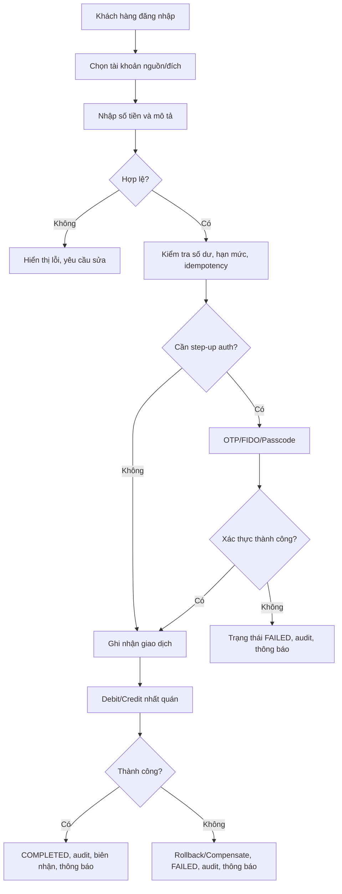

# 02. BRD

> **Dự án:** Digital Banking  
> **Tài liệu:** Business Requirements Document (BRD)  

## Mục lục

- [1. Business Context](#1-business-context)
- [2. Business Objectives](#2-business-objectives)
- [3. Stakeholder Analysis](#3-stakeholder-analysis)
- [4. Business Requirements](#4-business-requirements)
- [5. Business Processes](#5-business-processes)
- [6. Business Rules](#6-business-rules)
- [7. Business Constraints](#7-business-constraints)
- [8. Assumptions and Dependencies](#8-assumptions-and-dependencies)
- [9. Success Criteria](#9-success-criteria)
- [10. Risks and Mitigation](#10-risks-and-mitigation)
- [11. Traceability and Approval](#11-traceability-and-approval)
- [Appendix](#appendix)

---

## 1. Business Context

### 1.1. Organization and Market Context

**Digital Banking** xây dựng một hệ thống ngân hàng số ở mức MVP, phục vụ khách hàng cá nhân thực hiện chuyển tiền nội bộ và tra cứu tài khoản/lịch sử giao dịch. Hệ thống tự quản lý tài khoản, số dư và sổ cái nội bộ; không phụ thuộc vào Core Banking System thật.

Bối cảnh được sử dụng trong tài liệu này là **bối cảnh mô phỏng phục vụ đồ án**, không đại diện cho một ngân hàng cụ thể. Các quy tắc nghiệp vụ được xây dựng để chứng minh nhóm yêu cầu chung, không nhằm tái hiện đầy đủ quy trình vận hành của một ngân hàng thương mại.

| Khía cạnh          | Mô tả                                                                |
| ------------------ | -------------------------------------------------------------------- |
| Lĩnh vực           | Ngân hàng số bán lẻ                                                  |
| Đối tượng chính    | Khách hàng cá nhân                                                   |
| Sản phẩm           | Kênh số MVP cho chuyển tiền nội bộ và tra cứu tài khoản/lịch sử      |
| Nguồn dữ liệu tiền | Sổ cái nội bộ do hệ thống tự quản lý                                 |
| Hệ thống ngoài     | SMS/Email/OTP, FIDO, fraud engine – mô phỏng hoặc tích hợp tối thiểu |
| Nền tảng kỹ thuật  | Spring Boot + PostgreSQL                                             |
| Đơn vị tiền tệ     | VND                                                                  |

### 1.2. Current Business Situation

Trong bối cảnh mô phỏng, việc chuyển tiền nội bộ đang được thực hiện qua một quy trình chưa hoàn chỉnh:

- Chưa có cơ chế chống gửi trùng khi khách hàng retry do timeout.
- Chưa đảm bảo tính nguyên tử giữa debit và credit.
- Trạng thái giao dịch chưa được chuẩn hóa, khó xác định giao dịch đã hoàn tất hay thất bại.
- Audit trail chưa đầy đủ, không đủ dữ liệu để tra soát.
- Xác thực chưa phân tầng theo rủi ro; chưa có cơ chế khóa tài khoản thống nhất.
- Chưa có cơ chế phát hiện giao dịch bất thường.

### 1.3. Problem Statement

| Vấn đề | Tác động nghiệp vụ | Mục tiêu liên quan |
|---|---|---|
| Retry/timeout có thể gây double debit | Mất tiền, mất niềm tin, phát sinh khiếu nại | OBJ-002 |
| Debit thành công nhưng credit thất bại | Sổ cái không nhất quán, khó đối soát | OBJ-002, OBJ-006 |
| Trạng thái giao dịch không rõ ràng | Khách hàng/vận hành không biết giao dịch đã hoàn tất chưa | OBJ-001, OBJ-004 |
| Thiếu audit trail | Không chứng minh được ai làm gì, khi nào | OBJ-004 |
| Xác thực/phân quyền chưa đầy đủ | Tăng rủi ro truy cập trái phép và gian lận | OBJ-003, OBJ-005 |
| Không có phát hiện bất thường | Giao dịch rủi ro không được rà soát kịp thời | OBJ-005 |
| Không có bằng chứng kiểm thử tải/lỗi | Không chứng minh được độ tin cậy của hệ thống | OBJ-006 |

### 1.4. Target Business State

Hệ thống đích cần đạt các đặc điểm sau:

- Khách hàng đăng nhập an toàn và thực hiện chuyển tiền nội bộ với trạng thái rõ ràng.
- Mọi giao dịch tiền được xử lý nhất quán; retry không tạo giao dịch trùng.
- Mọi giao dịch tiền và hành động nhạy cảm có audit trail và correlation ID.
- Quyền truy cập được kiểm soát theo vai trò; dữ liệu nhạy cảm được mã hóa/che dấu.
- Các tình huống timeout, crash và lỗi từng phần có quy trình phục hồi và kết quả cuối cùng xác định.
- Giao dịch bất thường được gắn cờ để vận hành rà soát.
- Có bằng chứng kiểm chứng cho concurrency, duplicate protection, failure/recovery, security/audit và load test.

### 1.5. Scope Alignment

Phạm vi của BRD kế thừa `01. Introduction`:

| Trong phạm vi | Ngoài phạm vi |
|---|---|
| Đăng nhập/xác thực, quản lý phiên | Quản lý thẻ, bill payment, top-up, tax, loan, statement |
| Xem tài khoản/số dư | QR payment, secure message |
| Chuyển tiền nội bộ (own account và intra-bank) | Chuyển tiền liên ngân hàng/quốc tế |
| Lịch sử giao dịch | Full back-office/product setup |
| Hạn mức giao dịch/ngày | Tích hợp CBS/payment gateway thật |
| Audit, traceability, encryption | ML/AI fraud scoring nâng cao |
| Rule-based fraud flagging | Triển khai production/chứng nhận tuân thủ |
| Notification mô phỏng | Thiết kế UI/UX chi tiết, đa ngôn ngữ |
| Demo bắt buộc | Xử lý tiền thật/settlement thật |

### 1.6. Business Glossary Reference

Các thuật ngữ trong BRD này sử dụng định nghĩa tại `01. Introduction`, mục 6. Các thuật ngữ bổ sung (nếu có) sẽ được ghi rõ trong phần Appendix.

---

## 2. Business Objectives

### 2.1. Objectives and Business Outcomes

| ID | Mục tiêu | Kết quả nghiệp vụ mong đợi | Metric | Priority |
|---|---|---|---|---|
| OBJ-001 | Chuyển tiền nội bộ an toàn | Khách hàng hoàn tất chuyển tiền với trạng thái rõ ràng, không bị trừ tiền sai | MET-001, MET-002 | Must |
| OBJ-002 | Nhất quán và chống trùng | Debit/credit nhất quán; retry không tạo giao dịch trùng | MET-002 | Must |
| OBJ-003 | Xác thực và phân quyền | Hành động nhạy cảm được xác thực; quyền truy cập đúng vai trò | MET-003 | Must |
| OBJ-004 | Audit và truy vết | Mọi giao dịch tiền/hành động quan trọng có audit trail và correlation ID | MET-004 | Must |
| OBJ-005 | Phát hiện bất thường | Giao dịch rủi ro được gắn cờ để vận hành rà soát | MET-004, MET-007 | Must |
| OBJ-006 | Chịu lỗi và hiệu năng | Hệ thống xử lý được lỗi và đáp ứng mục tiêu load test | MET-005, MET-006 | Must |

### 2.2. Success Metrics

| ID | Metric | Định nghĩa | Mục tiêu | Cách đo |
|---|---|---|---|---|
| MET-001 | Giao dịch có trạng thái cuối cùng | Tỷ lệ giao dịch tiền có trạng thái COMPLETED hoặc FAILED rõ ràng | 100% | Kiểm tra dữ liệu giao dịch và audit |
| MET-002 | Double debit | Số giao dịch bị debit hai lần trong kiểm thử concurrency/idempotency | 0 | Test report |
| MET-003 | Auth + audit cho hành động nhạy cảm | Tỷ lệ hành động nhạy cảm có xác thực và audit record | 100% | Audit review/test |
| MET-004 | Audit coverage | Tỷ lệ giao dịch tiền có audit record và correlation ID | 100% | Audit review |
| MET-005 | Failure/recovery | Tỷ lệ kịch bản failure/recovery chạy thành công | 100% | Demo/test report |
| MET-006 | Load test | Throughput, latency, error rate trong kịch bản tải | 20 RPS; p95 ≤ 2 giây; lỗi < 1% trong 10 phút (đề xuất) | Load test report |
| MET-007 | Demo bắt buộc | Tỷ lệ demo bắt buộc hoàn thành | 100% | Demo checklist |

> MET-006 là **mục tiêu đề xuất**, cần xác nhận trước khi dùng làm tiêu chí nghiệm thu chính thức.

### 2.3. Objective Prioritization

| Priority | Objectives | Ghi chú |
|---|---|---|
| Must | OBJ-001, OBJ-002, OBJ-003, OBJ-004 | Là điều kiện tối thiểu để hệ thống đáng tin cậy |
| Must | OBJ-005, OBJ-006 | Cần cho yêu cầu common và demo bắt buộc |
| Should | — | Không có objective Should trong MVP |

### 2.4. Objective-to-Benefit Mapping

| Objective | Benefit chính | Chỉ số |
|---|---|---|
| OBJ-001 | An toàn tài sản, trải nghiệm rõ ràng | MET-001, MET-002 |
| OBJ-002 | Không double debit, dữ liệu nhất quán | MET-002 |
| OBJ-003 | Bảo vệ tài khoản, giảm rủi ro gian lận | MET-003 |
| OBJ-004 | Kiểm chứng và tra soát | MET-004 |
| OBJ-005 | Kiểm soát rủi ro giao dịch | MET-004, MET-007 |
| OBJ-006 | Độ tin cậy và khả năng chịu tải | MET-005, MET-006 |

---

## 3. Stakeholder Analysis

### 3.1. Stakeholder Catalog

| ID      | Stakeholder                      | Loại      | Interest | Influence  | Nhu cầu chính                                           | Pain points                                        |
| ------- | -------------------------------- | --------- | -------- | ---------- | ------------------------------------------------------- | -------------------------------------------------- |
| STK-001 | Khách hàng cá nhân               | Bên ngoài | Cao      | Trung bình | Chuyển tiền an toàn, nhanh, rõ trạng thái, bảo mật      | Sợ mất tiền, không biết giao dịch đã hoàn tất chưa |
| STK-002 | Đại diện nghiệp vụ/Product Owner | Nội bộ    | Cao      | Cao        | Phạm vi đúng, giá trị nghiệp vụ rõ, tiêu chí thành công | Scope creep, yêu cầu thiếu ưu tiên                 |
| STK-003 | Nhân viên vận hành/Admin         | Nội bộ    | Cao      | Trung bình | Tra soát, quản lý tài khoản/hạn mức, xử lý ngoại lệ     | Thiếu công cụ tra soát, dữ liệu phân mảnh          |
| STK-004 | Audit/Security/Compliance        | Nội bộ    | Cao      | Cao        | Audit trail, phân quyền, bằng chứng bảo mật             | Thiếu bằng chứng, log không đủ, khó điều tra       |
| STK-005 | Nhóm phát triển                  | Nội bộ    | Cao      | Trung bình | Yêu cầu rõ, testable, traceability                      | Yêu cầu mơ hồ, thay đổi muộn                       |

### 3.2. Needs, Expectations and Pain Points

| Stakeholder | Needs                                                          | Expectations                                    | Pain points                             |
| ----------- | -------------------------------------------------------------- | ----------------------------------------------- | --------------------------------------- |
| STK-001     | Biết chắc giao dịch thành công/thất bại; không bị trừ tiền sai | Thông báo rõ ràng, biên nhận, lịch sử chính xác | Trạng thái mơ hồ, retry gây lo lắng     |
| STK-002     | Phạm vi MVP rõ, ưu tiên rõ                                     | BRD/SRS có traceability, tiêu chí nghiệm thu    | Yêu cầu thay đổi liên tục               |
| STK-003     | Tra soát nhanh, xem audit, quản lý hạn mức                     | Công cụ tối thiểu nhưng đủ dùng                 | Thiếu dữ liệu, không có correlation ID  |
| STK-004     | Audit bất biến, kiểm soát truy cập                             | Bằng chứng kiểm thử bảo mật/audit               | Log thiếu, quyền quá rộng               |
| STK-005     | Yêu cầu rõ, testable                                           | BR/FR/NFR/AC liên kết                           | Yêu cầu mơ hồ, thiếu tiêu chí           |

### 3.3. Influence/Interest Matrix

|                               | Interest thấp | Interest cao              |
| ----------------------------- | ------------- | ------------------------- |
| **Influence cao**             | —             | STK-002, STK-004          |
| **Influence trung bình/thấp** | —             | STK-001, STK-003, STK-005 |

### 3.4. RACI

| Hoạt động               | STK-001 | STK-002 | STK-003 | STK-004 | STK-005 |
| ----------------------- | ------- | ------- | ------- | ------- | ------- |
| Phê duyệt phạm vi       | I       | A       | C       | C       | I       |
| Xác nhận business rules | C       | A       | C       | C       | I       |
| Review BRD              | I       | A       | C       | C       | R       |
| Cung cấp dữ liệu demo   | I       | I       | R       | I       | C       |
| Kiểm thử và bằng chứng  | I       | I       | C       | C       | R       |
| Nghiệm thu/demo         | I       | A       | C       | C       | R       |

> R = Responsible, A = Accountable, C = Consulted, I = Informed.

### 3.5. Stakeholder Conflicts and Resolutions

| Xung đột | Bên liên quan      | Hướng giải quyết |
|---|---|---|
| Tốc độ giao dịch vs bảo mật | STK-001 vs STK-004 | Chỉ yêu cầu step-up khi rủi ro cao hoặc vượt ngưỡng; các giao dịch thông thường dùng passcode/FIDO |
| Audit đầy đủ vs quyền riêng tư | STK-004 vs STK-001 | Audit lưu dữ liệu cần thiết; PII được che dấu; chỉ vai trò được phép xem chi tiết |
| Phạm vi đầy đủ vs tiến độ | STK-002 vs STK-005 | Ưu tiên MoSCoW; MVP chỉ gồm các yêu cầu Must |
| Tích hợp thật vs mô phỏng | STK-005            | Mô phỏng có interface rõ ràng; ghi rõ giả định và giới hạn trong tài liệu |

---

## 4. Business Requirements

### 4.1. Business Capability Map

> Tiêu chí chấp nhận chi tiết cho từng BR sẽ được đặc tả trong SRS (`AC-`) và Test plan; BRD chỉ xác định kết quả nghiệp vụ cần đạt.

| Capability | BR range | Objectives |
|---|---|---|
| Authentication & Access | BR-001 – BR-005 | OBJ-003, OBJ-004 |
| Customer & Account | BR-006 – BR-008 | OBJ-001, OBJ-003 |
| Transfer | BR-009 – BR-017 | OBJ-001, OBJ-002, OBJ-006 |
| Transaction History | BR-018 – BR-021 | OBJ-001, OBJ-004 |
| Limits | BR-022 – BR-023 | OBJ-001, OBJ-002 |
| Audit & Traceability | BR-024 – BR-028 | OBJ-004 |
| Security & Encryption | BR-029 – BR-032 | OBJ-003, OBJ-004 |
| Notification | BR-033 – BR-034 | OBJ-001, OBJ-003 |
| Fraud/Anomaly | BR-035 – BR-037 | OBJ-005 |
| Administration & Data | BR-038 – BR-041 | OBJ-003, OBJ-004 |
| Demonstration | BR-042 | OBJ-006 |

### 4.2. Authentication and Access Requirements

| ID | Business Requirement | Rationale / Outcome | Source | Priority |
|---|---|---|---|---|
| BR-001 | Hệ thống phải cho phép khách hàng đăng nhập bằng password; sau lần đăng nhập đầu tiên, khách hàng có thể dùng passcode/FIDO để xác thực nhanh theo chính sách thiết bị | Bảo vệ tài khoản, cân bằng bảo mật và trải nghiệm | STK-001, STK-004 | Must |
| BR-002 | Hệ thống phải yêu cầu OTP cho tình huống rủi ro cao: thiết bị mới, thay đổi thông tin nhạy cảm hoặc giao dịch vượt ngưỡng cấu hình | Tăng cường xác thực cho hành động rủi ro | STK-001, STK-004 | Must |
| BR-003 | Hệ thống phải khóa tạm thời/đình chỉ xác thực sau số lần sai liên tiếp theo chính sách và phải hết hạn phiên sau thời gian không hoạt động | Giảm brute force và truy cập trái phép | STK-004 | Must |
| BR-004 | Hệ thống phải phân quyền theo vai trò cho khách hàng, vận hành, admin và auditor; mỗi vai trò chỉ truy cập chức năng/dữ liệu được phép | Đảm bảo least privilege và kiểm soát truy cập | STK-002, STK-003, STK-004 | Must |
| BR-005 | Hệ thống phải ghi nhận sự kiện xác thực/bảo mật quan trọng (đăng nhập thành công/thất bại, khóa, từ chối quyền) để phục vụ audit | Cung cấp bằng chứng điều tra và giám sát | STK-004 | Must |

### 4.3. Customer and Account Requirements

| ID | Business Requirement | Rationale / Outcome | Source | Priority |
|---|---|---|---|---|
| BR-006 | Khách hàng phải xem được thông tin hồ sơ tối thiểu, danh sách tài khoản và số dư khả dụng của mình | Cung cấp thông tin cần thiết trước khi giao dịch | STK-001 | Must |
| BR-007 | Khách hàng chỉ được truy cập tài khoản thuộc sở hữu; nhân viên chỉ truy cập theo vai trò và mục đích được phép | Ngăn truy cập trái phép và rò rỉ dữ liệu | STK-001, STK-003, STK-004 | Must |
| BR-008 | Hệ thống phải kiểm tra trạng thái tài khoản nguồn/đích và từ chối giao dịch nếu tài khoản không hoạt động | Ngăn giao dịch trên tài khoản bị khóa/đóng | STK-001, STK-003 | Must |

### 4.4. Transfer Requirements

| ID | Business Requirement | Rationale / Outcome | Source | Priority |
|---|---|---|---|---|
| BR-009 | Khách hàng phải chuyển được tiền giữa các tài khoản của mình | Nhu cầu cơ bản của khách hàng | STK-001 | Must |
| BR-010 | Khách hàng phải chuyển được tiền đến tài khoản của khách hàng khác trong cùng hệ thống | Hỗ trợ giao dịch nội bộ giữa khách hàng | STK-001 | Must |
| BR-011 | Hệ thống phải kiểm tra số tiền > 0, tối đa 2 chữ số thập phân, tài khoản nguồn khác tài khoản đích, tài khoản hoạt động, quyền sở hữu và số dư khả dụng | Ngăn giao dịch không hợp lệ và bảo vệ số dư | STK-001, STK-004 | Must |
| BR-012 | Hệ thống phải thực thi hạn mức giao dịch và hạn mức ngày do ngân hàng cấu hình | Kiểm soát rủi ro và tuân thủ chính sách | STK-002, STK-004 | Must |
| BR-013 | Hệ thống phải đảm bảo retry cùng một yêu cầu chuyển tiền không tạo giao dịch hoặc debit thứ hai | Ngăn double debit khi timeout/retry | STK-001, STK-004 | Must |
| BR-014 | Mỗi giao dịch chuyển tiền phải có vòng đời trạng thái rõ ràng và trạng thái cuối cùng (COMPLETED/FAILED) | Giúp khách hàng/vận hành biết kết quả thực tế | STK-001, STK-003 | Must |
| BR-015 | Hệ thống phải xử lý các kịch bản debit thành công/credit thất bại, timeout và crash mà không làm mất tiền hoặc để lại trạng thái không nhất quán | Bảo vệ tài sản và tính đúng đắn của sổ cái | STK-001, STK-004 | Must |
| BR-016 | Khách hàng nên nhận được biên nhận/kết quả giao dịch có mã tham chiếu, thời gian và trạng thái | Tăng minh bạch và khả năng tra cứu | STK-001 | Should |
| BR-017 | Khách hàng nên có thể nhập mô tả giao dịch trong giới hạn độ dài; hệ thống không lưu dữ liệu nhạy cảm trong mô tả | Hỗ trợ nhận diện giao dịch, hạn chế rò rỉ dữ liệu | STK-001, STK-004 | Should |

#### 4.4.1. Transfer Status Model

| Status | Ý nghĩa | Terminal? | Chuyển tiếp hợp lệ |
|---|---|---|---|
| PENDING | Giao dịch đã được tiếp nhận và đang xử lý | Không | COMPLETED, FAILED |
| COMPLETED | Debit/credit đã hoàn tất và nhất quán | Có | Không |
| FAILED | Giao dịch không hoàn tất; không có tiền bị mất hoặc đã được hoàn tác đầy đủ | Có | Không |

**Quy tắc:** trạng thái terminal không được sửa trực tiếp. Nếu cần điều chỉnh sau COMPLETED, phải tạo giao dịch mới theo quy trình được phê duyệt (ngoài phạm vi MVP).

#### 4.4.2. Idempotency Semantics

- Mỗi yêu cầu tạo chuyển tiền phải có idempotency key do client gửi.
- Cùng key + cùng nội dung yêu cầu: hệ thống trả lại kết quả của lần xử lý đầu tiên, không tạo giao dịch mới.
- Cùng key + nội dung khác: hệ thống phải từ chối và ghi nhận sự kiện bất thường.
- Key không được chứa dữ liệu nhạy cảm; thời gian lưu key đề xuất tối thiểu 24 giờ (cần xác nhận).
- Idempotency áp dụng cho API tạo chuyển tiền; các thao tác đọc không cần key.

#### 4.4.3. Failure and Recovery Outcomes

| Tình huống | Kết quả nghiệp vụ bắt buộc |
|---|---|
| Client timeout, khách hàng retry | Retry cùng idempotency key trả lại kết quả ban đầu; không debit lần hai |
| Debit thành công, credit thất bại | Hoàn tác/compensate đầy đủ; trạng thái cuối cùng FAILED; không mất tiền |
| Service crash giữa giao dịch | Khi khởi động lại, giao dịch PENDING được đối soát; xác định COMPLETED hoặc FAILED; audit và thông báo |
| Lỗi xác thực | Giao dịch không được ghi nhận là thành công; trạng thái FAILED hoặc không tạo giao dịch |

#### 4.4.4. Audit Record Requirements

Mỗi audit record cho giao dịch tiền phải có tối thiểu:

| Trường | Mô tả |
|---|---|
| Audit ID | Mã duy nhất của bản ghi audit |
| Timestamp | Thời điểm sự kiện |
| Actor | Người/hệ thống thực hiện |
| Role | Vai trò tại thời điểm thực hiện |
| Action | Hành động (tạo, xác nhận, hủy bỏ, hoàn tác, đăng nhập, đổi hạn mức…) |
| Entity | Đối tượng bị tác động (transfer, account, role…) |
| Before/After hoặc Delta | Trạng thái trước/sau hoặc thay đổi |
| Amount/Currency | Số tiền và đơn vị tiền tệ nếu có |
| Correlation ID | Mã xuyên suốt request/luồng xử lý |
| Outcome | Kết quả (success/failure/rejected) |

Chi tiết schema sẽ được đặc tả trong SRS và tài liệu Database analysis.

### 4.5. Transaction History Requirements

| ID | Business Requirement | Rationale / Outcome | Source | Priority |
|---|---|---|---|---|
| BR-018 | Khách hàng phải xem được lịch sử giao dịch với trạng thái, số tiền, đối tác và thời gian | Giúp khách hàng theo dõi và đối chiếu giao dịch | STK-001 | Must |
| BR-019 | Khách hàng phải xem được chi tiết giao dịch với mã tham chiếu, trạng thái và thông tin an toàn | Hỗ trợ tra cứu và khiếu nại | STK-001 | Must |
| BR-020 | Khách hàng nên lọc/tìm kiếm lịch sử theo khoảng thời gian, trạng thái và số tiền | Tăng khả năng tra cứu khi có nhiều giao dịch | STK-001 | Should |
| BR-021 | Lịch sử giao dịch phải là read-only; không cho sửa/xóa; điều chỉnh phải bằng bản ghi mới | Bảo toàn dữ liệu và audit | STK-004 | Must |

### 4.6. Limits Requirements

| ID | Business Requirement | Rationale / Outcome | Source | Priority |
|---|---|---|---|---|
| BR-022 | Khách hàng nên xem được hạn mức hiện tại và hạn mức ngày còn lại | Giúp khách hàng chủ động lập kế hoạch giao dịch | STK-001 | Should |
| BR-023 | Vận hành nên cấu hình được hạn mức trong phạm vi chính sách; thay đổi phải được audit | Kiểm soát rủi ro và thay đổi có kiểm chứng | STK-003, STK-004 | Should |

> Việc **thực thi** hạn mức là BR-012; BR-022/BR-023 chỉ quy định khả năng xem/cấu hình.

### 4.7. Audit and Traceability Requirements

| ID | Business Requirement | Rationale / Outcome | Source | Priority |
|---|---|---|---|---|
| BR-024 | Mọi giao dịch tiền phải tạo audit record bất biến với actor, thời gian, hành động, số tiền, tài khoản, trạng thái và correlation ID | Cung cấp bằng chứng đầy đủ để tra soát | STK-004 | Must |
| BR-025 | Mọi hành động nhạy cảm (đăng nhập, khóa, đổi hạn mức, đổi vai trò, đổi trạng thái tài khoản, admin) phải được audit | Phát hiện và điều tra hành vi bất thường | STK-004 | Must |
| BR-026 | Audit record phải tra cứu được bởi vận hành/auditor theo quyền; không được sửa/xóa | Hỗ trợ điều tra và kiểm toán | STK-003, STK-004 | Must |
| BR-027 | Hệ thống phải cung cấp traceability end-to-end qua correlation ID xuyên suốt request, giao dịch, sổ cái và thông báo | Rút ngắn thời gian điều tra sự cố | STK-004, STK-005 | Must |
| BR-028 | Audit record phải có bằng chứng chống sửa đổi và được lưu theo chính sách | Đảm bảo giá trị pháp lý/kiểm toán | STK-004 | Must |

### 4.8. Security and Encryption Requirements

| ID | Business Requirement | Rationale / Outcome | Source | Priority |
|---|---|---|---|---|
| BR-029 | Dữ liệu truyền tải giữa client/hệ thống phải được mã hóa bằng TLS | Ngăn nghe lén/chỉnh sửa trên đường truyền | STK-004 | Must |
| BR-030 | Dữ liệu nhạy cảm khi lưu trữ phải được mã hóa; PII phải được che dấu trên UI/log | Giảm rủi ro rò rỉ dữ liệu | STK-004 | Must |
| BR-031 | Secret/key phải được quản lý an toàn, không hard-code trong source/config công khai | Ngăn lộ khóa và truy cập trái phép | STK-004, STK-005 | Must |
| BR-032 | Hệ thống phải có biện pháp bảo vệ chống các lỗ hổng web phổ biến (auth bypass, injection, XSS, CSRF) và ghi nhận sự kiện bảo mật | Bảo vệ hệ thống trước tấn công cơ bản | STK-004, STK-005 | Must |

### 4.9. Notification Requirements

| ID | Business Requirement | Rationale / Outcome | Source | Priority |
|---|---|---|---|---|
| BR-033 | Hệ thống nên thông báo kết quả giao dịch qua in-app/email/SMS (mô phỏng) | Giúp khách hàng biết kết quả kịp thời | STK-001 | Should |
| BR-034 | OTP phải có thời hạn; thông báo không được chứa đầy đủ số tài khoản/dữ liệu nhạy cảm | Bảo vệ OTP và dữ liệu khách hàng | STK-004 | Must |

### 4.10. Fraud and Anomaly Requirements

| ID | Business Requirement | Rationale / Outcome | Source | Priority |
|---|---|---|---|---|
| BR-035 | Hệ thống phải gắn cờ giao dịch vượt ngưỡng giá trị lớn do ngân hàng cấu hình | Phát hiện giao dịch rủi ro cao | STK-004 | Must |
| BR-036 | Hệ thống phải gắn cờ giao dịch có tần suất cao trong khoảng thời gian cấu hình | Phát hiện hành vi bất thường | STK-004 | Must |
| BR-037 | Hệ thống nên gắn cờ các dấu hiệu bất thường cơ bản (người nhận mới, thời điểm/thiết bị bất thường); vận hành rà soát; chỉ tự động chặn nếu chính sách cho phép | Tăng cường kiểm soát gian lận ở mức cơ bản | STK-003, STK-004 | Should |

### 4.11. Administration and Data Requirements

| ID | Business Requirement | Rationale / Outcome | Source | Priority |
|---|---|---|---|---|
| BR-038 | Vận hành phải xem được dữ liệu khách hàng/tài khoản/giao dịch trong phạm vi quyền | Hỗ trợ tra soát và xử lý ngoại lệ | STK-003 | Must |
| BR-039 | Admin phải quản lý được vai trò/quyền/hạn mức; thay đổi nhạy cảm cần xác thực mạnh, maker/checker và audit | Ngăn lạm dụng quyền quản trị | STK-003, STK-004 | Must |
| BR-040 | Hệ thống phải phân loại dữ liệu (PII, tài chính, audit) và áp dụng quy tắc truy cập/xử lý tương ứng | Bảo vệ dữ liệu theo mức độ nhạy cảm | STK-004 | Must |
| BR-041 | Hệ thống phải lưu trữ/archival giao dịch và audit theo chính sách, hỗ trợ legal hold | Đáp ứng yêu cầu tra soát dài hạn | STK-004 | Must |

### 4.12. Demonstration Requirement

| ID     | Business Requirement                                                                                                                         | Rationale / Outcome                        | Source  | Priority |
| ------ | -------------------------------------------------------------------------------------------------------------------------------------------- | ------------------------------------------ | ------- | -------- |
| BR-042 | Nhóm phải cung cấp bằng chứng cho các demo bắt buộc: concurrency, duplicate protection, failure/recovery, security & audit review, load test | Chứng minh hệ thống đáp ứng yêu cầu common | STK-002 | Must     |

### 4.13. Priority Summary

| Priority | Số lượng | BR IDs |
|---|---|---|
| Must | 35 | BR-001 – BR-015, BR-018, BR-019, BR-021, BR-024 – BR-032, BR-034 – BR-036, BR-038 – BR-042 |
| Should | 7 | BR-016, BR-017, BR-020, BR-022, BR-023, BR-033, BR-037 |

### 4.14. Out-of-Scope and Deferred Requirements

- Hủy giao dịch (cancellation) và quy trình reversal/refund sau khi đã COMPLETED.
- Chuyển tiền liên ngân hàng/quốc tế.
- Phí, lãi, tỷ giá và đối soát với CBS.
- ML/AI fraud scoring nâng cao.
- Full back-office: product setup, fee engine, GL mapping, report center.
- Statement, card, bill payment, top-up, tax, loan, QR, secure message.

---

## 5. Business Processes

### 5.1. Process Inventory

| ID | Process | Trigger | Primary actors | Related BR |
|---|---|---|---|---|
| BP-001 | Authentication and session | Khách hàng đăng nhập/phiên hết hạn | STK-001, STK-004 | BR-001 – BR-005 |
| BP-002 | Internal transfer | Khách hàng tạo yêu cầu chuyển tiền | STK-001 | BR-009 – BR-017 |
| BP-003 | Failure and recovery | Timeout, partial failure, crash | STK-001, STK-003, STK-004 | BR-015, BR-024 – BR-028 |
| BP-004 | History and audit review | Khách hàng xem lịch sử; auditor tra soát | STK-001, STK-003, STK-004 | BR-018 – BR-028 |
| BP-005 | Limit management | Khách hàng xem hạn mức; vận hành cấu hình | STK-001, STK-003 | BR-012, BR-022 – BR-023 |
| BP-006 | Fraud/anomaly review | Giao dịch bị gắn cờ | STK-003, STK-004 | BR-035 – BR-037 |
| BP-007 | Administration and role management | Admin thay đổi vai trò/quyền/hạn mức | STK-003, STK-004 | BR-038 – BR-039 |

### 5.2. BP-001 – Authentication and Session

| Trường | Nội dung |
|---|---|
| Trigger | Khách hàng mở ứng dụng/đăng nhập; phiên hết hạn |
| Actors | Khách hàng, hệ thống xác thực, audit |
| Preconditions | Tài khoản tồn tại và đang hoạt động; kênh xác thực khả dụng |
| Main flow | 1) Khách hàng nhập định danh/password. 2) Hệ thống xác thực. 3) Nếu thiết bị mới/rủi ro cao, yêu cầu OTP. 4) Nếu hợp lệ, tạo phiên và ghi audit. 5) Khách hàng vào kênh số. |
| Alternate/exception | Sai password/OTP → trả lỗi, tăng bộ đếm; vượt ngưỡng → khóa tạm thời; OTP hết hạn → yêu cầu gửi lại; tài khoản bị khóa → từ chối |
| Postconditions | Phiên hợp lệ hoặc tài khoản bị khóa theo chính sách; audit record được tạo |
| Related rules | BRL-001 – BRL-006 |

### 5.3. BP-002 – Internal Transfer

| Trường | Nội dung |
|---|---|
| Trigger | Khách hàng chọn chức năng chuyển tiền và gửi yêu cầu |
| Actors | Khách hàng, hệ thống chuyển tiền, audit, notification |
| Preconditions | Khách hàng đã đăng nhập; tài khoản nguồn/đích tồn tại; kênh xử lý khả dụng |
| Main flow | 1) Chọn tài khoản nguồn/đích. 2) Nhập số tiền, mô tả. 3) Hệ thống kiểm tra hợp lệ, số dư, hạn mức, idempotency. 4) Yêu cầu step-up auth nếu cần. 5) Ghi nhận giao dịch và cập nhật sổ cái nhất quán. 6) Xác định trạng thái cuối cùng. 7) Ghi audit. 8) Gửi thông báo và hiển thị biên nhận. |
| Alternate/exception | Thiếu số dư → từ chối; vượt hạn mức → từ chối; tài khoản không hoạt động → từ chối; xác thực thất bại → không ghi nhận thành công; retry trùng → trả kết quả cũ; lỗi hệ thống → chuyển sang BP-003 |
| Postconditions | Giao dịch COMPLETED hoặc FAILED; sổ cái nhất quán; audit và thông báo được tạo |
| Related rules | BRL-009 – BRL-017 |

**Hình 1 – Luồng nghiệp vụ chuyển tiền nội bộ**

### 5.4. BP-003 – Failure and Recovery

| Trường | Nội dung |
|---|---|
| Trigger | Timeout, debit thành công/credit thất bại, service crash hoặc trạng thái PENDING quá hạn |
| Actors | Hệ thống, vận hành, audit |
| Preconditions | Có giao dịch PENDING hoặc tín hiệu lỗi từ luồng xử lý |
| Main flow | 1) Phát hiện giao dịch PENDING/ambiguous. 2) Đối soát trạng thái debit/credit. 3) Nếu hoàn tất đầy đủ → COMPLETED. 4) Nếu không hoàn tất → rollback/compensate và FAILED. 5) Ghi audit. 6) Thông báo khách hàng. |
| Alternate/exception | Không thể đối soát tự động → chuyển vận hành rà soát; mọi thay đổi trạng thái phải có audit |
| Postconditions | Không có tiền bị mất; trạng thái cuối cùng rõ ràng; khách hàng được thông báo |
| Related rules | BRL-013 – BRL-017, BRL-021 – BRL-024 |

### 5.5. BP-004 – History and Audit Review

| Trường | Nội dung |
|---|---|
| Trigger | Khách hàng xem lịch sử; vận hành/auditor tra soát |
| Actors | Khách hàng, vận hành, auditor |
| Preconditions | Người dùng đã đăng nhập và có quyền tương ứng |
| Main flow | 1) Mở lịch sử/audit. 2) Lọc theo thời gian/trạng thái/mã tham chiếu/correlation ID. 3) Xem chi tiết. 4) Nếu cần, xuất bằng chứng theo quyền. |
| Alternate/exception | Không có dữ liệu → hiển thị thông báo; không đủ quyền → từ chối và ghi audit |
| Postconditions | Người dùng nhận được thông tin cần tra cứu; không thay đổi dữ liệu gốc |
| Related rules | BRL-018 – BRL-024 |

### 5.6. BP-005 – Limit Management

| Trường | Nội dung |
|---|---|
| Trigger | Khách hàng xem hạn mức; vận hành cấu hình hạn mức |
| Actors | Khách hàng, vận hành, audit |
| Preconditions | Người dùng có quyền; chính sách hạn mức đã được cấu hình |
| Main flow | 1) Xem hạn mức hiện tại/hạn mức còn lại. 2) Vận hành nhập thay đổi trong phạm vi chính sách. 3) Xác thực mạnh/maker-checker nếu cần. 4) Áp dụng và ghi audit. |
| Alternate/exception | Vượt phạm vi chính sách → từ chối; thiếu quyền → từ chối; thay đổi nhạy cảm không được duyệt → không áp dụng |
| Postconditions | Hạn mức được cập nhật hoặc giữ nguyên; audit record được tạo |
| Related rules | BRL-012, BRL-032 |

### 5.7. BP-006 – Fraud and Anomaly Review

| Trường | Nội dung |
|---|---|
| Trigger | Giao dịch vượt ngưỡng giá trị/tần suất hoặc có dấu hiệu bất thường |
| Actors | Rule engine, vận hành, audit |
| Preconditions | Rule đã được cấu hình; giao dịch có dữ liệu cần đánh giá |
| Main flow | 1) Rule engine gắn cờ. 2) Ghi audit. 3) Vận hành xem danh sách cờ. 4) Quyết định cho phép/giữ/rà soát thêm. 5) Ghi nhận quyết định. |
| Alternate/exception | Rule engine lỗi → giao dịch vẫn được xử lý theo luồng chính và ghi nhận lỗi; không tự động chặn nếu chưa cấu hình |
| Postconditions | Giao dịch được gắn cờ và có quyết định rà soát; audit đầy đủ |
| Related rules | BRL-029 – BRL-031 |

### 5.8. BP-007 – Administration and Role Management

| Trường | Nội dung |
|---|---|
| Trigger | Admin tạo/khóa vai trò, thay đổi quyền hoặc cấu hình |
| Actors | Admin, checker, audit |
| Preconditions | Admin đã đăng nhập, có quyền; thay đổi nhạy cảm cần maker/checker |
| Main flow | 1) Tạo yêu cầu thay đổi. 2) Checker xem xét. 3) Xác thực mạnh. 4) Áp dụng thay đổi. 5) Ghi audit. |
| Alternate/exception | Checker từ chối → không áp dụng; thiếu quyền → từ chối; thay đổi không hợp lệ → trả lỗi |
| Postconditions | Vai trò/quyền được cập nhật hoặc giữ nguyên; audit đầy đủ |
| Related rules | BRL-007, BRL-008, BRL-032 |

---

## 6. Business Rules

### 6.1. Authentication and Access Rules

| ID | Business Rule | Loại | Related BR | Ghi chú |
|---|---|---|---|---|
| BRL-001 | Đăng nhập yêu cầu password; passcode/FIDO được dùng sau lần đăng nhập đầu tiên theo chính sách thiết bị | Policy | BR-001 | Đề xuất |
| BRL-002 | OTP bắt buộc cho thiết bị mới, hành động rủi ro cao hoặc giao dịch vượt ngưỡng | Policy | BR-002 | Ngưỡng cấu hình |
| BRL-003 | 5 lần xác thực sai liên tiếp → khóa 10 phút; 3 lần khóa trong 24 giờ → khóa tài khoản | Policy | BR-003 | Giá trị đề xuất, cần xác nhận |
| BRL-004 | OTP có hiệu lực 5 phút, dùng một lần, tối đa 5 lần thử | Policy | BR-002, BR-034 | Giá trị đề xuất |
| BRL-005 | Phiên hết hạn sau 15 phút không hoạt động; phiên tuyệt đối 8 giờ; logout vô hiệu hóa phiên | Policy | BR-003 | Giá trị đề xuất |
| BRL-006 | Password tối thiểu 8 ký tự, có chữ hoa/thường/số/ký tự đặc biệt; không chứa thông tin cá nhân; không trùng 3 password gần nhất | Policy | BR-001 | Giá trị đề xuất |
| BRL-007 | Khách hàng chỉ truy cập tài khoản của mình; nhân viên truy cập theo vai trò và least privilege | Policy | BR-004, BR-007 | Bắt buộc |
| BRL-008 | Thay đổi vai trò/quyền/hạn mức nhạy cảm cần xác thực mạnh, maker/checker và audit | Policy | BR-039 | Bắt buộc |

### 6.2. Transfer Rules

| ID | Business Rule | Loại | Related BR | Ghi chú |
|---|---|---|---|---|
| BRL-009 | Số tiền > 0, tối đa 2 chữ số thập phân, đơn vị VND | Validation | BR-011 | Bắt buộc |
| BRL-010 | Tài khoản nguồn khác tài khoản đích; cả hai phải hoạt động; tài khoản nguồn thuộc khách hàng | Validation | BR-008, BR-011 | Bắt buộc |
| BRL-011 | Số dư khả dụng phải >= số tiền chuyển; MVP không tính phí | Validation | BR-011 | Phí ngoài phạm vi |
| BRL-012 | Hạn mức giao dịch và hạn mức ngày phải được thực thi; hạn mức ngày reset theo timezone cấu hình (đề xuất Asia/Ho_Chi_Minh) | Policy | BR-012, BR-022, BR-023 | Giá trị cấu hình |
| BRL-013 | Idempotency key bắt buộc cho tạo chuyển tiền; cùng key + cùng payload trả kết quả cũ; cùng key + payload khác bị từ chối | Validation | BR-013 | Bắt buộc; TTL 24h là đề xuất (OI-001); nếu cần chống trùng dài hạn, bổ sung client_request_id hoặc tăng TTL |
| BRL-014 | Trạng thái giao dịch: PENDING → COMPLETED/FAILED; trạng thái terminal không đổi | Policy | BR-014 | Bắt buộc |
| BRL-015 | Debit thành công/credit thất bại phải rollback/compensate đầy đủ; kết quả cuối cùng FAILED; không mất tiền | Policy | BR-015 | Bắt buộc |
| BRL-016 | Retry do timeout với cùng key trả lại kết quả ban đầu; không debit lần hai | Policy | BR-013, BR-015 | Bắt buộc |
| BRL-017 | Service crash phải được đối soát khi khởi động lại; giao dịch PENDING phải có kết quả cuối cùng, audit và thông báo | Policy | BR-015, BR-024 | Bắt buộc |

### 6.3. History, Audit and Traceability Rules

| ID | Business Rule | Loại | Related BR | Ghi chú |
|---|---|---|---|---|
| BRL-018 | Lịch sử giao dịch read-only; không sửa/xóa; điều chỉnh bằng bản ghi mới | Policy | BR-021 | Bắt buộc |
| BRL-019 | Lịch sử hiển thị trạng thái, số tiền, đối tác, thời gian; dữ liệu nhạy cảm được che dấu | Policy | BR-018, BR-030 | Bắt buộc |
| BRL-020 | Chi tiết giao dịch có mã tham chiếu, trạng thái và thông tin an toàn | Policy | BR-019 | Bắt buộc |
| BRL-021 | Mọi giao dịch tiền/hành động nhạy cảm tạo audit record với actor, thời gian, action, entity, before/after, amount, correlation ID, outcome | Policy | BR-024, BR-025 | Bắt buộc |
| BRL-022 | Audit record append-only; không cập nhật/xóa; có bằng chứng chống sửa đổi | Policy | BR-026, BR-028 | Bắt buộc |
| BRL-023 | Audit tra cứu được theo correlation ID/mã tham chiếu/thời gian bởi vai trò được phép | Policy | BR-026, BR-027 | Bắt buộc |
| BRL-024 | Audit/transaction data lưu theo chính sách; hỗ trợ legal hold; thời hạn đề xuất tối thiểu 5 năm | Policy | BR-028, BR-041 | Giá trị đề xuất |

### 6.4. Security Rules

| ID | Business Rule | Loại | Related BR | Ghi chú |
|---|---|---|---|---|
| BRL-025 | Mọi kết nối bên ngoài dùng TLS | Policy | BR-029 | Bắt buộc |
| BRL-026 | Dữ liệu nhạy cảm khi lưu trữ được mã hóa; PII được che dấu trên UI/log | Policy | BR-030 | Bắt buộc |
| BRL-027 | Secret/key được quản lý an toàn; không hard-code | Policy | BR-031 | Bắt buộc |

### 6.5. Notification and Fraud Rules

| ID | Business Rule | Loại | Related BR | Ghi chú |
|---|---|---|---|---|
| BRL-028 | Thông báo kết quả giao dịch không chứa đầy đủ số tài khoản/dữ liệu nhạy cảm; OTP chỉ chứa nội dung tối thiểu | Policy | BR-033, BR-034 | Bắt buộc |
| BRL-029 | Giao dịch vượt ngưỡng giá trị lớn bị gắn cờ | Policy | BR-035 | Ngưỡng cấu hình |
| BRL-030 | Giao dịch vượt ngưỡng tần suất trong khoảng thời gian bị gắn cờ (đề xuất > 5 giao dịch/10 phút) | Policy | BR-036 | Giá trị đề xuất |
| BRL-031 | Dấu hiệu bất thường cơ bản (người nhận mới, thời điểm/thiết bị bất thường) được gắn cờ; vận hành rà soát; chỉ tự động chặn nếu cấu hình | Policy | BR-037 | Đề xuất |

### 6.6. Administration and Data Rules

| ID | Business Rule | Loại | Related BR | Ghi chú |
|---|---|---|---|---|
| BRL-032 | Thay đổi hạn mức/quyền cần xác thực mạnh và audit | Policy | BR-023, BR-039 | Bắt buộc |
| BRL-033 | Dữ liệu được phân loại PII/tài chính/audit; quyền truy cập theo vai trò | Policy | BR-040 | Bắt buộc |
| BRL-034 | Dữ liệu giao dịch/audit được lưu trữ, archival và legal hold theo chính sách | Policy | BR-041 | Bắt buộc |

### 6.7. Proposed Values Requiring Confirmation

| Nhóm | Giá trị đề xuất | Trạng thái |
|---|---|---|
| Số lần xác thực sai | 5 lần → khóa 10 phút; 3 lần khóa/24 giờ → khóa tài khoản | Cần xác nhận |
| OTP | Hiệu lực 5 phút; tối đa 5 lần thử; dùng một lần | Cần xác nhận |
| Session | 15 phút không hoạt động; tối đa 8 giờ | Cần xác nhận |
| Password | Tối thiểu 8 ký tự; chữ hoa/thường/số/ký tự đặc biệt; không trùng 3 password gần nhất | Cần xác nhận |
| Idempotency key | Lưu tối thiểu 24 giờ | Cần xác nhận |
| Hạn mức | Cấu hình theo khách hàng/sản phẩm; chưa đặt giá trị mặc định | Cần xác nhận |
| Fraud | Ngưỡng giá trị lớn và tần suất cấu hình; đề xuất > 5 giao dịch/10 phút | Cần xác nhận |
| Audit retention | Tối thiểu 5 năm | Cần xác nhận |
| Timezone | Asia/Ho_Chi_Minh cho reset hạn mức ngày | Cần xác nhận |

### 6.8. Rule Governance

- BRD là nguồn quản lý chính thức của business rules (`BRL-`).
- SRS tham chiếu `BRL-` và bổ sung `SYS-RL-` cho cách hệ thống thực thi.
- Thay đổi rule phải có lý do, người đề xuất, người phê duyệt và ngày hiệu lực.
- Rule có ảnh hưởng tài chính/bảo mật phải được audit và kiểm thử hồi quy.

---

## 7. Business Constraints

| ID | Constraint | Loại | Ảnh hưởng |
|---|---|---|---|
| CON-001 | MVP chỉ gồm các chức năng trong phạm vi 01. Introduction | Scope | Không mở rộng sang card/bill/loan/statement |
| CON-002 | Hệ thống tự quản lý ledger; không tích hợp CBS thật | Architecture/Business | Không có đối soát CBS; dữ liệu tiền do hệ thống quản lý |
| CON-003 | SMS/Email/OTP, FIDO, fraud engine ở mức mô phỏng | Integration | Không phản ánh đầy đủ hành vi nhà cung cấp thật |
| CON-004 | Nền tảng Spring Boot + PostgreSQL | Technical | Ảnh hưởng thiết kế và kiểm thử |
| CON-005 | Đơn vị tiền tệ VND; không có phí/lãi/tỷ giá trong MVP | Business | Transfer amount = debit amount |
| CON-006 | Không xử lý tiền thật/settlement thật | Business | Chỉ phục vụ demo/học tập |
| CON-007 | Thời gian và nguồn lực theo kế hoạch môn học/đồ án | Project | Ưu tiên Must, hạn chế scope mở rộng |
| CON-008 | Tuân thủ bảo mật/quyền riêng tư ở mức đồ án; không chứng nhận | Compliance | Không thay thế kiểm toán/PCI-DSS/ISO |
| CON-009 | Audit bất biến và có thể tra cứu | Compliance | Không cho sửa/xóa audit record |
| CON-010 | Fraud chỉ rule-based, không ML | Scope/Technical | Không có scoring nâng cao |

---

## 8. Assumptions and Dependencies

### 8.1. Assumptions

| ID | Assumption | Ảnh hưởng nếu sai |
|---|---|---|
| ASM-001 | Đây là đồ án/MVP, không phải hệ thống production | Phạm vi NFR/compliance phải mở rộng |
| ASM-002 | Hệ thống tự quản lý ledger; không có CBS thật | Phải bổ sung tích hợp CBS và đối soát |
| ASM-003 | SMS/Email/OTP, FIDO, fraud engine được mô phỏng | Phải bổ sung hợp đồng tích hợp thật |
| ASM-004 | Tiền tệ mặc định là VND; có thể cấu hình | Ảnh hưởng định dạng số tiền và rule hạn mức |
| ASM-005 | Người dùng demo có thiết bị hỗ trợ passcode/FIDO hoặc dùng fallback | Cần điều chỉnh luồng xác thực |
| ASM-006 | Các quy tắc nghiệp vụ chi tiết sẽ được chốt trong BRD/SRS | Có thể phải cập nhật lại scope |
| ASM-007 | MVP không có phí, lãi, tỷ giá; chỉ chuyển tiền nội bộ | Phải bổ sung rule tài chính và đối soát |
| ASM-008 | Reset hạn mức ngày theo timezone cấu hình (đề xuất Asia/Ho_Chi_Minh) | Có thể sai lệch ranh giới ngày |
| ASM-009 | Các ngưỡng bảo mật/fraud/retention đề xuất sẽ được xác nhận | Có thể phải sửa rule/acceptance criteria |

### 8.2. Dependencies

| ID | Dependency | Ảnh hưởng nếu không có |
|---|---|---|
| DEP-001 | Môi trường Spring Boot + PostgreSQL | Không thể triển khai demo |
| DEP-002 | Dịch vụ mô phỏng OTP/SMS/Email/FIDO | Không thể demo xác thực |
| DEP-003 | Bộ dữ liệu demo và tài khoản thử nghiệm | Không thể chạy test end-to-end |
| DEP-004 | Xác nhận của nhóm/giảng viên về phạm vi và tiêu chí đánh giá | Có thể phải điều chỉnh tài liệu |
| DEP-005 | Stakeholder sẵn sàng review rule/acceptance criteria | Chậm tiến độ và tăng rủi ro hiểu sai |

---

## 9. Success Criteria

### 9.1. Business Success Criteria

| Tiêu chí | Liên kết | Bằng chứng |
|---|---|---|
| Tất cả business requirement Must được triển khai và kiểm chứng | BR-001 – BR-015, BR-018, BR-019, BR-021, BR-024 – BR-032, BR-034 – BR-036, BR-038 – BR-042 | Traceability matrix + test report |
| 100% giao dịch tiền có trạng thái cuối cùng rõ ràng | MET-001 | Transaction/audit report |
| Không có double debit trong test concurrency/idempotency | MET-002 | Test report |
| 100% hành động nhạy cảm có auth + audit | MET-003, MET-004 | Audit review |
| 100% giao dịch tiền có audit record + correlation ID | MET-004 | Audit review |
| Tất cả demo failure/recovery chạy thành công | MET-005 | Demo checklist |
| Load test đạt mục tiêu đề xuất | MET-006 | Load test report |
| Tất cả demo bắt buộc hoàn thành | MET-007 | Demo checklist |
| Không còn defect Critical/High mở | — | Defect log |

### 9.2. Business Acceptance Criteria

Hệ thống được chấp nhận khi:

1. Khách hàng hoàn tất chuyển tiền nội bộ và thấy trạng thái cuối cùng.
2. Retry cùng idempotency key không tạo giao dịch/debit thứ hai.
3. Kịch bản debit thành công/credit thất bại không làm mất tiền và kết thúc FAILED.
4. Kịch bản timeout/crash được phục hồi và có audit/notification.
5. Giao dịch tiền/hành động nhạy cảm có audit record và correlation ID.
6. Phân quyền customer/operations/admin/auditor hoạt động đúng.
7. Dữ liệu nhạy cảm được mã hóa/che dấu theo yêu cầu.
8. Giao dịch bất thường được gắn cờ và có thể rà soát.
9. Các demo concurrency, duplicate, failure/recovery, security/audit, load test có bằng chứng.
10. BRD/SRS được phê duyệt và không còn open issue mức Critical.

### 9.3. Measurement Plan

| Hoạt động | Cách đo | Người chịu trách nhiệm |
|---|---|---|
| Review yêu cầu | Traceability matrix + sign-off | BA/Nhóm phát triển |
| Kiểm thử chức năng | Test report + defect log | QA/Nhóm phát triển |
| Kiểm thử concurrency/idempotency | Test report + audit log | Nhóm phát triển |
| Security/audit review | Checklist + audit evidence | Audit/Security |
| Load test | Load test report | Nhóm phát triển |
| Demo | Demo checklist + biên bản | Nhóm phát triển/Giảng viên |

### 9.4. Sign-off Criteria

- BRD được review và phê duyệt bởi STK-002.
- Các open issue mức Critical được đóng hoặc có quyết định chấp nhận rủi ro.
- SRS được phê duyệt và traceability matrix đầy đủ.
- Test plan được thực thi; bằng chứng demo được lưu trữ.
- Biên bản nghiệm thu được ký xác nhận.

---

## 10. Risks and Mitigation

| ID | Risk | Likelihood | Impact | Mitigation | Owner |
|---|---|---|---|---|---|
| RSK-001 | Scope creep vượt MVP | Cao | Cao | Kiểm soát bằng MoSCoW; mọi thay đổi phải qua change control | STK-002 |
| RSK-002 | Business rule/ngưỡng chưa rõ | Cao | Trung bình | Chốt bảng proposed values; review với stakeholder | STK-002 |
| RSK-003 | Mô phỏng khác hệ thống thật | Trung bình | Trung bình | Đặc tả interface, ghi rõ giả định, thiết kế có thể thay thế | STK-005 |
| RSK-004 | Lỗi consistency khi concurrency | Trung bình | Cao | Test concurrency, idempotency, audit review | STK-005 |
| RSK-005 | Lỗ hổng bảo mật trong demo | Trung bình | Cao | Security checklist, review quyền, che dấu dữ liệu | STK-004 |
| RSK-006 | Thiếu thời gian/nguồn lực | Trung bình | Cao | Ưu tiên Must; cắt Should nếu cần | STK-002 |
| RSK-007 | Môi trường load test không đại diện | Trung bình | Trung bình | Ghi rõ giới hạn, dùng kịch bản và dữ liệu chuẩn hóa | STK-005 |

---

## 11. Traceability and Approval

### 11.1. Objective → Business Requirement

| Objective | BR chính | Ghi chú |
|---|---|---|
| OBJ-001 | BR-006 – BR-017, BR-018 – BR-020 | Trải nghiệm chuyển tiền và tra cứu |
| OBJ-002 | BR-009 – BR-016, BR-024 – BR-028 | Consistency, idempotency, audit |
| OBJ-003 | BR-001 – BR-005, BR-007, BR-029 – BR-032, BR-038 – BR-039 | Auth, phân quyền, bảo mật |
| OBJ-004 | BR-005, BR-018 – BR-028, BR-033 – BR-034 | Audit, traceability, thông báo |
| OBJ-005 | BR-035 – BR-037 | Fraud/anomaly |
| OBJ-006 | BR-015, BR-042 | Failure/recovery và load test |

### 11.2. Stakeholder → Business Requirement

| Stakeholder | BR chính |
|---|---|
| STK-001 | BR-001 – BR-003, BR-006 – BR-022, BR-033 |
| STK-002 | BR-001 – BR-042 (phạm vi và ưu tiên) |
| STK-003 | BR-003, BR-007, BR-018 – BR-023, BR-026, BR-038 – BR-039 |
| STK-004 | BR-004 – BR-005, BR-024 – BR-032, BR-034 – BR-037, BR-040 – BR-041 |
| STK-005 | BR-001 – BR-042 (triển khai và kiểm thử) |

### 11.3. BR → Process/Rule Summary

| Capability | BR range | Processes | Rules |
|---|---|---|---|
| Authentication & Access | BR-001 – BR-005 | BP-001 | BRL-001 – BRL-008 |
| Customer & Account | BR-006 – BR-008 | BP-001, BP-002 | BRL-007, BRL-010 |
| Transfer | BR-009 – BR-017 | BP-002, BP-003 | BRL-009 – BRL-017 |
| History | BR-018 – BR-021 | BP-004 | BRL-018 – BRL-020 |
| Limits | BR-022 – BR-023 | BP-005 | BRL-012, BRL-032 |
| Audit | BR-024 – BR-028 | BP-003, BP-004 | BRL-021 – BRL-024 |
| Security | BR-029 – BR-032 | BP-001 – BP-007 | BRL-025 – BRL-027 |
| Notification | BR-033 – BR-034 | BP-001, BP-002 | BRL-028 |
| Fraud | BR-035 – BR-037 | BP-006 | BRL-029 – BRL-031 |
| Administration & Data | BR-038 – BR-041 | BP-007 | BRL-007, BRL-008, BRL-032 – BRL-034 |
| Demonstration | BR-042 | Tất cả | — |

### 11.4. Open Issues

| ID     | Open Issue                                                  | Ảnh hưởng                   | Owner           | Trạng thái |
| ------ | ----------------------------------------------------------- | --------------------------- | --------------- | ---------- |
| OI-001 | Chốt các ngưỡng bảo mật/fraud/retention đề xuất tại mục 6.7 | Rule và acceptance criteria | STK-002/STK-004 | Open       |
| OI-002 | Chốt thời hạn lưu audit/transaction                         | Retention/archival          | STK-004         | Open       |
| OI-003 | Xác nhận timezone reset hạn mức ngày                        | Rule hạn mức                | STK-002         | Open       |
| OI-004 | Xác nhận kênh notification thực tế/mô phỏng                 | BR-033                      | STK-005         | Open       |
| OI-005 | Xác nhận có cần cancellation/reversal trong MVP không; hiện out-of-scope theo mục 4.14 | Scope | STK-002 | Open |
| OI-006 | Xác nhận chính sách password/passcode chi tiết              | Auth rule                   | STK-004         | Open       |

### 11.5. Approval

| Vai trò | Họ tên | Chữ ký | Ngày |
|---|---|---|---|
| Business Owner / Đại diện nghiệp vụ | | | |
| BA Lead | | | |
| Technical Lead | | | |
| QA Lead | | | |
| Audit/Security Representative | | | |

---

## Appendix

### A. Glossary

Sử dụng định nghĩa tại `01. Introduction`, mục 6. Các thuật ngữ bổ sung trong BRD:

| Thuật ngữ | Định nghĩa |
|---|---|
| Business Requirement (BR) | Yêu cầu nghiệp vụ mà hệ thống phải đáp ứng |
| Business Rule (BRL) | Chính sách/quy tắc nghiệp vụ ràng buộc hành vi |
| Idempotency key | Khóa nhận diện một yêu cầu để retry an toàn |
| PENDING | Trạng thái giao dịch đã tiếp nhận, đang xử lý |
| COMPLETED | Trạng thái giao dịch hoàn tất, debit/credit nhất quán |
| FAILED | Trạng thái giao dịch không hoàn tất, không mất tiền |

### B. Reference Documents

| Tài liệu | Cách sử dụng |
|---|---|
| `docs-common/01. Introduction.md` | Baseline về bối cảnh, mục tiêu, phạm vi, stakeholder, glossary |
| `docs-common/Requirement Common.md` | Yêu cầu common và demo bắt buộc |
| `docs-references/BRD Individual Banking (Mobile Banking App).md` | Tham khảo cấu trúc/quy tắc; không dùng bối cảnh BNF |
| `docs-references/Idempotency.md` | Tham khảo idempotency key/retry |
| `docs-references/Spring transactions.md` | Tham khảo transaction management |
| `docs-references/Spring data JPA.md` | Tham khảo transaction/locking ở mức kỹ thuật |
| `docs-references/Transaction, isolation, locking.md` | Tham khảo isolation/locking/retry |
| `docs-references/Accouting.md` | Link-only; chưa sử dụng |

---
