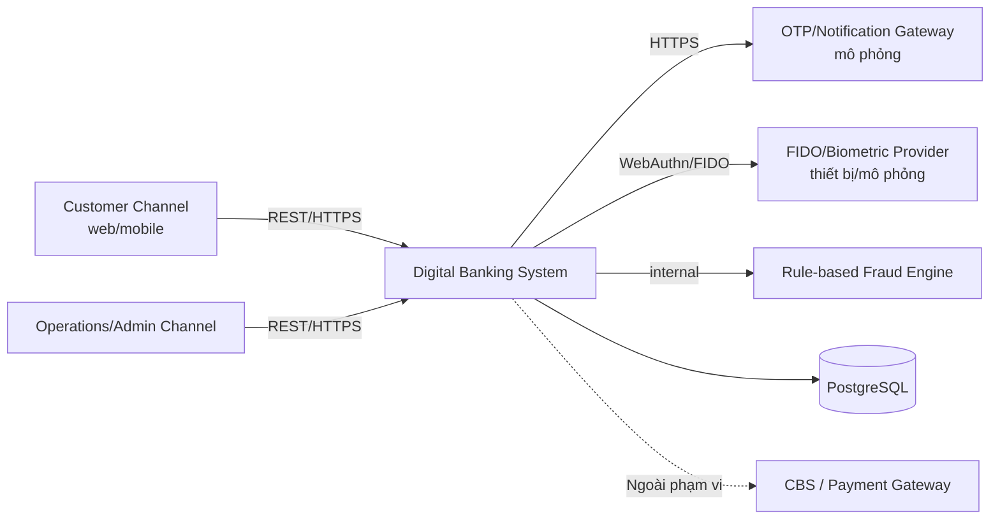
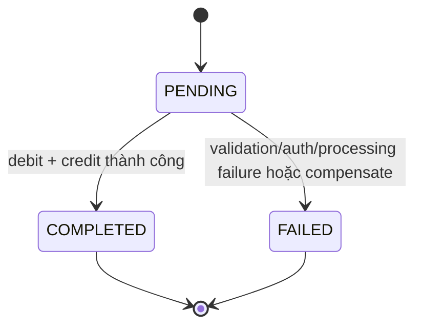
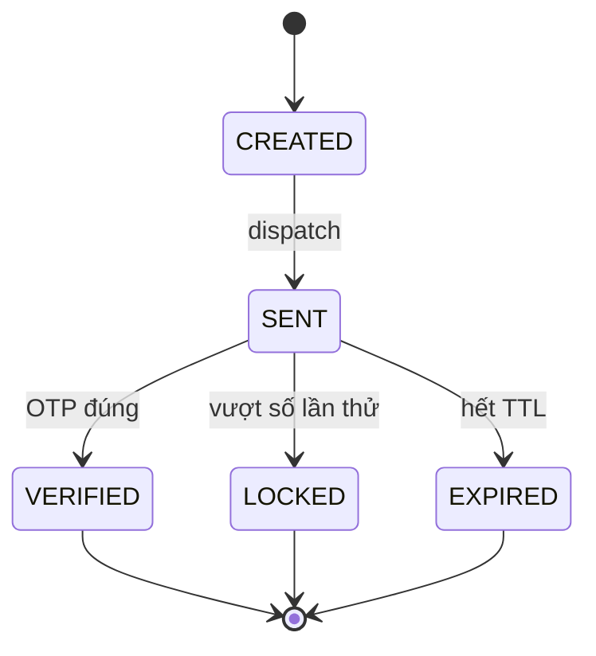
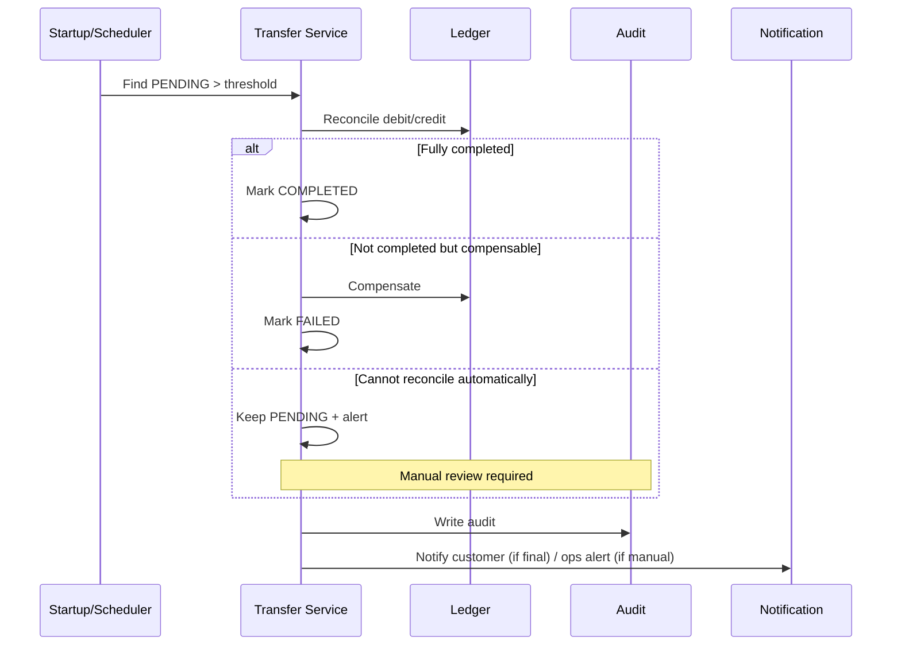
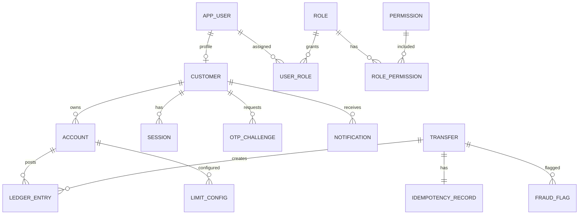

# 03. SRS

> **Dự án:** Digital Banking  
> **Tài liệu:** Software Requirements Specification (SRS)  
## Mục lục

- [1. System Overview](#1-system-overview)
- [2. Functional Requirements](#2-functional-requirements)
- [3. Non-functional Requirements](#3-non-functional-requirements)
- [4. User Roles and Permissions](#4-user-roles-and-permissions)
- [5. Use Cases / User Stories](#5-use-cases--user-stories)
- [6. System Interfaces](#6-system-interfaces)
- [7. Data Requirements](#7-data-requirements)
- [8. Business Rules](#8-business-rules)
- [9. System Constraints](#9-system-constraints)
- [10. Acceptance Criteria](#10-acceptance-criteria)
- [11. Traceability Matrix](#11-traceability-matrix)
- [Appendix](#appendix)

---

## 1. System Overview

### 1.1. Purpose and Scope

Tài liệu này đặc tả hành vi của **Digital Banking** trong phạm vi câu hỏi: hệ thống phải làm gì, hành vi ra sao, ràng buộc nào phải tuân thủ và làm thế nào để kiểm chứng.

Phạm vi SRS:

- Đăng nhập, xác thực và quản lý phiên.
- Xem thông tin khách hàng, tài khoản và số dư.
- Chuyển tiền nội bộ giữa các tài khoản của cùng khách hàng và đến khách hàng khác trong hệ thống.
- Kiểm soát hạn mức, idempotency, trạng thái giao dịch và phục hồi khi lỗi.
- Lịch sử giao dịch, audit trail và traceability.
- Bảo mật, mã hóa, che dấu dữ liệu nhạy cảm.
- Thông báo mô phỏng và phát hiện bất thường theo rule-based.
- Quản trị tối thiểu và các kịch bản demo bắt buộc.

Ngoài phạm vi: card, bill payment, top-up, tax, loan, statement, QR, secure message, chuyển tiền liên ngân hàng/quốc tế, hủy giao dịch (cancellation) và reversal/refund sau COMPLETED, phí/lãi/tỷ giá, tích hợp CBS/payment gateway thật, ML/AI fraud scoring, full back-office, thiết kế UI/UX chi tiết, đa ngôn ngữ và xử lý tiền thật.

### 1.2. System Context and Boundaries



**Hình 1 – System Context của SRS**

Ranh giới hệ thống:

| Thành phần | Vai trò | Thuộc phạm vi |
|---|---|---|
| Customer Channel | Kênh khách hàng (web/mobile) | Có |
| Operations/Admin Channel | Kênh vận hành/quản trị | Có |
| Digital Banking System | API, nghiệp vụ, ledger, audit | Có |
| PostgreSQL | Lưu trữ dữ liệu giao dịch/audit | Có |
| OTP/Notification Gateway | Gửi OTP/thông báo | Mô phỏng |
| FIDO/Biometric Provider | Xác thực mạnh | Thiết bị/mô phỏng |
| Fraud Engine | Rule-based flagging | Có, mức cơ bản |
| CBS/Payment Gateway | Hệ thống ngân hàng lõi/settlement | Không |

### 1.3. Major Capabilities

| Capability | Modules | FR range |
|---|---|---|
| Authentication & Session | Login, passcode/FIDO, OTP, lockout, session | FR-001 – FR-007 |
| Customer & Account | Profile, account list, balance, ownership | FR-008 – FR-012 |
| Transfer | Own transfer, intra-bank, validation, limits, idempotency, status, recovery | FR-013 – FR-026 |
| Transaction History | List, detail, filter, read-only | FR-027 – FR-030 |
| Limits | View, configure, validate | FR-031 – FR-033 |
| Audit & Traceability | Audit money movement, sensitive actions, search, immutability, correlation ID | FR-034 – FR-038 |
| Security | PII masking, RBAC enforcement | FR-039 – FR-040 |
| Notification | Transfer notification, OTP delivery, content masking | FR-041 – FR-043 |
| Fraud/Anomaly | Rule evaluation, large-value, high-frequency, unusual pattern, ops review | FR-044 – FR-048 |
| Administration & Data | Ops data access, roles/permissions, maker/checker, classification, retention | FR-049 – FR-053 |

### 1.4. User Classes and Characteristics

| User class | Đặc điểm | Nhu cầu chính |
|---|---|---|
| Khách hàng cá nhân (STK-001) | Sử dụng kênh số, có ít nhất một tài khoản hoạt động | Chuyển tiền an toàn, rõ trạng thái, bảo mật |
| Operations (STK-003) | Nhân viên vận hành/tra soát | Xem dữ liệu, xử lý ngoại lệ, rà soát fraud |
| Admin (STK-003) | Quản trị vai trò/quyền/hạn mức | Cấu hình có kiểm soát, maker/checker |
| Auditor (STK-004) | Audit/Security/Compliance | Tra cứu audit, bằng chứng, quyền read-only |

> Business Owner (STK-002) và Development/QA (STK-005) là **project stakeholders**, không phải user class của hệ thống; thông tin chi tiết tại `01. Introduction` và `02. BRD`.

### 1.5. Operating Environment

| Khía cạnh | Mô tả |
|---|---|
| Nền tảng backend | Spring Boot + PostgreSQL |
| Giao thức | REST/JSON qua HTTPS |
| Kênh khách hàng | Web/mobile ở mức MVP |
| Kênh vận hành | Web/admin ở mức tối thiểu |
| Xác thực mạnh | FIDO/WebAuthn ở mức thiết bị/mô phỏng |
| Dịch vụ ngoài | OTP/SMS/Email/FIDO/fraud engine mô phỏng |
| Tiền tệ | VND |
| Môi trường | Demo/học tập, dữ liệu tổng hợp |
| Thời gian | Timezone cấu hình; đề xuất `Asia/Ho_Chi_Minh` |

### 1.6. High-Level Constraints

SRS kế thừa các constraint từ BRD:

| ID | Constraint | Ảnh hưởng đến SRS |
|---|---|---|
| CON-001 | MVP chỉ gồm phạm vi đã chốt | Không đặc tả card/bill/loan/statement |
| CON-002 | Hệ thống tự quản lý ledger, không có CBS thật | Ledger và đối soát nội bộ |
| CON-003 | SMS/Email/OTP/FIDO/fraud engine mô phỏng | Interface mô phỏng, không phụ thuộc nhà cung cấp thật |
| CON-004 | Spring Boot + PostgreSQL | Ràng buộc triển khai/kiểm thử |
| CON-005 | VND; không phí/lãi/tỷ giá | Amount = debit amount |
| CON-006 | Không xử lý tiền thật | Dữ liệu demo, không settlement |
| CON-007 | Thời gian/nguồn lực đồ án | Ưu tiên Must |
| CON-008 | Bảo mật/quyền riêng tư ở mức đồ án | Không chứng nhận compliance |
| CON-009 | Audit bất biến, tra cứu được | Audit append-only |
| CON-010 | Fraud rule-based, không ML | Rule engine đơn giản |

### 1.7. Assumptions and Dependencies

| ID | Nội dung | Ảnh hưởng đến SRS |
|---|---|---|
| ASM-001 | Đây là MVP, không phải production | NFR/compliance ở mức đồ án |
| ASM-002 | Tự quản lý ledger, không CBS | Không có FR tích hợp CBS |
| ASM-003 | Dịch vụ ngoài mô phỏng | Interface có thể thay thế sau |
| ASM-004 | VND, có thể cấu hình | Amount/format theo VND |
| ASM-005 | Người dùng có thiết bị hỗ trợ passcode/FIDO hoặc fallback | Luồng auth có fallback |
| ASM-006 | Business rules chi tiết sẽ chốt trong BRD/SRS | Một số giá trị đang là đề xuất |
| ASM-007 | Không phí/lãi/tỷ giá | Không có FR fee/FX |
| ASM-008 | Timezone cấu hình, đề xuất Asia/Ho_Chi_Minh | Reset hạn mức ngày |
| ASM-009 | Các ngưỡng bảo mật/fraud/retention sẽ xác nhận | NFR/AC có thể thay đổi |
| DEP-001 | Spring Boot + PostgreSQL | Môi trường triển khai |
| DEP-002 | Dịch vụ mô phỏng OTP/SMS/Email/FIDO | Demo xác thực |
| DEP-003 | Dữ liệu demo/tài khoản thử nghiệm | Test end-to-end |
| DEP-004 | Xác nhận phạm vi/tiêu chí đánh giá | Nghiệm thu |
| DEP-005 | Stakeholder review rule/acceptance | Chốt yêu cầu |

### 1.8. Relationship to BRD

- Mỗi FR trong SRS phải truy vết về ít nhất một `BR-` trong BRD.
- Các `BRL-` trong BRD là nguồn chính thức của business rules; SRS bổ sung `SYS-RL-` cho cách hệ thống thực thi.
- Các yêu cầu `BR-029`, `BR-031`, `BR-032` được hiện thực chủ yếu qua NFR bảo mật.
- `BR-042` (demo bắt buộc) được kiểm chứng qua mục Acceptance Criteria/Demo Scenarios, không tạo FR nghiệp vụ mới.
- SRS không thay đổi phạm vi BRD. Nếu phát hiện thiếu, ghi nhận open issue và cập nhật BRD trước.

---

## 2. Functional Requirements

### 2.1. Catalog and Conventions

- Mỗi FR có ID duy nhất, mô tả một hành vi kiểm chứng được.
- Cột **Source BR** dùng để trace về BRD.
- Cột **UC/AC** dùng để trace sang use case/acceptance criteria.
- Các giá trị đang là đề xuất được ghi rõ “đề xuất” hoặc tham chiếu BRD mục 6.7.
- Chi tiết API đầy đủ nằm ở tài liệu `07. API contracts`; SRS chỉ đặc tả hành vi mức hệ thống.

### 2.2. Authentication and Session

| ID | Functional Requirement | Priority | Source BR | UC/AC |
|---|---|---|---|---|
| FR-001 | Hệ thống phải xác thực khách hàng bằng định danh và password; tạo session khi thành công | Must | BR-001 | UC-001 / AC-001 |
| FR-002 | Hệ thống phải cho phép xác thực bằng passcode trên thiết bị tin cậy sau lần đăng nhập đầu tiên | Must | BR-001 | UC-002 / AC-002 |
| FR-003 | Hệ thống phải cho phép xác thực bằng FIDO/biometric trên thiết bị hỗ trợ; có fallback passcode/password | Must | BR-001 | UC-002 / AC-002 |
| FR-004 | Hệ thống phải tạo, gửi và xác thực OTP cho tình huống rủi ro cao; OTP dùng một lần, có TTL và giới hạn số lần thử | Must | BR-002 | UC-003, UC-015 / AC-003, AC-033 |
| FR-005 | Hệ thống phải đếm số lần xác thực sai, khóa tạm thời/khóa tài khoản theo BRL-003 và ghi audit | Must | BR-003 | UC-001 / AC-001 |
| FR-006 | Hệ thống phải quản lý session timeout, absolute timeout và logout | Must | BR-003 | UC-001 / AC-004 |
| FR-007 | Hệ thống phải ghi nhận sự kiện xác thực/bảo mật quan trọng với correlation ID | Must | BR-005 | UC-001 / AC-001, AC-019 |

### 2.3. Customer and Account

| ID | Functional Requirement | Priority | Source BR | UC/AC |
|---|---|---|---|---|
| FR-008 | Hệ thống phải cho phép khách hàng xem thông tin hồ sơ tối thiểu của mình | Must | BR-006 | UC-004 / AC-005 |
| FR-009 | Hệ thống phải cho phép khách hàng xem danh sách tài khoản và số dư khả dụng | Must | BR-006 | UC-004 / AC-005 |
| FR-010 | Hệ thống phải cho phép xem chi tiết tài khoản với số tài khoản được che dấu | Must | BR-006 | UC-004 / AC-005, AC-023 |
| FR-011 | Hệ thống phải giới hạn khách hàng chỉ truy cập tài khoản thuộc sở hữu; nhân viên truy cập theo vai trò | Must | BR-007 | UC-004 / AC-024 |
| FR-012 | Hệ thống phải kiểm tra trạng thái tài khoản nguồn/đích trước khi cho phép chuyển tiền | Must | BR-008 | UC-005, UC-006 / AC-006 |

### 2.4. Transfer

| ID | Functional Requirement | Priority | Source BR | UC/AC |
|---|---|---|---|---|
| FR-013 | Hệ thống phải cho phép khách hàng tạo giao dịch chuyển tiền giữa các tài khoản của mình | Must | BR-009 | UC-005 / AC-007 |
| FR-014 | Hệ thống phải cho phép khách hàng tạo giao dịch chuyển tiền đến tài khoản của khách hàng khác trong hệ thống | Must | BR-010 | UC-006 / AC-008 |
| FR-015 | Hệ thống phải kiểm tra số tiền, số chữ số thập phân, tài khoản nguồn/đích, quyền sở hữu, trạng thái tài khoản và số dư khả dụng | Must | BR-011 | UC-005, UC-006 / AC-006 |
| FR-016 | Hệ thống phải thực thi hạn mức giao dịch và hạn mức ngày | Must | BR-012 | UC-005, UC-006 / AC-009 |
| FR-017 | Hệ thống phải xử lý idempotency key cho yêu cầu tạo chuyển tiền: replay trả kết quả cũ, xung đột payload bị từ chối | Must | BR-013 | UC-007 / AC-010, AC-011 |
| FR-018 | Hệ thống phải tạo giao dịch ở trạng thái PENDING với mã tham chiếu duy nhất trước khi xử lý tiền | Must | BR-014 | UC-005, UC-006 / AC-007, AC-008 |
| FR-019 | Hệ thống phải xử lý debit/credit nguyên tử và chuyển trạng thái PENDING sang COMPLETED hoặc FAILED | Must | BR-014, BR-015 | UC-005, UC-006 / AC-007, AC-008, AC-012, AC-034 |
| FR-020 | Hệ thống phải rollback/compensate khi debit thành công nhưng credit thất bại; không để lại trạng thái không nhất quán | Must | BR-015 | UC-005, UC-006 / AC-012 |
| FR-021 | Hệ thống phải xử lý retry do timeout bằng cùng idempotency key mà không debit lần hai | Must | BR-013, BR-015 | UC-007 / AC-010 |
| FR-022 | Hệ thống phải đối soát giao dịch PENDING sau crash/restart và xác định trạng thái cuối cùng | Must | BR-015 | UC-014 / AC-013 |
| FR-023 | Hệ thống phải cho phép khách hàng/vận hành tra cứu trạng thái và chi tiết giao dịch theo mã tham chiếu | Must | BR-014, BR-016 | UC-008 / AC-014 |
| FR-024 | Hệ thống nên cung cấp biên nhận giao dịch có mã tham chiếu, thời gian và trạng thái | Should | BR-016 | UC-008 / AC-014 |
| FR-025 | Hệ thống nên cho phép nhập mô tả giao dịch trong giới hạn độ dài; không lưu dữ liệu nhạy cảm trong mô tả | Should | BR-017 | UC-005, UC-006 / AC-007, AC-008 |
| FR-026 | Hệ thống phải xác định giao dịch cần step-up auth và yêu cầu OTP/FIDO/passcode theo chính sách rủi ro | Must | BR-002 | UC-005, UC-006, UC-015 / AC-003, AC-033 |

### 2.5. Transaction History

| ID | Functional Requirement | Priority | Source BR | UC/AC |
|---|---|---|---|---|
| FR-027 | Hệ thống phải cho phép khách hàng xem danh sách lịch sử giao dịch với trạng thái, số tiền, đối tác và thời gian | Must | BR-018 | UC-009 / AC-015 |
| FR-028 | Hệ thống phải cho phép xem chi tiết giao dịch với mã tham chiếu, trạng thái và thông tin an toàn | Must | BR-019 | UC-009 / AC-015 |
| FR-029 | Hệ thống nên cho phép lọc/tìm kiếm lịch sử theo khoảng thời gian, trạng thái và số tiền | Should | BR-020 | UC-009 / AC-015 |
| FR-030 | Hệ thống phải đảm bảo lịch sử giao dịch là read-only; không có chức năng sửa/xóa | Must | BR-021 | UC-009 / AC-016 |

### 2.6. Limits

| ID | Functional Requirement | Priority | Source BR | UC/AC |
|---|---|---|---|---|
| FR-031 | Hệ thống nên cho phép khách hàng xem hạn mức hiện tại và hạn mức ngày còn lại | Should | BR-022 | UC-009, UC-011 / AC-017 |
| FR-032 | Hệ thống nên cho phép vận hành cấu hình hạn mức trong phạm vi chính sách | Should | BR-023 | UC-011 / AC-017 |
| FR-033 | Hệ thống phải kiểm tra giá trị hạn mức, yêu cầu maker/checker và ghi audit khi thay đổi | Must | BR-023, BR-039 | UC-011 / AC-017, AC-028 |

### 2.7. Audit and Traceability

| ID | Functional Requirement | Priority | Source BR | UC/AC |
|---|---|---|---|---|
| FR-034 | Hệ thống phải tạo audit record cho mọi giao dịch tiền với actor, thời gian, action, entity, amount, status và correlation ID | Must | BR-024 | UC-005, UC-006, UC-014 / AC-018, AC-034 |
| FR-035 | Hệ thống phải tạo audit record cho hành động nhạy cảm (đăng nhập, khóa, đổi hạn mức, đổi vai trò, đổi trạng thái tài khoản) | Must | BR-025 | UC-001, UC-011, UC-013, UC-015 / AC-019, AC-033 |
| FR-036 | Hệ thống phải cho phép vận hành/auditor tra cứu audit theo quyền | Must | BR-026 | UC-012 / AC-020 |
| FR-037 | Hệ thống phải bảo vệ audit record theo hướng append-only/tamper-evident | Must | BR-028 | UC-012 / AC-021 |
| FR-038 | Hệ thống phải sinh/propagate correlation ID xuyên suốt request, giao dịch, ledger, audit và notification | Must | BR-027 | UC-005, UC-006, UC-012 / AC-022 |

### 2.8. Security

| ID | Functional Requirement | Priority | Source BR | UC/AC |
|---|---|---|---|---|
| FR-039 | Hệ thống phải che dấu PII trong response/log/notification theo chính sách | Must | BR-030 | UC-004, UC-009 / AC-023 |
| FR-040 | Hệ thống phải thực thi RBAC trên mọi endpoint và kiểm tra quyền sở hữu dữ liệu | Must | BR-004, BR-007 | UC-001 – UC-014 / AC-024 |

### 2.9. Notification

| ID | Functional Requirement | Priority | Source BR | UC/AC |
|---|---|---|---|---|
| FR-041 | Hệ thống nên gửi thông báo kết quả giao dịch qua in-app/email/SMS (mô phỏng) | Should | BR-033 | UC-008 / AC-025 |
| FR-042 | Hệ thống phải gửi OTP qua kênh thông báo với TTL và giới hạn số lần thử | Must | BR-034 | UC-003, UC-015 / AC-003, AC-033 |
| FR-043 | Hệ thống phải đảm bảo nội dung thông báo không chứa đầy đủ số tài khoản/dữ liệu nhạy cảm | Must | BR-034 | UC-003, UC-008, UC-015 / AC-025, AC-033 |

### 2.10. Fraud and Anomaly

| ID | Functional Requirement | Priority | Source BR | UC/AC |
|---|---|---|---|---|
| FR-044 | Hệ thống phải đánh giá rule fraud khi tạo giao dịch chuyển tiền | Must | BR-035, BR-036, BR-037 | UC-005, UC-006 / AC-026 |
| FR-045 | Hệ thống phải tạo cờ cho giao dịch vượt ngưỡng giá trị lớn | Must | BR-035 | UC-005, UC-006 / AC-026 |
| FR-046 | Hệ thống phải tạo cờ cho giao dịch vượt ngưỡng tần suất trong khoảng thời gian | Must | BR-036 | UC-005, UC-006 / AC-026 |
| FR-047 | Hệ thống nên tạo cờ cho dấu hiệu bất thường cơ bản (người nhận mới, thời điểm/thiết bị bất thường) | Should | BR-037 | UC-010 / AC-026 |
| FR-048 | Hệ thống phải cho phép vận hành xem và ghi nhận quyết định rà soát fraud flag | Must | BR-037, BR-038 | UC-010 / AC-026, AC-027 |

### 2.11. Administration and Data

| ID | Functional Requirement | Priority | Source BR | UC/AC |
|---|---|---|---|---|
| FR-049 | Hệ thống phải cho phép vận hành xem dữ liệu khách hàng/tài khoản/giao dịch trong phạm vi quyền | Must | BR-038 | UC-010, UC-012 / AC-027 |
| FR-050 | Hệ thống phải cho phép admin quản lý người dùng, vai trò và quyền | Must | BR-039 | UC-013 / AC-028 |
| FR-051 | Hệ thống phải áp dụng maker/checker cho thay đổi nhạy cảm và không cho cùng một người vừa tạo vừa duyệt | Must | BR-039 | UC-011, UC-013 / AC-028 |
| FR-052 | Hệ thống phải phân loại dữ liệu và thực thi quy tắc truy cập theo phân loại | Must | BR-040 | UC-004, UC-012 / AC-029 |
| FR-053 | Hệ thống phải hỗ trợ lưu trữ/archival/legal hold theo chính sách | Must | BR-041 | UC-012 / AC-029 |

### 2.12. State Machines

#### 2.12.1. Transfer State



| Trạng thái | Ý nghĩa | Terminal | Chuyển tiếp |
|---|---|---|---|
| PENDING | Đã tiếp nhận, đang xử lý | Không | COMPLETED, FAILED |
| COMPLETED | Debit/credit hoàn tất, ledger nhất quán | Có | Không |
| FAILED | Không hoàn tất; không mất tiền hoặc đã compensate | Có | Không |

**Invariant:** không có chuyển tiếp từ terminal; không có debit/credit một phần khi ở terminal.

#### 2.12.2. OTP Challenge State



- OTP sai làm tăng `attempt_count` nhưng giữ trạng thái `SENT` cho đến khi đạt giới hạn.
- OTP đúng chuyển `VERIFIED` và không thể tái sử dụng.
- OTP hết hạn chuyển `EXPIRED`; hệ thống có thể tạo challenge mới theo chính sách.

#### 2.12.3. Session State

| Trạng thái | Ý nghĩa | Chuyển tiếp |
|---|---|---|
| ACTIVE | Session đang hiệu lực | EXPIRED, LOGGED_OUT |
| EXPIRED | Hết hạn do idle/absolute timeout | — |
| LOGGED_OUT | Người dùng logout | — |

### 2.13. Detailed Behavior

#### 2.13.1. Idempotency (FR-017)

- `Idempotency-Key` là bắt buộc cho `POST /transfers`; tối đa 255 ký tự, không chứa PII.
- Hệ thống tính `request_hash` từ payload chuẩn hóa (customer, source, destination, amount, currency, description).
- Key mới: tạo `IDEMPOTENCY_RECORD` trạng thái `RECEIVED`, xử lý giao dịch, lưu HTTP status/response.
- Key đã tồn tại, cùng `request_hash`, đã có response: trả lại đúng status/body cũ, không tạo giao dịch mới.
- Key đã tồn tại, cùng `request_hash`, đang xử lý: trả `409 IDEMPOTENCY_IN_PROGRESS` kèm `Retry-After`.
- Key đã tồn tại, khác `request_hash`: trả `409 IDEMPOTENCY_CONFLICT`, ghi audit security event.
- Thời gian lưu key: tối thiểu 24 giờ (đề xuất, kế thừa BRD BRL-013/OI-001).
- Key hết hạn được coi là yêu cầu mới; đây là giới hạn của cửa sổ retry, không phải cơ chế chống trùng vĩnh viễn. Client phải query theo reference trước khi tạo yêu cầu mới; hệ thống khuyến nghị dùng cùng key trong toàn bộ cửa sổ retry. Nếu cần chống trùng dài hạn, bổ sung `client_request_id` hoặc tăng TTL (OI-001).

#### 2.13.2. Transfer Processing and Failure Recovery (FR-018 – FR-022)

- Luồng chuẩn: validate → kiểm tra hạn mức → kiểm tra idempotency → step-up auth nếu cần → tạo PENDING → debit/credit → COMPLETED → audit → notification.
- Debit/credit phải nằm trong cùng một đơn vị xử lý nguyên tử; nếu một bên thất bại, không được để trạng thái tiền không nhất quán.
- Nếu debit thành công nhưng credit thất bại: rollback/compensate; ghi ledger đối ứng nếu cần; chuyển FAILED; audit; thông báo.
- Nếu client timeout: client retry cùng idempotency key hoặc query theo reference; hệ thống không tạo giao dịch mới.
- Nếu service crash: khi khởi động, reconciliation tìm PENDING quá ngưỡng (đề xuất 5 phút); đối soát ledger; xác định COMPLETED/FAILED; nếu không thể đối soát tự động thì giữ PENDING, tạo cảnh báo và chuyển vận hành rà soát; audit/notification.
- Không trả COMPLETED nếu audit record chưa được ghi nhận bền vững. Audit record phải được ghi bền vững trong cùng đơn vị xử lý với money movement hoặc qua cơ chế bảo đảm tương đương. Nếu debit/credit đã thành công nhưng audit write thất bại, transfer phải giữ PENDING (hoặc FAILED nếu đã compensate), phát cảnh báo và được retry/reconcile; không được trả success khi audit gap còn tồn tại.
- Response tạo giao dịch phải có `reference`, `status`, `amount`, `currency`, `createdAt`, `correlationId`.

#### 2.13.3. Audit and Correlation (FR-034 – FR-038)

- Audit record cho money movement phải có tối thiểu các trường tại BRD mục 4.4.4.
- Audit record append-only; không có API update/delete.
- Bảo vệ tamper-evident bằng hash chain hoặc cơ chế tương đương; chi tiết ở tài liệu Database analysis.
- Correlation ID: nếu request có `X-Correlation-Id` thì dùng lại; nếu không, hệ thống sinh mới; trả trong response header/body.
- Correlation ID phải xuất hiện trong transfer, ledger entries, audit records và notification records.
- Audit search cho phép lọc theo correlation ID, reference, thời gian, actor, action; phân trang.

#### 2.13.4. PII Masking (FR-039)

| Dữ liệu | Cách hiển thị mặc định | Ghi chú |
|---|---|---|
| Số tài khoản | 4 ký tự cuối, phần còn lại che dấu | Ví dụ `**** **** 1234` |
| Số điện thoại | 3 ký tự cuối | Chỉ hiển thị cho chủ sở hữu/vai trò được phép |
| Email | Ký tự đầu + domain | Không hiển thị đầy đủ trong log |
| Họ tên | Hiển thị đầy đủ cho chủ sở hữu; mask một phần cho vai trò khác | Theo quyền |
| OTP/password/hash | Không bao giờ trả về | Chỉ lưu dạng hash |

- Log không được chứa password, OTP, full account number, full PII.
- Notification chỉ chứa thông tin tối thiểu và đã mask.

#### 2.13.5. Fraud Evaluation (FR-044 – FR-048)

- Rule evaluation chạy khi tạo giao dịch; kết quả được lưu thành `FRAUD_FLAG`.
- Large-value: amount ≥ ngưỡng cấu hình.
- High-frequency: số giao dịch trong cửa sổ thời gian ≥ ngưỡng (đề xuất > 5 giao dịch/10 phút).
- Unusual pattern: người nhận mới, thời điểm/thiết bị bất thường (mức cơ bản).
- Mặc định: flag và tiếp tục xử lý; không tự động chặn.
- Nếu auto-block được cấu hình: giao dịch FAILED với lý do `FRAUD_BLOCKED`; không ghi debit/credit.
- Rule engine lỗi: ghi log/audit lỗi; giao dịch tiếp tục theo luồng chính (fail-open) trừ khi chính sách quy định khác.
- Quyết định review của vận hành phải được audit.

#### 2.13.6. Transfer Step-up Authentication (FR-026)

- Hệ thống đánh giá risk/step-up khi tạo transfer dựa trên ngưỡng giá trị, thiết bị, hành vi bất thường và chính sách cấu hình.
- Nếu cần step-up: API trả `428 STEP_UP_REQUIRED` kèm `challengeId`, danh sách phương thức (`OTP`, `FIDO`, `PASSCODE`) và `expiresAt`; **không** tạo transfer/ledger entry.
- Challenge phải gắn với customer, `request_hash` và idempotency key; không thể dùng lại cho request khác.
- Khách hàng xác thực qua `POST /api/v1/auth/step-up/verify`; OTP/TTL/attempt theo BRL-004.
- Sau khi xác thực thành công, client retry `POST /transfers` với cùng idempotency key; hệ thống xử lý giao dịch đúng một lần.
- Nếu xác thực thất bại/hết hạn: không tạo transfer/debit; ghi audit; trả lỗi tương ứng.
- Nếu không cần step-up: tiếp tục luồng transfer bình thường.

### 2.14. Error Handling and Recovery

| Nhóm lỗi | Ví dụ | Hành vi hệ thống |
|---|---|---|
| Validation | Amount ≤ 0, sai định dạng, source = destination | Trả lỗi 400; không tạo giao dịch |
| Authentication | Sai password/OTP, session hết hạn | Trả 401/423; tăng bộ đếm; audit |
| Authorization | Truy cập dữ liệu người khác, thiếu quyền | Trả 403; audit security event |
| Business rule | Thiếu số dư, vượt hạn mức, tài khoản inactive | Trả 422/409; không ghi ledger |
| Idempotency | Key conflict/in-progress | Trả 409; không tạo giao dịch mới |
| System | Timeout, service unavailable, crash | Trả 503/500; retry an toàn; reconciliation |
| Fraud | Bị chặn bởi rule auto-block | Trả 422 `FRAUD_BLOCKED`; audit; không ghi ledger |

Nguyên tắc:

- Không trả thông tin nhạy cảm trong error message.
- Mọi lỗi phải có `code`, `message`, `correlationId`.
- Client chỉ retry khi lỗi được đánh dấu retryable và với idempotency key phù hợp.
- Lỗi hệ thống không được làm mất giao dịch đã PENDING; reconciliation xử lý sau.

---

## 3. Non-functional Requirements

### 3.1. NFR Catalog

| ID | Category | Requirement | Target/Metric | Verification | Source | Priority |
|---|---|---|---|---|---|---|
| NFR-001 | Performance | Transfer API latency | p95 ≤ 2 giây; p99 ≤ 5 giây ở 20 RPS (đề xuất) | Load test | BR-042, MET-006 | Must |
| NFR-002 | Performance | Truy vấn trạng thái/lịch sử | p95 ≤ 1 giây (đề xuất) | API test/load test | BR-018, BR-042 | Should |
| NFR-003 | Performance | Xác thực/OTP | p95 ≤ 1 giây (đề xuất) | API test | BR-001, BR-002 | Should |
| NFR-004 | Performance | Load test | 20 RPS trong 10 phút; lỗi < 1% (đề xuất) | Load test report | MET-006, BR-042 | Must |
| NFR-005 | Availability | Availability demo | 99,9% trong thời gian demo (đề xuất) | Monitoring/health check | OBJ-006 | Should |
| NFR-006 | Reliability | Phục hồi sau crash | Không ledger inconsistency; bắt đầu đối soát PENDING trong 5 phút sau restart (đề xuất) | Failure injection/restart test | BR-015 | Must |
| NFR-007 | Reliability | RTO/RPO | RTO ≤ 30 phút; RPO ≤ 5 phút (đề xuất) | DR test/backup review | BR-041, OBJ-006 | Should |
| NFR-008 | Reliability | Dịch vụ ngoài lỗi | Notification/fraud failure không chặn giao dịch; lỗi được log/flag | Failure injection | BR-033, BR-037 | Must |
| NFR-009 | Consistency | Atomicity/no negative balance | Debit/credit nguyên tử; không số dư âm; ledger cân bằng | Concurrency test/audit review | BR-015 | Must |
| NFR-010 | Consistency | Concurrency safety | Không lost update/double debit khi giao dịch đồng thời | Concurrency test | BR-013, BR-015 | Must |
| NFR-011 | Consistency | Idempotency retention | ≥ 24 giờ (đề xuất) | Config/test | BRL-013 | Must |
| NFR-012 | Consistency | Status integrity | Chỉ PENDING → COMPLETED/FAILED; terminal immutable | State machine test | BRL-014 | Must |
| NFR-013 | Security | TLS | TLS 1.2+ (ưu tiên 1.3) cho kết nối ngoài | Security review/scan | BR-029 | Must |
| NFR-014 | Security | Encryption at rest | Mã hóa dữ liệu nhạy cảm (AES-256 đề xuất) | Config/security review | BR-030 | Must |
| NFR-015 | Security | Password storage | Hash bằng Argon2id/bcrypt; không plaintext | Code review/security test | BR-001, BR-030 | Must |
| NFR-016 | Security | OTP security | Hash OTP; TTL 5 phút; tối đa 5 lần thử; single-use (đề xuất) | Test/code review | BRL-004, BR-034 | Must |
| NFR-017 | Security | RBAC | Enforce trên mọi endpoint; least privilege | Security test/code review | BR-004, BR-007 | Must |
| NFR-018 | Security | Web security | Chống OWASP Top 10 cơ bản; input validation/output encoding/CSRF | Security checklist/scan | BR-032 | Must |
| NFR-019 | Security | Secrets | Không hard-code; quản lý qua env/vault | Code review/config review | BR-031 | Must |
| NFR-020 | Security | PII masking | Không lộ PII trong log/response/notification | Security review/log audit | BR-030, BR-034 | Must |
| NFR-021 | Auditability | Audit immutability | Append-only/tamper-evident | Audit review/test | BR-028 | Must |
| NFR-022 | Auditability | Audit retention | ≥ 5 năm (đề xuất); legal hold | Retention test/policy review | BR-028, BR-041 | Must |
| NFR-023 | Auditability | Audit coverage | 100% money movement/sensitive action có audit + correlation ID | Audit review | BR-024, BR-025, BR-027 | Must |
| NFR-024 | Scalability | Demo load | Đáp ứng 20 RPS; thiết kế có thể scale ngang ở mức cơ bản (đề xuất) | Load test/architecture review | BR-042 | Should |
| NFR-025 | Observability | Logs/metrics/health | Structured log + correlation ID; metrics transfer success/failure/latency; health endpoint | Inspection/monitoring | BR-027, BR-042 | Must |
| NFR-026 | Maintainability | API documentation | OpenAPI/Swagger; versioning | Review | BR-042 | Should |
| NFR-027 | Maintainability | Automated tests | Unit/integration cho critical paths; coverage ≥ 80% (đề xuất) | CI report | BR-042 | Should |
| NFR-028 | Usability | Error clarity | Thông báo lỗi rõ, có mã, không lộ dữ liệu nhạy cảm | UX/API review | BR-016, BR-034 | Must |
| NFR-029 | Localization | Ngôn ngữ/format | UI tiếng Việt; VND; timezone cấu hình | UI/API review | 01, CON-005 | Must |
| NFR-030 | Compliance | Data classification | Phân loại PII/financial/audit; access theo vai trò | Data review | BR-040 | Must |
| NFR-031 | Compliance | Retention/legal hold | Lưu trữ/archival theo chính sách; legal hold | Retention test/policy review | BR-041 | Must |
| NFR-032 | Privacy | Synthetic data | Không dùng dữ liệu khách hàng thật trong demo | Data review | CON-006 | Must |

> Các ngưỡng có ghi “đề xuất” kế thừa BRD mục 6.7 và MET-006; sẽ được chốt khi OI-001/OI-002/OI-003/OI-006 đóng.

### 3.2. NFR Verification Summary

| Nhóm NFR | Cách kiểm chứng chính | Bằng chứng |
|---|---|---|
| Performance/Load | Load test 20 RPS × 10 phút | Load test report (AC-031) |
| Reliability/Recovery | Failure injection, restart | Test report/audit (AC-013) |
| Consistency | Concurrency/idempotency test | Test report/ledger audit (AC-010 – AC-013) |
| Security | Security checklist/scan/code review | Security report (AC-030) |
| Auditability | Audit review/tamper test | Audit evidence (AC-018 – AC-023) |
| Data/Privacy | Data review/retention test | Data policy/evidence (AC-029) |
| Observability | Log/metrics/health inspection | Monitoring evidence (NFR-025) |
| Maintainability | CI/API docs review | CI report/OpenAPI (NFR-026, NFR-027) |

---

## 4. User Roles and Permissions

### 4.1. Role Catalog

| ID | Role | Stakeholder | Mô tả |
|---|---|---|---|
| ROLE-001 | Customer | STK-001 | Khách hàng cá nhân sử dụng kênh số |
| ROLE-002 | Operations | STK-003 | Nhân viên vận hành/tra soát, fraud review, cấu hình hạn mức |
| ROLE-003 | Admin | STK-003 | Quản trị người dùng/vai trò/quyền/hạn mức |
| ROLE-004 | Auditor | STK-004 | Audit/Security/Compliance, quyền read-only |
| — | Checker privilege | STK-003 | Quyền phê duyệt bổ sung cho một số user ROLE-002/ROLE-003; không phải role độc lập |

> Checker là **privilege** gắn cho user được chọn, không phải role mới. Một user không thể vừa là maker vừa là checker cho cùng một thay đổi.

### 4.2. Permission Matrix

Ký hiệu: `W` = write/create/update; `R` = read; `A` = approve; `E` = export; `—` = không có quyền.

| Chức năng | Customer | Operations (Maker) | Operations (Checker) | Admin (Maker) | Admin (Checker) | Auditor |
|---|---|---|---|---|---|---|
| Đăng nhập/self-service | W | W | W | W | W | W |
| Xem hồ sơ/tài khoản của mình | R | — | — | — | — | — |
| Xem dữ liệu khách hàng/tài khoản | Chỉ của mình | R | R | R | R | R |
| Tạo chuyển tiền | W | — | — | — | — | — |
| Xem lịch sử giao dịch | Của mình | R | R | R | R | R |
| Xem audit trail | — | R | R | R | R | R |
| Cấu hình hạn mức | — | W | A | W | A | R |
| Quản lý vai trò/quyền | — | — | — | W | A | R |
| Rà soát fraud flag | — | W | W | R | R | R |
| Xuất bằng chứng audit | — | R | R | R | R | E |
| Retention/legal hold | — | — | — | W | A | R |
| Health/metrics | — | — | — | R | R | R |

### 4.3. Data Access Rules

| Quy tắc | Mô tả |
|---|---|
| DAR-001 | Customer chỉ truy cập dữ liệu thuộc customer_id của mình |
| DAR-002 | Operations/Admin chỉ truy cập dữ liệu trong phạm vi quyền và mục đích nghiệp vụ |
| DAR-003 | Auditor chỉ đọc audit/transaction; không được tạo/sửa/xóa |
| DAR-004 | PII mặc định được mask; xem đầy đủ chỉ khi có quyền và mục đích hợp lệ |
| DAR-005 | Audit record không được sửa/xóa bởi bất kỳ role nào |
| DAR-006 | Dữ liệu demo là dữ liệu tổng hợp, không dùng PII thật |

### 4.4. Segregation of Duties (Maker/Checker)

- Áp dụng cho: thay đổi hạn mức, vai trò/quyền, retention/legal hold và các thay đổi nhạy cảm khác.
- Maker tạo yêu cầu; Checker xem xét và phê duyệt/từ chối.
- Không cho cùng một user thực hiện cả hai bước.
- Mọi yêu cầu/phê duyệt/từ chối phải có audit record.
- Checker phải xác thực mạnh trước khi phê duyệt.

### 4.5. Session and Authentication Rules

| Quy tắc | Nội dung | Nguồn |
|---|---|---|
| AUTH-01 | Password dùng cho đăng nhập; passcode/FIDO cho thiết bị tin cậy | BRL-001 |
| AUTH-02 | OTP bắt buộc cho thiết bị mới/hành động rủi ro/giao dịch vượt ngưỡng | BRL-002 |
| AUTH-03 | 5 lần sai → khóa 10 phút; 3 lần khóa/24 giờ → khóa tài khoản (đề xuất) | BRL-003 |
| AUTH-04 | OTP TTL 5 phút; tối đa 5 lần thử; single-use (đề xuất) | BRL-004 |
| AUTH-05 | Session idle 15 phút; absolute 8 giờ; logout vô hiệu hóa (đề xuất) | BRL-005 |
| AUTH-06 | Password tối thiểu 8 ký tự, complexity, không trùng 3 password gần nhất (đề xuất) | BRL-006 |

---

## 5. Use Cases / User Stories

### 5.1. Use Case Inventory

| ID | Use Case | Actors | Goal | FR chính | AC |
|---|---|---|---|---|---|
| UC-001 | Đăng nhập bằng password | Customer | Xác thực và tạo session | FR-001, FR-005, FR-006, FR-007 | AC-001, AC-004 |
| UC-002 | Đăng nhập bằng passcode/FIDO trên thiết bị tin cậy | Customer | Xác thực nhanh | FR-002, FR-003, FR-006 | AC-002 |
| UC-003 | Đăng nhập trên thiết bị mới bằng OTP | Customer | Xác thực thiết bị mới | FR-004, FR-042, FR-043 | AC-003 |
| UC-004 | Xem tài khoản và số dư | Customer, Operations, Admin, Auditor | Tra cứu tài khoản/số dư | FR-008 – FR-011, FR-039 | AC-005, AC-024 |
| UC-005 | Chuyển tiền giữa tài khoản của mình | Customer | Chuyển tiền nội bộ own-account | FR-012, FR-013, FR-015 – FR-026, FR-034, FR-038, FR-044 – FR-046 | AC-006 – AC-009, AC-018 |
| UC-006 | Chuyển tiền đến khách hàng khác | Customer | Chuyển tiền intra-bank | FR-012, FR-014 – FR-026, FR-034, FR-038, FR-044 – FR-046 | AC-006 – AC-009, AC-018 |
| UC-007 | Retry giao dịch bị timeout | Customer | Retry an toàn, không double debit | FR-017, FR-021, FR-023 | AC-010, AC-011 |
| UC-008 | Xem kết quả/biên nhận giao dịch | Customer, Operations, Admin, Auditor | Xác nhận kết quả | FR-023, FR-024, FR-041 | AC-014, AC-025 |
| UC-009 | Xem lịch sử và hạn mức | Customer (history + limits); Operations/Admin/Auditor (history read-only) | Tra cứu lịch sử/hạn mức | FR-027 – FR-031 | AC-015 – AC-017 |
| UC-010 | Rà soát fraud flag | Operations, Admin (read), Auditor (read) | Xem và quyết định flag | FR-047, FR-048, FR-049 | AC-026, AC-027 |
| UC-011 | Cấu hình hạn mức | Operations/Admin Maker, Checker | Thay đổi hạn mức có kiểm soát | FR-032, FR-033, FR-051 | AC-017, AC-028 |
| UC-012 | Tra cứu audit | Operations, Admin (read), Auditor | Tìm bằng chứng audit | FR-036, FR-038 | AC-020, AC-022 |
| UC-013 | Quản lý vai trò/quyền | Admin Maker, Checker | Cấp/thu quyền có kiểm soát | FR-050, FR-051 | AC-028 |
| UC-014 | Đối soát giao dịch PENDING sau crash | System | Xác định trạng thái cuối cùng | FR-022 | AC-013 |
| UC-015 | Xác thực step-up cho giao dịch chuyển tiền | Customer, Auth/Step-up | Hoàn tất xác thực bổ sung cho transfer rủi ro cao | FR-004, FR-026, FR-034, FR-035, FR-042, FR-043 | AC-033 |

> UC-001/002/003 mô tả luồng xác thực của khách hàng; Operations/Admin/Auditor dùng cùng cơ chế với chính sách tương ứng.

**Business Process → Use Case mapping (từ BRD):**

| BP | Use Case |
|---|---|
| BP-001 – Authentication and Session | UC-001, UC-002, UC-003 |
| BP-002 – Internal Transfer | UC-005, UC-006, UC-015 |
| BP-003 – Failure and Recovery | UC-007, UC-014 |
| BP-004 – History and Audit Review | UC-009, UC-012 |
| BP-005 – Limit Management | UC-011 |
| BP-006 – Fraud and Anomaly Review | UC-010 |
| BP-007 – Administration and Role Management | UC-013 |

### 5.2. Use Case Specifications (Key Flows)

#### UC-003 – Đăng nhập trên thiết bị mới bằng OTP

| Trường | Nội dung |
|---|---|
| ID / Name | UC-003 – Đăng nhập trên thiết bị mới bằng OTP |
| Actors | Customer, OTP/Notification Gateway, Audit |
| Goal | Xác thực khách hàng trên thiết bị mới và tạo session |
| Trigger | Khách hàng đăng nhập từ thiết bị chưa được tin cậy |
| Preconditions | Tài khoản active; số điện thoại/email nhận OTP khả dụng; kênh OTP hoạt động |
| Main flow | 1) Khách hàng nhập định danh/password. 2) Hệ thống xác thực password. 3) Hệ thống phát hiện thiết bị mới, tạo OTP challenge. 4) Gửi OTP qua kênh mô phỏng. 5) Khách hàng nhập OTP. 6) Hệ thống xác thực OTP. 7) Tạo session, đánh dấu thiết bị tin cậy (nếu chính sách cho phép). 8) Ghi audit. |
| Alternate flow | OTP gửi lại theo chính sách; đăng ký FIDO/passcode sau khi xác thực thành công nếu được yêu cầu |
| Exception flow | Sai password → 401, tăng bộ đếm; OTP sai → 401, tăng attempt; OTP hết hạn → 401/410; vượt attempt → 423/429; gửi OTP lỗi → 503; tài khoản khóa → 403/423 |
| Postconditions | Session hợp lệ hoặc xác thực thất bại; audit record được tạo |
| Related FR/BR/BRL | FR-004, FR-042, FR-043; BR-002, BR-034; BRL-002, BRL-004 |
| Acceptance | AC-003 |

#### UC-005 – Chuyển tiền giữa tài khoản của mình

| Trường | Nội dung |
|---|---|
| ID / Name | UC-005 – Own-account transfer |
| Actors | Customer, Transfer Service, Ledger, Audit, Notification |
| Goal | Chuyển tiền giữa các tài khoản thuộc cùng khách hàng |
| Trigger | Khách hàng gửi yêu cầu chuyển tiền |
| Preconditions | Đã đăng nhập; có ít nhất 2 tài khoản active; tài khoản nguồn đủ số dư; kênh xử lý khả dụng |
| Main flow | 1) Chọn tài khoản nguồn/đích. 2) Nhập amount/description. 3) Hệ thống validate input, ownership, account status, balance, limits. 4) Kiểm tra idempotency key. 5) Yêu cầu step-up auth nếu cần. 6) Tạo transfer PENDING + reference. 7) Debit/credit nguyên tử. 8) Chuyển COMPLETED. 9) Ghi audit + correlation ID. 10) Gửi notification/trả receipt theo cấu hình (FR-024/FR-041 là Should). |
| Alternate flow | Nếu không cần step-up, bỏ qua bước 5; nếu description trống, dùng giá trị mặc định/rỗng theo thiết kế |
| Exception flow | Amount không hợp lệ → 400; source = destination → 400; tài khoản inactive → 409; thiếu số dư → 422; vượt hạn mức → 422; auth fail → 401/403; idempotency conflict → 409; partial failure → FAILED + compensate; timeout → retry an toàn; crash → UC-014 |
| Postconditions | Transfer COMPLETED hoặc FAILED; ledger nhất quán; audit được tạo; notification/receipt theo cấu hình (Should) |
| Related FR/BR/BRL | FR-012, FR-013, FR-015 – FR-026, FR-034, FR-038, FR-044 – FR-046; BR-009, BR-011 – BR-017; BRL-009 – BRL-017 |
| Acceptance | AC-006 – AC-010, AC-012, AC-014, AC-018 |

#### UC-006 – Chuyển tiền đến khách hàng khác trong hệ thống

| Trường | Nội dung |
|---|---|
| ID / Name | UC-006 – Intra-bank transfer |
| Actors | Customer, Transfer Service, Ledger, Audit, Notification |
| Goal | Chuyển tiền đến tài khoản của khách hàng khác trong hệ thống |
| Trigger | Khách hàng gửi yêu cầu chuyển tiền đến tài khoản đích |
| Preconditions | Đã đăng nhập; tài khoản nguồn active/đủ số dư; tài khoản đích tồn tại và active |
| Main flow | 1) Chọn tài khoản nguồn. 2) Nhập thông tin tài khoản đích/amount/description. 3) Hệ thống lookup/validate tài khoản đích. 4) Validate ownership/source, status, balance, limits. 5) Kiểm tra idempotency. 6) Step-up auth nếu cần. 7) Tạo PENDING + reference. 8) Debit/credit nguyên tử. 9) COMPLETED. 10) Audit; notification/receipt theo cấu hình (Should). |
| Alternate flow | Tài khoản đích có thể được chọn từ danh sách beneficiary nếu có; ngoài phạm vi MVP nếu chưa có |
| Exception flow | Tài khoản đích không tồn tại/inactive → 404/409; source = destination → 400; thiếu số dư/hạn mức → 422; auth fail → 401/403; idempotency conflict → 409; partial failure → FAILED + compensate |
| Postconditions | Transfer COMPLETED hoặc FAILED; ledger nhất quán; audit được tạo; notification/receipt theo cấu hình (Should) |
| Related FR/BR/BRL | FR-012, FR-014 – FR-026, FR-034, FR-038, FR-044 – FR-046; BR-010 – BR-017; BRL-009 – BRL-017 |
| Acceptance | AC-006 – AC-010, AC-012, AC-014, AC-018 |

> Các bước notification/receipt và AC-014/AC-025 là `Should`; nếu defer, UC-005/UC-006 vẫn đạt các Must AC.

#### UC-007 – Retry giao dịch bị timeout

| Trường | Nội dung |
|---|---|
| ID / Name | UC-007 – Retry timed-out transfer |
| Actors | Customer, Transfer Service, Audit |
| Goal | Retry an toàn, không tạo debit/giao dịch thứ hai |
| Trigger | Client timeout/không nhận được response; khách hàng retry |
| Preconditions | Có yêu cầu trước đó với idempotency key; key còn trong thời gian lưu |
| Main flow | 1) Client gửi lại cùng key + cùng payload. 2) Hệ thống tìm idempotency record. 3) Nếu có response → trả lại status/body cũ. 4) Nếu đang xử lý → trả 409 `IDEMPOTENCY_IN_PROGRESS` + `Retry-After`. 5) Nếu payload khác → 409 `IDEMPOTENCY_CONFLICT`. |
| Alternate flow | Nếu key hết hạn, yêu cầu được coi là mới; client **phải** query theo reference trước khi tạo mới. Hệ thống không đảm bảo chống trùng sau khi key hết hạn; xem OI-001 |
| Exception flow | Key thiếu → 400; key không hợp lệ → 400; hệ thống không tìm thấy transfer → 404 |
| Postconditions | Không có debit/giao dịch mới; kết quả nhất quán với lần đầu |
| Related FR/BR/BRL | FR-017, FR-021, FR-023; BR-013, BR-015; BRL-013, BRL-016 |
| Acceptance | AC-010, AC-011 |

#### UC-011 – Cấu hình hạn mức

| Trường | Nội dung |
|---|---|
| ID / Name | UC-011 – Configure limit |
| Actors | Operations/Admin Maker, Checker, Customer (view), Audit |
| Goal | Thay đổi hạn mức có kiểm soát và audit |
| Trigger | Maker tạo yêu cầu thay đổi hạn mức |
| Preconditions | Maker/Checker có quyền; chính sách hạn mức đã cấu hình |
| Main flow | 1) Maker chọn customer/account và nhập hạn mức mới. 2) Hệ thống validate trong phạm vi chính sách. 3) Tạo yêu cầu PENDING_APPROVAL. 4) Checker xem xét, xác thực mạnh, approve/reject. 5) Nếu approve, áp dụng hạn mức. 6) Ghi audit. 7) Customer xem hạn mức mới. |
| Alternate flow | Checker từ chối → yêu cầu REJECTED, không áp dụng; Maker sửa và gửi lại |
| Exception flow | Vượt phạm vi chính sách → 422; thiếu quyền → 403; maker = checker → 403; yêu cầu không tồn tại → 404 |
| Postconditions | Hạn mức được cập nhật hoặc giữ nguyên; audit đầy đủ |
| Related FR/BR/BRL | FR-032, FR-033, FR-051; BR-023, BR-039; BRL-008, BRL-012, BRL-032 |
| Acceptance | AC-017, AC-028 |

#### UC-012 – Tra cứu audit

| Trường | Nội dung |
|---|---|
| ID / Name | UC-012 – Audit search |
| Actors | Operations, Auditor |
| Goal | Tìm và xem bằng chứng audit theo quyền |
| Trigger | Người dùng mở chức năng audit |
| Preconditions | Đã đăng nhập; có quyền audit |
| Main flow | 1) Nhập filter (correlation ID, reference, thời gian, actor, action). 2) Hệ thống kiểm tra quyền. 3) Trả kết quả phân trang. 4) Xem chi tiết record. 5) Xuất bằng chứng nếu có quyền. |
| Alternate flow | Không có kết quả → trả danh sách rỗng; filter không hợp lệ → 400 |
| Exception flow | Không đủ quyền → 403 + audit security event; truy cập record ngoài phạm vi → 403 |
| Postconditions | Không thay đổi dữ liệu audit; truy cập được audit |
| Related FR/BR/BRL | FR-036, FR-038; BR-026, BR-027; BRL-023 |
| Acceptance | AC-020, AC-022 |

#### UC-014 – Đối soát giao dịch PENDING sau crash

| Trường | Nội dung |
|---|---|
| ID / Name | UC-014 – Reconcile pending transfer |
| Actors | System, Operations (khi cần), Audit, Notification |
| Goal | Xác định trạng thái cuối cùng cho giao dịch PENDING sau crash/restart |
| Trigger | Service khởi động lại hoặc scheduler phát hiện PENDING quá ngưỡng |
| Preconditions | Có transfer PENDING; ledger accessible |
| Main flow | 1) Tìm PENDING vượt ngưỡng (đề xuất 5 phút). 2) Đối soát ledger debit/credit. 3) Nếu đủ debit+credit → COMPLETED. 4) Nếu không đủ → compensate (nếu cần) và FAILED. 5) Ghi audit. 6) Gửi notification. |
| Alternate flow | Không thể đối soát tự động → chuyển trạng thái cần vận hành rà soát (không tạo trạng thái mới trong MVP; giữ PENDING và tạo cảnh báo/audit) |
| Exception flow | Ledger không nhất quán → cảnh báo, không tự động COMPLETED; audit; vận hành xử lý |
| Postconditions | Không mất tiền; trạng thái cuối cùng rõ ràng hoặc có cảnh báo; audit/notification |
| Related FR/BR/BRL | FR-022; BR-015; BRL-015, BRL-017 |
| Acceptance | AC-013 |

#### UC-015 – Xác thực step-up cho giao dịch chuyển tiền

| Trường | Nội dung |
|---|---|
| ID / Name | UC-015 – Transfer step-up authentication |
| Actors | Customer, Auth/Step-up Service, Audit |
| Goal | Xác thực bổ sung trước khi thực hiện transfer rủi ro cao |
| Trigger | Transfer vượt ngưỡng risk/step-up hoặc thuộc trường hợp cần xác thực bổ sung |
| Preconditions | Đã đăng nhập; transfer request hợp lệ; kênh OTP/FIDO/passcode khả dụng |
| Main flow | 1) Customer gửi `POST /transfers`. 2) Hệ thống đánh giá risk/step-up. 3) Nếu cần, trả `428 STEP_UP_REQUIRED` + challenge. 4) Customer xác thực OTP/FIDO/passcode. 5) Hệ thống verify challenge. 6) Customer retry `POST /transfers` với cùng idempotency key. 7) Hệ thống xử lý transfer đúng một lần. |
| Alternate flow | Nếu không cần step-up, tiếp tục luồng transfer; nếu customer hủy, challenge hết hạn và không có transfer |
| Exception flow | Challenge hết hạn → 410/401; OTP/FIDO sai → 401; vượt attempt → 423/429; challenge không khớp request → 409; retry không có step-up hợp lệ → 428 |
| Postconditions | Transfer được xử lý đúng một lần sau step-up, hoặc không có transfer/ledger entry nếu xác thực thất bại |
| Related FR/BR/BRL | FR-004, FR-026, FR-034, FR-035, FR-042, FR-043; BR-002; BRL-002, BRL-004 |
| Acceptance | AC-033 |

### 5.3. Other Use Case Summaries

| UC | Main flow tóm tắt |
|---|---|
| UC-001 | Nhập định danh/password → xác thực → kiểm tra lockout/session → tạo session → audit |
| UC-002 | Auto-fill/định danh → passcode/FIDO → xác thực → session → audit; fallback password nếu cần |
| UC-004 | Đăng nhập → mở danh sách tài khoản → xem số dư/chi tiết đã mask; kiểm tra ownership/role |
| UC-008 | Mở transfer theo reference → xem status/amount/reference/time → tải biên nhận nếu có |
| UC-009 | Mở lịch sử → lọc theo thời gian/trạng thái/amount → xem chi tiết; xem hạn mức hiện tại/còn lại |
| UC-010 | Mở danh sách fraud flag → xem chi tiết → quyết định cho phép/giữ/rà soát thêm → audit |
| UC-013 | Admin maker tạo thay đổi role/permission → checker approve/reject → áp dụng → audit |

### 5.4. User Stories

| ID | User Story | Priority | FR | AC |
|---|---|---|---|---|
| US-001 | As a customer, I want to view my current and remaining daily limits so that I can plan my transfers. | Should | FR-031 | AC-017 |
| US-002 | As a customer, I want to filter my transaction history by date, status, and amount so that I can find a transaction quickly. | Should | FR-029 | AC-015 |
| US-003 | As a customer, I want a receipt with a reference number and status so that I can keep evidence of my transfer. | Should | FR-024 | AC-014 |
| US-004 | As a customer, I want to receive a notification when my transfer succeeds or fails so that I know the outcome. | Should | FR-041 | AC-025 |
| US-005 | As an operations user, I want to review fraud flags and record my decision so that suspicious transactions are handled consistently. | Must | FR-048 | AC-026 |
| US-006 | As an operations/admin maker, I want to propose a limit change and have a checker approve it so that changes are controlled. | Should | FR-032, FR-033 | AC-017, AC-028 |
| US-007 | As a customer, I want to add a short description to my transfer so that I can recognize it later. | Should | FR-025 | AC-007, AC-008 |
| US-008 | As an auditor, I want to search audit records by correlation ID or reference so that I can investigate an incident. | Must | FR-036, FR-038 | AC-020, AC-022 |
| US-009 | As a customer, I want to verify a high-value transfer with OTP so that my money is protected. | Must | FR-026 | AC-033 |

#### Acceptance Criteria for User Stories (Given-When-Then)

- **US-001:** Given a logged-in customer with configured limits, when they open the limit screen, then the current per-transaction limit, daily limit, and remaining daily amount are displayed; no other customer's limits are visible.
- **US-002:** Given a customer with multiple transactions, when they filter by date/status/amount, then only matching transactions are returned and pagination works.
- **US-003:** Given a completed or failed transfer, when the customer opens the receipt, then reference, amount, status, timestamp, and masked accounts are shown; no sensitive data is exposed.
- **US-004:** Given a transfer reaches COMPLETED or FAILED, when the notification service is available, then a masked notification is sent via the configured simulated channel; if the channel fails, the transfer result is unchanged and the failure is logged.
- **US-005:** Given a fraud flag is open, when an operations user reviews it and records a decision, then the decision is saved, audited, and visible in the flag history.
- **US-006:** Given a maker proposes a limit change within policy, when a different checker approves it, then the new limit is applied and audited; if the same user tries to approve, the request is rejected.
- **US-007:** Given a customer enters a description within the allowed length, when the transfer is created, then the description is stored and displayed in history; sensitive data is rejected/masked.
- **US-008:** Given an auditor searches by correlation ID/reference, when the record exists and access is allowed, then the audit record and linked transfer are returned; unauthorized access is denied and audited.
- **US-009:** Given a transfer requires step-up, when the customer submits it, then the API returns `428 STEP_UP_REQUIRED` with a challenge; after successful OTP/FIDO verification and retry with the same idempotency key, the transfer is processed exactly once; failed/expired verification creates no transfer or debit.

### 5.5. UC/US to FR Mapping

| UC/US | FR |
|---|---|
| UC-001 | FR-001, FR-005, FR-006, FR-007 |
| UC-002 | FR-002, FR-003, FR-006 |
| UC-003 | FR-004, FR-042, FR-043 |
| UC-004 | FR-008, FR-009, FR-010, FR-011, FR-039 |
| UC-005 | FR-012, FR-013, FR-015 – FR-026, FR-034, FR-038, FR-044 – FR-046 |
| UC-006 | FR-012, FR-014 – FR-026, FR-034, FR-038, FR-044 – FR-046 |
| UC-007 | FR-017, FR-021, FR-023 |
| UC-008 | FR-023, FR-024, FR-041 |
| UC-009 | FR-027 – FR-031 |
| UC-010 | FR-047, FR-048, FR-049 |
| UC-011 | FR-032, FR-033, FR-051 |
| UC-012 | FR-036, FR-038 |
| UC-013 | FR-050, FR-051 |
| UC-014 | FR-022 |
| UC-015 | FR-004, FR-026, FR-034, FR-035, FR-042, FR-043 |
| US-001 | FR-031 |
| US-002 | FR-029 |
| US-003 | FR-024 |
| US-004 | FR-041 |
| US-005 | FR-048 |
| US-006 | FR-032, FR-033 |
| US-007 | FR-025 |
| US-008 | FR-036, FR-038 |
| US-009 | FR-026 |

---

## 6. System Interfaces

### 6.1. Interface Inventory

| ID | Interface | Direction | Protocol | Data chính | Timeout/Retry | Failure behavior |
|---|---|---|---|---|---|---|
| INT-001 | Customer Client API | Client ↔ System | REST/HTTPS | Auth, account, transfer, history, limits | 10s; retry chỉ với idempotent request | Trả lỗi chuẩn; không lộ PII |
| INT-002 | Operations/Admin API | Client ↔ System | REST/HTTPS | Customer/account/transaction/audit/limit/role | 10s; retry an toàn | 403/409/503; audit |
| INT-003 | OTP/Notification Gateway | System → Gateway | HTTPS/SMTP/SMS simulator | OTP, notification template, masked payload | 5s; retry có backoff | OTP fail → auth fail/503; notification fail → log/retry, không chặn transfer |
| INT-004 | FIDO/WebAuthn Provider | Client ↔ System ↔ Device | WebAuthn | Challenge/credential assertion | 30s | Fallback passcode/password; audit |
| INT-005 | Fraud Rule Engine | System ↔ Engine | Internal/HTTP | Transfer facts, rule result/flags | 1s | Fail-open: transfer tiếp tục, lỗi được log/audit |

### 6.2. API Catalog (High-Level)

> Chi tiết request/response schema, status code và ví dụ nằm ở `07. API contracts`.

| Method | Path | Purpose | Role | FR |
|---|---|---|---|---|
| POST | `/api/v1/auth/login` | Đăng nhập password | All roles | FR-001 |
| POST | `/api/v1/auth/passcode` | Xác thực passcode trên thiết bị tin cậy | All roles | FR-002 |
| POST | `/api/v1/auth/fido/verify` | Xác thực FIDO/biometric | All roles | FR-003 |
| POST | `/api/v1/auth/otp/verify` | Xác thực OTP | All roles | FR-004 |
| POST | `/api/v1/auth/step-up/verify` | Xác thực step-up (OTP/FIDO/passcode) | Customer | FR-026 |
| POST | `/api/v1/auth/logout` | Logout | All roles | FR-006 |
| GET | `/api/v1/accounts` | Danh sách tài khoản | Customer | FR-009 |
| GET | `/api/v1/accounts/{accountId}` | Chi tiết tài khoản | Customer, Operations, Admin, Auditor | FR-010, FR-049 |
| GET | `/api/v1/admin/customers/{customerId}` | Xem hồ sơ khách hàng (ops/audit) | Operations, Admin, Auditor | FR-049 |
| GET | `/api/v1/admin/customers/{customerId}/accounts` | Danh sách tài khoản của khách hàng (ops/audit) | Operations, Admin, Auditor | FR-049 |
| POST | `/api/v1/transfers` | Tạo chuyển tiền; trả 428 `STEP_UP_REQUIRED` nếu cần step-up | Customer | FR-013, FR-014, FR-017, FR-026 |
| GET | `/api/v1/transfers/{reference}` | Trạng thái/chi tiết transfer | Customer, Operations, Admin, Auditor | FR-023 |
| GET | `/api/v1/transactions` | Lịch sử giao dịch (customer self; staff filter theo customerId) | Customer, Operations, Admin, Auditor | FR-027 |
| GET | `/api/v1/transactions/{reference}` | Chi tiết giao dịch | Customer, Operations, Admin, Auditor | FR-028 |
| GET | `/api/v1/limits` | Xem hạn mức | Customer | FR-031 |
| POST | `/api/v1/admin/limits` | Tạo yêu cầu thay đổi hạn mức (maker) | Operations/Admin Maker | FR-032 |
| POST | `/api/v1/admin/limits/{id}/approve` | Duyệt/từ chối hạn mức (checker) | Operations/Admin Checker | FR-051 |
| GET | `/api/v1/audit` | Tra cứu audit | Operations, Admin, Auditor | FR-036 |
| GET | `/api/v1/audit/export` | Xuất bằng chứng audit | Auditor | FR-036 |
| GET | `/api/v1/fraud-flags` | Danh sách fraud flag | Operations, Admin (read), Auditor (read) | FR-048 |
| POST | `/api/v1/fraud-flags/{id}/review` | Ghi nhận quyết định review | Operations | FR-048 |
| POST | `/api/v1/admin/roles` | Tạo/thay đổi role (maker) | Admin Maker | FR-050 |
| POST | `/api/v1/admin/roles/{id}/approve` | Duyệt role (checker) | Admin Checker | FR-051 |
| GET | `/api/v1/health` | Health check | Internal/Admin, Auditor (read) | NFR-025 |

### 6.3. Error Codes, Timeout and Retry

| Code | HTTP | Ý nghĩa | Retryable | FR |
|---|---|---|---|---|
| `AUTH_INVALID_CREDENTIALS` | 401 | Sai định danh/password | Không | FR-001 |
| `AUTH_ACCOUNT_LOCKED` | 423 | Tài khoản bị khóa | Không | FR-005 |
| `AUTH_OTP_INVALID` | 401 | OTP sai | Có (trong giới hạn) | FR-004 |
| `AUTH_OTP_EXPIRED` | 410 | OTP hết hạn | Có (gửi lại) | FR-004 |
| `AUTH_SESSION_EXPIRED` | 401 | Session hết hạn | Có (đăng nhập lại) | FR-006 |
| `STEP_UP_REQUIRED` | 428 | Cần xác thực bổ sung (OTP/FIDO/passcode) | Có (sau xác thực) | FR-026 |
| `AUTH_FORBIDDEN` | 403 | Không đủ quyền | Không | FR-040 |
| `VALIDATION_ERROR` | 400 | Dữ liệu không hợp lệ | Không | FR-015 |
| `ACCOUNT_NOT_FOUND` | 404 | Tài khoản không tồn tại | Không | FR-012 |
| `ACCOUNT_INACTIVE` | 409 | Tài khoản không hoạt động | Không | FR-012 |
| `INSUFFICIENT_BALANCE` | 422 | Thiếu số dư | Không | FR-015 |
| `LIMIT_EXCEEDED` | 422 | Vượt hạn mức | Không | FR-016 |
| `IDEMPOTENCY_CONFLICT` | 409 | Cùng key, payload khác | Không | FR-017 |
| `IDEMPOTENCY_IN_PROGRESS` | 409 | Cùng key đang xử lý | Có (sau `Retry-After`) | FR-017 |
| `TRANSFER_NOT_FOUND` | 404 | Không tìm thấy transfer | Không | FR-023 |
| `TRANSFER_FAILED` | 422 | Giao dịch thất bại | Không | FR-019 |
| `FRAUD_BLOCKED` | 422 | Bị chặn bởi rule | Không | FR-044 |
| `RATE_LIMITED` | 429 | Quá nhiều yêu cầu | Có (sau backoff) | FR-005 |
| `INTERNAL_ERROR` | 500 | Lỗi hệ thống | Có (idempotent) | FR-019 |
| `SERVICE_UNAVAILABLE` | 503 | Dịch vụ tạm thời không khả dụng | Có (idempotent) | FR-019 |

**Retry policy:**

- Client chỉ retry `GET` và `POST /transfers` với cùng idempotency key.
- Không retry mù các request tạo giao dịch khi không có key.
- Retry dùng exponential backoff; tôn trọng `Retry-After`.
- Server phải trả `correlationId` trong mọi response.

### 6.4. Sequence Diagrams

#### 6.4.1. Transfer Flow

```mermaid
sequenceDiagram
    participant C as Customer
    participant API as Digital Banking API
    participant AUTH as Auth/Step-up
    participant TX as Transfer Service
    participant L as Ledger
    participant AUD as Audit
    participant N as Notification
    C->>API: POST /transfers + Idempotency-Key
    API->>AUTH: Validate session + risk/step-up decision
    alt Step-up required
        AUTH-->>API: STEP_UP_REQUIRED + challenge
        API-->>C: 428 STEP_UP_REQUIRED
        C->>API: POST /auth/step-up/verify (OTP/FIDO)
        API->>AUTH: Verify challenge
        AUTH-->>API: Verified
        C->>API: Retry POST /transfers (same Idempotency-Key)
    end
    API->>TX: Create/validate transfer
    TX->>TX: Validate rules + limits + idempotency
    TX->>L: Debit/Credit atomically
    L-->>TX: Success/Failure
    TX->>AUD: Write audit + correlation ID
    alt Audit write failed
        AUD-->>TX: Failure
        TX-->>API: 500 AUDIT_WRITE_FAILED
        Note over TX,AUD: Keep PENDING/FAILED; retry/reconcile; no COMPLETED without audit
    else Audit persisted
        TX->>N: Send notification (best effort)
        TX-->>API: COMPLETED/FAILED
    end
    API-->>C: Response + receipt
```

#### 6.4.2. Crash Recovery Flow



### 6.5. Interface Failure Behavior

| Tình huống | Hành vi hệ thống |
|---|---|
| OTP gateway unavailable | Auth/step-up fail với 503; không tạo session; cho phép gửi lại |
| Notification gateway unavailable | Transfer vẫn COMPLETED/FAILED; notification retry/log; không rollback tiền |
| Fraud engine unavailable | Fail-open; transfer tiếp tục; ghi log/audit lỗi |
| FIDO unavailable/fails | Fallback passcode/password theo chính sách; audit |
| PostgreSQL unavailable | 503; không trả COMPLETED; không để partial ledger |
| Timeout từ client | Retry với idempotency key; query theo reference |

---

## 7. Data Requirements

### 7.1. Data Model Overview



**Hình 2 – Data model mức khái niệm**

### 7.2. Entity Catalog

| Entity | Mục đích | Khóa chính | Quan hệ chính |
|---|---|---|---|
| APP_USER | Tài khoản đăng nhập (customer/staff) | user_id | 1:0..1 Customer; N:M Role |
| CUSTOMER | Hồ sơ khách hàng | customer_id | 1:N Account/Session/OTP/Notification |
| ACCOUNT | Tài khoản và số dư | account_id | N:1 Customer; 1:N LedgerEntry/LimitConfig |
| TRANSFER | Giao dịch chuyển tiền | transfer_id | 1:N LedgerEntry; 1:1 IdempotencyRecord; 1:N FraudFlag |
| LEDGER_ENTRY | Bút toán debit/credit | entry_id | N:1 Transfer/Account |
| IDEMPOTENCY_RECORD | Lưu kết quả retry | idempotency_key | 1:1 Transfer |
| OTP_CHALLENGE | OTP challenge | challenge_id | N:1 Customer |
| SESSION | Phiên đăng nhập | session_id | N:1 Customer |
| AUDIT_LOG | Audit trail | audit_id | Tham chiếu entity bằng type/id |
| LIMIT_CONFIG | Hạn mức | limit_id | N:1 Customer/Account |
| FRAUD_FLAG | Cờ bất thường | flag_id | N:1 Transfer |
| NOTIFICATION | Thông báo | notification_id | N:1 Customer |
| DEVICE | Thiết bị tin cậy/FIDO | device_id | N:1 Customer |
| ROLE / PERMISSION | Phân quyền | role_id / permission_id | N:M qua UserRole/RolePermission |

### 7.3. Key Data Dictionary

| Entity | Trường chính | Ghi chú |
|---|---|---|
| TRANSFER | transfer_id, reference_no, idempotency_key, source_account_id, destination_account_id, amount, currency, description, status, failure_code, created_at, updated_at, completed_at | reference_no unique; status PENDING/COMPLETED/FAILED |
| LEDGER_ENTRY | entry_id, transfer_id, account_id, entry_type, amount, currency, balance_after, created_at | entry_type DEBIT/CREDIT; amount > 0 |
| IDEMPOTENCY_RECORD | idempotency_key, request_hash, transfer_id, status, response_status, response_body, created_at, expires_at | key unique; expires_at ≥ 24h (đề xuất) |
| OTP_CHALLENGE | challenge_id, customer_id, purpose, channel, otp_hash, status, attempt_count, expires_at, created_at, verified_at | otp_hash only; TTL 5 phút (đề xuất) |
| AUDIT_LOG | audit_id, timestamp, actor_id, actor_role, action, entity_type, entity_id, before_state, after_state, amount, currency, correlation_id, outcome, client_info_masked | append-only; correlation_id indexed |
| LIMIT_CONFIG | limit_id, customer_id, account_id, per_transaction_limit, daily_limit, effective_from, status, created_by, approved_by, created_at, approved_at | maker/checker; status PENDING_APPROVAL/ACTIVE/REJECTED |
| FRAUD_FLAG | flag_id, transfer_id, rule_code, severity, status, reviewed_by, reviewed_at, decision, notes, created_at | status OPEN/UNDER_REVIEW/ALLOWED/BLOCKED/CLOSED |
| ACCOUNT | account_id, customer_id, account_no, currency, status, available_balance, ledger_balance, updated_at | account_no unique; status ACTIVE/LOCKED/CLOSED |
| APP_USER | user_id, username, password_hash, user_type, status, created_at | password_hash only; user_type CUSTOMER/STAFF |
| ROLE/PERMISSION | role_code, permission_code, description | least privilege |
| NOTIFICATION | notification_id, customer_id, channel, template_code, payload_masked, status, sent_at, correlation_id | payload masked |
| SESSION | session_id, customer_id, device_id, status, created_at, last_activity_at, expires_at | idle 15 phút/absolute 8 giờ (đề xuất) |
| DEVICE | device_id, customer_id, device_name, fido_credential_id, trusted, last_seen_at | FIDO credential reference |

### 7.4. Data Classification and PII

| Lớp dữ liệu | Ví dụ | Xử lý |
|---|---|---|
| PII | Họ tên, phone, email, device info, IP | Mã hóa/che dấu; truy cập theo quyền |
| Financial | account_no, balances, transfer amount, ledger entries | Mã hóa at rest; audit; mask khi hiển thị |
| Audit | Audit log, correlation ID, action history | Append-only; retention; read-only |
| Secrets | password hash, OTP hash, FIDO credential | Hash/encrypt; không log/trả về |
| Internal | Rule thresholds, config | Chỉ admin/ops được xem |

### 7.5. Retention and Archival

| Dữ liệu | Thời hạn đề xuất | Ghi chú |
|---|---|---|
| Transfer/Ledger | 5 năm | Kế thừa BRL-024 (đề xuất) |
| Audit log | 5 năm | Legal hold; append-only |
| Idempotency record | 24 giờ | BRL-013 (đề xuất) |
| OTP challenge | 90 ngày | Phục vụ audit; OTP hash only (đề xuất) |
| Session | 30 ngày sau khi hết hạn | Dọn dẹp định kỳ (đề xuất) |
| Notification | 90 ngày | Nội dung đã mask (đề xuất) |
| Fraud flag | 5 năm | Audit/risk (đề xuất) |
| Limit config history | 5 năm | Audit thay đổi (đề xuất) |

> Các thời hạn ngoài BRD là đề xuất; cần xác nhận tại OI-001/OI-002.

### 7.6. Audit Data

- Audit log append-only; không cập nhật/xóa qua API.
- Trường tối thiểu theo BRD mục 4.4.4; bổ sung `correlation_id`, `request_id` nếu cần.
- Audit record phải tham chiếu được transfer/account/user bằng `entity_type` + `entity_id`.
- Không lưu full PII trong audit; dùng masked/actor_id.
- Bảo vệ tamper-evident bằng hash chain hoặc cơ chế tương đương (thiết kế chi tiết ở 04).

### 7.7. Data Integrity Rules

| ID | Rule |
|---|---|
| DIR-001 | `reference_no` unique và immutable |
| DIR-002 | `idempotency_key` unique trong cửa sổ lưu |
| DIR-003 | `amount > 0`; scale ≤ 2; currency = VND |
| DIR-004 | Source account ≠ destination account |
| DIR-005 | Không có available_balance < 0 |
| DIR-006 | Mỗi transfer COMPLETED có tổng debit = tổng credit |
| DIR-007 | Status chỉ PENDING → COMPLETED/FAILED; terminal immutable |
| DIR-008 | Audit log append-only; không update/delete |
| DIR-009 | Account/customer access phải qua ownership/RBAC |
| DIR-010 | OTP/password/secret không lưu plaintext |

### 7.8. Data Migration

Không có migration từ hệ thống cũ trong MVP. Dữ liệu demo được seed từ script/test fixtures; không dùng dữ liệu khách hàng thật.

---

## 8. Business Rules

### 8.1. Reference to BRD

BRD là nguồn chính thức của business rules `BRL-001` – `BRL-034`. SRS không định nghĩa lại rule nghiệp vụ; SRS bổ sung cách hệ thống thực thi (`SYS-RL-`) và hành vi lỗi.

### 8.2. System Enforcement Rules

| ID | System Rule | Related BRL | Related FR |
|---|---|---|---|
| SYS-RL-001 | Validate amount > 0, scale ≤ 2, currency VND | BRL-009 | FR-015 |
| SYS-RL-002 | Validate source ≠ destination, active accounts, source ownership | BRL-010 | FR-015 |
| SYS-RL-003 | Validate available balance ≥ amount | BRL-011 | FR-015 |
| SYS-RL-004 | Enforce per-transaction/daily limits; reset daily theo timezone | BRL-012 | FR-016 |
| SYS-RL-005 | Require idempotency key; hash payload; replay/conflict handling | BRL-013 | FR-017 |
| SYS-RL-006 | Enforce PENDING → COMPLETED/FAILED; terminal immutable | BRL-014 | FR-018, FR-019 |
| SYS-RL-007 | Atomic debit/credit; rollback/compensate on failure | BRL-015 | FR-019, FR-020 |
| SYS-RL-008 | Timeout retry returns original result; no second debit | BRL-016 | FR-021 |
| SYS-RL-009 | Startup reconciliation for PENDING transfers | BRL-017 | FR-022 |
| SYS-RL-010 | Write audit for every money movement | BRL-021 | FR-034 |
| SYS-RL-011 | Audit append-only/tamper-evident; no update/delete | BRL-022 | FR-037 |
| SYS-RL-012 | Audit search authorization and filtering | BRL-023 | FR-036 |
| SYS-RL-013 | Enforce RBAC/ownership on every endpoint | BRL-007 | FR-011, FR-040 |
| SYS-RL-014 | OTP TTL/attempts/single-use | BRL-004 | FR-004, FR-042 |
| SYS-RL-015 | Lockout after failed attempts | BRL-003 | FR-005 |
| SYS-RL-016 | Session idle/absolute timeout and logout | BRL-005 | FR-006 |
| SYS-RL-017 | Mask PII in responses/logs/notifications | BRL-026 | FR-039, FR-043 |
| SYS-RL-018 | Large-value fraud flag | BRL-029 | FR-045 |
| SYS-RL-019 | High-frequency fraud flag | BRL-030 | FR-046 |
| SYS-RL-020 | Unusual-pattern fraud flag | BRL-031 | FR-047 |
| SYS-RL-021 | Maker/checker for sensitive changes | BRL-008, BRL-032 | FR-051 |
| SYS-RL-022 | Validate/audit limit changes | BRL-032 | FR-032, FR-033 |
| SYS-RL-023 | Notification content masking | BRL-028 | FR-043 |
| SYS-RL-024 | Retention/archival/legal hold | BRL-024, BRL-034 | FR-053 |
| SYS-RL-025 | Enforce TLS, encryption at rest, secret management | BRL-025 – BRL-027 | NFR-013, NFR-014, NFR-019 |
| SYS-RL-026 | Enforce step-up for high-risk/high-value transfers; return 428 challenge; no ledger before verification | BRL-002 | FR-026 |
| SYS-RL-027 | Enforce read-only history; display status/amount/counterparty/time with masking; no update/delete | BRL-018, BRL-019, BRL-020 | FR-027, FR-028, FR-030 |
| SYS-RL-028 | Enforce data classification and access rules for PII/financial/audit | BRL-033 | FR-052, NFR-030 |

### 8.3. Rule-to-FR Mapping

| Rule group | SYS-RL | FR |
|---|---|---|
| Transfer validation | SYS-RL-001 – SYS-RL-004 | FR-015, FR-016 |
| Idempotency/status/recovery | SYS-RL-005 – SYS-RL-009 | FR-017 – FR-022 |
| Audit/traceability | SYS-RL-010 – SYS-RL-012 | FR-034 – FR-038 |
| Access/auth/session | SYS-RL-013 – SYS-RL-016 | FR-001 – FR-007, FR-040 |
| Transfer step-up | SYS-RL-026 | FR-026 |
| History/read-only | SYS-RL-027 | FR-027, FR-028, FR-030 |
| Data classification | SYS-RL-028 | FR-052, NFR-030 |
| Privacy/notification | SYS-RL-017, SYS-RL-023 | FR-039, FR-043 |
| Fraud | SYS-RL-018 – SYS-RL-020 | FR-044 – FR-048 |
| Maker/checker/admin | SYS-RL-021, SYS-RL-022 | FR-032, FR-033, FR-050, FR-051 |
| Retention/security | SYS-RL-024, SYS-RL-025 | FR-053, NFR-013/014/019 |

### 8.4. Error/Exception Behavior

| Vi phạm | Error code | HTTP | Hành vi |
|---|---|---|---|
| Amount/format/account invalid | `VALIDATION_ERROR` | 400 | Không tạo transfer/ledger |
| Source = destination | `VALIDATION_ERROR` | 400 | Từ chối |
| Account inactive/not found | `ACCOUNT_INACTIVE` / `ACCOUNT_NOT_FOUND` | 409/404 | Từ chối |
| Insufficient balance | `INSUFFICIENT_BALANCE` | 422 | Từ chối |
| Limit exceeded | `LIMIT_EXCEEDED` | 422 | Từ chối |
| Idempotency conflict | `IDEMPOTENCY_CONFLICT` | 409 | Không tạo transfer mới; audit |
| OTP invalid/expired | `AUTH_OTP_INVALID` / `AUTH_OTP_EXPIRED` | 401/410 | Tăng attempt; audit |
| Step-up required | `STEP_UP_REQUIRED` | 428 | Trả challenge; không tạo transfer/ledger; retry sau xác thực |
| Unauthorized | `AUTH_FORBIDDEN` | 403 | Từ chối; audit security event |
| Fraud auto-block | `FRAUD_BLOCKED` | 422 | Không debit/credit; audit |
| Audit write failed | `AUDIT_WRITE_FAILED` | 500 | Không COMPLETED; PENDING/FAILED; retry/reconcile; cảnh báo audit gap |
| System failure | `INTERNAL_ERROR` / `SERVICE_UNAVAILABLE` | 500/503 | Retry an toàn; reconciliation |

### 8.5. Rule Governance

- BRL do BRD quản lý; SYS-RL do SRS quản lý.
- Thay đổi rule phải cập nhật traceability và test cases.
- Rule ảnh hưởng tài chính/bảo mật phải được audit và regression test.
- Các giá trị đề xuất (lockout, OTP, session, retention, fraud threshold) chỉ có hiệu lực sau khi OI tương ứng được đóng.

---

## 9. System Constraints

### 9.1. Technical Constraints

| ID | Constraint | Ảnh hưởng |
|---|---|---|
| TC-001 | Backend dùng Spring Boot + PostgreSQL | Quyết định framework, migration, test |
| TC-002 | API dùng REST/JSON qua HTTPS | Contract, error model, versioning |
| TC-003 | Hệ thống tự quản lý ledger; không có CBS | Không có tích hợp CBS/đối soát ngoài |
| TC-004 | Không xử lý tiền thật/settlement | Dữ liệu demo, không kết nối payment gateway |
| TC-005 | Đơn vị tiền tệ VND; không phí/lãi/tỷ giá | Amount = debit amount; không có FX/fee engine |
| TC-006 | Dịch vụ OTP/SMS/Email/FIDO/fraud mô phỏng | Interface có thể thay thế; không phụ thuộc SLA thật |
| TC-007 | Fraud chỉ rule-based, không ML | Không có scoring/model training |
| TC-008 | Môi trường demo/học tập | Không cam kết production SLA |
| TC-009 | Timezone cấu hình; đề xuất Asia/Ho_Chi_Minh | Reset hạn mức ngày |
| TC-010 | Dữ liệu demo tổng hợp, không PII thật | Seed/test data |

### 9.2. Regulatory and Compliance Constraints

| ID | Constraint | Ảnh hưởng |
|---|---|---|
| RC-001 | Bảo vệ dữ liệu cá nhân ở mức đồ án | PII masking/encryption/access control |
| RC-002 | Audit bất biến, có thể tra cứu | Append-only, retention, legal hold |
| RC-003 | Không chứng nhận PCI-DSS/ISO/kiểm toán độc lập | Không tuyên bố compliant |
| RC-004 | Lưu trữ giao dịch/audit theo chính sách | Retention/archival (đề xuất 5 năm) |
| RC-005 | Không dùng dữ liệu khách hàng thật | Synthetic data |

### 9.3. Integration Constraints

| ID | Constraint | Ảnh hưởng |
|---|---|---|
| IC-001 | OTP/Notification gateway mô phỏng | Không đảm bảo delivery thật; retry/log |
| IC-002 | FIDO/WebAuthn ở mức thiết bị/mô phỏng | Fallback passcode/password |
| IC-003 | Fraud engine nội bộ/rule-based | Fail-open; flag/audit |
| IC-004 | Không có CBS/payment gateway | Không có settlement/đối soát ngoài |
| IC-005 | API contract chi tiết ở tài liệu 07 | SRS chỉ mô tả hành vi mức cao |

### 9.4. Operational Constraints

| ID | Constraint | Ảnh hưởng |
|---|---|---|
| OC-001 | Demo environment, không production | Logs/metrics/backup ở mức demo |
| OC-002 | Dữ liệu demo/seed | Test reproducibility |
| OC-003 | Thời gian/nguồn lực đồ án | Ưu tiên Must; Should có thể lùi |
| OC-004 | Cần bằng chứng demo/load test | Acceptance phụ thuộc test report |
| OC-005 | Cần stakeholder review rule/AC | Chậm nếu chưa chốt OI |

### 9.5. Constraints vs Assumptions

| Loại | Ví dụ | Xử lý |
|---|---|---|
| Constraint | Spring Boot + PostgreSQL; VND; không CBS | Bắt buộc tuân thủ trong thiết kế/kiểm thử |
| Assumption | Dịch vụ ngoài mô phỏng; ngưỡng đề xuất sẽ chốt | Ghi rõ, review định kỳ |
| Open issue | Threshold/retention/timezone/password policy | Không coi là final; cập nhật khi OI đóng |

---

## 10. Acceptance Criteria

### 10.1. Functional Acceptance Criteria

| ID | Given | When | Then | FR/NFR |
|---|---|---|---|---|
| AC-001 | Khách hàng có credentials hợp lệ; tài khoản active | Đăng nhập bằng password | Tạo session, trả thành công, ghi audit; sai 5 lần liên tiếp thì lần tiếp theo trả `AUTH_ACCOUNT_LOCKED` | FR-001, FR-005, FR-007 |
| AC-002 | Thiết bị tin cậy đã đăng ký; passcode/FIDO khả dụng | Xác thực bằng passcode/FIDO | Tạo session; sai vượt ngưỡng bị khóa theo BRL-003; fallback password hoạt động | FR-002, FR-003, FR-006 |
| AC-003 | Khách hàng đăng nhập từ thiết bị mới | Nhập đúng password và được yêu cầu OTP | OTP được gửi; OTP đúng tạo session; OTP sai/hết hạn bị từ chối; vượt 5 lần thử bị khóa | FR-004, FR-042, FR-043 |
| AC-004 | Session đang active | Không hoạt động 15 phút hoặc logout | Request tiếp theo trả `AUTH_SESSION_EXPIRED`; logout vô hiệu hóa session | FR-006 |
| AC-005 | Khách hàng đã đăng nhập | Xem danh sách/chi tiết tài khoản | Chỉ thấy tài khoản của mình; số dư đúng; số tài khoản được mask | FR-008 – FR-010, FR-039 |
| AC-006 | Yêu cầu chuyển tiền có amount ≤ 0, sai decimals, source = destination, tài khoản inactive hoặc thiếu số dư | Gửi yêu cầu | Trả lỗi tương ứng; không tạo transfer/ledger entry | FR-012, FR-015 |
| AC-007 | Khách hàng có đủ số dư, tài khoản active | Chuyển tiền giữa tài khoản của mình với idempotency key | Transfer PENDING → COMPLETED; debit/credit đúng; audit; response có reference | FR-013, FR-018 – FR-023 |
| AC-008 | Tài khoản đích tồn tại và active | Chuyển tiền đến khách hàng khác | Transfer COMPLETED; số dư nguồn giảm, đích tăng; audit | FR-014, FR-018 – FR-023 |
| AC-009 | Amount vượt hạn mức giao dịch/ngày | Gửi chuyển tiền | Trả `LIMIT_EXCEEDED`; không có tiền bị debit | FR-016 |
| AC-010 | Một transfer đã hoàn tất; client có cùng key/payload | Retry cùng idempotency key | Trả lại cùng status/body; không tạo transfer hoặc debit mới | FR-017, FR-021 |
| AC-011 | Cùng idempotency key nhưng payload khác | Retry | Trả `IDEMPOTENCY_CONFLICT`; không tạo transfer mới; audit | FR-017 |
| AC-012 | Debit thành công nhưng credit thất bại | Hệ thống xử lý giao dịch | Transfer FAILED; debit được rollback/compensate; ledger cân bằng; audit | FR-019, FR-020 |
| AC-013 | Có transfer PENDING và service restart | Reconciliation chạy | Transfer được xác định COMPLETED/FAILED hoặc flag cần vận hành rà soát; không mất tiền; audit/notification | FR-022 |
| AC-014 | Transfer có reference | Khách hàng/vận hành query | Trả status, amount, reference, timestamp; receipt có thông tin mask | FR-023, FR-024 |
| AC-015 | Có nhiều giao dịch | Xem/filter lịch sử và chi tiết | Kết quả đúng filter, phân trang; chi tiết có reference/status an toàn | FR-027 – FR-029 |
| AC-016 | Một giao dịch đã ghi nhận | Thử update/delete qua API/UI | Không có chức năng hoặc bị từ chối; dữ liệu không đổi | FR-030 |
| AC-017 | Customer có hạn mức; Maker/Checker có quyền | Xem/cấu hình hạn mức | Customer thấy current/remaining; thay đổi cần maker + checker; audit; cùng user không thể tự duyệt | FR-031 – FR-033, FR-051 |
| AC-018 | Một transfer đạt COMPLETED/FAILED | Kiểm tra audit | Có audit record đầy đủ trường + correlation ID | FR-034 |
| AC-019 | Login/lockout/đổi limit/đổi role/đổi account status | Hành động xảy ra | Có audit record tương ứng | FR-035 |
| AC-020 | Ops/Auditor có quyền | Search audit theo correlation/reference/time | Trả kết quả đúng; truy cập trái phép bị 403 và audit | FR-036 |
| AC-021 | Audit record đã tồn tại | Thử sửa/xóa | Bị từ chối; có bằng chứng tamper-evident | FR-037 |
| AC-022 | Request có/không có correlation ID | Hệ thống xử lý | Correlation ID được dùng/sinh mới và propagate đến transfer, ledger, audit, notification; response chứa ID | FR-038 |
| AC-023 | Response/log/notification chứa PII | Kiểm tra nội dung | PII được mask; không lộ full account/phone/email | FR-039, FR-043 |
| AC-024 | Customer A truy cập dữ liệu Customer B | Gửi request | Trả 403; audit security event; vai trò hợp lệ được phép theo matrix | FR-011, FR-040 |
| AC-025 | Transfer đạt COMPLETED/FAILED | Notification service khả dụng | Gửi thông báo đã mask; nếu service lỗi, transfer không đổi và lỗi được log | FR-041 – FR-043 |
| AC-026 | Transfer vượt ngưỡng large-value/high-frequency/unusual | Tạo transfer | Tạo fraud flag tương ứng; ops xem được; mặc định không auto-block; audit | FR-044 – FR-048 |
| AC-027 | Ops user có quyền | Xem customer/account/transaction trong phạm vi | Cho phép; ngoài phạm vi bị 403 | FR-049 |
| AC-028 | Admin Maker tạo thay đổi role/limit | Checker xử lý | Checker approve → áp dụng; reject → không áp dụng; maker = checker bị chặn; audit | FR-050, FR-051 |
| AC-029 | Dữ liệu PII/financial/audit | Lưu trữ/truy cập/retention | Phân loại đúng; access theo quyền; retention/legal hold hoạt động; chỉ dữ liệu synthetic | FR-052, FR-053 |
| AC-030 | Security checklist được thực thi | Review/scan hệ thống | TLS, encryption at rest, password/OTP hashing, secret management, OWASP protections đạt; không có Critical/High | NFR-013 – NFR-020 |
| AC-031 | Hệ thống có dữ liệu demo | Chạy load test 20 RPS × 10 phút | p95 ≤ 2 giây; lỗi < 1%; không có ledger inconsistency | NFR-001 – NFR-004 |
| AC-032 | Các demo D1–D5 được thực thi | Thu thập bằng chứng | Có test report/log/audit/load report; kết quả tái lập được | BR-042, NFR-025 – NFR-027 |
| AC-033 | Transfer vượt ngưỡng risk/step-up | Gửi `POST /transfers` | Trả `428 STEP_UP_REQUIRED` + challenge; chưa tạo transfer/ledger; sau OTP/FIDO thành công và retry cùng idempotency key, transfer xử lý đúng một lần; nếu xác thực thất bại/hết hạn, không có transfer/debit; audit | FR-004, FR-026, FR-042 |
| AC-034 | Debit/credit đã thành công nhưng audit write thất bại | Hệ thống xử lý | Không trả COMPLETED; transfer giữ PENDING/FAILED; cảnh báo audit gap; retry cùng idempotency key không double debit; sau khi audit bền vững, transfer có thể COMPLETED; không có audit gap | FR-019, FR-034, FR-037 |

### 10.2. Non-functional Acceptance Summary

| Nhóm | Tiêu chí | Bằng chứng |
|---|---|---|
| Performance | MET-006/NFR-001 – NFR-004 | Load test report |
| Reliability | NFR-006 – NFR-008 | Failure injection/restart report |
| Consistency | NFR-009 – NFR-012 | Concurrency/idempotency test report |
| Security | NFR-013 – NFR-020 | Security checklist/scan |
| Auditability | NFR-021 – NFR-023 | Audit review/tamper test |
| Privacy/Data | NFR-030 – NFR-032 | Data review/retention evidence |
| Observability | NFR-025 | Log/metrics/health evidence |
| Maintainability | NFR-026, NFR-027 | OpenAPI/CI report |

### 10.3. Required Demo Scenarios

| Demo | Kịch bản | Kỳ vọng | Bằng chứng |
|---|---|---|---|
| D1 – Concurrency | Nhiều giao dịch đồng thời từ cùng tài khoản nguồn | Không âm số dư; không double debit; ledger cân bằng; kết quả nhất quán | Test report + ledger/audit |
| D2 – Duplicate protection | Retry cùng idempotency key nhiều lần/đồng thời | Chỉ một transfer; cùng response; không debit thêm | Test report + idempotency records |
| D3 – Failure/recovery | Inject credit failure; audit-write failure; restart service khi PENDING | FAILED + compensate, audit failure được cảnh báo và không COMPLETED, hoặc COMPLETED sau reconcile; không mất tiền; audit | Test report + audit |
| D4 – Security/audit | Truy cập trái phép, PII masking, audit search, tamper test | 403/audit; PII mask; audit search; audit bất biến | Security/audit report |
| D5 – Load test | 20 RPS × 10 phút | p95 ≤ 2 giây; lỗi < 1%; không inconsistency | Load test report |

### 10.4. Definition of Done and Sign-off

- Tất cả FR `Must` và NFR `Must` được triển khai.
- Tất cả AC `Must` pass; AC `Should` pass hoặc có quyết định defer.
- Traceability matrix đầy đủ, không có orphan requirement.
- Không còn defect Critical/High.
- Demo D1–D5 có bằng chứng và tái lập được.
- Tài liệu 01–03 nhất quán; các thay đổi được cập nhật.
- SRS được review và phê duyệt bởi STK-002; Audit/Security xác nhận bằng chứng.
- Test plan (09) được thực thi; biên bản nghiệm thu được ký.

---

## 11. Traceability Matrix

### 11.1. BR → FR/NFR → UC → AC

| BR | FR | NFR | UC | AC |
|---|---|---|---|---|
| BR-001 | FR-001, FR-002, FR-003 | NFR-015 | UC-001, UC-002 | AC-001, AC-002 |
| BR-002 | FR-004, FR-026, FR-042 | NFR-016 | UC-003, UC-005, UC-006, UC-015 | AC-003, AC-033 |
| BR-003 | FR-005, FR-006 | — | UC-001 | AC-001, AC-004 |
| BR-004 | FR-040 | NFR-017 | UC-001 – UC-014 | AC-024 |
| BR-005 | FR-007 | NFR-023 | UC-001 | AC-001, AC-019 |
| BR-006 | FR-008, FR-009, FR-010 | — | UC-004 | AC-005 |
| BR-007 | FR-011, FR-040 | NFR-017 | UC-004 | AC-024 |
| BR-008 | FR-012 | — | UC-005, UC-006 | AC-006 |
| BR-009 | FR-013 | — | UC-005 | AC-007 |
| BR-010 | FR-014 | — | UC-006 | AC-008 |
| BR-011 | FR-015 | NFR-009 | UC-005, UC-006 | AC-006 |
| BR-012 | FR-016 | — | UC-005, UC-006 | AC-009 |
| BR-013 | FR-017, FR-021 | NFR-010, NFR-011 | UC-007 | AC-010, AC-011 |
| BR-014 | FR-018, FR-019, FR-023 | NFR-012 | UC-005, UC-006, UC-008 | AC-007, AC-008, AC-014 |
| BR-015 | FR-019, FR-020, FR-021, FR-022 | NFR-006, NFR-009, NFR-010 | UC-005, UC-006, UC-007, UC-014 | AC-012, AC-013, AC-034 |
| BR-016 | FR-023, FR-024 | — | UC-008 | AC-014 |
| BR-017 | FR-025 | — | UC-005, UC-006 | AC-007, AC-008 |
| BR-018 | FR-027 | NFR-002 | UC-009 | AC-015 |
| BR-019 | FR-028 | — | UC-009 | AC-015 |
| BR-020 | FR-029 | NFR-002 | UC-009 | AC-015 |
| BR-021 | FR-030 | NFR-021 | UC-009 | AC-016 |
| BR-022 | FR-031 | — | UC-009, UC-011 | AC-017 |
| BR-023 | FR-032, FR-033 | — | UC-011 | AC-017, AC-028 |
| BR-024 | FR-034 | NFR-023 | UC-005, UC-006, UC-014 | AC-018, AC-034 |
| BR-025 | FR-035 | NFR-023 | UC-001, UC-011, UC-013 | AC-019 |
| BR-026 | FR-036 | NFR-021, NFR-022 | UC-012 | AC-020 |
| BR-027 | FR-038 | NFR-023, NFR-025 | UC-005, UC-006, UC-012 | AC-022 |
| BR-028 | FR-037 | NFR-021, NFR-022 | UC-012 | AC-021 |
| BR-029 | — | NFR-013 | Tất cả | AC-030 |
| BR-030 | FR-039 | NFR-014, NFR-020 | UC-004, UC-009 | AC-023 |
| BR-031 | — | NFR-019 | Tất cả | AC-030 |
| BR-032 | — | NFR-018 | Tất cả | AC-030 |
| BR-033 | FR-041 | NFR-008 | UC-008 | AC-025 |
| BR-034 | FR-042, FR-043 | NFR-016, NFR-020 | UC-003 | AC-003, AC-025 |
| BR-035 | FR-044, FR-045 | — | UC-005, UC-006 | AC-026 |
| BR-036 | FR-044, FR-046 | — | UC-005, UC-006 | AC-026 |
| BR-037 | FR-044, FR-047, FR-048 | — | UC-010 | AC-026 |
| BR-038 | FR-048, FR-049 | — | UC-010, UC-012 | AC-027 |
| BR-039 | FR-050, FR-051 | NFR-017 | UC-011, UC-013 | AC-028 |
| BR-040 | FR-052 | NFR-030 | UC-004, UC-012 | AC-029 |
| BR-041 | FR-053 | NFR-022, NFR-031 | UC-012 | AC-029 |
| BR-042 | — | NFR-001 – NFR-004, NFR-025 – NFR-027 | Demo D1–D5 | AC-031, AC-032 |

**Ghi chú:** BR-029, BR-031, BR-032 được hiện thực chủ yếu qua NFR bảo mật; BR-042 được kiểm chứng qua Acceptance Criteria/Demo Scenarios, không tạo FR nghiệp vụ mới.

### 11.2. Should Requirements Coverage

| BR | FR | AC | Trạng thái |
|---|---|---|---|
| BR-016 | FR-024 | AC-014 | Trong phạm vi |
| BR-017 | FR-025 | AC-007, AC-008 | Trong phạm vi |
| BR-020 | FR-029 | AC-015 | Trong phạm vi |
| BR-022 | FR-031 | AC-017 | Trong phạm vi |
| BR-023 | FR-032, FR-033 | AC-017, AC-028 | Trong phạm vi |
| BR-033 | FR-041 | AC-025 | Trong phạm vi |
| BR-037 | FR-047, FR-048 | AC-026 | Trong phạm vi |

> Nếu một Should requirement bị defer, phải ghi lý do, owner và kế hoạch bổ sung; không được biến mất khỏi traceability.

### 11.3. NFR Verification Matrix

| NFR | Verification | AC/Evidence |
|---|---|---|
| NFR-001 – NFR-004 | Load test 20 RPS × 10 phút | AC-031 / load report |
| NFR-005, NFR-007 | Monitoring/DR review | Health/backup evidence |
| NFR-006, NFR-008 | Failure injection/restart | AC-013 / test report |
| NFR-009, NFR-010 | Concurrency/idempotency test | AC-007, AC-010, AC-012, AC-013 |
| NFR-011 | Idempotency retention test | AC-010, AC-011 |
| NFR-012 | State machine test | AC-007, AC-012 |
| NFR-013 – NFR-020 | Security checklist/scan | AC-030 |
| NFR-021 – NFR-023 | Audit review/tamper test | AC-018 – AC-023 |
| NFR-024 | Load test/architecture review | AC-031 |
| NFR-025 – NFR-027 | Log/metrics/CI/OpenAPI review | AC-032 |
| NFR-028, NFR-029 | UX/API review | AC-014, AC-025 |
| NFR-030 – NFR-032 | Data review/retention evidence | AC-029 |

### 11.4. Open Items

Các open item dưới đây kế thừa BRD; SRS sẽ cập nhật khi BRD đóng OI.

| ID | Open Issue | Ảnh hưởng SRS |
|---|---|---|
| OI-001 | Chốt ngưỡng bảo mật/fraud/retention đề xuất | NFR-016, NFR-022, BRL-003 – BRL-006, BRL-030 |
| OI-002 | Chốt thời hạn lưu audit/transaction | NFR-022, NFR-031, mục 7.5 |
| OI-003 | Xác nhận timezone reset hạn mức ngày | FR-016, BRL-012 |
| OI-004 | Xác nhận kênh notification thực tế/mô phỏng | FR-041, FR-042, INT-003 |
| OI-005 | Xác nhận cancellation/reversal trong MVP | Hiện out-of-scope theo BRD 4.14; nếu chấp nhận, bổ sung trạng thái CANCELLED/REVERSED |
| OI-006 | Xác nhận chính sách password/passcode chi tiết | NFR-015, NFR-016, AUTH-01 – AUTH-06 |

Các chi tiết kỹ thuật như schema DB, API contract đầy đủ, deployment sẽ được quản lý tại tài liệu 04–08; không tạo open issue mới trong SRS nếu không ảnh hưởng hành vi.

### 11.5. Approval

| Vai trò | Họ tên | Chữ ký | Ngày |
|---|---|---|---|
| Business Owner / Đại diện nghiệp vụ (STK-002) | | | |
| BA Lead | | | |
| Technical Lead | | | |
| QA Lead | | | |
| Audit/Security Representative (STK-004) | | | |

---

## Appendix

### A. Error Catalog

Các mã lỗi chính đã liệt kê tại mục 6.3. Bảng dưới bổ sung mã nội bộ/trường hợp đặc biệt:

| Code | HTTP/Internal | Ý nghĩa | Hành vi |
|---|---|---|---|
| `AUDIT_WRITE_FAILED` | 500 | Không ghi được audit record | Không trả COMPLETED; transfer PENDING/FAILED; retry/reconcile; cảnh báo audit gap |
| `NOTIFICATION_FAILED` | Internal | Gửi thông báo thất bại | Không chặn transfer; log/retry |
| `FRAUD_ENGINE_UNAVAILABLE` | Internal | Fraud engine lỗi | Fail-open; log/audit; transfer tiếp tục |
| `RECONCILIATION_REQUIRED` | Internal | PENDING cần đối soát | Giữ PENDING; cảnh báo; UC-014 |
| `INVALID_STATE_TRANSITION` | 409 | Chuyển trạng thái không hợp lệ | Từ chối; audit |
| `ROLE_CONFLICT` | 409 | Maker = Checker | Từ chối; audit |
| `LEGAL_HOLD_ACTIVE` | 409 | Dữ liệu đang legal hold | Không xóa/archival trái phép |
| `IDEMPOTENCY_IN_PROGRESS` | 409 | Cùng key đang xử lý | Trả `Retry-After`; không tạo mới |

### B. Glossary

Sử dụng định nghĩa tại `01. Introduction` mục 6 và `02. BRD` Appendix A. Các thuật ngữ bổ sung:

| Thuật ngữ | Định nghĩa |
|---|---|
| FR | Functional Requirement |
| NFR | Non-functional Requirement |
| UC | Use Case |
| US | User Story |
| AC | Acceptance Criterion |
| SYS-RL | System enforcement rule |
| ROLE | Vai trò hệ thống |
| INT | Interface |
| OI | Open Issue |
| PENDING_APPROVAL | Trạng thái yêu cầu thay đổi chờ checker duyệt |
| Fail-open | Khi dịch vụ phụ lỗi, giao dịch chính vẫn tiếp tục và lỗi được ghi nhận |
| Tamper-evident | Có bằng chứng phát hiện sửa đổi trái phép |
| DAR | Data Access Rule (SRS-specific) |
| DIR | Data Integrity Rule |
| TC | Technical Constraint (SRS-specific) |
| RC | Regulatory/Compliance Constraint (SRS-specific) |
| IC | Integration Constraint (SRS-specific) |
| OC | Operational Constraint (SRS-specific) |
| AUTH | Authentication/Session Rule (SRS-specific) |

### C. References

| Tài liệu | Cách sử dụng |
|---|---|
| `docs-common/01. Introduction.md` | Baseline bối cảnh, mục tiêu, phạm vi, glossary |
| `docs-common/02. BRD.md` | Baseline business requirements/rules/processes |
| `docs-common/Requirement Common.md` | Yêu cầu common và demo bắt buộc |
| `docs-references/BRD Individual Banking (Mobile Banking App).md` | Tham khảo cấu trúc/use case; không dùng bối cảnh BNF |
| `docs-references/Idempotency.md` | Tham khảo idempotency key/retry |
| `docs-references/Spring transactions.md` | Tham khảo transaction management |
| `docs-references/Spring data JPA.md` | Tham khảo transaction/locking |
| `docs-references/Transaction, isolation, locking.md` | Tham khảo isolation/locking/retry |
| `docs-references/Accouting.md` | Link-only; chưa sử dụng |
| `04. Database analysis` – `10. Master timelines` | Tài liệu chi tiết sẽ hoàn thiện ở giai đoạn sau |

---


