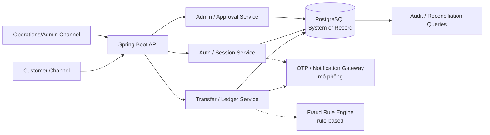
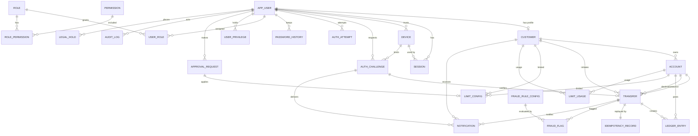
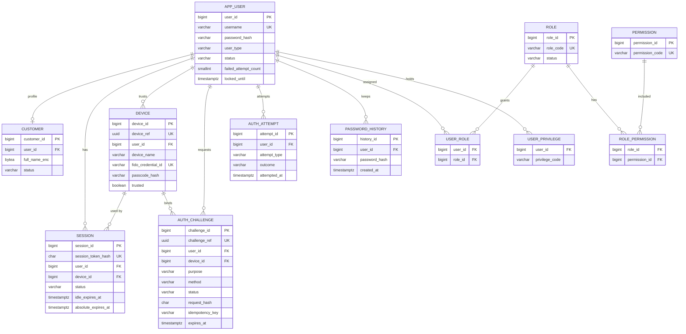
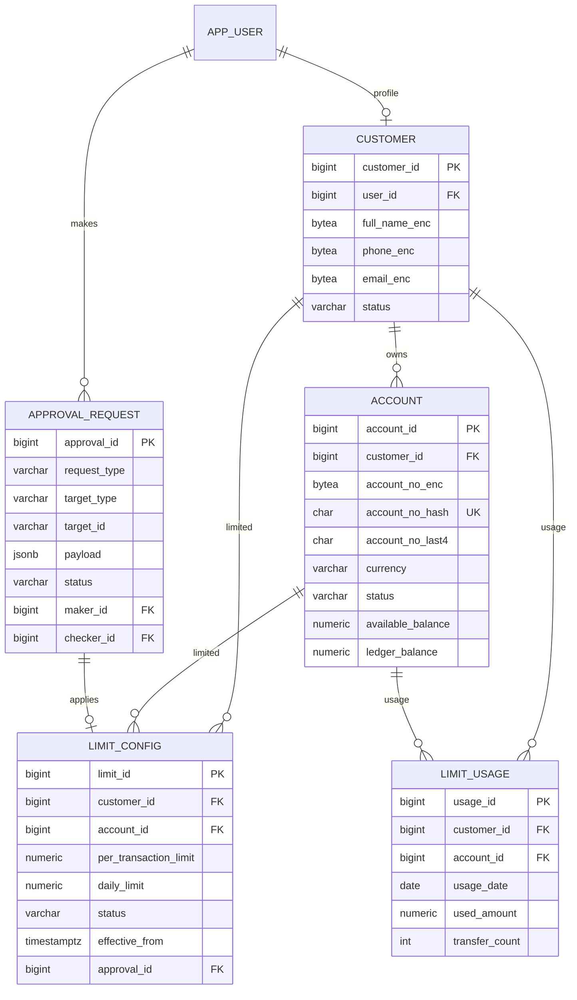
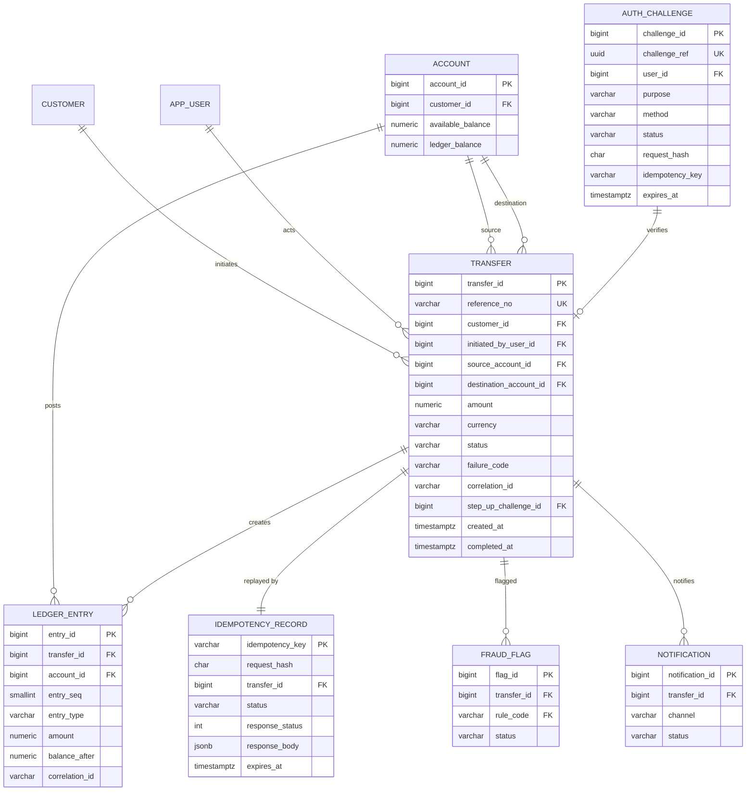
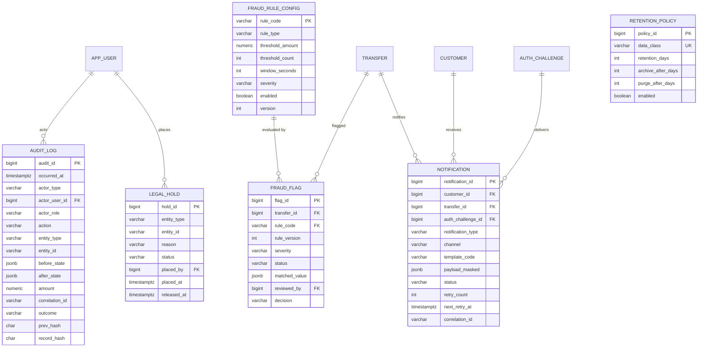

# 04. Database Design & Analysis

> **Dự án:** Digital Banking (Requirement Common)  
> **Tài liệu:** Database Design & Analysis  

---

## Mục lục

- [1. Database Overview](#1-database-overview)
- [2. Data Requirements Analysis](#2-data-requirements-analysis)
- [3. Entity Relationship Diagram](#3-entity-relationship-diagram)
- [4. Database Schema Design](#4-database-schema-design)
- [5. Relationship Analysis](#5-relationship-analysis)
- [6. Database Normalization](#6-database-normalization)
- [7. Data Integrity and Constraints](#7-data-integrity-and-constraints)
- [8. Indexing Strategy](#8-indexing-strategy)
- [9. Data Security and Lifecycle](#9-data-security-and-lifecycle)
- [10. Requirement Traceability](#10-requirement-traceability)
- [11. Assumptions, Open Questions and Design Decisions](#11-assumptions-open-questions-and-design-decisions)
- [Appendix A. Enumerations and Reference Data](#appendix-a-enumerations-and-reference-data)
- [Appendix B. Glossary](#appendix-b-glossary)

---

## 1. Database Overview

### 1.1. Mục đích của cơ sở dữ liệu

Cơ sở dữ liệu là **system of record** cho toàn bộ nghiệp vụ Digital Banking trong phạm vi MVP:

- Danh tính, xác thực, phiên đăng nhập và thiết bị tin cậy.
- Hồ sơ khách hàng, tài khoản và số dư.
- Giao dịch chuyển tiền nội bộ, bút toán sổ cái và trạng thái giao dịch.
- Idempotency, chống gửi trùng và phục hồi giao dịch PENDING.
- Hạn mức giao dịch/ngày và quy trình phê duyệt maker/checker.
- Audit trail bất biến, correlation ID và khả năng tra soát.
- Cảnh báo bất thường, thông báo và lưu trữ/legal hold.

Database **không** phải message broker, không thay thế OTP/Notification Gateway, FIDO Provider hay Fraud Engine. Các hệ thống ngoài được mô phỏng và tích hợp qua interface; database chỉ lưu trạng thái, kết quả và bằng chứng.

### 1.2. Vai trò trong kiến trúc hệ thống



**Hình 1 – Vai trò của database trong kiến trúc**

- **PostgreSQL** là nguồn dữ liệu chuẩn cho tiền, trạng thái giao dịch và audit.
- **Application service** sở hữu transaction boundary; database enforce constraint, uniqueness và tính bất biến.
- **Ledger** là nguồn sự thật cho số dư; `ACCOUNT.available_balance`/`ledger_balance` là materialized balance có reconciliation.
- **Audit log** là append-only; không có API update/delete.

### 1.3. Phạm vi quản lý và lưu trữ

| Trong phạm vi | Ngoài phạm vi |
|---|---|
| Customer, account, balance, transfer, ledger, idempotency | CBS/GL thật, settlement thật, payment gateway thật |
| Auth session, device, OTP/step-up challenge | Card, loan, statement, bill payment, top-up, tax, QR |
| Limits, approval maker/checker, audit, legal hold | Fee/interest/FX engine, beneficiary management |
| Fraud flag rule-based, notification record | ML/AI fraud scoring, notification template management |
| Correlation ID, reconciliation, retention metadata | Multi-tenancy, production compliance certification |

### 1.4. Giả định và ràng buộc

| ID | Nội dung | Ảnh hưởng thiết kế |
|---|---|---|
| CON-004 | Nền tảng Spring Boot + PostgreSQL | Chọn mô hình relational, ACID, row lock |
| CON-005 | VND; không phí/lãi/tỷ giá | `amount = debit amount`; currency VND |
| CON-006 | Không xử lý tiền thật | Dữ liệu demo/tổng hợp |
| CON-008 | Bảo mật ở mức đồ án | Encryption/masking/least privilege, không tuyên bố compliance |
| CON-009 | Audit bất biến, tra cứu được | Append-only, hash chain, retention |
| CON-010 | Fraud rule-based, không ML | `FRAUD_RULE_CONFIG` + `FRAUD_FLAG` |
| ASM-001 | MVP, không production | Ưu tiên simplicity, tránh over-engineering |
| ASM-002 | Tự quản lý ledger, không CBS | Không có bảng đối soát CBS |
| ASM-003 | OTP/SMS/Email/FIDO/fraud mô phỏng | Trạng thái gửi/retry được lưu, không phụ thuộc SLA thật |
| ASM-004 | VND mặc định, có thể cấu hình | `currency` có check VND trong MVP |
| ASM-008 | Timezone cấu hình, đề xuất `Asia/Ho_Chi_Minh` | Lưu UTC; business date tính theo timezone |

### 1.5. DBMS đề xuất

**PostgreSQL 16** (hoặc phiên bản 15+ đang được hỗ trợ; phiên bản chính xác cần xác nhận theo môi trường triển khai).

Lý do:

- ACID, MVCC, row-level locking phù hợp với transfer và ledger.
- Hỗ trợ `SELECT ... FOR UPDATE`, partial unique index, `ON CONFLICT`, JSONB, BRIN index.
- Partial unique index dùng cho session/challenge/limit đang active.
- `pg_advisory_xact_lock` hỗ trợ serialize audit hash chain.
- Là ràng buộc đã chốt trong CON-004/DEP-001; không cần so sánh nhiều DBMS trong phạm vi MVP.

Không chọn NoSQL vì yêu cầu chính là **strong transactional consistency**, quan hệ rõ ràng và audit bất biến.

### 1.6. Nguyên tắc thiết kế

1. **Business-driven:** mọi bảng/cột truy vết về BR/FR/BRL/DIR.
2. **Consistency:** tiền và audit phải nhất quán; ledger là nguồn sự thật.
3. **Normalization:** ưu tiên 3NF; chỉ phi chuẩn hóa có kiểm soát và có reconciliation.
4. **Referential integrity:** FK rõ ràng; không cascade xóa dữ liệu tài chính/audit.
5. **Simplicity:** không thêm bảng cho nghiệp vụ ngoài phạm vi; ưu tiên cột/constraint trước khi tạo bảng mới.
6. **Security by design:** hash secret, encrypt PII/financial, least privilege, audit.
7. **Append-only:** ledger và audit không update/delete; điều chỉnh bằng bản ghi mới.
8. **No hard delete:** dữ liệu tài chính/audit dùng retention/archival/legal hold.

---

## 2. Data Requirements Analysis

### 2.1. Yêu cầu dữ liệu theo domain

| Domain | Yêu cầu nguồn | Hàm ý dữ liệu chính |
|---|---|---|
| Identity & Access | FR-001–007, FR-040, FR-050; BR-001–005, BR-039; BRL-001–008; NFR-015–017 | `app_user`, `session`, `device`, `auth_challenge`, `auth_attempt`, `password_history`, role/permission |
| Customer & Account | FR-008–012; BR-006–008; BRL-007, BRL-010, BRL-011; DIR-005 | `customer`, `account`, ownership, status, balances, PII |
| Transfer & Ledger | FR-013–030; BR-009–021; BRL-009–020; DIR-001–007; NFR-009–012 | `transfer`, `ledger_entry`, reference, status, failure code, correlation ID |
| Idempotency & Recovery | FR-017, FR-021, FR-022; BR-013, BR-015; BRL-013, BRL-016, BRL-017; DIR-002; NFR-006/010/011 | `idempotency_record`, request hash, TTL, replay/conflict, reconciliation |
| Limits | FR-016, FR-031–033; BR-012, BR-022–023; BRL-012, BRL-032; UC-011; AC-017/028 | `limit_config`, `limit_usage`, `approval_request` |
| Audit & Compliance | FR-034–038, FR-053; BR-024–028, BR-041; BRL-021–024, BRL-034; DIR-008; NFR-021–023 | `audit_log`, `legal_hold`, `retention_policy` |
| Security | FR-039/040/052; BR-029–032, BR-040; BRL-025–027, BRL-033; NFR-013–020/030; DIR-009/010 | Encryption, masking, RBAC, data classification, secret hash |
| Notification | FR-041–043; BR-033–034; BRL-028; NFR-008/020 | `notification`, channel, template, masked payload, retry |
| Fraud/Anomaly | FR-044–048; BR-035–037; BRL-029–031; NFR-008 | `fraud_rule_config`, `fraud_flag`, review decision |
| Administration & Data | FR-049–051; BR-038–039; BRL-008/032; AC-028 | Role/permission, maker/checker, checker privilege, audit |

### 2.2. Danh mục thực thể nghiệp vụ

| Entity | Loại dữ liệu | Mục đích | Khóa chính / Unique | Nguồn |
|---|---|---|---|---|
| `app_user` | Master / Security | Tài khoản đăng nhập customer/staff | PK `user_id`; UQ `username` | SRS 7.2–7.3; FR-001/005/050 |
| `customer` | Master / PII | Hồ sơ khách hàng tối thiểu | PK `customer_id`; UQ `user_id` | FR-008; SRS 7.2 |
| `session` | Security / Operational | Phiên đăng nhập | PK `session_id`; UQ `session_token_hash` | FR-001–003/006; BRL-005 |
| `device` | Security / Master | Thiết bị tin cậy/FIDO/passcode | PK `device_id`; UQ `device_ref`; UQ `fido_credential_id` | FR-002/003; SRS 7.3 |
| `auth_challenge` | Security / Operational | OTP/step-up challenge đa phương thức | PK `challenge_id`; UQ `challenge_ref` | FR-004/026/042; UC-015; AC-033 |
| `auth_attempt` | Security / Operational | Lịch sử đăng nhập/xác thực/lockout | PK `attempt_id` | FR-005; BRL-003 |
| `password_history` | Security | Lịch sử password hash gần nhất | PK `history_id` | BRL-006 |
| `role` / `permission` | Reference / Security | Vai trò và quyền | PK riêng; UQ `role_code`/`permission_code` | FR-040/050; ROLE-001–004 |
| `user_role` / `role_permission` | Junction | Gán role/permission | PK ghép | FR-040/050 |
| `user_privilege` | Security | Checker privilege gắn user | PK ghép `(user_id, privilege_code)` | SRS 4.1/4.4; FR-051 |
| `account` | Master / Financial | Tài khoản và số dư | PK `account_id`; UQ `account_no_hash` | FR-009–012; DIR-005 |
| `transfer` | Transactional | Vòng đời chuyển tiền | PK `transfer_id`; UQ `reference_no` | FR-013–026; DIR-001/003/004/007 |
| `ledger_entry` | Transactional / Financial | Bút toán debit/credit | PK `entry_id`; UQ `(transfer_id, entry_seq)` | FR-019/020; DIR-005/006 |
| `idempotency_record` | Operational / Transactional | Lưu kết quả retry | PK `idempotency_key`; UQ `transfer_id` | FR-017/021; DIR-002 |
| `limit_config` | Config / Transactional | Hạn mức hiện hành và lịch sử | PK `limit_id`; partial UQ active scope | FR-016/031–033 |
| `limit_usage` | Derived / Transactional | Usage ngày cho enforcement | PK `usage_id`; partial UQ scope/date | FR-016; BRL-012 |
| `approval_request` | Transactional / Approval | Maker/checker cho limit/role/retention | PK `approval_id` | FR-032/033/051; AC-028 |
| `audit_log` | Audit | Audit trail bất biến | PK `audit_id` | FR-034–038; BRD 4.4.4 |
| `legal_hold` | Audit / Compliance | Legal hold trên entity/data scope | PK `hold_id` | FR-053; BR-041 |
| `retention_policy` | Reference / Compliance | Chính sách retention/archival | PK `policy_id`; UQ `data_class` | FR-053; NFR-031 |
| `fraud_rule_config` | Reference / Config | Ngưỡng và bật/tắt rule | PK `rule_code` | BR-035/036; FR-044–046 |
| `fraud_flag` | Transactional / Risk | Cờ bất thường và quyết định review | PK `flag_id`; UQ `(transfer_id, rule_code, rule_version)` | FR-044–048; AC-026 |
| `notification` | Operational | Thông báo/OTP delivery | PK `notification_id` | FR-041–043; AC-025 |

### 2.3. Thuộc tính khái niệm

Chi tiết vật lý nằm tại mục 4. Ở mức khái niệm:

- **Identity:** `app_user` giữ credential hash, trạng thái, lockout; `customer` giữ hồ sơ PII; `session`/`device` thuộc `app_user`; `auth_challenge` giữ challenge OTP/FIDO/passcode và binding step-up.
- **Account:** `account` giữ `customer_id`, account number đã mã hóa/blind index, trạng thái, hai loại balance.
- **Transfer:** `transfer` giữ reference, source/destination, amount, status, failure code, correlation ID, step-up challenge; `ledger_entry` giữ bút toán; `idempotency_record` giữ request hash và response replay.
- **Controls:** `limit_config` giữ hạn mức hiện hành; `limit_usage` giữ usage ngày; `approval_request` giữ yêu cầu maker/checker.
- **Audit/Compliance:** `audit_log` giữ actor/action/entity/before-after/correlation/hash; `legal_hold` và `retention_policy` giữ vòng đời.
- **Risk/Notification:** `fraud_rule_config` giữ ngưỡng; `fraud_flag` giữ kết quả; `notification` giữ kênh, payload đã mask, trạng thái gửi/retry.

### 2.4. Quan hệ khái niệm

| Quan hệ | Cardinality | Ghi chú |
|---|---|---|
| `app_user` – `customer` | 1 : 0..1 | Customer profile gắn login; staff không có customer |
| `app_user` – `session` | 1 : N | Sửa từ `customer` sang `app_user` (design correction) |
| `app_user` – `device` | 1 : N | Thiết bị tin cậy của customer/staff |
| `app_user` – `auth_challenge` | 1 : N | OTP login/step-up |
| `customer` – `account` | 1 : N | Ownership |
| `customer` – `limit_config` | 1 : N | Limit customer-level |
| `account` – `limit_config` | 1 : N | Limit account-level (optional) |
| `transfer` – `account` | N : 1 (hai FK) | Source và destination |
| `transfer` – `ledger_entry` | 1 : N | Completed có 2 entry |
| `transfer` – `idempotency_record` | 1 : 1 | Record tạo sau validation/step-up |
| `transfer` – `fraud_flag` | 1 : N | Một flag cho mỗi rule khớp |
| `transfer` – `notification` | 1 : N | Best-effort |
| `app_user` – `role` | N : M | Qua `user_role` |
| `role` – `permission` | N : M | Qua `role_permission` |
| `app_user` – `approval_request` | 1 : N | Maker/checker |
| `fraud_flag` – `fraud_rule_config` | N : 1 | `rule_code`/`rule_version` |
| `audit_log` – entity | N : 1 | Polymorphic `entity_type`/`entity_id` |
| `legal_hold` – entity | N : 1 | Polymorphic/data scope |

### 2.5. Phân loại dữ liệu

| Lớp | Thực thể/trường tiêu biểu | Đặc điểm | Xử lý |
|---|---|---|---|
| Master Data | `customer`, `account`, `app_user`, `device`, `role`, `permission` | Ít thay đổi, được tham chiếu | Audit khi thay đổi; không hard delete |
| Transactional Data | `transfer`, `ledger_entry`, `fraud_flag`, `notification`, `limit_usage`, `approval_request` | Tăng liên tục, có vòng đời | Append-only với ledger; status lifecycle; index thời gian |
| Reference Data | `role`, `permission`, `fraud_rule_config`, `retention_policy`, status enums | Cấu hình/chuẩn hóa | Seed/version; admin/ops; audit |
| Audit Data | `audit_log` | Bất biến, phục vụ tra soát | Append-only; hash chain; retention/legal hold |
| Security/Operational | `session`, `auth_challenge`, `auth_attempt`, `password_history`, `idempotency_record` | Ngắn hạn, nhạy cảm | Hash/encrypt; TTL; purge |
| Derived/Denormalized | `account.available_balance`/`ledger_balance`, `limit_usage`, `idempotency_record.response_body`, audit before/after | Dữ liệu dẫn xuất/snapshot | Invariant + reconciliation; ghi rõ lý do |

### 2.6. Yêu cầu toàn vẹn, bảo mật và vòng đời

| Nhóm | Yêu cầu | Nguồn |
|---|---|---|
| Entity integrity | PK, unique reference/account/username/idempotency/role/permission/challenge | DIR-001, DIR-002; SRS 7.3 |
| Referential integrity | FK; không cascade xóa dữ liệu tài chính/audit | BR-021, BR-026; DIR-008 |
| Domain integrity | Amount > 0, scale ≤ 2, VND; source ≠ destination; balance ≥ 0; status enums; OTP attempts | DIR-003–007; BRL-009–011; NFR-009/012 |
| Business integrity | Tổng debit = tổng credit; một idempotency key → một transfer; terminal immutable; audit append-only; không COMPLETED nếu audit chưa bền vững; limit usage; maker ≠ checker | BRL-013–017, BRL-021–024, BRL-032; AC-034 |
| Security | TLS; encryption at rest; hash password/OTP/passcode; PII masking; RBAC; secret management | NFR-013–020; BRL-025–027 |
| Privacy/classification | PII/financial/audit/internal; access theo role | BR-040; NFR-030; FR-052 |
| Lifecycle | Retention, archival, legal hold; không hard delete; synthetic data | BR-041; NFR-022/031/032; FR-053 |
| Auditability | 100% money movement/sensitive action có audit + correlation ID | BR-024–028; NFR-021–023; FR-034–038 |

### 2.7. Các quyết định xử lý khoảng trống yêu cầu

| Vấn đề Phase 1 | Quyết định trong thiết kế này | Lý do |
|---|---|---|
| C-01 Baseline | Dùng `docs-common/01–03`; ghi rõ khác biệt | Là bản official, có step-up/audit-failure |
| C-02 Audit vs tiền | **Hai pha:** T1 tạo transfer PENDING + audit creation; T2 tiền + ledger + balance + limit + audit completion + status là một transaction. Audit fail → T2 rollback, transfer giữ PENDING | Đảm bảo AC-034, không audit gap, không double debit |
| C-03 Step-up | `auth_challenge` tổng quát OTP/FIDO/PASSCODE, binding `request_hash` + `idempotency_key` | Đáp ứng UC-015/AC-033, tránh replay |
| C-04 Idempotency vs 428 | Không tạo `idempotency_record`/transfer trước verify; challenge giữ key/hash; record tạo sau verify, trước T1 | `transfer_id` NOT NULL, không nullable; unique key bảo vệ race |
| C-05 Session/device subject | `session.user_id`/`device.user_id` → `app_user` | Staff cũng đăng nhập; customer là profile optional |
| H-01 Limit | `limit_config` active version + `limit_usage` ngày + `approval_request` | Enforce đồng thời, maker/checker, remaining limit |
| H-02 Ledger | All-or-nothing; FAILED không có ledger entry; không compensation entry trong MVP | Strong consistency; rollback thay compensation |
| H-03 Auth data | `auth_attempt`, `password_history`, `device.passcode_hash` | Đáp ứng BRL-003/006, FR-002 |
| H-04 Checker/role | `user_privilege` + `approval_request` | Checker là privilege, không phải role |
| H-05 Fraud config | `fraud_rule_config` + `fraud_flag` | Ngưỡng cấu hình; rule version |
| H-06 Legal hold | `legal_hold` + `retention_policy` | Đáp ứng BR-041/FR-053 |
| H-07 Audit hash chain | `prev_hash`/`record_hash` + advisory lock + verification job | Tamper-evident |
| H-08 Correlation ID | Có ở transfer, ledger, auth_challenge, audit, notification | FR-038 |

### 2.8. Điều chỉnh so với mô hình khái niệm SRS

Các điều chỉnh sau là **design decisions**, không sửa SRS:

| Điểm | SRS 7.1–7.3 | Thiết kế này | Lý do |
|---|---|---|---|
| Session subject | `CUSTOMER ||--o{ SESSION` | `session.user_id → app_user`; `customer_id` suy ra | Staff cũng có session |
| Device subject | `CUSTOMER ||--o{ DEVICE` | `device.user_id → app_user` | Thiết bị tin cậy của mọi user |
| OTP challenge | `OTP_CHALLENGE` | `auth_challenge` đa phương thức | Step-up FIDO/passcode + binding request |
| Transfer/ledger correlation | Chỉ audit/notification có `correlation_id` | Thêm `correlation_id` vào `transfer`, `ledger_entry`, `auth_challenge` | FR-038 yêu cầu propagate |
| Transfer idempotency | `TRANSFER.idempotency_key` | Chuẩn hóa sang `idempotency_record` (1:1) | Tránh trùng lặp; vẫn trace qua join |
| Transfer step-up | Không có link | `transfer.step_up_challenge_id` nullable FK | Chứng minh transfer dùng challenge verified |
| Audit columns | Chưa có hash chain | Thêm `prev_hash`, `record_hash`, `hash_version` | BR-028/FR-037 |
| Account number | `account_no` | `account_no_enc` + `account_no_hash` + `account_no_last4` | Encrypt at rest + unique + mask |

---

## 3. Entity Relationship Diagram

### 3.1. Ký pháp và quy ước

- Sử dụng **Crow's Foot** qua Mermaid `erDiagram`.
- `||` = exactly one; `o|` = zero or one; `|{` = one or more; `o{` = zero or more.
- `PK` = Primary Key; `FK` = Foreign Key; `UK` = Unique Key.
- Tên bảng/cột dùng `snake_case`, số ít.
- Các quan hệ polymorphic (`audit_log`, `legal_hold`) không thể biểu diễn FK tuyệt đối; được ghi chú riêng.
- Mỗi domain có ERD riêng; ERD tổng thể chỉ hiển thị quan hệ, không hiển thị toàn bộ thuộc tính.

### 3.2. ERD tổng thể



**Hình 2 – ERD tổng thể**

> `AUDIT_LOG` tham chiếu entity qua `entity_type` + `entity_id`; `LEGAL_HOLD` tham chiếu entity/data scope tương tự. Đây là quan hệ logic, không phải FK vật lý.

### 3.3. ERD – Identity & Access



**Hình 3 – ERD Identity & Access**

### 3.4. ERD – Customer, Account, Limits & Approval



**Hình 4 – ERD Customer, Account, Limits & Approval**

### 3.5. ERD – Transfer, Ledger & Idempotency



**Hình 5 – ERD Transfer, Ledger & Idempotency**

### 3.6. ERD – Audit, Fraud & Notification



**Hình 6 – ERD Audit, Fraud & Notification**

> `AUDIT_LOG.entity_type/entity_id` và `LEGAL_HOLD.entity_type/entity_id` là polymorphic references. Không có FK vật lý tới `transfer/account/customer/...`; integrity được kiểm soát bởi application service và audit.

### 3.7. Cardinality và Optionality

| FK / Quan hệ | Parent | Child | Nullable | Cardinality | ON DELETE | Ghi chú |
|---|---|---|---|---|---|---|
| `customer.user_id` | `app_user` | `customer` | NOT NULL | 1 : 0..1 | RESTRICT | Customer có login; staff không có customer |
| `session.user_id` | `app_user` | `session` | NOT NULL | 1 : N | RESTRICT | Subject là app_user |
| `session.device_id` | `device` | `session` | NULL | 1 : N | RESTRICT | Password login có thể không có device |
| `device.user_id` | `app_user` | `device` | NOT NULL | 1 : N | RESTRICT | Thiết bị tin cậy |
| `auth_challenge.user_id` | `app_user` | `auth_challenge` | NOT NULL | 1 : N | RESTRICT | Login/step-up |
| `auth_challenge.device_id` | `device` | `auth_challenge` | NULL | 1 : N | RESTRICT | FIDO/passcode gắn device |
| `auth_attempt.user_id` | `app_user` | `auth_attempt` | NOT NULL | 1 : N | RESTRICT | Lockout history |
| `password_history.user_id` | `app_user` | `password_history` | NOT NULL | 1 : N | RESTRICT | 3 password gần nhất |
| `user_role.user_id/role_id` | `app_user`/`role` | `user_role` | NOT NULL | N : M | RESTRICT | Junction |
| `role_permission.role_id/permission_id` | `role`/`permission` | `role_permission` | NOT NULL | N : M | RESTRICT | Junction |
| `user_privilege.user_id` | `app_user` | `user_privilege` | NOT NULL | 1 : N | RESTRICT | Checker privilege |
| `account.customer_id` | `customer` | `account` | NOT NULL | 1 : N | RESTRICT | Ownership |
| `transfer.customer_id` | `customer` | `transfer` | NOT NULL | 1 : N | RESTRICT | Denormalized owner |
| `transfer.initiated_by_user_id` | `app_user` | `transfer` | NOT NULL | 1 : N | RESTRICT | Actor |
| `transfer.source_account_id` | `account` | `transfer` | NOT NULL | 1 : N | RESTRICT | Source |
| `transfer.destination_account_id` | `account` | `transfer` | NOT NULL | 1 : N | RESTRICT | Destination |
| `transfer.step_up_challenge_id` | `auth_challenge` | `transfer` | NULL | 1 : 0..1 | RESTRICT | Unique khi có |
| `ledger_entry.transfer_id` | `transfer` | `ledger_entry` | NOT NULL | 1 : N | RESTRICT | 2 entry khi COMPLETED |
| `ledger_entry.account_id` | `account` | `ledger_entry` | NOT NULL | 1 : N | RESTRICT | Posting |
| `idempotency_record.transfer_id` | `transfer` | `idempotency_record` | NOT NULL | 1 : 1 | RESTRICT | Unique |
| `limit_config.customer_id` | `customer` | `limit_config` | NOT NULL | 1 : N | RESTRICT | Customer scope |
| `limit_config.account_id` | `account` | `limit_config` | NULL | 1 : N | RESTRICT | Account scope |
| `limit_config.created_by/approved_by` | `app_user` | `limit_config` | NOT NULL/NULL | 1 : N | RESTRICT | Maker/checker |
| `limit_config.approval_id` | `approval_request` | `limit_config` | NULL | 1 : 0..1 | RESTRICT | Traceability |
| `limit_usage.customer_id` | `customer` | `limit_usage` | NOT NULL | 1 : N | RESTRICT | Daily usage |
| `limit_usage.account_id` | `account` | `limit_usage` | NULL | 1 : N | RESTRICT | Account usage |
| `approval_request.maker_id` | `app_user` | `approval_request` | NOT NULL | 1 : N | RESTRICT | Maker |
| `approval_request.checker_id` | `app_user` | `approval_request` | NULL | 1 : N | RESTRICT | Checker |
| `audit_log.actor_user_id` | `app_user` | `audit_log` | NULL | 1 : N | RESTRICT | SYSTEM actor |
| `fraud_flag.transfer_id` | `transfer` | `fraud_flag` | NOT NULL | 1 : N | RESTRICT | Flag |
| `fraud_flag.rule_code` | `fraud_rule_config` | `fraud_flag` | NOT NULL | 1 : N | RESTRICT | Rule version riêng |
| `fraud_flag.reviewed_by` | `app_user` | `fraud_flag` | NULL | 1 : N | RESTRICT | Reviewer |
| `notification.customer_id` | `customer` | `notification` | NOT NULL | 1 : N | RESTRICT | Recipient |
| `notification.transfer_id` | `transfer` | `notification` | NULL | 1 : N | RESTRICT | Transfer result |
| `notification.auth_challenge_id` | `auth_challenge` | `notification` | NULL | 1 : N | RESTRICT | OTP delivery |
| `legal_hold.placed_by/released_by` | `app_user` | `legal_hold` | NOT NULL/NULL | 1 : N | RESTRICT | Hold lifecycle |
| `legal_hold.approval_id` | `approval_request` | `legal_hold` | NULL | 1 : 0..1 | RESTRICT | Approval |
| `retention_policy.created_by/approved_by` | `app_user` | `retention_policy` | NOT NULL/NULL | 1 : N | RESTRICT | Maker/checker |

**Quy tắc chung:**

- Tất cả FK dùng `ON DELETE RESTRICT` hoặc `NO ACTION`; **không dùng CASCADE** cho dữ liệu tài chính/audit.
- `ON UPDATE RESTRICT`/`NO ACTION`; PK và natural key (`reference_no`, `account_no_hash`, `idempotency_key`) immutable.
- Junction table chỉ xóa assignment khi có thao tác quản trị rõ ràng; role/permission không hard delete.
- `NULL` chỉ dùng khi quan hệ thực sự optional (device, account-level limit, transfer result notification, checker).

### 3.8. Tóm tắt PK/FK/Unique cho bảng lõi

| Table | Primary Key | Foreign Keys | Unique Constraints |
|---|---|---|---|
| `app_user` | `user_id` | — | `username` |
| `customer` | `customer_id` | `user_id → app_user` | `user_id` |
| `account` | `account_id` | `customer_id → customer` | `account_no_hash` |
| `transfer` | `transfer_id` | `customer_id`, `initiated_by_user_id`, `source_account_id`, `destination_account_id`, `step_up_challenge_id` | `reference_no`; partial unique `step_up_challenge_id` |
| `ledger_entry` | `entry_id` | `transfer_id`, `account_id` | `(transfer_id, entry_seq)` |
| `idempotency_record` | `idempotency_key` | `transfer_id → transfer` | `transfer_id` |
| `session` | `session_id` | `user_id`, `device_id` | `session_token_hash` |
| `device` | `device_id` | `user_id` | `device_ref`; `fido_credential_id`; `(user_id, device_fingerprint_hash)` |
| `auth_challenge` | `challenge_id` | `user_id`, `device_id` | `challenge_ref`; partial unique active step-up |
| `audit_log` | `audit_id` | `actor_user_id` | — (hash chain, not unique) |
| `limit_config` | `limit_id` | `customer_id`, `account_id`, `created_by`, `approved_by`, `approval_id` | partial unique active customer/account scope |
| `limit_usage` | `usage_id` | `customer_id`, `account_id` | partial unique `(customer_id, usage_date)`/`(account_id, usage_date)` |
| `approval_request` | `approval_id` | `maker_id`, `checker_id` | — (business unique theo payload) |
| `fraud_flag` | `flag_id` | `transfer_id`, `rule_code`, `reviewed_by` | `(transfer_id, rule_code, rule_version)` |
| `notification` | `notification_id` | `customer_id`, `transfer_id`, `auth_challenge_id` | — |

### 3.9. Polymorphic references

`audit_log` và `legal_hold` dùng `entity_type` + `entity_id` để tham chiếu nhiều loại entity. Hệ quả:

- Không thể enforce FK vật lý cho mọi loại entity.
- Application service phải validate `entity_type`/`entity_id` tồn tại trước khi ghi.
- Index `(entity_type, entity_id)` bắt buộc cho tra cứu audit/hold.
- Với các entity lõi, có thể bổ sung FK optional riêng nếu cần truy vấn join; thiết kế này **không** thêm nhiều nullable FK để tránh schema phức tạp.
- `audit_log` là append-only; không có `updated_at`; `legal_hold` có lifecycle release nhưng không delete.

---

## 4. Database Schema Design

### 4.1. Quy ước thiết kế vật lý

| Quy ước | Áp dụng |
|---|---|
| Schema | `banking` cho toàn bộ bảng MVP; không tách schema audit ở giai đoạn này |
| Tên bảng/cột | `snake_case`, số ít; FK `<entity>_id` |
| PK | `BIGINT GENERATED ALWAYS AS IDENTITY` cho bảng nội bộ |
| External ID | `reference_no`, `account_no_hash`, `challenge_ref UUID`, `device_ref UUID`, `session_token_hash` |
| Thời gian | `TIMESTAMPTZ` lưu UTC; business date dùng `DATE` theo `Asia/Ho_Chi_Minh` |
| Tiền | `NUMERIC(19,2)`; `currency CHAR(3)`; MVP check `VND` |
| Enum | `VARCHAR` + `CHECK` constraint (không dùng PostgreSQL ENUM type) |
| JSONB | Chỉ dùng cho snapshot/payload: audit before/after, approval payload, fraud matched value, notification payload, client info masked |
| Encrypted field | Hậu tố `_enc`, kiểu `BYTEA`, AES-256-GCM ở application layer |
| Blind index | Hậu tố `_hash`, `CHAR(64)`, HMAC-SHA-256; dùng cho equality/unique khi cần |
| Hash secret | `VARCHAR(255)` cho Argon2id/bcrypt; không lưu plaintext |
| Audit fields | `created_at`, `updated_at` cho bảng mutable; `created_by`/`updated_by` khi cần; ledger/audit chỉ append |
| Xóa | Không hard delete dữ liệu tài chính/audit; dùng status/retention/legal hold |
| FK action | `ON DELETE RESTRICT`/`NO ACTION`; `ON UPDATE RESTRICT`; không CASCADE |
| Index naming | `uq_<table>_<cols>`, `ix_<table>_<cols>`, `ck_<table>_<rule>` |

> Các kiểu dữ liệu và constraint dưới đây là thiết kế mức physical; không bao gồm migration/SQL script theo yêu cầu phạm vi tài liệu.

### 4.2. Identity & Access

#### 4.2.1. `app_user`

**Mục đích:** tài khoản đăng nhập cho customer và staff; lưu credential hash, trạng thái và lockout summary.  
**Vai trò:** subject trung tâm cho session, device, role, privilege và audit actor.

| Column | Type | Length/Precision | Key | Null | Default | Check | Description |
|---|---|---|---|---|---|---|---|
| `user_id` | BIGINT | — | PK | NO | IDENTITY | — | Định danh nội bộ |
| `username` | VARCHAR | 64 | UK | NO | — | độ dài 1–64 | Định danh đăng nhập; lưu lowercase |
| `password_hash` | VARCHAR | 255 | — | NO | — | — | Argon2id/bcrypt hash; không plaintext |
| `user_type` | VARCHAR | 16 | — | NO | — | `IN ('CUSTOMER','STAFF')` | Loại user |
| `status` | VARCHAR | 16 | — | NO | `'ACTIVE'` | `IN ('ACTIVE','LOCKED','DISABLED')` | Trạng thái tài khoản |
| `failed_attempt_count` | SMALLINT | — | — | NO | `0` | `>= 0` | Số lần sai liên tiếp hiện tại |
| `locked_until` | TIMESTAMPTZ | — | — | YES | — | — | Khóa tạm thời đến thời điểm |
| `last_failed_at` | TIMESTAMPTZ | — | — | YES | — | — | Lần sai gần nhất |
| `last_login_at` | TIMESTAMPTZ | — | — | YES | — | — | Lần đăng nhập thành công gần nhất |
| `password_changed_at` | TIMESTAMPTZ | — | — | NO | `now()` | — | Phục vụ password policy |
| `created_at` | TIMESTAMPTZ | — | — | NO | `now()` | — | Thời điểm tạo |
| `updated_at` | TIMESTAMPTZ | — | — | NO | `now()` | — | Thời điểm cập nhật |

**Indexes:**

- `uq_app_user_username` UNIQUE (`username`).
- `ix_app_user_status` (`status`).
- `ix_app_user_locked_until` (`locked_until`) WHERE `locked_until IS NOT NULL`.

**Business rules:**

- Password chỉ lưu hash; kiểm tra 3 password gần nhất qua `password_history`.
- `failed_attempt_count`/`locked_until` là cache lockout; lịch sử chi tiết ở `auth_attempt`.
- Khóa/mở khóa/disable phải ghi audit.
- Không hard delete user; dùng `status='DISABLED'`.
- `username` được normalize lowercase trước khi insert/update.

#### 4.2.2. `customer`

**Mục đích:** hồ sơ khách hàng tối thiểu; tách khỏi tài khoản đăng nhập.  
**Vai trò:** chủ sở hữu tài khoản; subject của dữ liệu PII và lịch sử giao dịch.

| Column | Type | Length/Precision | Key | Null | Default | Check | Description |
|---|---|---|---|---|---|---|---|
| `customer_id` | BIGINT | — | PK | NO | IDENTITY | — | Định danh nội bộ |
| `user_id` | BIGINT | — | FK, UK | NO | — | — | Login gắn customer; unique trong MVP |
| `full_name_enc` | BYTEA | — | — | NO | — | — | Họ tên mã hóa |
| `phone_enc` | BYTEA | — | — | YES | — | — | Số điện thoại mã hóa |
| `email_enc` | BYTEA | — | — | YES | — | — | Email mã hóa |
| `status` | VARCHAR | 16 | — | NO | `'ACTIVE'` | `IN ('ACTIVE','INACTIVE')` | Trạng thái hồ sơ |
| `created_at` | TIMESTAMPTZ | — | — | NO | `now()` | — | Thời điểm tạo |
| `updated_at` | TIMESTAMPTZ | — | — | NO | `now()` | — | Thời điểm cập nhật |

**Indexes:** `uq_customer_user_id` UNIQUE (`user_id`); `ix_customer_status` (`status`).

**Business rules:**

- PII chỉ lưu dạng mã hóa; response/log dùng giá trị mask.
- `user_id` unique vì MVP giả định mỗi customer có một login; nếu sau này cho phép customer không có login, đổi thành nullable unique (OQ).
- Không hard delete; dùng `status='INACTIVE'`.
- Trường hồ sơ tối thiểu ngoài name/phone/email cần xác nhận (OQ-02).

#### 4.2.3. `session`

**Mục đích:** phiên đăng nhập của mọi `app_user` (customer/staff).  
**Vai trò:** kiểm soát idle/absolute timeout và logout; subject là `app_user`, không phải customer.

| Column | Type | Length/Precision | Key | Null | Default | Check | Description |
|---|---|---|---|---|---|---|---|
| `session_id` | BIGINT | — | PK | NO | IDENTITY | — | Định danh nội bộ |
| `session_token_hash` | CHAR | 64 | UK | NO | — | — | Hash token phiên; không lưu token gốc |
| `user_id` | BIGINT | — | FK | NO | — | — | Chủ sở hữu phiên |
| `device_id` | BIGINT | — | FK | YES | — | — | Thiết bị (nếu có) |
| `status` | VARCHAR | 16 | — | NO | `'ACTIVE'` | `IN ('ACTIVE','EXPIRED','LOGGED_OUT')` | Trạng thái phiên |
| `created_at` | TIMESTAMPTZ | — | — | NO | `now()` | — | Thời điểm tạo |
| `last_activity_at` | TIMESTAMPTZ | — | — | NO | `now()` | — | Hoạt động gần nhất |
| `idle_expires_at` | TIMESTAMPTZ | — | — | NO | — | — | Hết hạn do idle |
| `absolute_expires_at` | TIMESTAMPTZ | — | — | NO | — | — | Hết hạn tuyệt đối |
| `logged_out_at` | TIMESTAMPTZ | — | — | YES | — | — | Thời điểm logout |

**Checks:** `absolute_expires_at > created_at`; `idle_expires_at >= last_activity_at`.

**Indexes:** `uq_session_token_hash` UNIQUE (`session_token_hash`); `ix_session_user_status` (`user_id`, `status`); `ix_session_idle_expires` (`idle_expires_at`); `ix_session_absolute_expires` (`absolute_expires_at`).

**Business rules:**

- Idle 15 phút/absolute 8 giờ là đề xuất BRL-005; giá trị cấu hình.
- Logout/expiry cập nhật status + timestamp; audit sự kiện bảo mật.
- Token gốc chỉ trả client một lần; DB chỉ lưu hash.
- Session purge sau 30 ngày kể từ khi hết hạn (đề xuất).

#### 4.2.4. `device`

**Mục đích:** thiết bị tin cậy, FIDO credential và passcode hash.  
**Vai trò:** hỗ trợ passcode/FIDO login và step-up; gắn với `app_user`.

| Column | Type | Length/Precision | Key | Null | Default | Check | Description |
|---|---|---|---|---|---|---|---|
| `device_id` | BIGINT | — | PK | NO | IDENTITY | — | Định danh nội bộ |
| `device_ref` | UUID | — | UK | NO | — | — | Định danh external cho client |
| `user_id` | BIGINT | — | FK | NO | — | — | Chủ sở hữu thiết bị |
| `device_name` | VARCHAR | 100 | — | NO | — | độ dài 1–100 | Tên thiết bị |
| `device_fingerprint_hash` | CHAR | 64 | — | NO | — | — | HMAC fingerprint; không lưu raw |
| `fido_credential_id` | VARCHAR | 255 | UK | YES | — | — | FIDO/WebAuthn credential reference |
| `passcode_hash` | VARCHAR | 255 | — | YES | — | — | Passcode hash; không plaintext |
| `trusted` | BOOLEAN | — | — | NO | `FALSE` | — | Thiết bị tin cậy |
| `status` | VARCHAR | 16 | — | NO | `'ACTIVE'` | `IN ('ACTIVE','REVOKED')` | Trạng thái thiết bị |
| `trusted_at` | TIMESTAMPTZ | — | — | YES | — | — | Thời điểm trust |
| `last_seen_at` | TIMESTAMPTZ | — | — | YES | — | — | Lần cuối sử dụng |
| `created_at` | TIMESTAMPTZ | — | — | NO | `now()` | — | Thời điểm tạo |
| `updated_at` | TIMESTAMPTZ | — | — | NO | `now()` | — | Thời điểm cập nhật |

**Indexes:** `uq_device_ref` UNIQUE (`device_ref`); `uq_device_fido` UNIQUE (`fido_credential_id`); `uq_device_user_fingerprint` UNIQUE (`user_id`, `device_fingerprint_hash`); `ix_device_user_status` (`user_id`, `status`).

**Business rules:**

- Passcode/FIDO chỉ dùng trên thiết bị `trusted`; fallback password theo chính sách.
- Revoke thiết bị không xóa; revoke session đang active liên quan.
- Audit trust/revoke/credential change.

#### 4.2.5. `auth_challenge`

**Mục đích:** challenge đa phương thức cho OTP login, step-up transfer và hành động nhạy cảm.  
**Vai trò:** thay thế `OTP_CHALLENGE` trong SRS; đảm bảo binding `request_hash` + `idempotency_key` cho step-up.

| Column | Type | Length/Precision | Key | Null | Default | Check | Description |
|---|---|---|---|---|---|---|---|
| `challenge_id` | BIGINT | — | PK | NO | IDENTITY | — | Định danh nội bộ |
| `challenge_ref` | UUID | — | UK | NO | — | — | ID trả client |
| `user_id` | BIGINT | — | FK | NO | — | — | User yêu cầu |
| `device_id` | BIGINT | — | FK | YES | — | — | Thiết bị liên quan |
| `purpose` | VARCHAR | 32 | — | NO | — | `IN ('LOGIN_NEW_DEVICE','TRANSFER_STEP_UP','SENSITIVE_ACTION')` | Mục đích |
| `method` | VARCHAR | 16 | — | NO | — | `IN ('OTP','FIDO','PASSCODE')` | Phương thức |
| `channel` | VARCHAR | 16 | — | YES | — | `IN ('SMS','EMAIL','IN_APP')` | Kênh gửi OTP |
| `otp_hash` | VARCHAR | 255 | — | YES | — | — | OTP hash; không plaintext |
| `fido_credential_id` | VARCHAR | 255 | — | YES | — | — | FIDO credential dùng để verify |
| `request_hash` | CHAR | 64 | — | YES | — | — | Hash payload step-up |
| `idempotency_key` | VARCHAR | 255 | — | YES | — | độ dài ≤ 255 | Key step-up |
| `status` | VARCHAR | 16 | — | NO | `'CREATED'` | `IN ('CREATED','SENT','VERIFIED','LOCKED','EXPIRED','CANCELLED')` | Trạng thái |
| `attempt_count` | SMALLINT | — | — | NO | `0` | `>= 0` | Số lần thử |
| `max_attempts` | SMALLINT | — | — | NO | `5` | `> 0` | Giới hạn thử |
| `expires_at` | TIMESTAMPTZ | — | — | NO | — | — | TTL |
| `created_at` | TIMESTAMPTZ | — | — | NO | `now()` | — | Thời điểm tạo |
| `sent_at` | TIMESTAMPTZ | — | — | YES | — | — | Thời điểm gửi |
| `verified_at` | TIMESTAMPTZ | — | — | YES | — | — | Thời điểm verify |
| `consumed_at` | TIMESTAMPTZ | — | — | YES | — | — | Thời điểm dùng cho transfer |
| `correlation_id` | VARCHAR | 64 | — | NO | — | — | Trace ID |

**Checks:**

- `method='OTP'` ⇒ `otp_hash IS NOT NULL AND channel IS NOT NULL`.
- `method='FIDO'` ⇒ `fido_credential_id IS NOT NULL AND device_id IS NOT NULL`.
- `method='PASSCODE'` ⇒ `device_id IS NOT NULL`.
- `purpose='TRANSFER_STEP_UP'` ⇒ `request_hash IS NOT NULL AND idempotency_key IS NOT NULL`.
- `expires_at > created_at`; `attempt_count <= max_attempts`.

**Indexes:**

- `uq_auth_challenge_ref` UNIQUE (`challenge_ref`).
- `ix_auth_challenge_user_status` (`user_id`, `status`, `expires_at`).
- `ix_auth_challenge_idempotency` (`idempotency_key`).
- `ix_auth_challenge_expires` (`expires_at`).
- `uq_auth_challenge_active_stepup` UNIQUE (`idempotency_key`, `request_hash`) WHERE `purpose='TRANSFER_STEP_UP' AND status IN ('CREATED','SENT','VERIFIED') AND consumed_at IS NULL`.

**Business rules:**

- OTP single-use, TTL 5 phút, tối đa 5 lần thử (đề xuất BRL-004).
- `CREATED → SENT → VERIFIED`; sai vượt ngưỡng → `LOCKED`; hết hạn → `EXPIRED`.
- Step-up: không tạo transfer/ledger trước khi `VERIFIED`; verify xong client retry cùng idempotency key; challenge được `consumed_at` khi transfer T1 tạo và phải consume trước `expires_at`.
- Không trả OTP/hash ra response/log.
- Một challenge step-up active cho mỗi `(idempotency_key, request_hash)`.

#### 4.2.6. `auth_attempt`

**Mục đích:** lưu lịch sử đăng nhập/xác thực và lockout.  
**Vai trò:** đếm số lần sai/khóa trong 24h; hỗ trợ điều tra bảo mật.

| Column | Type | Length/Precision | Key | Null | Default | Check | Description |
|---|---|---|---|---|---|---|---|
| `attempt_id` | BIGINT | — | PK | NO | IDENTITY | — | Định danh |
| `user_id` | BIGINT | — | FK | NO | — | — | User |
| `attempt_type` | VARCHAR | 16 | — | NO | — | `IN ('LOGIN','PASSCODE','FIDO','OTP','STEP_UP')` | Loại xác thực |
| `outcome` | VARCHAR | 16 | — | NO | — | `IN ('SUCCESS','FAILURE','LOCKED')` | Kết quả |
| `reason_code` | VARCHAR | 32 | — | YES | — | — | Mã lý do |
| `correlation_id` | VARCHAR | 64 | — | NO | — | — | Trace ID |
| `attempted_at` | TIMESTAMPTZ | — | — | NO | `now()` | — | Thời điểm |
| `client_info_masked` | JSONB | — | — | YES | — | — | IP/user agent đã mask |

**Indexes:** `ix_auth_attempt_user_time` (`user_id`, `attempted_at DESC`); `ix_auth_attempt_user_outcome_time` (`user_id`, `outcome`, `attempted_at DESC`).

**Business rules:**

- 5 lần sai liên tiếp → khóa 10 phút; 3 lần khóa/24h → khóa tài khoản (đề xuất BRL-003).
- Không lưu credential/OTP; chỉ metadata đã mask.
- Ghi audit khi lock/unlock.

#### 4.2.7. `password_history`

**Mục đích:** kiểm tra không trùng 3 password gần nhất.  
**Vai trò:** hỗ trợ BRL-006.

| Column | Type | Length/Precision | Key | Null | Default | Check | Description |
|---|---|---|---|---|---|---|---|
| `history_id` | BIGINT | — | PK | NO | IDENTITY | — | Định danh |
| `user_id` | BIGINT | — | FK | NO | — | — | User |
| `password_hash` | VARCHAR | 255 | — | NO | — | — | Hash của password cũ |
| `created_at` | TIMESTAMPTZ | — | — | NO | `now()` | — | Thời điểm đổi |

**Indexes:** `ix_password_history_user_time` (`user_id`, `created_at DESC`).

**Business rules:**

- Khi đổi password, so sánh với 3 hash gần nhất; nếu trùng → từ chối.
- Không lưu plaintext; retention theo user lifecycle/audit.

#### 4.2.8. Role, Permission và Privilege

**`role`**

**Mục đích:** danh mục vai trò hệ thống (Customer/Operations/Admin/Auditor).  
**Vai trò:** đầu mối gán permission; không lưu permission trực tiếp trên user.

| Column | Type | Length/Precision | Key | Null | Default | Check | Description |
|---|---|---|---|---|---|---|---|
| `role_id` | BIGINT | — | PK | NO | IDENTITY | — | Định danh |
| `role_code` | VARCHAR | 32 | UK | NO | — | — | `CUSTOMER`, `OPERATIONS`, `ADMIN`, `AUDITOR` |
| `name` | VARCHAR | 100 | — | NO | — | — | Tên hiển thị |
| `description` | VARCHAR | 255 | — | YES | — | — | Mô tả |
| `status` | VARCHAR | 16 | — | NO | `'ACTIVE'` | `IN ('ACTIVE','DISABLED')` | Trạng thái |
| `created_at` | TIMESTAMPTZ | — | — | NO | `now()` | — | Thời điểm tạo |
| `updated_at` | TIMESTAMPTZ | — | — | NO | `now()` | — | Cập nhật |

**`permission`**

**Mục đích:** danh mục quyền thao tác/đọc dữ liệu.  
**Vai trò:** đơn vị least privilege gán cho role.

| Column | Type | Length/Precision | Key | Null | Default | Check | Description |
|---|---|---|---|---|---|---|---|
| `permission_id` | BIGINT | — | PK | NO | IDENTITY | — | Định danh |
| `permission_code` | VARCHAR | 64 | UK | NO | — | — | Mã quyền |
| `description` | VARCHAR | 255 | — | YES | — | — | Mô tả |
| `status` | VARCHAR | 16 | — | NO | `'ACTIVE'` | `IN ('ACTIVE','DISABLED')` | Trạng thái |
| `created_at` | TIMESTAMPTZ | — | — | NO | `now()` | — | Thời điểm tạo |
| `updated_at` | TIMESTAMPTZ | — | — | NO | `now()` | — | Cập nhật |

**`user_role`**

**Mục đích:** bảng trung gian gán role cho user.  
**Vai trò:** triển khai quan hệ N–N `app_user`–`role`; lưu người/thời điểm gán.

| Column | Type | Length/Precision | Key | Null | Default | Check | Description |
|---|---|---|---|---|---|---|---|
| `user_id` | BIGINT | — | PK, FK | NO | — | — | User |
| `role_id` | BIGINT | — | PK, FK | NO | — | — | Role |
| `assigned_by` | BIGINT | — | FK | YES | — | — | Người gán |
| `assigned_at` | TIMESTAMPTZ | — | — | NO | `now()` | — | Thời điểm gán |

**`role_permission`**

**Mục đích:** bảng trung gian gán permission cho role.  
**Vai trò:** triển khai quan hệ N–N `role`–`permission`; audit thay đổi quyền.

| Column | Type | Length/Precision | Key | Null | Default | Check | Description |
|---|---|---|---|---|---|---|---|
| `role_id` | BIGINT | — | PK, FK | NO | — | — | Role |
| `permission_id` | BIGINT | — | PK, FK | NO | — | — | Permission |
| `granted_by` | BIGINT | — | FK | YES | — | — | Người gán |
| `granted_at` | TIMESTAMPTZ | — | — | NO | `now()` | — | Thời điểm gán |

**`user_privilege`**

**Mục đích:** privilege gắn trực tiếp user, hiện dùng cho `CHECKER`.  
**Vai trò:** tách quyền phê duyệt khỏi role; hỗ trợ maker/checker.

| Column | Type | Length/Precision | Key | Null | Default | Check | Description |
|---|---|---|---|---|---|---|---|
| `user_id` | BIGINT | — | PK, FK | NO | — | — | User |
| `privilege_code` | VARCHAR | 32 | PK | NO | — | `IN ('CHECKER')` | Privilege |
| `status` | VARCHAR | 16 | — | NO | `'ACTIVE'` | `IN ('ACTIVE','REVOKED')` | Trạng thái |
| `granted_by` | BIGINT | — | FK | YES | — | — | Người cấp |
| `granted_at` | TIMESTAMPTZ | — | — | NO | `now()` | — | Thời điểm cấp |

**Indexes:** `uq_role_code`, `uq_permission_code`; `ix_user_role_role` (`role_id`); `ix_role_permission_permission` (`permission_id`); `ix_user_privilege_code` (`privilege_code`).

**Business rules:**

- Seed roles: `CUSTOMER`, `OPERATIONS`, `ADMIN`, `AUDITOR`.
- Checker là privilege gắn user, không phải role; không tự cấp cho mình nếu chính sách cấm.
- Thay đổi role/permission/privilege phải qua `approval_request` (trừ seed/migration có kiểm soát) và ghi audit.
- Không hard delete role/permission; dùng `status='DISABLED'`.

### 4.3. Customer & Account

#### 4.3.1. `account`

**Mục đích:** tài khoản tiền gửi/thanh toán, số dư khả dụng và số dư sổ cái.  
**Vai trò:** đối tượng debit/credit; ownership; nguồn kiểm tra balance/status trước transfer.

| Column | Type | Length/Precision | Key | Null | Default | Check | Description |
|---|---|---|---|---|---|---|---|
| `account_id` | BIGINT | — | PK | NO | IDENTITY | — | Định danh nội bộ |
| `customer_id` | BIGINT | — | FK | NO | — | — | Chủ sở hữu |
| `account_no_enc` | BYTEA | — | — | NO | — | — | Số tài khoản mã hóa AES-256-GCM |
| `account_no_hash` | CHAR | 64 | UK | NO | — | — | Blind index HMAC để unique/tra cứu |
| `account_no_last4` | CHAR | 4 | — | NO | — | độ dài 4 | 4 ký tự cuối để mask |
| `currency` | CHAR | 3 | — | NO | `'VND'` | `= 'VND'` | Tiền tệ MVP |
| `status` | VARCHAR | 16 | — | NO | `'ACTIVE'` | `IN ('ACTIVE','LOCKED','CLOSED')` | Trạng thái tài khoản |
| `available_balance` | NUMERIC | 19,2 | — | NO | `0` | `>= 0` | Số dư khả dụng |
| `ledger_balance` | NUMERIC | 19,2 | — | NO | `0` | `>= 0` | Số dư theo ledger |
| `closed_at` | TIMESTAMPTZ | — | — | YES | — | — | Thời điểm đóng |
| `created_at` | TIMESTAMPTZ | — | — | NO | `now()` | — | Thời điểm tạo |
| `updated_at` | TIMESTAMPTZ | — | — | NO | `now()` | — | Thời điểm cập nhật |

**Checks:** `available_balance <= ledger_balance` (MVP không có hold, hai giá trị thường bằng nhau); `currency='VND'`; `account_no_last4` khớp 4 ký tự cuối của account number (application).

**Indexes:** `uq_account_no_hash` UNIQUE (`account_no_hash`); `ix_account_customer` (`customer_id`); `ix_account_status` (`status`).

**Business rules:**

- `account_no` không lưu plaintext; decrypt chỉ cho role được phép; response mặc định `**** **** <last4>`.
- `ledger_balance` là tổng posted entries; `available_balance` là số dư khả dụng (MVP không hold nên bằng `ledger_balance`).
- Cập nhật balance chỉ trong transaction tiền, có row lock; không update trực tiếp ngoài service.
- Không hard delete; đóng tài khoản bằng `status='CLOSED'` + `closed_at`.
- Định kỳ reconciliation: `ledger_balance = SUM(credits) - SUM(debits)` theo account.
- Account number format/generation là open question (OQ-02).

### 4.4. Transfer, Ledger & Idempotency

#### 4.4.1. `transfer`

**Mục đích:** vòng đời một giao dịch chuyển tiền nội bộ.  
**Vai trò:** entity trung tâm cho history, status, audit và reconciliation.

| Column | Type | Length/Precision | Key | Null | Default | Check | Description |
|---|---|---|---|---|---|---|---|
| `transfer_id` | BIGINT | — | PK | NO | IDENTITY | — | Định danh nội bộ |
| `reference_no` | VARCHAR | 32 | UK | NO | — | độ dài 1–32 | Mã tham chiếu external, immutable |
| `customer_id` | BIGINT | — | FK | NO | — | — | Customer khởi tạo/owner |
| `initiated_by_user_id` | BIGINT | — | FK | NO | — | — | Actor thực hiện |
| `source_account_id` | BIGINT | — | FK | NO | — | — | Tài khoản nguồn |
| `destination_account_id` | BIGINT | — | FK | NO | — | — | Tài khoản đích |
| `amount` | NUMERIC | 19,2 | — | NO | — | `> 0` | Số tiền |
| `currency` | CHAR | 3 | — | NO | `'VND'` | `= 'VND'` | Tiền tệ |
| `description` | VARCHAR | 255 | — | YES | — | độ dài ≤ 255 | Mô tả; không chứa dữ liệu nhạy cảm |
| `status` | VARCHAR | 16 | — | NO | `'PENDING'` | `IN ('PENDING','COMPLETED','FAILED')` | Trạng thái |
| `failure_code` | VARCHAR | 32 | — | YES | — | — | Mã lỗi nghiệp vụ/hệ thống |
| `failure_message` | VARCHAR | 255 | — | YES | — | — | Thông điệp an toàn, không PII |
| `correlation_id` | VARCHAR | 64 | — | NO | — | — | Trace ID |
| `step_up_challenge_id` | BIGINT | — | FK | YES | — | — | Challenge đã verify (nếu có) |
| `created_at` | TIMESTAMPTZ | — | — | NO | `now()` | — | Thời điểm tạo |
| `updated_at` | TIMESTAMPTZ | — | — | NO | `now()` | — | Thời điểm cập nhật |
| `completed_at` | TIMESTAMPTZ | — | — | YES | — | — | Thời điểm COMPLETED |
| `failed_at` | TIMESTAMPTZ | — | — | YES | — | — | Thời điểm FAILED |

**Checks:**

- `amount > 0`; `currency='VND'`.
- `source_account_id <> destination_account_id`.
- `status='COMPLETED'` ⇒ `completed_at IS NOT NULL AND failed_at IS NULL`.
- `status='FAILED'` ⇒ `failed_at IS NOT NULL AND completed_at IS NULL AND failure_code IS NOT NULL`.
- `status='PENDING'` ⇒ `completed_at IS NULL AND failed_at IS NULL`.

**Indexes:**

- `uq_transfer_reference` UNIQUE (`reference_no`).
- `ix_transfer_customer_time` (`customer_id`, `created_at DESC`).
- `ix_transfer_source_time` (`source_account_id`, `created_at DESC`).
- `ix_transfer_destination_time` (`destination_account_id`, `created_at DESC`).
- `ix_transfer_status_time` (`status`, `created_at`).
- `ix_transfer_correlation` (`correlation_id`).
- `uq_transfer_step_up_challenge` UNIQUE (`step_up_challenge_id`) WHERE `step_up_challenge_id IS NOT NULL`.

**Business rules:**

- `reference_no` unique, immutable; format do API quy định (OQ-02).
- `customer_id`/`initiated_by_user_id` là controlled denormalization để query history và lưu actor; application kiểm tra khớp source account/customer khi tạo.
- Transfer tạo ở T1 với status `PENDING`; T2 xử lý tiền + ledger + audit + status terminal.
- Terminal status immutable; trigger chặn update status/amount/accounts/reference sau terminal.
- Không có `idempotency_key` trên bảng này; quan hệ 1:1 qua `idempotency_record` (chuẩn hóa).
- `step_up_challenge_id` unique để một challenge không dùng cho hai transfer; challenge phải `VERIFIED` trước T1.
- Mọi thay đổi trạng thái ghi audit; correlation ID propagate sang ledger/audit/notification.
- Description không chứa full PII/số tài khoản; validate/mask ở application.

#### 4.4.2. `ledger_entry`

**Mục đích:** bút toán debit/credit append-only cho mỗi transfer thành công.  
**Vai trò:** nguồn sự thật của số dư; bằng chứng double-entry.

| Column | Type | Length/Precision | Key | Null | Default | Check | Description |
|---|---|---|---|---|---|---|---|
| `entry_id` | BIGINT | — | PK | NO | IDENTITY | — | Định danh |
| `transfer_id` | BIGINT | — | FK | NO | — | — | Transfer |
| `account_id` | BIGINT | — | FK | NO | — | — | Account được post |
| `entry_seq` | SMALLINT | — | — | NO | — | `IN (1,2)` | Thứ tự entry trong transfer |
| `entry_type` | VARCHAR | 8 | — | NO | — | `IN ('DEBIT','CREDIT')` | Loại bút toán |
| `amount` | NUMERIC | 19,2 | — | NO | — | `> 0` | Số tiền |
| `currency` | CHAR | 3 | — | NO | `'VND'` | `= 'VND'` | Tiền tệ |
| `balance_after` | NUMERIC | 19,2 | — | NO | — | `>= 0` | Số dư sau bút toán |
| `correlation_id` | VARCHAR | 64 | — | NO | — | — | Trace ID |
| `created_at` | TIMESTAMPTZ | — | — | NO | `now()` | — | Thời điểm post |

**Indexes:** `uq_ledger_transfer_seq` UNIQUE (`transfer_id`, `entry_seq`); `ix_ledger_account_time` (`account_id`, `created_at DESC`); `ix_ledger_transfer` (`transfer_id`); `ix_ledger_correlation` (`correlation_id`).

**Business rules:**

- Append-only: không UPDATE/DELETE; điều chỉnh sau này bằng bản ghi mới (ngoài MVP).
- Transfer `COMPLETED` có đúng 2 entry: DEBIT source, CREDIT destination; cùng amount/currency.
- Transfer `FAILED`/`PENDING` không có entry trong MVP (all-or-nothing).
- `balance_after` là snapshot sau khi post; reconciliation kiểm tra lại.
- Tổng debit = tổng credit cho mỗi transfer; có thể enforce bằng deferred constraint trigger hoặc reconciliation job.
- Ledger là nguồn sự thật; account balance là materialized.

#### 4.4.3. `idempotency_record`

**Mục đích:** lưu request hash và response của lần xử lý đầu tiên để replay an toàn.  
**Vai trò:** chống double debit khi timeout/retry; đảm bảo một key → một transfer.

| Column | Type | Length/Precision | Key | Null | Default | Check | Description |
|---|---|---|---|---|---|---|---|
| `idempotency_key` | VARCHAR | 255 | PK | NO | — | độ dài 1–255 | Key client gửi |
| `request_hash` | CHAR | 64 | — | NO | — | — | SHA-256 payload chuẩn hóa |
| `transfer_id` | BIGINT | — | FK, UK | NO | — | — | Transfer tương ứng |
| `status` | VARCHAR | 16 | — | NO | `'RECEIVED'` | `IN ('RECEIVED','IN_PROGRESS','COMPLETED','FAILED')` | Trạng thái xử lý |
| `response_status` | SMALLINT | — | — | YES | — | 100–599 | HTTP status đã trả |
| `response_body` | JSONB | — | — | YES | — | — | Response replay; chỉ chứa dữ liệu đã mask/an toàn |
| `created_at` | TIMESTAMPTZ | — | — | NO | `now()` | — | Thời điểm tạo |
| `completed_at` | TIMESTAMPTZ | — | — | YES | — | — | Thời điểm terminal |
| `expires_at` | TIMESTAMPTZ | — | — | NO | — | `> created_at` | Hết hạn lưu key |

**Checks:** `status IN ('COMPLETED','FAILED')` ⇒ `completed_at IS NOT NULL AND response_status IS NOT NULL`.

**Indexes:** `uq_idempotency_transfer` UNIQUE (`transfer_id`); `ix_idempotency_expires` (`expires_at`); `ix_idempotency_status` (`status`).

**Business rules:**

- Record chỉ được tạo sau validation và sau step-up verify (nếu có), trong T1 cùng transfer PENDING.
- Key unique toàn cục; cùng key + cùng hash → replay; cùng key + khác hash → `IDEMPOTENCY_CONFLICT`; đang xử lý → `IDEMPOTENCY_IN_PROGRESS`.
- `response_body` không chứa PII/full account; nếu có dữ liệu nhạy cảm phải mask/encrypt.
- TTL 24h (đề xuất BRL-013/OI-001); key hết hạn được coi là request mới; client nên query reference trước.
- Purge job xóa record hết hạn; không ảnh hưởng transfer/ledger/audit.
- Key không chứa dữ liệu nhạy cảm; giới hạn 255 ký tự.

### 4.5. Controls: Limits & Approval

#### 4.5.1. `limit_config`

**Mục đích:** hạn mức hiện hành (per-transaction/daily) theo customer hoặc account; lưu lịch sử version.  
**Vai trò:** nguồn cấu hình cho FR-016/FR-031–033; maker/checker qua `approval_request`.

| Column | Type | Length/Precision | Key | Null | Default | Check | Description |
|---|---|---|---|---|---|---|---|
| `limit_id` | BIGINT | — | PK | NO | IDENTITY | — | Định danh |
| `customer_id` | BIGINT | — | FK | NO | — | — | Customer scope |
| `account_id` | BIGINT | — | FK | YES | — | — | Account scope (nếu có) |
| `per_transaction_limit` | NUMERIC | 19,2 | — | NO | — | `> 0` | Hạn mức mỗi giao dịch |
| `daily_limit` | NUMERIC | 19,2 | — | NO | — | `> 0` | Hạn mức ngày |
| `currency` | CHAR | 3 | — | NO | `'VND'` | `= 'VND'` | Tiền tệ |
| `effective_from` | TIMESTAMPTZ | — | — | NO | — | — | Hiệu lực từ |
| `effective_to` | TIMESTAMPTZ | — | — | YES | — | `> effective_from` nếu có | Hiệu lực đến |
| `status` | VARCHAR | 16 | — | NO | `'PENDING_APPROVAL'` | `IN ('PENDING_APPROVAL','ACTIVE','SUPERSEDED','REJECTED')` | Trạng thái |
| `version` | INT | — | — | NO | `1` | `> 0` | Version cấu hình |
| `created_by` | BIGINT | — | FK | NO | — | — | Maker |
| `approved_by` | BIGINT | — | FK | YES | — | — | Checker |
| `approval_id` | BIGINT | — | FK | YES | — | — | Approval request |
| `created_at` | TIMESTAMPTZ | — | — | NO | `now()` | — | Thời điểm tạo |
| `approved_at` | TIMESTAMPTZ | — | — | YES | — | — | Thời điểm duyệt |
| `updated_at` | TIMESTAMPTZ | — | — | NO | `now()` | — | Cập nhật |

**Checks:** `approved_by IS NULL OR approved_by <> created_by`; `status='ACTIVE' OR status='SUPERSEDED'` ⇒ `approved_by IS NOT NULL AND approved_at IS NOT NULL`; `status='REJECTED'` ⇒ `approved_by IS NULL AND approved_at IS NULL`.

**Partial unique:**

- `uq_limit_active_customer` UNIQUE (`customer_id`) WHERE `account_id IS NULL AND status='ACTIVE'`.
- `uq_limit_active_account` UNIQUE (`account_id`) WHERE `account_id IS NOT NULL AND status='ACTIVE'`.

**Indexes:** `ix_limit_customer_status` (`customer_id`, `status`); `ix_limit_account_status` (`account_id`, `status`); `ix_limit_effective` (`effective_from`, `effective_to`).

**Business rules:**

- Một scope chỉ có một `ACTIVE` config; thay đổi tạo version mới và set bản cũ `SUPERSEDED` trong cùng transaction.
- Customer-level limit áp dụng tổng usage của customer; account-level limit áp dụng riêng account. Nếu cả hai tồn tại, enforce cả hai (giới hạn chặt hơn thắng).
- Thay đổi phải qua `approval_request`; maker ≠ checker; audit.
- Daily reset theo business date `Asia/Ho_Chi_Minh` (đề xuất); giá trị ngưỡng cần chốt (OI).
- Không hard delete; giữ lịch sử version.

#### 4.5.2. `limit_usage`

**Mục đích:** counter usage theo ngày để enforce daily limit đồng thời.  
**Vai trò:** tránh race condition khi nhiều transfer cùng customer/account; hỗ trợ “remaining daily limit”.

| Column | Type | Length/Precision | Key | Null | Default | Check | Description |
|---|---|---|---|---|---|---|---|
| `usage_id` | BIGINT | — | PK | NO | IDENTITY | — | Định danh |
| `customer_id` | BIGINT | — | FK | NO | — | — | Customer |
| `account_id` | BIGINT | — | FK | YES | — | — | Account scope |
| `usage_date` | DATE | — | — | NO | — | — | Business date |
| `currency` | CHAR | 3 | — | NO | `'VND'` | `= 'VND'` | Tiền tệ |
| `used_amount` | NUMERIC | 19,2 | — | NO | `0` | `>= 0` | Tổng amount đã dùng |
| `transfer_count` | INT | — | — | NO | `0` | `>= 0` | Số transfer |
| `updated_at` | TIMESTAMPTZ | — | — | NO | `now()` | — | Cập nhật |

**Partial unique:**

- `uq_limit_usage_customer` UNIQUE (`customer_id`, `usage_date`) WHERE `account_id IS NULL`.
- `uq_limit_usage_account` UNIQUE (`account_id`, `usage_date`) WHERE `account_id IS NOT NULL`.

**Indexes:** `ix_limit_usage_date` (`usage_date`).

**Business rules:**

- T2 lock usage row (`SELECT ... FOR UPDATE`), kiểm tra `used_amount + amount <= daily_limit`, sau đó cập nhật counter.
- Nếu cả customer/account scope: lock theo thứ tự customer-level → account-level để tránh deadlock.
- Chỉ transfer `COMPLETED` mới tăng usage; transfer `FAILED` rollback không tăng.
- `usage_date` tính theo timezone cấu hình; reconciliation từ `transfer`/`ledger_entry` nếu counter lệch.
- Có thể thay bằng query aggregate nếu dữ liệu nhỏ; counter được chọn vì enforcement đồng thời và remaining limit.

#### 4.5.3. `approval_request`

**Mục đích:** quy trình maker/checker cho thay đổi hạn mức, role/permission và retention/legal hold.  
**Vai trò:** đáp ứng FR-032/033/050/051, AC-028; tách yêu cầu khỏi config hiện tại.

| Column | Type | Length/Precision | Key | Null | Default | Check | Description |
|---|---|---|---|---|---|---|---|
| `approval_id` | BIGINT | — | PK | NO | IDENTITY | — | Định danh |
| `request_type` | VARCHAR | 32 | — | NO | — | `IN ('LIMIT_CHANGE','ROLE_CHANGE','RETENTION_HOLD','RETENTION_POLICY_CHANGE')` | Loại yêu cầu |
| `target_type` | VARCHAR | 32 | — | NO | — | `IN ('CUSTOMER','ACCOUNT','APP_USER','DATA_SCOPE','RETENTION_POLICY')` | Loại đối tượng |
| `target_id` | VARCHAR | 64 | — | NO | — | độ dài 1–64 | ID đối tượng |
| `payload` | JSONB | — | — | NO | — | — | Nội dung thay đổi; schema theo `request_type` |
| `status` | VARCHAR | 16 | — | NO | `'PENDING'` | `IN ('PENDING','APPROVED','REJECTED','APPLIED','CANCELLED')` | Trạng thái |
| `maker_id` | BIGINT | — | FK | NO | — | — | Người tạo |
| `checker_id` | BIGINT | — | FK | YES | — | — | Người duyệt |
| `decision_note` | VARCHAR | 500 | — | YES | — | — | Lý do quyết định |
| `correlation_id` | VARCHAR | 64 | — | NO | — | — | Trace ID |
| `created_at` | TIMESTAMPTZ | — | — | NO | `now()` | — | Thời điểm tạo |
| `decided_at` | TIMESTAMPTZ | — | — | YES | — | — | Thời điểm quyết định |
| `applied_at` | TIMESTAMPTZ | — | — | YES | — | — | Thời điểm áp dụng |

**Checks:** `checker_id IS NULL OR checker_id <> maker_id`; `status IN ('APPROVED','REJECTED','APPLIED')` ⇒ `checker_id IS NOT NULL AND decided_at IS NOT NULL`; `status='APPLIED'` ⇒ `applied_at IS NOT NULL`.

**Indexes:** `ix_approval_status_time` (`status`, `created_at`); `ix_approval_type_status` (`request_type`, `status`); `ix_approval_target` (`target_type`, `target_id`); `ix_approval_maker` (`maker_id`); `ix_approval_checker` (`checker_id`).

**Business rules:**

- Maker tạo request; checker phải có `USER_PRIVILEGE('CHECKER')`, khác maker, xác thực mạnh.
- `payload` được validate theo JSON schema của từng `request_type`; không chứa secret/full PII.
- Khi `APPROVED`: application áp dụng thay đổi trong transaction với status `APPLIED` + audit (limit config mới, user_role/role_permission, legal_hold, retention_policy).
- `REJECTED`/`CANCELLED` không áp dụng; giữ lịch sử.
- Không hard delete; audit mọi bước.
- Generic approval giữ số bảng thấp; trade-off là payload JSONB kém ràng buộc hơn bảng typed. Nếu cần tính integrity cao hơn, tách `LIMIT_CHANGE_REQUEST`/`ROLE_CHANGE_REQUEST` (xem DD-08).

### 4.6. Audit & Compliance

#### 4.6.1. `audit_log`

**Mục đích:** audit trail append-only, tamper-evident cho money movement và hành động nhạy cảm.  
**Vai trò:** bằng chứng tra soát, correlation, retention, legal hold.

| Column | Type | Length/Precision | Key | Null | Default | Check | Description |
|---|---|---|---|---|---|---|---|
| `audit_id` | BIGINT | — | PK | NO | IDENTITY | — | Định danh |
| `occurred_at` | TIMESTAMPTZ | — | — | NO | — | — | Thời điểm sự kiện |
| `recorded_at` | TIMESTAMPTZ | — | — | NO | `now()` | — | Thời điểm ghi DB |
| `actor_type` | VARCHAR | 8 | — | NO | — | `IN ('USER','SYSTEM')` | Loại actor |
| `actor_user_id` | BIGINT | — | FK | YES | — | — | User actor; null cho SYSTEM |
| `actor_role` | VARCHAR | 32 | — | NO | — | — | Role snapshot tại thời điểm action |
| `action` | VARCHAR | 64 | — | NO | — | — | Hành động |
| `entity_type` | VARCHAR | 32 | — | NO | — | — | Loại entity |
| `entity_id` | VARCHAR | 64 | — | NO | — | — | ID entity |
| `before_state` | JSONB | — | — | YES | — | — | Snapshot trước, đã mask |
| `after_state` | JSONB | — | — | YES | — | — | Snapshot sau, đã mask |
| `amount` | NUMERIC | 19,2 | — | YES | — | `>= 0` nếu có | Số tiền liên quan |
| `currency` | CHAR | 3 | — | YES | — | — | Tiền tệ |
| `correlation_id` | VARCHAR | 64 | — | NO | — | — | Trace ID |
| `request_id` | VARCHAR | 64 | — | YES | — | — | Request ID |
| `outcome` | VARCHAR | 16 | — | NO | — | `IN ('SUCCESS','FAILURE','REJECTED')` | Kết quả |
| `client_info_masked` | JSONB | — | — | YES | — | — | IP/user agent đã mask |
| `prev_hash` | CHAR | 64 | — | YES | — | — | Hash record trước |
| `record_hash` | CHAR | 64 | — | NO | — | — | Hash record này |
| `hash_version` | SMALLINT | — | — | NO | `1` | `> 0` | Version hash |

**Checks:** `actor_type='USER'` ⇒ `actor_user_id IS NOT NULL`; `hash_version >= 1`.

**Indexes:** `ix_audit_occurred` (`occurred_at`); `ix_audit_correlation` (`correlation_id`); `ix_audit_entity` (`entity_type`, `entity_id`); `ix_audit_actor` (`actor_user_id`); `ix_audit_action` (`action`); `ix_audit_record_hash` (`record_hash`).

**Business rules:**

- Append-only; không UPDATE/DELETE; application role chỉ INSERT, DB role audit writer tách biệt.
- Hash chain toàn cục: `record_hash = SHA256(canonical_payload || prev_hash || hash_version)`; `prev_hash` là `record_hash` của record trước.
- Audit writer lấy `pg_advisory_xact_lock` trước khi đọc last hash/insert để serialize; đánh đổi throughput, phù hợp 20 RPS. Nếu scale lớn, dùng outbox + single writer.
- `before_state`/`after_state` là snapshot đã mask; không full PII/secret.
- `actor_role` lưu snapshot, không join role hiện tại.
- `entity_type`/`entity_id` polymorphic; application validate.
- Verification job định kỳ recompute hash chain; phát hiện gap/tamper.
- Retention 5 năm (đề xuất); legal hold override; không purge record đang hold.
- Audit record cho mọi money movement và sensitive action (FR-034/035).

#### 4.6.2. `legal_hold`

**Mục đích:** giữ dữ liệu không bị purge/archival trái phép.  
**Vai trò:** đáp ứng BR-041/FR-053/AC-029.

| Column | Type | Length/Precision | Key | Null | Default | Check | Description |
|---|---|---|---|---|---|---|---|
| `hold_id` | BIGINT | — | PK | NO | IDENTITY | — | Định danh |
| `entity_type` | VARCHAR | 32 | — | NO | — | `IN ('CUSTOMER','ACCOUNT','TRANSFER','AUDIT_LOG','DATA_SCOPE')` | Loại đối tượng |
| `entity_id` | VARCHAR | 64 | — | NO | — | độ dài 1–64 | ID/scope |
| `reason` | VARCHAR | 500 | — | NO | — | độ dài 1–500 | Lý do hold |
| `status` | VARCHAR | 16 | — | NO | `'ACTIVE'` | `IN ('ACTIVE','RELEASED')` | Trạng thái |
| `placed_by` | BIGINT | — | FK | NO | — | — | Người đặt |
| `placed_at` | TIMESTAMPTZ | — | — | NO | `now()` | — | Thời điểm đặt |
| `released_by` | BIGINT | — | FK | YES | — | — | Người release |
| `released_at` | TIMESTAMPTZ | — | — | YES | — | — | Thời điểm release |
| `approval_id` | BIGINT | — | FK | YES | — | — | Approval request |
| `correlation_id` | VARCHAR | 64 | — | NO | — | — | Trace ID |

**Checks:** `status='RELEASED'` ⇒ `released_by IS NOT NULL AND released_at IS NOT NULL`; `status='ACTIVE'` ⇒ `released_at IS NULL AND released_by IS NULL`.

**Indexes:** `ix_legal_hold_entity` (`entity_type`, `entity_id`, `status`); `ix_legal_hold_status` (`status`); `ix_legal_hold_approval` (`approval_id`).

**Business rules:**

- Retention/purge job phải kiểm tra hold trước khi xóa/archive; hold active chặn purge.
- Release cần quyền, approval (nếu chính sách yêu cầu) và audit.
- Không hard delete hold; giữ lịch sử.
- Hỗ trợ hold theo entity hoặc data scope (ví dụ toàn bộ audit của customer).

#### 4.6.3. `retention_policy`

**Mục đích:** cấu hình thời hạn retention/archival cho từng data class.  
**Vai trò:** đáp ứng NFR-022/031, FR-053; làm rõ các giá trị đang là đề xuất.

| Column | Type | Length/Precision | Key | Null | Default | Check | Description |
|---|---|---|---|---|---|---|---|
| `policy_id` | BIGINT | — | PK | NO | IDENTITY | — | Định danh |
| `data_class` | VARCHAR | 32 | UK | NO | — | `IN ('TRANSFER','LEDGER_ENTRY','AUDIT_LOG','AUTH_CHALLENGE','SESSION','NOTIFICATION','FRAUD_FLAG','LIMIT_HISTORY','IDEMPOTENCY_RECORD')` | Lớp dữ liệu |
| `retention_days` | INT | — | — | NO | — | `> 0` | Tổng thời hạn lưu |
| `archive_after_days` | INT | — | — | YES | — | `> 0` | Archive sau N ngày |
| `purge_after_days` | INT | — | — | YES | — | `> 0` | Purge sau N ngày |
| `legal_hold_supported` | BOOLEAN | — | — | NO | `TRUE` | — | Có hỗ trợ hold |
| `enabled` | BOOLEAN | — | — | NO | `TRUE` | — | Bật policy |
| `effective_from` | TIMESTAMPTZ | — | — | NO | — | — | Hiệu lực |
| `created_by` | BIGINT | — | FK | NO | — | — | Maker |
| `approved_by` | BIGINT | — | FK | YES | — | — | Checker |
| `created_at` | TIMESTAMPTZ | — | — | NO | `now()` | — | Thời điểm tạo |
| `updated_at` | TIMESTAMPTZ | — | — | NO | `now()` | — | Cập nhật |

**Checks:** `archive_after_days IS NULL OR purge_after_days IS NULL OR archive_after_days < purge_after_days`; `purge_after_days IS NULL OR purge_after_days <= retention_days`; `approved_by IS NULL OR approved_by <> created_by`.

**Indexes:** `uq_retention_data_class` UNIQUE (`data_class`); `ix_retention_enabled` (`enabled`).

**Business rules:**

- Giá trị seed đề xuất: transfer/ledger/audit/fraud/limit history 5 năm; OTP 90 ngày; session 30 ngày sau hết hạn; notification 90 ngày; idempotency 24 giờ.
- Thay đổi policy phải qua approval/audit; không áp dụng hồi tố nếu đang legal hold.
- Job retention đọc policy, archive trước purge, kiểm tra legal hold, ghi audit.
- Các giá trị còn là đề xuất (OI-001/OI-002).

### 4.7. Fraud & Notification

#### 4.7.1. `fraud_rule_config`

**Mục đích:** cấu hình ngưỡng và bật/tắt rule fraud; giữ version để audit flag lịch sử.  
**Vai trò:** đáp ứng BR-035/036, FR-044–046; rule-based, không ML.

| Column | Type | Length/Precision | Key | Null | Default | Check | Description |
|---|---|---|---|---|---|---|---|
| `rule_code` | VARCHAR | 32 | PK | NO | — | — | Mã rule (ví dụ `LARGE_TRANSFER`) |
| `version` | INT | — | PK | NO | `1` | `> 0` | Version rule |
| `rule_name` | VARCHAR | 100 | — | NO | — | — | Tên rule |
| `rule_type` | VARCHAR | 32 | — | NO | — | `IN ('LARGE_VALUE','HIGH_FREQUENCY','UNUSUAL_PATTERN')` | Loại rule |
| `threshold_amount` | NUMERIC | 19,2 | — | YES | — | `> 0` nếu có | Ngưỡng giá trị |
| `threshold_count` | INT | — | — | YES | — | `> 0` nếu có | Ngưỡng số giao dịch |
| `window_seconds` | INT | — | — | YES | — | `> 0` nếu có | Cửa sổ thời gian |
| `severity` | VARCHAR | 16 | — | NO | — | `IN ('LOW','MEDIUM','HIGH','CRITICAL')` | Mức độ |
| `enabled` | BOOLEAN | — | — | NO | `TRUE` | — | Bật rule |
| `effective_from` | TIMESTAMPTZ | — | — | NO | — | — | Hiệu lực từ |
| `effective_to` | TIMESTAMPTZ | — | — | YES | — | `> effective_from` nếu có | Hiệu lực đến |
| `created_by` | BIGINT | — | FK | NO | — | — | Maker |
| `approved_by` | BIGINT | — | FK | YES | — | — | Checker |
| `created_at` | TIMESTAMPTZ | — | — | NO | `now()` | — | Thời điểm tạo |
| `updated_at` | TIMESTAMPTZ | — | — | NO | `now()` | — | Cập nhật |

**Checks:**

- `rule_type='LARGE_VALUE'` ⇒ `threshold_amount IS NOT NULL`.
- `rule_type='HIGH_FREQUENCY'` ⇒ `threshold_count IS NOT NULL AND window_seconds IS NOT NULL`.
- `rule_type='UNUSUAL_PATTERN'` ⇒ ít nhất một threshold/behavior config (application).

**Indexes:** PK (`rule_code`, `version`); `uq_fraud_rule_active` UNIQUE (`rule_code`) WHERE `enabled = TRUE AND effective_to IS NULL`; `ix_fraud_rule_type` (`rule_type`, `enabled`).

**Business rules:**

- Rule code/version bất biến; thay đổi ngưỡng tạo version mới, set version cũ `effective_to`.
- Threshold values là cấu hình; chưa có FR quản lý UI, MVP có thể seed/config file (OQ-06).
- Thay đổi phải audit; nếu bổ sung admin UI, có thể mở rộng `approval_request.request_type` (ngoài MVP).
- Rule engine lỗi → fail-open, ghi log/audit; không block transfer.
- High-frequency threshold đề xuất > 5 giao dịch/10 phút (BRL-030).

#### 4.7.2. `fraud_flag`

**Mục đích:** kết quả đánh giá rule cho một transfer.  
**Vai trò:** hàng đợi review của Operations; bằng chứng risk.

| Column | Type | Length/Precision | Key | Null | Default | Check | Description |
|---|---|---|---|---|---|---|---|
| `flag_id` | BIGINT | — | PK | NO | IDENTITY | — | Định danh |
| `transfer_id` | BIGINT | — | FK | NO | — | — | Transfer bị flag |
| `rule_code` | VARCHAR | 32 | FK | NO | — | — | Rule code |
| `rule_version` | INT | — | FK | NO | — | — | Rule version |
| `severity` | VARCHAR | 16 | — | NO | — | `IN ('LOW','MEDIUM','HIGH','CRITICAL')` | Severity snapshot |
| `status` | VARCHAR | 16 | — | NO | `'OPEN'` | `IN ('OPEN','UNDER_REVIEW','ALLOWED','BLOCKED','CLOSED')` | Trạng thái review |
| `matched_value` | JSONB | — | — | YES | — | — | Giá trị khớp (amount/count/window) |
| `reviewed_by` | BIGINT | — | FK | YES | — | — | Reviewer |
| `reviewed_at` | TIMESTAMPTZ | — | — | YES | — | — | Thời điểm review |
| `decision` | VARCHAR | 16 | — | YES | — | `IN ('ALLOW','BLOCK','ESCALATE','CLOSE')` | Quyết định |
| `notes` | VARCHAR | 500 | — | YES | — | — | Ghi chú review |
| `correlation_id` | VARCHAR | 64 | — | NO | — | — | Trace ID |
| `created_at` | TIMESTAMPTZ | — | — | NO | `now()` | — | Thời điểm flag |

**Constraints:** FK (`rule_code`, `rule_version`) → `fraud_rule_config`; UNIQUE (`transfer_id`, `rule_code`, `rule_version`).

**Indexes:** `ix_fraud_flag_status_time` (`status`, `created_at`); `ix_fraud_flag_transfer` (`transfer_id`); `ix_fraud_flag_rule` (`rule_code`, `rule_version`); `ix_fraud_flag_correlation` (`correlation_id`).

**Business rules:**

- Default: flag và tiếp tục xử lý; không auto-block trừ khi rule/policy cấu hình auto-block.
- Auto-block: transfer `FAILED` với `failure_code='FRAUD_BLOCKED'`, không ghi ledger.
- Fraud engine lỗi: fail-open; transfer tiếp tục; log/audit lỗi.
- Reviewer phải có quyền Operations; decision lưu + audit; lịch sử review nằm trong `audit_log` (không tạo bảng riêng trong MVP).
- Severity/rule version snapshot để giữ ý nghĩa lịch sử.

#### 4.7.3. `notification`

**Mục đích:** lưu thông báo kết quả giao dịch, OTP delivery và cảnh báo bảo mật.  
**Vai trò:** best-effort delivery; không ảnh hưởng kết quả transfer.

| Column | Type | Length/Precision | Key | Null | Default | Check | Description |
|---|---|---|---|---|---|---|---|
| `notification_id` | BIGINT | — | PK | NO | IDENTITY | — | Định danh |
| `customer_id` | BIGINT | — | FK | NO | — | — | Người nhận |
| `transfer_id` | BIGINT | — | FK | YES | — | — | Transfer liên quan |
| `auth_challenge_id` | BIGINT | — | FK | YES | — | — | OTP challenge liên quan |
| `notification_type` | VARCHAR | 32 | — | NO | — | `IN ('TRANSFER_RESULT','OTP_DELIVERY','SECURITY_ALERT')` | Loại thông báo |
| `channel` | VARCHAR | 16 | — | NO | — | `IN ('IN_APP','EMAIL','SMS')` | Kênh |
| `template_code` | VARCHAR | 32 | — | NO | — | — | Mã template (không quản lý template trong MVP) |
| `payload_masked` | JSONB | — | — | NO | — | — | Nội dung đã mask |
| `status` | VARCHAR | 16 | — | NO | `'PENDING'` | `IN ('PENDING','SENT','FAILED','RETRYING','CANCELLED')` | Trạng thái gửi |
| `retry_count` | INT | — | — | NO | `0` | `>= 0` | Số lần retry |
| `next_retry_at` | TIMESTAMPTZ | — | — | YES | — | — | Lần retry kế tiếp |
| `sent_at` | TIMESTAMPTZ | — | — | YES | — | — | Thời điểm gửi thành công |
| `failure_code` | VARCHAR | 32 | — | YES | — | — | Mã lỗi gửi |
| `correlation_id` | VARCHAR | 64 | — | NO | — | — | Trace ID |
| `created_at` | TIMESTAMPTZ | — | — | NO | `now()` | — | Thời điểm tạo |
| `updated_at` | TIMESTAMPTZ | — | — | NO | `now()` | — | Cập nhật |

**Checks:** `status='SENT'` ⇒ `sent_at IS NOT NULL`; `status='FAILED'` ⇒ `failure_code IS NOT NULL`; `payload_masked` không chứa full account/phone/email (application).

**Indexes:** `ix_notification_customer_time` (`customer_id`, `created_at DESC`); `ix_notification_status_retry` (`status`, `next_retry_at`); `ix_notification_transfer` (`transfer_id`); `ix_notification_correlation` (`correlation_id`).

**Business rules:**

- Notification failure không rollback transfer; retry có backoff, log/audit.
- Payload chỉ chứa dữ liệu đã mask theo SRS 2.13.4.
- OTP delivery gắn `auth_challenge_id`; nội dung OTP không lưu plaintext (OTP hash ở challenge).
- Template management ngoài phạm vi; `template_code` là reference value.
- Retention 90 ngày (đề xuất).

---

## 5. Relationship Analysis

### 5.1. Quan hệ 1–1

| Quan hệ | Triển khai | Optionality | Quy tắc |
|---|---|---|---|
| `app_user` – `customer` | `customer.user_id` UNIQUE FK | Customer bắt buộc có user trong MVP; staff không có customer | Không tạo customer trùng user; customer disable không xóa user |
| `transfer` – `idempotency_record` | `idempotency_record.transfer_id` UNIQUE FK | Bắt buộc khi transfer tồn tại | Một key → một transfer; record tạo sau step-up, trước T1 |
| `auth_challenge` – `transfer` | `transfer.step_up_challenge_id` UNIQUE FK nullable | Optional (chỉ transfer cần step-up) | Challenge phải `VERIFIED` trước T1; một challenge không dùng cho hai transfer |
| `approval_request` – `limit_config` | `limit_config.approval_id` FK nullable | Optional | Config active có thể không có approval nếu seed/migration; thay đổi thường có approval |

### 5.2. Quan hệ 1–N

| Quan hệ | FK ở bảng con | Quy tắc |
|---|---|---|
| `app_user` → `session`, `device`, `auth_challenge`, `auth_attempt`, `password_history` | Các bảng con đều có `user_id` | Xóa user bị RESTRICT; disable/revoke thay thế |
| `customer` → `account`, `transfer`, `limit_config`, `limit_usage`, `notification` | `customer_id` | Customer không hard delete; account/transfer giữ lịch sử |
| `account` → `transfer` (source/destination), `ledger_entry`, `limit_config`, `limit_usage` | `source_account_id`, `destination_account_id`, `account_id` | Account `CLOSED` không cho transfer mới; ledger giữ lịch sử |
| `transfer` → `ledger_entry`, `fraud_flag`, `notification` | `transfer_id` | Transfer terminal không xóa; ledger/audit append-only |
| `role` → `user_role`; `permission` → `role_permission` | Junction | Không cascade; role/permission disable |
| `fraud_rule_config` → `fraud_flag` | `(rule_code, rule_version)` | Flag giữ version lịch sử; rule config không update version cũ |
| `auth_challenge` → `notification` | `auth_challenge_id` | OTP delivery trace |
| `approval_request` → `legal_hold` | `approval_id` | Release/hold có approval nếu chính sách |

### 5.3. Quan hệ N–N

| Quan hệ | Bảng trung gian | Khóa | Ghi chú |
|---|---|---|---|
| `app_user` – `role` | `user_role` | PK (`user_id`, `role_id`) | Gán role; audit `assigned_by/at` |
| `role` – `permission` | `role_permission` | PK (`role_id`, `permission_id`) | Quyền theo role; audit |
| `app_user` – privilege | `user_privilege` | PK (`user_id`, `privilege_code`) | Checker là privilege, không phải role |

### 5.4. Quan hệ polymorphic

- `audit_log` tham chiếu bất kỳ entity qua `entity_type` + `entity_id`; không FK.
- `legal_hold` tham chiếu entity/data scope tương tự.
- Ứng dụng validate entity tồn tại và quyền truy cập trước khi ghi.
- Index `(entity_type, entity_id)` bắt buộc để tra cứu.
- Không dùng polymorphic cho quan hệ cần FK chặt (account/transfer/ledger); chỉ dùng cho audit/hold.

### 5.5. Ràng buộc quan hệ

| Ràng buộc | Cách enforce |
|---|---|
| Source account ≠ destination account | `CHECK` trên `transfer` |
| Source account thuộc customer | Application + row lock; kiểm tra `account.customer_id` |
| Destination account tồn tại/active | Application + FK; `status='ACTIVE'` |
| Transfer only from active account | Application conditional update/status check |
| Ledger account thuộc transfer | Application; reconciliation |
| Idempotency record ↔ transfer | Unique FK; 1:1 |
| Step-up challenge ↔ transfer | Unique partial FK; challenge verified |
| Maker ≠ checker | `CHECK` trên `approval_request`; application + privilege |
| Fraud flag ↔ rule version | Composite FK; unique per transfer/rule/version |
| Notification recipient | FK customer; transfer optional |
| Legal hold blocks purge | Application retention job; hold status check |

### 5.6. Quyết định nullability

| Cột | Nullable | Lý do |
|---|---|---|
| `session.device_id` | YES | Password login có thể không có device; FIDO/passcode cần device |
| `transfer.step_up_challenge_id` | YES | Chỉ transfer rủi ro cao mới cần step-up |
| `transfer.failure_code`/`failure_message` | YES | Chỉ có khi FAILED; PENDING/COMPLETED không có |
| `limit_config.account_id` | YES | Customer-level limit không gắn account |
| `limit_usage.account_id` | YES | Customer-level usage |
| `approval_request.checker_id` | YES | Chưa duyệt |
| `audit_log.actor_user_id` | YES | SYSTEM actor |
| `fraud_flag.reviewed_by`/`reviewed_at`/`decision` | YES | Chưa review |
| `notification.transfer_id`/`auth_challenge_id` | YES | Notification có thể là security alert hoặc OTP; không nhất thiết transfer |
| `legal_hold.released_by`/`released_at` | YES | Hold đang active |
| `retention_policy.archive_after_days`/`purge_after_days` | YES | Policy có thể chỉ đặt retention tổng |

### 5.7. Entity Integrity vs Application Integrity

| Quy tắc | DB enforce | Application enforce |
|---|---|---|
| PK/unique/FK | Có | — |
| Amount > 0, scale, currency | Có (CHECK) | Validate format |
| Source ≠ destination | Có (CHECK) | Validate input |
| Balance ≥ 0 | Có (CHECK) | Conditional update + lock |
| Ownership/account status | Không (cross-row) | Có, trong transaction |
| Limit usage | Không (cross-row) | Có, row lock |
| Maker ≠ checker | Có (CHECK) + privilege | Có, strong auth |
| Terminal immutable | Trigger + app | Có |
| Audit append-only | DB privilege/trigger | Có |
| Ledger double-entry | Deferred trigger/reconciliation | Có, transaction |
| Idempotency replay | Unique PK/FK | Có, response replay |

---

## 6. Database Normalization

### 6.1. Phương pháp đánh giá

- Đánh giá từng bảng theo 1NF, 2NF, 3NF; kiểm tra BCNF cho các bảng có nhiều candidate key.
- Phân biệt **phi chuẩn hóa có kiểm soát** (có invariant/reconciliation) và **dư thừa không kiểm soát**.
- Ưu tiên 3NF cho dữ liệu lõi; JSONB chỉ dùng cho snapshot/payload không tham gia join.

### 6.2. First Normal Form (1NF)

| Tiêu chí | Kết quả |
|---|---|
| Giá trị atomic | Tất cả cột nghiệp vụ là scalar; không có repeating group |
| Không có bảng lồng nhau | Không có cột chứa danh sách entity |
| Khóa xác định | Mọi bảng có PK; junction có PK ghép |
| JSONB | `audit_log.before_state/after_state`, `approval_request.payload`, `fraud_flag.matched_value`, `notification.payload_masked`, `client_info_masked` là snapshot/payload bán cấu trúc, không dùng làm khóa/join. Đây là **exception có chủ đích**, không phải repeating group |

**Kết luận:** đạt 1NF cho dữ liệu quan hệ; JSONB là ngoại lệ có kiểm soát.

### 6.3. Second Normal Form (2NF)

- Các bảng dùng PK đơn (`BIGINT`) không thể có partial dependency.
- Các bảng PK ghép:
  - `user_role`: `assigned_by`, `assigned_at` phụ thuộc toàn bộ (`user_id`, `role_id`) — đạt.
  - `role_permission`: `granted_by`, `granted_at` phụ thuộc toàn bộ (`role_id`, `permission_id`) — đạt.
  - `user_privilege`: `status`, `granted_by`, `granted_at` phụ thuộc toàn bộ (`user_id`, `privilege_code`) — đạt.
  - `fraud_rule_config`: PK (`rule_code`, `version`); `rule_name`, `rule_type`, thresholds, severity phụ thuộc version cụ thể — đạt.
- Không có cột non-key chỉ phụ thuộc một phần PK.

**Kết luận:** đạt 2NF.

### 6.4. Third Normal Form (3NF)

| Kiểm tra | Kết quả |
|---|---|
| Non-key → non-key | Không có trong dữ liệu lõi |
| Role/permission | Tách `role`, `permission`, junction; không lưu tên role trong `app_user` |
| Customer/account | Tách `customer`/`account`; không lưu tên/phone trong `account` |
| Transfer/ledger | Tách `transfer`/`ledger_entry`; ledger không lặp transfer metadata |
| Idempotency | Không lưu `idempotency_key` trong `transfer`; 1:1 qua `idempotency_record` |
| Limit | `limit_config` không lưu usage; `limit_usage` tách riêng |
| Audit | `audit_log` lưu snapshot lịch sử, không join role hiện tại |
| Status | Dùng CHECK/reference value; không lưu text mô tả lặp lại |

**Kết luận:** các bảng lõi đạt 3NF, trừ các phi chuẩn hóa có kiểm soát ở mục 6.6.

### 6.5. BCNF check

Các bảng có nhiều candidate key:

| Table | Candidate keys | Kết quả |
|---|---|---|
| `app_user` | `user_id`, `username` | Không có determinant không phải candidate key |
| `customer` | `customer_id`, `user_id` | Đạt |
| `account` | `account_id`, `account_no_hash` | Đạt |
| `transfer` | `transfer_id`, `reference_no` | Đạt |
| `idempotency_record` | `idempotency_key`, `transfer_id` | Đạt |
| `auth_challenge` | `challenge_id`, `challenge_ref` | Đạt |
| `session` | `session_id`, `session_token_hash` | Đạt |
| `device` | `device_id`, `device_ref`, `fido_credential_id` (nullable) | Đạt trong phạm vi relational attributes |
| `limit_config` | `limit_id`; partial unique scope | Đạt |
| `fraud_rule_config` | (`rule_code`, `version`) | Đạt |

Không phát hiện vi phạm BCNF cho các cột quan hệ. JSONB payload/snapshot không thuộc phạm vi BCNF.

### 6.6. Phi chuẩn hóa có kiểm soát

| Dữ liệu | Nguồn chuẩn | Lý do phi chuẩn hóa | Kiểm soát |
|---|---|---|---|
| `account.available_balance`/`ledger_balance` | `ledger_entry` | Tránh aggregate mỗi lần đọc; cần row lock/atomic update khi transfer | Cập nhật trong T2; reconciliation định kỳ; `CHECK >= 0`; ledger là source of truth |
| `limit_usage.used_amount`/`transfer_count` | `transfer`/`ledger_entry` | Enforcement đồng thời và remaining daily limit | Row lock; chỉ COMPLETED tăng; reconciliation từ transfer |
| `idempotency_record.response_body` | Response gốc | Replay đúng response, tránh xử lý lại | TTL 24h; payload masked; không dùng làm nguồn nghiệp vụ |
| `audit_log.before_state/after_state` | Entity state | Bằng chứng bất biến tại thời điểm action | Mask PII; hash chain; append-only |
| `transfer.customer_id`/`initiated_by_user_id` | `account`/`session` | Query history theo customer/actor; lưu actor tại thời điểm tạo | Validate khớp source account/customer khi tạo; immutable |
| `fraud_flag.severity`/`rule_version` | `fraud_rule_config` | Giữ ý nghĩa lịch sử khi config thay đổi | FK composite; snapshot; audit |
| `notification.payload_masked` | Transfer/customer | Bằng chứng nội dung đã gửi; retry | Mask; retention 90 ngày |
| `approval_request.payload` | Đề xuất thay đổi | Workflow generic cho limit/role/retention | JSON schema validation; audit; apply transaction |

**Nguyên tắc:** mọi phi chuẩn hóa phải có (1) lý do hiệu năng/nghiệp vụ, (2) invariant, (3) cơ chế reconciliation hoặc transaction bảo vệ.

### 6.7. Insert / Update / Delete Anomalies

| Anomaly | Cách tránh |
|---|---|
| Insert account không có customer | FK `account.customer_id` NOT NULL |
| Insert transfer không có account | FK source/destination NOT NULL |
| Insert role assignment trùng | PK (`user_id`, `role_id`) |
| Update tên customer bị lặp ở account/transfer | Không lưu tên trong account/transfer; join khi cần |
| Update role name ảnh hưởng lịch sử audit | Audit lưu `actor_role` snapshot; role name không join ngược |
| Update balance không khớp ledger | Ledger source of truth; balance update trong T2; reconciliation |
| Delete account làm mất lịch sử | `ON DELETE RESTRICT`; account `CLOSED` |
| Delete audit/ledger | DB privilege + append-only; không API delete |
| Update transfer terminal | Trigger + conditional update; terminal immutable |
| Update limit config ghi đè lịch sử | Version mới + `SUPERSEDED`; giữ lịch sử |

---

## 7. Data Integrity and Constraints

### 7.1. Entity Integrity

| Quy tắc | Bảng/áp dụng |
|---|---|
| PK không null, immutable | Tất cả bảng |
| Unique natural key | `app_user.username`, `customer.user_id`, `account.account_no_hash`, `transfer.reference_no`, `idempotency_record.idempotency_key`, `session.session_token_hash`, `device.device_ref`, `device.fido_credential_id`, `auth_challenge.challenge_ref`, `role.role_code`, `permission.permission_code`, `retention_policy.data_class` |
| Unique composite | `ledger_entry(transfer_id, entry_seq)`, `fraud_flag(transfer_id, rule_code, rule_version)`, junction PK ghép |
| Unique partial | Active session? (không cần); active step-up challenge; active limit scope; active fraud rule |
| Surrogate + natural key | PK nội bộ BIGINT; natural key dùng cho API/unique |

### 7.2. Referential Integrity

| Quy tắc | Triển khai |
|---|---|
| FK cho quan hệ xác định | Tất cả FK tại mục 3.7 |
| Không orphan | FK NOT NULL ở child; parent không xóa |
| Không cascade tài chính/audit | `ON DELETE RESTRICT`/`NO ACTION` |
| `ON UPDATE` | `RESTRICT`/`NO ACTION`; natural key immutable |
| Junction | Xóa assignment có kiểm soát; role/permission disable thay vì delete |
| Polymorphic | `audit_log`/`legal_hold` không FK; validate app + index |
| Optional FK | `session.device_id`, `transfer.step_up_challenge_id`, `limit_config.account_id`, `notification.transfer_id` |

### 7.3. Domain Integrity

| Bảng | Check chính |
|---|---|
| `app_user` | `user_type IN (...)`, `status IN (...)`, `failed_attempt_count >= 0` |
| `customer` | `status IN (...)`, encrypted fields not null theo policy |
| `session` | `absolute_expires_at > created_at`, `idle_expires_at >= last_activity_at` |
| `device` | `status IN (...)`, fingerprint/hash length |
| `auth_challenge` | method/purpose constraints; `expires_at > created_at`; attempt ≤ max |
| `auth_attempt` | enum type/outcome |
| `account` | `currency='VND'`, balances ≥ 0, `available_balance <= ledger_balance` |
| `transfer` | `amount > 0`, `currency='VND'`, source ≠ destination, status/timestamps |
| `ledger_entry` | `amount > 0`, `balance_after >= 0`, entry type/seq |
| `idempotency_record` | key length, `expires_at > created_at`, terminal status timestamps |
| `limit_config` | limits > 0, effective dates, maker ≠ checker |
| `limit_usage` | used/count ≥ 0 |
| `approval_request` | checker ≠ maker, status/timestamps |
| `audit_log` | actor type/user, hash version, outcome enum |
| `legal_hold` | status/release timestamps |
| `retention_policy` | days > 0, archive < purge, purge ≤ retention |
| `fraud_rule_config` | threshold theo rule type, effective dates |
| `fraud_flag` | enum status/decision, rule/version |
| `notification` | enum type/channel/status, sent timestamp |

### 7.4. Business Constraints

| ID / Quy tắc | Nội dung | Enforcement |
|---|---|---|
| BRL-009 / DIR-003 | Amount > 0, scale ≤ 2, VND | CHECK + app validation |
| BRL-010 / DIR-004 | Source ≠ destination; active; ownership | CHECK source ≠ dest; app check active/ownership |
| BRL-011 / DIR-005 | Available balance ≥ amount; no negative | Conditional update + CHECK |
| BRL-012 | Per-transaction/daily limits; reset timezone | `limit_config` + `limit_usage` row lock |
| BRL-013 / DIR-002 | Idempotency key unique; replay/conflict | PK + app replay logic |
| BRL-014 / DIR-007 | PENDING → COMPLETED/FAILED; terminal immutable | Trigger + conditional update |
| BRL-015 / DIR-006 | Debit/credit balanced; rollback on failure | T2 atomic + deferred check/reconciliation |
| BRL-016 | Retry timeout no second debit | Idempotency + unique transfer |
| BRL-017 | Crash reconciliation | PENDING query + job |
| BRL-021–024 | Audit append-only; correlation; retention | DB privilege + hash chain + job |
| BRL-032 | Maker ≠ checker; strong auth | CHECK + privilege + approval |
| FR-026 / AC-033 | Step-up before transfer; no ledger before verify | `auth_challenge` + `step_up_challenge_id` + T0 |
| FR-044–048 | Fraud flag; fail-open; review | Fraud engine + flag + audit |
| FR-053 | Retention/legal hold | `retention_policy` + `legal_hold` + job |

### 7.5. INSERT / UPDATE / DELETE Rules

| Bảng | INSERT | UPDATE | DELETE |
|---|---|---|---|
| `app_user` | Admin/seed; password hash | Status/lockout/password; audit | Không; disable |
| `customer` | Onboarding/seed | PII/status; audit | Không; inactive |
| `session` | Login | Activity/status/logout | Purge sau retention |
| `device` | Trust device | Trust/revoke/last_seen | Không; revoke |
| `auth_challenge` | Tạo challenge | Status/attempt/verify | Purge sau retention |
| `auth_attempt` | Mỗi lần xác thực | Không | Purge/retention |
| `password_history` | Đổi password | Không | Purge/retention |
| `role`/`permission` | Seed/admin | Name/status | Không; disable |
| `user_role`/`role_permission` | Assign | Không (xóa assignment nếu cần) | Có kiểm soát; audit |
| `user_privilege` | Grant | Revoke status | Không; revoke |
| `account` | Ops/seed | Balance/status; audit | Không; close |
| `transfer` | T1 PENDING | T2 terminal một lần; audit | Không |
| `ledger_entry` | T2 insert | Không | Không |
| `idempotency_record` | T1 | Status/response | Purge TTL |
| `limit_config` | Tạo version | Status/effective; audit | Không |
| `limit_usage` | T2 upsert | Counter; row lock | Purge/retention |
| `approval_request` | Maker | Approve/reject/apply | Không |
| `audit_log` | Append | Không | Không (retention/archive) |
| `legal_hold` | Place | Release | Không |
| `retention_policy` | Seed/admin | Version/status | Không |
| `fraud_rule_config` | Tạo version | Effective_to/disable | Không |
| `fraud_flag` | Fraud evaluation | Review decision/status | Không |
| `notification` | After commit | Sent/retry/status | Purge/retention |

### 7.6. ON DELETE / ON UPDATE Policy

| Nhóm | ON DELETE | ON UPDATE | Ghi chú |
|---|---|---|---|
| Dữ liệu tài chính (`transfer`, `ledger_entry`, `idempotency_record`) | RESTRICT | RESTRICT | Không xóa; giữ lịch sử |
| Audit/compliance (`audit_log`, `legal_hold`, `retention_policy`) | RESTRICT | RESTRICT | Append/hold; retention job riêng |
| Master (`app_user`, `customer`, `account`, `device`, `role`, `permission`) | RESTRICT | RESTRICT | Disable/close/revoke |
| Junction (`user_role`, `role_permission`, `user_privilege`) | RESTRICT | RESTRICT | Xóa assignment có kiểm soát |
| Config (`limit_config`, `fraud_rule_config`) | RESTRICT | RESTRICT | Version mới; không xóa |
| Operational (`session`, `auth_challenge`, `notification`, `limit_usage`) | RESTRICT | RESTRICT | Purge theo retention |
| Approval (`approval_request`) | RESTRICT | RESTRICT | Không xóa lịch sử |

**Không dùng `CASCADE`** cho bất kỳ quan hệ tài chính/audit. Nếu cần dọn reference data, thực hiện migration có kiểm soát và audit, không dựa vào cascade.

### 7.7. Transaction Boundaries and Concurrency

#### 7.7.1. Luồng transfer

```mermaid
sequenceDiagram
    participant C as Customer
    participant API as API
    participant AUTH as Auth/Step-up
    participant DB as PostgreSQL
    participant N as Notification

    C->>API: POST /transfers + Idempotency-Key
    API->>AUTH: Risk/step-up decision
    alt Step-up required
        AUTH->>DB: T0 create auth_challenge
        API-->>C: 428 STEP_UP_REQUIRED + challenge
        C->>API: Verify OTP/FIDO/passcode
        API->>DB: T0 verify challenge (VERIFIED)
        C->>API: Retry POST /transfers same key
    end
    API->>DB: T1 idempotency_record + transfer PENDING + audit CREATED
    API->>DB: T2 lock accounts, check limits, insert ledger, update balances, audit, status COMPLETED/FAILED
    alt T2 success
        API-->>C: 200 COMPLETED/FAILED
        API->>N: T3 notification (best effort)
    else T2 failure (incl. audit failure)
        DB-->>API: rollback T2; transfer remains PENDING
        API-->>C: 5xx/retryable
    end
```

**Hình 7 – Transaction boundaries của transfer**

| Phase | Nội dung | Ghi chú |
|---|---|---|
| T0 | Auth/step-up challenge; verify; **không** tạo transfer/ledger | UC-015/AC-033 |
| T1 | Insert `idempotency_record` + `transfer` PENDING + audit `TRANSFER_CREATED` | Unique key bảo vệ race; audit creation |
| T2 | Lock accounts theo `account_id ASC`; lock limit usage; validate; insert `ledger_entry`; update balances/usage; insert audit completion; update transfer terminal; update idempotency response | **Một transaction**; audit fail → rollback toàn bộ T2 |
| T3 | Insert/update notification; gửi best-effort | Sau commit; không ảnh hưởng tiền |

#### 7.7.2. Quy tắc khóa và isolation

- Isolation mặc định: **Read Committed** + explicit row locks; nếu dùng Serializable phải có retry cho `40001`/`40P01`.
- Lock order:
  1. `transfer` row (nếu cần update status).
  2. `auth_challenge` row (nếu step-up).
  3. Accounts theo `account_id ASC`.
  4. `limit_usage` customer-level → account-level.
  5. Audit advisory lock (cuối transaction, thời gian ngắn).
- Không gọi external service trong T2; notification sau commit.
- Transaction ngắn; không giữ lock khi chờ user input.
- Idempotency: insert-first; unique conflict → replay/in-progress.
- Limit: `SELECT ... FOR UPDATE` usage row; check + increment trong cùng transaction.
- Balance: conditional update `WHERE available_balance >= amount AND status='ACTIVE'`; row count 0 → insufficient/inactive.
- Deadlock: consistent lock order + retry deadlock.
- Audit chain: `pg_advisory_xact_lock` serialize; 20 RPS acceptable; scale-out dùng outbox/single writer.

#### 7.7.3. Audit failure và reconciliation

- Audit completion nằm trong T2. Nếu audit write fail → T2 rollback; transfer vẫn PENDING; idempotency record IN_PROGRESS; không có ledger/balance change.
- Retry cùng idempotency key sẽ chạy lại T2; nếu thành công → COMPLETED; không double debit vì T2 trước đã rollback.
- Reconciliation job tìm PENDING quá ngưỡng (đề xuất 5 phút):
  - Nếu có ledger + audit đầy đủ → COMPLETED.
  - Nếu không có ledger → retry T2 hoặc FAILED với lý do; audit.
  - Nếu trạng thái mơ hồ → giữ PENDING + alert/manual review.
- Audit creation ở T1 vẫn tồn tại nếu T2 fail; không có “audit gap” cho completion vì chưa COMPLETED.
- AC-034 được đáp ứng: không trả COMPLETED khi audit chưa bền vững; retry không double debit.

### 7.8. Validation Matrix

| Quy tắc | DB | App | Ghi chú |
|---|---|---|---|
| Amount > 0/scale/currency | CHECK | Validate request | DB là chốt cuối |
| Source ≠ destination | CHECK | Validate | DB chốt |
| Active account/ownership | FK + status check | Row lock + check | Cross-row |
| Balance sufficient | CHECK >= 0 | Conditional update | Atomic |
| Limit usage | — | Row lock + check | Cross-row |
| Idempotency | PK/unique | Replay/conflict | DB unique là chốt |
| Step-up verified | FK + unique | T0 check | Challenge state |
| Terminal immutable | Trigger | State machine | Both |
| Audit append-only | Privilege/trigger | No API | Defense in depth |
| Ledger balanced | Deferred trigger/reconciliation | T2 | Both |
| Maker ≠ checker | CHECK | Privilege + auth | Both |
| Legal hold blocks purge | — | Retention job | Cross-table |

---

## 8. Indexing Strategy

### 8.1. Nguyên tắc

- Index phục vụ **query pattern thực tế**, không index mọi cột.
- Ưu tiên B-tree cho equality/range/sort; partial index cho active rows; BRIN cho audit time-range lớn.
- Mỗi index làm tăng chi phí ghi; money path (`transfer`, `ledger_entry`, `audit_log`) cần cân nhắc.
- Composite index: cột equality trước, cột range/sort sau.
- Không dùng GIN JSONB trừ khi thực sự query bên trong payload; audit search dùng cột top-level.
- Index FK nếu FK được dùng cho join/delete check thường xuyên.
- Theo dõi `pg_stat_statements`, `pg_stat_user_indexes`, bloat; loại bỏ index không dùng.

### 8.2. Query patterns dự kiến

| # | Query pattern | Tần suất | Bảng chính | Index đề xuất |
|---|---|---|---|---|
| Q1 | Login theo username | Cao | `app_user` | unique `username` |
| Q2 | Validate session theo token hash | Cao | `session` | unique `session_token_hash` |
| Q3 | Danh sách account theo customer | Cao | `account` | `(customer_id)` |
| Q4 | Transfer theo reference | Cao | `transfer` | unique `reference_no` |
| Q5 | Lịch sử transfer theo customer/source/destination + thời gian/status | Cao | `transfer` | composite `(customer_id, created_at DESC)`, `(source_account_id, created_at DESC)`, `(destination_account_id, created_at DESC)`, `(status, created_at)` |
| Q6 | Reconciliation PENDING quá ngưỡng | Trung bình | `transfer` | `(status, created_at)` |
| Q7 | Ledger theo account/thời gian; theo transfer | Cao | `ledger_entry` | `(account_id, created_at DESC)`, `(transfer_id, entry_seq)` |
| Q8 | Idempotency theo key; purge theo expires | Cao | `idempotency_record` | PK key; `(expires_at)` |
| Q9 | Audit search theo correlation/entity/actor/action/time | Trung bình | `audit_log` | `(correlation_id)`, `(entity_type, entity_id)`, `(actor_user_id)`, `(action)`, `(occurred_at)` |
| Q10 | Limit active theo customer/account; usage theo ngày | Cao | `limit_config`, `limit_usage` | partial unique active; `(customer_id, usage_date)`/`(account_id, usage_date)` |
| Q11 | Fraud flag theo status/time; theo transfer | Trung bình | `fraud_flag` | `(status, created_at)`, `(transfer_id)` |
| Q12 | Notification theo customer/time; retry | Trung bình | `notification` | `(customer_id, created_at DESC)`, `(status, next_retry_at)` |
| Q13 | Approval theo status/type/target | Trung bình | `approval_request` | `(status, created_at)`, `(request_type, status)`, `(target_type, target_id)` |
| Q14 | Challenge theo user/status/expiry; step-up binding | Cao | `auth_challenge` | `(user_id, status, expires_at)`, partial unique active |
| Q15 | Role/permission của user | Cao | `user_role`, `role_permission` | `(user_id)`, `(role_id)`, `(permission_id)` |

### 8.3. Index catalog

| Table | Index | Columns | Type | Mục đích |
|---|---|---|---|---|
| `app_user` | `uq_app_user_username` | `username` | UNIQUE B-tree | Login |
| `app_user` | `ix_app_user_locked_until` | `locked_until` WHERE not null | Partial B-tree | Lockout lookup |
| `customer` | `uq_customer_user_id` | `user_id` | UNIQUE B-tree | 1:1 profile |
| `account` | `uq_account_no_hash` | `account_no_hash` | UNIQUE B-tree | Tra cứu/unique account |
| `account` | `ix_account_customer` | `customer_id` | B-tree | Danh sách account |
| `transfer` | `uq_transfer_reference` | `reference_no` | UNIQUE B-tree | Tra cứu transfer |
| `transfer` | `ix_transfer_customer_time` | `customer_id`, `created_at DESC` | B-tree | History |
| `transfer` | `ix_transfer_source_time` / `ix_transfer_destination_time` | account + time | B-tree | History theo account |
| `transfer` | `ix_transfer_status_time` | `status`, `created_at` | B-tree | Reconciliation |
| `transfer` | `ix_transfer_correlation` | `correlation_id` | B-tree | Trace |
| `transfer` | `uq_transfer_step_up_challenge` | `step_up_challenge_id` WHERE not null | Partial UNIQUE | 1 challenge/transfer |
| `ledger_entry` | `uq_ledger_transfer_seq` | `transfer_id`, `entry_seq` | UNIQUE B-tree | Double-entry |
| `ledger_entry` | `ix_ledger_account_time` | `account_id`, `created_at DESC` | B-tree | Ledger history |
| `ledger_entry` | `ix_ledger_correlation` | `correlation_id` | B-tree | Trace |
| `idempotency_record` | PK (`idempotency_key`) | key | B-tree | Replay lookup |
| `idempotency_record` | `uq_idempotency_transfer` | `transfer_id` | UNIQUE B-tree | 1:1 |
| `idempotency_record` | `ix_idempotency_expires` | `expires_at` | B-tree | Purge |
| `session` | `uq_session_token_hash` | token hash | UNIQUE B-tree | Validate session |
| `session` | `ix_session_user_status` | `user_id`, `status` | B-tree | Logout all/revoke |
| `session` | `ix_session_idle_expires` / `ix_session_absolute_expires` | expiry | B-tree | Timeout job |
| `device` | `uq_device_ref`, `uq_device_fido` | ref/credential | UNIQUE B-tree | Device lookup |
| `device` | `ix_device_user_status` | `user_id`, `status` | B-tree | Trusted device list |
| `auth_challenge` | `uq_auth_challenge_ref` | `challenge_ref` | UNIQUE B-tree | API lookup |
| `auth_challenge` | `ix_auth_challenge_user_status` | `user_id`, `status`, `expires_at` | B-tree | Challenge list/expiry |
| `auth_challenge` | `uq_auth_challenge_active_stepup` | `idempotency_key`, `request_hash` WHERE active | Partial UNIQUE | Một challenge active |
| `auth_attempt` | `ix_auth_attempt_user_time` | `user_id`, `attempted_at DESC` | B-tree | Lockout history |
| `password_history` | `ix_password_history_user_time` | `user_id`, `created_at DESC` | B-tree | Last 3 check |
| `role`/`permission` | `uq_role_code`/`uq_permission_code` | code | UNIQUE B-tree | Lookup |
| `user_role` | `ix_user_role_role` | `role_id` | B-tree | Users by role |
| `role_permission` | `ix_role_permission_permission` | `permission_id` | B-tree | Roles by permission |
| `user_privilege` | `ix_user_privilege_code` | `privilege_code` | B-tree | Checker lookup |
| `limit_config` | `uq_limit_active_customer`/`uq_limit_active_account` | scope WHERE active | Partial UNIQUE | Một config active |
| `limit_usage` | `uq_limit_usage_customer`/`uq_limit_usage_account` | scope + date | Partial UNIQUE | Counter/upsert |
| `approval_request` | `ix_approval_status_time` | `status`, `created_at` | B-tree | Queue |
| `approval_request` | `ix_approval_target` | `target_type`, `target_id` | B-tree | Trace |
| `audit_log` | `ix_audit_occurred` | `occurred_at` | B-tree/BRIN | Time search |
| `audit_log` | `ix_audit_correlation` | `correlation_id` | B-tree | Trace |
| `audit_log` | `ix_audit_entity` | `entity_type`, `entity_id` | B-tree | Entity audit |
| `audit_log` | `ix_audit_actor` / `ix_audit_action` | actor/action | B-tree | Investigation |
| `audit_log` | `ix_audit_record_hash` | `record_hash` | B-tree | Verification |
| `legal_hold` | `ix_legal_hold_entity` | `entity_type`, `entity_id`, `status` | B-tree | Hold lookup |
| `retention_policy` | `uq_retention_data_class` | `data_class` | UNIQUE B-tree | Policy lookup |
| `fraud_rule_config` | `uq_fraud_rule_active` | `rule_code` WHERE active | Partial UNIQUE | Một rule active |
| `fraud_flag` | `ix_fraud_flag_status_time` | `status`, `created_at` | B-tree | Review queue |
| `fraud_flag` | `ix_fraud_flag_transfer` | `transfer_id` | B-tree | Flags by transfer |
| `notification` | `ix_notification_customer_time` | `customer_id`, `created_at DESC` | B-tree | Notification history |
| `notification` | `ix_notification_status_retry` | `status`, `next_retry_at` | B-tree | Retry job |
| `notification` | `ix_notification_transfer` | `transfer_id` | B-tree | Trace |

### 8.4. Trade-off đọc/ghi

| Yếu tố | Đánh đổi |
|---|---|
| Composite history index | Tăng tốc query history; tăng write cost cho mỗi transfer |
| Partial unique active | Giảm kích thước index; cần predicate đúng trong query/upsert |
| BRIN audit | Rất nhỏ cho bảng append-only lớn; chỉ hiệu quả cho range scan theo thời gian |
| Covering index (`INCLUDE`) | Giảm heap fetch cho history; tăng kích thước index |
| GIN JSONB | Hữu ích nếu query payload; không dùng mặc định vì write cost và ít nhu cầu |
| Index FK | Cần cho join/delete check; không index FK không dùng |
| Audit table partition | Cải thiện retention/archival; tăng complexity vận hành |

**Khuyến nghị:** bắt đầu với bộ index tối thiểu ở mục 8.3; đo bằng `pg_stat_statements` và điều chỉnh sau load test. Không tối ưu sớm bằng nhiều index.

### 8.5. Partitioning / archival

- `audit_log` và `ledger_entry` có thể partition theo tháng/năm khi dữ liệu lớn; MVP chưa cần.
- Nếu partition, `audit_log` theo `occurred_at`; `ledger_entry` theo `created_at`.
- Retention/archival job làm việc theo partition để giảm lock.
- Không partition `transfer` trong MVP; index đủ cho 20 RPS.

---

## 9. Data Security and Lifecycle

### 9.1. Phân loại nhạy cảm

| Lớp | Dữ liệu | Mức nhạy cảm | Xử lý |
|---|---|---|---|
| Secrets | `password_hash`, `passcode_hash`, `otp_hash`, FIDO credential, session token hash | Critical | Hash/encrypt; không log/trả về |
| PII | Họ tên, phone, email, device info, IP | High | Encrypt at rest; mask UI/log; access theo role |
| Financial | `account_no`, balances, amount, ledger entries | High | Encrypt at rest; audit; mask |
| Audit | `audit_log`, correlation ID, actor/action | High | Append-only; read-only; hash chain |
| Internal/Config | Fraud thresholds, limits, retention policy | Medium | Admin/ops only; audit |
| Public/Reference | Role/permission code, status enum | Low | Read-only reference |

### 9.2. Cơ chế bảo vệ

| Cơ chế | Thiết kế |
|---|---|
| TLS | TLS 1.2+ (ưu tiên 1.3) cho client/gateway (NFR-013) |
| Encryption at rest | AES-256-GCM ở application layer cho `*_enc`; key ngoài DB (env/vault) |
| Blind index | HMAC-SHA-256 cho `account_no_hash`; hỗ trợ unique/tra cứu mà không lưu plaintext |
| Password | Argon2id/bcrypt; `password_history` cho 3 gần nhất (NFR-015/BRL-006) |
| OTP/passcode | Hash; TTL/attempt; không plaintext (NFR-016/BRL-004) |
| Session | Chỉ lưu token hash; revoke theo user/device |
| PII masking | Account last4; phone last3; email first char + domain; name partial; OTP/password never |
| RBAC | Roles Customer/Operations/Admin/Auditor; permission; checker privilege; ownership check |
| DB roles | `app_rw` (DML, no audit update/delete), `audit_writer` (INSERT audit), `auditor_ro` (SELECT audit/transaction), `migration` |
| Audit protection | Append-only; hash chain; advisory lock; verification job; no API update/delete |
| Idempotency response | Chỉ payload an toàn/masked; TTL 24h |
| Secrets | Không hard-code; env/vault; rotation (NFR-019) |
| Backup | Encrypted backup; restore test (NFR-007) |

### 9.3. Data access matrix

| Dữ liệu | Customer | Operations | Admin | Auditor |
|---|---|---|---|---|
| Customer profile | Own only | Read (scope) | Read (scope) | Read (scope) |
| Account/balance | Own only | Read (scope) | Read (scope) | Read (scope) |
| Transfer/history | Own only | Read (scope) | Read (scope) | Read (scope) |
| Create transfer | Yes | — | — | — |
| Limits | Own view | Maker/Checker | Maker/Checker | Read |
| Roles/permissions | — | — | Maker/Checker | Read |
| Fraud flags | — | Review | Read | Read |
| Audit | — | Read | Read | Read/Export |
| Legal hold | — | — | Maker/Checker | Read |
| Retention policy | — | — | Maker/Checker | Read |

> Quyền chi tiết theo SRS 4.2; DB role chỉ là lớp phòng thủ thứ hai. Application enforce ownership/role.

### 9.4. Audit hash chain

- Mỗi record có `prev_hash` (hash record trước) và `record_hash` (hash record hiện tại).
- Canonical payload gồm immutable fields: `occurred_at`, `actor_type`, `actor_user_id`, `actor_role`, `action`, `entity_type`, `entity_id`, `before_state`, `after_state`, `amount`, `currency`, `correlation_id`, `request_id`, `outcome`, `client_info_masked`, `hash_version`.
- `record_hash = SHA-256(canonical_payload || prev_hash)`.
- Audit writer lấy `pg_advisory_xact_lock` trước khi đọc last hash/insert; đảm bảo chuỗi đơn.
- Verification job recompute chuỗi; phát hiện gap/tamper; alert.
- `before_state`/`after_state` đã mask; không chứa secret/full PII.
- Audit record không update/delete; DB role `audit_writer` chỉ INSERT.

### 9.5. Soft delete và Audit fields

| Nhóm | Soft delete? | Audit fields |
|---|---|---|
| Financial (`transfer`, `ledger_entry`) | Không | `created_at`; transfer có `updated_at`/terminal timestamps; ledger chỉ `created_at` |
| Audit (`audit_log`) | Không | `occurred_at`, `recorded_at`; không `updated_at` |
| Master (`app_user`, `customer`, `account`, `device`) | Không; dùng status/closed_at/revoked | `created_at`, `updated_at`; actor audit |
| Reference (`role`, `permission`, `fraud_rule_config`, `retention_policy`) | Không; disable/version | `created_at`, `updated_at`, `created_by`/`approved_by` |
| Operational (`session`, `auth_challenge`, `notification`) | Không; status + purge | `created_at`, `updated_at` (notification/session) |
| Approval (`approval_request`) | Không | `created_at`, `decided_at`, `applied_at` |

### 9.6. Retention / Archival / Legal Hold

| Data class | Retention đề xuất | Archive | Purge | Ghi chú |
|---|---|---|---|---|
| `TRANSFER` | 5 năm | Sau 4 năm (nếu policy) | Sau archive, tối thiểu 5 năm | Không xóa khi hold |
| `LEDGER_ENTRY` | 5 năm | Sau 4 năm | Sau archive, tối thiểu 5 năm | Append-only |
| `AUDIT_LOG` | 5 năm | Sau 4 năm | Sau archive, tối thiểu 5 năm | Hash chain; legal hold |
| `AUTH_CHALLENGE` | 90 ngày | — | Sau 90 ngày | OTP hash only |
| `SESSION` | 30 ngày sau hết hạn | — | Sau 30 ngày | Token hash |
| `NOTIFICATION` | 90 ngày | — | Sau 90 ngày | Payload mask |
| `FRAUD_FLAG` | 5 năm | Sau 4 năm | Sau archive, tối thiểu 5 năm | Audit/risk |
| `LIMIT_HISTORY` | 5 năm | Sau 4 năm | Sau archive, tối thiểu 5 năm | Version history |
| `IDEMPOTENCY_RECORD` | 24 giờ | — | Sau 24 giờ | Replay window |

**Quy trình:**

1. Job đọc `retention_policy` đang enabled.
2. Kiểm tra `legal_hold` active cho entity/data scope; nếu có → skip.
3. Archive dữ liệu (nếu policy) trước khi purge.
4. Purge theo batch; ghi audit cho job (không chứa PII).
5. Verification/alert nếu job fail.

**Legal hold:** `legal_hold` active chặn purge/archival trái phép; release cần quyền + approval + audit.

### 9.7. Security controls theo mối đe dọa

| Mối đe dọa | Kiểm soát |
|---|---|
| Truy cập trái phép dữ liệu khách hàng | RBAC + ownership + DB role least privilege + audit |
| Lộ PII trong log/response | Masking + structured logging + no full PII |
| Lộ secret/OTP/password | Hash/encrypt; không log; không trả về |
| Sửa audit/ledger | Append-only + DB privilege + hash chain + verification |
| Double debit/retry | Idempotency unique + transactional T2 |
| Race condition balance/limit | Row lock + conditional update + limit usage lock |
| Step-up replay | Challenge binding + single-use + unique active challenge |
| Maker tự duyệt | CHECK maker ≠ checker + privilege + strong auth |
| Xóa dữ liệu trái phép | RESTRICT + no hard delete + legal hold |
| Backup lộ | Encrypted backup + access control |

---

## 10. Requirement Traceability

### 10.1. Entity → Requirement

| Entity / Table | Business Requirements | Functional Requirements | BRL / DIR / NFR |
|---|---|---|---|
| `app_user` | BR-001, BR-003, BR-004, BR-039 | FR-001, FR-005, FR-040, FR-050 | BRL-003, BRL-006; NFR-015, NFR-017 |
| `customer` | BR-006, BR-007, BR-040 | FR-008, FR-011, FR-039, FR-052 | NFR-014, NFR-020, NFR-030 |
| `session` | BR-003 | FR-001, FR-002, FR-003, FR-006 | BRL-005; NFR-017 |
| `device` | BR-001 | FR-002, FR-003 | BRL-001; NFR-016 |
| `auth_challenge` | BR-002, BR-034 | FR-004, FR-026, FR-042, FR-043 | BRL-002, BRL-004; NFR-016; AC-003, AC-033 |
| `auth_attempt` | BR-003 | FR-005 | BRL-003 |
| `password_history` | BR-001 | — | BRL-006; NFR-015 |
| `role`, `permission`, `user_role`, `role_permission` | BR-004, BR-039 | FR-040, FR-050, FR-051 | NFR-017; AC-024, AC-028 |
| `user_privilege` | BR-039 | FR-051 | SRS 4.1/4.4; AC-028 |
| `account` | BR-006–008, BR-011 | FR-009–012, FR-015, FR-039 | BRL-010, BRL-011; DIR-005; NFR-009 |
| `transfer` | BR-009–017, BR-021, BR-024 | FR-013–030, FR-034, FR-038 | BRL-009–020; DIR-001, DIR-003, DIR-004, DIR-007; NFR-009–012 |
| `ledger_entry` | BR-015, BR-024 | FR-019, FR-020, FR-034, FR-038 | BRL-015; DIR-005, DIR-006; NFR-009, NFR-010 |
| `idempotency_record` | BR-013, BR-015 | FR-017, FR-021 | BRL-013, BRL-016; DIR-002; NFR-010, NFR-011; AC-010, AC-011 |
| `limit_config` | BR-012, BR-022, BR-023 | FR-016, FR-031, FR-032, FR-033 | BRL-012, BRL-032; AC-009, AC-017, AC-028 |
| `limit_usage` | BR-012 | FR-016 | BRL-012; AC-009 |
| `approval_request` | BR-023, BR-039 | FR-032, FR-033, FR-050, FR-051 | BRL-008, BRL-032; AC-017, AC-028 |
| `audit_log` | BR-024–028 | FR-034–038 | BRL-021–024; DIR-008; NFR-021–023; AC-018–022, AC-034 |
| `legal_hold` | BR-041 | FR-053 | NFR-022, NFR-031; AC-029 |
| `retention_policy` | BR-041 | FR-053 | NFR-022, NFR-031; AC-029 |
| `fraud_rule_config` | BR-035, BR-036 | FR-044, FR-045, FR-046 | BRL-029, BRL-030 |
| `fraud_flag` | BR-035–037 | FR-044–048 | BRL-029–031; AC-026 |
| `notification` | BR-033, BR-034 | FR-041, FR-042, FR-043 | BRL-028; NFR-008, NFR-020; AC-025 |

### 10.2. Requirement → Design element

| Requirement | Design element |
|---|---|
| FR-001/002/003 login/passcode/FIDO | `app_user`, `session`, `device` |
| FR-004 OTP | `auth_challenge` (method OTP) |
| FR-005 lockout | `app_user.failed_attempt_count/locked_until`, `auth_attempt` |
| FR-006 session timeout/logout | `session.idle_expires_at/absolute_expires_at/status` |
| FR-007 auth audit | `audit_log` actor/action/correlation |
| FR-008–012 customer/account | `customer`, `account`, ownership/FK/status |
| FR-013–026 transfer | `transfer`, `ledger_entry`, `idempotency_record`, `auth_challenge` |
| FR-017/021 idempotency | `idempotency_record`, unique key, replay logic |
| FR-018 PENDING reference | `transfer.status`, `reference_no` |
| FR-019/020 atomic/compensate | T2 transaction, ledger, rollback |
| FR-022 reconciliation | `transfer(status, created_at)`, reconciliation job |
| FR-023 reference lookup | `uq_transfer_reference` |
| FR-026 step-up | `auth_challenge`, `transfer.step_up_challenge_id` |
| FR-027–030 history/read-only | `transfer`, `ledger_entry`; no update/delete |
| FR-031–033 limits | `limit_config`, `limit_usage`, `approval_request` |
| FR-034–038 audit | `audit_log`, correlation columns |
| FR-039 masking | encryption + mask + `account_no_last4` |
| FR-040 RBAC | role/permission/user_role/role_permission/user_privilege |
| FR-041–043 notification | `notification`, `auth_challenge.channel`, masked payload |
| FR-044–048 fraud | `fraud_rule_config`, `fraud_flag` |
| FR-049 ops data access | RBAC + read models (joins) |
| FR-050/051 roles/maker-checker | `role`, `permission`, `user_privilege`, `approval_request` |
| FR-052 classification | classification matrix + access control |
| FR-053 retention/legal hold | `retention_policy`, `legal_hold` |
| NFR-009/010/012 consistency | T2, row locks, constraints, triggers |
| NFR-013–020 security | TLS, encryption, hash, masking, RBAC, secret |
| NFR-021–023 audit | append-only, hash chain, retention |
| DIR-001–010 | PK/UQ/FK/CHECK/business rules |

### 10.3. SRS conceptual model traceability notes

| SRS element | Database implementation | Note |
|---|---|---|
| `APP_USER ||--o| CUSTOMER` | `customer.user_id` UNIQUE FK | 1:0..1 |
| `CUSTOMER ||--o{ SESSION` | `session.user_id → app_user` | Design correction: staff has session |
| `CUSTOMER ||--o{ DEVICE` | `device.user_id → app_user` | Design correction |
| `OTP_CHALLENGE` | `auth_challenge` | Generalize OTP/FIDO/passcode |
| `TRANSFER.idempotency_key` | `idempotency_record.idempotency_key` | Normalized 1:1 |
| `TRANSFER ||--o{ LEDGER_ENTRY` | `ledger_entry.transfer_id` | 2 entries when COMPLETED |
| `AUDIT_LOG` | `audit_log` + hash fields | Tamper-evident |
| `LIMIT_CONFIG` | `limit_config` + `limit_usage` + `approval_request` | Tách config/usage/approval |
| `FRAUD_FLAG` | `fraud_flag` + `fraud_rule_config` | Rule version |
| `NOTIFICATION` | `notification` | Add transfer/challenge links |

### 10.4. Quyết định chưa được xác nhận

Các điểm sau vẫn cần stakeholder xác nhận trước khi coi là final (chi tiết ở mục 11.2):

- Giá trị retention/lockout/OTP/session/fraud (OI-001/OI-002).
- Timezone reset hạn mức (OI-003/OI-004 tùy tài liệu).
- Customer profile fields, account number format, description length, reference format.
- Fraud/step-up threshold config management (chưa có FR quản lý).
- Legal hold approval workflow.
- Encryption key management/KMS.
- Audit chain scale/outbox.

---

## 11. Assumptions, Open Questions and Design Decisions

### 11.1. Assumptions

| ID | Assumption | Ảnh hưởng nếu sai |
|---|---|---|
| A-01 | MVP/demo, dữ liệu tổng hợp, không production | NFR/compliance phải mở rộng |
| A-02 | PostgreSQL 16 (hoặc 15+) | Cần điều chỉnh feature/index nếu version thấp hơn |
| A-03 | Một schema `banking` cho MVP | Nếu tách schema audit cần cập nhật grant/FK |
| A-04 | PK BIGINT identity; external ID opaque | Nếu dùng UUID/distributed ID phải đổi PK/FK |
| A-05 | UTC timestamp; business date `Asia/Ho_Chi_Minh` | Ảnh hưởng limit/session/report |
| A-06 | `NUMERIC(19,2)`, VND, tối đa 2 decimals | Nếu VND 0 decimals hoặc đa tiền tệ phải đổi |
| A-07 | Mỗi customer có một `app_user`; staff không có customer | Nếu customer không login phải đổi nullability |
| A-08 | MVP không hold/overdraft; available = ledger | Nếu có hold/overdraft phải thêm bảng/cột |
| A-09 | Không có settlement/external money | Compensation/outbox ngoài scope |
| A-10 | OTP/notification mô phỏng, best-effort | Nếu tích hợp thật cần retry/SLA |
| A-11 | Fraud rule engine in-process/rule-based, fail-open | Nếu fraud service thật cần contract/timeout |
| A-12 | Audit hash chain toàn cục + advisory lock | Nếu throughput cao cần outbox/partition |
| A-13 | PII/financial encrypt ở application layer; key ngoài DB | Nếu dùng pgcrypto/TDE phải đổi cột/khóa |
| A-14 | Không hard delete; retention/archival job | Nếu cần GDPR erasure phải thiết kế riêng |
| A-15 | Step-up dùng `auth_challenge`; không transfer trước verify | Nếu dùng model khác phải đổi |
| A-16 | Idempotency record tạo sau step-up/validation, trước T1 | Nếu tạo trước 428 phải nullable transfer_id |
| A-17 | Enforce cả customer-level và account-level limit nếu có | Nếu chỉ một scope phải bỏ partial unique còn lại |
| A-18 | Approval generic cho limit/role/retention | Nếu cần typed workflow phải tách bảng |
| A-19 | Ngoài phạm vi: beneficiary/card/statement/fee/FX/CBS/ML | Không thiết kế các bảng đó |
| A-20 | Username lowercase; role/permission code uppercase | Nếu case-sensitive phải đổi normalization/unique |

### 11.2. Open Questions

| ID    | Câu hỏi                                                                                                            | Ảnh hưởng                      | Đề xuất/Default                                                                        | Trạng thái           |
| ----- | ------------------------------------------------------------------------------------------------------------------ | ------------------------------ | -------------------------------------------------------------------------------------- | -------------------- |
| OQ-01 | PostgreSQL version và môi trường triển khai?                                                                       | Feature/index/partition        | PostgreSQL 16                                                                          | Open                 |
| OQ-02 | Customer profile fields tối thiểu, account number format, description max length, reference format, failure codes? | Schema/API validation          | Name/phone/email; account 10–16 số; description 255; reference opaque 32; failure enum | Open                 |
| OQ-03 | Retention chính thức cho transfer/ledger/audit/OTP/session/notification?                                           | Retention/archive              | 5 năm/90 ngày/30 ngày/90 ngày/24h                                                      | Open (OI-001/OI-002) |
| OQ-04 | Timezone reset hạn mức?                                                                                            | `usage_date`/limit             | `Asia/Ho_Chi_Minh`                                                                     | Open                 |
| OQ-05 | Idempotency key scope/TTL/response retention?                                                                      | Unique/replay                  | Global unique, 24h, response masked                                                    | Open                 |
| OQ-06 | Ai quản lý fraud threshold/step-up threshold? Chưa có FR cấu hình                                                  | `fraud_rule_config`/config     | Seed/config file MVP; admin UI sau                                                     | Open                 |
| OQ-07 | Step-up threshold/risk policy chính thức?                                                                          | `auth_challenge` creation      | Ngưỡng cấu hình; OTP mặc định                                                          | Open                 |
| OQ-08 | VND cố định hay đa tiền tệ?                                                                                        | `currency` check               | VND cố định MVP                                                                        | Open                 |
| OQ-09 | Legal hold cần approval/checker không?                                                                             | `legal_hold`/approval          | Có approval cho release                                                                | Open                 |
| OQ-10 | Role change payload schema và quy trình cấp checker privilege?                                                     | `approval_request`             | JSON schema + admin maker/checker                                                      | Open                 |
| OQ-11 | Customer có thể tồn tại không có login?                                                                            | `customer.user_id` nullability | MVP: bắt buộc login                                                                    | Open                 |
| OQ-12 | Staff có dùng FIDO/passcode/session riêng?                                                                         | `device`/`session`             | Có, dùng chung `app_user`                                                              | Open                 |
| OQ-13 | Notification channel/template chính thức?                                                                          | `notification`                 | IN_APP/EMAIL/SMS; template code                                                        | Open                 |
| OQ-14 | Audit chain throughput/scale?                                                                                      | Audit design                   | Advisory lock MVP; outbox nếu >20 RPS                                                  | Open                 |
| OQ-15 | Encryption key management/KMS?                                                                                     | Encryption                     | Env/vault; rotation định kỳ                                                            | Open                 |
| OQ-16 | Có hold/available balance khác ledger trong MVP?                                                                   | `account`                      | Không; bằng nhau                                                                       | Open                 |
| OQ-17 | Reconciliation threshold 5 phút?                                                                                   | Job                            | 5 phút                                                                                 | Open                 |
| OQ-18 | Archive storage/retention location?                                                                                | Retention job                  | Object storage/partition; chưa chốt                                                    | Open                 |
| OQ-19 | Audit retention 5 năm có đủ?                                                                                       | Legal/compliance               | 5 năm đề xuất                                                                          | Open                 |
| OQ-20 | Có cần audit hash chain anchor bên ngoài?                                                                          | Tamper-evident                 | MVP: internal chain; sau: external anchor                                              | Open                 |

### 11.3. Design Decisions

| ID    | Quyết định                                                                           | Lý do                                       | Alternative đã cân nhắc                             |
| ----- | ------------------------------------------------------------------------------------ | ------------------------------------------- | --------------------------------------------------- |
| DD-01 | PostgreSQL relational, schema `banking`, BIGINT identity                             | ACID, đơn giản, phù hợp MVP                 | UUID PK, multi-schema                               |
| DD-02 | `app_user` là auth subject; `session`/`device` thuộc `app_user`                      | Staff cũng đăng nhập                        | Giữ `customer_id` (không đủ cho staff)              |
| DD-03 | `auth_challenge` đa phương thức thay `OTP_CHALLENGE`                                 | Step-up OTP/FIDO/passcode + binding         | Giữ OTP-only + bảng step-up riêng                   |
| DD-04 | Idempotency record tạo sau step-up/validation, trước T1; `transfer_id` NOT NULL      | Tránh nullable FK; unique key bảo vệ race   | Tạo record trước 428 với transfer_id nullable       |
| DD-05 | Hai pha T1/T2; audit completion trong T2; audit fail → rollback T2, transfer PENDING | AC-034, strong consistency, no audit gap    | Audit sau commit + outbox; audit trong cùng T1      |
| DD-06 | Ledger all-or-nothing; FAILED không có entry; balance materialized                   | Đơn giản, strong consistency                | Compensation entries/reversal                       |
| DD-07 | Limit config version + usage counter + approval request                              | Enforce đồng thời, maker/checker, remaining | Tính usage từ transfer mỗi lần; config gộp approval |
| DD-08 | Generic `approval_request` với JSONB payload                                         | Ít bảng, đủ cho limit/role/retention        | Bảng typed riêng                                    |
| DD-09 | Audit append-only + global hash chain + advisory lock                                | Tamper-evident, đơn giản                    | Per-entity chain; outbox writer                     |
| DD-10 | App-level AES-256-GCM; blind index; hash secret                                      | Đáp ứng encryption + unique/tra cứu         | pgcrypto/TDE; plaintext + disk encryption           |
| DD-11 | Không hard delete/soft delete cho financial/audit; status lifecycle                  | Audit/regulatory                            | Soft delete flag toàn bộ                            |
| DD-12 | Enum VARCHAR + CHECK; JSONB snapshot/payload                                         | Dễ migration, linh hoạt                     | PostgreSQL ENUM; bảng lookup                        |
| DD-13 | Internal BIGINT PK + external opaque IDs                                             | Index nhỏ, không lộ ID                      | UUID mọi bảng                                       |
| DD-14 | `transfer.customer_id`/`initiated_by_user_id` denormalized                           | Query history/actor; immutable              | Join source account/session                         |
| DD-15 | Correlation ID trên transfer/ledger/challenge/audit/notification                     | FR-038                                      | Chỉ audit                                           |
| DD-16 | Fraud rule versioning + fail-open; review history trong audit                        | Lịch sử/rule-based                          | Bảng review riêng; block on error                   |
| DD-17 | Notification best-effort; OTP delivery tracking                                      | NFR-008                                     | Notification transactional/outbox                   |
| DD-18 | `retention_policy` + `legal_hold`                                                    | BR-041/FR-053                               | Hard-code retention; no hold                        |
| DD-19 | UTC timestamps + business date timezone                                              | Nhất quán                                   | Local time storage                                  |
| DD-20 | Audit `actor_role` snapshot                                                          | Lịch sử chính xác                           | Join role hiện tại                                  |
| DD-21 | `account_no_enc` + `account_no_hash` + `last4`                                       | Encrypt + unique + mask                     | Plaintext + unique; deterministic encryption        |
| DD-22 | Idempotency response body masked/encrypted                                           | Bảo mật replay data                         | Lưu full response                                   |

### 11.4. Change Log

| Version | Date | Author | Description |
|---|---|---|---|
| 0.1 | 02/11/2026 | Nhóm dự án | Khởi tạo Database Design & Analysis từ baseline `docs-common/01–03`; bổ sung gap-driven entities và design decisions |

### 11.5. Approval

| Vai trò | Họ tên | Chữ ký | Ngày |
|---|---|---|---|
| Technical Lead | | | |
| BA Lead | | | |
| QA Lead | | | |
| Audit/Security Representative | | | |
| Database Architect | | | |

---

## Appendix A. Enumerations and Reference Data

### A.1. Enum catalog

| Group | Values | Used in |
|---|---|---|
| User type | `CUSTOMER`, `STAFF` | `app_user.user_type` |
| User status | `ACTIVE`, `LOCKED`, `DISABLED` | `app_user.status` |
| Customer status | `ACTIVE`, `INACTIVE` | `customer.status` |
| Session status | `ACTIVE`, `EXPIRED`, `LOGGED_OUT` | `session.status` |
| Device status | `ACTIVE`, `REVOKED` | `device.status` |
| Challenge purpose | `LOGIN_NEW_DEVICE`, `TRANSFER_STEP_UP`, `SENSITIVE_ACTION` | `auth_challenge.purpose` |
| Challenge method | `OTP`, `FIDO`, `PASSCODE` | `auth_challenge.method` |
| Challenge channel | `SMS`, `EMAIL`, `IN_APP` | `auth_challenge.channel` |
| Challenge status | `CREATED`, `SENT`, `VERIFIED`, `LOCKED`, `EXPIRED`, `CANCELLED` | `auth_challenge.status` |
| Auth attempt type | `LOGIN`, `PASSCODE`, `FIDO`, `OTP`, `STEP_UP` | `auth_attempt.attempt_type` |
| Auth outcome | `SUCCESS`, `FAILURE`, `LOCKED` | `auth_attempt.outcome` |
| Transfer status | `PENDING`, `COMPLETED`, `FAILED` | `transfer.status` |
| Ledger entry type | `DEBIT`, `CREDIT` | `ledger_entry.entry_type` |
| Limit status | `PENDING_APPROVAL`, `ACTIVE`, `SUPERSEDED`, `REJECTED` | `limit_config.status` |
| Approval request type | `LIMIT_CHANGE`, `ROLE_CHANGE`, `RETENTION_HOLD`, `RETENTION_POLICY_CHANGE` | `approval_request.request_type` |
| Approval target | `CUSTOMER`, `ACCOUNT`, `APP_USER`, `DATA_SCOPE`, `RETENTION_POLICY` | `approval_request.target_type` |
| Approval status | `PENDING`, `APPROVED`, `REJECTED`, `APPLIED`, `CANCELLED` | `approval_request.status` |
| Fraud rule type | `LARGE_VALUE`, `HIGH_FREQUENCY`, `UNUSUAL_PATTERN` | `fraud_rule_config.rule_type` |
| Fraud severity | `LOW`, `MEDIUM`, `HIGH`, `CRITICAL` | `fraud_rule_config.severity`, `fraud_flag.severity` |
| Fraud flag status | `OPEN`, `UNDER_REVIEW`, `ALLOWED`, `BLOCKED`, `CLOSED` | `fraud_flag.status` |
| Fraud decision | `ALLOW`, `BLOCK`, `ESCALATE`, `CLOSE` | `fraud_flag.decision` |
| Notification type | `TRANSFER_RESULT`, `OTP_DELIVERY`, `SECURITY_ALERT` | `notification.notification_type` |
| Notification channel | `IN_APP`, `EMAIL`, `SMS` | `notification.channel` |
| Notification status | `PENDING`, `SENT`, `FAILED`, `RETRYING`, `CANCELLED` | `notification.status` |
| Legal hold status | `ACTIVE`, `RELEASED` | `legal_hold.status` |
| Audit actor type | `USER`, `SYSTEM` | `audit_log.actor_type` |
| Audit outcome | `SUCCESS`, `FAILURE`, `REJECTED` | `audit_log.outcome` |
| Privilege | `CHECKER` | `user_privilege.privilege_code` |
| Retention data class | `TRANSFER`, `LEDGER_ENTRY`, `AUDIT_LOG`, `AUTH_CHALLENGE`, `SESSION`, `NOTIFICATION`, `FRAUD_FLAG`, `LIMIT_HISTORY`, `IDEMPOTENCY_RECORD` | `retention_policy.data_class` |

### A.2. Role và permission seed tối thiểu

| Role | Permission seed |
|---|---|
| `CUSTOMER` | `ACCOUNT_READ_SELF`, `TRANSACTION_READ_SELF`, `TRANSFER_CREATE`, `LIMIT_READ_SELF` |
| `OPERATIONS` | `CUSTOMER_READ`, `ACCOUNT_READ`, `TRANSACTION_READ`, `AUDIT_READ`, `FRAUD_REVIEW`, `LIMIT_MAKER` |
| `ADMIN` | `CUSTOMER_READ`, `ACCOUNT_READ`, `TRANSACTION_READ`, `AUDIT_READ`, `ROLE_MANAGE`, `LIMIT_MANAGE`, `RETENTION_MANAGE`, `FRAUD_READ` |
| `AUDITOR` | `AUDIT_READ`, `AUDIT_EXPORT`, `TRANSACTION_READ`, `ACCOUNT_READ` |

> `CHECKER` là privilege trong `user_privilege`, không phải permission/role. Permission matrix tại SRS 4.2 là nguồn chính thức; seed trên là tối thiểu cho MVP.

### A.3. Transfer failure codes đề xuất

| Code | Ý nghĩa | Retryable |
|---|---|---|
| `INSUFFICIENT_BALANCE` | Số dư không đủ | Không |
| `LIMIT_EXCEEDED` | Vượt hạn mức giao dịch/ngày | Không |
| `ACCOUNT_INACTIVE` | Tài khoản nguồn/đích không active | Không |
| `ACCOUNT_NOT_FOUND` | Tài khoản không tồn tại | Không |
| `FRAUD_BLOCKED` | Bị auto-block bởi rule | Không |
| `OTP_DISPATCH_FAILED` | Không gửi được OTP/step-up | Có (retry an toàn) |
| `AUDIT_WRITE_FAILED` | Audit không ghi được; transfer giữ PENDING/FAILED | Có (retry/reconcile) |
| `INVALID_STATE_TRANSITION` | Chuyển trạng thái không hợp lệ | Không |
| `PROCESSING_ERROR` | Lỗi xử lý nội bộ | Có (idempotent) |

### A.4. Audit action catalog đề xuất

`AUTH_LOGIN_SUCCESS`, `AUTH_LOGIN_FAILED`, `AUTH_ACCOUNT_LOCKED`, `AUTH_SESSION_LOGOUT`, `AUTH_STEP_UP_VERIFIED`, `TRANSFER_CREATED`, `TRANSFER_COMPLETED`, `TRANSFER_FAILED`, `TRANSFER_RECONCILED`, `LIMIT_CHANGE_REQUESTED`, `LIMIT_CHANGE_APPROVED`, `LIMIT_CHANGE_REJECTED`, `ROLE_CHANGE_REQUESTED`, `ROLE_CHANGE_APPROVED`, `ROLE_CHANGE_REJECTED`, `FRAUD_FLAG_CREATED`, `FRAUD_FLAG_REVIEWED`, `LEGAL_HOLD_PLACED`, `LEGAL_HOLD_RELEASED`, `RETENTION_PURGED`, `AUDIT_EXPORTED`.

### A.5. Retention seed đề xuất

| Data class | Retention | Archive | Purge |
|---|---|---|---|
| `TRANSFER` | 5 năm | Sau 4 năm | Sau archive, tối thiểu 5 năm |
| `LEDGER_ENTRY` | 5 năm | Sau 4 năm | Sau archive, tối thiểu 5 năm |
| `AUDIT_LOG` | 5 năm | Sau 4 năm | Sau archive, tối thiểu 5 năm |
| `AUTH_CHALLENGE` | 90 ngày | — | Sau 90 ngày |
| `SESSION` | 30 ngày sau hết hạn | — | Sau 30 ngày |
| `NOTIFICATION` | 90 ngày | — | Sau 90 ngày |
| `FRAUD_FLAG` | 5 năm | Sau 4 năm | Sau archive, tối thiểu 5 năm |
| `LIMIT_HISTORY` | 5 năm | Sau 4 năm | Sau archive, tối thiểu 5 năm |
| `IDEMPOTENCY_RECORD` | 24 giờ | — | Sau 24 giờ |

> Các giá trị này kế thừa SRS 7.5 và vẫn là đề xuất (OI-001/OI-002). Không purge nếu `legal_hold` active.

---

## Appendix B. Glossary

| Thuật ngữ | Định nghĩa trong phạm vi tài liệu |
|---|---|
| `app_user` | Tài khoản đăng nhập của customer/staff; subject của session/device/role |
| `customer` | Hồ sơ khách hàng; chủ sở hữu account |
| `account` | Tài khoản và số dư; đối tượng debit/credit |
| `transfer` | Giao dịch chuyển tiền nội bộ; có reference/status/failure |
| `ledger_entry` | Bút toán debit/credit append-only |
| `idempotency_record` | Bản ghi request hash/response để replay an toàn |
| `auth_challenge` | Challenge OTP/FIDO/passcode cho login/step-up |
| Step-up | Xác thực bổ sung trước transfer rủi ro cao |
| `session` | Phiên đăng nhập; idle/absolute timeout |
| `device` | Thiết bị tin cậy, FIDO credential, passcode hash |
| `audit_log` | Audit trail append-only, hash chain |
| `limit_config` | Cấu hình hạn mức hiện hành/version |
| `limit_usage` | Counter usage ngày cho enforcement |
| `approval_request` | Yêu cầu maker/checker cho limit/role/retention |
| `fraud_rule_config` | Cấu hình rule/threshold fraud |
| `fraud_flag` | Kết quả rule evaluation cho transfer |
| `notification` | Thông báo/OTP delivery record |
| `legal_hold` | Lệnh giữ dữ liệu, chặn purge/archival |
| `retention_policy` | Chính sách retention/archive/purge |
| Blind index | HMAC hash của giá trị nhạy cảm để tra cứu/unique mà không lưu plaintext |
| Hash chain | Chuỗi hash `prev_hash`/`record_hash` để phát hiện sửa đổi audit |
| Controlled denormalization | Phi chuẩn hóa có invariant/reconciliation, ví dụ account balance |
| T1 | Transaction tạo transfer PENDING + idempotency + audit creation |
| T2 | Transaction tiền + ledger + balance + limit + audit completion + status |
| T3 | Notification sau commit, best-effort |

