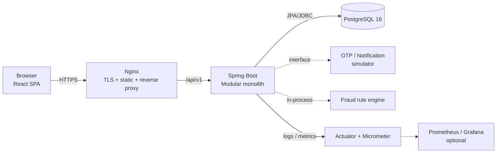

# 05. Technical Stack

> **Dự án:** Digital Banking  
> **Tài liệu:** Technical Stack  

## Mục lục

- [1. Mục đích và phạm vi](#1-mục-đích-và-phạm-vi)
- [2. Nguyên tắc chọn công nghệ](#2-nguyên-tắc-chọn-công-nghệ)
- [3. Định hướng kiến trúc](#3-định-hướng-kiến-trúc)
- [4. Tổng quan technology stack](#4-tổng-quan-technology-stack)
- [5. Chi tiết theo tầng](#5-chi-tiết-theo-tầng)
- [6. Bổ sung đề xuất theo ưu tiên](#6-bổ-sung-đề-xuất-theo-ưu-tiên)
- [7. Công nghệ không chọn hoặc hoãn lại](#7-công-nghệ-không-chọn-hoặc-hoãn-lại)
- [8. Phiên bản baseline và chính sách nâng cấp](#8-phiên-bản-baseline-và-chính-sách-nâng-cấp)
- [9. Ánh xạ yêu cầu NFR và TC](#9-ánh-xạ-yêu-cầu-nfr-và-tc)
- [10. Rủi ro và biện pháp](#10-rủi-ro-và-biện-pháp)
- [11. Việc cần chốt và phê duyệt](#11-việc-cần-chốt-và-phê-duyệt)

---

## 1. Mục đích và phạm vi

### 1.1. Mục đích

Chọn công nghệ cho MVP Digital Banking và là căn cứ để:

- Thống nhất lựa chọn công nghệ giữa backend, frontend, QA và DevOps.
- Cụ thể hóa ràng buộc kỹ thuật `TC-001` (Spring Boot + PostgreSQL) và `TC-002` (REST/JSON qua HTTPS) trong SRS.
- Làm đầu vào cho `06. System architecture`, `07. API contracts`, `08. Deployment infrastructure` và `09. Test plan`.
- Phân định rõ công nghệ **bắt buộc**, **nên có** và **hoãn lại** để tránh over-engineering.

### 1.2. Phạm vi

| Trong phạm vi | Ngoài phạm vi |
|---|---|
| Backend, persistence, API contract, security | Hạ tầng cloud/provider cụ thể, procurement |
| Frontend SPA, testing, build, container | Thiết kế UI/UX chi tiết, branding, đa ngôn ngữ |
| CI, observability, môi trường demo | Production hardening, chứng nhận PCI-DSS/ISO |
| Lựa chọn thư viện và phiên bản baseline | License/commercial support của từng sản phẩm |

### 1.3. Quy ước trạng thái

| Trạng thái | Ý nghĩa |
|---|---|
| **Bắt buộc** | Cần có để đáp ứng SRS, demo hoặc chất lượng tối thiểu |
| **Nên có** | Mang lại giá trị rõ ràng, có thể lùi nếu thiếu thời gian |
| **Tùy chọn / Hoãn** | Chưa cần cho MVP; chỉ thêm khi có trigger cụ thể |
| `[Bổ sung]` | Công nghệ không nằm trong danh sách ban đầu, được đề xuất thêm |

---

## 2. Nguyên tắc chọn công nghệ

| #   | Nguyên tắc                            | Hệ quả thiết kế                                                                               |
| --- | ------------------------------------- | --------------------------------------------------------------------------------------------- |
| 1   | **Đúng nghiệp vụ và nhất quán trước** | Ưu tiên ACID, transaction, row lock, idempotency và audit hơn tối ưu hiệu năng sớm            |
| 2   | **Đơn giản, một deployable**          | Modular monolith + một PostgreSQL; không microservices, không message broker trong MVP        |
| 3   | **Bảo mật theo thiết kế**             | Spring Security, session an toàn, Argon2id, AES-256-GCM, least privilege, secret ngoài source |
| 4   | **Kiểm chứng được**                   | Testcontainers, test concurrency, test failure/recovery và load test có bằng chứng tái lập    |
| 5   | **Vận hành nhẹ**                      | Docker Compose, health check, structured log, metrics; không Kubernetes                       |
| 6   | **Hợp đồng rõ ràng**                  | OpenAPI là hợp đồng API; frontend dùng client sinh từ contract khi có thể                     |
| 7   | **Công nghệ ổn định, phổ biến**       | Ưu tiên công nghệ trưởng thành, tài liệu tốt, đội ngũ quen thuộc; tránh bleeding edge         |

---

## 3. Định hướng kiến trúc

### 3.1. Kiến trúc áp dụng

MVP sử dụng **modular monolith**:

- Một ứng dụng Spring Boot duy nhất, chia module theo nghiệp vụ.
- Một React SPA phục vụ khách hàng và màn hình vận hành tối thiểu.
- Một PostgreSQL là system of record cho tiền, trạng thái giao dịch và audit.
- Docker Compose cho môi trường local/demo; Nginx làm TLS termination, phục vụ static và reverse proxy.

**Hình 1 – Stack ở mức triển khai demo**

### 3.2. Module nghiệp vụ đề xuất

| Module | Trách nhiệm chính |
|---|---|
| `auth` | Đăng nhập, session, device, OTP/step-up, RBAC |
| `customer` | Hồ sơ khách hàng, PII, trạng thái |
| `account` | Tài khoản, số dư khả dụng/ledger balance |
| `transfer` | Tạo transfer, state machine, idempotency |
| `ledger` | Bút toán debit/credit, đối soát |
| `limit` | Hạn mức, sử dụng hạn mức, maker/checker |
| `audit` | Audit append-only, hash chain, tra cứu |
| `fraud` | Rule engine, fraud flag, review |
| `notification` | Thông báo mô phỏng, outbox nội bộ |
| `admin` | Quản trị người dùng/vai trò/hạn mức, tra soát |
| `common` | Error model, correlation ID, security, config, tiện ích dùng chung |

### 3.3. Vì sao chưa dùng microservices

- Giao dịch tiền cần nhất quán mạnh; microservices kéo theo distributed transaction/saga, tăng độ phức tạp không cần thiết cho MVP.
- Audit, idempotency và reconciliation xuyên module dễ bảo đảm hơn trong một transaction boundary.
- Quy mô demo 20 RPS không cần scale độc lập từng service.
- Một deployable giúp CI/CD, debug và demo đơn giản hơn.

Chỉ tách service khi có trigger rõ ràng: nhiều team sở hữu module độc lập, nhu cầu scale khác nhau, hoặc tích hợp bên ngoài cần ranh giới vận hành riêng.

---

## 4. Tổng quan technology stack

### 4.1. Backend, dữ liệu và API

| Thành phần    | Công nghệ                         | Baseline                | Vai trò                      | Ưu tiên              |
| ------------- | --------------------------------- | ----------------------- | ---------------------------- | -------------------- |
| Runtime       | Java                              | 21 LTS                  | Ngôn ngữ backend             | Bắt buộc             |
| Framework     | Spring Boot                       | 4.x (fallback 3.5.x)    | Ứng dụng, auto-configuration | Bắt buộc             |
| Web           | Spring MVC                        | Theo Spring Boot        | REST/JSON                    | Bắt buộc             |
| Persistence   | Spring Data JPA + Hibernate       | Theo Spring Boot        | ORM, repository, locking     | Bắt buộc             |
| Database      | PostgreSQL                        | 16.x                    | System of record             | Bắt buộc             |
| Migration     | Flyway                            | 11.x                    | Versioned SQL migration      | Bắt buộc `[Bổ sung]` |
| Security      | Spring Security                   | Theo Spring Boot        | AuthN/AuthZ, session, RBAC   | Bắt buộc `[Bổ sung]` |
| Validation    | Hibernate Validator               | Theo Spring Boot        | Bean Validation              | Bắt buộc `[Bổ sung]` |
| API contract  | OpenAPI 3.x + springdoc-openapi   | Tương thích Spring Boot | Contract, Swagger UI         | Bắt buộc `[Bổ sung]` |
| Mapping       | MapStruct                         | 1.6.x                   | DTO/entity mapping           | Bắt buộc             |
| Boilerplate   | Lombok                            | 1.18.x                  | Giảm boilerplate             | Bắt buộc             |
| Build         | Gradle Kotlin DSL                 | 8.14+ hoặc 9.x          | Build, dependency, wrapper   | Bắt buộc             |
| Observability | Spring Boot Actuator + Micrometer | Theo Spring Boot        | Health, metrics              | Bắt buộc `[Bổ sung]` |

### 4.2. Frontend

| Thành phần | Công nghệ | Baseline | Vai trò | Ưu tiên |
|---|---|---|---|---|
| UI library | React | 19.x | SPA | Bắt buộc |
| Language | TypeScript | 5.x | Type safety | Bắt buộc `[Bổ sung]` |
| Build/dev | Vite | 7.x | Dev server, build | Bắt buộc `[Bổ sung]` |
| Routing | React Router | 7.x | Routing SPA | Bắt buộc `[Bổ sung]` |
| Server state | TanStack Query | 5.x | Cache/query API | Bắt buộc `[Bổ sung]` |
| Form/validation | React Hook Form + Zod | Bản ổn định | Form và schema validation | Bắt buộc `[Bổ sung]` |
| UI kit | Tailwind CSS + shadcn/ui | Bản ổn định | Component nhanh, dễ kiểm soát | Nên có `[Bổ sung]` |
| Local state | Zustand hoặc React Context | Bản ổn định | Auth/UI state đơn giản | Tùy chọn `[Bổ sung]` |
| Unit/component test | Vitest + React Testing Library + MSW | Bản ổn định | Test frontend | Bắt buộc `[Bổ sung]` |
| E2E test | Playwright | Bản ổn định | Luồng critical end-to-end | Nên có `[Bổ sung]` |
| Lint/format | ESLint + Prettier | Bản ổn định | Chất lượng code | Bắt buộc `[Bổ sung]` |
| Package manager | pnpm | 10.x | Cài đặt, lockfile | Bắt buộc `[Bổ sung]` |

### 4.3. Testing, build và vận hành

| Thành phần | Công nghệ | Baseline | Vai trò | Ưu tiên |
|---|---|---|---|---|
| Unit test | JUnit + Mockito | Theo BOM Spring Boot | Test service/domain | Bắt buộc |
| Assertion | AssertJ | Theo BOM Spring Boot | Assertion dễ đọc | Bắt buộc `[Bổ sung]` |
| Integration test | Testcontainers PostgreSQL | Theo BOM Spring Boot | Test với PostgreSQL thật | Bắt buộc `[Bổ sung]` |
| API test | MockMvc hoặc REST Assured | Theo BOM Spring Boot | Test controller/API | Bắt buộc `[Bổ sung]` |
| External mock | WireMock | Bản ổn định | Giả lập OTP/notification/fraud | Nên có `[Bổ sung]` |
| Async assertion | Awaitility | Bản ổn định | Chờ job/event bất đồng bộ | Nên có `[Bổ sung]` |
| Coverage | JaCoCo | Bản ổn định | Đo coverage critical paths | Nên có `[Bổ sung]` |
| Load test | k6 | Bản ổn định | Kịch bản 20 RPS × 10 phút | Bắt buộc `[Bổ sung]` |
| Container | Docker + Docker Compose | Bản ổn định | Đóng gói, môi trường demo | Bắt buộc |
| Reverse proxy | Nginx | Bản ổn định | TLS, static, proxy `/api` | Bắt buộc `[Bổ sung]` |
| CI | GitHub Actions | — | Build/test/scan | Bắt buộc `[Bổ sung]` |
| Security scan | Trivy + Dependabot | — | Image/dependency scan | Nên có `[Bổ sung]` |
| Metrics dashboard | Prometheus + Grafana | Bản ổn định | Bằng chứng load test | Nên có `[Bổ sung]` |

### 4.4. Tóm tắt quyết định chính

| Quyết định | Lựa chọn |
|---|---|
| Kiến trúc | Modular monolith, một Spring Boot app |
| Session | Opaque session token lưu hash trong PostgreSQL, không mặc định dùng JWT |
| Idempotency | Bảng `idempotency_record` trong PostgreSQL, unique key + request hash |
| Audit | Append-only + hash chain + DB trigger/privilege, không dùng Envers làm audit nghiệp vụ |
| Async nội bộ | Transactional outbox + scheduler; chưa dùng Kafka/RabbitMQ |
| Frontend | React SPA + TypeScript + Vite; không Next.js/SSR |
| Triển khai | Docker Compose + Nginx; chưa dùng Kubernetes |

---

## 5. Chi tiết theo tầng

### 5.1. Backend

#### 5.1.1. Runtime và framework

- **Java 21 LTS** là baseline ổn định, hỗ trợ records, pattern matching, virtual threads và được các thư viện chính hỗ trợ tốt. Java 25 LTS có thể dùng nếu IDE/toolchain/thư viện đã tương thích.
- **Spring Boot** là framework chính; chốt phiên bản ổn định mới nhất mà hệ sinh thái thư viện hỗ trợ. Nếu Spring Boot 4.x gặp vấn đề tương thích với springdoc/MapStruct/Testcontainers, dùng 3.5.x và ghi nhận lý do.
- **Spring MVC** thay vì WebFlux: luồng nghiệp vụ dùng JPA blocking, quy mô 20 RPS không cần reactive; MVC đơn giản hơn cho team và dễ debug transaction/lock.
- Tổ chức code **package-by-feature** theo module ở mục 3.2; không chia package thuần technical (`controller`, `service`, `repository`) trên toàn hệ thống.

#### 5.1.2. Transaction và domain

- Transaction boundary đặt tại application service, không đặt trong controller.
- Luồng transfer theo thiết kế hai pha của tài liệu 04:
  - **T1:** tạo `transfer` PENDING + `idempotency_record` + audit creation.
  - **T2:** khóa tài khoản, kiểm tra số dư/hạn mức, ghi ledger, cập nhật balance, chuyển trạng thái terminal, ghi audit completion.
- Dùng `@Transactional` với isolation mặc định `READ_COMMITTED`; bảo vệ số dư bằng `SELECT ... FOR UPDATE` thay vì nâng isolation toàn cục.
- Dùng `@Version` cho entity mutable không phải tiền nếu phù hợp; invariant tiền tệ do row lock + constraint + transaction bảo đảm.
- Retry deadlock/serialization failure có giới hạn (tối đa 2–3 lần, backoff + jitter); chỉ retry thao tác an toàn và idempotent.
- Tiền dùng `BigDecimal`, ánh xạ `NUMERIC(19,2)`; tuyệt đối không dùng `double`/`float`.
- Thời gian dùng `Instant`/`OffsetDateTime`, lưu UTC; business date tính theo timezone cấu hình (đề xuất `Asia/Ho_Chi_Minh`).

#### 5.1.3. Validation và xử lý lỗi

- Dùng Bean Validation (Hibernate Validator) cho input DTO; custom validator cho rule phức tạp (amount scale, source ≠ destination, idempotency key format).
- Lỗi API trả về **RFC 9457 Problem Details** (`application/problem+json`), kèm `code` lấy từ bảng error code của SRS (ví dụ `INSUFFICIENT_BALANCE`, `IDEMPOTENCY_CONFLICT`).
- `@RestControllerAdvice` tập trung map exception → HTTP status + error code; không trả stack trace hoặc PII.
- Validation phải chạy trước khi tạo idempotency record/transfer; lỗi validation không để lại dữ liệu tiền.

#### 5.1.4. Async, scheduling và tích hợp mô phỏng

- Notification dùng **transactional outbox nội bộ**: ghi `notification` trong transaction, sau commit có scheduler/worker gửi mô phỏng; lỗi gửi không chặn giao dịch (NFR-008).
- Reconciliation, purge idempotency/session, retention job dùng `@Scheduled`; nếu chạy nhiều instance, dùng advisory lock hoặc ShedLock.
- Fraud rule engine chạy in-process, đọc rule từ DB, fail-open theo IC-003; không thêm Drools trong MVP.
- Tích hợp OTP/SMS/Email/FIDO/fraud qua interface rõ ràng để có thể thay implementation thật sau này.

#### 5.1.5. Mapping và boilerplate

- **MapStruct** cho mapping DTO/entity, `componentModel = "spring"`, `unmappedTargetPolicy = ERROR` để tránh bỏ sót field.
- **Lombok** dùng cho getter/setter/builder/constructor; cấu hình `lombok-mapstruct-binding` để annotation processor hoạt động đúng thứ tự.
- Không dùng `@Data` trên JPA entity vì dễ sinh `equals/hashCode` sai với quan hệ và lazy loading; dùng `@Getter`, `@Setter`, `@EqualsAndHashCode(onlyExplicitlyIncluded = true)` khi cần.
- DTO bất biến có thể dùng Java record; không cần Lombok cho mọi class.

#### 5.1.6. Cấu hình và secret

- Dùng `application.yml` + profile (`local`, `test`, `demo`); cấu hình bằng `@ConfigurationProperties`.
- Secret (DB password, encryption key, HMAC pepper) lấy từ environment variable/GitHub Secrets; không commit `.env` hoặc khóa thật.
- Không dùng `spring.jpa.hibernate.ddl-auto=update` ngoài môi trường test cá nhân; môi trường chung dùng `validate` + Flyway.

### 5.2. Persistence và database

#### 5.2.1. PostgreSQL

- **PostgreSQL 16** theo tài liệu 04, tận dụng ACID, MVCC, row-level locking, partial unique index, `ON CONFLICT`, JSONB và advisory lock.
- Schema `banking`; tên bảng/cột `snake_case`; tiền `NUMERIC(19,2)`; thời gian `TIMESTAMPTZ`.
- Không dùng NoSQL cho dữ liệu tiền/audit vì yêu cầu nhất quán mạnh và quan hệ rõ ràng.

#### 5.2.2. Spring Data JPA và SQL

| Nhu cầu | Cách tiếp cận |
|---|---|
| CRUD/domain | Spring Data JPA repository |
| Khóa số dư/hạn mức | `@Lock(PESSIMISTIC_WRITE)` hoặc native `SELECT ... FOR UPDATE` |
| Truy vấn phức tạp/đối soát | Native query/JdbcTemplate, projection DTO |
| Báo cáo/audit search | Query có index, phân trang; tránh N+1 |
| Batch job | JdbcTemplate/batch update có kiểm soát transaction |

- Không lạm dụng `@EntityGraph`/fetch join toàn bộ; history dùng projection và phân trang.
- Không mở transaction dài trong khi gọi dịch vụ ngoài (OTP/notification/fraud).

#### 5.2.3. Flyway

- Migration đặt tại `src/main/resources/db/migration`.
- Quy ước: `V<n>__<description>.sql` cho versioned migration; `R__<description>.sql` cho trigger/view/function lặp lại.
- Không sửa migration đã chạy trên môi trường chung; thay đổi bằng migration mới.
- Dùng Flyway cho cả schema, trigger bất biến audit, partial index và seed demo có kiểm soát.
- `ddl-auto=validate` để phát hiện lệch entity/schema.

#### 5.2.4. Bảo mật dữ liệu

- Trường nhạy cảm dùng hậu tố `_enc`, kiểu `BYTEA`, mã hóa **AES-256-GCM** ở application layer; IV ngẫu nhiên, lưu kèm ciphertext/tag và key version.
- Blind index dùng HMAC-SHA-256, hậu tố `_hash`, cho equality/unique khi cần tìm kiếm.
- Password hash bằng Argon2id (hoặc bcrypt nếu môi trường không hỗ trợ Argon2id); OTP lưu hash, không lưu plaintext.
- Audit dùng append-only + hash chain; serialize ghi audit bằng `pg_advisory_xact_lock`; trigger/privilege chặn UPDATE/DELETE.
- Key mã hóa lấy từ environment; có kế hoạch key version/rotation ở mức demo, không hard-code.

#### 5.2.5. Test và dữ liệu demo

- Integration test dùng **Testcontainers PostgreSQL**, cùng major version với môi trường demo.
- Không dùng H2 cho test transaction/lock/idempotency vì hành vi khác PostgreSQL (partial index, trigger, locking).
- Seed dữ liệu tổng hợp qua profile demo hoặc repeatable migration; không dùng PII thật (NFR-032).
- Backup demo bằng `pg_dump` định kỳ; kiểm tra restore trước demo (chi tiết ở tài liệu 08).

### 5.3. API và contract

#### 5.3.1. Quy ước API

| Chủ đề | Quy ước |
|---|---|
| Base path | `/api/v1` |
| Protocol | REST/JSON qua HTTPS (TC-002) |
| Contract | OpenAPI 3.x; ưu tiên 3.1 nếu toolchain hỗ trợ |
| Tài liệu | springdoc-openapi + Swagger UI ở môi trường dev/demo |
| Error | RFC 9457 Problem Details + `code` nghiệp vụ |
| Correlation | Header `X-Correlation-ID`, sinh mới nếu client không gửi |
| Idempotency | Header `Idempotency-Key` cho POST tạo transfer |
| Tiền | Chuỗi thập phân trong JSON (ví dụ `"100000.00"`) để tránh sai số/giới hạn số của JavaScript |
| Thời gian | ISO 8601, UTC; UI hiển thị theo timezone cấu hình |
| Phân trang | `page`, `size` có giới hạn tối đa; sort whitelist |
| Versioning | URL version `/v1`; breaking change tạo version mới |

#### 5.3.2. OpenAPI workflow

- `07. API contracts` là nguồn hợp đồng API.
- Dùng springdoc để sinh/đối chiếu spec từ implementation; Swagger UI phục vụ demo và tra cứu.
- CI kiểm tra spec hợp lệ và không lệch contract đã chốt.
- Nên sinh TypeScript client từ OpenAPI (Orval hoặc `openapi-typescript` + `openapi-fetch`) để giảm lệch FE/BE.
- Swagger UI chỉ bật ở dev/demo; môi trường khác phải bảo vệ hoặc tắt.

#### 5.3.3. Bảo vệ API

- Spring Security kiểm soát authentication/authorization ở mọi endpoint.
- CORS chỉ cho origin của SPA; không dùng `*` khi gửi cookie.
- Nếu dùng cookie session: bật CSRF protection và cấu hình token cho SPA.
- Giới hạn kích thước request body; validate header; rate limit login/OTP/transfer.

### 5.4. Security

#### 5.4.1. Xác thực và session

- Dùng **Spring Security** với mô hình **opaque session token**:
  - Token ngẫu nhiên trả cho client một lần; server lưu SHA-256 hash trong `session.session_token_hash` (theo tài liệu 04).
  - SPA dùng cookie `HttpOnly`, `Secure`, `SameSite=Lax/Strict`; API test có thể dùng Bearer token opaque.
  - Kiểm tra idle timeout, absolute timeout, trạng thái session và logout/revocation.
- Không mặc định dùng JWT vì yêu cầu revoke session, idle/absolute timeout và audit session khó đáp ứng nếu chỉ dùng token stateless. Nếu cần JWT cho client khác, dùng access token ngắn hạn + server-side revocation/session registry.
- Phân quyền theo role `CUSTOMER`, `OPERATIONS`, `ADMIN`, `AUDITOR`; dùng `@PreAuthorize` và kiểm tra ownership ở service (không chỉ ở controller).
- Step-up auth dùng challenge lưu DB, gắn với transfer qua `step_up_challenge_id`; không ghi ledger trước khi xác thực thành công.

#### 5.4.2. Bảo vệ thông tin

- Password: Argon2id (khuyến nghị; cần BouncyCastle provider) hoặc bcrypt; không plaintext; lưu password history theo BRL-006.
- OTP: sinh bằng `SecureRandom`, hash trước khi lưu, TTL 5 phút, single-use, giới hạn số lần thử; không log OTP.
- PII/tài chính: AES-256-GCM at rest; HMAC blind index; mask trên UI/log/notification.
- Secret: environment/GitHub Secrets; không hard-code; cân nhắc Vault khi ra khỏi phạm vi demo.
- TLS 1.2+ tại Nginx; HSTS, CSP, `X-Content-Type-Options`, `X-Frame-Options`/`frame-ancestors`.
- Rate limit login/OTP bằng Bucket4j (in-memory cho MVP); trả `429 RATE_LIMITED`.
- Quét dependency/image bằng Trivy/Dependabot; không đưa secret vào log hoặc response.

#### 5.4.3. Ghi chú về FIDO/WebAuthn

- MVP có thể mô phỏng FIDO/passcode qua interface và lưu trạng thái challenge/device.
- Nếu demo FIDO thật, dùng thư viện WebAuthn server (ví dụ Yubico `webauthn-server-core`) + WebAuthn API trên trình duyệt; vẫn giữ fallback password/passcode theo SRS.

### 5.5. Frontend

#### 5.5.1. Nền tảng

- **React + TypeScript strict**; Vite cho dev/build; React Router cho routing.
- SPA là đủ cho kênh nội bộ; không cần Next.js/SSR vì không có yêu cầu SEO/public web.
- Node.js 26 LTS (hoặc 24 LTS) cho team/CI; dùng `.nvmrc` và `packageManager` của pnpm để thống nhất môi trường.

#### 5.5.2. Thư viện và tổ chức

| Nhu cầu | Lựa chọn |
|---|---|
| Server state/API cache | TanStack Query |
| Form + validation | React Hook Form + Zod |
| UI | Tailwind CSS + shadcn/ui (hoặc MUI nếu team quen hơn) |
| Local state | React Context cho auth/UI đơn giản; Zustand khi state phức tạp |
| HTTP client | Client sinh từ OpenAPI (`openapi-fetch`/Orval) |
| Format tiền/ngày | `Intl.NumberFormat('vi-VN')`, `Intl.DateTimeFormat` |
| Test | Vitest + React Testing Library + MSW |
| E2E | Playwright |
| Lint/format | ESLint + Prettier |

- Không lưu session token trong `localStorage`; ưu tiên cookie `HttpOnly` + CSRF token.
- Zod schema phản ánh validation backend; map error code sang thông báo tiếng Việt, không lộ chi tiết hệ thống.
- UI hiển thị tiếng Việt, VND, timezone cấu hình; che dấu số tài khoản/PII theo BRL-019/NFR-020.
- Tổ chức `src/features/<module>` và `src/shared`; tránh import chéo tùy tiện giữa feature.

#### 5.5.3. Chất lượng frontend

- `pnpm lint`, `pnpm test`, `pnpm build` là gate bắt buộc trong CI.
- Playwright chạy các luồng critical: login, transfer, history, audit review.
- Không dùng Redux cho MVP nếu state chỉ gồm auth + query cache; tránh tăng boilerplate.
- Kiểm tra bundle size và dependency trước demo; không nhúng secret/API key vào FE.

### 5.6. Testing

#### 5.6.1. Test pyramid

| Loại | Công cụ | Phạm vi | Bắt buộc |
|---|---|---|---|
| Unit | JUnit + Mockito + AssertJ | Domain rule, service logic, state machine | Có |
| Slice | `@WebMvcTest`, `@DataJpaTest` | Controller, repository, validation | Có |
| Integration | Spring Boot Test + Testcontainers PostgreSQL | Transaction, lock, idempotency, audit | Có |
| API contract | MockMvc/REST Assured + OpenAPI validation | Schema, status code, error model | Có |
| E2E | Playwright | Luồng người dùng critical | Nên có |
| Concurrency | JUnit + ExecutorService + Testcontainers | Double debit, lost update | Có |
| Failure/recovery | Fault injection, restart, reconciliation | Crash/timeout/partial failure | Có |
| Load | k6 | 20 RPS × 10 phút, p95/error rate | Có |
| Security | Checklist + Trivy; ZAP baseline (tùy chọn) | OWASP cơ bản, secret, dependency | Có |

#### 5.6.2. Nguyên tắc test

- Không dùng H2 để test transaction/locking; dùng PostgreSQL thật qua Testcontainers.
- Concurrency test dùng nhiều thread + `CountDownLatch`/`CyclicBarrier`, mỗi request có idempotency key riêng; assert không double debit và ledger cân bằng.
- Test idempotency: cùng key + cùng payload → replay; cùng key + payload khác → conflict; key đang xử lý → `IDEMPOTENCY_IN_PROGRESS`.
- Test audit: mọi thay đổi trạng thái tiền có audit record và correlation ID; audit không update/delete được.
- Coverage mục tiêu ≥ 80% cho module critical (NFR-027 là Should), không chạy theo coverage hình thức.
- Test data tổng hợp, deterministic; dọn dữ liệu giữa các test bằng transaction rollback hoặc reset schema Testcontainers.

#### 5.6.3. Load test và failure test

- k6 kịch bản 20 RPS trong 10 phút; threshold p95 ≤ 2 giây, error rate < 1% (NFR-001/NFR-004).
- Chạy trên Docker Compose với cấu hình giống demo; ghi rõ giới hạn môi trường.
- Ghi metrics/latency/error vào report; đối chiếu Prometheus/Grafana nếu có.
- Failure/recovery: kill app giữa giao dịch, restart, chạy reconciliation; xác nhận PENDING được xử lý và không mất tiền.
- Có thể dùng Toxiproxy để mô phỏng latency/network failure ở mức nâng cao.

### 5.7. Build, container và CI/CD

#### 5.7.1. Gradle

- Dùng **Gradle Kotlin DSL** (`build.gradle.kts`) + **version catalog** (`libs.versions.toml`) + Gradle Wrapper.
- Dùng Java toolchain 21; bật compiler `-parameters` nếu cần binding.
- Dependency chính lấy từ Spring Boot BOM; MapStruct/Lombok khai báo phiên bản rõ ràng.
- Không dùng dynamic version (`latest.release`, `+`).

#### 5.7.2. Docker

- Backend: multi-stage build (Gradle build → JRE runtime), chạy non-root, có healthcheck.
- Frontend: Node build → Nginx static runtime.
- Docker Compose cho local/demo gồm:
  - `postgres`
  - `backend`
  - `frontend`/`nginx`
  - tùy chọn `prometheus`, `grafana`
- Dùng named volume cho PostgreSQL; healthcheck + `depends_on` condition; `.env.example` thay vì commit `.env`.
- Không chạy container bằng root; không bake secret vào image.

#### 5.7.3. CI/CD

- GitHub Actions (hoặc GitLab CI nếu nhóm dùng GitLab) chạy:
  1. Backend: `./gradlew check` + integration test với Testcontainers.
  2. Frontend: `pnpm lint`, `pnpm test`, `pnpm build`.
  3. OpenAPI validation.
  4. Docker build + Trivy scan.
  5. Lưu test report/artifact.
- Cache Gradle/pnpm; dùng khóa dependency; fail pipeline nếu test/security check critical fail.
- CD cho demo có thể thủ công bằng Docker Compose; chi tiết ở tài liệu 08.
- Bảo vệ branch `main`; PR phải qua CI và review.

### 5.8. Observability và vận hành

- Bật Actuator: `health`, `info`, `metrics`, `prometheus`; chỉ public `health/info`, bảo vệ endpoint còn lại.
- Micrometer metrics tối thiểu:
  - transfer created/completed/failed
  - transfer latency
  - idempotency replay/conflict
  - PENDING transfer count
  - auth failure/lockout
  - rate limit hits
  - DB pool/connection
  - reconciliation result
- Log JSON có `timestamp`, `level`, `correlation_id`, `user_id` (mask), `action`, `outcome`; không log PII/OTP/token.
- Correlation ID sinh ở filter, đưa vào MDC, trả về header và lưu vào transfer/ledger/audit.
- Tracing (OpenTelemetry/Micrometer Tracing) là tùy chọn; với MVP, correlation ID + metrics + log là đủ.
- Prometheus/Grafana hỗ trợ bằng chứng load test; không bắt buộc cho chức năng.
- Job vận hành: reconciliation PENDING, purge idempotency/session, retention/legal hold; có log/metrics và chạy idempotent.
- Backup/restore demo bằng `pg_dump`/`pg_restore`; kiểm tra định kỳ trước demo.

---

## 6. Bổ sung đề xuất theo ưu tiên

### 6.1. P0 – Bắt buộc bổ sung

| # | Bổ sung | Vì sao cần | Liên kết |
|---|---|---|---|
| 1 | **Spring Security + Spring Security Crypto** | AuthN/AuthZ, session, RBAC, CSRF, Argon2; thiếu sẽ không đáp ứng NFR bảo mật | NFR-015, NFR-017, NFR-018 |
| 2 | **Flyway** | Quản lý schema/trigger/partial index bằng SQL versioned; tránh `ddl-auto=update` | TC-001, tài liệu 04 |
| 3 | **Testcontainers PostgreSQL** | Test transaction/lock/idempotency với PostgreSQL thật; H2 không đại diện đúng | NFR-009, NFR-010 |
| 4 | **springdoc-openapi** | Biến OpenAPI thành Swagger UI/spec kiểm tra được; đáp ứng NFR-026 | NFR-026 |
| 5 | **Actuator + Micrometer** | Health check, metrics, bằng chứng load test và vận hành | NFR-025 |
| 6 | **Hibernate Validator** | Validation input thống nhất, giảm lỗi nghiệp vụ và lỗi 500 | NFR-018, BRL-009 |
| 7 | **Bộ test nền tảng**: AssertJ, MockMvc/REST Assured, WireMock, Awaitility, JaCoCo | Test đủ tầng, mock dịch vụ ngoài, đo coverage critical | NFR-027 |
| 8 | **Frontend foundation**: TypeScript, Vite, React Router, TanStack Query, React Hook Form + Zod | Type safety, server state, form validation; giảm lỗi tích hợp API | NFR-028, NFR-029 |
| 9 | **Frontend quality**: Vitest, React Testing Library, MSW, ESLint, Prettier | Test component và lint/format tự động | NFR-027 |
| 10 | **Docker Compose + Nginx** | Môi trường demo tái lập; TLS, static, reverse proxy | TC-001, tài liệu 08 |
| 11 | **GitHub Actions + Trivy + Dependabot** | CI bắt buộc và kiểm soát dependency/image | NFR-027 |
| 12 | **k6** | Load test 20 RPS × 10 phút có số liệu p95/error | NFR-001, NFR-004 |

### 6.2. P1 – Nên có

| # | Bổ sung | Vì sao nên có | Ghi chú |
|---|---|---|---|
| 1 | Bucket4j | Rate limit login/OTP/transfer, trả `RATE_LIMITED` | In-memory đủ cho MVP; Redis khi scale ngang |
| 2 | Spring Retry | Retry deadlock/serialization failure có kiểm soát | Chỉ retry thao tác an toàn; giới hạn số lần |
| 3 | Playwright | E2E cho login/transfer/history/audit | Chạy trong CI hoặc trước demo |
| 4 | ArchUnit | Enforce ranh giới module/package | Hữu ích cho modular monolith |
| 5 | Spotless + Checkstyle | Format/lint backend tự động | Giảm noise review |
| 6 | Orval hoặc `openapi-typescript` | Sinh TypeScript client từ OpenAPI | Giảm lệch contract FE/BE |
| 7 | Prometheus + Grafana | Dashboard latency/error/throughput | Hỗ trợ bằng chứng load test |
| 8 | OpenTelemetry/Micrometer Tracing | Trace xuyên suốt request | Tùy chọn; correlation ID là mức tối thiểu |
| 9 | ShedLock | Khóa job khi chạy nhiều instance | Chỉ cần khi scale backend |
| 10 | Yubico WebAuthn server | FIDO/WebAuthn thật thay vì mô phỏng | Chỉ khi demo FIDO thật |
| 11 | OWASP ZAP baseline / Schemathesis | Security/API fuzz test | Chạy định kỳ hoặc trước demo |
| 12 | Toxiproxy | Mô phỏng network failure/latency | Hỗ trợ demo failure/recovery |

### 6.3. P2 – Hoãn lại, chỉ thêm khi có trigger

| # | Công nghệ | Khi nào xem xét lại |
|---|---|---|
| 1 | Redis | Khi scale ngang cần shared cache/rate limit/distributed lock; MVP dùng PostgreSQL + in-memory |
| 2 | Kafka/RabbitMQ | Khi có tích hợp event bên ngoài hoặc volume event lớn; MVP dùng outbox + scheduler |
| 3 | Keycloak/OAuth2 | Khi cần SSO, nhiều ứng dụng hoặc identity federation |
| 4 | Kubernetes/Helm | Khi triển khai cloud/production; MVP dùng Docker Compose |
| 5 | Vault | Khi cần quản lý secret/key rotation tập trung ngoài demo |
| 6 | ELK/Loki | Khi cần log aggregation tập trung; MVP dùng JSON log + Docker logs |
| 7 | SonarQube | Khi cần quality gate nâng cao; MVP dùng Spotless/Checkstyle/JaCoCo |
| 8 | Drools | Khi rule fraud phức tạp, nhiều phiên bản; MVP dùng rule evaluator đơn giản |
| 9 | Hibernate Envers | Không dùng làm audit nghiệp vụ; chỉ cân nhắc audit kỹ thuật generic |
| 10 | Spring Modulith | Khi cần kiểm tra module/event mạnh hơn; MVP dùng ArchUnit |
| 11 | jqwik/PIT | Khi muốn property-based/mutation testing nâng cao |
| 12 | GraphQL/Next.js/Redux | Khi có yêu cầu public SEO, query linh hoạt hoặc state phức tạp |

---

## 7. Công nghệ không chọn hoặc hoãn lại

| Công nghệ | Lý do chưa chọn | Khi nào xem xét lại |
|---|---|---|
| Microservices/Spring Cloud | Distributed transaction, vận hành phức tạp; MVP 20 RPS không cần scale độc lập | Khi tách team/service hoặc cần scale từng phần |
| Kafka/RabbitMQ | Async nội bộ dùng outbox + scheduler; broker làm tăng hạ tầng và độ phức tạp | Khi có tích hợp event bên ngoài hoặc event volume lớn |
| Redis | Idempotency/session đã lưu PostgreSQL; rate limit in-memory đủ cho một instance | Khi scale ngang hoặc cần shared cache/lock |
| JWT-only | Khó revoke, khó kiểm soát idle/absolute timeout và audit session | Khi có mobile/third-party API cần stateless token |
| Keycloak/OAuth2 | Overkill cho 4 role nội bộ; Spring Security đáp ứng đủ | Khi cần SSO/multi-app/identity federation |
| Kubernetes | Docker Compose đủ cho demo; K8s tăng chi phí học và vận hành | Khi triển khai cloud/production |
| NoSQL | Dữ liệu tiền/audit cần ACID, quan hệ và constraint | Khi có use case document/search riêng |
| H2 | Khác PostgreSQL về lock, partial index, trigger; dễ cho kết quả test sai | Không dùng cho integration test |
| GraphQL | REST + OpenAPI đáp ứng hợp đồng và demo | Khi FE cần query linh hoạt, nhiều client |
| Next.js/Redux | SPA nội bộ không cần SSR; state đơn giản | Khi có public SEO hoặc state phức tạp |
| Drools | Rule-based MVP đơn giản; tránh learning curve | Khi rule phức tạp, cần versioning/authoring |
| Hibernate Envers | Không đảm bảo hash chain/append-only theo yêu cầu audit nghiệp vụ | Khi cần audit kỹ thuật generic, không thay audit nghiệp vụ |

---

## 8. Phiên bản baseline và chính sách nâng cấp

### 8.1. Baseline

| Thành phần                   | Baseline                             | Cách quản lý                               |
| ---------------------------- | ------------------------------------ | ------------------------------------------ |
| Java                         | 21 LTS (hoặc 25 LTS nếu tương thích) | Gradle toolchain                           |
| Spring Boot                  | 4.x                                  | Plugin/BOM, pin phiên bản                  |
| Gradle                       | 8.14+ hoặc 9.x                       | Gradle Wrapper                             |
| PostgreSQL                   | 16.x                                 | Docker image + Testcontainers cùng version |
| Flyway                       | 11.x                                 | Spring Boot BOM hoặc khai báo rõ           |
| MapStruct                    | 1.6.x                                | Khai báo rõ + annotation processor         |
| Lombok                       | 1.18.x                               | Khai báo rõ + `lombok-mapstruct-binding`   |
| springdoc-openapi            | Tương thích Spring Boot              | Khai báo rõ                                |
| JUnit/Mockito/Testcontainers | Theo BOM Spring Boot                 | Không override nếu không cần               |
| Node.js                      | 26 LTS (hoặc 24 LTS)                 | `.nvmrc`                                   |
| pnpm                         | 10.x                                 | `packageManager` trong `package.json`      |
| React                        | 19.x                                 | `package.json` + lockfile                  |
| Vite                         | 7.x                                  | `package.json` + lockfile                  |
| TypeScript                   | 5.x                                  | `package.json` + lockfile                  |
| Nginx                        | Stable                               | Image pin tag/digest                       |
| k6                           | Stable                               | Image/CI tool pin                          |

### 8.2. Chính sách nâng cấp

- Spring Boot BOM quản lý phần lớn dependency; chỉ khai báo phiên bản riêng khi BOM không quản lý hoặc cần bản vá cụ thể.
- Pin phiên bản chính xác; commit lockfile/wrapper; không dùng `latest` hoặc dynamic version.
- Dependabot/Renovate tạo PR nâng cấp định kỳ; major upgrade chỉ thực hiện trong branch riêng, chạy đầy đủ unit/integration/load test.
- Kiểm tra tương thích Spring Boot ↔ springdoc/MapStruct/Testcontainers trước khi nâng major.
- Base image pin tag/digest; quét Trivy trước khi dùng image mới.
- Ghi lại quyết định nâng cấp trong tài liệu hoặc ADR kỹ thuật.

---

## 9. Ánh xạ yêu cầu NFR và TC

| Nhóm yêu cầu | Cơ chế/công nghệ đáp ứng | Bằng chứng |
|---|---|---|
| NFR-001, NFR-004 – Performance/load | Spring MVC + JPA + index; k6; Prometheus/Grafana | Load test report |
| NFR-006 – Recovery sau crash | Reconciliation `@Scheduled`, advisory lock; failure injection | Test/restart report |
| NFR-009, NFR-010, NFR-012 – Consistency/concurrency | PostgreSQL transaction + row lock; Testcontainers concurrency test | Test report |
| NFR-011 – Idempotency retention | `idempotency_record` unique key + TTL job | Test report |
| NFR-013 – NFR-020 – Security | Nginx TLS, Spring Security, Argon2id, AES-256-GCM, Bucket4j, secret env, dependency scan | Security checklist |
| NFR-021, NFR-022, NFR-023 – Audit | Append-only table, hash chain, DB trigger/privilege, correlation ID | Audit review |
| NFR-025 – Observability | Actuator, Micrometer, JSON log, correlation ID | Health/metrics/log evidence |
| NFR-026, NFR-027 – Maintainability | OpenAPI/springdoc, JUnit/Testcontainers, JaCoCo, CI | CI report/OpenAPI |
| NFR-028, NFR-029 – Usability/localization | Problem Details + error code, React/Intl, tiếng Việt/VND | UI/API review |
| NFR-030, NFR-031, NFR-032 – Data/privacy | Phân loại dữ liệu, encryption/masking, seed tổng hợp | Data review |
| TC-001 – Spring Boot + PostgreSQL | Stack backend/database | Kiến trúc + test |
| TC-002 – REST/JSON/HTTPS | Spring MVC + OpenAPI + Nginx TLS | API/Swagger |

---

## 10. Rủi ro và biện pháp

| Rủi ro | Khả năng | Tác động | Biện pháp |
|---|---|---|---|
| Xung đột phiên bản Spring Boot/thư viện | Trung bình | Cao | Spike tương thích trước khi chốt; pin BOM; fallback 3.5.x nếu cần |
| Team chưa quen Spring Security/Testcontainers | Trung bình | Trung bình | Spike ngắn, pair review, tài liệu mẫu |
| Test concurrency flaky | Trung bình | Cao | Testcontainers, dữ liệu deterministic, Awaitility, tránh shared state |
| Dùng H2 che giấu lỗi PostgreSQL | Trung bình | Cao | Cấm H2 cho integration; dùng Testcontainers |
| Over-engineering (Kafka/Redis/K8s) | Cao | Trung bình | Gate P0/P1/P2; chỉ thêm khi có trigger |
| FE/BE lệch contract | Trung bình | Trung bình | OpenAPI + generated client + CI validation |
| Lộ secret/PII trong log/repo | Trung bình | Cao | Secret env, review log, Trivy/Dependabot, `.gitignore` |
| Load test không đại diện | Trung bình | Trung bình | Cùng Docker Compose/version; ghi rõ giới hạn |
| Thiếu thời gian | Cao | Cao | Ưu tiên P0; cắt P1/P2; không giảm yêu cầu Must |
| Key encryption khó rotation | Trung bình | Trung bình | Key version + env; ghi rõ giới hạn demo |
