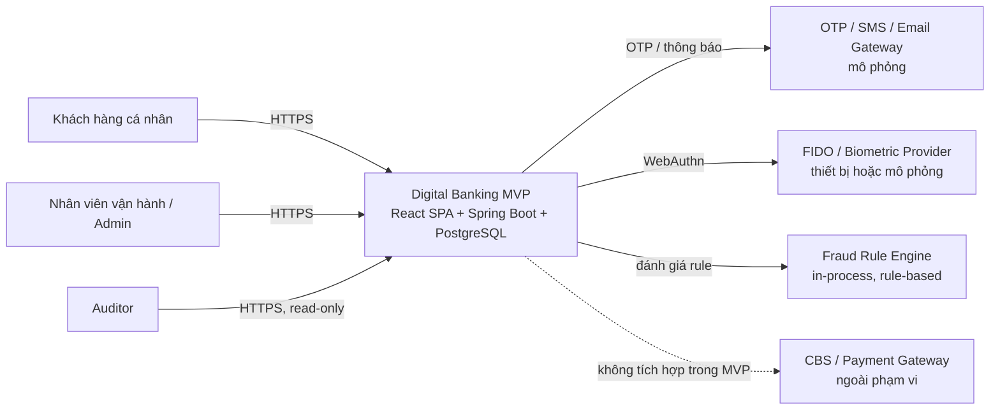
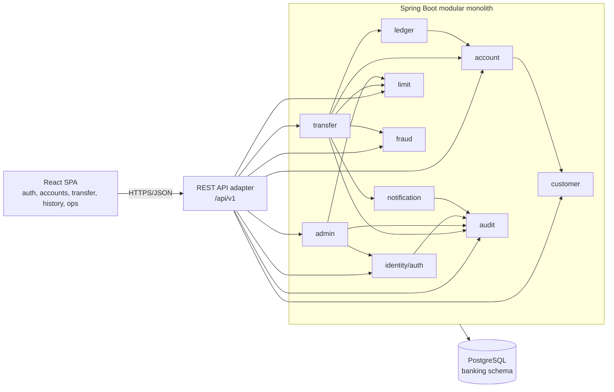
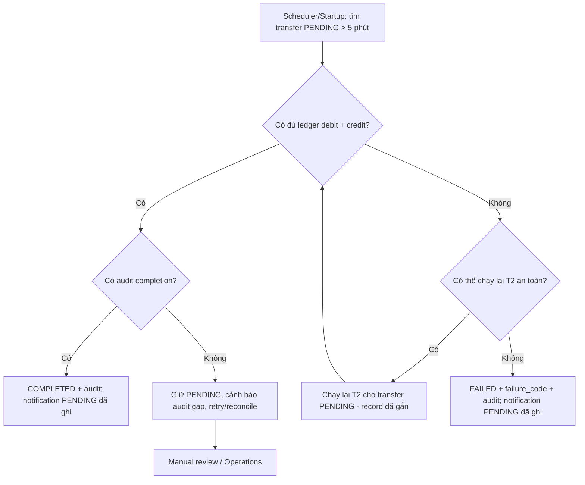
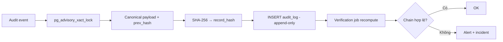
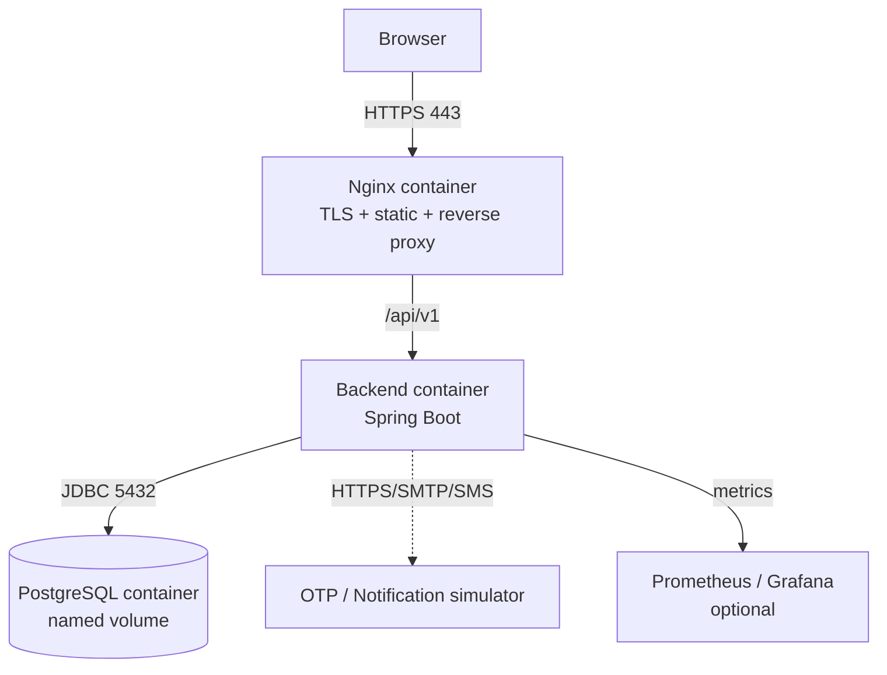

# 06. System Architecture

> **Dự án:** Digital Banking  
> **Tài liệu:** System Architecture  

## Mục lục

- [1. Mục đích và phạm vi](#1-mục-đích-và-phạm-vi)
- [2. Kiến trúc drivers](#2-kiến-trúc-drivers)
- [3. Nguyên tắc và quyết định kiến trúc](#3-nguyên-tắc-và-quyết-định-kiến-trúc)
- [4. System context](#4-system-context)
- [5. Container view](#5-container-view)
- [6. Component view](#6-component-view)
- [7. Runtime view](#7-runtime-view)
- [8. Data architecture](#8-data-architecture)
- [9. Security architecture](#9-security-architecture)
- [10. Integration architecture](#10-integration-architecture)
- [11. Deployment topology](#11-deployment-topology)
- [12. Observability và vận hành](#12-observability-và-vận-hành)
- [13. Quality attributes và traceability](#13-quality-attributes-và-traceability)
- [14. Rủi ro và trade-off](#14-rủi-ro-và-trade-off)
- [15. Open issues và phê duyệt](#15-open-issues-và-phê-duyệt)
- [Appendix A. Viết tắt kiến trúc](#appendix-a-viết-tắt-kiến-trúc)
- [Change Log](#change-log)

---

## 1. Mục đích và phạm vi

### 1.1. Mục đích

Tài liệu này mô tả kiến trúc của **Digital Banking MVP** ở mức đủ để:

- Thống nhất cách hệ thống được chia thành các thành phần, module và trách nhiệm.
- Giải thích cách các yêu cầu trọng tâm của BRD/SRS được hiện thực: nhất quán giao dịch tiền, idempotency, audit bất biến, xác thực/step-up, phục hồi sau lỗi và truy vết.
- Làm đầu vào cho `07. API contracts`, `08. Deployment infrastructure`, `09. Test plan` và kế hoạch triển khai.
- Ghi lại các quyết định kiến trúc và trade-off để tránh thay đổi tùy ý về sau.

### 1.2. Phạm vi

| Trong phạm vi | Ngoài phạm vi |
|---|---|
| Kiến trúc ứng dụng, module, transaction boundary | Thiết kế UI/UX chi tiết, branding |
| Mô hình dữ liệu, consistency, locking, audit | Hạ tầng cloud/provider cụ thể, procurement |
| Bảo mật ứng dụng, xác thực, phân quyền | Chứng nhận PCI-DSS/ISO, kiểm toán độc lập |
| Tích hợp mô phỏng OTP/notification/FIDO/fraud | Tích hợp CBS/payment gateway thật |
| Topology triển khai logic, CI/CD, observability | Production hardening ngoài mức MVP |

### 1.3. Đối tượng đọc

| Đối tượng | Phần nên đọc trước |
|---|---|
| Technical Lead / Kiến trúc sư | 2, 3, 5, 6, 7, 8, 9 |
| Backend developer | 3, 6, 7, 8, 9, 10 |
| Frontend developer | 5, 6.5, 7, 10.4, 11 |
| QA | 2, 7, 8.4, 13 |
| DevOps | 5, 11, 12 |
| Audit/Security | 8.5, 9, 12, 13 |

### 1.4. Tài liệu tham chiếu

| Tài liệu | Vai trò trong kiến trúc |
|---|---|
| `01. Introduction` | Bối cảnh, mục tiêu, phạm vi, stakeholder |
| `02. BRD` | Business requirements, rules, processes |
| `03. SRS` | FR/NFR, interface, data requirements, acceptance criteria |
| `04. Database design & analysis` | Schema, transaction boundary, locking, audit hash chain |
| `05. Technical stack` | Công nghệ, baseline phiên bản, quyết định stack |
| `Requirement Common.md` | Yêu cầu common và demo bắt buộc |
| `docs-references/Idempotency.md` | Mô hình idempotency key, replay và TTL |
| `docs-references/Transaction, isolation, locking.md` | MVCC, isolation, row lock, deadlock |
| `docs-references/Spring transactions.md` | Transaction abstraction và boundary |
| `docs-references/Spring data JPA.md` | Repository transaction và locking |

### 1.5. Quy ước

- Thuật ngữ dùng theo `01. Introduction` mục 6.
- ID yêu cầu (`BR-`, `FR-`, `NFR-`, `BRL-`, `TC-`) giữ nguyên từ BRD/SRS.
- Quyết định kiến trúc dùng tiền tố `AD-` và chỉ có trong tài liệu này.
- Các giá trị chưa chốt được ghi “đề xuất” hoặc tham chiếu `OI-` tương ứng.

---

## 2. Kiến trúc drivers

### 2.1. Yêu cầu chức năng trọng tâm

| Nhóm năng lực | Yêu cầu tiêu biểu | Hàm ý kiến trúc |
|---|---|---|
| Authentication & Session | FR-001 – FR-007 | AuthN đa phương thức, session server-side, lockout, step-up |
| Customer & Account | FR-008 – FR-012 | Ownership, trạng thái tài khoản, số dư khả dụng |
| Transfer | FR-013 – FR-026 | State machine, transaction boundary, idempotency, step-up |
| History & Audit | FR-027 – FR-038 | Read-only history, audit bất biến, correlation ID |
| Security | FR-039 – FR-040 | RBAC, ownership, masking, encryption |
| Notification & Fraud | FR-041 – FR-048 | Best-effort notification, rule-based flagging |
| Administration | FR-049 – FR-053 | Maker/checker, retention, legal hold |

### 2.2. Thuộc tính chất lượng

| Driver | Nguồn | Mục tiêu kiến trúc |
|---|---|---|
| Consistency | NFR-009, NFR-010, NFR-012; CON-004 | Debit/credit nguyên tử; không âm số dư; trạng thái terminal bất biến |
| Idempotency | NFR-011; BRL-013 | Một key → một transfer; replay trả kết quả cũ |
| Auditability | NFR-021 – NFR-023 | 100% money movement/sensitive action có audit + correlation ID |
| Security | NFR-013 – NFR-020 | TLS, mã hóa at rest, hash secret, RBAC, masking |
| Recovery | NFR-006, NFR-008 | Crash không mất tiền; PENDING được đối soát; dịch vụ ngoài lỗi không chặn giao dịch |
| Performance | NFR-001 – NFR-004 | 20 RPS, p95 ≤ 2 giây, p99 ≤ 5 giây, lỗi < 1% trong 10 phút |
| Operability | NFR-025 | Health, metrics, structured log, correlation ID |
| Maintainability | NFR-026, NFR-027 | OpenAPI, test tự động, module boundary rõ ràng |
| Availability/DR | NFR-005, NFR-007 | Demo 99,9%; RTO ≤ 30 phút; RPO ≤ 5 phút (đề xuất) |

### 2.3. Ràng buộc

| Ràng buộc | Ảnh hưởng |
|---|---|
| TC-001: Spring Boot + PostgreSQL | Modular monolith, JPA/JDBC, transaction relational |
| TC-002: REST/JSON qua HTTPS | API contract, Problem Details, versioning |
| CON-002, TC-003: tự quản lý ledger, không CBS | Ledger nội bộ là nguồn sự thật |
| CON-003, TC-006: OTP/SMS/Email/FIDO/fraud mô phỏng | Ports/adapters, không phụ thuộc SLA thật |
| CON-005, TC-005: VND, không phí/lãi/tỷ giá | `NUMERIC(19,2)`, transfer amount = debit amount |
| CON-009: audit bất biến | Append-only, hash chain, retention |
| CON-010, TC-007: fraud rule-based, không ML | Rule engine in-process, fail-open |
| ASM-001, OC-001: MVP/demo, không production | Ưu tiên đơn giản, tránh over-engineering |

### 2.4. Căng thẳng thiết kế và ưu tiên

| Căng thẳng | Ưu tiên trong MVP | Cách xử lý |
|---|---|---|
| Đúng tiền vs sẵn sàng | Đúng tiền | Từ chối/retry thay vì trả COMPLETED khi chưa chắc chắn |
| Audit đầy đủ vs latency | Audit đầy đủ | Audit completion nằm trong T2; rollback nếu audit fail |
| Bảo mật vs trải nghiệm | Bảo mật | Step-up chỉ khi rủi ro cao/vượt ngưỡng |
| Đơn giản vs scale | Đơn giản | Modular monolith + một PostgreSQL; chỉ tách khi có trigger |
| Nhất quán vs phân tán | Nhất quán | Không dùng distributed transaction/message broker trong MVP |
| Truy vết vs PII | Cân bằng | Correlation ID và actor ID; PII mask/encrypt |

---

## 3. Nguyên tắc và quyết định kiến trúc

### 3.1. Nguyên tắc

1. **Correctness first:** mọi quyết định ưu tiên tính đúng đắn của tiền, trạng thái và audit.
2. **Một deployable:** backend là một Spring Boot app; frontend là một SPA; một PostgreSQL.
3. **Transaction boundary tường minh:** đặt tại application service, không ở controller; external call nằm ngoài transaction tiền.
4. **Database là system of record:** ledger, trạng thái transfer, idempotency và audit nằm trong PostgreSQL.
5. **Defense in depth:** application validation + DB constraint + trigger/privilege + audit.
6. **Audit by design:** audit là một phần của transaction nghiệp vụ, không phải log phụ.
7. **Ports/adapters cho tích hợp mô phỏng:** OTP, notification, FIDO, fraud có thể thay implementation.
8. **Không tối ưu sớm:** chưa dùng microservices, Kafka, Redis, Kubernetes khi chưa có trigger.
9. **Module hóa theo nghiệp vụ:** package-by-feature, ranh giới module được kiểm soát.
10. **Vận hành nhẹ:** Docker Compose, health check, structured log, metrics; không Kubernetes.

### 3.2. Quyết định kiến trúc

| ID | Quyết định | Lý do | Đánh đổi/chú ý |
|---|---|---|---|
| **AD-01** | Modular monolith thay vì microservices | Giao dịch tiền cần nhất quán mạnh; MVP 20 RPS; một team | Phải giữ ranh giới module; scale độc lập bị hạn chế |
| **AD-02** | PostgreSQL là system of record duy nhất | ACID, MVCC, row lock, partial unique index, advisory lock | Một DB là SPOF; cần backup/restore và scale-up |
| **AD-03** | Chia luồng transfer thành T0/T1/T2/T3 | Tách step-up, tạo transfer, xử lý tiền + audit + fraud + outbox, giao notification sau commit | Nhiều bước hơn; cần reconciliation cho T1/T2 |
| **AD-04** | `idempotency_record` tạo sau validation/step-up, trong T1 | Tránh nullable FK; unique key bảo vệ race; không tạo record trước 428 | Key hết hạn là giới hạn chống trùng |
| **AD-05** | Audit completion nằm trong T2; audit fail → rollback T2 | Không trả COMPLETED khi audit chưa bền vững (AC-034) | Audit làm tăng thời gian giữ lock |
| **AD-06** | Opaque session token lưu hash trong PostgreSQL | Revoke, idle/absolute timeout, audit session dễ kiểm soát | Cần tra DB mỗi request; không stateless như JWT |
| **AD-07** | Step-up dùng `auth_challenge` gắn `request_hash` + idempotency key | Chống replay, đảm bảo challenge dùng một lần | Challenge có lifecycle và cần dọn dẹp |
| **AD-08** | `READ COMMITTED` + explicit row lock + thứ tự khóa cố định | Đủ cho nghiệp vụ, tránh lock toàn cục; giảm deadlock | Phải kiểm thử concurrency kỹ |
| **AD-09** | Ledger all-or-nothing; FAILED không có entry; balance materialized | Đơn giản, nhất quán; không cần compensation entry trong MVP | Cần reconciliation balance/ledger |
| **AD-10** | Notification transactional outbox trong PostgreSQL, không message broker | Bản ghi PENDING trong cùng T2 bảo đảm không mất thông báo (at-least-once); delivery sau commit không chặn giao dịch; đúng quyết định tài liệu 05 | INSERT notification trong T2; delivery có thể trùng → payload/template idempotent |
| **AD-11** | Fraud rule engine in-process, đánh giá đồng bộ trong T2, fail-open | Bảo đảm flag bền vững (FR-044 – FR-046, AC-026) và auto-block chặn trước khi ghi ledger; engine lỗi không chặn tiền (IC-003) | T2 giữ lock lâu hơn; cần budget 1 giây và fail-open |
| **AD-12** | AES-256-GCM ở application layer + HMAC blind index | Mã hóa at rest nhưng vẫn unique/tra cứu | Key rotation phức tạp; key ngoài DB |
| **AD-13** | React SPA + REST API + Nginx; không BFF/SSR | SPA nội bộ, không cần SEO; đơn giản | Nginx đảm nhận TLS/static/proxy |
| **AD-14** | Docker Compose, không Kubernetes | Đủ cho demo; giảm chi phí vận hành | Không có auto-healing/orchestration nâng cao |

### 3.3. Hệ quả tổng thể

Kiến trúc tổng thể là **modular monolith + layered trong từng module**: adapter-in → application → domain → adapter-out; giao tiếp nội bộ qua interface; tích hợp ngoài qua ports/adapters; fraud đánh giá đồng bộ trong T2 với fail-open; notification giao qua outbox sau commit.

- Backend có thể scale ngang ở mức cơ bản vì session/idempotency lưu DB, nhưng scheduler và audit advisory lock cần lưu ý khi chạy nhiều instance.
- Mọi thay đổi trạng thái tiền đi qua transfer service; không module nào tự cập nhật balance ngoài transaction tiền.
- Audit là đầu ra bắt buộc của nghiệp vụ, không phải side effect tùy chọn.
- Các tích hợp ngoài đều đi qua interface, không ràng buộc transaction tiền với dịch vụ mô phỏng.

---

## 4. System context

### 4.1. Actors

| Actor | Tương tác chính | Quyền |
|---|---|---|
| Khách hàng cá nhân | Đăng nhập, xem tài khoản, chuyển tiền, xem lịch sử | ROLE-001 Customer |
| Nhân viên vận hành | Tra soát, rà soát fraud, cấu hình hạn mức | ROLE-002 Operations (+ checker privilege) |
| Admin | Quản lý vai trò/quyền/hạn mức/retention | ROLE-003 Admin (+ checker privilege) |
| Auditor | Tra cứu audit, xuất bằng chứng | ROLE-004 Auditor, read-only |
| System | Reconciliation, retention, verification, notification retry | SYSTEM actor |

### 4.2. Hệ thống ngoài

| Hệ thống | Vai trò | Mức tích hợp |
|---|---|---|
| OTP/Notification Gateway | Gửi OTP, thông báo kết quả | Mô phỏng qua adapter; timeout/retry |
| FIDO/Biometric Provider | Xác thực mạnh/WebAuthn | Thiết bị hoặc mô phỏng; fallback passcode/password |
| Fraud Rule Engine | Đánh giá rule-based | In-process; fail-open |
| CBS/Payment Gateway | Core banking/settlement | Ngoài phạm vi MVP |

### 4.3. Sơ đồ context



**Hình 1 – System context**

### 4.4. Ranh giới trách nhiệm

| Thành phần | Chịu trách nhiệm | Không chịu trách nhiệm |
|---|---|---|
| Digital Banking MVP | Auth, account, transfer, ledger, limit, audit, fraud, notification, admin | Xử lý tiền thật, settlement, CBS |
| OTP/Notification Gateway | Gửi OTP/thông báo | Quyết định kết quả giao dịch |
| FIDO Provider | Challenge/credential assertion | Session nghiệp vụ, phân quyền |
| Fraud Rule Engine | Đánh giá rule và trả flag | Ghi ledger, quyết định hạch toán |
| PostgreSQL | Lưu trạng thái, tiền, audit, idempotency | Gửi thông báo, xác thực người dùng |

---

## 5. Container view

### 5.1. Sơ đồ container

![[digitalbanking-docs/docs-common/diagrams/06-container-view.svg]]

**Hình 2 – Container view**

### 5.2. Thành phần container

| Container | Công nghệ | Trách nhiệm | Ghi chú |
|---|---|---|---|
| Customer/Operations SPA | React 19, TypeScript, Vite, TanStack Query | Giao diện khách hàng và vận hành tối thiểu | Không lưu token trong `localStorage`; dùng cookie `HttpOnly` + CSRF |
| Nginx | Nginx stable | TLS termination, phục vụ static, reverse proxy `/api` | Security headers, HSTS, giới hạn body |
| Application | Spring Boot, Java 21 | Auth, nghiệp vụ, transaction, audit, API | Một deployable; package-by-feature |
| Database | PostgreSQL 16 | System of record: tiền, trạng thái, audit, idempotency | Schema `banking`; Flyway migration |
| OTP/Notification/FIDO simulators | Adapter/service mô phỏng | Gửi OTP/thông báo, xác thực FIDO mô phỏng | Có thể thay bằng provider thật |
| Prometheus/Grafana | Optional | Thu metrics, dashboard latency/error | Hỗ trợ bằng chứng load test |

### 5.3. Giao tiếp

| Từ | Đến | Giao thức | Ghi chú |
|---|---|---|---|
| SPA | Nginx | HTTPS | TLS 1.2+; cookie session |
| Nginx | Application | HTTP nội bộ `/api/v1` | Không public trực tiếp backend |
| Application | PostgreSQL | JDBC/JPA | Connection pool; transaction relational |
| Application | OTP/Notification | HTTPS/SMTP/SMS simulator | Timeout 5 giây; retry có backoff |
| Application | FIDO Provider | WebAuthn | Timeout 30 giây; fallback |
| Application | Fraud Engine | In-process | Timeout mục tiêu 1 giây; fail-open |
| Application | Prometheus | `/actuator/prometheus` | Chỉ mở trong mạng nội bộ |

### 5.4. Vì sao chưa dùng thành phần phân tán

- **Không microservices:** giao dịch tiền cần nhất quán mạnh; distributed transaction/saga làm tăng độ phức tạp mà MVP 20 RPS không cần.
- **Không Kafka/RabbitMQ:** notification dùng transactional outbox + delivery worker; chưa có nhu cầu event streaming.
- **Không Redis:** session/idempotency/rate limit mức MVP dùng PostgreSQL và in-memory; Redis chỉ cần khi scale ngang.
- **Không Kubernetes:** Docker Compose đủ cho local/demo; K8s tăng chi phí vận hành.
- **Không BFF/SSR:** SPA nội bộ không cần SEO; Nginx làm static/proxy.

Trigger xem xét lại: nhiều team sở hữu module độc lập, cần scale từng phần, tích hợp event bên ngoài hoặc triển khai production.

---

## 6. Component view

### 6.1. Cấu trúc backend

Backend tổ chức **package-by-feature**; mỗi module có cấu trúc nội bộ thống nhất:

```text
<module>/
  api/            # interface cho module khác (nếu cần)
  adapter/in/     # REST controller, request/response DTO
  application/    # use case/service, transaction boundary
  domain/         # entity, value object, state machine, rule
  adapter/out/    # JPA repository, gateway adapter
```

Quy ước:

- Transaction boundary đặt ở `application` service, không ở controller.
- Controller chỉ validate/parse, gọi application service và map response.
- Domain không phụ thuộc Spring/JPA; rule nghiệp vụ thuần.
- Repository/gateway là adapter-out; module khác không truy cập trực tiếp.
- Cross-cutting (error model, correlation ID, security, crypto, logging) nằm ở `common`.

### 6.2. Module nghiệp vụ

| Module              | Trách nhiệm chính                                                                                  | Dữ liệu sở hữu                                                                                                                                                | FR chính                        |
| ------------------- | -------------------------------------------------------------------------------------------------- | ------------------------------------------------------------------------------------------------------------------------------------------------------------- | ------------------------------- |
| `identity` / `auth` | Đăng nhập, passcode/FIDO, OTP/step-up, session, device, lockout, password history, RBAC evaluation | `app_user`, `session`, `device`, `auth_challenge`, `auth_attempt`, `password_history`, `role`, `permission`, `user_role`, `role_permission`, `user_privilege` | FR-001 – FR-007, FR-026, FR-040 |
| `customer`          | Hồ sơ khách hàng, PII, trạng thái                                                                  | `customer`                                                                                                                                                    | FR-008 – FR-011, FR-039         |
| `account`           | Tài khoản, số dư, ownership, trạng thái                                                            | `account`                                                                                                                                                     | FR-009 – FR-012, FR-015         |
| `transfer`          | Tạo transfer, state machine, idempotency, step-up link, điều phối T1/T2                            | `transfer`, `idempotency_record`                                                                                                                              | FR-013 – FR-026                 |
| `ledger`            | Bút toán debit/credit, double-entry, đối soát ledger                                               | `ledger_entry`; cập nhật balance qua `account` trong cùng transaction                                                                                         | FR-019, FR-020, FR-034          |
| `limit`             | Hạn mức, usage ngày, enforcement                                                                   | `limit_config`, `limit_usage`                                                                                                                                 | FR-016, FR-031                  |
| `audit`             | Audit append-only, hash chain, tra cứu, verification, retention/legal hold                         | `audit_log`, `legal_hold`, `retention_policy`                                                                                                                 | FR-034 – FR-038, FR-053         |
| `fraud`             | Rule engine, flag, review decision                                                                 | `fraud_rule_config`, `fraud_flag`                                                                                                                             | FR-044 – FR-048                 |
| `notification`      | Outbox/notification, gửi và retry                                                                  | `notification`                                                                                                                                                | FR-041 – FR-043                 |
| `admin`             | Quản trị người dùng/vai trò/quyền, approval maker/checker, tra cứu vận hành                        | `approval_request`; thao tác role/permission qua `identity`, limit qua `limit`                                                                                | FR-032, FR-033, FR-049 – FR-051 |
| `common`            | Error model, correlation ID, security config, crypto, validation, logging                          | Không sở hữu bảng nghiệp vụ                                                                                                                                   | NFR-018, NFR-025                |

### 6.3. Quy tắc phụ thuộc module

- `common` không phụ thuộc module nghiệp vụ.
- `identity`, `customer`, `account` là nền tảng; không phụ thuộc `transfer`.
- `transfer` được phụ thuộc `account`, `limit`, `ledger`, `audit`, `fraud`, `notification` qua interface/application service.
- `admin` được phụ thuộc `identity`, `limit`, `audit` cho use case quản trị; module nghiệp vụ không phụ thuộc `admin`.
- Không ghi trực tiếp bảng của module khác; ghi qua application service/interface.
- Đọc chéo module chỉ qua interface hoặc read-only projection được khai báo; không join tùy tiện trong write path.
- Có thể enforce bằng ArchUnit (P1) để phát hiện dependency vòng.

### 6.4. Sơ đồ component



**Hình 3 – Component view mức module**

> `common` là cross-cutting, không tham gia luồng nghiệp vụ như một module độc lập. Sơ đồ chỉ thể hiện dependency chính, không thay thế ma trận phụ thuộc chi tiết.

### 6.5. Frontend

| Thành phần | Trách nhiệm |
|---|---|
| `features/auth` | Login, passcode/FIDO, OTP, step-up, logout, session expiry |
| `features/accounts` | Danh sách/chi tiết tài khoản, số dư, masking |
| `features/transfer` | Form transfer, xác nhận, trạng thái, receipt |
| `features/history` | Lịch sử, filter, chi tiết giao dịch |
| `features/ops` | Tra cứu khách hàng/giao dịch, fraud review, audit search, limit approval |
| `shared/api` | Client sinh từ OpenAPI, error mapping, correlation ID |
| `shared/auth` | Auth context/session state, route guard |
| `shared/ui` | Component, format tiền/ngày, i18n tiếng Việt |

Nguyên tắc frontend:

- Server state dùng TanStack Query; không cache số dư/trạng thái quá lâu; invalidate sau transfer.
- Form dùng React Hook Form + Zod; schema phản ánh validation backend.
- Không lưu session token trong `localStorage`; dùng cookie `HttpOnly`, `Secure`, `SameSite` và CSRF token.
- Hiển thị tiếng Việt, VND, timezone cấu hình; mask PII theo SRS 2.13.4.
- Error code backend map sang thông báo tiếng Việt; không hiển thị stack trace.

### 6.6. Ánh xạ use case → module

| Use case | Module tham gia chính |
|---|---|
| UC-001/002/003 – Đăng nhập | `identity`, `audit` |
| UC-004 – Xem tài khoản | `account`, `customer`, `identity` (ownership) |
| UC-005/006 – Chuyển tiền | `transfer`, `account`, `limit`, `ledger`, `audit`, `fraud`, `notification` |
| UC-007 – Retry | `transfer`, `idempotency` (trong transfer) |
| UC-008 – Kết quả/biên nhận | `transfer`, `notification` |
| UC-009 – Lịch sử/hạn mức | `transfer`, `limit`, `account` |
| UC-010 – Fraud review | `fraud`, `admin`, `audit` |
| UC-011 – Cấu hình hạn mức | `limit`, `admin`, `audit` |
| UC-012 – Audit search | `audit`, `admin` |
| UC-013 – Vai trò/quyền | `admin`, `identity`, `audit` |
| UC-014 – Đối soát PENDING | `transfer`, `ledger`, `audit`, `notification` |
| UC-015 – Step-up transfer | `identity`, `transfer`, `audit` |

---

## 7. Runtime view

### 7.1. Đăng nhập, session và step-up

**Luồng đăng nhập chuẩn:**

1. Khách hàng gửi định danh/password.
2. `identity` xác thực password hash, kiểm tra lockout và trạng thái tài khoản.
3. Nếu thiết bị mới/rủi ro cao, tạo `auth_challenge` OTP và trả yêu cầu xác thực.
4. Sau khi xác thực thành công, tạo session token ngẫu nhiên; chỉ lưu SHA-256 hash trong `session`.
5. Trả token qua cookie `HttpOnly`, `Secure`, `SameSite`; ghi audit.
6. Mỗi request kiểm tra session hash, idle/absolute timeout và trạng thái.

**Step-up cho transfer:**

- Hệ thống đánh giá risk dựa trên ngưỡng giá trị, thiết bị, hành vi bất thường và chính sách.
- Nếu cần step-up, trả `428 STEP_UP_REQUIRED` kèm `challengeId`, phương thức và `expiresAt`; **không** tạo transfer/ledger.
- Challenge gắn với customer, `request_hash` và idempotency key; chỉ dùng một lần.
- Sau khi verify thành công, client retry `POST /transfers` với cùng idempotency key; transfer được xử lý đúng một lần.

### 7.2. Chuyển tiền

```mermaid
sequenceDiagram
    autonumber
    participant C as Customer
    participant API as API - Spring MVC
    participant AUTH as Identity / Step-up
    participant TX as Transfer Service
    participant FR as Fraud Engine
    participant DB as PostgreSQL
    participant N as Notification Worker

    C->>API: POST /api/v1/transfers + Idempotency-Key + X-Correlation-ID
    API->>AUTH: Validate session + risk/step-up

    alt Cần step-up
        AUTH->>DB: T0 tạo auth_challenge
        API-->>C: 428 STEP_UP_REQUIRED + challenge
        C->>API: POST /api/v1/auth/step-up/verify
        API->>AUTH: Verify OTP/FIDO/passcode
        AUTH->>DB: T0 challenge VERIFIED
        API-->>C: 200 verified
        C->>API: Retry POST /transfers với cùng Idempotency-Key
    end

    API->>TX: Tạo transfer
    TX->>DB: T1 idempotency_record + transfer PENDING + audit TRANSFER_CREATED
    DB-->>TX: Commit T1

    TX->>DB: T2 lock accounts ASC + limit usage
    TX->>FR: Đánh giá rule trong T2 - fail-open
    FR-->>TX: Flags / auto-block / engine error
    TX->>DB: T2 tiếp: fraud_flag, ledger, balance, audit, notification PENDING, status terminal

    alt T2 thành công
        DB-->>TX: Commit T2
        N->>DB: Gửi notification PENDING sau commit - retry nếu lỗi
        API-->>C: 2xx COMPLETED + reference
    else T2 từ chối nghiệp vụ hoặc auto-block
        TX->>DB: FAILED + failure_code + audit; không ghi ledger
        DB-->>TX: Commit T2
        API-->>C: 422 TRANSFER_FAILED hoặc FRAUD_BLOCKED + reference
    else T2 lỗi hệ thống hoặc audit completion
        DB-->>TX: Rollback T2
        TX->>DB: Transfer giữ PENDING; idempotency IN_PROGRESS
        API-->>C: 5xx retryable + correlationId
    end
```

**Hình 4 – Sequence chuyển tiền và step-up**

> Lỗi nghiệp vụ phát hiện trước T1 (validation, thiếu số dư, hạn mức) trả lỗi và không tạo transfer. Nếu lỗi nghiệp vụ hoặc auto-block chỉ phát hiện trong T2 sau khi transfer đã PENDING, transfer chuyển FAILED với `failure_code` (`TRANSFER_FAILED`/`FRAUD_BLOCKED`), không ghi ledger, và audit được ghi trong cùng transaction. Lỗi hệ thống/audit completion thì rollback T2 và giữ PENDING để retry/reconcile.

### 7.3. Idempotency và retry

| Tình huống | Trạng thái dữ liệu | Phản hồi | Hiệu ứng |
|---|---|---|---|
| Key mới, payload hợp lệ | Chưa có record | Tạo T1 → T2 → trả kết quả | Một transfer |
| Cùng key + cùng `request_hash`, đã có response | Record terminal | Trả đúng status/body cũ | Không tạo transfer/debit mới |
| Cùng key + cùng hash, đang xử lý | Record `IN_PROGRESS` | `409 IDEMPOTENCY_IN_PROGRESS` + `Retry-After` | Client retry sau |
| Cùng key + payload khác | Record tồn tại | `409 IDEMPOTENCY_CONFLICT` | Không tạo transfer; audit security event |
| Key hết hạn | Không còn record | Coi là yêu cầu mới | Client nên query reference trước; giới hạn cửa sổ retry |
| Thiếu key | — | `400 VALIDATION_ERROR` | Không xử lý |
| Cần step-up | Challenge được tạo | `428 STEP_UP_REQUIRED` | Không tạo idempotency record/transfer |
| Step-up thành công + retry cùng key | Challenge `VERIFIED` | T1/T2 | Xử lý đúng một lần |

Nguyên tắc:

- Idempotency key unique toàn cục; request hash tính từ payload chuẩn hóa.
- Record được tạo **sau** validation và step-up, **trong T1**; `transfer_id` NOT NULL.
- Không lưu PII trong key; key tối đa 255 ký tự.
- TTL đề xuất 24 giờ (BRL-013/OI-001); hết TTL là giới hạn chống trùng, không phải bảo đảm vĩnh viễn.

### 7.4. Failure và recovery



**Hình 5 – Đối soát transfer PENDING**

| Kịch bản | Kết quả kiến trúc |
|---|---|
| Client timeout sau T2 commit | Retry cùng key trả kết quả cũ; không debit lần hai |
| Crash sau T1, trước T2 | PENDING, không có ledger; reconciliation retry T2 hoặc FAILED |
| Crash trong T2 | T2 rollback; PENDING; retry T2 an toàn |
| Lỗi nghiệp vụ/auto-block trong T2 (số dư/hạn mức/trạng thái/fraud) | Transfer FAILED + audit; không ghi ledger |
| Audit completion fail | T2 rollback; PENDING; `AUDIT_WRITE_FAILED`; không trả COMPLETED; retry/reconcile |
| Notification delivery fail | Transfer giữ kết quả; worker retry/log; không rollback tiền |
| Fraud engine fail | Fail-open; transfer tiếp tục; log/audit lỗi |
| Step-up fail/hết hạn | Không tạo transfer/ledger; audit; trả lỗi tương ứng |

### 7.5. Audit, correlation và notification

- Correlation ID được sinh ở filter nếu client không gửi; lưu MDC, trả header và propagate vào transfer, ledger, audit, notification.
- T1 ghi audit `TRANSFER_CREATED`; T2 ghi audit completion trong cùng transaction.
- Notification PENDING được ghi trong T2 theo transactional outbox; delivery worker gửi sau commit và retry khi lỗi; kết quả transfer không phụ thuộc việc gửi.
- Audit search là read-only; filter theo correlation ID, reference, thời gian, actor, action; phân trang.

### 7.6. Fraud đồng bộ trong T2 và notification outbox

**Fraud:**

- Rule evaluation chạy **đồng bộ trong T2**, sau khi khóa/validate và trước khi ghi ledger; engine là in-process nên không phải dịch vụ ngoài. Việc đánh giá chỉ đọc `fraud_rule_config` và lịch sử transfer gần đây, không phát sinh lock mới nên thứ tự khóa không đổi.
- Engine lỗi → **fail-open**: log/audit lỗi, giao dịch tiếp tục theo luồng chính (IC-003, NFR-008).
- Rule khớp → insert `fraud_flag` **trong cùng T2**; flag bền vững cùng kết quả giao dịch (FR-044 – FR-046, AC-026).
- Auto-block được cấu hình → transfer FAILED với `FRAUD_BLOCKED`, không ghi ledger; audit trong T2.
- Mặc định flag và tiếp tục xử lý; không tự động chặn nếu chưa cấu hình.
- Ngưỡng high-frequency đề xuất > 5 giao dịch/10 phút (BRL-030), giá trị thực tế theo cấu hình; large-value/unusual pattern theo `fraud_rule_config`.
- Review decision của Operations được lưu và audit.

**Notification:**

- Transactional outbox: bản ghi `notification` PENDING được insert **trong T2**, cùng transaction với trạng thái terminal và audit → không mất thông báo.
- Delivery worker gửi sau commit; lỗi gửi chỉ retry theo backoff, không rollback/không đổi kết quả transfer (NFR-008).
- Delivery là at-least-once; payload đã mask và template idempotent để xử lý trùng lặp.
- Worker là scheduler nội bộ; nếu chạy nhiều instance, cần khóa job (ShedLock/advisory lock).

### 7.7. Luồng đọc

| Luồng | Nguồn dữ liệu | Ghi chú |
|---|---|---|
| Danh sách/số dư tài khoản | `account` | Balance materialized; ownership check |
| Lịch sử giao dịch | `transfer` + `ledger_entry` | Index theo customer/account/time; read-only |
| Chi tiết giao dịch | `transfer`, `ledger_entry`, `fraud_flag` | Reference unique; mask PII |
| Audit search | `audit_log` | Read-only; filter + phân trang |
| Hạn mức | `limit_config`, `limit_usage` | Current/remaining; maker/checker cho thay đổi |
| Fraud review | `fraud_flag` | Ops decision + audit |

---

## 8. Data architecture

### 8.1. Data domains và ownership

| Domain | Bảng chính | Module sở hữu | Vai trò |
|---|---|---|---|
| Identity & Access | `app_user`, `session`, `device`, `auth_challenge`, `auth_attempt`, `password_history`, `role`, `permission`, `user_role`, `role_permission`, `user_privilege` | `identity` | Xác thực, session, step-up, RBAC |
| Customer | `customer` | `customer` | Hồ sơ, PII |
| Account | `account` | `account` | Số dư, trạng thái, ownership |
| Transfer & Idempotency | `transfer`, `idempotency_record` | `transfer` | Vòng đời, replay |
| Ledger | `ledger_entry` | `ledger` | Double-entry, nguồn sự thật số dư |
| Limits | `limit_config`, `limit_usage` | `limit` | Enforcement, usage ngày |
| Approval | `approval_request` | `admin` | Maker/checker cho thay đổi nhạy cảm |
| Audit & Compliance | `audit_log`, `legal_hold`, `retention_policy` | `audit` | Bất biến, retention |
| Fraud & Notification | `fraud_rule_config`, `fraud_flag`, `notification` | `fraud`, `notification` | Flag, gửi thông báo |

**Nguyên tắc ownership:**

- Mỗi bảng có một module sở hữu ghi; module khác đọc qua interface/projection.
- Balance được cập nhật trong transaction tiền qua `account`; ledger không tự sửa balance ngoài transaction.
- `approval_request` thuộc `admin`; thay đổi hạn mức do `admin` điều phối và gọi `limit` để áp dụng sau khi checker duyệt.
- Audit là append-only; không module nào update/delete.
- Không join tùy tiện giữa các module trong write path; read model được khai báo rõ.

### 8.2. Transaction boundaries

| Phase | Nội dung | Transaction | Ghi chú |
|---|---|---|---|
| **T0** | Tạo/verify `auth_challenge` step-up | Transaction ngắn riêng | Không tạo transfer/ledger |
| **T1** | Insert `idempotency_record` + `transfer` PENDING + audit `TRANSFER_CREATED` | Một transaction | Unique key bảo vệ race |
| **T2** | Lock account, limit usage; fraud eval (fail-open) + flag/auto-block; insert `ledger_entry`; update balance/usage; insert notification PENDING (outbox); audit completion; update status terminal; update idempotency response | Một transaction | Audit fail → rollback toàn bộ T2 |
| **T3** | Delivery worker gửi notification PENDING; retry theo backoff | Sau commit | Delivery lỗi không ảnh hưởng tiền |

Chi tiết T2:

1. Khóa transfer row nếu cần cập nhật trạng thái.
2. Khóa `auth_challenge` nếu có step-up.
3. Khóa accounts theo `account_id ASC`.
4. Khóa và cập nhật `limit_usage` customer-level → account-level.
5. Đánh giá fraud rule (fail-open); insert `fraud_flag` nếu khớp; auto-block → FAILED, không ghi ledger.
6. Kiểm tra balance/hạn mức; insert hai `ledger_entry`; cập nhật balance.
7. Ghi audit completion; insert notification PENDING (outbox); cập nhật transfer terminal; cập nhật idempotency response.
8. Commit.

### 8.3. Concurrency, locking và isolation

- Isolation mặc định: **Read Committed** + explicit row lock; nếu dùng Serializable phải có retry `40001`/`40P01`.
- Thứ tự khóa cố định: `transfer` → `auth_challenge` → `account ASC` → `limit_usage` customer → account → audit advisory lock.
- Balance: conditional update `WHERE available_balance >= amount AND status='ACTIVE'`; row count 0 → insufficient/inactive.
- Limit: `SELECT ... FOR UPDATE` usage row; check + increment trong cùng transaction.
- Idempotency: insert-first; unique conflict → replay/in-progress.
- Không gọi dịch vụ ngoài (OTP/notification gateway) trong T2; fraud engine là in-process nên chạy trong T2 với fail-open; delivery notification sau commit.
- Transaction ngắn; không giữ lock khi chờ user input.
- Deadlock: retry có giới hạn 2–3 lần với backoff + jitter; chỉ retry thao tác an toàn/idempotent.

### 8.4. Invariants và cơ chế bảo vệ

| ID | Invariant | Cơ chế | Bằng chứng |
|---|---|---|---|
| I-01 | Không có `available_balance < 0` | Row lock + conditional update + CHECK | Concurrency test |
| I-02 | Không double debit khi retry | Idempotency unique + T1/T2 + state machine | D2 test/report |
| I-03 | Tổng debit = tổng credit cho transfer COMPLETED | Hai ledger entry trong T2 + trigger/reconciliation | Ledger reconciliation |
| I-04 | Terminal immutable | State machine + trigger chặn update | State machine test |
| I-05 | Không COMPLETED nếu audit chưa bền vững | Audit completion trong T2; fail → rollback | AC-034 test |
| I-06 | Step-up challenge dùng một lần | `auth_challenge` binding + unique `transfer.step_up_challenge_id` | AC-033 test |
| I-07 | Maker ≠ checker | CHECK + privilege + approval flow | AC-028 test |
| I-08 | PII không lộ | Encrypt + mask + log redaction | Security review |
| I-09 | Traceability | Correlation ID ở transfer/ledger/audit/notification | Audit search |
| I-10 | Hạn mức được enforce đồng thời | Lock `limit_usage` + versioned config | AC-009 test |
| I-11 | Giao dịch vượt ngưỡng luôn có fraud flag bền vững; auto-block không ghi ledger | Fraud eval + flag insert trong T2; auto-block → FAILED trước ledger | AC-026 test |

### 8.5. Audit data

- `audit_log` append-only; không có API update/delete.
- Hash chain toàn cục: `record_hash = SHA-256(canonical_payload || prev_hash)`; `hash_version` nằm trong canonical payload.
- Audit writer lấy `pg_advisory_xact_lock` trước khi đọc last hash/insert để serialize.
- `before_state`/`after_state` là snapshot đã mask; `actor_role` là snapshot tại thời điểm action.
- DB roles: `app_rw` (DML, không update/delete audit), `audit_writer` (chỉ INSERT audit), `auditor_ro` (SELECT), `migration`.
- Verification job định kỳ recompute hash chain; phát hiện gap/tamper; alert.
- Retention 5 năm (đề xuất); legal hold override; không purge record đang hold.



**Hình 6 – Audit hash chain**

### 8.6. Idempotency data

- PK `idempotency_key`; unique `transfer_id`; `request_hash` SHA-256 payload chuẩn hóa.
- Trạng thái: `RECEIVED` → `IN_PROGRESS` → `COMPLETED`/`FAILED`.
- Response replay chỉ chứa dữ liệu an toàn/masked; TTL đề xuất 24 giờ.
- Record tạo trong T1, sau validation/step-up; không tạo trước `428`.
- Purge job xóa record hết hạn; không ảnh hưởng transfer/ledger/audit.

### 8.7. Reconciliation và derived data

| Derived data | Nguồn sự thật | Cơ chế đối soát |
|---|---|---|
| `account.available_balance`/`ledger_balance` | `ledger_entry` | Job tính tổng credit − debit; alert nếu lệch |
| `limit_usage` | `transfer`/`ledger_entry` COMPLETED | Job aggregate theo business date |
| `transfer` terminal status | `ledger_entry` + audit | Reconciliation PENDING |
| Audit chain | `audit_log` | Verification job recompute |
| Notification status | Kết quả gửi | Delivery worker retry |

Reconciliation PENDING chạy khi startup và theo scheduler; ngưỡng đề xuất 5 phút. Nếu không thể đối soát tự động, giữ PENDING, tạo cảnh báo và chuyển Operations.

### 8.8. Lifecycle, retention và migration

- Schema `banking`; tên bảng/cột `snake_case`; tiền `NUMERIC(19,2)`; thời gian `TIMESTAMPTZ` UTC; business date theo timezone cấu hình (đề xuất `Asia/Ho_Chi_Minh`) dùng cho reset hạn mức ngày.
- Flyway quản lý migration; môi trường chung dùng `ddl-auto=validate`; không sửa migration đã chạy.
- Không hard delete dữ liệu tài chính/audit; dùng status, retention, legal hold.
- Retention đề xuất: transfer/ledger/audit/fraud/limit history 5 năm; OTP 90 ngày; session 30 ngày sau hết hạn; notification 90 ngày; idempotency 24 giờ.
- Job retention kiểm tra legal hold trước khi archive/purge; ghi audit.
- Dữ liệu demo tổng hợp; không dùng PII thật.

### 8.9. Read model, index và caching

- Index theo query pattern: reference, customer/account + time, status + time, correlation ID, audit entity/actor/action.
- Audit/ledger có thể partition khi dữ liệu lớn; MVP chưa cần.
- Không cache số dư/trạng thái giao dịch trong bộ nhớ server; đọc từ DB.
- Frontend cache ngắn qua TanStack Query; invalidate sau transfer/step-up.
- Reference data (role/permission/fraud rule) có thể cache read-only; thay đổi phải invalidate.
- Phân trang bắt buộc cho history/audit; giới hạn `size` tối đa; sort whitelist.

---

## 9. Security architecture

### 9.1. Trust boundaries

| Biên | Kiểm soát |
|---|---|
| Browser ↔ Nginx | TLS 1.2+, HSTS, security headers, CSP |
| Nginx ↔ Application | Network nội bộ; backend không public trực tiếp |
| Application ↔ PostgreSQL | Least privilege DB roles; TLS nếu qua mạng |
| Application ↔ OTP/Notification/FIDO | HTTPS; timeout; không gửi secret thừa |
| Application ↔ Fraud Engine | In-process; fail-open; không chặn tiền khi lỗi |
| Auditor/Operations ↔ dữ liệu | RBAC + ownership + read-only/approval + audit |

### 9.2. Authentication và session

- Password hash Argon2id (hoặc bcrypt nếu môi trường không hỗ trợ); password history 3 lần gần nhất.
- Passcode/FIDO chỉ trên thiết bị tin cậy; fallback password theo chính sách.
- OTP sinh bằng `SecureRandom`, lưu hash, TTL 5 phút, single-use, tối đa 5 lần thử.
- Session: opaque token ngẫu nhiên; DB lưu SHA-256 hash; idle 15 phút, absolute 8 giờ; logout/revoke.
- Cookie `HttpOnly`, `Secure`, `SameSite=Lax/Strict`; CSRF protection cho SPA.
- Lockout: 5 lần sai → khóa 10 phút; 3 lần khóa/24 giờ → khóa tài khoản (đề xuất).

### 9.3. Authorization

- Roles: `CUSTOMER`, `OPERATIONS`, `ADMIN`, `AUDITOR`; checker là privilege, không phải role.
- Enforce ở cả endpoint (`@PreAuthorize`) và service (ownership/data scope).
- Customer chỉ truy cập dữ liệu của mình; staff theo vai trò và mục đích.
- Maker/checker cho thay đổi hạn mức, vai trò/quyền, retention/legal hold; cùng user không thể tự duyệt; checker phải xác thực mạnh trước khi duyệt.
- DB role là lớp phòng thủ thứ hai; application vẫn enforce.

### 9.4. Data protection

| Dữ liệu | Bảo vệ |
|---|---|
| PII | AES-256-GCM `*_enc`; mask UI/log theo SRS 2.13.4; access theo role |
| Account number | `account_no_enc` + `account_no_hash` HMAC + `last4` |
| Password/passcode/OTP | Hash; không plaintext; không log |
| Session token | Chỉ lưu hash; revoke theo user/device |
| Financial | Mã hóa at rest; audit; mask khi hiển thị |
| Audit | Append-only; hash chain; retention/legal hold |
| Secret/key | Environment/GitHub Secrets; không hard-code; rotation |

### 9.5. Audit và non-repudiation

- Mọi money movement/sensitive action tạo audit record với actor, role, action, entity, before/after, amount, correlation ID, outcome.
- Audit record append-only; hash chain; `actor_role` snapshot; không lưu full PII.
- Audit search/export theo quyền (Auditor có quyền E; Operations/Admin đọc); mọi truy cập trái phép bị 403 và audit.
- Audit chain verification định kỳ; alert nếu gap/tamper.

### 9.6. Threat controls

| Mối đe dọa | Kiểm soát |
|---|---|
| Brute force/credential stuffing | Lockout, rate limit login/OTP, audit |
| Session theft | Cookie HttpOnly/Secure/SameSite, idle/absolute timeout, revoke |
| IDOR/truy cập dữ liệu người khác | Ownership check + RBAC + audit |
| Leo thang quyền | Least privilege, maker/checker, strong auth |
| Replay/double spend | Idempotency key + challenge binding + unique constraint |
| Sửa ledger/audit | Append-only + DB privilege + hash chain |
| PII leak | Encryption, masking, log redaction |
| Secret leak | Env/vault, secret scan, không log |
| Injection/XSS/CSRF | Validation, parameterized query/JPA, output encoding, CSRF, CSP |
| DoS | Rate limit, body size limit, timeout, connection pool |

### 9.7. Security operations

- TLS 1.2+ tại Nginx; HSTS, CSP, `X-Content-Type-Options`, `X-Frame-Options`/`frame-ancestors`; CORS chỉ cho origin SPA.
- Rate limit login/OTP/transfer bằng Bucket4j in-memory cho MVP; trả `429 RATE_LIMITED`.
- Quét dependency/image bằng Trivy/Dependabot; OWASP ZAP baseline tùy chọn.
- Swagger UI chỉ bật dev/demo; actuator trừ health/info phải bảo vệ.
- Log không chứa password, OTP, token, full account/PII.

---

## 10. Integration architecture

### 10.1. Interface inventory

| ID | Interface | Protocol | Timeout | Retry/failure |
|---|---|---|---|---|
| INT-001 | Customer Client API | REST/HTTPS | 10 giây | Chỉ retry request idempotent; lỗi chuẩn, không lộ PII |
| INT-002 | Operations/Admin API | REST/HTTPS | 10 giây | 403/409/503; audit |
| INT-003 | OTP/Notification Gateway | HTTPS/SMTP/SMS simulator | 5 giây | OTP fail → 503; notification fail → log/retry, không chặn transfer |
| INT-004 | FIDO/WebAuthn Provider | WebAuthn | 30 giây | Fallback passcode/password; audit |
| INT-005 | Fraud Rule Engine | In-process/HTTP | 1 giây | Fail-open; log/audit lỗi |

### 10.2. Ports và adapters

| Port | Adapter MVP | Adapter tương lai |
|---|---|---|
| `OtpGateway` | Simulator/log | SMS/Email provider thật |
| `NotificationGateway` | In-app/SMS/Email simulator | Provider thật |
| `FidoVerifier` | WebAuthn device/mock | FIDO server thật |
| `FraudEngine` | In-process rule evaluator | Fraud service/ML |
| `Clock` | System UTC + timezone config | NTP/clock service |

Nguyên tắc:

- Application service phụ thuộc port, không phụ thuộc implementation.
- Adapter ngoài không tham gia transaction DB: OTP dispatch/FIDO verify chạy trước T1, notification delivery chạy sau commit qua outbox.
- Lỗi adapter được map thành error code nội bộ; không rò rỉ chi tiết provider.

### 10.3. Failure behavior

| Tình huống | Hành vi |
|---|---|
| OTP gateway unavailable | Auth/step-up fail 503; không tạo session/transfer; cho gửi lại |
| Notification gateway unavailable | Transfer giữ kết quả; notification retry/log |
| Fraud engine unavailable | Fail-open; transfer tiếp tục; log/audit |
| FIDO unavailable/fails | Fallback passcode/password; audit |
| PostgreSQL unavailable | 503; không trả COMPLETED; không partial ledger |
| Client timeout | Retry cùng idempotency key hoặc query reference |

### 10.4. API contract và correlation

- Base path `/api/v1`; REST/JSON qua HTTPS; OpenAPI 3.x là hợp đồng.
- Error theo RFC 9457 Problem Details + `code` nghiệp vụ; response luôn có `correlationId`.
- Header `Idempotency-Key` bắt buộc cho `POST /transfers`.
- Header `X-Correlation-ID`: dùng lại nếu client gửi; sinh mới nếu thiếu.
- Tiền là chuỗi thập phân trong JSON; thời gian ISO 8601 UTC.
- Breaking change tạo version mới; Swagger UI chỉ dev/demo.

---

## 11. Deployment topology

### 11.1. Topology logic



**Hình 7 – Deployment topology mức demo**

### 11.2. Container và cấu hình

| Service | Image/build | Vai trò | Ghi chú |
|---|---|---|---|
| `nginx` | Nginx stable | TLS, static, reverse proxy | Security headers; chỉ expose 443 |
| `backend` | Multi-stage Gradle → JRE | API/nghiệp vụ | Non-root; healthcheck; env secret |
| `postgres` | PostgreSQL 16 | System of record | Named volume; healthcheck; backup |
| `prometheus` | Optional | Metrics | Chỉ mạng nội bộ |
| `grafana` | Optional | Dashboard | Load test evidence |

Quy ước:

- Docker Compose cho local/demo; healthcheck + `depends_on` condition.
- `.env.example` thay vì commit `.env`; secret lấy từ environment/GitHub Secrets.
- Backend stateless; session/idempotency trong DB.
- Scheduler chạy một instance hoặc dùng ShedLock/advisory lock khi scale.
- Không bake secret vào image; không chạy container bằng root.

### 11.3. Môi trường

| Môi trường | Mục đích | Đặc điểm |
|---|---|---|
| `local` | Phát triển | Docker Compose; dữ liệu seed; Swagger bật |
| `test` | CI/integration | Testcontainers PostgreSQL; không H2 |
| `demo` | Trình diễn/đánh giá | Compose; dữ liệu tổng hợp; backup trước demo |
| `production` | Ngoài phạm vi MVP | Không cam kết; cần hardening/K8s/KMS |

### 11.4. CI/CD

| Stage | Nội dung | Gate |
|---|---|---|
| Backend | `./gradlew check`, unit/slice/integration Testcontainers | Fail nếu test fail |
| Frontend | `pnpm lint`, `pnpm test`, `pnpm build` | Fail nếu lint/test/build fail |
| Contract | OpenAPI validation, schema check | Fail nếu lệch contract |
| Security | Trivy image scan, Dependabot | Critical/High phải xử lý |
| Package | Docker build backend/frontend | Artifact lưu trữ |
| Deploy demo | Docker Compose thủ công | Theo checklist 08 |

Branch `main` được bảo vệ; PR phải qua CI + review. CD demo có thể thủ công; chi tiết ở `08. Deployment infrastructure`.

### 11.5. Backup, restore và DR

- Backup `pg_dump` định kỳ; kiểm tra restore trước demo.
- RTO ≤ 30 phút, RPO ≤ 5 phút (đề xuất, NFR-007).
- Backup mã hóa; lưu ngoài container; không chứa secret.
- Kịch bản restore được diễn tập và ghi biên bản.

### 11.6. Scale-out path

| Trigger | Hướng mở rộng |
|---|---|
| > 20 RPS hoặc latency tăng | Scale backend ngang; DB connection pool; index tuning |
| Nhiều instance backend | ShedLock/advisory lock cho scheduler; audit advisory lock là điểm tuần tự |
| Rate limit cần shared | Chuyển Bucket4j sang Redis |
| Event volume lớn | Kafka/RabbitMQ + outbox chặt |
| Nhiều team/module độc lập | Tách service theo module boundary |
| Production cloud | Kubernetes/Helm, KMS/Vault, managed PostgreSQL |

---

## 12. Observability và vận hành

### 12.1. Logs

- JSON log với `timestamp`, `level`, `correlation_id`, `user_id` (mask), `action`, `outcome`.
- Không log password, OTP, token, full account/PII.
- Correlation ID sinh ở filter, đưa vào MDC, trả header và lưu vào transfer/ledger/audit/notification.
- Log aggregation tập trung (ELK/Loki) là P2; MVP dùng Docker logs.

### 12.2. Metrics

| Nhóm | Metrics |
|---|---|
| Transfer | created/completed/failed, latency, PENDING count |
| Idempotency | replay, conflict, in-progress |
| Auth | login failure, lockout, step-up success/failure |
| Fraud | flag count theo rule, review queue |
| Notification | sent/failed/retry |
| Database | connection pool, slow query, lock wait |
| Jobs | reconciliation result, audit verification, retention |
| HTTP | request rate, error rate, p95/p99 |

Prometheus/Grafana optional nhưng nên bật cho load test (NFR-004, AC-031).

### 12.3. Health

- Actuator `health`, `info`, `metrics`, `prometheus`.
- Public `health/info`; endpoint còn lại bảo vệ hoặc chỉ mạng nội bộ.
- Health check kiểm tra DB và trạng thái ứng dụng; dùng cho Docker healthcheck.

### 12.4. Jobs

| Job | Tần suất | Mục đích | Idempotent |
|---|---|---|---|
| Reconciliation PENDING | Startup + scheduler | Xác định trạng thái cuối | Có |
| Balance/ledger reconciliation | Định kỳ | Phát hiện lệch số dư | Có |
| Audit verification | Định kỳ | Recompute hash chain | Có |
| Notification delivery/retry | Scheduler/worker | Gửi notification PENDING từ outbox | Có |
| Idempotency/session purge | Định kỳ | Dọn dữ liệu hết hạn | Có |
| Retention/archival | Định kỳ | Archive/purge theo policy | Có |

### 12.5. Alert và runbook

| Alert | Ngưỡng đề xuất | Hành động |
|---|---|---|
| PENDING transfer quá hạn | > 5 phút | Kiểm tra reconciliation, ledger, audit |
| Audit chain invalid | Bất kỳ gap/tamper | Incident, điều tra, không purge |
| Transfer error rate | > 1% trong 5 phút | Kiểm tra DB/provider, rollback nếu cần |
| p95 latency | > 2 giây | Kiểm tra lock, DB, pool |
| Notification backlog | > ngưỡng | Kiểm tra gateway/retry |
| DB connection pool | > 80% | Tuning pool/DB |
| Backup fail | Bất kỳ | Chạy lại, kiểm tra dung lượng |

---

## 13. Quality attributes và traceability

### 13.1. Quality scenarios

| ID | Kịch bản | Kỳ vọng | Bằng chứng |
|---|---|---|---|
| QS-01 | 20 RPS transfer trong 10 phút | p95 ≤ 2 giây; lỗi < 1%; không inconsistency | Load test report |
| QS-02 | Nhiều transfer đồng thời từ cùng tài khoản | Không âm số dư; không double debit; ledger cân bằng | Concurrency test |
| QS-03 | Retry cùng idempotency key | Trả kết quả cũ; không debit thêm | D2 test |
| QS-04 | Crash giữa giao dịch | PENDING được đối soát; không mất tiền; audit | D3 test |
| QS-05 | Debit thành công, credit thất bại | Rollback; FAILED; ledger cân bằng | Failure injection |
| QS-06 | Audit completion fail | Không COMPLETED; PENDING/FAILED; cảnh báo | AC-034 test |
| QS-07 | Truy cập dữ liệu người khác | 403 + audit; không lộ dữ liệu | Security test |
| QS-08 | Sửa audit record | Bị từ chối; hash chain phát hiện | Tamper test |
| QS-09 | OTP gateway down | Auth fail 503; không tạo session/transfer | Failure injection |
| QS-10 | Notification gateway down khi delivery | Transfer không đổi; worker retry/log | Failure injection |
| QS-11 | Transfer vượt ngưỡng large-value/high-frequency | `fraud_flag` bền vững trong T2; auto-block nếu cấu hình → FAILED, không ledger | AC-026 test |

### 13.2. NFR mapping

| NFR | Cơ chế kiến trúc | Bằng chứng |
|---|---|---|
| NFR-001 – NFR-004 | Spring MVC + JPA + index; k6; Prometheus/Grafana | Load test |
| NFR-005, NFR-007 | Docker healthcheck, backup/restore, RTO/RPO | DR test |
| NFR-006, NFR-008 | Reconciliation, transactional outbox, fail-open | Restart/failure test |
| NFR-009 – NFR-012 | T2, row lock, constraint, state machine | Concurrency test |
| NFR-013 – NFR-020 | Nginx TLS, Spring Security, AES-GCM, Argon2id, mask | Security review |
| NFR-021 – NFR-023 | Audit append-only, hash chain, correlation ID | Audit review |
| NFR-024 | Backend stateless, session/idempotency trong DB, scale-out path | Architecture review/load test |
| NFR-025 | Actuator, Micrometer, JSON log | Metrics/log evidence |
| NFR-026, NFR-027 | OpenAPI, unit/integration test, CI | CI report |
| NFR-028, NFR-029 | Problem Details, React/Intl, VN/VND | UI/API review |
| NFR-030 – NFR-032 | Classification, encryption, synthetic data | Data review |

### 13.3. FR mapping

| FR range | Module chính |
|---|---|
| FR-001 – FR-007 | `identity` |
| FR-008 – FR-012 | `customer`, `account`, `identity` |
| FR-013 – FR-026 | `transfer`, `account`, `limit`, `ledger`, `audit`, `fraud`, `notification` |
| FR-027 – FR-030 | `transfer`, `ledger` |
| FR-031 – FR-033 | `limit`, `admin` |
| FR-034 – FR-038 | `audit`, tất cả module phát sinh sự kiện |
| FR-039 – FR-040 | `common`, `identity`, `account` |
| FR-041 – FR-043 | `notification`, `identity` |
| FR-044 – FR-048 | `fraud`, `admin` |
| FR-049 – FR-053 | `admin`, `audit`, `limit` |

### 13.4. Quyết định kiến trúc → tài liệu

| Quyết định | Tài liệu chi tiết |
|---|---|
| AD-03, AD-05, AD-08, AD-09 | `04. Database design & analysis` mục 7.7 |
| AD-04, AD-07 | `03. SRS` mục 2.13.1, 2.13.6; `04` mục 4.4.3 |
| AD-06, AD-12 | `05. Technical stack` mục 5.2, 5.4 |
| AD-10, AD-11 | `05. Technical stack` mục 5.1.4, 5.6; `04` mục 4.7, 7.7 |
| AD-14 | `08. Deployment infrastructure` |
| API contract | `07. API contracts` |

---

## 14. Rủi ro và trade-off

| Rủi ro | Khả năng | Tác động | Biện pháp |
|---|---|---|---|
| Audit advisory lock làm giảm throughput khi scale | Trung bình | Cao | 20 RPS chấp nhận; scale-out dùng outbox/single writer |
| PostgreSQL là SPOF | Trung bình | Cao | Backup/restore; healthcheck; RTO/RPO; managed DB khi production |
| Monolith khó scale độc lập | Trung bình | Trung bình | Module boundary; ArchUnit; tách service khi có trigger |
| Notification delivery chậm/trùng lặp do at-least-once | Trung bình | Thấp | Worker retry + backoff; payload/template idempotent; monitor backlog |
| Fraud engine chậm làm tăng thời gian T2 | Thấp | Trung bình | Budget 1 giây + fail-open (IC-003); rule in-process đơn giản; đo p95 transfer |
| Fraud fail-open bỏ sót giao dịch | Trung bình | Trung bình | Rule + audit + review; fail-closed khi chính sách yêu cầu |
| Simulator khác provider thật | Trung bình | Trung bình | Ports/adapters; contract test; ghi rõ giả định |
| Spring Boot 4.x xung đột thư viện | Trung bình | Cao | Spike tương thích; fallback 3.5.x; pin BOM |
| Test concurrency flaky | Trung bình | Cao | Testcontainers, dữ liệu deterministic, Awaitility |
| Key encryption khó rotation | Trung bình | Trung bình | Key version + env; KMS/Vault khi production |
| Rate limit in-memory không shared | Trung bình | Thấp | Redis khi scale ngang |
| Frontend lưu token sai | Thấp | Cao | Cookie HttpOnly + CSRF; review security |
| Load test không đại diện | Trung bình | Trung bình | Cùng Compose/version; ghi rõ giới hạn |

**Trade-off chính:**

- **Nhất quán mạnh vs sẵn sàng:** chọn nhất quán; giao dịch có thể fail/retry thay vì trả kết quả không chắc chắn.
- **Audit đầy đủ vs latency:** audit trong T2 làm tăng lock time nhưng bảo đảm không có audit gap.
- **Đơn giản vs phân tán:** modular monolith và một DB giảm phức tạp nhưng hạn chế scale độc lập.
- **Bảo mật vs UX:** step-up có thể làm chậm giao dịch lớn nhưng giảm rủi ro.
- **Flag đồng bộ vs isolation:** fraud trong T2 làm T2 dài hơn nhưng flag bền vững và auto-block khả thi; engine lỗi vẫn fail-open.

---

## 15. Open issues và phê duyệt

### 15.1. Open issues kế thừa

| ID | Nội dung | Ảnh hưởng kiến trúc |
|---|---|---|
| OI-001 | Chốt ngưỡng bảo mật/fraud/retention | Lockout, OTP, fraud threshold, audit retention |
| OI-002 | Chốt thời hạn lưu audit/transaction | Retention/archival/legal hold |
| OI-003 | Xác nhận timezone reset hạn mức | `usage_date`, business date |
| OI-004 | Xác nhận kênh notification thực tế/mô phỏng | Notification adapter |
| OI-005 | Xác nhận cancellation/reversal trong MVP | State machine, ledger compensation |
| OI-006 | Xác nhận chính sách password/passcode | Auth/session |

### 15.2. Open issues kiến trúc

| ID | Nội dung | Đề xuất |
|---|---|---|
| OA-01 | KMS/key rotation cho AES-256-GCM | Env/vault cho MVP; KMS khi production |
| OA-02 | Audit hash chain anchor bên ngoài | MVP internal chain; external anchor sau |
| OA-03 | Scale-out scheduler/worker | Một instance hoặc ShedLock/advisory lock |
| OA-04 | Hợp đồng simulator OTP/FIDO/fraud | Ports/adapters + contract test |
| OA-05 | Mức độ chi tiết read model cho ops | Bắt đầu bằng query/projection; tách read model khi cần |

---

## Appendix A. Viết tắt kiến trúc

| Viết tắt | Diễn giải |
|---|---|
| AD | Architecture Decision |
| ADR | Architecture Decision Record |
| C4 | Context, Container, Component, Code |
| T0/T1/T2/T3 | Các pha transaction của luồng transfer |
| PENDING | Transfer đã tiếp nhận, đang xử lý |
| COMPLETED | Transfer hoàn tất, debit/credit nhất quán |
| FAILED | Transfer không hoàn tất, không mất tiền |
| Transactional outbox | Bản ghi notification PENDING ghi trong cùng transaction nghiệp vụ; worker gửi/retry sau commit (at-least-once) |
| Fail-open | Dịch vụ phụ lỗi nhưng giao dịch chính vẫn tiếp tục, lỗi được ghi nhận |
| Tamper-evident | Có bằng chứng phát hiện sửa đổi trái phép |
| RBAC | Role-Based Access Control |
| PII | Personally Identifiable Information |
| SPA | Single Page Application |
| JPA | Jakarta Persistence API |

---

## Change Log

| Version | Date | Author | Description |
|---|---|---|---|
| 1.0 | 03/11/2026 | Nhóm dự án | Khởi tạo System Architecture từ baseline `docs-common/01–05`, thiết kế T1/T2 của tài liệu 04 và các reference kỹ thuật |
| 1.1 | 03/11/2026 | System Architect | Rà soát kiến trúc: chuyển fraud evaluation vào T2 đồng bộ (flag bền vững + auto-block theo SRS 2.13.5/AC-026), chuyển notification sang transactional outbox chặt theo quyết định tài liệu 05, cập nhật ADR/sequence/invariant/rủi ro |
