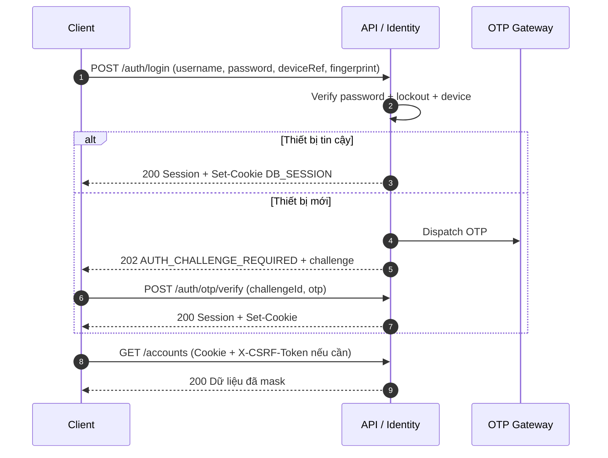
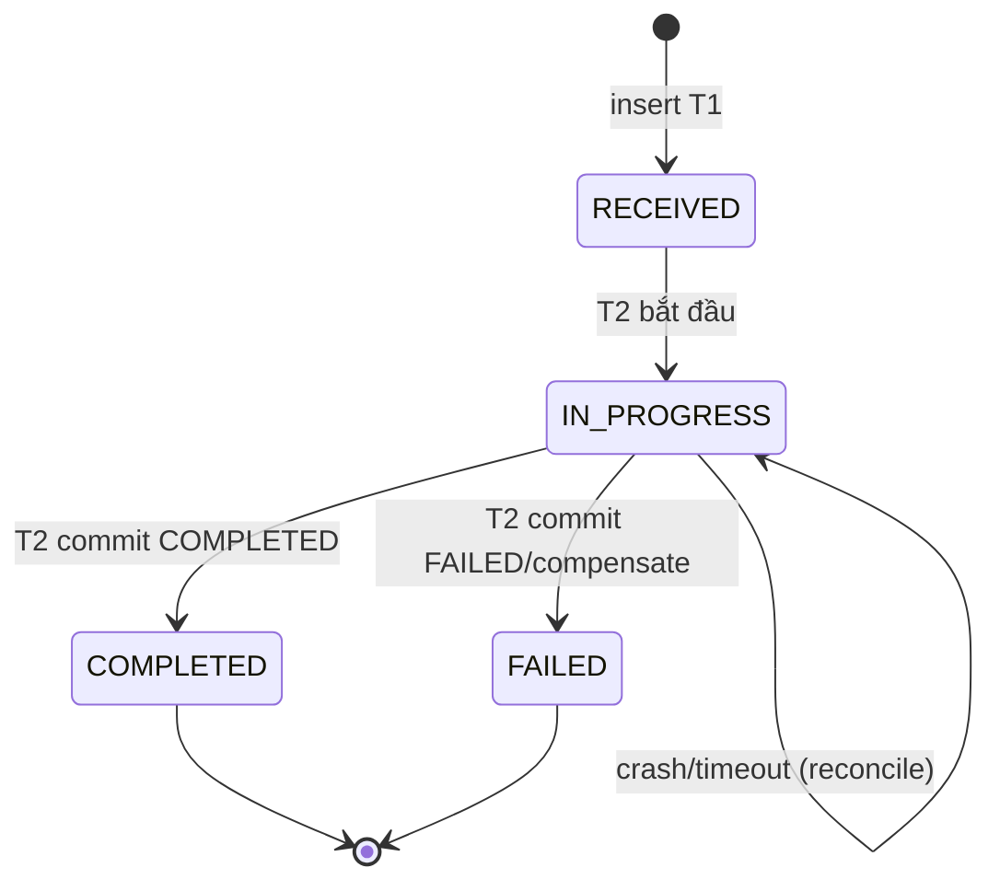
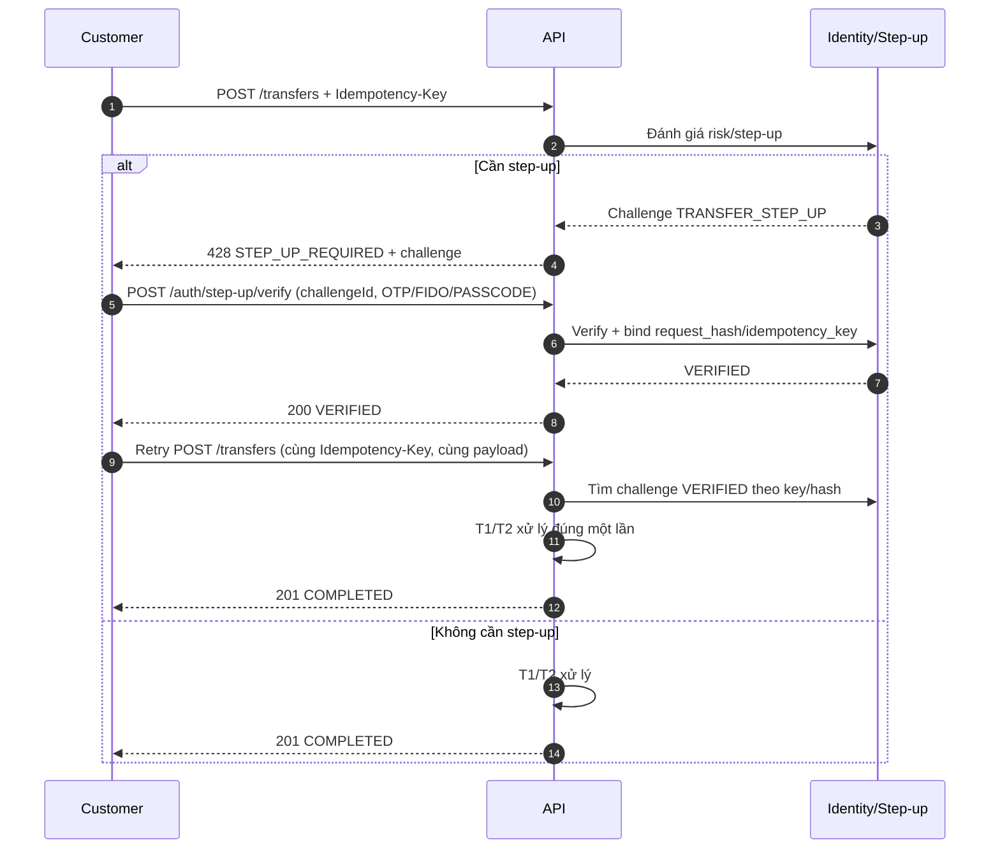

# 07. API Contracts

Tài liệu này là **nguồn ngữ nghĩa của hợp đồng API** cho Digital Banking MVP. Các giá trị đang là đề xuất được đánh dấu rõ và phải được chốt qua open issue tương ứng trước khi coi là cam kết cuối cùng.

---

## Mục lục

- [1. Mục đích, phạm vi và nguyên tắc](#1-mục-đích-phạm-vi-và-nguyên-tắc)
- [2. Quy ước chung](#2-quy-ước-chung)
- [3. Xác thực, session và phân quyền](#3-xác-thực-session-và-phân-quyền)
- [4. Mô hình lỗi](#4-mô-hình-lỗi)
- [5. Idempotency](#5-idempotency)
- [6. Step-up authentication](#6-step-up-authentication)
- [7. Danh mục endpoint và schema dùng chung](#7-danh-mục-endpoint-và-schema-dùng-chung)
- [8. Chi tiết endpoint](#8-chi-tiết-endpoint)
- [9. Traceability](#9-traceability)
- [10. Kiểm thử hợp đồng và CI](#10-kiểm-thử-hợp-đồng-và-ci)
- [11. Quyết định, open issues và phê duyệt](#11-quyết-định-open-issues-và-phê-duyệt)
- [Appendix A. OpenAPI 3.1 – components trích](#appendix-a-openapi-31--components-trích)
- [Appendix B. Ví dụ end-to-end](#appendix-b-ví-dụ-end-to-end)

---

## 1. Mục đích, phạm vi và nguyên tắc

### 1.1. Mục đích

Tài liệu xác định:

- Danh mục endpoint, method, path, quyền truy cập và quan hệ với FR/UC.
- Cấu trúc request/response, kiểu dữ liệu, ràng buộc validation và ví dụ.
- Quy ước xác thực, session, CSRF, correlation ID, idempotency và step-up.
- Mô hình lỗi thống nhất theo RFC 9457 Problem Details.
- Hành vi biên: replay, conflict, timeout, retry, crash recovery, audit và PII masking.
- Tiêu chí để FE/BE/QA kiểm thử hợp đồng và phát hiện breaking change.

### 1.2. Phạm vi

**Trong phạm vi:**

- Public/customer API và Operations/Admin/Auditor API dưới base path `/api/v1`.
- Các endpoint trong [[03. SRS#6.2. API Catalog (High-Level)]].
- Các endpoint bổ sung tối thiểu để đáp ứng FR chưa có trong catalog:
  - `GET /customers/me` (FR-008).
  - `GET /auth/session` (FR-006, phục hồi session sau refresh).
  - `POST /auth/challenges/{challengeId}/resend` (UC-003, gửi lại OTP).
  - `GET /admin/approvals`, `GET /admin/approvals/{approvalId}` (UC-011/UC-013).
  - `GET /audit/{auditId}` (UC-012, xem chi tiết audit).
- Hợp đồng với OTP/Notification/FIDO/Fraud được mô tả ở mức hệ thống; chi tiết adapter nội bộ không thuộc tài liệu này.

**Ngoài phạm vi:**

- CBS, payment gateway, settlement, FX, phí, lãi.
- OTP/SMS/Email/FIDO provider thật; fraud ML.
- API quản trị retention/legal hold chi tiết (xem [OI-API-07](#113-open-issues)).
- API tìm kiếm khách hàng diện rộng (xem [OI-API-08](#113-open-issues)).
- Giao diện quản trị, template notification và cấu hình rule fraud.

### 1.3. Tài liệu tham chiếu

| Tài liệu | Cách sử dụng |
|---|---|
| [[01. Introduction]] | Thuật ngữ, ID convention, phạm vi tổng thể |
| [[02. BRD]] | Business requirements, BRL, process, success criteria |
| [[03. SRS]] | FR/NFR, UC/AC, state machine, interface catalog, error catalog |
| [[04. Database design & analysis]] | Schema, enum, constraint, transaction boundary, audit hash chain |
| [[05. Technical stack]] | Spring Boot, OpenAPI, RFC 9457, session/cookie, tiền dạng chuỗi |
| [[06. System architecture]] | Module, runtime flow, T1/T2, idempotency, step-up, integration |
| [[digital-banking-v1.yaml]] | OpenAPI 3.1 đầy đủ cho 30 endpoint |
| [[Requirement Common]] | Yêu cầu consistency, idempotency, audit, bảo mật, demo |
| [[Idempotency]] | Tham khảo semantics/idempotency key, replay |
| [[Transaction, isolation, locking]] | Tham khảo transaction boundary, isolation, locking |
| [[Accouting]] | Tham khảo double-entry/ledger và đối soát |

### 1.4. Nguyên tắc hợp đồng

1. **Contract-first:** thay đổi hành vi API phải cập nhật tài liệu này và OpenAPI trước/cùng lúc với code.
2. **Resource-oriented REST:** danh từ số nhiều, HTTP method đúng ngữ nghĩa; không dùng RPC-style tùy tiện.
3. **Explicit status:** mọi kết quả nghiệp vụ có mã lỗi và HTTP status rõ ràng; không trả `200` cho lỗi nghiệp vụ.
4. **Idempotent write:** `POST /transfers` bắt buộc `Idempotency-Key`; retry không tạo giao dịch thứ hai.
5. **Least privilege:** mọi endpoint kiểm tra role + ownership/data scope; customer chỉ thấy dữ liệu của mình.
6. **No sensitive data:** response/log/notification chỉ chứa dữ liệu đã mask; không trả password, OTP, token, full account number.
7. **Traceability:** mọi response có `X-Correlation-ID`; lỗi và giao dịch tiền có `correlationId` trong body.
8. **Backward compatibility:** thay đổi breaking phải tạo version mới; trong `/v1` chỉ bổ sung field optional/enum mở rộng có kiểm soát.
9. **Fail-safe:** lỗi hệ thống không được biến giao dịch PENDING thành COMPLETED khi audit/ledger chưa bền vững.
10. **Testable:** mỗi endpoint có ít nhất một happy path, một lỗi validation, một lỗi quyền và một lỗi biên.

### 1.5. Quy ước trạng thái

| Nhãn | Ý nghĩa |
|---|---|
| `Chốt` | Đã thống nhất trong phạm vi MVP, dùng để triển khai/test |
| `Đề xuất` | Giá trị/hành vi cần xác nhận qua open issue |
| `Deferred` | Không triển khai trong MVP; có owner/trigger |
| `Internal` | Không trả trực tiếp cho client; dùng log/audit/metric |

---

## 2. Quy ước chung

### 2.1. Base URL, versioning và content type

| Chủ đề | Quy ước |
|---|---|
| Base path | `/api/v1` |
| Protocol | HTTPS bắt buộc; TLS 1.2+ (ưu tiên 1.3) |
| Request/response | `application/json; charset=utf-8` |
| Error response | `application/problem+json; charset=utf-8` |
| Versioning | URL version `/v1`; breaking change tạo `/v2` |
| Timeout client | 10 giây cho API thường; transfer p95 ≤ 2 giây, p99 ≤ 5 giây (NFR-001) |
| Request body tối đa | 64 KB (đề xuất) |
| Response nén | Gzip/br nếu client hỗ trợ |

**Breaking change** gồm: đổi tên/xóa field, đổi kiểu dữ liệu, đổi ý nghĩa status code, bắt buộc field mới, thay đổi enum theo hướng đóng. Bổ sung field optional hoặc enum value mới có tài liệu là non-breaking trong `/v1`.

### 2.2. Header chuẩn

| Header | Bắt buộc | Mô tả |
|---|---|---|
| `Authorization: Bearer <token>` | Tùy chọn | Dùng cho API client/test; token opaque giống session token |
| `Cookie: DB_SESSION=<opaque>` | Tùy chọn | Session SPA; `HttpOnly`, `Secure`, `SameSite=Strict` |
| `X-CSRF-Token` | Bắt buộc với cookie session + request thay đổi dữ liệu | CSRF token lấy từ login/session response |
| `X-Correlation-ID` | Không | Nếu có, dùng lại; nếu không, server sinh UUID; pattern `^[A-Za-z0-9._:-]{1,64}$` |
| `Idempotency-Key` | Bắt buộc với `POST /transfers` | 1–255 ký tự; không chứa PII; pattern `^[A-Za-z0-9._:~-]{1,255}$` |
| `X-Step-Up-Challenge` | Bắt buộc với hành động nhạy cảm sau 428 | `challengeId` đã `VERIFIED`, purpose `SENSITIVE_ACTION` |
| `Content-Type` | Bắt buộc khi có body | `application/json` |
| `Accept` | Không | Mặc định `application/json`; export dùng `text/csv` hoặc `application/x-ndjson` |
| `Idempotent-Replayed` | Response header | `true` nếu response được replay từ idempotency record |

**Quy tắc correlation:**

- Nếu client gửi `X-Correlation-ID` hợp lệ, hệ thống dùng lại.
- Nếu thiếu, server sinh UUID và trả trong response header.
- Nếu header sai định dạng, trả `400 VALIDATION_ERROR` để tránh log injection.
- Correlation ID phải propagate vào `transfer`, `ledger_entry`, `audit_log`, `notification`, `auth_challenge` và log MDC.

### 2.3. Kiểu dữ liệu

| Kiểu | JSON | Ràng buộc | Ví dụ |
|---|---|---|---|
| `ID` | string | `^[1-9][0-9]{0,18}$`; BIGINT exposed dạng chuỗi để tránh mất precision JavaScript | `"3001"` |
| `UUID` | string | RFC 4122 | `"11111111-2222-4333-8444-555555555555"` |
| `Money` | string | `^(0\|[1-9][0-9]{0,16})\.[0-9]{2}$`; tối đa 19 chữ số, 2 decimals; không dấu phân cách | `"150000.00"` |
| `Currency` | string | Enum `VND` trong MVP | `"VND"` |
| `Instant` | string | ISO 8601 UTC, hậu tố `Z`; fractional seconds tùy chọn | `"2026-11-03T10:15:30Z"` |
| `LocalDate` | string | `YYYY-MM-DD`; dùng cho `usageDate` theo timezone cấu hình | `"2026-11-03"` |
| `Reference` | string | 16–32 ký tự; đề xuất `^TXN[0-9]{8}[A-Z0-9]{8,20}$` | `"TXN20261103A1B2C3D4"` |
| `MaskedAccount` | string | `**** **** <last4>` | `"**** **** 3001"` |
| `MaskedPhone` | string | 3 ký tự cuối | `"********123"` |
| `MaskedEmail` | string | Ký tự đầu + domain | `"n***@example.com"` |
| `RoleCode` | string | `CUSTOMER`, `OPERATIONS`, `ADMIN`, `AUDITOR` | `"CUSTOMER"` |
| `PrivilegeCode` | string | `CHECKER` | `"CHECKER"` |
| `Sort` | string | `field,asc\|desc`; field thuộc whitelist từng endpoint | `"createdAt,desc"` |

**Quy tắc bổ sung:**

- Không dùng số JSON cho tiền/ID; luôn dùng chuỗi.
- `null` và field vắng mặt có ý nghĩa khác nhau: field vắng mặt = không áp dụng/không trả; `null` = có field nhưng không có giá trị.
- Boolean không dùng `0/1`.
- Enum so sánh case-sensitive, uppercase.

### 2.4. Tiền tệ, thời gian và làm tròn

- MVP chỉ hỗ trợ `VND`; mọi amount/balance/limit là `Money`.
- Không có phí, lãi, tỷ giá; `amount` chuyển = amount debit = amount credit.
- Amount chuyển phải `> 0`; tối đa 2 chữ số thập phân. `0.00` bị từ chối.
- Server không tự làm tròn amount; amount sai scale bị từ chối `400 VALIDATION_ERROR`.
- API trả thời gian UTC; UI hiển thị theo timezone cấu hình (đề xuất `Asia/Ho_Chi_Minh`).
- Daily limit reset theo `usageDate` tại timezone cấu hình, không theo UTC.
- Filter thời gian dùng `from` (inclusive) và `to` (exclusive).

### 2.5. Phân trang, lọc và sắp xếp

**Query chung cho endpoint danh sách:**

| Param | Kiểu | Mặc định | Ràng buộc |
|---|---|---|---|
| `page` | integer | `0` | ≥ 0; 0-based |
| `size` | integer | `20` | 1–100 |
| `sort` | string | Theo endpoint | Whitelist; ví dụ `createdAt,desc` |
| `from` | Instant | `now - 30 days` (đề xuất) | `from < to`; khoảng tối đa 366 ngày |
| `to` | Instant | `now` | `to > from`; exclusive |

**Response page:**

```json
{
  "items": [],
  "page": {
    "number": 0,
    "size": 20,
    "totalElements": 0,
    "totalPages": 0,
    "first": true,
    "last": true
  },
  "asOf": "2026-11-03T10:15:30Z"
}
```

- `totalElements`/`totalPages` có thể là `null` nếu dùng cursor trong tương lai; MVP dùng offset.
- Sort whitelist:
  - `/transactions`: `createdAt`, `amount`.
  - `/audit`: `occurredAt`.
  - `/fraud-flags`: `createdAt`, `severity`.
  - `/admin/approvals`: `createdAt`.
- Sort field ngoài whitelist → `400 VALIDATION_ERROR`.
- `page` vượt quá `totalPages` → trả `items: []`, không lỗi.

### 2.6. PII masking

| Dữ liệu | Hiển thị mặc định | Quy tắc |
|---|---|---|
| Số tài khoản | `**** **** 1234` | Chỉ 4 ký tự cuối; không trả full số tài khoản |
| Số điện thoại | `********123` | 3 ký tự cuối; chỉ chủ sở hữu/vai trò được phép |
| Email | `n***@example.com` | Ký tự đầu + domain; không trả full trong log |
| Họ tên | Chủ sở hữu: đầy đủ; vai trò khác: `Nguyễn V*** A` | Field `fullName` là giá trị display-safe theo role |
| OTP/password/passcode/token | Không bao giờ trả | Chỉ lưu hash; không log |
| `deviceFingerprint` | Không trả | Server HMAC; không log raw |
| Request body transfer | Không log full | Redact `destination.accountNumber`, `description` nếu chứa PII |

- `beforeState`/`afterState` trong audit phải được mask trước khi ghi.
- Notification payload chỉ chứa dữ liệu đã mask.
- Log redaction áp dụng cho header `Authorization`, `Cookie`, `X-CSRF-Token`, body auth/transfer.

### 2.7. Correlation ID

- Header response: `X-Correlation-ID` trong **mọi** response, kể cả lỗi.
- Body: `correlationId` bắt buộc trong `Problem`, `AuthResponse`, `TransferResponse`, `Audit*`, `Approval*`.
- Không tái sử dụng correlation ID của request khác; nếu client gửi lại thì dùng lại (retry hợp lệ).
- Log line phải có `correlationId`, `requestId` (internal), `userId` (nếu có), `route`, `status`, `latencyMs`.

### 2.8. Giới hạn kích thước và rate limit

| Nhóm | Giới hạn đề xuất | Ghi chú |
|---|---|---|
| Request body | 64 KB | Trả `413 REQUEST_TOO_LARGE` |
| Page size | 100 | Trả `400 VALIDATION_ERROR` nếu vượt |
| Login | 10 request/phút/IP + username | Trả `429 RATE_LIMITED` |
| OTP verify | 5 lần/challenge (BRL-004) + 20 request/phút/user | `423 AUTH_CHALLENGE_LOCKED` khi vượt attempt |
| Transfer | 30 request/phút/customer | `429 RATE_LIMITED`; retry an toàn với key |
| Audit export | 5 request/giờ/user | `429 RATE_LIMITED` |
| Global API | 120 request/phút/user/IP | Cấu hình được |

- `429` trả `Retry-After` (giây) và `X-RateLimit-*` nếu có.
- Rate limit không thay thế idempotency; retry transfer vẫn phải dùng cùng key.
- Giá trị trên là **đề xuất**, cấu hình qua env; xem [OI-API-06](#113-open-issues).

### 2.9. Cache và security header

- Response có dữ liệu tài chính/PII: `Cache-Control: no-store`, `Pragma: no-cache`.
- `GET /health` có thể `Cache-Control: no-store` để tránh cache trạng thái.
- Nginx/backend set:
  - `Strict-Transport-Security: max-age=31536000; includeSubDomains`
  - `X-Content-Type-Options: nosniff`
  - `X-Frame-Options: DENY` / CSP `frame-ancestors 'none'`
  - `Referrer-Policy: no-referrer`
  - CSP phù hợp SPA; CORS chỉ origin được cấu hình, không `*` khi gửi cookie.

---

## 3. Xác thực, session và phân quyền

### 3.1. Mô hình xác thực

| Phương thức | Endpoint | Điều kiện | Kết quả |
|---|---|---|---|
| Password | `POST /auth/login` | Mọi user | Session hoặc OTP challenge cho thiết bị mới |
| Passcode | `POST /auth/passcode` | Thiết bị `trusted`, có passcode | Session |
| FIDO/WebAuthn | `POST /auth/fido/verify` | Thiết bị `trusted`, credential hợp lệ | Session |
| OTP thiết bị mới | `POST /auth/otp/verify` | Challenge `LOGIN_NEW_DEVICE` | Session |
| Step-up | `POST /auth/step-up/verify` | Challenge `TRANSFER_STEP_UP`/`SENSITIVE_ACTION` | Challenge `VERIFIED`; không tạo session |
| Logout | `POST /auth/logout` | Session active | Session `LOGGED_OUT` |

- Password/passcode/OTP chỉ lưu hash; không plaintext.
- Passcode/FIDO chỉ dùng trên thiết bị `trusted`; fallback password theo chính sách.
- Mọi user (customer/staff) dùng cùng cơ chế; role quyết định quyền sau khi xác thực.
- `username` được normalize lowercase; password không trim và không log.

### 3.2. Session và cookie

- Session token opaque ngẫu nhiên 256-bit, trả client một lần qua cookie `DB_SESSION`.
- Server chỉ lưu SHA-256 hash trong `session.session_token_hash`.
- Cookie:
  - `HttpOnly`, `Secure`, `SameSite=Strict`, `Path=/`, `Max-Age=28800` (8 giờ).
  - Không đặt token trong JSON response.
- Session metadata trả trong body:
  - `idleExpiresAt` (15 phút không hoạt động – BRL-005, đề xuất).
  - `absoluteExpiresAt` (8 giờ – BRL-005, đề xuất).
  - `csrfToken`.
  - `deviceTrusted`.
- API client/test có thể dùng cùng token qua `Authorization: Bearer`; token lấy từ cookie jar hoặc test harness, không trả trong body.
- Response `401` trả `WWW-Authenticate: Bearer realm="digital-banking"` (cookie client bỏ qua header này).
- Logout/expiry:
  - Logout cập nhật `session.status='LOGGED_OUT'`, `logged_out_at`, xóa cookie (`Max-Age=0`), audit.
  - Idle/absolute timeout → `401 AUTH_SESSION_EXPIRED`; client đăng nhập lại.
- Concurrent sessions: cho phép nhiều session/user trong MVP; thu hồi theo device/user là Deferred (xem [OI-API-12](#113-open-issues)).

### 3.3. CSRF và CORS

- Cookie session + request `POST/PUT/PATCH/DELETE` bắt buộc header `X-CSRF-Token`.
- `csrfToken` lấy từ login response hoặc `GET /auth/session`; gắn với session.
- Bearer token request miễn CSRF (không dựa vào cookie).
- Thiếu/sai CSRF token → `403 AUTH_FORBIDDEN`.
- CORS:
  - `Access-Control-Allow-Origin` = origin SPA được cấu hình, không `*`.
  - `Access-Control-Allow-Credentials: true`.
  - Allow headers: `Authorization`, `Content-Type`, `X-Correlation-ID`, `Idempotency-Key`, `X-CSRF-Token`, `X-Step-Up-Challenge`.
  - Allow methods: `GET`, `POST`, `OPTIONS`.
- Preflight `OPTIONS` không yêu cầu CSRF.

### 3.4. Role, permission và privilege

- Roles: `CUSTOMER`, `OPERATIONS`, `ADMIN`, `AUDITOR`.
- `CHECKER` là **privilege** trong `user_privilege`, không phải role.
- Permission seed tối thiểu:

| Role | Permissions |
|---|---|
| `CUSTOMER` | `ACCOUNT_READ_SELF`, `TRANSACTION_READ_SELF`, `TRANSFER_CREATE`, `LIMIT_READ_SELF` |
| `OPERATIONS` | `CUSTOMER_READ`, `ACCOUNT_READ`, `TRANSACTION_READ`, `AUDIT_READ`, `FRAUD_REVIEW`, `LIMIT_MAKER` |
| `ADMIN` | `CUSTOMER_READ`, `ACCOUNT_READ`, `TRANSACTION_READ`, `AUDIT_READ`, `ROLE_MANAGE`, `LIMIT_MANAGE`, `RETENTION_MANAGE`, `FRAUD_READ` |
| `AUDITOR` | `AUDIT_READ`, `AUDIT_EXPORT`, `TRANSACTION_READ`, `ACCOUNT_READ` |

- Checker phải có privilege `CHECKER` và khác maker cho cùng approval.
- `CUSTOMER` không bao giờ có quyền staff; staff không có quyền customer self-service.
- Permission matrix đầy đủ tại [[03. SRS#4.2. Permission Matrix]].

### 3.5. Ma trận endpoint – role

Ký hiệu: `self` = chỉ dữ liệu của mình; `read` = đọc theo phạm vi; `write` = tạo/cập nhật; `approve` = cần `CHECKER`; `—` = không có quyền.

| Endpoint | CUSTOMER | OPERATIONS | ADMIN | AUDITOR |
|---|---|---|---|---|
| `POST /auth/login` | Public | Public | Public | Public |
| `POST /auth/passcode` | Public | Public | Public | Public |
| `POST /auth/fido/verify` | Public | Public | Public | Public |
| `POST /auth/otp/verify` | Public | Public | Public | Public |
| `POST /auth/step-up/verify` | self | self | self | self |
| `POST /auth/logout` | self | self | self | self |
| `GET /auth/session` | self | self | self | self |
| `POST /auth/challenges/{id}/resend` | self/public | self/public | self/public | self/public |
| `GET /customers/me` | self | — | — | — |
| `GET /accounts` | self | — | — | — |
| `GET /accounts/{accountId}` | self | read | read | read |
| `GET /admin/customers/{customerId}` | — | read | read | read |
| `GET /admin/customers/{customerId}/accounts` | — | read | read | read |
| `POST /transfers` | write | — | — | — |
| `GET /transfers/{reference}` | self | read | read | read |
| `GET /transactions` | self | read | read | read |
| `GET /transactions/{reference}` | self | read | read | read |
| `GET /limits` | self | — | — | — |
| `POST /admin/limits` | — | maker | maker | — |
| `POST /admin/limits/{id}/approve` | — | approve | approve | — |
| `GET /audit` | — | read | read | read |
| `GET /audit/{auditId}` | — | read | read | read |
| `GET /audit/export` | — | — | — | export |
| `GET /fraud-flags` | — | review | read | read |
| `POST /fraud-flags/{id}/review` | — | write | — | — |
| `POST /admin/roles` | — | — | maker | — |
| `POST /admin/roles/{id}/approve` | — | — | approve | — |
| `GET /admin/approvals` | — | read | read | — |
| `GET /admin/approvals/{approvalId}` | — | read | read | — |
| `GET /health` | — | — | read | read |

> `maker`/`approve` trong bảng là ngữ cảnh nghiệp vụ; kiểm tra thực tế dựa trên permission + privilege, không chỉ role.

### 3.6. Ownership và data scope

| Quy tắc | Hành vi |
|---|---|
| Customer đọc tài khoản/giao dịch không thuộc mình | `403 AUTH_FORBIDDEN`; audit `SECURITY_ACCESS_DENIED` |
| Customer truyền `customerId` khác mình | `403 AUTH_FORBIDDEN` |
| Staff đọc ngoài scope/permission | `403 AUTH_FORBIDDEN`; audit security event |
| Resource không tồn tại | `404` với mã cụ thể (`ACCOUNT_NOT_FOUND`, `TRANSFER_NOT_FOUND`, ...) |
| Customer query transfer không tham gia | `403 AUTH_FORBIDDEN` (không trả 404 để tránh enumeration) |
| Auditor | Chỉ đọc; mọi write bị `403` |
| PII đầy đủ | Không trả qua API MVP; nếu cần, bổ sung permission riêng (OI-API-09) |

### 3.7. Ngưỡng xác thực và session

| Tham số | Giá trị | Trạng thái | Nguồn |
|---|---|---|---|
| Sai password/passcode liên tiếp | 5 lần → khóa 10 phút | Đề xuất | BRL-003 |
| Khóa trong 24 giờ | 3 lần → khóa tài khoản | Đề xuất | BRL-003 |
| OTP TTL | 5 phút | Đề xuất | BRL-004 |
| OTP max attempts | 5 | Đề xuất | BRL-004 |
| OTP length | 6 chữ số (cấu hình 6–8) | Đề xuất | API design |
| Session idle | 15 phút | Đề xuất | BRL-005 |
| Session absolute | 8 giờ | Đề xuất | BRL-005 |
| Session purge | 30 ngày sau hết hạn | Đề xuất | DB retention |
| Idempotency TTL | 24 giờ | Đề xuất | BRL-013/OI-001 |

### 3.8. Luồng xác thực



**Quy tắc:**

- `deviceRef` + `deviceFingerprint` khớp device `trusted` → không cần OTP.
- Thiếu/không khớp fingerprint → coi là thiết bị mới, tạo OTP challenge.
- OTP dispatch lỗi → `503 OTP_DISPATCH_FAILED`; không tạo session.
- Password sai → `401 AUTH_INVALID_CREDENTIALS`; tăng `auth_attempt`, có thể khóa.
- Tài khoản `LOCKED`/`DISABLED` → `423 AUTH_ACCOUNT_LOCKED` hoặc `403 AUTH_FORBIDDEN`.

---

## 4. Mô hình lỗi

### 4.1. RFC 9457 Problem Details

Mọi lỗi trả `Content-Type: application/problem+json` với cấu trúc:

```json
{
  "type": "https://api.demo.local/problems/insufficient-balance",
  "title": "Insufficient balance",
  "status": 422,
  "detail": "Số dư khả dụng không đủ cho giao dịch.",
  "instance": "/api/v1/transfers",
  "code": "INSUFFICIENT_BALANCE",
  "correlationId": "0f8fad5b-d9cb-469f-a165-70867728950e",
  "timestamp": "2026-11-03T10:15:30Z",
  "retryable": false
}
```

| Field | Kiểu | Bắt buộc | Mô tả |
|---|---|---|---|
| `type` | URI | Có | URI định danh loại lỗi; ổn định theo `code` |
| `title` | string | Có | Tiêu đề ngắn, tiếng Anh |
| `status` | integer | Có | HTTP status |
| `detail` | string | Có | Mô tả an toàn, tiếng Việt; không chứa PII |
| `instance` | string | Có | Path request |
| `code` | string | Có | Mã nghiệp vụ ổn định (xem 4.3) |
| `correlationId` | string | Có | Trace ID |
| `timestamp` | Instant | Có | Thời điểm lỗi |
| `retryable` | boolean | Có | Client có được retry an toàn không |
| `errors` | array | Không | Chi tiết validation theo field |
| `challenge` | object | Không | Chỉ với `STEP_UP_REQUIRED` |
| `reference` | string | Không | Transfer reference nếu đã tạo |
| `transferStatus` | string | Không | `PENDING`/`FAILED` nếu đã tạo transfer |
| `failureCode` | string | Không | Mã failure nghiệp vụ của transfer |
| `lockedUntil` | Instant | Không | Chỉ với `AUTH_ACCOUNT_LOCKED`; thời điểm hết khóa tạm thời |

### 4.2. Validation error

```json
{
  "type": "https://api.demo.local/problems/validation-error",
  "title": "Validation failed",
  "status": 400,
  "detail": "Dữ liệu yêu cầu không hợp lệ.",
  "instance": "/api/v1/transfers",
  "code": "VALIDATION_ERROR",
  "correlationId": "0f8fad5b-d9cb-469f-a165-70867728950e",
  "timestamp": "2026-11-03T10:15:30Z",
  "retryable": false,
  "errors": [
    {
      "field": "amount",
      "code": "DECIMAL_SCALE",
      "message": "Số tiền tối đa 2 chữ số thập phân."
    },
    {
      "field": "destination",
      "code": "REQUIRED_ONE_OF",
      "message": "Phải cung cấp accountId hoặc accountNumber."
    }
  ]
}
```

- `errors[].field` dùng JSON path tương đối (`amount`, `destination.accountNumber`).
- Không trả stack trace, SQL, tên bảng/cột hoặc thông tin provider.
- Validation lỗi header `Idempotency-Key` dùng `field: "Idempotency-Key"`.

### 4.3. Error code catalog

#### 4.3.1. Auth/session

| Code | HTTP | Retryable | Ý nghĩa |
|---|---|---|---|
| `AUTH_INVALID_CREDENTIALS` | 401 | Không | Sai username/password/passcode hoặc FIDO assertion không hợp lệ |
| `AUTH_ACCOUNT_LOCKED` | 423 | Không (đến `lockedUntil`) | Tài khoản bị khóa tạm thời hoặc khóa tài khoản |
| `AUTH_SESSION_EXPIRED` | 401 | Có (đăng nhập lại) | Session hết hạn/không hợp lệ |
| `AUTH_FORBIDDEN` | 403 | Không | Thiếu quyền, sai CSRF, truy cập ngoài scope |
| `AUTH_DEVICE_NOT_TRUSTED` | 403 | Không | Passcode/FIDO trên thiết bị chưa trust |
| `AUTH_CHALLENGE_NOT_FOUND` | 404 | Không | `challengeId` không tồn tại/không thuộc user |
| `AUTH_CHALLENGE_EXPIRED` | 410 | Có (tạo challenge mới) | Challenge hết TTL |
| `AUTH_CHALLENGE_LOCKED` | 423 | Không | Vượt số lần thử OTP/challenge |
| `AUTH_OTP_INVALID` | 401 | Có (trong giới hạn) | OTP sai |
| `AUTH_OTP_EXPIRED` | 410 | Có (gửi lại/tạo mới) | OTP hết hạn |
| `STEP_UP_REQUIRED` | 428 | Có (sau xác thực) | Cần step-up; response kèm challenge |
| `STEP_UP_CHALLENGE_MISMATCH` | 409 | Không | Challenge không khớp user/purpose/request hash/idempotency key |
| `OTP_DISPATCH_FAILED` | 503 | Có | Không gửi được OTP qua gateway |

#### 4.3.2. Request/validation

| Code | HTTP | Retryable | Ý nghĩa |
|---|---|---|---|
| `VALIDATION_ERROR` | 400 | Không | Dữ liệu/header/query không hợp lệ |
| `MALFORMED_REQUEST` | 400 | Không | JSON sai cú pháp hoặc body không đọc được |
| `UNSUPPORTED_MEDIA_TYPE` | 415 | Không | `Content-Type` không phải JSON |
| `REQUEST_TOO_LARGE` | 413 | Không | Body vượt giới hạn |
| `METHOD_NOT_ALLOWED` | 405 | Không | Method không hỗ trợ cho path |
| `NOT_FOUND` | 404 | Không | Route không tồn tại |
| `RATE_LIMITED` | 429 | Có (sau backoff) | Vượt rate limit; có `Retry-After` |

#### 4.3.3. Business

| Code | HTTP | Retryable | Ý nghĩa |
|---|---|---|---|
| `ACCOUNT_NOT_FOUND` | 404 | Không | Tài khoản nguồn/đích không tồn tại |
| `ACCOUNT_INACTIVE` | 409 | Không | Tài khoản `LOCKED`/`CLOSED` |
| `INSUFFICIENT_BALANCE` | 422 | Không | Số dư khả dụng không đủ |
| `LIMIT_EXCEEDED` | 422 | Không | Vượt hạn mức giao dịch/ngày |
| `LIMIT_OUT_OF_POLICY` | 422 | Không | Hạn mức ngoài phạm vi chính sách |
| `TRANSFER_NOT_FOUND` | 404 | Không | Không tìm thấy transfer/reference |
| `TRANSFER_FAILED` | 422 | Không | Transfer đã tạo và kết thúc `FAILED` |
| `FRAUD_BLOCKED` | 422 | Không | Transfer bị auto-block; không ghi ledger |
| `FRAUD_FLAG_NOT_FOUND` | 404 | Không | Flag không tồn tại |
| `FRAUD_FLAG_ALREADY_CLOSED` | 409 | Không | Flag đã terminal, không review lại |
| `INVALID_STATE_TRANSITION` | 409 | Không | Chuyển trạng thái/không đúng purpose |
| `CUSTOMER_NOT_FOUND` | 404 | Không | Customer không tồn tại |
| `AUDIT_NOT_FOUND` | 404 | Không | Audit record không tồn tại |
| `EXPORT_TOO_LARGE` | 413 | Không | Export vượt số dòng cho phép; thu hẹp filter |

#### 4.3.4. Idempotency

| Code | HTTP | Retryable | Ý nghĩa |
|---|---|---|---|
| `IDEMPOTENCY_CONFLICT` | 409 | Không | Cùng key, payload khác |
| `IDEMPOTENCY_IN_PROGRESS` | 409 | Có (sau `Retry-After`) | Cùng key đang xử lý |

#### 4.3.5. Approval/admin

| Code | HTTP | Retryable | Ý nghĩa |
|---|---|---|---|
| `APPROVAL_NOT_FOUND` | 404 | Không | Approval không tồn tại |
| `APPROVAL_ALREADY_DECIDED` | 409 | Không | Approval không còn `PENDING` |
| `ROLE_CONFLICT` | 409 | Không | Maker = checker hoặc xung đột role/privilege |
| `ROLE_NOT_FOUND` | 404 | Không | Role không tồn tại/không active |
| `USER_NOT_FOUND` | 404 | Không | User đích không tồn tại |
| `LEGAL_HOLD_ACTIVE` | 409 | Không | Dữ liệu đang legal hold; không purge/archive |

#### 4.3.6. System

| Code | HTTP | Retryable | Ý nghĩa |
|---|---|---|---|
| `AUDIT_WRITE_FAILED` | 500 | Có (cùng idempotency key) | Không ghi được audit; transfer giữ `PENDING`/`FAILED`, cảnh báo audit gap |
| `INTERNAL_ERROR` | 500 | Có (idempotent) | Lỗi nội bộ không xác định |
| `SERVICE_UNAVAILABLE` | 503 | Có | DB/gateway/dịch vụ tạm thời không khả dụng |
| `GATEWAY_TIMEOUT` | 504 | Có | Gateway/provider timeout |

#### 4.3.7. Internal (không trả client)

`NOTIFICATION_FAILED`, `FRAUD_ENGINE_UNAVAILABLE`, `RECONCILIATION_REQUIRED` chỉ ghi log/audit/metric; không làm thay đổi response nghiệp vụ (trừ khi chính sách quy định khác).

### 4.4. Retry policy

| Tình huống | Client được retry? | Cách retry |
|---|---|---|
| `GET` bất kỳ | Có | Retry với backoff; tôn trọng `Retry-After` |
| `POST /transfers` | Có | Cùng `Idempotency-Key` + cùng payload |
| `POST` tạo approval | Có (đề xuất) | Cùng `Idempotency-Key` nếu bổ sung; hiện tại chỉ retry khi mất kết nối và kiểm tra approval list trước |
| `409 IDEMPOTENCY_IN_PROGRESS` | Có | Sau `Retry-After`; cùng key |
| `409 IDEMPOTENCY_CONFLICT` | Không | Query theo reference; không dùng lại key với payload khác |
| `428 STEP_UP_REQUIRED` | Có | Hoàn tất step-up rồi retry cùng request/key |
| `429`, `500` (idempotent), `503`, `504` | Có | Exponential backoff + jitter; tôn trọng `Retry-After` |
| `400`, `401`, `403`, `404`, `409` conflict, `422` | Không | Sửa dữ liệu/quyền hoặc chuyển trạng thái |
| `500 AUDIT_WRITE_FAILED` | Có | Cùng key; không tạo transfer mới; chờ reconcile nếu cần |

- Retry mặc định: exponential backoff `1s, 2s, 4s, ...` + jitter, tối đa 3–5 lần (đề xuất).
- Server trả `Retry-After` cho `409 IDEMPOTENCY_IN_PROGRESS` và `429`.
- Không retry mù request tạo giao dịch khi không có idempotency key.

---

## 5. Idempotency

### 5.1. Phạm vi

- Bắt buộc cho `POST /api/v1/transfers`.
- Không áp dụng cho `GET`; các thao tác đọc không cần key.
- Có thể áp dụng cho `POST /admin/limits` và `POST /admin/roles` trong tương lai (đề xuất), nhưng MVP chỉ bắt buộc transfer.
- Key unique toàn cục; một key → tối đa một transfer.

### 5.2. Header và canonical request hash

- Header: `Idempotency-Key`.
- Ràng buộc: 1–255 ký tự; pattern `^[A-Za-z0-9._:~-]{1,255}$`; không chứa PII.
- Request hash:
  1. Tạo object chuẩn hóa:
     ```json
     {
       "customerId": "2001",
       "sourceAccountId": "3001",
       "destination": { "type": "ACCOUNT_NUMBER", "value": "0123456789" },
       "amount": "150000.00",
       "currency": "VND",
       "description": "Chuyển tiền tháng 11"
     }
     ```
     - `destination.type` = `ACCOUNT_ID` hoặc `ACCOUNT_NUMBER`.
     - `amount` chuẩn hóa 2 decimals, bỏ leading zeros.
     - `currency` uppercase.
     - `description` trim; `null` và chuỗi rỗng cùng canonicalize thành `""`.
  2. Serialize theo **RFC 8785 JSON Canonicalization Scheme (JCS)**.
  3. `request_hash = lowercase_hex(SHA-256(UTF-8(JCS(payload))))`.
- Không đưa header, timestamp, correlation ID hoặc device info vào hash.
- Server lưu `request_hash` (CHAR 64) cùng `idempotency_key`.

### 5.3. Trạng thái idempotency



- Record được tạo **sau** validation và step-up (nếu có), trong **T1** cùng transfer `PENDING`.
- `transfer_id` NOT NULL; một key → một transfer.
- Record terminal lưu `response_status` và `response_body` (đã mask) để replay.
- Key hết hạn (TTL 24 giờ – đề xuất) được coi là request mới; client nên query reference trước.
- Purge job xóa record hết hạn; không ảnh hưởng transfer/ledger/audit.

### 5.4. Bảng hành vi replay

| Tình huống | Trạng thái record | Response | Hiệu ứng |
|---|---|---|---|
| Key mới, payload hợp lệ | Không có | Tạo T1/T2, trả kết quả | Một transfer |
| Cùng key + cùng hash, terminal | `COMPLETED`/`FAILED` | Trả đúng status/body cũ; `Idempotent-Replayed: true` | Không tạo transfer/debit mới |
| Cùng key + cùng hash, đang xử lý | `RECEIVED`/`IN_PROGRESS` | `409 IDEMPOTENCY_IN_PROGRESS` + `Retry-After` | Client retry sau |
| Cùng key + payload khác | Bất kỳ | `409 IDEMPOTENCY_CONFLICT` | Không tạo transfer; audit security event |
| Key hết hạn | Không còn record | Coi là request mới | Client phải query reference trước |
| Thiếu key | — | `400 VALIDATION_ERROR` | Không xử lý |
| Cần step-up | Chưa có record | `428 STEP_UP_REQUIRED` + challenge | Không tạo transfer/ledger |

### 5.5. Ví dụ replay

**Lần 1 — 201 Created:**

```http
POST /api/v1/transfers
Idempotency-Key: 7c9e6679-7425-40de-944b-e07fc1f90ae7
X-Correlation-ID: 0f8fad5b-d9cb-469f-a165-70867728950e
```

```json
{
  "reference": "TXN20261103A1B2C3D4",
  "status": "COMPLETED",
  "amount": "150000.00",
  "currency": "VND",
  "correlationId": "0f8fad5b-d9cb-469f-a165-70867728950e",
  "createdAt": "2026-11-03T10:15:30Z",
  "completedAt": "2026-11-03T10:15:31Z"
}
```

**Lần 2 — replay cùng key/payload:**

```http
HTTP/1.1 201 Created
Idempotent-Replayed: true
X-Correlation-ID: <correlation-id-mới-hoặc-cùng>
```

Body giống lần 1; không có debit mới.

---

## 6. Step-up authentication

### 6.1. Khi nào cần step-up

- Transfer vượt ngưỡng risk/step-up (giá trị, thiết bị, hành vi, chính sách).
- Hành động nhạy cảm: tạo yêu cầu đổi hạn mức/role, approve/reject limit/role, legal hold (nếu có).
- Ngưỡng cụ thể là cấu hình; đề xuất: giao dịch lớn/khác thường, thiết bị mới, thay đổi hạn mức/quyền.
- Không cần step-up cho đọc dữ liệu hoặc transfer thông thường dưới ngưỡng.

### 6.2. Luồng transfer



**Quy tắc:**

- 428 không tạo transfer, idempotency record hoặc ledger entry.
- Challenge gắn với `customerId`, `request_hash`, `idempotency_key`, purpose `TRANSFER_STEP_UP`.
- Một challenge chỉ dùng cho một transfer; `transfer.step_up_challenge_id` unique.
- Retry phải cùng key + cùng payload; nếu payload khác → `409 IDEMPOTENCY_CONFLICT`.
- Challenge hết hạn/không verify → không có transfer/debit; audit.
- OTP/TTL/attempt theo BRL-004; FIDO/passcode theo chính sách thiết bị.

### 6.3. Response 428

```json
{
  "type": "https://api.demo.local/problems/step-up-required",
  "title": "Step-up required",
  "status": 428,
  "code": "STEP_UP_REQUIRED",
  "detail": "Giao dịch cần xác thực bổ sung trước khi xử lý.",
  "instance": "/api/v1/transfers",
  "correlationId": "0f8fad5b-d9cb-469f-a165-70867728950e",
  "timestamp": "2026-11-03T10:15:30Z",
  "retryable": true,
  "challenge": {
    "challengeId": "11111111-2222-4333-8444-555555555555",
    "purpose": "TRANSFER_STEP_UP",
    "methods": ["OTP", "FIDO", "PASSCODE"],
    "channel": "SMS",
    "maskedDestination": "********123",
    "expiresAt": "2026-11-03T10:20:30Z",
    "maxAttempts": 5,
    "remainingAttempts": 5
  }
}
```

> [!warning] Giới hạn schema MVP
> `auth_challenge.method` trong DB là **đơn trị**, trong khi 428 quảng bá danh sách `methods`. Trong MVP, `challengeId` gắn với phương thức mặc định (thường `OTP`); `methods` là danh sách phương thức chính sách cho phép. Nếu client chọn phương thức khác, cần tạo challenge mới cho phương thức đó (xem OI-API-17). Không dùng một `challengeId` cho nhiều method.

### 6.4. Verify step-up

`POST /api/v1/auth/step-up/verify` với một trong các body:

**OTP:**

```json
{
  "challengeId": "11111111-2222-4333-8444-555555555555",
  "method": "OTP",
  "otp": "123456"
}
```

**Passcode:**

```json
{
  "challengeId": "11111111-2222-4333-8444-555555555555",
  "method": "PASSCODE",
  "passcode": "123456"
}
```

**FIDO:**

```json
{
  "challengeId": "11111111-2222-4333-8444-555555555555",
  "method": "FIDO",
  "fido": {
    "credentialId": "Zm9vYmFy",
    "clientDataJSON": "eyJ0eXBlIjoid2ViYXV0aG4uZ2V0In0",
    "authenticatorData": "SZYN5YgOjGh0NBcPZHZgW4/krrmihjLHmVzzuoMdl2M=",
    "signature": "MEUCIQD...",
    "userHandle": "dXNlcl8xMDAx"
  }
}
```

`method` phải khớp `auth_challenge.method` trong MVP; nếu khác → `409 STEP_UP_CHALLENGE_MISMATCH`. Danh sách `methods` ở 428 là chính sách cho phép, không phải nhiều method trên cùng một challenge (OI-API-17).

**Success 200:**

```json
{
  "challengeId": "11111111-2222-4333-8444-555555555555",
  "status": "VERIFIED",
  "purpose": "TRANSFER_STEP_UP",
  "verifiedAt": "2026-11-03T10:16:00Z",
  "expiresAt": "2026-11-03T10:20:30Z",
  "correlationId": "0f8fad5b-d9cb-469f-a165-70867728950e"
}
```

### 6.5. Sensitive action

- Với tạo/approve/reject limit/role, server trả `428 STEP_UP_REQUIRED` nếu chưa có step-up hợp lệ.
- Challenge purpose `SENSITIVE_ACTION`, gắn với `approvalId` + hash của decision payload.
- Sau verify, client retry request gốc với header:
  ```http
  X-Step-Up-Challenge: 11111111-2222-4333-8444-555555555555
  ```
- Server kiểm tra challenge `VERIFIED`, đúng user/purpose/binding, chưa consume; sau đó consume khi áp dụng thay đổi.
- Challenge không dùng lại cho approval khác hoặc decision khác.

### 6.6. Lỗi step-up

| Tình huống | Response |
|---|---|
| Chưa step-up | `428 STEP_UP_REQUIRED` + challenge |
| OTP sai | `401 AUTH_OTP_INVALID`; tăng attempt |
| OTP hết hạn | `410 AUTH_OTP_EXPIRED` |
| Vượt attempt | `423 AUTH_CHALLENGE_LOCKED` |
| Challenge không khớp request/key | `409 STEP_UP_CHALLENGE_MISMATCH` |
| Challenge không thuộc user | `404 AUTH_CHALLENGE_NOT_FOUND` hoặc `403 AUTH_FORBIDDEN` |
| Gateway OTP lỗi | `503 OTP_DISPATCH_FAILED` |
| Retry transfer không có challenge VERIFIED | `428 STEP_UP_REQUIRED` |

---

## 7. Danh mục endpoint và schema dùng chung

### 7.1. Danh mục endpoint

| API ID | Method | Path | Mục đích | Role | FR |
|---|---|---|---|---|---|
| `API-AUTH-01` | POST | `/api/v1/auth/login` | Đăng nhập password | Public | FR-001, FR-005, FR-007 |
| `API-AUTH-02` | POST | `/api/v1/auth/passcode` | Đăng nhập passcode | Public | FR-002 |
| `API-AUTH-03` | POST | `/api/v1/auth/fido/verify` | Đăng nhập FIDO/WebAuthn | Public | FR-003 |
| `API-AUTH-04` | POST | `/api/v1/auth/otp/verify` | Verify OTP thiết bị mới | Public | FR-004, FR-042, FR-043 |
| `API-AUTH-05` | POST | `/api/v1/auth/step-up/verify` | Verify step-up | Auth | FR-004, FR-026 |
| `API-AUTH-06` | POST | `/api/v1/auth/logout` | Logout | Auth | FR-006 |
| `API-AUTH-07` | GET | `/api/v1/auth/session` | Session hiện tại | Auth | FR-006 |
| `API-AUTH-08` | POST | `/api/v1/auth/challenges/{challengeId}/resend` | Gửi lại OTP | Public/Auth | FR-004, FR-042 |
| `API-CUS-01` | GET | `/api/v1/customers/me` | Hồ sơ customer self | Customer | FR-008, FR-039 |
| `API-ACC-01` | GET | `/api/v1/accounts` | Danh sách tài khoản | Customer | FR-009, FR-039 |
| `API-ACC-02` | GET | `/api/v1/accounts/{accountId}` | Chi tiết tài khoản | Customer/Staff | FR-010, FR-011, FR-049 |
| `API-ADM-01` | GET | `/api/v1/admin/customers/{customerId}` | Hồ sơ customer (staff) | Ops/Admin/Auditor | FR-049 |
| `API-ADM-02` | GET | `/api/v1/admin/customers/{customerId}/accounts` | Tài khoản của customer (staff) | Ops/Admin/Auditor | FR-049 |
| `API-TRF-01` | POST | `/api/v1/transfers` | Tạo transfer | Customer | FR-013 – FR-026, FR-034, FR-038, FR-044 – FR-046 |
| `API-TRF-02` | GET | `/api/v1/transfers/{reference}` | Trạng thái/chi tiết transfer | Customer/Staff | FR-023, FR-024 |
| `API-TXN-01` | GET | `/api/v1/transactions` | Lịch sử giao dịch | Customer/Staff | FR-027 – FR-030 |
| `API-TXN-02` | GET | `/api/v1/transactions/{reference}` | Chi tiết giao dịch | Customer/Staff | FR-028, FR-030 |
| `API-LIM-01` | GET | `/api/v1/limits` | Hạn mức của customer | Customer | FR-031 |
| `API-LIM-02` | POST | `/api/v1/admin/limits` | Tạo yêu cầu đổi hạn mức (maker) | Ops/Admin maker | FR-032, FR-033 |
| `API-LIM-03` | POST | `/api/v1/admin/limits/{id}/approve` | Duyệt/từ chối hạn mức (checker) | Ops/Admin checker | FR-033, FR-051 |
| `API-AUD-01` | GET | `/api/v1/audit` | Tra cứu audit | Ops/Admin/Auditor | FR-036, FR-038 |
| `API-AUD-02` | GET | `/api/v1/audit/{auditId}` | Chi tiết audit | Ops/Admin/Auditor | FR-036 |
| `API-AUD-03` | GET | `/api/v1/audit/export` | Xuất bằng chứng audit | Auditor | FR-036 |
| `API-FRD-01` | GET | `/api/v1/fraud-flags` | Danh sách fraud flag | Ops/Admin/Auditor | FR-048, FR-049 |
| `API-FRD-02` | POST | `/api/v1/fraud-flags/{id}/review` | Ghi nhận quyết định review | Operations | FR-048 |
| `API-ROL-01` | POST | `/api/v1/admin/roles` | Tạo yêu cầu role/privilege (maker) | Admin maker | FR-050, FR-051 |
| `API-ROL-02` | POST | `/api/v1/admin/roles/{id}/approve` | Duyệt/từ chối role (checker) | Admin checker | FR-050, FR-051 |
| `API-APR-01` | GET | `/api/v1/admin/approvals` | Danh sách approval | Ops/Admin | FR-033, FR-051 |
| `API-APR-02` | GET | `/api/v1/admin/approvals/{approvalId}` | Chi tiết approval | Ops/Admin | FR-033, FR-051 |
| `API-HLT-01` | GET | `/api/v1/health` | Health check | Admin/Auditor | NFR-025 |

> `API-AUTH-07`, `API-AUTH-08`, `API-CUS-01`, `API-AUD-02`, `API-APR-01`, `API-APR-02` là endpoint bổ sung tối thiểu; đã được bổ sung vào SRS 6.2 (đánh dấu `*`) và permission matrix 4.2.1, cần review/chấp nhận chính thức.

### 7.2. Schema dùng chung

#### 7.2.1. `UserSummary`

| Field | Kiểu | Null | Mô tả |
|---|---|---|---|
| `userId` | ID | Không | ID user |
| `userType` | enum `CUSTOMER`,`STAFF` | Không | Loại user |
| `displayName` | string | Không | Tên hiển thị an toàn |
| `roles` | array `RoleCode` | Không | Role hiện hành |
| `privileges` | array `PrivilegeCode` | Không | Ví dụ `["CHECKER"]` |
| `customerId` | ID | Có | Chỉ customer |

#### 7.2.2. `SessionInfo`

| Field | Kiểu | Null | Mô tả |
|---|---|---|---|
| `idleExpiresAt` | Instant | Không | Hết hạn do idle |
| `absoluteExpiresAt` | Instant | Không | Hết hạn tuyệt đối |
| `csrfToken` | string | Không | Token CSRF cho cookie session |
| `deviceTrusted` | boolean | Không | Thiết bị hiện tại đã trust |

#### 7.2.3. `AuthResponse`

```json
{
  "user": {
    "userId": "1001",
    "userType": "CUSTOMER",
    "displayName": "Nguyễn Văn A",
    "roles": ["CUSTOMER"],
    "privileges": [],
    "customerId": "2001"
  },
  "session": {
    "idleExpiresAt": "2026-11-03T10:30:00Z",
    "absoluteExpiresAt": "2026-11-03T18:15:30Z",
    "csrfToken": "csrf_opaque_token",
    "deviceTrusted": true
  },
  "correlationId": "0f8fad5b-d9cb-469f-a165-70867728950e"
}
```

#### 7.2.4. `Challenge`

| Field | Kiểu | Null | Mô tả |
|---|---|---|---|
| `challengeId` | UUID | Không | ID challenge |
| `purpose` | enum `LOGIN_NEW_DEVICE`,`TRANSFER_STEP_UP`,`SENSITIVE_ACTION` | Không | Mục đích |
| `methods` | array `OTP`,`FIDO`,`PASSCODE` | Không | Phương thức được phép |
| `channel` | enum `SMS`,`EMAIL`,`IN_APP` | Có | Kênh OTP |
| `maskedDestination` | string | Có | Đích OTP đã mask |
| `expiresAt` | Instant | Không | TTL |
| `maxAttempts` | integer | Không | Số lần thử tối đa |
| `remainingAttempts` | integer | Không | Số lần còn lại |
| `fidoRequestOptions` | object | Có | Chỉ khi `methods` có `FIDO`; WebAuthn request options (`challenge`, `rpId`, `allowCredentials`, `timeout`, `userVerification`) |

> Với FIDO, server trả `fidoRequestOptions` trong `Challenge` để client gọi `navigator.credentials.get()`. `challenge` trong options là nonce dùng một lần, gắn với `auth_challenge`. Không log/trả credential secret.

**`ChallengeRequiredResponse`** (dùng cho login/FIDO begin/resend):

| Field | Kiểu | Null | Mô tả |
|---|---|---|---|
| `code` | string | Không | Luôn `AUTH_CHALLENGE_REQUIRED` |
| `message` | string | Không | Thông điệp an toàn |
| `challenge` | `Challenge` | Không | Challenge cần xác thực |
| `correlationId` | string | Không | Trace ID |

#### 7.2.5. `PageMeta` và `PageResponse<T>`

```json
{
  "items": [],
  "page": {
    "number": 0,
    "size": 20,
    "totalElements": 0,
    "totalPages": 0,
    "first": true,
    "last": true
  },
  "asOf": "2026-11-03T10:15:30Z"
}
```

#### 7.2.6. `AccountRef`

| Field | Kiểu | Null | Mô tả |
|---|---|---|---|
| `accountId` | ID | Không | ID tài khoản |
| `accountNumberMasked` | string | Không | `**** **** 1234` |
| `accountNumberLast4` | string | Không | 4 ký tự cuối |

#### 7.2.7. `AccountSummary`

| Field | Kiểu | Null | Mô tả |
|---|---|---|---|
| `accountId` | ID | Không | ID tài khoản |
| `accountNumberMasked` | string | Không | Số tài khoản đã mask |
| `accountNumberLast4` | string | Không | 4 ký tự cuối |
| `currency` | Currency | Không | `VND` |
| `status` | enum `ACTIVE`,`LOCKED`,`CLOSED` | Không | Trạng thái |
| `availableBalance` | Money | Không | Số dư khả dụng |
| `ledgerBalance` | Money | Không | Số dư ledger |
| `asOf` | Instant | Không | Thời điểm số dư |

#### 7.2.8. `AccountDetail`

Gồm các field của `AccountSummary` và:

| Field | Kiểu | Null | Mô tả |
|---|---|---|---|
| `owner` | `CustomerSummary` | Không | Chủ sở hữu |
| `createdAt` | Instant | Không | Thời điểm tạo |
| `updatedAt` | Instant | Không | Thời điểm cập nhật |

`CustomerSummary`:

| Field | Kiểu | Null | Mô tả |
|---|---|---|---|
| `customerId` | ID | Không | ID customer |
| `fullName` | string | Không | Display-safe theo role |
| `status` | enum `ACTIVE`,`INACTIVE` | Không | Trạng thái |

#### 7.2.9. `CustomerProfile`

| Field | Kiểu | Null | Mô tả |
|---|---|---|---|
| `customerId` | ID | Không | ID customer |
| `userId` | ID | Không | ID user |
| `fullName` | string | Không | Display-safe theo role |
| `phoneMasked` | string | Có | `********123` |
| `emailMasked` | string | Có | `n***@example.com` |
| `status` | enum `ACTIVE`,`INACTIVE` | Không | Trạng thái |
| `createdAt` | Instant | Không | Thời điểm tạo |
| `updatedAt` | Instant | Không | Thời điểm cập nhật |

#### 7.2.10. `TransferCreateRequest`

```json
{
  "sourceAccountId": "3001",
  "destination": {
    "accountNumber": "0123456789"
  },
  "amount": "150000.00",
  "currency": "VND",
  "description": "Chuyển tiền tháng 11"
}
```

| Field | Kiểu | Bắt buộc | Ràng buộc |
|---|---|---|---|
| `sourceAccountId` | ID | Có | Tài khoản nguồn thuộc customer; `ACTIVE` |
| `destination` | object | Có | Đúng một trong `accountId`/`accountNumber` |
| `destination.accountId` | ID | Conditional | Tài khoản đích nội bộ |
| `destination.accountNumber` | string | Conditional | 6–20 chữ số; server lookup blind index |
| `amount` | Money | Có | `> 0`; tối đa 2 decimals; ≤ available balance |
| `currency` | Currency | Không | Mặc định `VND`; chỉ `VND` |
| `description` | string | Không | ≤ 255 ký tự; không chứa PII/số tài khoản đầy đủ |

- `sourceAccountId != destination.accountId` nếu cả hai là ID.
- Không nhận `customerId` từ client; lấy từ session.
- `description` trim; control characters bị từ chối.

#### 7.2.11. `TransferResponse`

| Field | Kiểu | Null | Mô tả |
|---|---|---|---|
| `reference` | Reference | Không | Mã tham chiếu |
| `status` | enum `PENDING`,`COMPLETED`,`FAILED` | Không | Trạng thái |
| `amount` | Money | Không | Số tiền |
| `currency` | Currency | Không | `VND` |
| `description` | string | Có | Mô tả đã lưu |
| `sourceAccount` | `AccountRef` | Không | Tài khoản nguồn |
| `destinationAccount` | `AccountRef` | Không | Tài khoản đích |
| `failureCode` | enum `TransferFailureCode` | Có | Chỉ khi `FAILED` |
| `failureMessage` | string | Có | Thông điệp an toàn |
| `correlationId` | string | Không | Trace ID |
| `createdAt` | Instant | Không | Thời điểm tạo |
| `completedAt` | Instant | Có | Khi `COMPLETED` |
| `failedAt` | Instant | Có | Khi `FAILED` |

`TransferFailureCode`:

`INSUFFICIENT_BALANCE`, `LIMIT_EXCEEDED`, `ACCOUNT_INACTIVE`, `ACCOUNT_NOT_FOUND`, `FRAUD_BLOCKED`, `OTP_DISPATCH_FAILED`, `AUDIT_WRITE_FAILED`, `INVALID_STATE_TRANSITION`, `PROCESSING_ERROR`.

**`TransferDetail` (staff-only):** gồm `TransferResponse` + `fraudFlags` (array `FraudFlagSummary`, optional). Customer không nhận `fraudFlags`.

`FraudFlagSummary`:

| Field | Kiểu | Null | Mô tả |
|---|---|---|---|
| `flagId` | ID | Không | ID flag |
| `ruleCode` | string | Không | Mã rule |
| `ruleVersion` | integer | Không | Version rule |
| `severity` | enum `LOW`,`MEDIUM`,`HIGH`,`CRITICAL` | Không | Severity |
| `status` | enum `OPEN`,`UNDER_REVIEW`,`ALLOWED`,`BLOCKED`,`CLOSED` | Không | Trạng thái |

#### 7.2.12. `TransactionItem` và `TransactionDetail`

`TransactionItem`:

| Field | Kiểu | Null | Mô tả |
|---|---|---|---|
| `reference` | Reference | Không | Mã tham chiếu |
| `direction` | enum `DEBIT`,`CREDIT`,`INTERNAL` | Không | Theo góc nhìn customer/account filter |
| `amount` | Money | Không | Số tiền |
| `currency` | Currency | Không | `VND` |
| `status` | enum `PENDING`,`COMPLETED`,`FAILED` | Không | Trạng thái |
| `counterparty` | object | Không | `displayName`, `accountNumberMasked` |
| `description` | string | Có | Mô tả |
| `createdAt` | Instant | Không | Thời điểm tạo |
| `completedAt` | Instant | Có | Thời điểm hoàn tất |

`TransactionDetail` gồm `TransferResponse` + `direction` + `counterparty` (và không có `fraudFlags`).

#### 7.2.13. `LimitView` và `LimitsResponse`

`LimitView`:

| Field | Kiểu | Null | Mô tả |
|---|---|---|---|
| `limitId` | ID | Không | ID config |
| `scope` | enum `CUSTOMER`,`ACCOUNT` | Không | Phạm vi |
| `accountId` | ID | Có | Chỉ scope `ACCOUNT` |
| `perTransactionLimit` | Money | Không | Hạn mức mỗi giao dịch |
| `dailyLimit` | Money | Không | Hạn mức ngày |
| `currency` | Currency | Không | `VND` |
| `usedToday` | Money | Không | Đã dùng trong ngày |
| `remainingDaily` | Money | Không | Còn lại trong ngày |
| `effectiveFrom` | Instant | Không | Hiệu lực từ |
| `effectiveTo` | Instant | Có | Hiệu lực đến |
| `version` | integer | Không | Version config |

`LimitsResponse`:

| Field | Kiểu | Null | Mô tả |
|---|---|---|---|
| `customerId` | ID | Không | Customer |
| `currency` | Currency | Không | `VND` |
| `usageDate` | LocalDate | Không | Ngày business |
| `effectivePerTransactionLimit` | Money | Có | Min của các scope; null nếu không config |
| `effectiveRemainingDaily` | Money | Có | Min remaining; null nếu không config |
| `items` | array `LimitView` | Không | Các config active |
| `asOf` | Instant | Không | Thời điểm tính |

#### 7.2.14. `ApprovalSummary`, `ApprovalDetail`

`ApprovalSummary`:

| Field | Kiểu | Null | Mô tả |
|---|---|---|---|
| `approvalId` | ID | Không | ID approval |
| `requestType` | enum `LIMIT_CHANGE`,`ROLE_CHANGE` | Không | Loại yêu cầu |
| `targetType` | enum `CUSTOMER`,`ACCOUNT`,`APP_USER` | Không | Đối tượng |
| `targetId` | string | Không | ID đối tượng |
| `status` | enum `PENDING`,`APPROVED`,`REJECTED`,`APPLIED`,`CANCELLED` | Không | Trạng thái |
| `maker` | `ActorSummary` | Không | Người tạo |
| `checker` | `ActorSummary` | Có | Người duyệt |
| `createdAt` | Instant | Không | Thời điểm tạo |
| `decidedAt` | Instant | Có | Thời điểm quyết định |
| `appliedAt` | Instant | Có | Thời điểm áp dụng |
| `decisionNote` | string | Có | Ghi chú |
| `correlationId` | string | Không | Trace ID |

`ActorSummary`: `userId`, `displayName`.

`ApprovalDetail` gồm `ApprovalSummary` + `payload` (JSON object theo request type; đã mask) + `result` (JSON object nếu đã áp dụng).

`LIMIT_CHANGE` payload:

```json
{
  "customerId": "2001",
  "accountId": null,
  "current": {
    "perTransactionLimit": "2000000.00",
    "dailyLimit": "10000000.00",
    "version": 2
  },
  "proposed": {
    "perTransactionLimit": "5000000.00",
    "dailyLimit": "20000000.00",
    "effectiveFrom": "2026-11-04T00:00:00Z"
  },
  "reason": "Điều chỉnh theo yêu cầu khách hàng"
}
```

`ROLE_CHANGE` payload:

```json
{
  "targetUserId": "1005",
  "operation": "ASSIGN_ROLE",
  "roleCode": "OPERATIONS",
  "currentRoles": ["CUSTOMER"],
  "proposedRoles": ["CUSTOMER", "OPERATIONS"],
  "reason": "Bổ sung quyền vận hành"
}
```

#### 7.2.15. `AuditSummary` và `AuditDetail`

`AuditSummary`:

| Field | Kiểu | Null | Mô tả |
|---|---|---|---|
| `auditId` | ID | Không | ID audit |
| `occurredAt` | Instant | Không | Thời điểm sự kiện |
| `recordedAt` | Instant | Không | Thời điểm ghi |
| `actor` | object | Không | `type`, `userId`, `role` |
| `action` | string | Không | Audit action |
| `entity` | object | Không | `type`, `id` |
| `amount` | Money | Có | Số tiền liên quan |
| `currency` | Currency | Có | Tiền tệ |
| `correlationId` | string | Không | Trace ID |
| `outcome` | enum `SUCCESS`,`FAILURE`,`REJECTED` | Không | Kết quả |
| `recordHash` | string | Không | Hash record |
| `prevHash` | string | Có | Hash record trước |
| `hashVersion` | integer | Không | Version hash |

`AuditDetail` gồm `AuditSummary` + `requestId`, `beforeState`, `afterState`, `clientInfo` (masked).

#### 7.2.16. `FraudFlag`

| Field | Kiểu | Null | Mô tả |
|---|---|---|---|
| `flagId` | ID | Không | ID flag |
| `transferReference` | Reference | Không | Transfer bị flag |
| `customerId` | ID | Không | Customer liên quan |
| `rule` | object | Không | `code`, `version`, `type` |
| `severity` | enum `LOW`,`MEDIUM`,`HIGH`,`CRITICAL` | Không | Severity snapshot |
| `status` | enum `OPEN`,`UNDER_REVIEW`,`ALLOWED`,`BLOCKED`,`CLOSED` | Không | Trạng thái |
| `matchedValue` | object | Có | Giá trị khớp (amount/count/window) |
| `decision` | enum `ALLOW`,`BLOCK`,`ESCALATE`,`CLOSE` | Có | Quyết định review |
| `notes` | string | Có | Ghi chú review |
| `reviewedBy` | `ActorSummary` | Có | Reviewer |
| `reviewedAt` | Instant | Có | Thời điểm review |
| `correlationId` | string | Không | Trace ID |
| `createdAt` | Instant | Không | Thời điểm flag |

#### 7.2.17. `HealthResponse`

```json
{
  "status": "UP",
  "checkedAt": "2026-11-03T10:15:30Z",
  "version": "1.0.0",
  "components": {
    "database": { "status": "UP", "latencyMs": 4 },
    "notificationOutbox": { "status": "UP", "pending": 0 }
  }
}
```

`status` và `components[*].status`: `UP` | `DEGRADED` | `DOWN`.

---

## 8. Chi tiết endpoint

> Mẫu chung: mỗi endpoint liệt kê mục đích, quyền, request, response thành công, lỗi chính, quy tắc nghiệp vụ và traceability. Các schema tham chiếu mục 7.2.

### 8.1. Nhóm Auth

#### 8.1.1. `API-AUTH-01` – POST `/api/v1/auth/login`

**Mục đích:** xác thực username/password; tạo session hoặc OTP challenge cho thiết bị mới.

**Quyền:** public; rate limit theo IP + username.

**Request:**

| Field | Kiểu | Bắt buộc | Ràng buộc |
|---|---|---|---|
| `username` | string | Có | 1–64; case-insensitive; server normalize lowercase |
| `password` | string | Có | 1–128; không trim; không log |
| `deviceRef` | UUID | Không | Thiết bị client; thiếu/không khớp → coi là thiết bị mới |
| `deviceName` | string | Không | 1–100 |
| `deviceFingerprint` | string | Không | 1–512; opaque; server HMAC; không log |

```json
{
  "username": "customer01",
  "password": "P@ssw0rd!",
  "deviceRef": "7b5c1a2e-3d4f-4a6b-8c9d-0e1f2a3b4c5d",
  "deviceName": "iPhone 15",
  "deviceFingerprint": "opaque-device-fingerprint"
}
```

**Success 200 – thiết bị tin cậy:**

`Set-Cookie: DB_SESSION=<opaque>; HttpOnly; Secure; SameSite=Strict; Path=/; Max-Age=28800`

Body: `AuthResponse` (mục 7.2.3).

**Success 202 – cần OTP thiết bị mới:**

```json
{
  "code": "AUTH_CHALLENGE_REQUIRED",
  "message": "Thiết bị mới cần xác thực OTP.",
  "challenge": {
    "challengeId": "11111111-2222-4333-8444-555555555555",
    "purpose": "LOGIN_NEW_DEVICE",
    "methods": ["OTP"],
    "channel": "SMS",
    "maskedDestination": "********123",
    "expiresAt": "2026-11-03T10:20:30Z",
    "maxAttempts": 5,
    "remainingAttempts": 5
  },
  "correlationId": "0f8fad5b-d9cb-469f-a165-70867728950e"
}
```

**Lỗi chính:**

| HTTP | Code | Tình huống |
|---|---|---|
| 400 | `VALIDATION_ERROR` | Thiếu/sai định dạng field |
| 401 | `AUTH_INVALID_CREDENTIALS` | Sai username/password |
| 403 | `AUTH_FORBIDDEN` | User `DISABLED`/không được phép |
| 423 | `AUTH_ACCOUNT_LOCKED` | Đang bị khóa; body có `lockedUntil` |
| 429 | `RATE_LIMITED` | Vượt rate limit |
| 503 | `OTP_DISPATCH_FAILED` | Không gửi được OTP |
| 503 | `SERVICE_UNAVAILABLE` | DB/gateway không khả dụng |
| 500 | `INTERNAL_ERROR` | Lỗi nội bộ |

**Quy tắc:**

- Password sai: tăng `failed_attempt_count`/`auth_attempt`; 5 lần → khóa 10 phút; 3 lần khóa/24h → khóa tài khoản (đề xuất BRL-003).
- Không tiết lộ username tồn tại hay không; dùng `AUTH_INVALID_CREDENTIALS` cho cả hai.
- Thiết bị mới: tạo `auth_challenge` purpose `LOGIN_NEW_DEVICE`, dispatch OTP; chưa tạo session.
- OTP dispatch lỗi: không tạo session; cho phép retry an toàn.
- Audit: `AUTH_LOGIN_SUCCESS`, `AUTH_LOGIN_FAILED`, `AUTH_ACCOUNT_LOCKED`, `AUTH_CHALLENGE_CREATED` (đề xuất).
- Password/OTP không bao giờ trả trong response/log.

**Trace:** FR-001, FR-005, FR-007; UC-001, UC-003; AC-001, AC-003.

#### 8.1.2. `API-AUTH-02` – POST `/api/v1/auth/passcode`

**Mục đích:** đăng nhập bằng passcode trên thiết bị tin cậy.

**Quyền:** public; rate limit.

**Request:**

| Field | Kiểu | Bắt buộc | Ràng buộc |
|---|---|---|---|
| `username` | string | Có | 1–64 |
| `passcode` | string | Có | 6–8 chữ số (đề xuất); không log |
| `deviceRef` | UUID | Có | Phải là device `trusted`, `ACTIVE` |
| `deviceFingerprint` | string | Có | Phải khớp fingerprint đã lưu |

```json
{
  "username": "customer01",
  "passcode": "123456",
  "deviceRef": "7b5c1a2e-3d4f-4a6b-8c9d-0e1f2a3b4c5d",
  "deviceFingerprint": "opaque-device-fingerprint"
}
```

**Success 200:** `AuthResponse` + `Set-Cookie` (như login).

**Lỗi chính:** 400, 401 `AUTH_INVALID_CREDENTIALS`, 403 `AUTH_DEVICE_NOT_TRUSTED`/`AUTH_FORBIDDEN`, 423 `AUTH_ACCOUNT_LOCKED`, 429, 500, 503.

**Quy tắc:**

- Passcode chỉ dùng trên device `trusted`; nếu không → `403 AUTH_DEVICE_NOT_TRUSTED`.
- Sai passcode: tăng attempt/lockout như password.
- Fallback password theo chính sách.
- Audit `AUTH_LOGIN_SUCCESS`/`AUTH_LOGIN_FAILED` với attempt type `PASSCODE`.

**Trace:** FR-002, FR-006; UC-002; AC-002.

#### 8.1.3. `API-AUTH-03` – POST `/api/v1/auth/fido/verify`

**Mục đích:** đăng nhập bằng FIDO/WebAuthn assertion trên thiết bị tin cậy. Hỗ trợ hai bước trên cùng endpoint:

1. **Begin:** client gửi `username` + `deviceRef` (chưa có `fido`) để lấy challenge/WebAuthn request options.
2. **Finish:** client gửi `challengeId` + `fido` assertion để tạo session.

**Quyền:** public; rate limit.

**Request bước 1 – begin:**

| Field | Kiểu | Bắt buộc | Ràng buộc |
|---|---|---|---|
| `username` | string | Có | 1–64 |
| `deviceRef` | UUID | Có | Device `trusted`, `ACTIVE`, có `fido_credential_id` |

**Success 202 – begin:**

```json
{
  "code": "AUTH_CHALLENGE_REQUIRED",
  "message": "Cần xác thực FIDO/WebAuthn.",
  "challenge": {
    "challengeId": "33333333-4444-4555-8666-777777777777",
    "purpose": "LOGIN_NEW_DEVICE",
    "methods": ["FIDO"],
    "expiresAt": "2026-11-03T10:20:30Z",
    "maxAttempts": 5,
    "remainingAttempts": 5,
    "fidoRequestOptions": {
      "challenge": "base64url-nonce",
      "rpId": "demo.local",
      "allowCredentials": [
        { "type": "public-key", "id": "Zm9vYmFy", "transports": ["internal"] }
      ],
      "timeout": 60000,
      "userVerification": "preferred"
    }
  },
  "correlationId": "0f8fad5b-d9cb-469f-a165-70867728950e"
}
```

**Request bước 2 – finish:**

| Field | Kiểu | Bắt buộc | Ràng buộc |
|---|---|---|---|
| `username` | string | Có | 1–64 |
| `deviceRef` | UUID | Có | Device `trusted`, `ACTIVE` |
| `challengeId` | UUID | Có | Challenge từ bước begin |
| `fido.credentialId` | string | Có | Base64URL; khớp `device.fido_credential_id` |
| `fido.clientDataJSON` | string | Có | Base64URL |
| `fido.authenticatorData` | string | Có | Base64URL |
| `fido.signature` | string | Có | Base64URL |
| `fido.userHandle` | string | Không | Base64URL nếu có |

```json
{
  "username": "customer01",
  "deviceRef": "7b5c1a2e-3d4f-4a6b-8c9d-0e1f2a3b4c5d",
  "challengeId": "33333333-4444-4555-8666-777777777777",
  "fido": {
    "credentialId": "Zm9vYmFy",
    "clientDataJSON": "eyJ0eXBlIjoid2ViYXV0aG4uZ2V0In0",
    "authenticatorData": "SZYN5YgOjGh0NBcPZHZgW4/krrmihjLHmVzzuoMdl2M=",
    "signature": "MEUCIQD...",
    "userHandle": "dXNlcl8xMDAx"
  }
}
```

**Success 200 – finish:** `AuthResponse` + `Set-Cookie`.

**Lỗi chính:** 400, 401 `AUTH_INVALID_CREDENTIALS`, 403 `AUTH_DEVICE_NOT_TRUSTED`, 404 `AUTH_CHALLENGE_NOT_FOUND`, 409 `INVALID_STATE_TRANSITION`, 410 `AUTH_CHALLENGE_EXPIRED`, 423, 429, 500, 503.

**Quy tắc:**

- Challenge bước begin được lưu trong `auth_challenge` (`method=FIDO`, `device_id`, `fido_credential_id`); challenge/`clientDataJSON` phải khớp khi finish.
- Challenge dùng một lần; verify xong tạo session và consume challenge.
- Fallback passcode/password nếu FIDO không khả dụng.
- DB enum `auth_challenge.purpose` hiện chỉ có `LOGIN_NEW_DEVICE` cho login; FIDO trusted-device dùng purpose này trong MVP hoặc bổ sung `LOGIN` (OI-API-13).
- Audit `AUTH_LOGIN_SUCCESS`/`AUTH_LOGIN_FAILED` với attempt type `FIDO`.

**Trace:** FR-003, FR-006; UC-002; AC-002.

#### 8.1.4. `API-AUTH-04` – POST `/api/v1/auth/otp/verify`

**Mục đích:** verify OTP cho challenge `LOGIN_NEW_DEVICE`; tạo session khi thành công.

**Quyền:** public (challenge là proof); rate limit.

**Request:**

| Field | Kiểu | Bắt buộc | Ràng buộc |
|---|---|---|---|
| `challengeId` | UUID | Có | Challenge `LOGIN_NEW_DEVICE`, `SENT`/`CREATED` |
| `otp` | string | Có | 6–8 chữ số; không log |

```json
{
  "challengeId": "11111111-2222-4333-8444-555555555555",
  "otp": "123456"
}
```

**Success 200:** `AuthResponse` + `Set-Cookie`; challenge `VERIFIED`/consumed.

**Lỗi chính:** 400, 401 `AUTH_OTP_INVALID`, 404 `AUTH_CHALLENGE_NOT_FOUND`, 409 `INVALID_STATE_TRANSITION` (sai purpose/trạng thái), 410 `AUTH_OTP_EXPIRED`, 423 `AUTH_CHALLENGE_LOCKED`, 429, 500, 503.

**Quy tắc:**

- OTP single-use, TTL 5 phút, tối đa 5 lần thử (đề xuất BRL-004).
- Sai OTP: tăng `attempt_count`; vượt max → `LOCKED`.
- Đúng: `VERIFIED`, tạo session, đánh dấu device trusted nếu chính sách cho phép.
- Không trả OTP/hash.
- Audit `AUTH_LOGIN_SUCCESS`/`AUTH_LOGIN_FAILED` với attempt type `OTP`.

**Trace:** FR-004, FR-042, FR-043; UC-003; AC-003.

#### 8.1.5. `API-AUTH-05` – POST `/api/v1/auth/step-up/verify`

**Mục đích:** verify challenge step-up cho transfer hoặc hành động nhạy cảm.

**Quyền:** authenticated; challenge phải thuộc user hiện tại.

**Request:**

| Field | Kiểu | Bắt buộc | Ràng buộc |
|---|---|---|---|
| `challengeId` | UUID | Có | Challenge `TRANSFER_STEP_UP`/`SENSITIVE_ACTION` |
| `method` | enum `OTP`,`FIDO`,`PASSCODE` | Có | Phải khớp `auth_challenge.method` trong MVP; nếu khác → `409 STEP_UP_CHALLENGE_MISMATCH` |
| `otp` | string | Conditional | Bắt buộc nếu `method=OTP`; 6–8 chữ số |
| `passcode` | string | Conditional | Bắt buộc nếu `method=PASSCODE`; 6–8 chữ số |
| `fido` | object | Conditional | Bắt buộc nếu `method=FIDO`; cùng schema mục 8.1.3 |

**Success 200:** `challengeId`, `status=VERIFIED`, `purpose`, `verifiedAt`, `expiresAt`, `correlationId`.

**Lỗi chính:** 400, 401 `AUTH_OTP_INVALID`/`AUTH_INVALID_CREDENTIALS`, 403 `AUTH_FORBIDDEN`, 404 `AUTH_CHALLENGE_NOT_FOUND`, 409 `STEP_UP_CHALLENGE_MISMATCH`/`INVALID_STATE_TRANSITION`, 410 `AUTH_OTP_EXPIRED`/`AUTH_CHALLENGE_EXPIRED`, 423 `AUTH_CHALLENGE_LOCKED`, 429, 500, 503.

**Quy tắc:**

- Challenge phải gắn user, purpose, `request_hash`/`idempotency_key` (nếu transfer).
- Verify không tạo transfer/ledger; chỉ đánh dấu `VERIFIED`.
- Transfer: client retry `POST /transfers` với cùng key/payload; server tìm challenge VERIFIED theo key/hash và consume trong T1.
- Sensitive action: client retry với header `X-Step-Up-Challenge`.
- Không trả OTP/passcode/credential.
- Audit `AUTH_STEP_UP_VERIFIED`/`AUTH_STEP_UP_FAILED` (đề xuất).

**Trace:** FR-004, FR-026, FR-034, FR-035, FR-042, FR-043; UC-015; AC-033.

#### 8.1.6. `API-AUTH-06` – POST `/api/v1/auth/logout`

**Mục đích:** logout, vô hiệu hóa session hiện tại.

**Quyền:** authenticated.

**Request:** không body; cookie session + CSRF header (nếu dùng cookie).

**Success 204:** `Set-Cookie: DB_SESSION=; Max-Age=0; Path=/`; audit.

**Lỗi chính:** 401 `AUTH_SESSION_EXPIRED`, 403 `AUTH_FORBIDDEN` (CSRF), 500, 503.

**Quy tắc:**

- Cập nhật `session.status='LOGGED_OUT'`, `logged_out_at`.
- Idempotent ở mức nghiệp vụ: session đã logout → 204 hoặc 401 theo token; không lộ thông tin.
- Audit `AUTH_SESSION_LOGOUT`.

**Trace:** FR-006; UC-001; AC-004.

#### 8.1.7. `API-AUTH-07` – GET `/api/v1/auth/session`

**Mục đích:** trả session hiện tại cho SPA sau refresh; cấp lại `csrfToken`.

**Quyền:** authenticated.

**Success 200:**

```json
{
  "user": {
    "userId": "1001",
    "userType": "CUSTOMER",
    "displayName": "Nguyễn Văn A",
    "roles": ["CUSTOMER"],
    "privileges": [],
    "customerId": "2001"
  },
  "session": {
    "idleExpiresAt": "2026-11-03T10:30:00Z",
    "absoluteExpiresAt": "2026-11-03T18:15:30Z",
    "csrfToken": "csrf_opaque_token",
    "deviceTrusted": true
  },
  "correlationId": "0f8fad5b-d9cb-469f-a165-70867728950e"
}
```

**Lỗi chính:** 401 `AUTH_SESSION_EXPIRED`, 500, 503.

**Trace:** FR-006; AC-004.

#### 8.1.8. `API-AUTH-08` – POST `/api/v1/auth/challenges/{challengeId}/resend`

**Mục đích:** gửi lại OTP cho challenge còn hiệu lực.

**Quyền:**

- `LOGIN_NEW_DEVICE`: public (challenge ID là proof) + rate limit.
- `TRANSFER_STEP_UP`/`SENSITIVE_ACTION`: authenticated + challenge thuộc user.

**Request:** không body (hoặc `{ "channel": "SMS" }` nếu hỗ trợ đa kênh).

**Success 202:** `ChallengeRequiredResponse` (mục 7.2.4) với `challenge` cập nhật `expiresAt`/`remainingAttempts`; OTP cũ bị vô hiệu.

**Lỗi chính:** 400, 401/403, 404 `AUTH_CHALLENGE_NOT_FOUND`, 409 `INVALID_STATE_TRANSITION` (không được resend), 410 `AUTH_CHALLENGE_EXPIRED`, 423 `AUTH_CHALLENGE_LOCKED`, 429, 503 `OTP_DISPATCH_FAILED`.

**Quy tắc:**

- Chỉ resend khi challenge `CREATED`/`SENT`, chưa `VERIFIED`/`LOCKED`/`EXPIRED`.
- Tối đa 3 lần resend/challenge (đề xuất); mỗi lần reset TTL OTP nhưng không reset attempt đã dùng.
- OTP cũ không còn hiệu lực.
- Audit `AUTH_CHALLENGE_RESENT` (đề xuất).

**Trace:** FR-004, FR-042; UC-003; AC-003.

### 8.2. Nhóm Customer và Account

#### 8.2.1. `API-CUS-01` – GET `/api/v1/customers/me`

**Mục đích:** customer xem hồ sơ tối thiểu của mình.

**Quyền:** `CUSTOMER`.

**Success 200:** `CustomerProfile` (mục 7.2.9).

```json
{
  "customerId": "2001",
  "userId": "1001",
  "fullName": "Nguyễn Văn A",
  "phoneMasked": "********123",
  "emailMasked": "n***@example.com",
  "status": "ACTIVE",
  "createdAt": "2026-01-15T08:00:00Z",
  "updatedAt": "2026-11-01T09:00:00Z"
}
```

**Lỗi chính:** 401, 403, 404 `CUSTOMER_NOT_FOUND`, 500, 503.

**Quy tắc:**

- Chỉ trả hồ sơ của customer gắn session.
- `fullName` đầy đủ cho chủ sở hữu; phone/email mask.
- Không trả full PII.

**Trace:** FR-008, FR-039; UC-004; AC-005, AC-023.

#### 8.2.2. `API-ACC-01` – GET `/api/v1/accounts`

**Mục đích:** customer xem danh sách tài khoản và số dư khả dụng.

**Quyền:** `CUSTOMER`; chỉ tài khoản của mình.

**Query:** không bắt buộc; có thể `status=ACTIVE|LOCKED|CLOSED` (đề xuất).

**Success 200:**

```json
{
  "items": [
    {
      "accountId": "3001",
      "accountNumberMasked": "**** **** 3001",
      "accountNumberLast4": "3001",
      "currency": "VND",
      "status": "ACTIVE",
      "availableBalance": "12500000.00",
      "ledgerBalance": "12500000.00",
      "asOf": "2026-11-03T10:15:30Z"
    }
  ],
  "asOf": "2026-11-03T10:15:30Z"
}
```

**Lỗi chính:** 401, 403, 500, 503.

**Quy tắc:**

- Chỉ tài khoản thuộc `customer_id` của session.
- Số tài khoản luôn mask; không trả full.
- Số dư là snapshot tại `asOf`; không cache lâu.
- Không audit read thông thường; audit security event nếu truy cập trái phép.

**Trace:** FR-009, FR-011, FR-039; UC-004; AC-005, AC-023, AC-024.

#### 8.2.3. `API-ACC-02` – GET `/api/v1/accounts/{accountId}`

**Mục đích:** xem chi tiết tài khoản.

**Quyền:** customer sở hữu; Operations/Admin/Auditor theo scope.

**Path:** `accountId` ID.

**Success 200:** `AccountDetail` (mục 7.2.8).

```json
{
  "accountId": "3001",
  "accountNumberMasked": "**** **** 3001",
  "accountNumberLast4": "3001",
  "currency": "VND",
  "status": "ACTIVE",
  "availableBalance": "12500000.00",
  "ledgerBalance": "12500000.00",
  "asOf": "2026-11-03T10:15:30Z",
  "owner": {
    "customerId": "2001",
    "fullName": "Nguyễn Văn A",
    "status": "ACTIVE"
  },
  "createdAt": "2026-01-15T08:00:00Z",
  "updatedAt": "2026-11-01T09:00:00Z"
}
```

**Lỗi chính:** 400 `VALIDATION_ERROR` (ID sai), 401, 403, 404 `ACCOUNT_NOT_FOUND`, 500, 503.

**Quy tắc:**

- Customer không sở hữu → `403 AUTH_FORBIDDEN` + audit security event.
- Staff cần `ACCOUNT_READ`; auditor read-only.
- `fullName` display-safe theo role.
- Không trả full số tài khoản.

**Trace:** FR-010, FR-011, FR-039, FR-049; UC-004; AC-005, AC-023, AC-024, AC-027.

#### 8.2.4. `API-ADM-01` – GET `/api/v1/admin/customers/{customerId}`

**Mục đích:** staff xem hồ sơ customer trong phạm vi quyền.

**Quyền:** Operations/Admin/Auditor với `CUSTOMER_READ`.

**Success 200:** `CustomerProfile`; `fullName`/phone/email đã mask.

**Lỗi chính:** 401, 403, 404 `CUSTOMER_NOT_FOUND`, 500, 503.

**Quy tắc:**

- Không trả full PII; nếu cần full, phải có permission riêng (OI-API-09).
- Auditor read-only.
- Truy cập ngoài scope → 403 + audit security event.

**Trace:** FR-049, FR-039; UC-004, UC-010; AC-005, AC-023, AC-027.

#### 8.2.5. `API-ADM-02` – GET `/api/v1/admin/customers/{customerId}/accounts`

**Mục đích:** staff xem danh sách tài khoản của customer.

**Quyền:** Operations/Admin/Auditor với `ACCOUNT_READ`.

**Success 200:** `{ "items": [AccountSummary], "asOf": ... }`.

**Lỗi chính:** 401, 403, 404 `CUSTOMER_NOT_FOUND`, 500, 503.

**Quy tắc:** như `API-ACC-01` nhưng không giới hạn ownership; vẫn mask và scope.

**Trace:** FR-049, FR-039; UC-010; AC-027.

### 8.3. Nhóm Transfer

#### 8.3.1. `API-TRF-01` – POST `/api/v1/transfers`

**Mục đích:** tạo chuyển tiền nội bộ; xử lý idempotency và step-up.

**Quyền:** `CUSTOMER` với `TRANSFER_CREATE`.

**Headers:** `Idempotency-Key` bắt buộc; `X-Correlation-ID` optional; `X-CSRF-Token` nếu cookie session.

**Request:** `TransferCreateRequest` (mục 7.2.10).

**Success 201 – COMPLETED:** `TransferResponse` (mục 7.2.11) + `Location: /api/v1/transfers/{reference}`.

**Success 202 – PENDING (đề xuất cho xử lý bất đồng bộ):** nếu implementation hỗ trợ trả sớm; body `TransferResponse` với `status=PENDING`, `Retry-After`. MVP synchronous có thể không dùng.

**Replay:** trả đúng HTTP status/body của lần xử lý đầu tiên (thường `201` nếu COMPLETED, `422` nếu FAILED); header `Idempotent-Replayed: true`.

**Lỗi nghiệp vụ sau T1 (transfer đã tạo, `FAILED`):**

```json
{
  "type": "https://api.demo.local/problems/insufficient-balance",
  "title": "Insufficient balance",
  "status": 422,
  "code": "INSUFFICIENT_BALANCE",
  "detail": "Số dư khả dụng không đủ cho giao dịch.",
  "instance": "/api/v1/transfers",
  "correlationId": "0f8fad5b-d9cb-469f-a165-70867728950e",
  "timestamp": "2026-11-03T10:15:30Z",
  "retryable": false,
  "reference": "TXN20261103A1B2C3D4",
  "transferStatus": "FAILED",
  "failureCode": "INSUFFICIENT_BALANCE"
}
```

**Lỗi trước T1 (không tạo transfer):** cùng code nhưng **không có** `reference`/`transferStatus`.

**Lỗi step-up:** `428 STEP_UP_REQUIRED` + `challenge` (mục 6.3).

**Lỗi chính:**

| HTTP | Code | Tình huống |
|---|---|---|
| 400 | `VALIDATION_ERROR` | Body/header/amount/account sai; thiếu `Idempotency-Key` |
| 401 | `AUTH_SESSION_EXPIRED` | Chưa đăng nhập/hết hạn |
| 403 | `AUTH_FORBIDDEN` | Không có quyền/không sở hữu tài khoản nguồn |
| 404 | `ACCOUNT_NOT_FOUND` | Tài khoản nguồn/đích không tồn tại |
| 409 | `ACCOUNT_INACTIVE` | Tài khoản nguồn/đích không `ACTIVE` |
| 409 | `IDEMPOTENCY_CONFLICT` | Cùng key, payload khác |
| 409 | `IDEMPOTENCY_IN_PROGRESS` | Cùng key đang xử lý; có `Retry-After` |
| 422 | `INSUFFICIENT_BALANCE` | Thiếu số dư |
| 422 | `LIMIT_EXCEEDED` | Vượt hạn mức |
| 422 | `TRANSFER_FAILED` | Transfer tạo nhưng FAILED vì lỗi nghiệp vụ khác |
| 422 | `FRAUD_BLOCKED` | Auto-block; không ghi ledger |
| 428 | `STEP_UP_REQUIRED` | Cần xác thực bổ sung |
| 429 | `RATE_LIMITED` | Vượt rate limit |
| 500 | `AUDIT_WRITE_FAILED` | Audit fail; transfer giữ PENDING/FAILED |
| 500 | `INTERNAL_ERROR` | Lỗi nội bộ |
| 503 | `SERVICE_UNAVAILABLE` | DB/dịch vụ không khả dụng |

**Quy tắc xử lý:**

1. Validate schema/header trước; thiếu key → 400, không tạo gì.
2. Resolve destination nếu dùng `accountNumber`.
3. Kiểm tra idempotency record:
   - Cùng key + cùng hash + terminal → replay.
   - Cùng key + cùng hash + đang xử lý → 409 + `Retry-After`.
   - Cùng key + khác hash → 409 conflict; audit security event.
4. Đánh giá risk/step-up; nếu cần → 428, không tạo transfer/idempotency record/ledger.
5. Sau step-up VERIFIED, retry cùng key/payload; T1 tạo transfer PENDING + idempotency record + audit `TRANSFER_CREATED`.
6. T2: lock account/limit, fraud (fail-open), ledger debit/credit, balance, notification PENDING, audit completion, status terminal, update idempotency response.
7. Chỉ trả `COMPLETED` khi audit completion đã bền vững; audit fail → rollback T2, giữ PENDING, trả `500 AUDIT_WRITE_FAILED`.
8. Notification fail không ảnh hưởng kết quả transfer.
9. Response `COMPLETED` phải có `reference`, `status`, `amount`, `currency`, `createdAt`, `correlationId` (SRS 2.13.2).
10. Audit `TRANSFER_CREATED`, `TRANSFER_COMPLETED`/`TRANSFER_FAILED`.

**Trace:** FR-013 – FR-026, FR-034, FR-038, FR-044 – FR-046; UC-005, UC-006, UC-007, UC-015; AC-006 – AC-012, AC-018, AC-026, AC-033, AC-034.

#### 8.3.2. `API-TRF-02` – GET `/api/v1/transfers/{reference}`

**Mục đích:** tra cứu trạng thái/chi tiết transfer theo reference.

**Quyền:** customer tham gia transfer; Operations/Admin/Auditor read.

**Path:** `reference` Reference.

**Success 200:** `TransferDetail` (mục 7.2.11: `TransferResponse` + `fraudFlags` chỉ cho staff).

```json
{
  "reference": "TXN20261103A1B2C3D4",
  "status": "COMPLETED",
  "amount": "150000.00",
  "currency": "VND",
  "description": "Chuyển tiền tháng 11",
  "sourceAccount": {
    "accountId": "3001",
    "accountNumberMasked": "**** **** 3001",
    "accountNumberLast4": "3001"
  },
  "destinationAccount": {
    "accountId": "3002",
    "accountNumberMasked": "**** **** 6789",
    "accountNumberLast4": "6789"
  },
  "failureCode": null,
  "failureMessage": null,
  "correlationId": "0f8fad5b-d9cb-469f-a165-70867728950e",
  "createdAt": "2026-11-03T10:15:30Z",
  "completedAt": "2026-11-03T10:15:31Z",
  "failedAt": null
}
```

**Lỗi chính:** 400 `VALIDATION_ERROR`, 401, 403 `AUTH_FORBIDDEN` (không tham gia/không đủ quyền), 404 `TRANSFER_NOT_FOUND`, 500, 503.

**Quy tắc:**

- Customer chỉ xem transfer mình là source/destination owner.
- Staff xem theo scope; `fraudFlags` chỉ trả cho Operations/Admin/Auditor.
- Response không chứa full account/PII.
- Read-only; không có API update/delete transfer.

**Trace:** FR-023, FR-024, FR-030, FR-039; UC-008; AC-014.

### 8.4. Nhóm Transaction History

#### 8.4.1. `API-TXN-01` – GET `/api/v1/transactions`

**Mục đích:** danh sách lịch sử giao dịch, read-only.

**Quyền:** customer self; Operations/Admin/Auditor read.

**Query:**

| Param | Kiểu | Bắt buộc | Mô tả |
|---|---|---|---|
| `customerId` | ID | Không | Staff filter; customer bị cấm nếu khác mình |
| `accountId` | ID | Không | Filter theo tài khoản; customer phải sở hữu |
| `status` | enum | Không | `PENDING`,`COMPLETED`,`FAILED` |
| `direction` | enum | Không | `DEBIT`,`CREDIT`,`INTERNAL`; yêu cầu `accountId` |
| `from` | Instant | Không | Inclusive; mặc định `now-30d` |
| `to` | Instant | Không | Exclusive; mặc định `now` |
| `minAmount` | Money | Không | ≥ 0 |
| `maxAmount` | Money | Không | ≥ `minAmount` |
| `page`,`size`,`sort` | — | Không | Mục 2.5 |

**Success 200:** `PageResponse<TransactionItem>`.

```json
{
  "items": [
    {
      "reference": "TXN20261103A1B2C3D4",
      "direction": "DEBIT",
      "amount": "150000.00",
      "currency": "VND",
      "status": "COMPLETED",
      "counterparty": {
        "displayName": "Trần Thị B",
        "accountNumberMasked": "**** **** 6789"
      },
      "description": "Chuyển tiền tháng 11",
      "createdAt": "2026-11-03T10:15:30Z",
      "completedAt": "2026-11-03T10:15:31Z"
    }
  ],
  "page": {
    "number": 0,
    "size": 20,
    "totalElements": 1,
    "totalPages": 1,
    "first": true,
    "last": true
  },
  "asOf": "2026-11-03T10:15:30Z"
}
```

**Lỗi chính:** 400, 401, 403, 500, 503.

**Quy tắc:**

- Customer tự động scope `customer_id`; nếu gửi `customerId` khác → 403.
- Staff có thể filter `customerId`/`accountId`; không filter thì trong scope quyền.
- `direction`:
  - `DEBIT`: customer là source, không phải destination.
  - `CREDIT`: customer là destination, không phải source.
  - `INTERNAL`: customer là cả source và destination.
  - Với staff + `accountId`, direction tương đối theo account đó.
- Chỉ đọc; không có update/delete.
- Mask counterparty.

**Trace:** FR-027 – FR-030, FR-039; UC-009; AC-015, AC-016, AC-023.

#### 8.4.2. `API-TXN-02` – GET `/api/v1/transactions/{reference}`

**Mục đích:** chi tiết giao dịch/biên nhận cho customer.

**Quyền:** customer tham gia; staff read.

**Success 200:** `TransactionDetail` (mục 7.2.12).

**Lỗi chính:** 400, 401, 403, 404 `TRANSFER_NOT_FOUND`, 500, 503.

**Quy tắc:**

- Không trả `fraudFlags` cho customer.
- `counterparty` mask.
- Read-only; dùng làm receipt cùng `GET /transfers/{reference}`.
- FR-024 (receipt) là Should; nếu defer, endpoint vẫn trả detail an toàn.

**Trace:** FR-028, FR-030, FR-039; UC-008, UC-009; AC-014, AC-015, AC-016.

### 8.5. Nhóm Limits và Approval

#### 8.5.1. `API-LIM-01` – GET `/api/v1/limits`

**Mục đích:** customer xem hạn mức hiện tại và hạn mức ngày còn lại.

**Quyền:** `CUSTOMER` với `LIMIT_READ_SELF`.

**Query:** `accountId` optional; nếu có phải thuộc customer.

**Success 200:** `LimitsResponse` (mục 7.2.13).

```json
{
  "customerId": "2001",
  "currency": "VND",
  "usageDate": "2026-11-03",
  "effectivePerTransactionLimit": "5000000.00",
  "effectiveRemainingDaily": "17500000.00",
  "items": [
    {
      "limitId": "9001",
      "scope": "CUSTOMER",
      "accountId": null,
      "perTransactionLimit": "5000000.00",
      "dailyLimit": "20000000.00",
      "currency": "VND",
      "usedToday": "2500000.00",
      "remainingDaily": "17500000.00",
      "effectiveFrom": "2026-11-01T00:00:00Z",
      "effectiveTo": null,
      "version": 3
    }
  ],
  "asOf": "2026-11-03T10:15:30Z"
}
```

**Lỗi chính:** 400, 401, 403, 500, 503.

**Quy tắc:**

- Trả các config `ACTIVE` đang hiệu lực tại `asOf` (`effective_from <= asOf` và `effective_to` null hoặc `> asOf`), áp dụng cho customer/account.
- Nếu cả customer-level và account-level tồn tại, enforce cả hai; effective limit là giá trị chặt hơn (min).
- `remainingDaily = max(0, dailyLimit - usedToday)`.
- `usageDate` theo timezone cấu hình (đề xuất `Asia/Ho_Chi_Minh`).
- Không config → `items: []`, effective fields `null`.

**Trace:** FR-031; UC-009, UC-011; AC-017.

#### 8.5.2. `API-LIM-02` – POST `/api/v1/admin/limits`

**Mục đích:** maker tạo yêu cầu thay đổi hạn mức; chưa áp dụng ngay.

**Quyền:** Operations/Admin maker với `LIMIT_MAKER`/`LIMIT_MANAGE`; maker ≠ checker sau này.

**Headers:** `X-Step-Up-Challenge` bắt buộc sau verify step-up (BRL-008); `X-CSRF-Token` nếu cookie session.

**Request:**

| Field | Kiểu | Bắt buộc | Ràng buộc |
|---|---|---|---|
| `customerId` | ID | Có | Customer tồn tại |
| `accountId` | ID | Không | Nếu có, thuộc customer |
| `perTransactionLimit` | Money | Có | > 0; ≤ `dailyLimit`; trong policy |
| `dailyLimit` | Money | Có | > 0; ≥ `perTransactionLimit`; trong policy |
| `currency` | Currency | Không | `VND` |
| `effectiveFrom` | Instant | Không | Mặc định now; có thể tương lai |
| `reason` | string | Không | ≤ 500; không chứa secret/PII |

```json
{
  "customerId": "2001",
  "accountId": null,
  "perTransactionLimit": "5000000.00",
  "dailyLimit": "20000000.00",
  "currency": "VND",
  "effectiveFrom": "2026-11-04T00:00:00Z",
  "reason": "Điều chỉnh theo yêu cầu khách hàng"
}
```

**Success 201:** `ApprovalSummary` với `status=PENDING`, `requestType=LIMIT_CHANGE`; `Location: /api/v1/admin/approvals/{approvalId}`.

**Lỗi chính:** 400, 401, 403, 404 `CUSTOMER_NOT_FOUND`/`ACCOUNT_NOT_FOUND`, 422 `LIMIT_OUT_OF_POLICY`, 428 `STEP_UP_REQUIRED`, 429, 500, 503.

**Quy tắc:**

- Lần gọi đầu chưa có step-up → 428 `SENSITIVE_ACTION`; verify rồi retry với `X-Step-Up-Challenge`; chưa tạo approval trước verify.
- Tạo `approval_request` `LIMIT_CHANGE` + `limit_config` `PENDING_APPROVAL` (version mới) trong transaction.
- Không áp dụng hạn mức trước khi checker approve.
- Validate policy range; giá trị policy cụ thể là OI-API-05.
- Audit `LIMIT_CHANGE_REQUESTED`.
- Checker không thể là maker; enforce khi approve.

**Trace:** FR-032, FR-033, FR-051; UC-011; AC-017, AC-028.

#### 8.5.3. `API-LIM-03` – POST `/api/v1/admin/limits/{id}/approve`

**Mục đích:** checker approve/reject yêu cầu đổi hạn mức.

**Quyền:** Operations/Admin checker với privilege `CHECKER`; maker ≠ checker.

**Path:** `{id}` = `approvalId` của `LIMIT_CHANGE` (quy ước; xem DD-API-06).

**Headers:** `X-Step-Up-Challenge` bắt buộc sau khi verify step-up.

**Request:**

| Field | Kiểu | Bắt buộc | Ràng buộc |
|---|---|---|---|
| `decision` | enum `APPROVE`,`REJECT` | Có | — |
| `decisionNote` | string | Không | ≤ 500 |

```json
{
  "decision": "APPROVE",
  "decisionNote": "Đồng ý điều chỉnh trong phạm vi chính sách."
}
```

**Success 200:** `ApprovalDetail` với `status=APPLIED` (approve) hoặc `REJECTED` (reject); `result` gồm `limitId`, `version`, `effectiveFrom`.

```json
{
  "approvalId": "8001",
  "requestType": "LIMIT_CHANGE",
  "targetType": "CUSTOMER",
  "targetId": "2001",
  "status": "APPLIED",
  "maker": { "userId": "1100", "displayName": "Ops Maker" },
  "checker": { "userId": "1101", "displayName": "Ops Checker" },
  "createdAt": "2026-11-03T10:00:00Z",
  "decidedAt": "2026-11-03T10:10:00Z",
  "appliedAt": "2026-11-03T10:10:00Z",
  "decisionNote": "Đồng ý điều chỉnh trong phạm vi chính sách.",
  "correlationId": "0f8fad5b-d9cb-469f-a165-70867728950e",
  "result": {
    "limitId": "9002",
    "version": 4,
    "effectiveFrom": "2026-11-04T00:00:00Z"
  }
}
```

**Lỗi chính:** 400, 401, 403, 404 `APPROVAL_NOT_FOUND`, 409 `APPROVAL_ALREADY_DECIDED`/`ROLE_CONFLICT`/`INVALID_STATE_TRANSITION`, 422 `LIMIT_OUT_OF_POLICY`, 428 `STEP_UP_REQUIRED`, 429, 500, 503.

**Quy tắc:**

- Lần gọi đầu chưa có step-up → 428 `SENSITIVE_ACTION`; verify rồi retry với `X-Step-Up-Challenge`.
- Checker = maker → `409 ROLE_CONFLICT`; audit.
- Approve: trong transaction, set config cũ `SUPERSEDED`, config mới `ACTIVE`, approval `APPLIED`, audit `LIMIT_CHANGE_APPROVED`.
- Reject: config `REJECTED`, approval `REJECTED`, audit `LIMIT_CHANGE_REJECTED`; không áp dụng.
- Re-validate policy khi approve.
- Không cho approve lại.

**Trace:** FR-033, FR-051; UC-011; AC-017, AC-028.

### 8.6. Nhóm Audit

#### 8.6.1. `API-AUD-01` – GET `/api/v1/audit`

**Mục đích:** tra cứu audit read-only.

**Quyền:** Operations/Admin/Auditor với `AUDIT_READ`.

**Query:**

| Param | Kiểu | Mô tả |
|---|---|---|
| `correlationId` | string | Filter chính xác |
| `reference` | Reference | Transfer reference |
| `actorUserId` | ID | Actor |
| `actorType` | enum `USER`,`SYSTEM` | — |
| `action` | string | Audit action |
| `entityType` | string | `TRANSFER`, `ACCOUNT`, `APP_USER`, ... |
| `entityId` | string | ID entity |
| `outcome` | enum `SUCCESS`,`FAILURE`,`REJECTED` | — |
| `from`,`to` | Instant | Inclusive/exclusive; mặc định 30 ngày |
| `page`,`size`,`sort` | — | Mục 2.5; sort `occurredAt` |

**Success 200:** `PageResponse<AuditSummary>`.

**Lỗi chính:** 400, 401, 403, 500, 503.

**Quy tắc:**

- Read-only; không có API update/delete.
- `reference` được map thành `entity_type=TRANSFER` + `entity_id=<reference>` (audit_log không có cột reference riêng).
- Không trả full PII; `beforeState`/`afterState` chỉ ở detail và đã mask.
- Truy cập trái phép → 403 + audit `SECURITY_ACCESS_DENIED`.
- Kết quả audit search không tạo audit record; export mới audit.

**Trace:** FR-036, FR-038; UC-012; AC-020, AC-022.

#### 8.6.2. `API-AUD-02` – GET `/api/v1/audit/{auditId}`

**Mục đích:** xem chi tiết một audit record.

**Quyền:** Operations/Admin/Auditor với `AUDIT_READ`.

**Path:** `auditId` ID (số); literal `/audit/export` được ưu tiên cho export.

**Success 200:** `AuditDetail` (mục 7.2.15).

```json
{
  "auditId": "7001",
  "occurredAt": "2026-11-03T10:15:31Z",
  "recordedAt": "2026-11-03T10:15:31Z",
  "actor": { "type": "USER", "userId": "1001", "role": "CUSTOMER" },
  "action": "TRANSFER_COMPLETED",
  "entity": { "type": "TRANSFER", "id": "TXN20261103A1B2C3D4" },
  "amount": "150000.00",
  "currency": "VND",
  "correlationId": "0f8fad5b-d9cb-469f-a165-70867728950e",
  "requestId": "req-123",
  "outcome": "SUCCESS",
  "beforeState": { "status": "PENDING" },
  "afterState": { "status": "COMPLETED" },
  "clientInfo": { "ipMasked": "203.0.113.***", "userAgent": "..." },
  "recordHash": "a3f...",
  "prevHash": "9c1...",
  "hashVersion": 1
}
```

**Lỗi chính:** 400, 401, 403, 404 `AUDIT_NOT_FOUND`, 500, 503.

**Quy tắc:** read-only; mask state; hash chain fields hiển thị cho mục đích kiểm chứng.

**Trace:** FR-036, FR-037; UC-012; AC-020, AC-021.

#### 8.6.3. `API-AUD-03` – GET `/api/v1/audit/export`

**Mục đích:** xuất bằng chứng audit theo filter.

**Quyền:** Auditor với `AUDIT_EXPORT`.

**Query:** như `API-AUD-01` + `format=CSV|JSONL` (mặc định `CSV`), `maxRows` (mặc định 10000, tối đa 10000).

**Success 200:**

- `Content-Type: text/csv; charset=utf-8` hoặc `application/x-ndjson; charset=utf-8`.
- `Content-Disposition: attachment; filename="audit-20261103-101530.csv"`.
- Stream; không pagination.

**Lỗi chính:** 400, 401, 403, 413 `EXPORT_TOO_LARGE`, 429, 500, 503.

**Quy tắc:**

- Export chỉ đọc; ghi audit `AUDIT_EXPORTED` (không bao gồm chính record export trong file).
- CSV header cố định; timestamp ISO 8601; PII mask.
- Nếu vượt `maxRows`, trả 413 và hướng dẫn thu hẹp filter; không cắt âm thầm.
- Export file không chứa secret/token.

**Trace:** FR-036; UC-012; AC-020, AC-022.

### 8.7. Nhóm Fraud

#### 8.7.1. `API-FRD-01` – GET `/api/v1/fraud-flags`

**Mục đích:** danh sách fraud flag cho review/read.

**Quyền:** Operations `FRAUD_REVIEW`; Admin/Auditor `FRAUD_READ`.

**Query:** `status`, `severity`, `ruleCode`, `reference`, `customerId`, `from`, `to`, `page`, `size`, `sort`.

**Success 200:** `PageResponse<FraudFlag>`.

**Lỗi chính:** 400, 401, 403, 500, 503.

**Quy tắc:** read-only; không trả full PII; `matchedValue` theo rule.

**Trace:** FR-048, FR-049; UC-010; AC-026, AC-027.

#### 8.7.2. `API-FRD-02` – POST `/api/v1/fraud-flags/{id}/review`

**Mục đích:** Operations ghi nhận quyết định review flag.

**Quyền:** Operations với `FRAUD_REVIEW`.

**Request:**

| Field | Kiểu | Bắt buộc | Ràng buộc |
|---|---|---|---|
| `decision` | enum `ALLOW`,`BLOCK`,`ESCALATE`,`CLOSE` | Có | — |
| `notes` | string | Không | ≤ 500 |

```json
{
  "decision": "ALLOW",
  "notes": "Đã xác minh với khách hàng; giao dịch hợp lệ."
}
```

**Success 200:** `FraudFlag` cập nhật `status`/`decision`/`reviewedBy`/`reviewedAt`.

**Lỗi chính:** 400, 401, 403, 404 `FRAUD_FLAG_NOT_FOUND`, 409 `FRAUD_FLAG_ALREADY_CLOSED`, 429, 500, 503.

**Quy tắc:**

- Chỉ flag `OPEN`/`UNDER_REVIEW` được review; terminal → 409.
- Mapping decision → status:
  - `ALLOW` → `ALLOWED`
  - `BLOCK` → `BLOCKED`
  - `ESCALATE` → `UNDER_REVIEW`
  - `CLOSE` → `CLOSED`
- Review **không** thay đổi transfer/ledger đã hoàn tất; nếu cần xử lý sau, quy trình ngoài MVP.
- Audit `FRAUD_FLAG_REVIEWED`.
- Reviewer phải có quyền Operations.

**Trace:** FR-048; UC-010; AC-026, AC-027.

### 8.8. Nhóm Role và Approval

#### 8.8.1. `API-ROL-01` – POST `/api/v1/admin/roles`

**Mục đích:** admin maker tạo yêu cầu gán/thu role hoặc cấp/thu privilege `CHECKER`.

**Quyền:** Admin với `ROLE_MANAGE`; maker ≠ checker.

**Headers:** `X-Step-Up-Challenge` bắt buộc sau verify step-up (BRL-008); `X-CSRF-Token` nếu cookie session.

**Request:**

| Field | Kiểu | Bắt buộc | Ràng buộc |
|---|---|---|---|
| `operation` | enum `ASSIGN_ROLE`,`REVOKE_ROLE`,`GRANT_PRIVILEGE`,`REVOKE_PRIVILEGE` | Có | — |
| `targetUserId` | ID | Có | User tồn tại, `ACTIVE` |
| `roleCode` | RoleCode | Conditional | Bắt buộc với `ASSIGN_ROLE`/`REVOKE_ROLE` |
| `privilegeCode` | string | Conditional | Bắt buộc với `GRANT_PRIVILEGE`/`REVOKE_PRIVILEGE`; hiện chỉ `CHECKER` |
| `reason` | string | Không | ≤ 500; không chứa secret/PII |

```json
{
  "operation": "ASSIGN_ROLE",
  "targetUserId": "1005",
  "roleCode": "OPERATIONS",
  "reason": "Bổ sung quyền vận hành theo phân công."
}
```

**Success 201:** `ApprovalSummary` `requestType=ROLE_CHANGE`, `status=PENDING`; `Location: /api/v1/admin/approvals/{approvalId}`.

**Lỗi chính:** 400, 401, 403, 404 `USER_NOT_FOUND`/`ROLE_NOT_FOUND`, 409 `ROLE_CONFLICT`, 428 `STEP_UP_REQUIRED`, 429, 500, 503.

**Quy tắc:**

- Lần gọi đầu chưa có step-up → 428 `SENSITIVE_ACTION`; verify rồi retry với `X-Step-Up-Challenge`; chưa tạo approval trước verify.
- Tạo `approval_request` `ROLE_CHANGE`; chưa áp dụng.
- Không cho user tự cấp quyền cho mình nếu chính sách cấm.
- Thay đổi định nghĩa role/permission (`role_permission`) là Deferred; cần bổ sung `target_type=ROLE` trong DB (OI-API-10).
- Audit `ROLE_CHANGE_REQUESTED`.

**Trace:** FR-050, FR-051; UC-013; AC-028.

#### 8.8.2. `API-ROL-02` – POST `/api/v1/admin/roles/{id}/approve`

**Mục đích:** admin checker approve/reject thay đổi role/privilege.

**Quyền:** Admin checker với privilege `CHECKER`; maker ≠ checker.

**Path:** `{id}` = `approvalId` (`ROLE_CHANGE`).

**Headers:** `X-Step-Up-Challenge` bắt buộc sau verify.

**Request:** `{ "decision": "APPROVE"|"REJECT", "decisionNote": "..." }`.

**Success 200:** `ApprovalDetail` `status=APPLIED`/`REJECTED`; `result` gồm `targetUserId`, `operation`, `roleCode`/`privilegeCode`.

**Lỗi chính:** 400, 401, 403, 404, 409 `APPROVAL_ALREADY_DECIDED`/`ROLE_CONFLICT`, 428, 429, 500, 503.

**Quy tắc:**

- Step-up `SENSITIVE_ACTION` trước khi áp dụng.
- Approve: cập nhật `user_role`/`user_privilege`, approval `APPLIED`, audit `ROLE_CHANGE_APPROVED`.
- Reject: không thay đổi quyền, approval `REJECTED`, audit `ROLE_CHANGE_REJECTED`.
- Không cho tự duyệt; không cho approve lại.

**Trace:** FR-050, FR-051; UC-013; AC-028.

#### 8.8.3. `API-APR-01` – GET `/api/v1/admin/approvals`

**Mục đích:** danh sách approval cho maker/checker theo dõi.

**Quyền:** Operations/Admin.

**Query:** `requestType` (`LIMIT_CHANGE`,`ROLE_CHANGE`), `status`, `makerId`, `checkerId`, `from`, `to`, `page`, `size`, `sort`.

**Success 200:** `PageResponse<ApprovalSummary>`.

**Lỗi chính:** 400, 401, 403, 500, 503.

**Quy tắc:** chỉ trả approval trong scope; maker thấy request của mình; checker thấy request được phân quyền duyệt (đề xuất).

**Trace:** FR-033, FR-051; UC-011, UC-013; AC-028.

#### 8.8.4. `API-APR-02` – GET `/api/v1/admin/approvals/{approvalId}`

**Mục đích:** xem chi tiết approval để review.

**Quyền:** Operations/Admin; maker/checker theo scope.

**Success 200:** `ApprovalDetail` + `payload` (mục 7.2.14).

**Lỗi chính:** 400, 401, 403, 404 `APPROVAL_NOT_FOUND`, 500, 503.

**Quy tắc:**

- Payload đã mask; không chứa secret/full PII.
- Checker dùng `current`/`proposed` để quyết định.
- Read-only.

**Trace:** FR-033, FR-051; UC-011, UC-013; AC-028.

### 8.9. Nhóm Health

#### 8.9.1. `API-HLT-01` – GET `/api/v1/health`

**Mục đích:** health check cho Admin/Auditor và monitoring nội bộ.

**Quyền:** Admin/Auditor. Infrastructure probe dùng `/actuator/health` (không thuộc public API) nếu cần unauthenticated.

**Success 200:** `HealthResponse` (mục 7.2.17) khi `UP`/`DEGRADED`.

**Lỗi chính:** 401, 403, 503 (khi `DOWN`), 500.

**Quy tắc:**

- Không trả connection string, secret, stack trace.
- `components` chỉ trạng thái/latency/pending count.
- Không audit health check để tránh noise.
- `DOWN` → 503 với body `HealthResponse` hoặc Problem; thống nhất dùng `HealthResponse` + status 503.

**Trace:** NFR-025; AC-032.

---

## 9. Traceability

### 9.1. Endpoint → FR/UC/AC

| API ID | FR | UC | AC |
|---|---|---|---|
| `API-AUTH-01` | FR-001, FR-005, FR-007 | UC-001, UC-003 | AC-001, AC-003 |
| `API-AUTH-02` | FR-002, FR-006 | UC-002 | AC-002 |
| `API-AUTH-03` | FR-003, FR-006 | UC-002 | AC-002 |
| `API-AUTH-04` | FR-004, FR-042, FR-043 | UC-003 | AC-003 |
| `API-AUTH-05` | FR-004, FR-026, FR-034, FR-035, FR-042, FR-043 | UC-015 | AC-033 |
| `API-AUTH-06` | FR-006 | UC-001 | AC-004 |
| `API-AUTH-07` | FR-006 | — | AC-004 |
| `API-AUTH-08` | FR-004, FR-042 | UC-003 | AC-003 |
| `API-CUS-01` | FR-008, FR-039 | UC-004 | AC-005, AC-023 |
| `API-ACC-01` | FR-009, FR-011, FR-039 | UC-004 | AC-005, AC-023, AC-024 |
| `API-ACC-02` | FR-010, FR-011, FR-039, FR-049 | UC-004 | AC-005, AC-023, AC-024, AC-027 |
| `API-ADM-01` | FR-049, FR-039 | UC-004, UC-010 | AC-005, AC-023, AC-027 |
| `API-ADM-02` | FR-049, FR-039 | UC-010 | AC-027 |
| `API-TRF-01` | FR-013 – FR-026, FR-034, FR-038, FR-044 – FR-046 | UC-005, UC-006, UC-007, UC-015 | AC-006 – AC-012, AC-018, AC-026, AC-033, AC-034 |
| `API-TRF-02` | FR-023, FR-024, FR-030, FR-039 | UC-008 | AC-014 |
| `API-TXN-01` | FR-027 – FR-030, FR-039 | UC-009 | AC-015, AC-016, AC-023 |
| `API-TXN-02` | FR-028, FR-030, FR-039 | UC-008, UC-009 | AC-014, AC-015, AC-016 |
| `API-LIM-01` | FR-031 | UC-009, UC-011 | AC-017 |
| `API-LIM-02` | FR-032, FR-033, FR-051 | UC-011 | AC-017, AC-028 |
| `API-LIM-03` | FR-033, FR-051 | UC-011 | AC-017, AC-028 |
| `API-AUD-01` | FR-036, FR-038 | UC-012 | AC-020, AC-022 |
| `API-AUD-02` | FR-036, FR-037 | UC-012 | AC-020, AC-021 |
| `API-AUD-03` | FR-036 | UC-012 | AC-020, AC-022 |
| `API-FRD-01` | FR-048, FR-049 | UC-010 | AC-026, AC-027 |
| `API-FRD-02` | FR-048 | UC-010 | AC-026, AC-027 |
| `API-ROL-01` | FR-050, FR-051 | UC-013 | AC-028 |
| `API-ROL-02` | FR-050, FR-051 | UC-013 | AC-028 |
| `API-APR-01` | FR-033, FR-051 | UC-011, UC-013 | AC-028 |
| `API-APR-02` | FR-033, FR-051 | UC-011, UC-013 | AC-028 |
| `API-HLT-01` | NFR-025 | — | AC-032 |

### 9.2. Endpoint → bảng dữ liệu

| API ID | Bảng chính |
|---|---|
| `API-AUTH-01` – `08` | `app_user`, `session`, `device`, `auth_challenge`, `auth_attempt`, `password_history` |
| `API-CUS-01` | `customer`, `app_user` |
| `API-ACC-01` – `02` | `account`, `customer` |
| `API-ADM-01` – `02` | `customer`, `account` |
| `API-TRF-01` – `02` | `transfer`, `idempotency_record`, `ledger_entry`, `account`, `limit_config`, `limit_usage`, `fraud_flag`, `audit_log`, `notification`, `auth_challenge` |
| `API-TXN-01` – `02` | `transfer`, `ledger_entry`, `account` |
| `API-LIM-01` – `03` | `limit_config`, `limit_usage`, `approval_request`, `audit_log` |
| `API-AUD-01` – `03` | `audit_log`, `legal_hold` |
| `API-FRD-01` – `02` | `fraud_flag`, `fraud_rule_config`, `transfer` |
| `API-ROL-01` – `02` | `role`, `permission`, `user_role`, `role_permission`, `user_privilege`, `approval_request`, `audit_log` |
| `API-APR-01` – `02` | `approval_request` |
| `API-HLT-01` | Không bảng nghiệp vụ |

### 9.3. Error → FR

| Error Code | FR liên quan |
|---|---|
| `AUTH_*`, `STEP_UP_*`, `OTP_DISPATCH_FAILED` | FR-001 – FR-007, FR-026, FR-042, FR-043 |
| `ACCOUNT_*`, `INSUFFICIENT_BALANCE`, `LIMIT_*` | FR-012, FR-015, FR-016 |
| `IDEMPOTENCY_*` | FR-017, FR-021 |
| `TRANSFER_*`, `FRAUD_BLOCKED` | FR-019, FR-020, FR-022, FR-044 |
| `AUDIT_*` | FR-034, FR-036, FR-037 |
| `APPROVAL_*`, `ROLE_CONFLICT` | FR-033, FR-050, FR-051 |
| `EXPORT_TOO_LARGE`, `AUDIT_NOT_FOUND` | FR-036 |
| `RATE_LIMITED` | NFR-018/NFR-019 (bảo vệ API) |

### 9.4. Audit action sử dụng

| Action | Nguồn | Ghi chú |
|---|---|---|
| `AUTH_LOGIN_SUCCESS`, `AUTH_LOGIN_FAILED` | DB A.4 | Login/passcode/FIDO/OTP |
| `AUTH_ACCOUNT_LOCKED` | DB A.4 | Lockout |
| `AUTH_SESSION_LOGOUT` | DB A.4 | Logout |
| `AUTH_STEP_UP_VERIFIED` | DB A.4 | Step-up thành công |
| `TRANSFER_CREATED`, `TRANSFER_COMPLETED`, `TRANSFER_FAILED`, `TRANSFER_RECONCILED` | DB A.4 | Money movement/reconcile |
| `LIMIT_CHANGE_REQUESTED`, `LIMIT_CHANGE_APPROVED`, `LIMIT_CHANGE_REJECTED` | DB A.4 | Maker/checker limit |
| `ROLE_CHANGE_REQUESTED`, `ROLE_CHANGE_APPROVED`, `ROLE_CHANGE_REJECTED` | DB A.4 | Maker/checker role |
| `FRAUD_FLAG_CREATED`, `FRAUD_FLAG_REVIEWED` | DB A.4 | Fraud |
| `AUDIT_EXPORTED` | DB A.4 | Audit export |
| `AUTH_CHALLENGE_CREATED`, `AUTH_CHALLENGE_RESENT`, `AUTH_STEP_UP_FAILED`, `SECURITY_ACCESS_DENIED` | Đề xuất | Bổ sung vào audit action catalog khi chốt |

> Action đề xuất phải được thêm vào DB A.4 và test audit trước khi coi là chính thức.

---

## 10. Kiểm thử hợp đồng và CI

### 10.1. OpenAPI workflow

- Tài liệu này là nguồn ngữ nghĩa; [[digital-banking-v1.yaml|OpenAPI 3.1 spec]] là nguồn máy đọc được.
- Backend dùng springdoc để sinh/đối chiếu spec; Swagger UI chỉ bật dev/demo.
- CI:
  1. Validate OpenAPI (Spectral/OpenAPI Validator).
  2. So sánh spec implementation với baseline; fail nếu breaking change ngoài kế hoạch.
  3. Sinh TypeScript client (Orval hoặc `openapi-typescript` + `openapi-fetch`) cho FE.
  4. Chạy contract test (MockMvc/WebTestClient) cho status/header/schema.
- Không merge nếu spec không hợp lệ hoặc lệch contract.

### 10.2. Checklist hợp đồng

- [ ] Mọi endpoint có `X-Correlation-ID` trong response.
- [ ] Mọi lỗi có `code`, `detail`, `correlationId`, `retryable`.
- [ ] `POST /transfers` thiếu `Idempotency-Key` → 400; replay/conflict đúng.
- [ ] `POST /transfers` trả 428 khi cần step-up; không tạo transfer/ledger.
- [ ] `GET`/`POST` phân quyền đúng role + ownership; 401/403/404 đúng.
- [ ] PII mask trong response/log/notification.
- [ ] Tiền/ID là chuỗi; thời gian UTC.
- [ ] Pagination/sort/filter đúng whitelist.
- [ ] Maker ≠ checker; step-up cho approve.
- [ ] Audit record cho mọi money movement/sensitive action.
- [ ] OpenAPI không có schema `nullable` sai chuẩn 3.1.
- [ ] FE client sinh từ spec build thành công.

### 10.3. Test scenario tối thiểu

| ID | Kịch bản | Kỳ vọng |
|---|---|---|
| `CT-API-001` | Login trusted device | 200 + cookie + session metadata |
| `CT-API-002` | Login new device | 202 + challenge; OTP verify → 200 session |
| `CT-API-003` | OTP sai 5 lần | 401 tăng attempt; lần 5 → 423; audit |
| `CT-API-004` | Session idle/absolute timeout | 401 `AUTH_SESSION_EXPIRED` |
| `CT-API-005` | Logout rồi dùng lại session | 401; audit logout |
| `CT-API-006` | Transfer thiếu key | 400; không tạo transfer |
| `CT-API-007` | Transfer replay cùng key/payload | Cùng status/body; không debit lần hai |
| `CT-API-008` | Transfer cùng key/payload khác | 409 `IDEMPOTENCY_CONFLICT`; audit |
| `CT-API-009` | Retry đồng thời cùng key | Một transfer; các request còn lại replay hoặc 409 in-progress |
| `CT-API-010` | Transfer cần step-up | 428; không transfer; verify + retry → 201 một lần |
| `CT-API-011` | Thiếu số dư/vượt hạn mức | 422; không ledger |
| `CT-API-012` | Debit thành công/credit thất bại | FAILED + compensate; ledger cân bằng |
| `CT-API-013` | Audit write fail | 500 `AUDIT_WRITE_FAILED`; transfer PENDING/FAILED; không COMPLETED |
| `CT-API-014` | Crash sau T1 | Reconciliation xác định COMPLETED/FAILED; audit |
| `CT-API-015` | Customer A đọc account B | 403 + audit security event |
| `CT-API-016` | Staff thiếu permission | 403; audit |
| `CT-API-017` | PII trong response/log | Mask đúng; không full account/phone/email |
| `CT-API-018` | Pagination/filter/sort | Đúng dữ liệu; sort ngoài whitelist → 400 |
| `CT-API-019` | Audit search/export | Đúng filter; export audit; 413 nếu quá lớn |
| `CT-API-020` | Maker tự approve | 409 `ROLE_CONFLICT`; không áp dụng |
| `CT-API-021` | Approve không step-up | 428; verify + retry → APPLIED |
| `CT-API-022` | Fraud flag review | Decision lưu; audit; không đổi ledger |
| `CT-API-023` | Health check | 200 UP; 503 DOWN; không lộ secret |
| `CT-API-024` | Load test 20 RPS | p95 ≤ 2s; lỗi < 1%; không inconsistency |

### 10.4. Bằng chứng cần lưu

- OpenAPI lint report + contract diff.
- Test report (unit/integration/contract).
- Load test report (k6) với p95/p99/error rate.
- Security checklist: 401/403/CSRF/PII/log redaction.
- Audit evidence: transfer + step-up + approval + export.
- Bug/known limitation list.

---

## 11. Quyết định, open issues và phê duyệt

### 11.1. Quyết định thiết kế

| ID | Quyết định | Lý do | Ảnh hưởng |
|---|---|---|---|
| `DD-API-01` | ID BIGINT trả dạng chuỗi | Tránh mất precision JavaScript | FE/BE dùng string |
| `DD-API-02` | Lỗi theo RFC 9457 + `code` | Chuẩn hóa, dễ parse | Error handler, FE mapping |
| `DD-API-03` | Cookie session + Bearer; CSRF cho cookie | Bảo mật SPA, hỗ trợ test | Auth filter, FE |
| `DD-API-04` | Idempotency hash theo JCS SHA-256 | Canonical, tránh lệch payload | Transfer service |
| `DD-API-05` | Step-up 428 + challenge binding | Không tạo tiền trước xác thực | Auth/Transfer |
| `DD-API-06` | `{id}` approve = `approvalId` | Thống nhất workflow maker/checker | Admin API |
| `DD-API-07` | Page 0-based, max 100 | Nhất quán Spring | FE/BE |
| `DD-API-08` | Tiền/ID dạng chuỗi | Tránh sai số/limit | Toàn API |
| `DD-API-09` | Mask PII mặc định | Tuân thủ BR-030/NFR-020 | Response/log |
| `DD-API-10` | Idempotency TTL 24h (đề xuất) | Cân bằng retry/storage | Transfer/DB |
| `DD-API-11` | 201 COMPLETED; 422 FAILED; 500 audit fail | Rõ kết quả nghiệp vụ | FE/BE |
| `DD-API-12` | Role API chỉ assign/revoke + privilege; định nghĩa role Deferred | Khớp DB hiện tại | Admin API |

### 11.2. Giá trị đề xuất cần chốt

| Nhóm | Giá trị | Trạng thái |
|---|---|---|
| Idempotency TTL | 24 giờ | Đề xuất (OI-001) |
| Reference format | `TXN` + `yyyyMMdd` + random 8–20 | Đề xuất (OQ-02) |
| Account number format | 6–20 chữ số | Đề xuất (OQ-02) |
| Step-up threshold | Theo cấu hình; chưa có giá trị | Đề xuất |
| Limit policy max | Chưa có giá trị | Đề xuất (OI-API-05) |
| Rate limit | Bảng 2.8 | Đề xuất (OI-API-06) |
| Session idle/absolute | 15m/8h | Đề xuất (BRL-005) |
| OTP TTL/attempts | 5m/5 | Đề xuất (BRL-004) |
| Export max rows | 10.000 | Đề xuất |
| Audit retention | 5 năm | Đề xuất (OI-001/OI-002) |

### 11.3. Open issues

| ID | Vấn đề | Ảnh hưởng | Đề xuất xử lý | Owner |
|---|---|---|---|---|
| `OI-API-01` | Reference format chưa chốt | Client/DB unique | Chốt pattern tại OQ-02 | BE |
| `OI-API-02` | Account number format/lookup | Transfer destination | Chốt format + blind index | BE/DB |
| `OI-API-03` | Idempotency TTL 24h | Retry window | Chốt BRL-013/OI-001 | BA/BE |
| `OI-API-04` | Ngưỡng step-up | Risk/UX | Chốt policy theo giá trị/thiết bị | BA/Security |
| `OI-API-05` | Limit policy max/default | Cấu hình hạn mức | Chốt policy + seed | BA |
| `OI-API-06` | Rate limit values | Chống abuse | Chốt theo load test | BE/Security |
| `OI-API-07` | API retention/legal hold | FR-053 | Bổ sung endpoint hoặc job nội bộ có kiểm soát | Admin/Audit |
| `OI-API-08` | API tìm kiếm khách hàng | FR-049 | Bổ sung `GET /admin/customers?q=` | Admin |
| `OI-API-09` | Quyền xem full PII | DAR-004 | Bổ sung permission + audit | Security |
| `OI-API-10` | Thay đổi định nghĩa role/permission | FR-050 | Bổ sung `target_type=ROLE` hoặc endpoint riêng | DB/Admin |
| `OI-API-11` | Export async/size | Audit export | Chốt sync 10k hoặc async job | Audit/BE |
| `OI-API-12` | Multi-device/session revoke | Security | Chốt policy + endpoint revoke | Security |
| `OI-API-13` | FIDO provider/WebAuthn details | Auth | Chốt thư viện/attestation | BE |
| `OI-API-14` | Currency khác VND | Tương lai | Giữ enum mở hoặc version mới | BA |
| `OI-API-15` | Ngôn ngữ error message | UX | Chốt `Accept-Language` hoặc tiếng Việt cố định | FE/BA |
| `OI-API-16` | Health endpoint auth/probe | Ops | Tách `/actuator/health` public | BE/Ops |
| `OI-API-17` | `auth_challenge.method` đơn trị vs 428 nhiều `methods` | Step-up FIDO/OTP | Chốt: tạo challenge theo method đã chọn hoặc trả `challenges[]`; MVP dùng challenge mặc định OTP | BE/Security |
| `OI-API-18` | Thiếu API tìm kiếm user/staff | FR-050 (role admin) | Bổ sung `GET /admin/users?q=` hoặc dùng danh sách user nội bộ | Admin |
| `OI-API-19` | Retry `POST /admin/limits`/`/admin/roles` có thể tạo approval trùng | FR-033/FR-050 | Bổ sung `Idempotency-Key` cho các POST admin | BE |

### 11.4. Phê duyệt

| Vai trò | Tên | Ngày | Trạng thái |
|---|---|---|---|
| Author | Qoderian (AI) | 2026-11-03 | Draft |
| Backend review | — | — | Chưa |
| Frontend review | — | — | Chưa |
| QA review | — | — | Chưa |
| Security/Audit review | — | — | Chưa |
| Product/BA approval | — | — | Chưa |

### 11.5. Change log

| Version | Ngày | Thay đổi |
|---|---|---|
| 1.0 | 2026-11-03 | Khởi tạo hợp đồng API chi tiết từ SRS/DB/Architecture; bổ sung auth/session, idempotency, step-up, error catalog, traceability, OpenAPI components |
| 1.1 | 2026-11-03 | Tách OpenAPI 3.1 đầy đủ sang `openapi/digital-banking-v1.yaml`; đồng bộ SRS 6.2, permission matrix 4.2/4.2.1 và ghi chú error catalog |

---

## Appendix A. OpenAPI 3.1

Hợp đồng máy đọc được đầy đủ:

- [[digital-banking-v1.yaml|OpenAPI 3.1 spec]] (path `openapi/digital-banking-v1.yaml`).
- OpenAPI 3.1.0; **30 operations**, 91 schemas; đã validate bằng `openapi-spec-validator`.
- Server: `https://api.demo.local/api/v1` (demo) và `http://localhost:8080/api/v1` (local).
- Spec là nguồn máy đọc; tài liệu này là nguồn ngữ nghĩa. CI phải validate spec và contract test.

**Quy ước chính trong spec:**

- Security: `sessionCookie` (`DB_SESSION`) + `bearerAuth`; endpoint public override `security: []`.
- Error: RFC 9457 Problem Details; `code` enum `ErrorCode`; `ValidationProblem`, `StepUpProblem`.
- Tiền/ID là string; thời gian ISO 8601 UTC; pagination 0-based.
- `POST /transfers` có `Idempotency-Key`; response 200/201/202/422/428/500.
- `POST /admin/limits`/`POST /admin/roles` và các approve có `X-Step-Up-Challenge`.

> Khi sửa contract, cập nhật đồng thời file YAML và mục 8 của tài liệu này; CI phải fail nếu lệch.

## Appendix B. Ví dụ end-to-end

### B.1. Login thiết bị mới → OTP → session

```http
POST /api/v1/auth/login
Content-Type: application/json
X-Correlation-ID: corr-login-001
```

```json
{
  "username": "customer01",
  "password": "P@ssw0rd!",
  "deviceRef": "7b5c1a2e-3d4f-4a6b-8c9d-0e1f2a3b4c5d",
  "deviceName": "iPhone 15",
  "deviceFingerprint": "opaque-device-fingerprint"
}
```

```http
HTTP/1.1 202 Accepted
Content-Type: application/json
```

```json
{
  "code": "AUTH_CHALLENGE_REQUIRED",
  "message": "Thiết bị mới cần xác thực OTP.",
  "challenge": {
    "challengeId": "11111111-2222-4333-8444-555555555555",
    "purpose": "LOGIN_NEW_DEVICE",
    "methods": ["OTP"],
    "channel": "SMS",
    "maskedDestination": "********123",
    "expiresAt": "2026-11-03T10:20:30Z",
    "maxAttempts": 5,
    "remainingAttempts": 5
  },
  "correlationId": "corr-login-001"
}
```

```http
POST /api/v1/auth/otp/verify
Content-Type: application/json
```

```json
{
  "challengeId": "11111111-2222-4333-8444-555555555555",
  "otp": "123456"
}
```

```http
HTTP/1.1 200 OK
Set-Cookie: DB_SESSION=<opaque>; HttpOnly; Secure; SameSite=Strict; Path=/; Max-Age=28800
Content-Type: application/json
```

```json
{
  "user": {
    "userId": "1001",
    "userType": "CUSTOMER",
    "displayName": "Nguyễn Văn A",
    "roles": ["CUSTOMER"],
    "privileges": [],
    "customerId": "2001"
  },
  "session": {
    "idleExpiresAt": "2026-11-03T10:35:30Z",
    "absoluteExpiresAt": "2026-11-03T18:20:30Z",
    "csrfToken": "csrf_opaque_token",
    "deviceTrusted": true
  },
  "correlationId": "corr-login-001"
}
```

### B.2. Transfer cần step-up → verify → retry

```http
POST /api/v1/transfers
Idempotency-Key: 7c9e6679-7425-40de-944b-e07fc1f90ae7
X-Correlation-ID: corr-transfer-001
Content-Type: application/json
```

```json
{
  "sourceAccountId": "3001",
  "destination": { "accountNumber": "0123456789" },
  "amount": "15000000.00",
  "currency": "VND",
  "description": "Chuyển tiền tháng 11"
}
```

```http
HTTP/1.1 428 Precondition Required
Content-Type: application/problem+json
```

```json
{
  "type": "https://api.demo.local/problems/step-up-required",
  "title": "Step-up required",
  "status": 428,
  "code": "STEP_UP_REQUIRED",
  "detail": "Giao dịch cần xác thực bổ sung trước khi xử lý.",
  "instance": "/api/v1/transfers",
  "correlationId": "corr-transfer-001",
  "timestamp": "2026-11-03T10:16:00Z",
  "retryable": true,
  "challenge": {
    "challengeId": "22222222-3333-4444-8555-666666666666",
    "purpose": "TRANSFER_STEP_UP",
    "methods": ["OTP", "FIDO", "PASSCODE"],
    "channel": "SMS",
    "maskedDestination": "********123",
    "expiresAt": "2026-11-03T10:21:00Z",
    "maxAttempts": 5,
    "remainingAttempts": 5
  }
}
```

Sau `POST /auth/step-up/verify` thành công, client retry **cùng** request key/payload. Server trả `201 COMPLETED` như mục 8.3.1.

### B.3. Idempotency replay

- Lần 1: `201 COMPLETED` + `reference`.
- Lần 2: cùng key/payload → trả đúng HTTP status gốc (thường `201` nếu COMPLETED, `422` nếu FAILED), header `Idempotent-Replayed: true`, body giống lần 1.
- Lần 2 với payload khác → `409 IDEMPOTENCY_CONFLICT`; audit security event; không tạo transfer.

### B.4. Audit gap

- T2 debit/credit thành công nhưng audit completion fail.
- Response: `500 AUDIT_WRITE_FAILED`, `reference` nếu T1 đã commit, `transferStatus=PENDING`.
- Client retry cùng key; server không double debit.
- Reconciliation kiểm tra ledger + audit; chỉ COMPLETED khi audit bền vững; nếu không, giữ PENDING/FAILED và cảnh báo.

---

> [!note] Ghi chú cuối
> Các endpoint bổ sung (`API-AUTH-07/08`, `API-CUS-01`, `API-AUD-02`, `API-APR-01/02`) đã được bổ sung vào SRS 6.2 và permission matrix 4.2.1; cần review/chấp nhận chính thức. Các giá trị đánh dấu **Đề xuất** phải được chốt trước khi coi là cam kết production.
