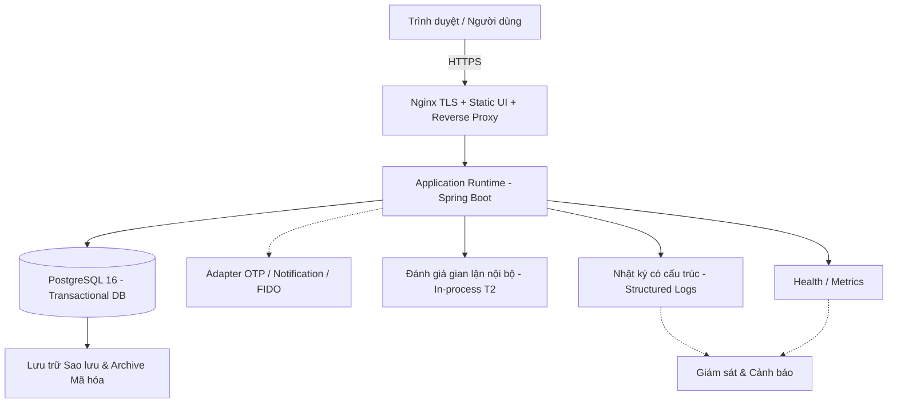

# 08. Hạ tầng Triển khai và Vận hành (`Deployment Infrastructure`)

> **Dự án:** Digital Banking MVP
> **Mã tài liệu:** `DEPLOY-08`
> **Phiên bản:** 1.0
> **Ngày:** 18/11/2026
> **Trạng thái:** Hoàn thành
> **Owner:** System Architect / DevOps
> **Reviewer:** Backend Lead, Security, QA

## 1. Mục đích và phạm vi

### 1.1. Mục đích

Tài liệu này đặc tả cách Digital Banking MVP được chuẩn bị, triển khai, kiểm tra và vận hành ở mức môi trường `local`, `test` và `demo`. Tài liệu trả lời các câu hỏi:

- Hệ thống chạy trong những môi trường nào?
- Các năng lực nghiệp vụ được ánh xạ vào kiến trúc triển khai (topology) nào?
- Cấu hình và bí mật (`secrets`) được quản lý ra sao?
- Quy trình phát hành (`release`), di trú cơ sở dữ liệu (`migration`) và quay lui (`rollback`) được kiểm soát thế nào?
- Sao lưu (`backup`), phục hồi (`restore`) và khôi phục thảm họa (`disaster recovery`) được kiểm chứng thế nào?
- Làm sao giám sát sức khỏe hệ thống (`observability`)?
- Khi thành phần phụ thuộc gặp sự cố, vận hành viên xử lý theo quy trình (`runbook`) nào?
- Chi phí và giới hạn mở rộng (`scale`) được đánh giá ra sao?

### 1.2. Trong phạm vi

- Môi trường phát triển cục bộ (`local`) và môi trường trình diễn (`demo`).
- Môi trường kiểm thử (`test`) dùng cho kiểm thử tích hợp, đồng thời (`concurrency`) và tiêm lỗi (`failure injection`).
- Kiến trúc triển khai logic theo `06. System architecture.md`.
- Compute, cơ sở dữ liệu, ranh giới mạng, lưu trữ, ranh giới bảo mật và hợp đồng quan sát hệ thống (`observability contract`).
- Quản lý cấu hình, xử lý bí mật, migration, sao lưu/phục hồi, phát hành/quay lui.
- Kiểm tra sức khỏe (`health check`), nhật ký (`logs`), chỉ số (`metrics`), cảnh báo (`alerts`), quy trình xử lý sự cố (`runbooks`) và gói bằng chứng (`evidence`).
- Ma trận truy vết tới `BR`/`FR`/`NFR`/`TC`/`OC`/`AD`.

### 1.3. Ngoài phạm vi

- Cứng hóa hạ tầng thương mại cấp độ Production hoàn chỉnh.
- Chứng nhận tuân thủ PCI-DSS, ISO 27001, chứng chỉ pháp lý hoặc kiểm toán độc lập bên ngoài.
- Kết nối Core Banking thật, cổng thanh toán, quyết toán liên ngân hàng hoặc giao dịch tiền thật.
- Mã nguồn hạ tầng (`IaC`) đặc thù theo nhà cung cấp đám mây thương mại ngoài phạm vi Docker Compose chuẩn.
- Liên kết định danh doanh nghiệp (`SSO federation`), tích hợp phần cứng HSM/KMS thương mại, Kubernetes và khôi phục thảm họa đa vùng (`multi-region DR`).

## 2. Nguồn tham chiếu chuẩn (`Source of Truth`)

### 2.1. Tài liệu nguồn

| Nguồn | Vai trò |
|---|---|
| [[digitalbanking-docs/docs-common/02. BRD.md]] | Ràng buộc nghiệp vụ, tiêu chí thành công và quy trình nghiệp vụ |
| [[digitalbanking-docs/docs-common/03. SRS.md]] | `FR`, `NFR`, `TC`, `RC`, `IC`, `OC`, `AC` và các kịch bản trình diễn `D1`–`D5` |
| [[digitalbanking-docs/docs-common/04. Database design & analysis.md]] | Toàn vẹn dữ liệu, chính sách migration, lưu trữ (`retention`) và ràng buộc sao lưu |
| [[digitalbanking-docs/docs-common/05. Technical stack.md]] | Nền tảng công nghệ, công cụ build, đóng gói container, CI/CD và định hướng quan sát |
| [[digitalbanking-docs/docs-common/06. System architecture.md]] | Kiến trúc triển khai, môi trường, bảo mật, tích hợp, quan sát và kịch bản chất lượng |
| [[digitalbanking-docs/docs-common/07. API contracts.md]] | Hợp đồng API, endpoint health, định dạng lỗi, kiểm tra OpenAPI và cổng kiểm soát hợp đồng |
| [[digitalbanking-docs/docs-common/design/01. audit-traceability.md]] | Thiết kế kiểm toán (`audit`), toàn vẹn chuỗi băm, lưu trữ, bằng chứng và runbook kiểm toán |
| [[digitalbanking-docs/docs-common/design/02. consistency-concurrency.md]] | Ranh giới giao dịch, phục hồi, thứ tự khóa, đối soát và runbook vận hành |
| [[digitalbanking-docs/docs-common/design/03. fraud-detection-rules.md]] | Quy tắc phát hiện gian lận, ngưỡng đánh giá trong `T2` và cơ chế cô lập lỗi (`fail-open`) |
| [[digitalbanking-docs/docs-common/design/04. security.md]] | Kiến trúc bảo mật, quản lý phiên, mã hóa, phân quyền tối thiểu và kiểm soát bí mật |
| [[digitalbanking-docs/docs-common/design/05. Modules contract.md]] | Hợp đồng giao tiếp nội bộ giữa các module backend |
| [[digitalbanking-docs/openapi/digital-banking-v1.yaml]] | Hợp đồng API dạng máy đọc (`OpenAPI 3.0.3`) |

### 2.2. Quy ước phân loại trạng thái trong tài liệu

- **Đã chốt (`Confirmed`)**: Quy tắc thiết kế và cấu hình chuẩn đã thống nhất trong bộ tài liệu nguồn.
- **Mục tiêu NFR (`Target NFR`)**: Ngưỡng mục tiêu phi chức năng (hiệu năng, độ sẵn sàng, RTO/RPO) dùng làm tiêu chí đo kiểm trong môi trường kiểm thử/demo.
- **Ngoài phạm vi MVP (`Out of scope`)**: Hạng mục thuộc giai đoạn mở rộng lên môi trường Production thương mại.

## 3. Mô hình triển khai và kiến trúc (`Deployment Model & Topology`)

### 3.1. Ánh xạ năng lực hệ thống vào hạ tầng (`Capability-to-Infrastructure Mapping`)

| Năng lực (`Capability`) | Thành phần logic | Mục đích | Nguồn tham chiếu |
|---|---|---|---|
| Compute | Application runtime (Spring Boot) | Thực thi logic nghiệp vụ, xác thực, tài khoản, chuyển tiền, kiểm toán, gian lận và điều phối thông báo | `05` §3.1, `06` §5 |
| Database | Cơ sở dữ liệu quan hệ giao dịch (PostgreSQL 16) | Nguồn sự thật (`System of Record`) cho tài khoản, chuyển tiền, sổ cái, idempotency, kiểm toán và dữ liệu rủi ro | `04` §1, `06` §8 |
| Network | Cổng HTTPS ingress, Nginx reverse proxy và mạng nội bộ riêng | Bảo vệ ranh giới mạng, định tuyến yêu cầu và cô lập cơ sở dữ liệu khỏi truy cập công khai | `05` §3.1, `06` §9–§11 |
| Storage | Volume cơ sở dữ liệu, lưu trữ sao lưu và lưu trữ归档 (`archive`) | Lưu trữ trạng thái bền vững, bản sao lưu, lưu giữ theo chính sách (`retention`) và giữ pháp lý (`legal hold`) | `04` §9, `06` §8.8 |
| Security | TLS, ranh giới bí mật, RBAC, đặc quyền tối thiểu và kiểm toán | Bảo vệ quyền truy cập, dữ liệu nhạy cảm và các thao tác quản trị | `03` NFR-013–NFR-020, `06` §9, `design/04` |
| Observability | Health check, structured logs, metrics, alerts và runbooks | Phát hiện sớm sự cố, đo lường SLO và hỗ trợ quy trình phục hồi | `06` §12, `design/01` §12, `design/02` §13 |

Các dịch vụ biên như CDN, WAF và bộ cân bằng tải ngoài (`External Load Balancer`) là thành phần mở rộng tùy chọn trong tương lai, không bắt buộc trong kiến trúc chuẩn của MVP.

### 3.2. Kiến trúc triển khai logic (`Logical Topology`)



**Trạng thái kiến trúc:** Nginx, tiến trình ứng dụng Spring Boot, cơ sở dữ liệu giao dịch PostgreSQL 16, các bộ điều hợp (`adapters`) và hệ thống giám sát là kiến trúc chuẩn đã chốt từ `05` §3.1 và `06` §11.1.

### 3.3. Quy tắc ranh giới mạng (`Network Boundary Rules`)

1. Toàn bộ lưu lượng người dùng đi vào hệ thống qua ranh giới HTTPS (TLS 1.2/1.3).
2. Tiến trình ứng dụng (`Application runtime`) là thành phần duy nhất được phép truy cập trực tiếp dữ liệu nghiệp vụ trong PostgreSQL.
3. Cơ sở dữ liệu nằm trong mạng nội bộ riêng, không mở cổng công khai ra bên ngoài.
4. Các bộ điều hợp bên ngoài (`OTP/notification/FIDO adapters`) được gọi qua giao diện cổng (`ports & adapters`); lỗi từ bộ điều hợp phải ánh xạ về hành vi xử lý lỗi xác định.
5. Các endpoint quan sát chỉ công khai thông tin sức khỏe tổng quát đã được phê duyệt (`/api/v1/health`); chỉ số chi tiết (`metrics`) và dữ liệu vận hành yêu cầu kiểm soát truy cập bảo vệ.
6. Mọi thao tác quản trị và kiểm toán đều bắt buộc kiểm tra vai trò/quyền hạn (`RBAC`) và ghi nhật ký kiểm toán bất biến.

### 3.4. Mô hình hoạch định năng lực (`Capacity Planning Model`)

`03. SRS.md` xác định mục tiêu tải công việc chuẩn cho MVP. Việc quy đổi sang kích thước CPU, bộ nhớ, số lượng instance và kích thước vùng kết nối (`connection pool`) tuân theo mô hình đo kiểm dưới đây:

| Chiều đo (`Dimension`) | Giá trị chuẩn (`Baseline`) | Phân loại | Bằng chứng kiểm chứng yêu cầu |
|---|---:|---|---|
| Tải duy trì (`Sustained workload`) | `20 RPS × 10 phút` | Mục tiêu NFR (`NFR-004`) | Báo cáo kiểm thử tải `D5` |
| Độ trễ chuyển tiền `p95` | `≤ 2 giây` | Mục tiêu NFR (`NFR-001`) | Báo cáo độ trễ `D5` |
| Độ trễ chuyển tiền `p99` | `≤ 5 giây` | Mục tiêu NFR (`NFR-001`) | Báo cáo độ trễ `D5` |
| Tỷ lệ lỗi ngoài dự kiến (`Error rate`) | `< 1%` | Mục tiêu NFR (`NFR-004`) | Báo cáo lỗi `D5` |
| RPS trung bình | Số yêu cầu mỗi ngày ÷ `86,400` | Công thức hoạch định | Đầu vào khối lượng giao dịch |
| RPS đỉnh (`Peak RPS`) | RPS trung bình × hệ số đỉnh | Công thức hoạch định | Giả định hệ số giờ cao điểm |
| Độ đồng thời xấp xỉ (`Concurrency`) | `RPS × độ trễ trung bình (giây)` | Ước lượng theo luật Little | Hồ sơ tải và dữ liệu độ trễ thực tế |
| Vùng kết nối DB (`HikariCP maximum-pool-size`) | `20` kết nối (mặc định) | Cấu hình chuẩn (`design/02` §11.8) | Số liệu thời gian chờ pool (`db_pool_waiting`) |
| Tăng trưởng lưu trữ (`Storage growth`) | Theo khối lượng giao dịch, audit và chu kỳ retention 5 năm | Mô hình lưu trữ | Ước lượng dung lượng bảng và archive |

Đánh giá năng lực phải ghi nhận độ phức tạp yêu cầu, số lệnh gọi cơ sở dữ liệu, số lệnh gọi adapter ngoài, mục tiêu độ trễ, mức sử dụng CPU/bộ nhớ, thời gian chờ connection pool và tốc độ tăng trưởng lưu trữ.

**Ngưỡng kích hoạt mở rộng (`Scale Trigger` từ `06. System architecture` §11.6):** Khi độ trễ tăng vượt ngưỡng mục tiêu hoặc tải duy trì vượt `20 RPS`, đội ngũ kỹ thuật thực hiện rà soát mở rộng backend, tối ưu connection pool, rà soát chỉ mục (`index`) và đánh giá chi phí.

### 3.5. Trách nhiệm thực thi đã chốt trong luồng giao dịch (`Confirmed Runtime Responsibilities`)

- Đánh giá gian lận (`Fraud evaluation`) chạy nội bộ trong tiến trình (`in-process`), đồng bộ trong giao dịch `T2` sau khi khóa tài khoản/hạn mức và trước khi ghi bút toán sổ cái (`06` AD-11, §7.6; `03` §2.13.5; `design/03`).
- Lỗi kỹ thuật của bộ máy gian lận tuân theo chính sách **cô lập lỗi (`fail-open`)** qua JDBC savepoint: khôi phục về savepoint, ghi nhận metric/log `ENGINE_ERROR` và tiếp tục luồng chuyển tiền chính (`06` §7.6; `03` §2.13.5; `IC-003`/`NFR-008`; `design/03` §8).
- Khi quy tắc gian lận khớp theo cấu hình mặc định: tạo bản ghi `fraud_flag` (`OPEN`) + sự kiện kiểm toán `FRAUD_FLAG_CREATED` (`C2`) trong cùng giao dịch `T2` và cho phép giao dịch tiếp tục; nếu quy tắc được cấu hình chặn tự động (`BLOCK`), giao dịch kết thúc ở trạng thái `FAILED` (`failureCode = 'FRAUD_BLOCKED'`) mà không sinh bút toán sổ cái (`03` §2.13.5; `design/03`).
- Lỗi ghi kiểm toán bắt buộc (`C1`/`C2`) luôn tuân theo chính sách **dừng an toàn (`fail-closed`)**, hoàn tác toàn bộ giao dịch `T2`.

## 4. Các môi trường triển khai (`Environments`)

| Môi trường | Mục đích | Dữ liệu sử dụng | Hành vi yêu cầu | Khác biệt cấu hình | Trạng thái |
|---|---|---|---|---|---|
| `local` | Phát triển phần mềm và kiểm tra luồng chức năng cục bộ | Chỉ dùng dữ liệu giả lập (`synthetic seed`) | Khởi động nhanh, hiển thị chẩn đoán phát triển rõ ràng, không dùng bí mật thật | Sử dụng bộ điều hợp mô phỏng (`simulator adapters`); thông tin xác thực chỉ dành cho môi trường cục bộ | Đã chốt |
| `test` | Chạy kiểm thử tự động: unit, slice, integration, contract, concurrency và tiêm lỗi | Dữ liệu giả lập tất định (`deterministic synthetic data`) | Cơ sở dữ liệu cô lập (Testcontainers PostgreSQL 16), thiết lập và dọn dẹp lặp lại được | Cơ sở dữ liệu dùng một lần; đồng hồ/test double tất định; bật cơ chế tiêm lỗi (`failure injection`) | Đã chốt |
| `demo` | Trình diễn nghiệm thu (`D1`–`D5`) và thu thập bằng chứng | Tài khoản và giao dịch demo giả lập | Triển khai tái lập được qua Docker Compose, có health check, logs, audit và thu thập bằng chứng | Giữ trạng thái bền vững qua volume; bật giám sát có kiểm soát; sao lưu trước khi chạy kịch bản phá hủy | Đã chốt |
| `production` | Môi trường vận hành thương mại tương lai | Không thuộc phạm vi MVP | Yêu cầu cứng hóa bảo mật, dịch vụ quản lý, KMS/HSM, HA và DR chính thức | Bí mật do nhà cung cấp quản lý, log tập trung, HA và PITR nằm ngoài phạm vi MVP | Ngoài phạm vi MVP |

### 4.1. Cô lập môi trường (`Environment Isolation`)

- Tuyệt đối không sử dụng dữ liệu khách hàng thật, dữ liệu tài chính thật hoặc thông tin xác thực thật trong các môi trường `local`, `test` hoặc `demo` (`NFR-032`, `TC-010`, `RC-005`).
- Các bí mật đặc thù theo môi trường không được sao chép vào tài liệu, kho mã nguồn (`Git`) hoặc gói bằng chứng kiểm thử.
- Dữ liệu kiểm thử phải có tính tất định và có thể khởi tạo lại sạch sẽ.
- Bản sao lưu môi trường `demo` phải được tạo trước khi thực hiện các kịch bản chuẩn bị dữ liệu hoặc tiêm lỗi có tính chất thay đổi trạng thái.
- Kết quả kiểm thử chỉ hợp lệ khi ghi nhận đầy đủ môi trường, phiên bản mã nguồn, giả định cấu hình và đường dẫn lưu trữ bằng chứng.

## 5. Thành phần thời gian chạy và hợp đồng cấu hình (`Runtime Components & Configuration Contract`)

### 5.1. Danh mục thành phần logic (`Logical Component Inventory`)

| Thành phần | Trách nhiệm | Trạng thái bền vững | Hành vi khi gặp lỗi | Nguồn tham chiếu |
|---|---|---|---|---|
| Application runtime | Cung cấp REST API, thực thi quy tắc nghiệp vụ, điều phối giao dịch `T0`–`T3`, xác thực/phiên và tích hợp các module | Không lưu trạng thái nghiệp vụ cục bộ trong bộ nhớ tiến trình | Trả về mã lỗi chuẩn theo hợp đồng; tuyệt đối không báo thành công giả (`false success`) | `05` §3, `06` §5/§7 |
| PostgreSQL 16 | Lưu trữ tài khoản, số dư, chuyển tiền, sổ cái, idempotency, kiểm toán, gian lận và trạng thái thông báo | Có (Volume bền vững) | Ứng dụng trả về `503 SERVICE_UNAVAILABLE` (fail-closed); thử lại/đối soát theo chính sách idempotency | `04`, `06` §8/§10 |
| Reverse proxy / TLS boundary (Nginx) | Kết thúc kết nối HTTPS (TLS termination), phục vụ tệp tĩnh frontend và định tuyến API | Không | Ngừng định tuyến lưu lượng tới tiến trình ứng dụng không khỏe (`DOWN`) | `06` §11 |
| Adapter OTP / Notification | Giao tiếp bên ngoài được mô phỏng hoặc thay thế qua cổng giao tiếp | Tùy thuộc adapter | Lỗi gửi OTP chặn bước xác thực (`503 OTP_DISPATCH_FAILED`); lỗi gửi thông báo sau commit không đảo ngược giao dịch tiền đã hoàn tất | `06` §10.1–§10.3, `design/04` §4.4 |
| Bộ đánh giá gian lận nội bộ (`In-process Fraud`) | Đánh giá các quy tắc cấu hình trong giao dịch `T2` trước khi ghi sổ cái | Cờ gian lận (`fraud_flag`) được lưu bền vững cùng kết quả giao dịch | Lỗi kỹ thuật của engine được cô lập qua savepoint (`fail-open`); quy tắc cấu hình `BLOCK` chuyển giao dịch sang `FAILED` | `06` AD-11/§7.6, `design/03` |
| Lưu trữ sao lưu &归档 (`Backup/Archive Storage`) | Lưu bản sao lưu, lưu giữ dài hạn, giữ pháp lý và làm nguồn phục hồi | Có | Phát cảnh báo và nâng mức xử lý khi sao lưu thất bại hoặc quá hạn | `04` §9, `06` §11.5 |
| Hệ thống giám sát & cảnh báo (`Monitoring/Alerting`) | Thu thập trạng thái sức khỏe, chỉ số, nhật ký và tín hiệu vận hành | Lưu giữ bằng chứng theo chính sách | Phát cảnh báo kịp thời mà không làm lộ dữ liệu nhạy cảm/PII | `06` §12, `design/01`, `design/02` |

### 5.2. Nguyên tắc quản lý cấu hình (`Configuration Principles`)

- Tách biệt hoàn toàn cấu hình môi trường và bí mật ra khỏi image/artifact đóng gói.
- Chỉ sử dụng cấu hình theo môi trường để điều chỉnh kết nối hạ tầng, tuyệt đối không dùng cấu hình để bỏ qua các bất biến nghiệp vụ.
- Máy chủ (`Server`) nắm quyền kiểm soát toàn bộ hạn mức chuyển tiền, chính sách OTP, ngưỡng gian lận và chính sách lưu giữ dữ liệu.
- Dữ liệu đầu vào từ phía trình duyệt/client không bao giờ ghi đè được chính sách bảo mật hoặc hạn mức tiền tệ phía máy chủ.
- Mọi thay đổi cấu hình ảnh hưởng đến tiền tệ, phân quyền, lưu giữ dữ liệu hoặc quy tắc gian lận đều yêu cầu phê duyệt, ghi nhận kiểm toán và phát hành có kiểm soát.
- Cố định phiên bản (`pin versions`) cho thư viện phụ thuộc và container image; không sử dụng nhãn động `latest` cho các artifact phát hành (`05` §8.2).

### 5.3. Phân loại cấu hình (`Configuration Categories`)

| Nhóm cấu hình | Ví dụ tham số | Cơ chế bảo vệ |
|---|---|---|
| Kết nối cơ sở dữ liệu | URL, `banking_app` / `banking_migrator`, mật khẩu, kích thước pool và timeout | Lưu trong biến môi trường/secret store; phân tách tài khoản đặc quyền tối thiểu |
| Xác thực & Phiên | Session idle/absolute TTL (`15m`/`8h`), cookie `DB_SESSION`, OTP TTL (`5m`), giới hạn lần thử (`5 lần`), khóa tạm thời (`10m`) | Cấu hình bảo mật tập trung (`app.security.*`); kiểm toán mọi thay đổi |
| Chính sách chuyển tiền | Tiền tệ (`VND`), miền giá trị số tiền, hạn mức giao dịch/ngày, ngưỡng Step-up (`10,000,000 VND` / `20,000,000 VND`) | Quản lý phía máy chủ; đánh phiên bản (`versioned`); truy vết tới `BR`/`FR` |
| Chính sách gian lận | Ngưỡng giao dịch lớn (`10,000,000 VND`), cửa sổ tần suất cao (`> 5` intent / `600s`), phiên bản quy tắc | Đánh phiên bản trong `banking.fraud_rule_config`; kiểm toán thay đổi |
| Thời gian chạy (`Runtime`) | Địa chỉ lắng nghe, cổng dịch vụ, profile môi trường đang kích hoạt | Cấu hình môi trường khởi chạy |
| Quan sát hệ thống (`Observability`) | Mức ghi log, endpoint chỉ số, ngưỡng cảnh báo | Cấu hình vận hành được bảo vệ |
| Sao lưu & Lưu giữ (`Backup/Retention`) | Lịch sao lưu, số ngày lưu giữ (mặc định 5 năm cho dữ liệu tài chính/audit),归档 và giữ pháp lý | Cấu hình vận hành viên có kiểm soát phê duyệt |

## 6. Quản lý bí mật và cấu hình bảo mật (`Secrets & Security Configuration`)

### 6.1. Quy tắc bảo vệ bí mật (`Secret Rules`)

1. Tuyệt đối không đưa mật khẩu, khóa mã hóa (`APP_PII_AES_KEY_BASE64`, `APP_HMAC_KEY_BASE64`), giá trị OTP, session token hoặc thông tin xác thực nhà cung cấp vào kho mã nguồn Git.
2. Trong các tệp cấu hình mẫu (`.env.example`, `application.yml`), chỉ cung cấp tên biến không nhạy cảm và giá trị giữ chỗ (`placeholder`) an toàn.
3. Dừng khởi động ứng dụng ngay lập tức (`Fail-Fast`) khi thiếu các khóa bảo mật bắt buộc hoặc khóa không đúng độ dài chuẩn (`32 bytes` cho AES-256/HMAC).
4. Không bao giờ in giá trị bí mật trong nhật ký ứng dụng, phản hồi lỗi HTTP, báo cáo kiểm thử hoặc ảnh chụp màn hình.
5. Thực hiện xoay vòng bí mật (`secret rotation`) thông qua quy trình thay đổi cấu hình có kiểm soát; ghi nhận phiên bản khóa (`key_id`) và môi trường bị ảnh hưởng.
6. Sử dụng thông tin xác thực và khóa mật mã riêng biệt cho từng môi trường `local`, `test` và `demo`.
7. Giới hạn quyền của tài khoản cơ sở dữ liệu theo nguyên tắc đặc quyền tối thiểu (`design/04` §6.5): ứng dụng chạy bằng role `banking_app` (chỉ có quyền `SELECT, INSERT` trên `ledger_entry` và `audit_log`), chỉ Flyway mới dùng role `banking_migrator`.

### 6.2. Các kiểm soát bảo mật tích hợp theo `design/04. security.md`

Kiến trúc triển khai thực thi đầy đủ các kiểm soát bảo mật đã chốt tại [[digitalbanking-docs/docs-common/design/04. security.md]]:

- **Mô hình mối đe dọa & Ranh giới tin cậy (`STRIDE & Trust Boundaries`):** 4 vùng tin cậy tách biệt từ trình duyệt → Nginx DMZ → Spring Boot Runtime → PostgreSQL 16 & Backup.
- **Cứng hóa xác thực & phiên (`Authentication & Session Hardening`):** Mật khẩu và OTP băm bằng `Argon2id`; phiên máy chủ (`Opaque Server-Side Session`) truyền qua cookie `DB_SESSION` (`HttpOnly; Secure; SameSite=Strict; Path=/; Max-Age=28800`) kết hợp header `X-CSRF-Token`.
- **Mã hóa dữ liệu nhạy cảm (`Encryption at Rest`):** Mã hóa cấp cột `AES-256-GCM` kết hợp chỉ mục mù `HMAC-SHA256` cho số tài khoản, CCCD và thông tin liên hệ nhạy cảm; che dấu PII (`**** **** 1234`) trên mọi giao diện/log.
- **Chống lạm dụng API (`Rate Limiting`):** Giới hạn tần suất theo IP, Username và User/Customer tại Nginx và tầng Filter ứng dụng (`429 RATE_LIMITED` kèm `Retry-After`).
- **Phân loại và ứng phó sự cố bảo mật (`SEV-1` đến `SEV-3`):** Quy trình đóng băng luồng, thu hồi phiên và bảo toàn bằng chứng kiểm toán khi phát hiện bất thường.

## 7. Quy trình Build, Phát hành và Quay lui (`Build, Release & Rollback`)

### 7.1. Luồng phát hành (`Release Flow`)

```text
Đề xuất thay đổi (Change proposed)
  → Rà soát tài liệu / API / thiết kế
  → Kiểm tra hợp lệ OpenAPI (OpenAPI validation)
  → Chạy kiểm thử đơn vị và tích hợp (Unit & integration tests)
  → Kiểm tra đồng thời, tiêm lỗi và bảo mật (Concurrency / failure / security checks)
  → Đóng gói artifact bất biến (Package artifact)
  → Kiểm tra container image và cấu hình triển khai
  → Triển khai lên môi trường demo (Demo deployment)
  → Kiểm tra sức khỏe hệ thống (Health check)
  → Thu thập gói bằng chứng (Evidence capture)
  → Rà soát nghiệm thu (Acceptance review)
```

### 7.2. Các cổng kiểm soát phát hành (`Release Gates`)

| Cổng kiểm soát (`Gate`) | Bằng chứng bắt buộc | Hành động khi thất bại |
|---|---|---|
| Truy vết yêu cầu (`Requirement traceability`) | Bảng ánh xạ `BR`/`FR`/`NFR`/`AC` đầy đủ | Trả lại bước rà soát tài liệu |
| Hợp đồng API (`API contract`) | Kết quả kiểm tra OpenAPI và bộ kiểm thử hợp đồng (`CT-API-*`) | Dừng phát hành; cập nhật hợp đồng nguồn trước |
| Di trú cơ sở dữ liệu (`Database migration`) | Chạy migration sạch trên DB trống; rà soát tính tương thích nâng cấp | Dừng phát hành; tuyệt đối không sửa migration đã áp dụng |
| Kiểm thử tự động (`Automated test`) | Báo cáo unit test, integration test và các luồng trọng yếu | Dừng phát hành nếu bất kỳ bài kiểm thử `Must` nào thất bại |
| Bảo mật (`Security`) | Danh mục kiểm tra bảo mật (`AC-030`) và kết quả quét secret/dependency | Dừng phát hành nếu còn lỗ hổng mức Nghiêm trọng (`Critical`) chưa xử lý |
| Đóng gói (`Container/package`) | Artifact tái lập được kèm định danh phiên bản cố định | Đóng gói lại; không triển khai artifact có thể bị thay đổi (`mutable`) |
| Kiểm thử khói sau triển khai (`Deployment smoke test`) | Trạng thái `/api/v1/health` `UP`, khả năng kết nối API và luồng nghiệp vụ cơ bản | Quay lui về artifact ứng dụng ổn định trước đó |
| Gói bằng chứng (`Evidence package`) | Lệnh thực thi, môi trường, kết quả kỳ vọng, kết quả thực tế và dấu thời gian | Đánh dấu đợt nghiệm thu chưa hoàn tất |

### 7.3. Chính sách quay lui (`Rollback Policy`)

- Quay lui ứng dụng (`Application rollback`) sử dụng lại artifact bất biến đã được nghiệm thu trước đó.
- Không thực hiện quay lui cơ sở dữ liệu bằng cách chỉnh sửa hoặc xóa các tệp migration đã được áp dụng.
- Nếu tính tương thích của cấu trúc bảng hoặc dữ liệu bị ảnh hưởng, dừng nhận lưu lượng hoặc chuyển hệ thống sang trạng thái bảo trì có kiểm soát, bảo toàn bằng chứng và khôi phục từ bản sao lưu đã được phê duyệt khi cần thiết.
- Sau khi quay lui, bắt buộc chạy lại kiểm tra sức khỏe (`health check`), tương thích lược đồ (`schema compatibility`), hợp đồng API và các truy vấn kiểm tra bất biến tài chính.
- Phía client chỉ thử lại các yêu cầu chưa rõ kết quả bằng đúng khóa `Idempotency-Key` ban đầu.
- Tuyệt đối không bao giờ đánh dấu thủ công một giao dịch chuyển tiền sang `COMPLETED` nếu thiếu bút toán sổ cái cân bằng và bản ghi kiểm toán hợp lệ.

### 7.4. Hồ sơ bằng chứng phát hành (`Release Evidence`)

Mỗi gói phát hành lên môi trường `demo` phải bao gồm:

- Mã định danh phiên bản mã nguồn (`Git commit SHA` / `tag`).
- Phiên bản cấu hình đã lược bỏ toàn bộ giá trị bí mật.
- Phiên bản migration Flyway hiện hành.
- Kết quả kiểm tra hợp lệ OpenAPI (`digital-banking-v1.yaml`).
- Báo cáo kết quả kiểm thử và danh sách các giới hạn đã biết.
- Kết quả kiểm tra endpoint `/api/v1/health` sau triển khai.
- Dấu thời gian của bản sao lưu và trạng thái kiểm chứng phục hồi (`restore verification`).
- Quyết định và kết quả quay lui (nếu có phát sinh quay lui).

## 8. Di trú Cơ sở dữ liệu, Sao lưu và Khôi phục Thảm họa (`Migration, Backup & DR`)

### 8.1. Chính sách di trú lược đồ (`Migration Policy`)

- Lược đồ cơ sở dữ liệu (`Database schema`) được quản lý hoàn toàn bằng các tệp migration tiến về phía trước có đánh phiên bản (`versioned forward-only migrations`) qua Flyway.
- JPA/Hibernate chỉ được cấu hình ở chế độ kiểm tra lược đồ (`ddl-auto: validate`); tuyệt đối không tự động tạo hoặc sửa đổi bảng nghiệp vụ lúc chạy.
- Không bao giờ chỉnh sửa một tệp migration đã được áp dụng. Mọi thay đổi lược đồ phải được bổ sung bằng một tệp migration mới.
- Các thay đổi migration yêu cầu rà soát thiết kế cơ sở dữ liệu (`04`), rà soát hợp đồng API bị ảnh hưởng (`07`) và cập nhật kế hoạch kiểm thử (`09`).
- Bằng chứng migration phải bao gồm kiểm chứng cài đặt mới trên cơ sở dữ liệu trống và kiểm chứng nâng cấp từ phiên bản trước đó.
- Lỗi migration sẽ chặn ngay quá trình khởi động và phát hành ứng dụng; không bao giờ mở lưu lượng nghiệp vụ trên một cơ sở dữ liệu mới di trú một phần.

### 8.2. Quy ước thứ tự di trú (`Migration Ordering Convention`)

Các phiên bản migration chạy theo thứ tự tăng dần nghiêm ngặt:

1. Tạo không gian tên lược đồ (`schema banking`) và bảng siêu dữ liệu migration.
2. Tạo các bảng tham chiếu độc lập và các bảng định danh/phân quyền (`app_user`, `role`, `permission`, `device`, `session`, `auth_challenge`).
3. Tạo bảng khách hàng (`customer`) và bảng tài khoản (`account`).
4. Tạo bảng giao dịch chuyển tiền (`transfer`), bút toán sổ cái (`ledger_entry`) và bảng chống trùng (`idempotency_record`).
5. Tạo các bảng cấu hình hạn mức (`limit_config`), sử dụng hạn mức (`limit_usage`), yêu cầu phê duyệt (`approval_request`) và gian lận (`fraud_rule_config`, `fraud_flag`).
6. Tạo các bảng nhật ký kiểm toán (`audit_log`, `audit_chain_checkpoint`), thông báo (`notification`), chính sách lưu giữ (`retention_policy`) và giữ pháp lý (`legal_hold`).
7. Bổ sung khóa ngoại (`foreign keys`) và các ràng buộc toàn vẹn liên miền sau khi các bảng đích đã tồn tại.
8. Bổ sung các trigger bảo vệ tính bất biến (`append-only` trên `ledger_entry`, `audit_log` và trạng thái kết thúc của `transfer`) cùng phân quyền role `banking_app` / `banking_migrator`.
9. Tạo các chỉ mục (`indexes`) phục vụ truy vấn và ràng buộc duy nhất có điều kiện (`partial unique indexes`).
10. Nạp dữ liệu mầm giả lập (`synthetic seed data`) chỉ sau khi toàn bộ lược đồ và ràng buộc đã hợp lệ.
11. Thực hiện các tác vụ điền dữ liệu bổ sung (`backfills`) dưới dạng các migration riêng biệt, có thể chạy lại an toàn và có bằng chứng kiểm chứng rõ ràng.

### 8.3. Yêu cầu bảo vệ dữ liệu (`Data Protection Requirements`)

Cơ sở dữ liệu phải bảo vệ nghiêm ngặt:

- Các bất biến về tài khoản và số dư (`available_balance >= 0`, `ledger_balance >= 0`, `available_balance <= ledger_balance`).
- Máy trạng thái chuyển tiền (`PENDING → COMPLETED/FAILED`) và tính bất biến của trạng thái kết thúc.
- Sự cân bằng của bút toán sổ cái kép (`Double-entry ledger balance`: tổng `DEBIT` bằng tổng `CREDIT` trên mỗi giao dịch hoàn tất).
- Bản ghi phát lại chống trùng (`Idempotency replay records`).
- Bản ghi kiểm toán chỉ thêm (`Append-only audit records`) và bằng chứng chuỗi băm (`hash-chain`).
- Các quy tắc lưu giữ (`retention`),归档 (`archival`) và giữ pháp lý (`legal hold`).

Chi tiết quy tắc dữ liệu được quy định tại [[digitalbanking-docs/docs-common/04. Database design & analysis.md]], [[digitalbanking-docs/docs-common/design/01. audit-traceability.md]] và [[digitalbanking-docs/docs-common/design/02. consistency-concurrency.md]].

### 8.4. Chính sách sao lưu (`Backup Policy`)

| Hạng mục sao lưu | Tần suất / Sự kiện kích hoạt | Thủ tục tối thiểu | Chính sách lưu giữ | Bằng chứng nghiệm thu |
|---|---|---|---|---|
| Cơ sở dữ liệu giao dịch (`PostgreSQL`) | Trước mỗi buổi demo, mỗi đợt migration và định kỳ hằng ngày | Tạo bản sao lưu logic (`pg_dump`) được mã hóa lưu bên ngoài volume chạy DB | Lưu giữ tối thiểu qua kỳ nghiệm thu | Siêu dữ liệu tệp sao lưu và mã kiểm tra `SHA-256` |
| Sao lưu gia tăng / WAL | Theo chu kỳ cấu hình môi trường demo/test | Lưu trữ nhật ký giao dịch để đáp ứng mục tiêu `RPO ≤ 5 phút` (`NFR-007`) | Theo chu kỳ bản sao lưu đầy đủ | Báo cáo đo lường mức mất dữ liệu khi diễn tập phục hồi |
| Dữ liệu kiểm toán (`audit_log`) | Tuân theo chính sách lưu giữ và giữ pháp lý | Bảo toàn bản ghi, siêu dữ liệu chuỗi băm (`checkpoint`) và manifest archive | `5 năm` (`design/01` §10.1) | Kết quả kiểm định chuỗi băm (`chain verification`) |
| Lịch sử chuyển tiền / sổ cái / gian lận / hạn mức | Tuân theo chính sách lưu giữ | Archive trước khi thanh lọc (`purge`); chặn thanh lọc nếu đang có `legal_hold` hiệu lực | `5 năm` (`design/01` §10.1) | Bằng chứng archive và nhật ký kiểm toán `RETENTION_PURGED` |
| Thử thách xác thực (`auth_challenge`) | Chính sách thanh lọc định kỳ | Xóa sau khi vượt ngưỡng thời gian lưu giữ | `90 ngày` (`design/01` §10.1) | Bằng chứng chạy tác vụ lưu giữ |
| Phiên đăng nhập (`session`) | Chính sách thanh lọc sau khi hết hạn | Xóa sau khi vượt ngưỡng thời gian lưu giữ | `30 ngày` sau hết hạn | Bằng chứng chạy tác vụ lưu giữ |
| Thông báo (`notification`) | Chính sách thanh lọc định kỳ | Xóa sau khi vượt ngưỡng thời gian lưu giữ | `90 ngày` (`design/01` §10.1) | Bằng chứng chạy tác vụ lưu giữ |
| Bản ghi chống trùng (`idempotency_record`) | Chính sách thanh lọc sau khi giao dịch kết thúc | Chỉ xóa các bản ghi đã ở trạng thái kết thúc và quá hạn `expires_at` | Tối thiểu `24 giờ` từ thời điểm kết thúc (`completed_at`) | Bằng chứng phát lại và thanh lọc an toàn |
| Cấu hình hệ thống | Trước mỗi lần phát hành hoặc thay đổi cấu hình | Lưu trữ bản cấu hình đã che dấu bí mật kèm phiên bản | Lưu cùng gói bằng chứng phát hành | Xác nhận không chứa giá trị bí mật |
| Gói bằng chứng (`Evidence package`) | Mỗi đợt kiểm thử, demo hoặc diễn tập phục hồi | Bảo toàn báo cáo, nhật ký và tệp manifest | Lưu giữ xuyên suốt kỳ nghiệm thu dự án | Tệp manifest bằng chứng |
| Lưu trữ giữ pháp lý (`Legal hold`) | Khi có lệnh giữ pháp lý đang hiệu lực (`ACTIVE`) | Bảo toàn toàn bộ dữ liệu và phạm vi bị giữ | Cho đến khi lệnh giữ được gỡ bỏ hợp lệ (`RELEASED`) | Bằng chứng phạm vi giữ và phê duyệt Maker-Checker |

Bản sao lưu phải được lưu trữ tách biệt khỏi volume thời gian chạy của cơ sở dữ liệu, được bảo vệ khỏi truy cập trái phép và được kiểm chứng bằng cách phục hồi thực tế (`restore drill`). Một bản sao lưu chưa từng được thử nghiệm phục hồi sẽ không được chấp nhận làm bằng chứng khôi phục.

### 8.5. Mục tiêu phục hồi và trình tự khôi phục (`Recovery Objectives & Sequence`)

`NFR-007` xác định mục tiêu **RTO ≤ 30 phút** và **RPO ≤ 5 phút**.

Trình tự khôi phục bắt buộc khi xảy ra sự cố:

1. Phát hiện lỗi cơ sở dữ liệu hoặc tiến trình thời gian chạy qua hệ thống cảnh báo/health check.
2. Chuyển sang hành vi từ chối dịch vụ an toàn (`fail-closed`); tuyệt đối không trả về kết quả chuyển tiền thành công giả.
3. Bảo toàn nhật ký ứng dụng, `correlation_id`, bằng chứng kiểm toán và dấu thời gian xảy ra sự cố.
4. Khôi phục hoặc kết nối lại cơ sở dữ liệu theo thủ tục đã được phê duyệt.
5. Kiểm증 lược đồ (`schema`), các ràng buộc toàn vẹn, tính toàn vẹn của chuỗi băm kiểm toán (`audit chain`) và các bất biến tài chính.
6. Chỉ mở lại lưu lượng truy cập vào ứng dụng sau khi kiểm tra sức khỏe (`health check`) và kiểm thử khói (`smoke tests`) đạt yêu cầu.
7. Phía client thử lại các yêu cầu chưa rõ kết quả bằng đúng khóa `Idempotency-Key` ban đầu; tác vụ đối soát (`reconciliation job`) xử lý các giao dịch `PENDING`.
8. Ghi nhận chỉ số RTO/RPO thực tế đạt được vào biên bản sự cố.

### 8.6. Tiêu chí nghiệm thu diễn tập khôi phục thảm họa (`Disaster-Recovery Acceptance`)

Một bài diễn tập khôi phục (`DR exercise`) chỉ được đánh giá đạt khi:

- Quá trình khôi phục cơ sở dữ liệu hoàn tất trong mục tiêu `RTO ≤ 30 phút` (hoặc chênh lệch được ghi nhận và giải trình rõ).
- Mức mất mát dữ liệu không vượt quá mục tiêu `RPO ≤ 5 phút`.
- Không xuất hiện số dư âm, ghi nợ trùng lặp hoặc sổ cái mất cân bằng sau khôi phục.
- Chuỗi băm kiểm toán (`audit_log`) vẫn kiểm định hợp lệ 100%.
- Endpoint `/api/v1/health` phản ánh chính xác trạng thái `DOWN` khi sự cố và `UP` sau khi phục hồi hoàn tất.
- Hồ sơ bằng chứng khôi phục ghi nhận đầy đủ môi trường, thủ tục, dấu thời gian và kết quả kiểm tra thực tế.

## 9. Quan sát hệ thống và vận hành (`Observability & Operations`)

### 9.1. Hợp đồng kiểm tra sức khỏe (`Health Contract`)

Endpoint `/api/v1/health` công bố trạng thái sẵn sàng của ứng dụng và kết nối cơ sở dữ liệu một cách an toàn mà không tiết lộ bí mật hay dữ liệu nhạy cảm:

| Trạng thái | Hành vi kỳ vọng | Ý nghĩa vận hành |
|---|---|---|
| `UP` | Yêu cầu kiểm tra sức khỏe trả về `200 OK` | Ứng dụng và cơ sở dữ liệu sẵn sàng nhận lưu lượng |
| `DOWN` | Yêu cầu kiểm tra sức khỏe trả về trạng thái lỗi (`503`) | Ngừng định tuyến lưu lượng; kiểm tra cơ sở dữ liệu hoặc tiến trình ứng dụng |
| `Unknown` | Không nhận được phản hồi sức khỏe đáng tin cậy (timeout) | Coi như không sẵn sàng (`unavailable`) cho đến khi xác minh xong |

Trạng thái `UP` của health check không thay thế cho việc kiểm tra các bất biến nghiệp vụ; sau khi triển khai hoặc phục hồi vẫn bắt buộc chạy kiểm thử khói (`smoke tests`) và đối soát sổ cái.

### 9.2. Hợp đồng nhật ký có cấu trúc (`Structured Log Contract`)

Các trường tối thiểu bắt buộc trong mỗi bản ghi JSON log:

- `timestamp` (ISO 8601 UTC)
- `level` (`INFO`, `WARN`, `ERROR`)
- `service`
- `environment`
- `correlation_id`
- `request_id`
- `user_id` (hoặc định danh đã che dấu)
- `route` / `status`
- `action` / `outcome`
- `latency_ms`
- `error_code` (nếu có lỗi)
- `audit_id` (nếu có liên kết bản ghi kiểm toán)

Tuyệt đối không bao giờ ghi vào log:

- Mật khẩu, passcode, mã OTP, session token hoặc CSRF token.
- Bí mật hệ thống, khóa mã hóa (`AES`/`HMAC`) hoặc thông tin xác thực cơ sở dữ liệu.
- Số tài khoản đầy đủ, số CCCD đầy đủ, số điện thoại, địa chỉ email hoặc PII chưa che dấu.
- Toàn bộ nội dung yêu cầu chuyển tiền (`description`) hoặc trạng thái nhạy cảm trước/sau chưa qua bộ lọc allowlist.

| Loại dữ liệu quan sát | Chính sách lưu giữ / xoay vòng chuẩn | Nguồn tham chiếu |
|---|---|---|
| Nhật ký kỹ thuật ứng dụng (`Technical logs`) | Xoay vòng theo dung lượng/ngày (`size/time rotation`); lưu tối thiểu `30 ngày` | `06` §12.1 |
| Nhật ký sự kiện bảo mật (`Security event logs`) | Lưu giữ tối thiểu `1 năm` phục vụ điều tra an toàn thông tin | `design/04. security.md` §9 |
| Chỉ số vận hành (`Metrics`) | Lưu giữ đủ lịch sử phục vụ báo cáo tải `D5` và rà soát sự cố (`30–90 ngày`) | `06` §12.2 |
| Bản ghi kiểm toán (`Audit records`) | Lưu giữ `5 năm` kèm quy tắc archive và giữ pháp lý (`legal hold`) | `design/01. audit-traceability.md` §10.1 |
| Bằng chứng kiểm thử và phục hồi (`Evidence`) | Lưu giữ xuyên suốt quá trình nghiệm thu và lưu trữ dự án | `09. Test plan.md` §10 |

Việc lưu giữ nhật ký kỹ thuật không thay thế cho bảng kiểm toán nghiệp vụ `banking.audit_log`. Quá trình xoay vòng log không được làm lộ bí mật hoặc xóa mất bằng chứng kiểm toán.

### 9.3. Hợp đồng chỉ số (`Metrics Contract`)

| Nhóm chỉ số | Tín hiệu bắt buộc thu thập | Yêu cầu liên quan |
|---|---|---|
| HTTP | Tốc độ yêu cầu (`request rate`), tỷ lệ lỗi (`error rate`), độ trễ `p95`/`p99` | `NFR-001`–`NFR-004` |
| Chuyển tiền (`Transfer`) | Số lượng tạo mới, hoàn tất, thất bại, tuổi của giao dịch `PENDING` và thời gian thực thi `T1`/`T2` | `NFR-001`, `NFR-006`, `NFR-025` |
| Chống trùng (`Idempotency`) | Số lượt phát lại (`replay`), xung đột (`conflict`), đang xử lý (`in-progress`) và bản ghi bị kẹt | `FR-017`, `NFR-011` |
| Đồng thời (`Concurrency`) | Thời gian chờ khóa (`lock wait`), số lần deadlock, số lần thử lại (`retry`) và số yêu cầu chờ connection pool | `NFR-009`–`NFR-010` |
| Kiểm toán (`Audit`) | Số lần ghi thành công/thất bại, độ trễ ghi audit, thời gian chờ khóa chuỗi băm và phát hiện thiếu hụt (`audit gap`) | `NFR-021`–`NFR-023` |
| Gian lận (`Fraud`) | Số lượng cờ cảnh báo theo quy tắc (`rule_code`), lỗi bộ máy (`ENGINE_ERROR`) và kết quả thẩm định | `FR-044`–`FR-048` |
| Thông báo (`Notification`) | Độ dài hàng đợi tồn đọng (`backlog`), số lần thử lại và số lần gửi thất bại | `NFR-008` |
| Cơ sở dữ liệu (`Database`) | Trạng thái sẵn sàng, mức sử dụng HikariCP pool, truy vấn chậm và dung lượng lưu trữ | `NFR-006`, `NFR-025` |
| Tác vụ nền (`Jobs`) | Kết quả chạy đối soát (`reconciliation`), kiểm định chuỗi băm (`verification`), archive và thanh lọc (`purge`) | `FR-022`, `FR-053` |

Không sử dụng các nhãn có độ phân tán cao (`high-cardinality labels`) như mã tài khoản thô, token, `Idempotency-Key` hoặc `correlation_id` làm nhãn (`label`) của metric.

### 9.4. Hợp đồng cảnh báo (`Alert Contract`)

| Cảnh báo (`Alert`) | Mức độ | Điều kiện kích hoạt (`Trigger`) | Hành động tức thì | Quy trình / Tham chiếu |
|---|---|---|---|---|
| Số dư âm (`Negative balance`) | Nghiêm trọng (`Critical`) | Bất kỳ vi phạm bất biến số dư nào (`< 0`) | Đóng băng luồng bị ảnh hưởng; bảo toàn bằng chứng | Sự cố bảo mật `SEV-1` / `R-CON-04` |
| Ghi nợ trùng (`Duplicate debit`) | Nghiêm trọng (`Critical`) | Phát hiện bất kỳ tác dụng phụ trừ tiền lặp lại nào | Tạm dừng nhận giao dịch mới; điều tra ngay | Sự cố bảo mật `SEV-1` / `R-CON-04` |
| Chuỗi băm kiểm toán không hợp lệ (`Audit chain invalid`) | Nghiêm trọng (`Critical`) | Kiểm định chuỗi băm phát hiện sai lệch (`mismatch > 0`) | Dừng ngay mọi tiến trình purge/archive; bảo toàn bản sao lưu | `R-AUD-02` |
| Lệch sổ cái (`Ledger mismatch`) | Nghiêm trọng (`Critical`) | Đối soát phát hiện tổng `DEBIT <> CREDIT` hoặc lệch số dư | Dừng xử lý phạm vi bị ảnh hưởng; chạy đối soát | `R-CON-04` |
| Cơ sở dữ liệu không khả dụng (`Database unavailable`) | Cao (`High`) | Kiểm tra sức khỏe hoặc kết nối DB thất bại | Chuyển sang chế độ từ chối an toàn (`fail-closed`); ngừng định tuyến | `R-CON-08` |
| Giao dịch `PENDING` quá hạn (`Pending transfer age`) | Cao (`High`) | `transfer_pending_age_seconds > 300` (`06` §12.5) | Kiểm tra trạng thái và chạy đối soát | `R-CON-01` |
| Bản ghi Idempotency bị kẹt (`Idempotency stuck`) | Cao (`High`) | Trạng thái `RECEIVED` tồn tại vượt ngưỡng `10 phút` (`design/02` §13.3) | Ngăn tác dụng phụ mới; kiểm tra giao dịch liên kết | `R-CON-02` |
| Deadlock / hết thời gian chờ khóa (`Lock timeout`) | Cao (`High`) | Tốc độ deadlock `> 5/phút` hoặc `lock_wait p95 > 500ms` (`design/02` §13.3) | Kiểm tra thứ tự khóa và chính sách thử lại có giới hạn | `R-CON-03` |
| Cạn kiệt vùng kết nối (`Connection pool exhaustion`) | Cao (`High`) | Kết nối đang hoạt động `> 80%–90%` hoặc có yêu cầu chờ pool kéo dài | Kiểm tra các giao dịch chạy lâu và các khóa đang giữ | `R-CON-07` |
| Tỷ lệ lỗi chuyển tiền cao (`Transfer error rate`) | Cao (`High`) | Tỷ lệ lỗi `> 1%` trong `5 phút` (`06` §12.5) | Kiểm tra DB/adapters; bảo toàn kết quả giao dịch | Rà soát sự cố vận hành |
| Lỗi ghi kiểm toán (`Audit write failure`) | Cao (`High`) | Bất kỳ lỗi ghi bản ghi kiểm toán bắt buộc nào (`> 0`) | Tuyệt đối không báo hoàn tất; thử lại/đối soát | `R-AUD-01` |
| Bất thường xuất dữ liệu kiểm toán (`Export anomaly`) | Cao (`High`) | Tần suất hoặc khối lượng xuất dữ liệu vượt ngưỡng (`> 5 req/giờ/user`) | Chặn hoặc giới hạn tốc độ xuất; rà soát quyền hạn (`SEV-2`) | `R-AUD-05` |
| Tồn đọng thông báo (`Notification backlog`) | Trung bình (`Medium`) | Hàng đợi tồn đọng `> 100` bản ghi hoặc tuổi `> 10 phút` (`design/02` §13.3) | Thử lại với thời gian lùi (`backoff`); không hoàn tác tiền | `R-CON-06` |
| Kiểm định chuỗi băm bị trễ (`Verification stale`) | Trung bình (`Medium`) | Quá `2×` chu kỳ kiểm định (`> 30 phút`, `design/01` §12.3) | Chạy lại tác vụ kiểm định; kiểm tra lịch trình scheduler | `R-AUD-02` / `R-AUD-03` |

## 10. Quy trình xử lý sự cố vận hành (`Incident Runbooks`)

Các quy trình (`runbooks`) dưới đây quy định các bước xử lý chuẩn cho vận hành viên và tuyệt đối không cho phép chỉnh sửa/xóa dữ liệu tài chính hoặc kiểm toán trực tiếp bằng tay.

### R-CON-01 — Giao dịch chuyển tiền kẹt ở trạng thái `PENDING`

1. Ghi nhận `correlation_id`, mã tham chiếu (`reference`), dấu thời gian và cảnh báo hiện tại.
2. Kiểm tra trạng thái bảng `transfer`, trạng thái `idempotency_record`, các bút toán `ledger_entry` và bản ghi kiểm toán hoàn tất.
3. Nếu bằng chứng sổ cái hoặc kiểm toán chưa đầy đủ, giữ giao dịch ở trạng thái chưa kết thúc và không báo thành công cho khách hàng.
4. Thực hiện thử lại hoặc đối soát thông qua quy trình đối soát idempotent đã được phê duyệt (`design/02` §10.3).
5. Nâng mức xử lý (`escalate`) khi bút toán sổ cái bị thiếu một vế, mất cân bằng hoặc không thể xác định trạng thái an toàn.
6. Đính kèm kết quả truy vấn và quyết định cuối cùng vào hồ sơ bằng chứng sự cố.

### R-CON-02 — Bản ghi chống trùng (`Idempotency record`) bị kẹt

1. Tìm giao dịch `transfer` liên kết và kiểm tra trạng thái hiện tại của giao dịch đó.
2. Xác định xem giao dịch đã commit, đã rollback hay vẫn đang được worker xử lý.
3. Tuyệt đối không yêu cầu tạo giao dịch thứ hai bằng khóa mới trước khi xác định rõ kết quả của yêu cầu ban đầu.
4. Tiếp tục xử lý hoặc đối soát theo chính sách idempotency (`design/02` §6.6).
5. Phát cảnh báo nếu bản ghi vượt quá ngưỡng thời gian xử lý mà chưa chuyển sang trạng thái kết thúc.

### R-CON-03 — Xung đột khóa (`Deadlock`) hoặc hết thời gian chờ khóa (`Lock timeout`)

1. Ghi nhận yêu cầu bị lỗi, `correlation_id` và nhóm mã lỗi SQL/lock (`40P01`, `55P03`) mà không ghi nội dung nhạy cảm.
2. Kiểm tra thời gian chờ khóa, thời lượng giao dịch và đối chiếu với thứ tự khóa toàn cục (`1. customer guard → 2. transfer/fence → 3. accounts ASC → 4. limit usage CUSTOMER/ACCOUNT → 5. audit chain lock`).
3. Chỉ thử lại các thao tác an toàn/idempotent theo chính sách thử lại có giới hạn.
4. Không tự ý nâng mức cô lập giao dịch (`isolation level`) hoặc tăng kích thước connection pool một cách mù quáng.
5. Bổ sung bài kiểm thử hồi quy (`regression test`) sau khi xác định được nguyên nhân gốc.

### R-CON-04 — Lệch bút toán sổ cái (`Ledger mismatch`)

1. Đóng băng việc nghiệm thu phạm vi bị ảnh hưởng và xác định danh sách các mã tham chiếu giao dịch liên quan.
2. Đối chiếu số dư tài khoản (`account`), các dòng bút toán (`ledger_entry`), trạng thái `transfer` và dữ kiện trong `audit_log`.
3. Tuyệt đối không chạy lệnh `UPDATE` hoặc `DELETE` thủ công trên bảng `ledger_entry` hoặc `audit_log`.
4. Sử dụng quy trình đối soát có kiểm soát hoặc khôi phục từ bản sao lưu đã được phê duyệt.
5. Báo cáo lên nhóm Kiểm toán/Bảo mật (`SEV-1`) và ghi nhận nguyên nhân gốc.

### R-CON-05 — Thiếu hụt bản ghi kiểm toán (`Audit gap`)

1. Xác định giao dịch `transfer`, hành động và `correlation_id` bị thiếu bản ghi kiểm toán bắt buộc.
2. Không bao giờ đánh dấu giao dịch chuyển tiền là `COMPLETED` khi bằng chứng kiểm toán bắt buộc (`C1`/`C2`) chưa có mặt.
3. Thực hiện thử lại hoặc đối soát thông qua quy trình được phê duyệt.
4. Nếu tính toàn vẹn của chuỗi băm bị ảnh hưởng, dừng ngay các tác vụ thanh lọc (`retention/purge`) và bảo toàn bản sao lưu.
5. Ghi nhận kết quả khắc phục và bổ sung kiểm thử hồi quy.

### R-CON-06 — Tồn đọng hàng đợi thông báo (`Notification backlog`)

1. Kiểm tra các bản ghi `notification` đang ở trạng thái `PENDING`/`RETRYING`, độ tuổi bản ghi và số lần đã thử lại (`retry_count`).
2. Kiểm tra trạng thái sẵn sàng và cấu hình timeout của bộ điều hợp thông báo (`notification adapter`).
3. Cho phép worker thử lại theo cơ chế lùi mũ (`exponential backoff`) trong giới hạn số lần thử tối đa (`5 lần`).
4. Tuyệt đối không hoàn tác (`rollback`) một giao dịch chuyển tiền đã hoàn tất chỉ vì việc gửi thông báo thất bại.
5. Phát cảnh báo vận hành khi hàng đợi vượt ngưỡng chính sách.

### R-CON-07 — Cạn kiệt vùng kết nối cơ sở dữ liệu (`Connection pool exhaustion`)

1. Kiểm tra tính sẵn sàng của PostgreSQL, số kết nối đang hoạt động (`active`) và số yêu cầu đang chờ (`waiting`).
2. Xác định các giao dịch chạy quá lâu, các phiên `idle in transaction` và các điểm nghẽn chờ khóa (`pg_stat_activity`, `pg_locks`).
3. Chỉ hủy hoặc dừng các tác vụ nền không trọng yếu đã được phê duyệt.
4. Bảo toàn kết quả giao dịch tiền tệ và chỉ thử lại kèm khóa idempotency.
5. Tinh chỉnh cấu hình timeout hoặc kích thước pool sau khi đã có bằng chứng về nguyên nhân gốc.

### R-CON-08 — Mất kết nối hoặc ngừng hoạt động cơ sở dữ liệu (`Database outage`)

1. Đánh dấu thành phần phụ thuộc không khả dụng và chuyển ứng dụng sang chế độ từ chối an toàn (`fail-closed`).
2. Xác định trạng thái đã commit hay đã rollback đối với từng yêu cầu đang lơ lửng khi kết nối phục hồi.
3. Khôi phục hoặc kết nối lại cơ sở dữ liệu theo quy trình DR đã phê duyệt (§8.5).
4. Kiểm증 lại phiên bản migration, sự cân bằng sổ cái, chuỗi băm kiểm toán và các bất biến idempotency.
5. Chỉ cho phép thử lại các yêu cầu của client với khóa `Idempotency-Key` gốc sau khi đã xác nhận trạng thái an toàn.

### R-AUD-01 — Lỗi ghi nhật ký kiểm toán (`Audit write failure`)

1. Kiểm tra kết nối cơ sở dữ liệu, dung lượng đĩa, trigger, ràng buộc và tình trạng tranh chấp khóa `pg_advisory_xact_lock(hashtextextended('audit:chain', 0))`.
2. Không bao giờ bỏ qua bước ghi kiểm toán (`bypass audit`) và không trả về kết quả hoàn tất thành công khi thiếu bằng chứng bắt buộc.
3. Giữ giao dịch chuyển tiền bị ảnh hưởng ở trạng thái `PENDING` (do `T2` rollback) theo đúng đặc tả `AC-034`.
4. Thử lại/đối soát bằng khóa `Idempotency-Key` ban đầu sau khi sự cố DB/lock được khắc phục.
5. Xác nhận không còn bất kỳ khoảng trống kiểm toán (`audit gap`) nào.

### R-AUD-02 — Chuỗi băm kiểm toán không hợp lệ (`Audit chain invalid`)

1. Dừng ngay lập tức mọi tác vụ lưu giữ, thanh lọc (`purge`) và归档 (`archive`).
2. Bảo toàn bản sao lưu cơ sở dữ liệu, tệp checkpoint/anchor và bằng chứng kiểm định.
3. Xác định bản ghi đầu tiên bị lệch (`audit_id`, `prev_hash` và `record_hash` kỳ vọng so với thực tế) và đối chiếu với checkpoint/anchor đã lưu.
4. Tuyệt đối không chỉnh sửa các bản ghi trong `banking.audit_log` để che giấu sai lệch.
5. Khôi phục hoặc xử lý sự cố theo quy trình an toàn thông tin mức `SEV-1` có kiểm toán đầy đủ.

### R-AUD-03 — Xử lý khoảng trống kiểm toán (`Audit gap resolution`)

Thực hiện theo `R-AUD-01`, sau đó kiểm증 mối liên kết giữa `transfer`, `ledger_entry`, `audit_log` và `correlation_id`. Nâng mức xử lý lên nhóm Kiến trúc/Kiểm toán nếu tiến trình đối soát tự động không thể chứng minh đầy đủ trạng thái kết thúc.

### R-AUD-04 — Xung đột giữa Giữ pháp lý (`Legal hold`) và Thanh lọc (`Purge`)

1. Xác nhận phạm vi của lệnh `legal_hold` đang hiệu lực (`ACTIVE`) và chính sách `retention_policy`.
2. Dừng ngay việc thanh lọc đối với toàn bộ các bản ghi nằm trong phạm vi bị giữ.
3. Việc gỡ bỏ lệnh giữ pháp lý (`RELEASED`) bắt buộc phải qua quy trình phê duyệt Maker-Checker kèm xác thực tăng cường (`SENSITIVE_ACTION`) và ghi bản ghi kiểm toán `LEGAL_HOLD_RELEASED`.
4. Bảo toàn tệp archive và tệp manifest bằng chứng.

### R-AUD-05 — Bất thường khi xuất dữ liệu kiểm toán (`Export anomaly`)

1. Kiểm tra quyền hạn của tác nhân (`AUDIT_EXPORT`), bộ lọc truy vấn, số lượng dòng và phạm vi dữ liệu xuất.
2. Kiểm tra tính toàn vẹn của tệp xuất (`fileHash`) và chữ ký manifest (`X-Audit-Manifest-Signature`).
3. Giới hạn tần suất hoặc tạm khóa tài khoản có dấu hiệu trích xuất dữ liệu bất thường (`SEV-2`).
4. Tuyệt đối không phát tán tệp bằng chứng kiểm toán qua các kênh không được phê duyệt (như email cá nhân hoặc ứng dụng nhắn tin).

## 11. Kiểm chứng hạ tầng và tiêu chí nghiệm thu (`Infrastructure Verification & Acceptance`)

| Mã kiểm chứng | Kịch bản kiểm chứng | Kết quả kỳ vọng | Nguồn tham chiếu |
|---|---|---|---|
| `DVT-001` | Rà soát cấu hình môi trường | Các biến bắt buộc, ranh giới môi trường và quy tắc bảo vệ bí mật được định nghĩa đầy đủ | `05` §5.1, `06` §11.2, `03` NFR-019 |
| `DVT-002` | Rà soát kiến trúc triển khai (`Topology review`) | Mọi thành phần logic đều có trách nhiệm và hành vi xử lý lỗi xác định | `06` §11 |
| `DVT-003` | Kiểm tra sức khỏe hệ thống (`Health check`) | Phân biệt rõ trạng thái `UP` và `DOWN`; không làm lộ bí mật hệ thống | `07` API-HLT-01, `03` NFR-025 |
| `DVT-004` | Rà soát chính sách di trú (`Migration review`) | Chính sách chỉ tiến (`forward-only`) và bằng chứng tương thích lược đồ được xác định rõ | `04` §10, `06` §8.8 |
| `DVT-005` | Diễn tập sao lưu và phục hồi (`Backup/restore exercise`) | Quá trình phục hồi hoàn tất trong mục tiêu RTO/RPO hoặc ghi nhận rõ độ lệch | `03` NFR-007, `06` §11.5 |
| `DVT-006` | Diễn tập tiêm lỗi và phục hồi (`Failure/recovery exercise`) | Không báo thành công giả, không ghi nợ trùng, không lệch sổ cái | `03` AC-012, AC-013, AC-034 |
| `DVT-007` | Rà soát khả năng quan sát (`Observability review`) | Nhật ký cấu trúc, chỉ số, cảnh báo và liên kết tới runbook được định nghĩa đầy đủ | `03` NFR-025, `06` §12 |
| `DVT-008` | Rà soát cấu hình bảo mật (`Security configuration review`) | Kiểm soát bí mật, mã hóa, cookie/CSRF và che dấu dữ liệu nhạy cảm được thực thi đúng | `03` NFR-013–NFR-020, `design/04` |
| `DVT-009` | Rà soát phát hành và quay lui (`Release/rollback review`) | Các cổng kiểm soát artifact, migration, quay lui và gói bằng chứng được tuân thủ | `05` §5.7, `06` §11.4 |
| `DVT-010` | Rà soát chi phí và mở rộng (`Cost and scale review`) | Các giả định tải, ngưỡng kích hoạt mở rộng và phương pháp đo kiểm được ghi nhận | `03` NFR-024, `06` §14 |

Các mã kiểm chứng `DVT-001`–`DVT-010` thuộc quyền quản lý của tài liệu này (`DEPLOY-08`), tách biệt với tiền tố `DEP-*` dùng cho các phụ thuộc dự án trong `02. BRD.md` và `03. SRS.md`. Việc thực thi kiểm thử và theo dõi trạng thái bằng chứng tuân theo [[digitalbanking-docs/docs-common/09. Test plan.md]] và lịch trình tổng thể tại [[digitalbanking-docs/docs-common/10 Master timelines.md]].

## 12. Ma trận truy vết (`Traceability`)

| Yêu cầu nguồn | Mục tương ứng trong `08` | Bằng chứng hoặc tài liệu liên kết |
|---|---|---|
| `TC-001` Spring Boot + PostgreSQL | §3, §7, §8 | `05`, `06`, `DVT-002`, `DVT-004` |
| `TC-002` REST/JSON qua HTTPS | §3, §6 | `03` NFR-013, `07`, `DVT-003` |
| `NFR-032` Dữ liệu giả lập (`Synthetic data`) | §4.1 | `03` NFR-032; bắt buộc dùng dữ liệu giả lập trên mọi môi trường |
| `CON-006` Dữ liệu demo giả lập | §4.1 | `02` §8.1; không sử dụng dữ liệu khách hàng thật trong demo |
| `NFR-024` Khả năng mở rộng & năng lực | §3.4, §11 | Mô hình năng lực, ngưỡng kích hoạt mở rộng, `DVT-010` và báo cáo tải `D5` |
| `NFR-021`–`NFR-023` Khả năng kiểm toán | §8.2–§8.6, §9.2, §9.4 | Lưu giữ 5 năm, chuỗi băm kiểm toán và bằng chứng từ `design/01` |
| `NFR-005` Độ sẵn sàng môi trường demo | §4, §9, §11 | Bằng chứng health check và giám sát; `DVT-003`, `DVT-007` |
| `NFR-006` Phục hồi sau sự cố (`Crash recovery`) | §8, §10 | `design/02` §10; `DVT-006` |
| `NFR-007` Mục tiêu `RTO ≤ 30m` / `RPO ≤ 5m` | §8.4–§8.6 | Bằng chứng diễn tập sao lưu/phục hồi; `DVT-005` |
| `NFR-008` Chịu lỗi thành phần phụ thuộc ngoài | §3.5, §5, §9, §10 | `06` §10.3, `design/03` §8; `DVT-006` |
| `NFR-013`–`NFR-020` Bảo mật hệ thống | §6, §9 | `design/04. security.md`; `DVT-008` |
| `NFR-025` Khả năng quan sát (`Observability`) | §9, §10 | `06` §12; `DVT-003`, `DVT-007` |
| `NFR-026`–`NFR-027` Khả năng bảo trì & kiểm thử | §7, §11 | `07` §10; [[digitalbanking-docs/docs-common/09. Test plan.md]] |
| `OC-001`–`OC-005` Ràng buộc vận hành | §1, §4, §8, §11 | `03` §9.4; [[digitalbanking-docs/docs-common/10 Master timelines.md]] |
| `AD-14` Kiến trúc triển khai (`Deployment topology`) | §3, §4, §7 | `06` §3 và §11 |

## 13. Quyết định kiến trúc, vấn đề đã chốt và nhật ký thay đổi

### 13.1. Các quyết định kiến trúc triển khai (`Architecture Decisions`)

| ID | Quyết định | Lý do | Đánh đổi (`Trade-off`) |
|---|---|---|---|
| `AD-DEP-01` | Sử dụng kiến trúc triển khai gọn nhẹ, tái lập được bằng Docker Compose cho MVP | Phạm vi dự án là MVP/demo, ưu tiên tính nhất quán và khả năng chạy lặp lại | Không bao gồm HA đa vùng hoặc tự động hóa đám mây phức tạp |
| `AD-DEP-02` | Giữ PostgreSQL 16 làm nguồn sự thật giao dịch duy nhất (`Transactional System of Record`) | Tính nhất quán mạnh, sự cân bằng sổ cái và tính nguyên tử của kiểm toán đòi hỏi giao dịch ACID quan hệ | Cơ sở dữ liệu là thành phần phụ thuộc trọng yếu cần sao lưu và giám sát chặt |
| `AD-DEP-03` | Ngoại hóa toàn bộ bí mật ra ngoài artifact đóng gói | Ngăn chặn rò rỉ thông tin xác thực và hỗ trợ phân tách cấu hình giữa `local`/`test`/`demo` | Đòi hỏi quy trình khởi tạo biến môi trường và kiểm tra `Fail-Fast` khi khởi động |
| `AD-DEP-04` | Tiến hóa lược đồ cơ sở dữ liệu theo hướng chỉ tiến (`Forward-only schema evolution`) | Bảo toàn lịch sử migration và ngăn ngừa việc tự động quay lui gây mất mát dữ liệu | Việc quay lui khi lỗi lược đồ yêu cầu khôi phục từ bản sao lưu hoặc chạy migration bù trừ |
| `AD-DEP-05` | Coi health check, structured logs, metrics và runbooks là bằng chứng nghiệm thu bắt buộc cho bản demo | Một hệ thống ngân hàng số MVP phải quan sát được và kiểm chứng được khi xảy ra lỗi | Tăng khối lượng công việc chuẩn bị bằng chứng bên cạnh chức năng nghiệp vụ |

### 13.2. Các quyết định hạ tầng đã chốt (`Resolved Baseline Decisions`)

| ID | Hạng mục quyết định | Quyết định chuẩn đã chốt (`Baseline v1.0`) | Tài liệu đồng bộ | Trạng thái |
|---|---|---|---|---|
| `OI-DEP-01` | Cứng hóa bảo mật, vòng đời khóa và kiểm soát sự cố bảo mật | Sử dụng `AES-256-GCM` + `HMAC-SHA256` qua `KeyProvider` nạp từ biến môi trường cô lập, băm mật khẩu/OTP bằng `Argon2id`, cookie `DB_SESSION`, phân tách role DB `banking_app`/`banking_migrator` và phân loại sự cố `SEV-1`..`SEV-3`. | [[digitalbanking-docs/docs-common/design/04. security.md]] | **Đã chốt** |
| `OI-DEP-02` | Ngưỡng quy tắc gian lận, phiên bản hóa và hành vi cô lập lỗi trong `T2` | Step-up (`T0`) kích hoạt tại `amount >= 10,000,000 VND` hoặc tổng dự kiến ngày `> 20,000,000 VND`; Fraud engine (`T2`) đánh giá `LARGE_VALUE` (`>= 10,000,000 VND`), `HIGH_FREQUENCY` (`> 5` intent trong `600s`) và `UNUSUAL_PATTERN`, mặc định gắn cờ `OPEN` + ghi `C2` audit và tiếp tục; lỗi kỹ thuật engine khôi phục về savepoint (`fail-open`). | [[digitalbanking-docs/docs-common/design/03. fraud-detection-rules.md]] | **Đã chốt** |
| `OI-DEP-03` | Ánh xạ lệnh vận hành, cấu hình và quy trình triển khai backend | Chuẩn hóa cấu hình runtime, профиle môi trường, Flyway migration và quy trình chạy Docker Compose/Maven trong bộ tài liệu triển khai backend. | `docs-backend/deployment/` | **Đã chốt** |
| `OI-DEP-04` | Cấu hình phục vụ giao diện tĩnh frontend và định tuyến Nginx | Nginx đóng vai trò TLS boundary, phục vụ SPA tĩnh và chuyển tiếp `/api/v1/**` tới Spring Boot runtime kèm các HTTP Security Headers chuẩn. | `06. System architecture.md` §11, `design/04` §6.1 | **Đã chốt** |
| `OI-DEP-05` | Liên kết các cổng kiểm soát phát hành với lịch trình và mốc bàn giao | Đồng bộ các mốc kiểm chứng hạ tầng `DVT-001`–`DVT-010` và trình diễn `D1`–`D5` với kế hoạch tổng thể của dự án. | [[digitalbanking-docs/docs-common/10 Master timelines.md]] | **Đã chốt** |
| `OI-DEP-06` | Mô hình đánh giá chi phí và ngưỡng kích hoạt mở rộng | Giữ mô hình hoạch định năng lực theo mục tiêu `20 RPS × 10 phút` và kích hoạt rà soát mở rộng/chi phí khi tải vượt `20 RPS` hoặc độ trễ vượt ngưỡng `NFR-001`. | `06. System architecture.md` §11.6, §14 | **Đã chốt** |
| `OI-DEP-07` | Ngưỡng cảnh báo vận hành chuẩn cho môi trường demo/test | Chốt bộ ngưỡng cảnh báo chuẩn tại §9.4 (`pending age > 300s`, `pool active > 80%`, `error rate > 1% trong 5m`, `deadlock > 5/m`, `lock wait p95 > 500ms`, `audit mismatch > 0`) gắn với các runbook `R-CON-*` và `R-AUD-*`. | `design/01` §12.3, `design/02` §13.3, `design/04` §9.2 | **Đã chốt** |

### 13.3. Nhật ký thay đổi (`Change Log`)

| Phiên bản | Ngày | Mô tả thay đổi |
|---|---|---|
| 0.1 | 03/11/2026 | Khởi tạo đề cương hạ tầng triển khai (`Deployment Infrastructure`). |
| 0.2 | 05/11/2026 | Bổ sung kiến trúc triển khai, chính sách migration/backup/DR, hợp đồng quan sát, runbooks `R-CON-*`/`R-AUD-*`, mã kiểm chứng `DVT-001`–`DVT-010` và bảng truy vết. |
| 1.0 | 18/11/2026 | Chuẩn hóa toàn bộ tài liệu sang tiếng Việt thống nhất, đồng bộ hoàn toàn với `design/01`–`design/05`, sửa đánh số mục §8.1–§8.6, cập nhật mã kiểm chứng `DVT-*` và đóng toàn bộ các quyết định hạ tầng `OI-DEP-01`–`OI-DEP-07`. |
