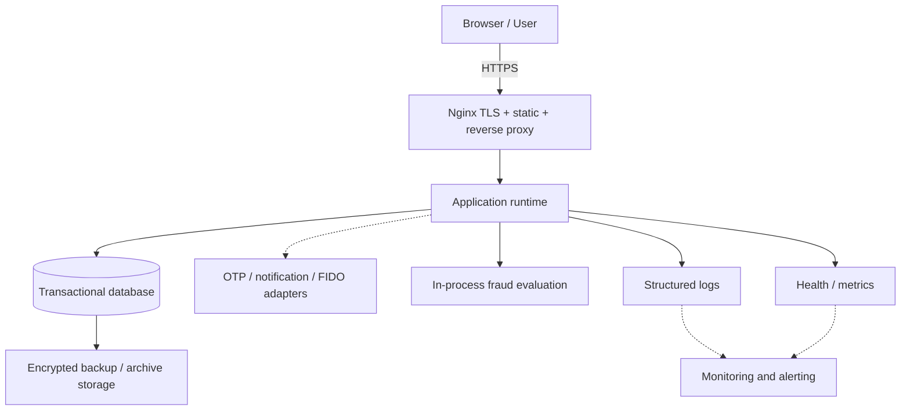

# 08. Deployment Infrastructure

> **Dự án:** Digital Banking MVP
> **Mã tài liệu:** `DEPLOY-08`
> **Phiên bản:** 0.2
> **Ngày:** 05/11/2026
> **Trạng thái:** Draft — chờ review
> **Phạm vi:** Documentation-only baseline trên branch `thinh`
> **Owner:** Chưa xác định
> **Reviewer:** Chưa xác định

> [!warning]
> Tài liệu này mô tả deployment baseline, kế hoạch vận hành và tiêu chí kiểm chứng dựa trên tài liệu hiện có. Tài liệu không xác nhận runtime deployment đã chạy thành công.

## 0. Phần chưa hoàn thành và dependency

Các mục dưới đây chưa thể chốt hoàn toàn trong phiên bản này. Nội dung độc lập đã hoàn thiện; chỉ các chi tiết phụ thuộc mới giữ trạng thái mở.

| Mục chưa hoàn thành | Lý do phụ thuộc | Tài liệu cần chờ | Cách xử lý hiện tại |
|---|---|---|---|
| Chi tiết security hardening, threat control, key lifecycle và security operations | Cần threat model, auth/session policy, encryption và key-management design thống nhất | [[digitalbanking-docs/docs-common/design/04. security.md]] | Dùng NFR-013–NFR-020, mục 9 của `06. System architecture` và `07. API contracts`; đánh dấu phần chưa chốt |
| Chi tiết fraud/risk rule catalog, threshold, versioning và auto-block exceptions | Cần rule catalog, threshold semantics, versioning và review flow | [[digitalbanking-docs/docs-common/design/03. fraud-detection-rules.md]] | Fail-open và in-process T2 là baseline từ SRS/06; chi tiết rule còn mở |
| Mapping deployment tới module, migration script, seed và operational command thực tế | Cần tài liệu implementation backend | `docs-backend/` | Chỉ mô tả deployment contract và procedure ở mức thiết kế; không khẳng định file/code tồn tại |
| Frontend static hosting, reverse proxy route và browser deployment detail | Cần architecture, route map, API integration và build contract frontend | `docs-frontend/` | Giữ topology logical và boundary trong `05`/`06`; chưa chốt cấu hình frontend cụ thể |
| Test/verification evidence mapping | Test profile, verification mapping and evidence package need consistent criteria | [[digitalbanking-docs/docs-common/09. Test plan.md]] | Deployment principles remain independent; align DEP evidence references with test-plan statuses |
| Release dates, WBS, milestone và ownership | Cần lịch tổng thể và dependency timeline | [[digitalbanking-docs/docs-common/10. Master timelines.md]] | Không đưa ngày triển khai hoặc phân công vào tài liệu này |
| Chi phí cloud cuối cùng | Cần provider, region, size, retention, traffic và pricing assumptions được chốt | Provider, region, sizing, retention, traffic và pricing decision chưa có trong permitted docs | Cost model/inputs stay Open; `10. Master timelines.md` chỉ dependency cho dates/ownership, không phải cost source |

Các dependency trên **không chặn** việc hoàn thiện deployment principles, environment model, topology, release gates, migration policy, backup/DR policy, observability contract, runbook structure và traceability.

## 1. Mục đích và phạm vi

### 1.1. Mục đích

Tài liệu này đặc tả cách Digital Banking MVP được chuẩn bị, triển khai, kiểm tra và vận hành ở mức local/test/demo. Tài liệu trả lời các câu hỏi:

- Hệ thống chạy trong môi trường nào?
- Các capability từ business được ánh xạ vào topology nào?
- Cấu hình và secret được quản lý ra sao?
- Release, migration và rollback được kiểm soát thế nào?
- Backup, restore và disaster recovery được kiểm chứng thế nào?
- Làm sao biết hệ thống đang khỏe?
- Khi dependency lỗi, operator xử lý theo runbook nào?
- Chi phí và giới hạn scale được đánh giá ra sao?

### 1.2. Trong phạm vi

- Local development và demo environment.
- Test environment dùng cho integration/concurrency/failure test.
- Deployment topology logical theo `06. System architecture`.
- Compute, database, network boundary, storage, security boundary và observability contract.
- Configuration, secret handling, migration, backup/restore, release/rollback.
- Health, logs, metrics, alerts, runbook và evidence.
- Traceability tới BR/FR/NFR/TC/OC/AD.

### 1.3. Ngoài phạm vi

- Production hardening hoàn chỉnh.
- PCI-DSS, ISO, regulatory certification hoặc independent audit.
- Core banking, payment gateway, settlement hoặc giao dịch tiền thật.
- Provider-specific IaC chưa được mô tả trong source documents.
- SSO federation, KMS/Vault production integration, Kubernetes và multi-region DR.
- Tài liệu implementation chi tiết thuộc `docs-backend/` và `docs-frontend/`.

## 2. Source of truth và trạng thái thông tin

### 2.1. Tài liệu nguồn

| Nguồn | Vai trò |
|---|---|
| [[digitalbanking-docs/docs-common/02. BRD.md]] | Business constraints, business success và business process |
| [[digitalbanking-docs/docs-common/03. SRS.md]] | FR, NFR, TC, RC, IC, OC, AC và demo scenarios |
| [[digitalbanking-docs/docs-common/04. Database design & analysis.md]] | Data integrity, migration, retention, backup-related data constraints |
| [[digitalbanking-docs/docs-common/05. Technical stack.md]] | Technology baseline, build, container, CI/CD và observability direction |
| [[digitalbanking-docs/docs-common/06. System architecture.md]] | Deployment topology, environment, security, integration, observability, quality scenarios |
| [[digitalbanking-docs/docs-common/07. API contracts.md]] | API contract, health, error, OpenAPI validation và contract gates |
| [[digitalbanking-docs/docs-common/design/01. audit-traceability.md]] | Audit, integrity, retention, evidence và audit runbook |
| [[digitalbanking-docs/docs-common/design/02. consistency-concurrency.md]] | Transaction boundary, recovery, lock, reconciliation và operational runbook |
| [[digitalbanking-docs/openapi/digital-banking-v1.yaml]] | Machine-readable API contract |

### 2.2. Nhãn trạng thái

- **Confirmed**: Được nêu trực tiếp trong tài liệu nguồn.
- **Proposed**: Giá trị hoặc control được source document ghi là đề xuất.
- **Design dependency**: Chưa thể chốt vì tài liệu thiết kế liên quan chưa hoàn thành.
- **Planned**: Kế hoạch cần thực hiện; chưa phải bằng chứng runtime.
- **Blocked**: Chưa thể kiểm chứng vì thiếu môi trường, dữ liệu hoặc dependency.
- **Not verified**: Chưa có evidence được phép trong scope docs-only.

Không dùng `PASS`, `VERIFIED` hoặc `PRODUCTION-READY` nếu tài liệu nguồn không cung cấp evidence tương ứng.

## 3. Deployment model và topology

### 3.1. Capability-to-infrastructure mapping

| Capability | Thành phần logical | Mục đích | Source |
|---|---|---|---|
| Compute | Application runtime | Chạy business logic, auth, account, transfer, audit, fraud và notification orchestration | `05` §3.1, `06` §5 |
| Database | Relational transactional database | System of record cho account, transfer, ledger, idempotency, audit và risk data | `04` §1, `06` §8 |
| Network | HTTPS ingress, Nginx reverse proxy và private service network | Bảo vệ boundary, route request và giới hạn DB exposure | `05` §3.1, `06` §9–§11 |
| Storage | Database volume, backup storage và archive storage | Persistent state, backup, retention và legal hold | `04` §9, `06` §8.8 |
| Security | TLS, secret boundary, RBAC, least privilege và audit | Bảo vệ access, data và administrative action | `03` NFR-013–NFR-020, `06` §9 |
| Observability | Health, structured logs, metrics, alerts và runbooks | Phát hiện lỗi, đo SLO và hỗ trợ recovery | `06` §12, `design/01` §12, `design/02` §13 |

CDN/WAF/external load balancer là optional future edge capabilities; chưa nằm trong confirmed MVP topology.

### 3.2. Logical topology



**Topology status:** Nginx, application runtime, transactional database, adapters and optional monitoring are confirmed logical baseline from `05` §3.1 and `06` §11.1. CDN, WAF, external load balancer and provider-specific edge services remain Optional/Open; they are not part of the confirmed MVP topology.

### 3.3. Network boundary rules

1. User traffic enters through HTTPS boundary.
2. Application runtime is the only component allowed to access business data.
3. Database is not a public application endpoint.
4. External adapters are accessed through ports and adapters; adapter failure must map to defined failure behavior.
5. Observability endpoints expose only approved health information publicly; metrics and operational data require protected access.
6. Administrative and audit actions require role/permission checks and audit records.

### 3.4. Capacity planning model

`03. SRS` defines workload targets, but RPS alone does not determine CPU, memory, instance count or connection-pool size. Resource sizing remains **Proposed/Open** until benchmark evidence exists.

| Dimension | Baseline | Status | Required evidence |
|---|---:|---|---|
| Sustained workload | 20 RPS × 10 minutes | Proposed NFR | D5 load report |
| Transfer p95 | ≤ 2 seconds | Proposed NFR | D5 latency report |
| Transfer p99 | ≤ 5 seconds | Proposed NFR | D5 latency report |
| Error rate | < 1% | Proposed NFR | D5 error report |
| Average RPS | Requests per day ÷ 86,400 | Planning formula | Business workload input |
| Peak RPS | Average RPS × peak factor | Planning formula | Peak-factor assumption |
| Approximate concurrency | RPS × average latency in seconds | Planning estimate | Load profile and latency data |
| CPU/memory per request | Not specified | Open | Benchmark profile |
| Database calls per request | Not specified | Open | Application/request trace |
| Connection-pool size | Not specified | Open | DB wait/pool measurement |
| Storage growth | Not specified | Open | Transaction, audit and retention volume estimate |
| Cost per environment | Not specified | Open | Provider, region, resource and retention assumptions |

Capacity review must record request complexity, database calls, external calls, latency target, CPU, memory, pool wait, storage growth and cost. Do not convert this model into a fixed CPU/RAM/resource recommendation without measurement.

Scale trigger from `06. System architecture` §11.6: latency increase or workload above 20 RPS triggers backend scale review, connection-pool review, index review and cost review.

### 3.5. Confirmed runtime responsibilities

- Fraud evaluation runs in-process, synchronously in T2, before ledger write (`06` AD-11, §7.6; `03` §2.13.5).
- Fraud engine failure follows **fail-open** baseline: log/audit failure, continue main transfer flow (`06` §7.6; `03` §2.13.5; IC-003/NFR-008).
- Default matching fraud rule creates a flag and continues; configured auto-block may fail transfer without ledger entries (`03` §2.13.5).
- `design/03` remains dependency for detailed rule catalog, numeric thresholds, versioning and policy exceptions; it does not block documenting baseline failure behavior.

## 4. Environments

| Environment | Purpose | Data | Required behavior | Configuration differences | Status |
|---|---|---|---|---|---|
| `local` | Developer workflow and functional walkthrough | Synthetic seed only | Fast startup, visible development diagnostics, no real secret | Simulator adapters; development diagnostics; local-only credentials | Confirmed direction |
| `test` | Automated unit, slice, integration, contract, concurrency and failure tests | Deterministic synthetic data | Isolated database, repeatable setup and cleanup | Disposable database; deterministic clock/doubles; failure injection enabled | Confirmed direction |
| `demo` | Classroom demonstration and acceptance evidence | Synthetic demo accounts | Reproducible deployment, health check, logs, audit and evidence capture | Persistent demo state; controlled monitoring; backup before demo | Confirmed direction |
| `production` | Future operational target | Not in MVP | Requires hardening, managed services, key management, HA and formal DR | Provider-managed secrets, centralized logs, HA and PITR remain out of scope | Out of scope |

### 4.1. Environment isolation

- Never use real customer, financial or credential data in local, test or demo environments (`NFR-032`, `TC-010`, `RC-005`).
- Environment-specific secrets must not be copied into documentation, source control or evidence.
- Test data must be disposable and deterministic.
- Demo backup must be created before destructive demo preparation.
- A test result is valid only when environment, source version, configuration assumptions and evidence location are recorded.

## 5. Runtime components and configuration contract

### 5.1. Logical component inventory

| Component | Responsibility | Persistent state | Failure behavior | Source |
|---|---|---|---|---|
| Application runtime | REST API, business rules, transaction orchestration, auth/session and module integration | No local business state assumed | Return defined error; do not report false success | `05` §3, `06` §5/§7 |
| PostgreSQL | Account, balance, transfer, ledger, idempotency, audit, fraud and notification state | Yes | Application returns service-unavailable; retry/reconcile by idempotency policy | `04`, `06` §8/§10 |
| Reverse proxy / TLS boundary | HTTPS termination, static delivery and API routing | No | Stop routing unhealthy application | `06` §11 |
| OTP/notification adapter | Simulated or replaceable external communication | Adapter-specific | Auth failure may block auth; notification failure must not reverse completed transfer | `06` §10.1–§10.3 |
| In-process fraud evaluation | Evaluate configured rules during transfer T2 before ledger writes | Fraud flag persisted with transfer outcome | Engine failure is fail-open; configured auto-block can fail transfer | `06` AD-11/§7.6, `03` §2.13.5 |
| Backup/archive storage | Backup, retention, legal hold and restore source | Yes | Alert and escalate on failed or stale backup | `04` §9, `06` §11.5 |
| Monitoring/alerting | Health, metrics, logs and operational signals | Evidence retained by policy | Alert without exposing sensitive data | `06` §12, design docs |

### 5.2. Configuration principles

- Keep configuration outside image artifacts.
- Use environment-specific configuration only for environment behavior, never to bypass business invariants.
- Server owns transfer limits, OTP policy, fraud thresholds and retention policy.
- Client input never overrides server-side security or monetary limits.
- Configuration changes affecting money, authorization, retention or fraud require review, audit and controlled release.
- Pin dependency and image versions; do not use dynamic `latest` for release artifacts (`05` §8.2).

### 5.3. Configuration categories

| Category | Examples | Protection |
|---|---|---|
| Database connection | URL, username, password, pool and timeout | Secret store/environment; least-privilege account |
| Authentication | Session TTL, token policy, OTP TTL, attempt limit | Secure configuration; audit changes |
| Transfer policy | Currency, amount range, limits, step-up threshold | Server-side; versioned; trace to BR/FR |
| Fraud policy | Large-value threshold, frequency window, rule version | Versioned; reviewable; audit changes |
| Runtime | Bind address, port, active environment | Environment configuration |
| Observability | Log level, metric endpoint, alert threshold | Protected operational configuration |
| Backup/retention | Schedule, retention, archive and legal hold | Protected operator configuration |

## 6. Secrets and security configuration

### 6.1. Secret rules

1. Do not commit passwords, JWT secrets, OTP values, tokens, encryption keys or provider credentials.
2. Provide only non-sensitive variable names and safe placeholders in example configuration.
3. Fail deployment when mandatory secrets are missing.
4. Do not print secret values in logs, error responses, test reports or screenshots.
5. Rotate secrets through controlled configuration change; record key version and affected environment.
6. Use separate credentials for local, test and demo.
7. Restrict database credentials to required permissions; application must not use administrative database privileges.

### 6.2. Security controls to be completed

The following controls require [[digitalbanking-docs/docs-common/design/04. security.md]] before final sign-off:

- Threat model and trust-boundary inventory.
- Authentication/session hardening details.
- Encryption-at-rest algorithm, key lifecycle and rotation procedure.
- API abuse controls and rate-limit policy.
- Security incident severity and escalation rules.
- Secure SDLC and dependency/image scanning acceptance thresholds.

Current baseline remains: TLS 1.2+ (prefer TLS 1.3), password/OTP hashing, PII masking, secret externalization, RBAC, least privilege, audit and no sensitive values in logs (`03` NFR-013–NFR-020; `06` §9).

## 7. Build, release and rollback

### 7.1. Release flow

```text
Change proposed
  → document/API/design review
  → OpenAPI validation
  → unit and integration tests
  → concurrency/failure/security checks
  → package artifact
  → image/deployment validation
  → demo deployment
  → health check
  → evidence capture
  → acceptance review
```

### 7.2. Release gates

| Gate | Required evidence | Failure action |
|---|---|---|
| Requirement traceability | BR/FR/NFR/AC mapping | Return to documentation review |
| API contract | OpenAPI validation and contract checks | Stop release; update source contract first |
| Database migration | Clean migration on empty database; migration compatibility review | Stop release; do not edit applied migration |
| Automated test | Unit, integration and critical-path reports | Stop release on failed Must test |
| Security | Security checklist and scan result | Stop release on unresolved critical issue |
| Container/package | Reproducible artifact and version identifier | Rebuild; do not deploy mutable artifact |
| Deployment smoke test | Health, API reachability and basic business flow | Roll back application artifact |
| Evidence package | Command, environment, expected, actual and timestamp | Mark acceptance incomplete |

### 7.3. Rollback policy

- Application rollback uses a previously accepted immutable artifact.
- Database migration rollback is not performed by editing or reversing an already-applied migration.
- If schema/data compatibility is affected, stop traffic or place system in controlled maintenance state, preserve evidence, and restore from approved backup when required.
- After rollback, run health, schema compatibility, API contract and financial invariant checks.
- Retry a client request only with the same idempotency key when the original outcome is uncertain.
- Never manually mark a money transfer `COMPLETED` without ledger and audit evidence.

### 7.4. Release evidence

Each demo release package should contain:

- Source revision identifier.
- Configuration version without secret values.
- Migration version.
- OpenAPI validation result.
- Test report and known limitations.
- Deployment health result.
- Backup timestamp and restore-verification status.
- Rollback decision and result if rollback occurred.

## 8. Database migration, backup and disaster recovery

### 8.1. Migration policy

- Database schema is managed by versioned forward-only migrations.
- JPA/ORM must validate schema; it must not silently create or alter business tables.
- Never modify an applied migration. Add a new migration for every schema change.
- Migration changes require database design review, affected API review and test-plan update.
- Migration evidence must include clean installation and upgrade-path verification.
- Migration failure blocks application release; do not start business traffic against a partially migrated schema.

### 8.1. Migration ordering convention

Migration versions run strictly in ascending order. The convention below is planning guidance; exact migration filenames remain implementation scope.

1. Create schema namespace and migration metadata.
2. Create independent reference and identity tables.
3. Create customer and account tables.
4. Create transfer, ledger and idempotency tables.
5. Create limit, usage, approval and fraud tables.
6. Create audit, notification, retention and legal-hold tables.
7. Add foreign keys and cross-domain integrity constraints after referenced tables exist.
8. Add triggers and append-only protections after target tables exist.
9. Add indexes separately from foreign keys and triggers; indexes may be added or tuned without changing integrity ordering.
10. Apply synthetic seed data only after schema and constraints validate.
11. Run backfills as separate, resumable migrations with explicit evidence.
12. Never edit an applied migration; add a new forward-only migration.

Migration failure blocks release. Do not start business traffic against a partially migrated database.

### 8.2. Data protection requirements

The database must protect:

- Account and balance invariants.
- Transfer state machine and terminal immutability.
- Double-entry ledger balance.
- Idempotency replay records.
- Append-only audit records and hash-chain evidence.
- Retention, archival and legal hold rules.

Detailed data rules remain in [[digitalbanking-docs/docs-common/04. Database design & analysis.md]], [[digitalbanking-docs/docs-common/design/01. audit-traceability.md]] and [[digitalbanking-docs/docs-common/design/02. consistency-concurrency.md]].

### 8.3. Backup policy

| Backup item | Frequency/trigger | Minimum procedure | Retention/status | Acceptance evidence |
|---|---|---|---|---|
| Transactional database | Before every demo and migration | Create logical backup outside runtime volume | Required trigger; retention Open | File metadata and checksum |
| Scheduled logical backup | Schedule not specified | Define schedule after RPO design | Open; cannot claim RPO | Backup schedule and restore report |
| WAL/PITR or incremental backup | Mechanism not specified | Evaluate if RPO ≤ 5 minutes is retained | Open; production dependency | Measured data-loss report |
| Audit data | Follow retention policy and legal hold | Preserve records, chain metadata and archive manifest | 5 years Proposed; `design/01` §10.1 | Chain verification result |
| Transfer/ledger/fraud/limit history | Follow retention policy | Archive before purge; block active legal hold | 5 years Proposed; `design/01` §10.1 | Archive and purge evidence |
| Auth challenge | Retention policy | Purge after policy threshold | 90 days Proposed | Retention evidence |
| Session | Retention policy after expiry | Purge after policy threshold | 30 days Proposed | Retention evidence |
| Notification | Retention policy | Purge after policy threshold | 90 days Proposed | Retention evidence |
| Idempotency record | Retention policy | Purge after policy threshold | 24 hours Proposed | Replay/retention evidence |
| Configuration | Before release/configuration change | Store redacted configuration and version | Until evidence package archive policy; Open | No secret value present |
| Evidence package | Each test/demo/recovery event | Preserve report, logs and manifest | Until sign-off and archive policy; Proposed | Evidence manifest |
| Archive/legal hold | On active hold | Preserve archive and hold scope | Until hold release | Hold scope and approval evidence |

Backup must be stored outside the database runtime volume, protected from unauthorized access, and tested by restore. A backup that has not been restored is not accepted as recovery evidence.

### 8.4. Recovery objectives and limitations

`NFR-007` proposes **RTO ≤ 30 minutes** and **RPO ≤ 5 minutes**. These targets remain Proposed until backup frequency, restore duration, storage location and data-loss measurement are verified.

Required recovery sequence:

1. Detect database or runtime failure.
2. Return fail-closed service behavior; never return false successful money movement.
3. Preserve logs, correlation IDs, audit evidence and failure timestamp.
4. Restore or reconnect database using approved procedure.
5. Verify schema, constraints, audit integrity and financial invariants.
6. Restart application traffic only after health and smoke checks pass.
7. Retry uncertain client requests with the original idempotency key.
8. Record actual RTO/RPO and unresolved data gap.

### 8.5. Disaster-recovery acceptance

A DR exercise passes only when:

- Database restore completes within approved RTO target or variance is documented.
- Data loss does not exceed approved RPO target or variance is documented.
- No negative balance, duplicate debit or unbalanced ledger exists.
- Audit integrity remains verifiable.
- Health endpoint reports correct state before and after recovery.
- Recovery evidence contains exact environment, procedure, timestamps and actual results.

## 9. Observability and operations

### 9.1. Health contract

The health contract must expose a safe application status and database availability signal without secrets or sensitive records.

| State | Expected behavior | Operational meaning |
|---|---|---|
| `UP` | Health request succeeds | Application may receive traffic |
| `DOWN` | Health request returns failure status | Stop routing; investigate dependency or application |
| Unknown | No trustworthy health result | Treat as unavailable until verified |

Health is not proof that every business capability works. Smoke tests and business invariant checks are also required.

### 9.2. Structured log contract

Minimum fields:

- `timestamp`
- `level`
- `service`
- `environment`
- `correlation_id`
- `request_id`
- masked `user_id`
- route/status
- action/outcome
- latency
- error code
- audit identifier where applicable

Never log:

- Password, passcode, OTP or token.
- Secret, encryption key or credential.
- Full account number, phone, email or other unnecessary PII.
- Full transfer payload or before/after sensitive state.

| Data type | Retention/rotation baseline | Status |
|---|---|---|
| Technical application logs | Rotation policy not specified; define size/time rotation before demo | Open |
| Security event logs | Retention and central archive depend on security design | Dependency: `design/04. security.md` |
| Metrics | Retention not specified; retain enough history for D5 and incident review | Open |
| Audit records | 5 years proposed with archive/legal hold rules | Proposed: `design/01. audit-traceability.md` |
| Test and recovery evidence | Preserve through acceptance and approved archive period | Proposed; timeline dependency |

Technical log retention does not replace audit retention. Log rotation must not expose secrets or silently remove required audit records.

Source: `03` NFR-020, `06` §12.1, `design/01` §12.1 and `design/02` §13.2.

### 9.3. Metrics contract

| Metric group | Required signal | Related requirement |
|---|---|---|
| HTTP | Request rate, error rate, p95/p99 latency | NFR-001–NFR-004 |
| Transfer | Created, completed, failed, pending age and duration | NFR-001, NFR-006, NFR-025 |
| Idempotency | Replay, conflict, in-progress and stuck records | FR-017, NFR-011 |
| Concurrency | Lock wait, deadlock, retry and pool waiting | NFR-009–NFR-010 |
| Audit | Write success/failure, write latency and audit gap | NFR-021–NFR-023 |
| Fraud | Flag count by rule and review result | FR-044–FR-048 |
| Notification | Pending backlog, retry and failure | NFR-008 |
| Database | Availability, connection pool, slow query and storage | NFR-006, NFR-025 |
| Jobs | Reconciliation, verification, retention and purge result | FR-022, FR-053 |

Do not use high-cardinality labels such as raw account ID, token, idempotency key or correlation ID in metrics.

### 9.4. Alert contract

| Alert | Severity | Trigger | Immediate action | Escalation/reference |
|---|---|---|---|---|
| Negative balance | Critical | Any invariant violation | Freeze affected flow; preserve evidence | Audit/security incident |
| Duplicate debit | Critical | Any duplicate money side effect | Freeze transfer acceptance; investigate | Audit/security incident |
| Audit chain invalid | Critical | Hash verification mismatch | Stop purge/archive; preserve backup | `R-AUD-02` |
| Ledger mismatch | Critical | Reconciliation detects imbalance | Stop affected processing; reconcile | `R-CON-04` |
| Database unavailable | High | Health/database check fails | Fail closed; stop routing | `R-CON-08` |
| Pending transfer age | High | `transfer_pending_age_seconds > 300` (proposed in `06` §12.5) | Inspect state and reconcile | `R-CON-01` |
| Idempotency stuck | High | Processing exceeds approved threshold; threshold open | Prevent new side effect; inspect | `R-CON-02` |
| Deadlock/lock timeout | High | Rate exceeds proposed threshold in `design/02` §13.3 | Inspect lock order and bounded retry | `R-CON-03` |
| Connection pool exhaustion | High | Active connections > 80% (proposed in `06` §12.5) or pool waiting persists | Inspect long transactions and locks | `R-CON-07` |
| Transfer error rate | High | > 1% for 5 minutes (proposed in `06` §12.5) | Check DB/adapters; preserve transfer outcome | Incident review |
| Audit write failure | High | Required audit write fails | Do not report completion; retry/reconcile | `R-AUD-01` |
| Export anomaly | High | Unexpected export volume/content | Block or rate-limit export; review permission | `R-AUD-05` |
| Notification backlog | Medium | Backlog/age exceeds proposed threshold (`design/02` §10.4) | Retry with backoff; do not rollback money | `R-CON-06` |
| Verification stale | Medium | Verification exceeds configured interval; interval proposed in `design/01` §12.3 | Run verification; investigate job | `R-AUD-02`/`R-AUD-03` |

`06` and design docs provide proposed thresholds for selected alerts. Other thresholds remain Open. Final operational thresholds require operations decision; `design/04` dependency applies only to security-event severity and escalation.

## 10. Incident runbooks

Runbooks below define planning-level action. They do not authorize destructive data modification.

### R-CON-01 — Transfer remains PENDING

1. Record correlation ID, reference, timestamp and current alert.
2. Inspect transfer state, idempotency state, ledger entries and audit completion.
3. If ledger/audit evidence is incomplete, keep transfer non-terminal and do not report success.
4. Retry or reconcile only through approved idempotent procedure.
5. Escalate when ledger is incomplete, unbalanced or state cannot be determined.
6. Attach query output and final decision to incident evidence.

### R-CON-02 — Idempotency record stuck

1. Find associated transfer and current state.
2. Check whether request committed, rolled back or is still processing.
3. Do not create a second transfer with a new key before outcome is known.
4. Resume/reconcile under the idempotency policy.
5. Alert if record exceeds retention or processing threshold.

### R-CON-03 — Deadlock or lock timeout

1. Record failed request, correlation ID and SQL/lock error category without sensitive payload.
2. Inspect lock wait, transaction duration and known global lock order.
3. Retry only safe/idempotent work under bounded retry policy.
4. Do not increase isolation or pool size blindly.
5. Add a regression test when root cause is identified.

### R-CON-04 — Ledger mismatch

1. Freeze acceptance of affected evidence and identify affected references.
2. Compare account balance, ledger entries, transfer state and audit facts.
3. Do not update/delete ledger or audit rows manually.
4. Use controlled reconciliation or restore procedure.
5. Escalate to audit/security review and record root cause.

### R-CON-05 — Audit gap

1. Identify transfer, action and correlation ID with missing audit fact.
2. Do not mark money movement `COMPLETED` while required audit evidence is missing.
3. Retry audit/reconciliation through approved procedure.
4. If chain integrity is affected, stop retention/purge and preserve backup evidence.
5. Record gap resolution and regression test.

### R-CON-06 — Notification backlog

1. Inspect pending/retrying records, age and retry count.
2. Check adapter availability and timeout behavior.
3. Retry with backoff and bounded attempts.
4. Do not rollback a completed money transaction because notification failed.
5. Alert when backlog breaches policy.

### R-CON-07 — Connection pool exhaustion

1. Check database availability, active connections and waiting requests.
2. Identify long transactions, idle transactions and lock waits.
3. Stop or cancel only approved non-critical work.
4. Preserve transaction outcome and retry only with idempotency.
5. Tune timeout/pool after root-cause evidence, not as first action.

### R-CON-08 — Database outage or connection loss

1. Mark application dependency unavailable and fail closed.
2. Determine whether each uncertain request committed or rolled back.
3. Restore/reconnect database using approved DR procedure.
4. Verify migration, ledger, audit and idempotency invariants.
5. Retry client request with original idempotency key only after outcome is safe.

### R-AUD-01 — Audit write failure

1. Check database, trigger, constraint and lock condition.
2. Do not bypass audit and do not return successful completion without required evidence.
3. Keep affected transfer pending or failed according to SRS behavior.
4. Retry/reconcile with original idempotency key.
5. Confirm no audit gap remains.

### R-AUD-02 — Audit chain invalid

1. Stop retention, purge and archive operations.
2. Preserve database backup and verification evidence.
3. Identify first mismatch and compare with retained evidence.
4. Do not edit audit records to hide mismatch.
5. Restore or repair only through approved, audited procedure.

### R-AUD-03 — Audit gap

Follow `R-AUD-01`, then verify transfer, ledger, audit and correlation linkage. Escalate if automatic reconciliation cannot prove final state.

### R-AUD-04 — Legal hold or purge conflict

1. Confirm hold scope and retention policy.
2. Stop purge for affected records.
3. Require approved release with strong authentication and audit.
4. Preserve archive and evidence manifest.

### R-AUD-05 — Export anomaly

1. Verify actor permission, filter, row count and export scope.
2. Verify file integrity and evidence manifest.
3. Rate-limit or block suspicious export.
4. Do not distribute audit evidence through unapproved channels.

## 11. Infrastructure verification and acceptance

| Verification ID | Scenario | Expected result | Source |
|---|---|---|---|
| `DVT-001` | Environment configuration review | Required variables, boundaries and secret rules documented | `05` §5.1, `06` §11.2, `03` NFR-019 |
| `DVT-002` | Topology review | Every logical component has responsibility and failure behavior | `06` §11 |
| `DVT-003` | Health check | Healthy and unavailable states are distinguishable; no secret exposure | `07` API-HLT-01, `03` NFR-025 |
| `DVT-004` | Migration review | Forward-only policy and compatibility evidence defined | `04` §10, `06` §8.8 |
| `DVT-005` | Backup/restore exercise | Restore completes within approved target or variance is recorded | `03` NFR-007, `06` §11.5 |
| `DVT-006` | Failure/recovery exercise | No false success, duplicate debit or unbalanced ledger | `03` AC-012, AC-013, AC-034 |
| `DVT-007` | Observability review | Logs, metrics, alerts and runbook links are defined | `03` NFR-025, `06` §12 |
| `DVT-008` | Security configuration review | Secrets and sensitive data controls are documented | `03` NFR-013–NFR-020 |
| `DVT-009` | Release/rollback review | Artifact, migration, rollback and evidence gates are documented | `05` §5.7, `06` §11.4 |
| `DVT-010` | Cost and scale review | Assumptions, trigger and measurement method are recorded | `03` NFR-024, `06` §14 |

`DVT-*` verification IDs are owned by this document. `DEP-*` remains reserved for project dependency identifiers in BRD/SRS. Test execution and evidence status must follow [[digitalbanking-docs/docs-common/09. Test plan.md]].

## 12. Traceability

| Requirement | Deployment section | Evidence or dependency |
|---|---|---|
| `TC-001` Spring Boot + PostgreSQL | §3, §7, §8 | `05`, `06`, `DEP-002`, `DEP-004` |
| `TC-002` REST/JSON over HTTPS | §3, §6 | `03` NFR-013, `07`, `DEP-003` |
| `NFR-032` synthetic data | §4.1 | Synthetic data requirement | `03` NFR-032 |
| `CON-006` synthetic demo data | §4.1 | No real customer data in demo | `02` §8.1 |
| `NFR-024` scalability/capacity | §3.4, §12 | Capacity model, scale trigger and D5 benchmark |
| `NFR-021`–`NFR-023` auditability | §8.2–§8.5, §9.2, §9.4 | Five-year retention is Proposed; audit design evidence |
| `NFR-005` demo availability | §4, §9, §11 | Health and monitoring evidence; `DVT-003`, `DVT-007` |
| `NFR-006` crash recovery | §8, §10 | `design/02` §10; `DVT-006` |
| `NFR-007` RTO/RPO | §8 | Proposed target; restore/data-loss evidence; `DVT-005` |
| `NFR-008` external dependency failure | §5, §9, §10 | `06` §10.3; `DVT-006` |
| `NFR-013`–`NFR-020` security | §6, §9 | `design/04` dependency; `DVT-008` |
| `NFR-025` observability | §9, §10 | `06` §12; `DVT-003`, `DVT-007` |
| `NFR-026`–`NFR-027` maintainability/test | §7, §11 | `07` §10; document 09 |
| `OC-001`–`OC-005` operational constraints | §1, §4, §8, §11 | `03` §9.4 |
| `AD-14` deployment topology | §3, §4, §7 | `06` §3 and §11 |

## 13. Architecture decisions, open issues and change log

### 13.1. Decisions

| ID | Decision | Reason | Trade-off |
|---|---|---|---|
| `AD-DEP-01` | Use a small, reproducible deployment topology for MVP | Project scope is demo/MVP, not enterprise production | Less HA and provider automation |
| `AD-DEP-02` | Keep database as transactional system of record | Strong consistency, ledger integrity and audit require relational transaction semantics | Database is a high-impact dependency |
| `AD-DEP-03` | Keep secrets outside artifacts | Prevent credential leakage and support environment separation | Requires environment setup and secret rotation process |
| `AD-DEP-04` | Use forward-only schema evolution | Preserves migration history and prevents unsafe automatic rollback | Rollback may require backup restore or compensating migration |
| `AD-DEP-05` | Treat health, logs, metrics and runbooks as acceptance evidence for demo | Demo-oriented MVP must be observable and defensible; this does not claim production readiness | Adds evidence work beyond functional demo |

### 13.2. Open issues

| ID | Issue | Impact | Dependency |
|---|---|---|---|
| `OI-DEP-01` | Security hardening and key lifecycle not finalized | Cannot sign off encryption and incident controls | `design/04. security.md` |
| `OI-DEP-02` | Fraud thresholds/rule detail and auto-block exceptions not finalized | Numeric oracle and exceptions remain open; current runtime baseline is in-process/fail-open | `design/03. fraud-detection-rules.md` |
| `OI-DEP-03` | Implementation command and artifact mapping not finalized | Cannot claim executable deployment runbook | `docs-backend/` |
| `OI-DEP-04` | Frontend hosting and route mapping not finalized | Cannot claim complete end-to-end deployment | `docs-frontend/` |
| `OI-DEP-05` | Milestone and release dates not finalized | Cannot bind deployment gates to dates | `10. Master timelines.md` |
| `OI-DEP-06` | Provider and cost assumptions not finalized | Cost remains planning model only; timeline does not supply pricing assumptions | Provider/region/sizing/pricing decision |
| `OI-DEP-07` | Final operational alert thresholds not approved | Existing values remain Proposed; security-event escalation is separate | Operations decision; `design/04` for security-event policy |

### 13.3. Change log

| Version | Date | Description |
|---|---|---|
| 0.1 | 03/11/2026 | Created deployment infrastructure outline |
| 0.2 | 05/11/2026 | Added independent deployment baseline, dependencies, runbooks, acceptance IDs and traceability for docs-only planning |
