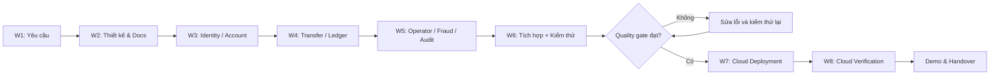

# 10. Master timelines

# 10. Master Timelines — Digital Banking MVP

**Dự án:** Digital Banking MVP
**Tài liệu:** Master Timelines
**Phiên bản:** 1.5
**Ngày cập nhật:** 08/11/2026
**Trạng thái:** Hoàn thành bản kế hoạch 8 tuần

## 1. Mục đích và phạm vi

**Rõ việc. Rõ mốc.** Kế hoạch chia dự án Digital Banking MVP thành tám tuần, theo đúng thứ tự phân tích yêu cầu, hoàn thiện thiết kế và tài liệu, xây dựng các nghiệp vụ cốt lõi, tích hợp–kiểm thử, triển khai Cloud, kiểm tra lại trên môi trường đã triển khai và bàn giao.

**Ba tuần cho nghiệp vụ lõi.** Từ tuần 3 đến tuần 5, mỗi tuần tập trung một nhóm nghiệp vụ chính. Các việc nhỏ như kiểm tra dữ liệu đầu vào, xử lý thông báo, seed dữ liệu, cấu hình chạy và chỉnh sửa màn hình được triển khai cùng chức năng tương ứng; không tách thành một nhóm công việc riêng.

**Docs giữ vai trò trọng tâm.** Công việc thiết kế và viết Docs tạo cơ sở để thống nhất nghiệp vụ, ràng buộc dữ liệu, quy tắc xử lý và tiêu chí nghiệm thu. Tài liệu được cập nhật xuyên suốt quá trình thực hiện, thay vì chỉ tổng hợp sau khi đã code xong.

Kế hoạch mô tả công việc theo các nhóm **Thiết kế & Docs, Backend, Kiểm thử và Cloud**. Phần giao diện hoàn thiện cùng nghiệp vụ Backend, không tổ chức thành workstream độc lập. Các quy tắc Fraud Detection Option B được giữ trong thiết kế và triển khai theo phạm vi chức năng của phiên bản phát hành.

## 2. Nguyên tắc lập kế hoạch

1. **Thiết kế trước.** Yêu cầu nghiệp vụ, hành trình sử dụng, dữ liệu, phân quyền và logic chuyển tiền phải có mô tả thống nhất trước khi triển khai.
2. **Tách việc khó.** Xác thực, tài khoản, chuyển tiền, tính đúng đắn số dư, nghiệp vụ Operator và Fraud Detection được phân chia thành các nhóm có đầu ra riêng.
3. **Gộp việc nhỏ.** Validation, thông báo lỗi, chỉnh sửa giao diện, dữ liệu thử nghiệm và cấu hình cơ bản đi cùng nghiệp vụ phát sinh chúng.
4. **Docs xuyên suốt.** Thiết kế và viết Docs là đầu việc chính trong giai đoạn đầu; việc cập nhật tài liệu diễn ra theo từng thay đổi nghiệp vụ.
5. **Tích hợp cùng kiểm thử.** Tuần 6 dành cho kiểm tra hành trình sử dụng, quyền truy cập, tính đúng đắn giao dịch, sửa lỗi và chốt bản triển khai.
6. **Cloud đúng thời điểm.** Tuần 7 mới triển khai Cloud sau khi có release candidate ổn định. Tuần 8 kiểm tra lại toàn bộ hệ thống trên Cloud và hoàn tất bàn giao.
7. **Đánh giá theo bằng chứng.** Kết quả công việc được ghi bằng tài liệu, commit, test result, biên bản kiểm tra hoặc phiên bản chạy được; kế hoạch không thay thế báo cáo tiến độ thực tế.

## 3. Milestone và deliverable

| Milestone | Thời điểm | Nội dung nghiệm thu | Sản phẩm bàn giao |
| --- | --- | --- | --- |
| M1 — Requirements & Planning | Cuối W1 | Phạm vi, vai trò người dùng, các nghiệp vụ chính và thứ tự thực hiện được xác định | Scope, use cases, backlog, phân công theo vai trò |
| M2 — Design & Documentation | Cuối W2 | Hoàn thiện thiết kế tổng thể và Docs làm cơ sở triển khai | Bộ Docs thiết kế, sơ đồ luồng, kế hoạch và tiêu chí nghiệm thu |
| M3 — Identity & Account | Cuối W3 | Xác thực người dùng, PIN/OTP và tài khoản hoạt động trên môi trường phát triển | Nghiệp vụ xác thực và quản lý tài khoản |
| M4 — Transfer & Ledger | Cuối W4 | Chuyển tiền, kiểm soát số dư, trạng thái giao dịch và chống xử lý trùng hoạt động đúng | Nghiệp vụ chuyển tiền có kiểm tra tính nhất quán |
| M5 — Operation & Risk | Cuối W5 | Nghiệp vụ Operator, audit, risk flags và các quy tắc gian lận trong phạm vi phát hành hoàn thiện | Các luồng quản lý và kiểm soát rủi ro |
| M6 — Integration & Quality Gate | Cuối W6 | Các nghiệp vụ kết nối thành một ứng dụng; kiểm thử bảo mật và tiền, sửa lỗi nghiêm trọng | Test report, known issues, release candidate |
| M7 — Cloud Deployment | Cuối W7 | Triển khai bản đã chốt, dịch vụ khởi động và kết nối bình thường | URL Cloud, deployment log, hướng dẫn vận hành |
| M8 — Cloud Verification & Handover | Cuối W8 | Kiểm tra lại nghiệp vụ trên Cloud, sửa lỗi sau deploy, demo và hoàn tất hồ sơ | Test evidence, video, slide, báo cáo cuối và bàn giao |

## 4. Work Breakdown Structure (WBS)

### 4.1. Tuần 1 — Phân tích yêu cầu và lập kế hoạch

**Nắm đúng bài toán.** Giai đoạn mở đầu xác định mục tiêu ứng dụng, các nhóm người dùng và các nghiệp vụ ngân hàng mô phỏng cần xây dựng; đồng thời phân biệt yêu cầu cốt lõi với những phần có thể phát triển thêm mà không làm lệch phạm vi MVP.

| WBS | Đầu việc chi tiết | Nhóm | Kết quả |
| --- | --- | --- | --- |
| 1.1 | Rà soát Introduction, BRD, SRS; tổng hợp mục tiêu, phạm vi và yêu cầu phi chức năng | Thiết kế & Docs | Requirements baseline |
| 1.2 | Xác định vai trò Customer, Operator, Auditor, Admin và quyền nghiệp vụ ở mức chức năng | Thiết kế & Docs, Backend | Actor/use-case matrix |
| 1.3 | Mô tả hành trình đăng ký, đăng nhập, quản lý tài khoản, chuyển tiền và tra cứu | Thiết kế & Docs | Luồng nghiệp vụ chính |
| 1.4 | Phân nhóm các nghiệp vụ cốt lõi, lập backlog và xác định phụ thuộc giữa các nhóm | Nhóm | Scope, backlog ưu tiên |
| 1.5 | Thiết lập nhịp phối hợp, quản lý repository, quy trình review và cách ghi tiến độ | Nhóm | Quy ước thực hiện và kế hoạch chung |

**Cuối tuần:** các nghiệp vụ được định nghĩa đầy đủ để bắt đầu thiết kế. Những yêu cầu chưa rõ được ghi trong danh sách vấn đề cần quyết định.

### 4.2. Tuần 2 — Thiết kế hệ thống và viết Docs

**Docs là nền.** Tuần này tập trung xây dựng và hoàn thiện bộ tài liệu thiết kế của dự án, từ kiến trúc, dữ liệu, tương tác giữa các thành phần đến tính nhất quán giao dịch, xác thực, gian lận và kế hoạch kiểm thử. Đó là đầu vào cho cả ba tuần phát triển nghiệp vụ phía sau.

| WBS | Đầu việc chi tiết | Nhóm | Kết quả |
| --- | --- | --- | --- |
| 2.1 | Thiết kế kiến trúc tổng thể, cách các thành phần trao đổi và lưu trữ dữ liệu | Thiết kế & Docs, Backend | Thiết kế kiến trúc |
| 2.2 | Hoàn thiện thiết kế dữ liệu, API, quyền truy cập và vòng đời giao dịch | Thiết kế & Docs, Backend | Bộ đặc tả kỹ thuật |
| 2.3 | Thiết kế tính đúng đắn chuyển tiền, idempotency, xử lý đồng thời và rollback | Thiết kế & Docs, Backend | Quy tắc nhất quán giao dịch |
| 2.4 | Viết thiết kế Fraud Detection: rule, ngưỡng, đánh giá tại T2, flag, review, fail-open và audit | Thiết kế & Docs | Fraud Detection Rules |
| 2.5 | Xây dựng kế hoạch tám tuần, milestone, WBS, phụ thuộc, phân vai và điều kiện nghiệm thu | Thiết kế & Docs | Master Timelines |
| 2.6 | Rà soát chéo các Docs, xử lý mâu thuẫn trong cách mô tả nghiệp vụ và chốt baseline | Nhóm | Bộ Docs làm cơ sở phát triển |

**Cuối tuần:** bộ Docs mô tả nhất quán các nghiệp vụ, dữ liệu đầu vào/đầu ra, trạng thái xử lý và giới hạn hệ thống. Thiết kế trở thành tài liệu tham chiếu cho việc phát triển.

### 4.3. Tuần 3 — Nghiệp vụ định danh, xác thực và tài khoản

**Người dùng trước.** Khi mô hình xác thực và dữ liệu đã được thiết kế, tuần 3 xây dựng nền tảng để người dùng có thể đăng nhập, quản lý phiên và sử dụng tài khoản ngân hàng mô phỏng; các thao tác nhỏ được xử lý trong chính nhóm nghiệp vụ này.

| WBS | Đầu việc chi tiết | Nhóm | Kết quả |
| --- | --- | --- | --- |
| 3.1 | Xây dựng đăng ký tài khoản, đăng nhập và kiểm soát trạng thái người dùng | Backend | Luồng tạo tài khoản/đăng nhập |
| 3.2 | Xử lý session, refresh/revoke token, đăng xuất và các tình huống xác thực thất bại | Backend | Quản lý phiên an toàn |
| 3.3 | Triển khai thiết lập PIN, xác minh PIN, giới hạn nhập sai và khôi phục bằng OTP | Backend | Các luồng PIN/OTP |
| 3.4 | Xây dựng thông tin tài khoản, kiểm tra quyền sở hữu và truy vấn số dư | Backend | Nghiệp vụ account |
| 3.5 | Hoàn thiện thao tác sử dụng và xử lý lỗi liên quan; bổ sung dữ liệu mô phỏng, kiểm tra nghiệp vụ ngay trong quá trình làm | Backend | Nhóm chức năng sử dụng được |
| 3.6 | Cập nhật Docs theo quyết định kỹ thuật đã thực hiện và ghi các thay đổi so với thiết kế | Thiết kế & Docs | Docs nhất quán với module định danh/tài khoản |

**Cuối tuần:** tài khoản có thể được đăng ký, xác thực và sử dụng trong môi trường phát triển; điều kiện PIN/OTP và kiểm soát truy cập đã được thực hiện trong module tương ứng.

### 4.4. Tuần 4 — Nghiệp vụ chuyển tiền và tính nhất quán tài chính

**Tiền phải đúng.** Đây là nhóm nghiệp vụ trọng tâm nhất của Digital Banking MVP. Mọi giao dịch phải giữ số dư nhất quán giữa tài khoản gửi và nhận, được xác thực theo hạn mức, không xử lý hai lần khi request bị gửi lại và không để xảy ra ghi nợ một phần.

| WBS | Đầu việc chi tiết | Nhóm | Kết quả |
| --- | --- | --- | --- |
| 4.1 | Xây dựng khởi tạo giao dịch, chọn tài khoản nguồn/đích, xác minh quyền và số dư | Backend | Tạo giao dịch hợp lệ |
| 4.2 | Áp dụng điều kiện PIN/OTP theo giá trị chuyển khoản và trạng thái xác nhận giao dịch | Backend | Luồng xác thực chuyển tiền |
| 4.3 | Xử lý ghi nợ/ghi có nguyên tử, rollback và các trạng thái giao dịch | Backend | Money path nhất quán |
| 4.4 | Triển khai Idempotency-Key, phát hiện request lặp và xử lý yêu cầu đồng thời | Backend | Không phát sinh giao dịch trùng |
| 4.5 | Hoàn thiện tra cứu giao dịch, lịch sử, thông báo kết quả và các trường hợp không đủ số dư/hạn mức | Backend | Hành trình chuyển tiền hoàn chỉnh |
| 4.6 | Đối chiếu logic chuyển tiền với Docs, ghi nhận các thay đổi cần thiết trong đặc tả | Thiết kế & Docs | Tài liệu chuyển tiền cập nhật |

**Cuối tuần:** chuyển tiền hoạt động với đầy đủ kiểm tra bắt buộc và bảo toàn số dư. Những trường hợp sai PIN/OTP, số tiền không hợp lệ, gửi trùng hoặc lỗi giữa chừng đều có kết quả xác định.

### 4.5. Tuần 5 — Nghiệp vụ vận hành, gian lận và kiểm toán

**Phát hiện. Ghi nhận. Xử lý.** Sau khi luồng chuyển tiền đã có nền tảng ổn định, dự án hoàn thiện nghiệp vụ Operator, kiểm soát phân quyền, audit và Fraud Detection, giúp việc tra cứu, phát hiện bất thường và xử lý giao dịch có thể thực hiện theo đúng vai trò.

| WBS | Đầu việc chi tiết | Nhóm | Kết quả |
| --- | --- | --- | --- |
| 5.1 | Xây dựng nghiệp vụ Operator: tra cứu, thực hiện tác vụ được phân quyền, theo dõi trạng thái | Backend | Luồng Operator |
| 5.2 | Hoàn thiện RBAC/ownership và các quyền riêng của Customer, Operator, Auditor, Admin | Backend | Kiểm soát truy cập |
| 5.3 | Ghi audit cho sự kiện xác thực, nghiệp vụ tài khoản, chuyển tiền và hành động vận hành | Backend | Audit trail |
| 5.4 | Triển khai risk evaluation, fraud flags và hiển thị trạng thái cảnh báo theo phạm vi chức năng | Backend | Nghiệp vụ phát hiện rủi ro |
| 5.5 | Tích hợp các ngưỡng Fraud Detection Option B thuộc phạm vi release: hạn mức theo ngày, tần suất và giữ giao dịch để review | Backend | Quy trình risk/review được xác định |
| 5.6 | Hoàn thiện hướng dẫn nghiệp vụ, cập nhật thiết kế và các nội dung thay đổi trong Docs | Thiết kế & Docs | Bộ tài liệu nghiệp vụ đã đồng bộ |

**Cuối tuần:** các vai trò vận hành và kiểm toán có thể sử dụng chức năng tương ứng. Cảnh báo gian lận được ghi nhận có căn cứ và liên kết với giao dịch; những quy tắc Option B ngoài phạm vi release được quản lý riêng, không trình bày như tính năng đã triển khai.

### 4.6. Tuần 6 — Tích hợp, kiểm thử tổng thể và sửa lỗi

**Kiểm tra toàn diện.** Tích hợp và kiểm thử được gộp thành một giai đoạn: chạy xuyên suốt các nghiệp vụ trên cùng một phiên bản, phát hiện lỗi giữa các module, kiểm tra cả trường hợp thành công lẫn thất bại, sửa lỗi và xác nhận lại bằng regression.

| WBS | Đầu việc chi tiết | Nhóm | Kết quả |
| --- | --- | --- | --- |
| 6.1 | Kiểm tra hành trình Customer từ xác thực đến tài khoản, chuyển tiền và lịch sử | Backend, Kiểm thử | E2E chức năng |
| 6.2 | Kiểm tra nghiệp vụ Operator/Auditor và khả năng truy cập đúng/sai quyền | Backend, Kiểm thử | RBAC/IDOR results |
| 6.3 | Kiểm tra ranh giới số tiền, PIN/OTP, thời hạn OTP, khóa PIN và giao dịch thất bại | Backend, Kiểm thử | Test kết quả xác thực |
| 6.4 | Kiểm tra số dư, rollback, idempotency, request đồng thời và tình huống lỗi giao dịch | Backend, Kiểm thử | Money correctness report |
| 6.5 | Kiểm tra risk flags, audit và các rule Fraud Detection có trong release | Backend, Kiểm thử | Fraud/audit results |
| 6.6 | Tổng hợp lỗi, sửa lỗi nghiêm trọng, chạy lại kiểm thử và chốt phiên bản đủ điều kiện triển khai | Backend, Kiểm thử | Defect closure, release candidate |
| 6.7 | Đối chiếu kết quả với Docs, hoàn thiện hướng dẫn sử dụng và giới hạn phiên bản | Thiết kế & Docs | Docs đồng bộ, user guide |

**Cuối tuần:** các chức năng cốt lõi hoạt động xuyên suốt và không còn lỗi nghiêm trọng về bảo mật hoặc tính đúng đắn số dư. Một release candidate được xác định để triển khai lên Cloud.

### 4.7. Tuần 7 — Triển khai Cloud

**Đưa lên môi trường thật.** Tuần 7 tiếp nhận bản ứng dụng đã vượt kiểm thử nội bộ rồi triển khai lên Cloud; công việc tập trung ở hạ tầng, cấu hình kết nối, quản lý secret, xuất bản ứng dụng và xác nhận hệ thống khởi động ổn định.

| WBS | Đầu việc chi tiết | Nhóm | Kết quả |
| --- | --- | --- | --- |
| 7.1 | Chốt bản triển khai, kiểm tra cấu hình, tài nguyên và các điều kiện môi trường | Cloud, Backend | Deployment checklist |
| 7.2 | Thiết lập hạ tầng, quyền truy cập, bảo mật kết nối và biến môi trường | Cloud | Môi trường Cloud sẵn sàng |
| 7.3 | Triển khai dữ liệu và ứng dụng, cấu hình tích hợp các thành phần | Cloud, Backend | Hệ thống được xuất bản |
| 7.4 | Kiểm tra khởi động, URL, HTTPS, health check, kết nối và log triển khai | Cloud, Backend | Deployment validation |
| 7.5 | Xử lý lỗi cấu hình cản trở truy cập, ghi nhận phương án restart/rollback | Cloud | Runbook và known issues |
| 7.6 | Cập nhật tài liệu triển khai, sơ đồ môi trường và thông tin phục vụ kiểm thử lại | Thiết kế & Docs | Deployment Docs |

**Cuối tuần:** ứng dụng chạy được trên Cloud, các thành phần kết nối đúng và có hướng dẫn vận hành. Việc kiểm thử toàn diện trên Cloud được thực hiện ở tuần 8.

### 4.8. Tuần 8 — Kiểm tra lại Cloud, demo và bàn giao

**Kiểm chứng lần cuối.** Hệ thống được kiểm tra như một sản phẩm hoàn chỉnh trên môi trường Cloud: từ truy cập và xác thực, chuyển tiền, quyền vận hành đến audit, fraud, lỗi môi trường và khả năng phục hồi cơ bản. Sau mỗi lỗi đã sửa, chạy lại đúng ca kiểm thử liên quan.

| WBS | Đầu việc chi tiết | Nhóm | Kết quả |
| --- | --- | --- | --- |
| 8.1 | Chạy lại hành trình Customer, tài khoản, chuyển tiền và các tình huống PIN/OTP trên URL Cloud | Backend, Kiểm thử | Cloud E2E report |
| 8.2 | Kiểm tra quyền Operator/Auditor/Admin, bảo vệ dữ liệu và log audit | Backend, Kiểm thử | Cloud security evidence |
| 8.3 | Kiểm tra tính đúng đắn giao dịch, idempotency, concurrency và các rule fraud trong release | Backend, Kiểm thử | Regression results |
| 8.4 | Kiểm tra vận hành, log lỗi, restart, HTTPS và các tình huống mất kết nối cơ bản | Cloud, Kiểm thử | Operational checklist |
| 8.5 | Sửa lỗi sau triển khai, cập nhật phiên bản, triển khai lại và xác minh kết quả | Backend, Cloud, Kiểm thử | Fix log và retest evidence |
| 8.6 | Quay video demo thao tác người dùng, hoàn thiện slide và phần trình bày | Thiết kế & Docs, Nhóm | Video và slide |
| 8.7 | Hoàn thiện báo cáo cuối, đường dẫn ứng dụng/GitHub, danh sách hạn chế và hồ sơ nghiệm thu | Thiết kế & Docs, Nhóm | Final handover package |

**Cuối tuần:** có kết quả kiểm tra hệ thống chạy trên Cloud, video demo, slide, báo cáo và bộ Docs hoàn chỉnh.

## 5. Bảng timeline tổng hợp

| Tuần | Chủ đề chính | Nhóm nghiệp vụ trọng tâm | Milestone |
| --- | --- | --- | --- |
| W1 | Phân tích yêu cầu | Mục tiêu, actor, scope, kế hoạch | M1 |
| W2 | Thiết kế và viết Docs | Kiến trúc, dữ liệu, nghiệp vụ, fraud, kế hoạch | M2 |
| **W3** | **Nghiệp vụ lõi 1** | **Định danh, xác thực, PIN/OTP, tài khoản** | M3 |
| **W4** | **Nghiệp vụ lõi 2** | **Chuyển tiền, số dư, idempotency, nhất quán giao dịch** | M4 |
| **W5** | **Nghiệp vụ lõi 3** | **Operator, phân quyền, audit, Fraud Detection** | M5 |
| W6 | Tích hợp và kiểm thử | E2E, bảo mật, concurrency, sửa lỗi, chốt bản | M6 |
| **W7** | **Triển khai Cloud** | **Môi trường, ứng dụng, cấu hình, kiểm tra khởi động** | M7 |
| **W8** | **Kiểm tra lại trên Cloud** | **Regression, xử lý lỗi, demo, báo cáo và bàn giao** | M8 |

## 6. Phụ thuộc và critical path

**Critical path:** yêu cầu → thiết kế và Docs → định danh/tài khoản → chuyển tiền/ghi sổ → vận hành/risk/audit → tích hợp và kiểm thử → Cloud → kiểm tra lại → bàn giao.

Điểm chốt ở cuối W6 quyết định phiên bản sẽ triển khai. W7 tập trung đưa phiên bản này lên Cloud; W8 dành cho đánh giá hoạt động thực tế và hoàn thiện sản phẩm nộp, không được gộp ngược vào tuần triển khai.

## 7. RACI và phân công theo vai trò

R = Responsible (thực hiện); A = Accountable (chịu trách nhiệm cuối); C = Consulted (tham vấn); I = Informed (nhận thông tin).

| Workstream | Thiết kế & Docs | Backend | Kiểm thử | Cloud |
| --- | --- | --- | --- | --- |
| Phân tích yêu cầu và kế hoạch | A/R | C | C | I |
| Thiết kế hệ thống và viết Docs | A/R | R | C | I |
| Định danh, PIN/OTP và tài khoản | C | A/R | C | I |
| Chuyển tiền, ledger và consistency | C | A/R | C | I |
| Operator, phân quyền và Fraud Detection | C | A/R | C | I |
| Tích hợp và kiểm thử tổng thể | C | R | A/R | I |
| Triển khai Cloud | I | R | C | A/R |
| Kiểm tra lại trên Cloud | C | R | A/R | R |
| Demo, báo cáo và bàn giao | A/R | C | C | C |

Phân công sử dụng **vai trò**, không ghi tên cá nhân. Nghiệp vụ và các thao tác sử dụng đi cùng một đầu việc Backend, không tách riêng nhiệm vụ giao diện.

## 8. Kế hoạch release, demo và nghiệm thu

### 8.1. Chốt release candidate — W6

Ứng dụng phải vận hành các nghiệp vụ chính trên môi trường phát triển, có kết quả kiểm thử đủ để xác nhận tính đúng đắn giao dịch và phân quyền. Các lỗi nghiêm trọng được xử lý trước khi đóng phiên bản; Docs được rà soát để thống nhất với phạm vi chức năng thực tế.

### 8.2. Triển khai Cloud — W7

Bản đã chốt được triển khai cùng cấu hình vận hành và cơ chế bảo vệ thông tin xác thực. Kiểm tra khả năng khởi động, URL, kết nối và log, sau đó ghi lại các thông số vận hành cần thiết. **Kết thúc W7 là deploy thành công, không phải kết luận toàn bộ nghiệp vụ đã vượt kiểm thử Cloud.**

### 8.3. Kiểm tra lại và demo — W8

Kiểm tra toàn bộ các hành trình người dùng và nghiệp vụ quản trị trên Cloud. Riêng chuyển tiền phải có bằng chứng về số dư, xử lý lỗi, replay, phân quyền và quy tắc xác thực; những chức năng Fraud Detection được kiểm tra theo phạm vi đã triển khai.

**Demo lấy chức năng làm trung tâm.** Trình tự giới thiệu là đăng nhập, tài khoản, chuyển tiền bằng PIN, chuyển tiền yêu cầu OTP, lịch sử giao dịch và quyền vận hành. Kiến trúc/Cloud xuất hiện sau để giải thích cách hệ thống được triển khai. Cuối cùng là kết quả kiểm thử, hạn chế và nội dung bàn giao.

## 9. Theo dõi tiến độ và change control

Trạng thái quản lý: TODO, IN_PROGRESS, BLOCKED, IN_REVIEW, DONE, VERIFIED. Mỗi công việc có mã WBS, vai trò phụ trách, tuần thực hiện và bằng chứng đầu ra.

| Tuần | WBS | Trọng tâm theo dõi | Bằng chứng |
| --- | --- | --- | --- |
| W1 | 1.1–1.5 | Phạm vi và phân công | Requirements/backlog |
| W2 | 2.1–2.6 | Thiết kế và Docs | Bộ tài liệu thiết kế |
| W3 | 3.1–3.6 | Xác thực, PIN/OTP và tài khoản | Commit, nghiệp vụ chạy được |
| W4 | 4.1–4.6 | Chuyển tiền, ledger và tính nhất quán | Commit, test giao dịch |
| W5 | 5.1–5.6 | Operator, audit, Fraud Detection | Luồng nghiệp vụ, audit/risk evidence |
| W6 | 6.1–6.7 | Tích hợp, kiểm thử, sửa lỗi | Test report, release candidate |
| W7 | 7.1–7.6 | Cloud deployment | URL, deploy log, runbook |
| W8 | 8.1–8.7 | Kiểm tra Cloud, demo và nộp | Cloud regression, video, slide, báo cáo |

**Thay đổi phải có dấu vết.** Nếu giới hạn chuyển tiền, API, trạng thái xử lý hoặc phạm vi gian lận thay đổi, bản thiết kế và Docs liên quan được cập nhật cùng nội dung điều chỉnh, tác động, phiên bản và quyết định xử lý.

## 10. Rủi ro và phương án xử lý

| Rủi ro | Tác động | Biện pháp |
| --- | --- | --- |
| Thiết kế thiếu thống nhất | Code lệch nghiệp vụ | Rà soát và hoàn thiện Docs ngay W2 |
| Các nghiệp vụ cốt lõi bị dồn trong một tuần | Quá tải, nhiều lỗi liên quan | Phân riêng Identity/Account, Transfer/Ledger và Operation/Risk thành W3–W5 |
| Lỗi chuyển tiền hoặc request đồng thời | Sai số dư, ghi trùng | Kiểm tra transaction, rollback, idempotency và concurrency |
| Sai phân quyền hoặc OTP/PIN | Lộ dữ liệu, vượt quyền | Kiểm thử negative cases và RBAC |
| Option B làm tăng phạm vi | Ảnh hưởng thời gian hoàn thiện | Chốt release scope, ghi phần ngoài scope trong Docs |
| Tích hợp muộn phát sinh lỗi liên hoàn | Không đạt W6 quality gate | Gộp integration và regression W6, xử lý theo mức nghiêm trọng |
| Cloud triển khai khi bản phát triển chưa ổn định | Lỗi môi trường khó tách khỏi lỗi chức năng | Chỉ deploy phiên bản qua quality gate |
| Kiểm thử Cloud không đầy đủ | Demo chạy nhưng nghiệp vụ sai | Dành riêng W8 cho Cloud verification và sửa lỗi |
| Docs không theo kịp thay đổi | Báo cáo thiếu nhất quán | Duy trì cập nhật tài liệu xuyên suốt W3–W8 |

## 11. Change log

| Phiên bản | Ngày | Nội dung |
| --- | --- | --- |
| 0.1 | 03/11/2026 | Đề cương Master Timelines ban đầu |
| 1.0 | 06/11/2026 | Bổ sung milestones, WBS, kế hoạch release và Cloud |
| 1.1 | 06/11/2026 | Chuẩn hóa văn phong, phân công theo vai trò |
| 1.2 | 08/11/2026 | Mở rộng thành kế hoạch 8 tuần |
| 1.3 | 08/11/2026 | Bổ sung tiêu chí bàn giao theo tuần |
| 1.4 | 08/11/2026 | Chuyển Cloud sang W7 và kiểm tra lại trên Cloud tại W8 |
| 1.5 | 08/11/2026 | Phân tách nghiệp vụ lõi trong W3–W5; gộp tích hợp–kiểm thử ở W6; nhấn mạnh Docs; bỏ workstream Frontend độc lập |

**Tài liệu liên quan:** [Digital Banking MVP repository](https://github.com/TNoLisme/cloude) — Introduction, BRD, SRS, Test plan và các Docs thiết kế; [03. Fraud Detection Rules](https://app.notion.com/p/03-fraud-detection-rules-410141d898e681a29635f574866fe95f?pvs=21).