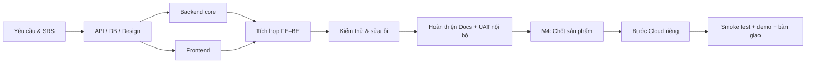

# 10. Master timelines

## 1. Mục đích và phạm vi

Master Timelines xác lập lộ trình phát triển Digital Banking MVP, từ chốt yêu cầu và thiết kế, xây dựng Backend–Frontend, tích hợp, kiểm thử cho đến hoàn thiện sản phẩm. Sau đó mới triển khai Cloud, chạy thử trên môi trường vận hành và tổ chức demo bàn giao.

Mỗi giai đoạn có sản phẩm đầu ra, phụ thuộc và điều kiện hoàn thành. WBS làm rõ nội dung công việc; RACI xác định trách nhiệm theo vai trò; cơ chế change control giữ tiến độ không bị xáo trộn khi phạm vi thay đổi.

**Cloud là bước sau.** Hoàn thiện code, tích hợp, kiểm thử và tài liệu trước; khi Milestone M4 đạt, dự án mới chuyển sang triển khai Cloud. Week 1–4 xác định thứ tự thực hiện, còn ngày thực tế nằm trong bảng theo dõi.

Kế hoạch bám theo Introduction, BRD, SRS, Test plan và work/README. Fraud Detection Option B được quản lý như một nhánh thiết kế mở rộng có phụ thuộc và tiêu chí hoàn thành riêng.

## 2. Nguyên tắc lập kế hoạch

1. **Chốt trước. Làm sau.** Yêu cầu nghiệp vụ, phân quyền, dữ liệu và API contract tạo nền cho các luồng tích hợp.
2. Phân tách **P0 baseline** (register/login, account, transfer, PIN/OTP, operator, audit, correctness) và **P1 proposal** (Fraud Detection Option B nâng cao).
3. Công việc chỉ được xem là hoàn thành khi có deliverable và bằng chứng kiểm tra hoặc xác nhận nhóm; không suy từ task đã tạo.
4. **Rõ điểm chuyển.** Chỉ bắt đầu Cloud khi Milestone M4 xác nhận ứng dụng đã hoàn thiện ở môi trường phát triển.
5. Mỗi công việc có vai trò phụ trách, phụ thuộc, đầu ra và trạng thái. Phân công dùng tên workstream để kế hoạch không lệ thuộc vào danh tính cá nhân.
6. Những thay đổi yêu cầu tác động money path, API hay timeline phải được review trước khi cập nhật baseline.

## 3. Milestone và deliverable

| Milestone | Giai đoạn | Deliverables | Điều kiện đạt |
| --- | --- | --- | --- |
| M1 — Requirements & Design Freeze | W1 | Introduction/BRD/SRS được rà soát; API contract; database design; fraud rules; WBS | Nhóm thống nhất phạm vi, không còn mâu thuẫn cản trở phát triển |
| M2 — Core Functions | W2 | Backend auth/account/transfer/operator; Frontend màn hình nghiệp vụ và kết nối API | Các luồng cơ bản hoạt động trên môi trường phát triển |
| M3 — Integration & Security | W3 | FE–BE integration, PIN/OTP, RBAC/IDOR, idempotency/concurrency, audit, test evidence | Test chính hoạt động, không còn lỗi nghiêm trọng ngăn giao dịch |
| M4 — Product Completion | W4 | Hoàn thiện chức năng, sửa lỗi, UAT nội bộ, tài liệu, bản code được nhóm chốt | **Sản phẩm nội bộ sẵn sàng để triển khai Cloud** |
| M5 — Cloud Deployment | **Bước riêng sau W4** | Cloud environment, deployment config, ứng dụng chạy trên Cloud, hướng dẫn vận hành | Deploy và smoke test thành công |
| M6 — Final Demo & Handover | Sau Cloud | Demo, báo cáo kết quả, tài liệu và known limitations | Nhóm xác nhận bàn giao |

M5 bắt đầu sau khi M4 hoàn tất. Ngày dự kiến và thực tế được cập nhật tại bảng tracking theo tiến độ của các nhóm chức năng.

## 4. Work Breakdown Structure (WBS)

| WBS | Công việc | Kết quả | Người phụ trách dự kiến | Phụ thuộc |
| --- | --- | --- | --- | --- |
| 1.1 | Phân tích Introduction, BRD, SRS; chốt MVP scope | Requirements baseline | Nhóm / Docs | — |
| 1.2 | Thiết kế kiến trúc và dữ liệu | Architecture, database design | BE / thiết kế | 1.1 |
| 1.3 | Hoàn thiện API/team contract và RBAC matrix | API contract | BE + FE | 1.1 |
| 1.4 | Viết Fraud Detection Rules (DESIGN-FRD-03) | Tài liệu 03 | Docs | 1.1–1.3 |
| 1.5 | Viết Master Timelines / WBS | Tài liệu 10 | Docs | 1.1 |
| 2.1 | Xây dựng đăng ký, đăng nhập, OTP recovery, PIN | Auth module | BE | 1.3 |
| 2.2 | Account, giao dịch và chuyển tiền đúng đắn | Transfer/ledger module | BE | 1.2–1.3 |
| 2.3 | Operator, audit và quyền truy cập | Operator/audit module | BE | 1.3 |
| 2.4 | Giao diện người dùng và API integration | FE screens | FE | 1.3 |
| 3.1 | Tích hợp luồng Customer, Operator, Auditor | FE–BE E2E | FE + BE | 2.1–2.4 |
| 3.2 | Kiểm thử transfer, PIN/OTP, phân quyền và race | Test report/evidence | QA/nhóm | 3.1 |
| 3.3 | Rà soát rủi ro và xử lý lỗi | Defect list, fixes | BE + FE | 3.2 |
| 3.4 | Nếu duyệt Option B: thêm daily cap, velocity, hold/review | Feature + tests hoặc deferred scope note | Nhóm phân công | 1.4, 2.2–2.3 |
| 4.1 | Hoàn thiện chức năng và kiểm thử regression | Release candidate nội bộ | Nhóm | 3.1–3.3 và 3.4 nếu được duyệt |
| 4.2 | Hoàn thiện Docs, hướng dẫn sử dụng và UAT nội bộ | Docs + sign-off | Docs + nhóm | 4.1 |
| 5.1 | Chuẩn bị hạ tầng Cloud, secrets, cấu hình | Cloud setup checklist | Người phụ trách Cloud | **M4 đạt** |
| 5.2 | Deploy ứng dụng đã chốt | URL demo / deployment report | Người phụ trách Cloud | 5.1 |
| 5.3 | Smoke test Cloud, xử lý lỗi môi trường, bàn giao | Cloud validation | Nhóm | 5.2 |
| 6.1 | Demo cuối, tổng hợp kết quả và hạn chế | Demo & project report | Nhóm | M5 đạt |

**Phân vai rõ ràng.** Workstream Docs chịu trách nhiệm đặc tả và kế hoạch; Backend, Frontend, QA và Cloud nhận các công việc chuyên môn tương ứng. WBS trình bày tiến độ chung của dự án.

## 5. Timeline theo tuần và bước Cloud

| Giai đoạn | Trọng tâm | Đầu ra |
| --- | --- | --- |
| W1 — Analyze & Design | Yêu cầu, kiến trúc, database, API, fraud rules, kế hoạch | Spec, thiết kế, WBS |
| W2 — Implement Core | Backend auth/account/transfer; Frontend UI | Các chức năng chính |
| W3 — Integration & Testing | FE–BE integration, security, functional tests | Bản tích hợp và danh sách lỗi |
| W4 — Finalize Product | Sửa lỗi, regression, UAT nội bộ, hoàn thiện Docs | Release candidate được nhóm duyệt |
| **Bước 5 — Cloud** | **Sau khi M4 hoàn tất:** cấu hình và deploy lên Cloud | Hệ thống chạy trên Cloud |
| Sau Cloud — Demo/Handover | Smoke test và demo cuối | Báo cáo và bàn giao |

Timeline mô tả thứ tự và điều kiện chuyển giai đoạn. Ngày hoàn thành và các điểm nghẽn được theo dõi trong bảng tiến độ.

## 6. Phụ thuộc và critical path

**Critical path:** chốt yêu cầu → API/database design → code chức năng chính → tích hợp → kiểm thử → chốt sản phẩm → Cloud → demo. Nếu một khâu bắt buộc chưa xong, các khâu phụ thuộc không được tự đánh dấu DONE.

**Option B có nhánh riêng.** Khi thuộc phạm vi phát hành, daily cap, velocity và Operator review nằm trên đường phụ thuộc trước M4. Nếu được xếp cho phiên bản sau, các đầu việc này mang trạng thái `DEFERRED` và được theo dõi độc lập.

## 7. RACI và phân công

R = thực hiện; A = chịu trách nhiệm kết quả; C = tham vấn; I = được thông báo.

| Công việc | Docs | Backend | Frontend | QA/Reviewer | Cloud |
| --- | --- | --- | --- | --- | --- |
| Tài liệu Fraud Detection Rules | A/R | C | I | C | I |
| Master Timelines/WBS | A/R | C | C | C | I |
| API/DB/transfer implementation | C | A/R | C | C | I |
| Giao diện và kết nối frontend | I | C | A/R | C | I |
| Kiểm thử chức năng và security | I | R | R | A | I |
| Triển khai Cloud sau M4 | I | C | C | C | A/R |
| Demo và nghiệm thu toàn nhóm | R | R | R | A (nhóm chốt) | R |

Bảng RACI giao trách nhiệm theo **vai trò**: Docs, Backend, Frontend, QA và Cloud. Mỗi hạng mục có một đầu mối chịu trách nhiệm cuối cùng.

## 8. Release và demo plan

### 8.1. Release candidate nội bộ — trước Cloud

- Hoàn thành phần chức năng thuộc scope được duyệt.
- Frontend–Backend chạy thống nhất; các nghiệp vụ đăng nhập, tài khoản, chuyển tiền và phân quyền có kết quả kiểm thử.
- Xử lý lỗi chính, chốt version/commit và tài liệu hỗ trợ.
- Chốt Option B đã được code hay chỉ là thiết kế cho release sau.

### 8.2. Triển khai Cloud — bước riêng

- Chỉ bắt đầu khi release candidate nội bộ được nhóm xác nhận.
- Chuẩn bị hạ tầng, biến môi trường và secret; không hardcode vào repository.
- Triển khai bản code đã chốt và chạy smoke test trên Cloud.
- Lưu URL, cấu hình mức cao, kết quả chạy và hướng dẫn vận hành; ghi rõ lỗi môi trường nếu phát sinh.

### 8.3. Demo và bàn giao

**Demo đi từ đơn giản đến phức tạp.** Đầu tiên là đăng nhập, xem tài khoản và chuyển tiền bằng PIN. Tiếp theo, giao dịch trên 5 triệu đồng kích hoạt PIN + OTP; sau đó hệ thống hiển thị lịch sử cùng quyền truy cập của Operator và Auditor. Với bản phát hành có Option B, demo thêm giao dịch liên tiếp, cờ rủi ro và quyết định review. Chức năng nằm ngoài release được trình bày trong phần thiết kế.

## 9. Theo dõi tiến độ và change control

- Mỗi task có ID, owner, planned date, actual date, trạng thái và link chứng minh (PR, test result, trang Docs).
- Trạng thái dùng: TODO, IN_PROGRESS, BLOCKED, IN_REVIEW, DONE hoặc VERIFIED.
- Cập nhật tiến độ định kỳ dựa vào báo cáo nhóm; không đánh dấu hoàn thành vì chỉ có tài liệu đề xuất.
- Khi thêm rule thay đổi hạn mức, API, DB hoặc deadline, ghi Change Request: lý do, tác động, phương án, người review và quyết định.
- Nếu đổi scope P1 sang MVP, cập nhật SRS/API/Test plan và WBS tương ứng **bởi các owner phụ trách**, không mặc định giao cho Docs.

### 9.1. Mẫu tracking

| WBS | Owner | Planned | Actual | Status | Evidence/Blocker |
| --- | --- | --- | --- | --- | --- |
| 1.4 Fraud Rules Docs | Docs | TBD | — | IN_REVIEW | Notion / DESIGN-FRD-03 |
| 1.5 Master Timelines Docs | Docs | TBD | — | IN_REVIEW | Notion / Timeline |
| 3.2 Integration tests | QA/nhóm | TBD | — | TODO | Chờ integration |
| 3.4 Fraud Option B | Nhóm chốt owner | TBD | — | PROPOSED | Chưa có quyết định scope |
| 5.2 Deploy Cloud | Cloud owner | Sau M4 | — | NOT_STARTED | Phụ thuộc M4 |

## 10. Rủi ro và phương án xử lý

| Risk | Tác động | Giảm thiểu |
| --- | --- | --- |
| API và FE không khớp | Lỗi tích hợp | Contract-first, E2E sớm |
| Money transfer race/idempotency | Sai số dư/ghi trùng | Transaction và concurrency test |
| PIN/OTP hoặc ownership sai | Vượt phân quyền, sai xác thực | Security negative tests |
| Scope Fraud Detection B tăng nhanh | Trễ MVP | Tách BASELINE và PROPOSED, chốt scope trước M4 |
| Cloud thực hiện khi chưa xong chức năng | Chậm tiến độ, khó debug | M4 là điều kiện bắt buộc của bước Cloud |
| Docs không khớp code | Báo cáo gây hiểu nhầm | Đánh dấu thiết kế/triển khai/kiểm thử riêng |
| Owner/date không được nhóm xác nhận | Sai phân công và tiến độ | Lưu TBD, cập nhật sau buổi thống nhất |

## 11. Change log

| Phiên bản | Ngày | Nội dung | Trạng thái |
| --- | --- | --- | --- |
| 0.1 | 03/11/2026 | Đề cương Master Timelines ban đầu | Đang viết |
| 1.0 | 06/11/2026 | Hoàn thiện milestone, WBS, timeline, RACI, kế hoạch demo và bước Cloud riêng | Bản kế hoạch |

**Tham chiếu:** [Digital Banking MVP repository](https://github.com/TNoLisme/cloude) — Introduction, BRD, SRS, Test plan và work/README. Tài liệu liên quan: [Fraud Detection Rules](https://app.notion.com/p/03-fraud-detection-rules-410141d898e681a29635f574866fe95f?pvs=21).