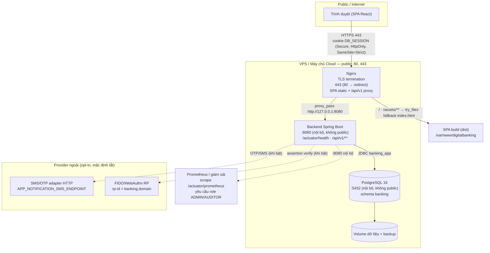

# 12. Triển khai Cloud & Runbook vận hành (`Cloud Deployment & Operations`)

> **Dự án:** Digital Banking MVP — Single-Bank, Core Simulated
> **Mã tài liệu:** `DEPLOY-12`
> **Phiên bản:** 2.0
> **Ngày:** 22/11/2026
> **Trạng thái:** Bản nháp — hai phương án chờ Cloud Owner/Technical Lead chốt
> **Owner:** Cloud (DevOps)
> **Reviewer:** Technical Lead (Phương), Backend (Đạt, Thịnh, Vũ), Frontend (Thắng), Kiểm thử
> **Nguồn tham chiếu:** [[digitalbanking-docs/docs-common/08. Deployment infrastructure.md]] (`DEPLOY-08`), [[digitalbanking-docs/docs-common/10 Master timelines.md]] (`PLAN-10`, WBS 7.1–7.6 & 8.4), [[digitalbanking-docs/docs-backend/deployment/README.md]] (`BE-DEP-01`), [[digitalbanking-docs/docs-backend/deployment/configuration.md]] (`BE-DEP-02`), [[digitalbanking-docs/docs-backend/deployment/common-readiness.md]] (`BE-COM-OPS-08`), source `digitalbanking-backend/`, [[DECISIONS.md]]

---

## 0. Decision summary — Hai phương án triển khai

### 0.1. Target chung

Hai phương án cùng triển khai một Cloud Deployment Target cho deploy, demo, verification và handover.

Target không phải commercial production. Cả hai phương án chỉ dùng dữ liệu synthetic, tải MVP và số lượng người dùng nhỏ.

Không sửa scope `local`, `test`, `demo`, `production` trong các tài liệu nguồn `docs-common`.

### 0.2. Option A — Single VPS Self-managed

```text
VPS Ubuntu x86_64
  -> Nginx + Let's Encrypt
       -> Frontend static
       -> Spring Boot Docker Compose
            -> PostgreSQL 16 container
```

- Giữ gần nhất source/`compose.yaml` hiện tại.
- Toàn quyền PostgreSQL, role, Flyway, trigger và locking.
- Chi phí và số lượng service thấp hơn.
- Tự vận hành patching, backup, restore, monitoring và VM recovery.
- Không có managed PITR/HA mặc định.
- Runbook chi tiết Option A của Đạt được giữ trong các phần sau của tài liệu này.

### 0.3. Option B — AWS Managed Core

```text
Cloudflare DNS
  -> AWS EC2 x86_64
       -> Nginx + Let's Encrypt
            -> Frontend static
            -> Spring Boot Docker Compose
                 -> Amazon RDS PostgreSQL 16 private subnet

RDS backup/PITR + encrypted pg_dump
  -> Amazon S3

GitHub Actions + OIDC
  -> ECR + Systems Manager

CloudWatch
  -> logs, metrics, alarms
```

- RDS cung cấp managed backup/PITR/snapshot.
- S3 cung cấp private bucket, versioning, lifecycle, encryption và checksum.
- IAM/OIDC/ECR/SSM giảm credential dài hạn và public admin surface.
- CloudWatch cung cấp EC2/RDS logs, metrics và alarms.
- Chi phí và cấu hình ban đầu cao hơn Option A.
- RDS role separation, locking semantics và isolated restore phải được verify thật.
- Chi tiết thực thi nằm tại `docs-backend/deployment/cloud-*.md`.

### 0.4. So sánh quyết định

| Tiêu chí | Option A — VPS | Option B — AWS Managed Core |
|---|---|---|
| Compatibility với source hiện tại | Cao nhất | Cao; EC2 vẫn chạy Docker Compose |
| PostgreSQL control | Toàn quyền | Provider restriction cần test |
| Backup/PITR | Tự xây | RDS managed + S3 portable backup |
| Failure-domain separation | Thấp nếu app/DB cùng VPS | Cao hơn: EC2/RDS/S3 tách riêng |
| Security/IAM evidence | Tự cấu hình | IAM, Security Group, SSM, Secrets Manager, CloudTrail |
| Monitoring | Tự ghép | CloudWatch + Actuator + k6 |
| Chi phí | Thấp hơn | Cao hơn, nhiều cost dimension |
| Initial setup | Nhanh hơn | Nhiều bước hơn |
| DB operations | Tự vận hành | Managed |
| Portability | Cao | AWS lock-in cao hơn |
| Recovery evidence | Khó hơn | Mạnh hơn, vẫn phải restore drill |

### 0.5. Recommendation và fallback

**Recommendation:** Option B — AWS Managed Core.

Lý do: AWS có evidence mạnh hơn về private network, managed backup/PITR, storage versioning, IAM, registry identity, monitoring và recovery; đồng thời EC2 vẫn giữ Docker Compose/Nginx topology hiện tại.

**Fallback:** Option A — Single VPS Self-managed.

Dùng Option A nếu AWS account, region, pricing, quota, RDS role separation, RDS locking semantics, isolated restore hoặc deadline không đạt.

Cả hai option giữ trạng thái `Proposed` cho tới khi Cloud Owner/Technical Lead chốt primary và verification gates pass. Không claim `Confirmed`, `Verified`, `RTO/RPO achieved` hoặc `Production-ready` trước runtime evidence.

### 0.6. Owner decision required

Vũ/Cloud Owner cần chốt:

1. Primary option A hoặc B.
2. Provider và region cụ thể.
3. Monthly budget và thời gian giữ resource.
4. RDS Single-AZ có chấp nhận không nếu chọn Option B.
5. Backup retention và restore drill schedule.
6. Domain/DNS ownership.
7. FIDO/OTP/Notification scope trên Cloud.
8. Known limitations chấp nhận cho W8.

---

## 1. Mục đích, phạm vi & Kiến trúc triển khai (WBS 7.2, 7.6)

### 1.1. Mục đích

Tài liệu này là **hướng dẫn triển khai và vận hành Cloud** cho Digital Banking MVP: hạ tầng, mạng, biến môi trường, quy trình deploy theo bước, smoke test, restart/rollback, xử lý sự cố và gói bàn giao cho kiểm thử W8. Mọi giá trị dưới đây được trích từ **source code hiện có**; phần chưa có trong code được đánh dấu `[TBD - Cần Cloud Owner chốt]` kèm đề xuất mặc định.

### 1.2. Ranh giới W7 (Deploy & Validation) vs W8 (Cloud Verification)

| Tuần | WBS | Nội dung | Kết luận được phép |
|---|---|---|---|
| W7 | 7.1–7.6 | Chốt bản deploy, dựng hạ tầng, deploy dữ liệu + ứng dụng, cấu hình proxy/HTTPS, kiểm tra khởi động, ghi runbook | **Deploy thành công** (URL, HTTPS, health `UP`, log, migration sạch) |
| W8 | 8.1–8.7 | Chạy lại hành trình nghiệp vụ trên URL Cloud, kiểm quyền, tính đúng đắn giao dịch, vận hành (8.4), sửa lỗi, demo, bàn giao | **Nghiệp vụ vượt kiểm thử Cloud** — cần evidence `D1–D5` |

W7 **không** kết luận nghiệp vụ đã đúng; W8 **không** thay thế release gate của W6 (`10` §8.2–8.3, `BE-DEP-01` §3.4–3.5).

### 1.3. Thành phần thật của hệ thống (trích từ source)

| Thành phần | Thực tế trong repo | Nguồn |
|---|---|---|
| Backend | Spring Boot 3.5.7, Java 21, Gradle Kotlin DSL, **modular monolith** 11 module (`identity`, `customer`, `account`, `transfer`, `ledger`, `limit`, `audit`, `fraud`, `notification`, `admin`, `common`) | `digitalbanking-backend/build.gradle.kts`, `digitalbanking-docs/docs-backend/README.md` |
| Đóng gói backend | Dockerfile 2 stage (`eclipse-temurin:21-jdk-alpine` → `21-jre-alpine`), chạy non-root user `banking`, `EXPOSE 8080`, `ENTRYPOINT java -jar /app/app.jar`; image `apk add wget` cho healthcheck | `digitalbanking-backend/Dockerfile` |
| Database | PostgreSQL 16 (`postgres:16-alpine`), schema `banking`, Flyway forward-only `V1`–`V25`, `validate-on-migrate: true`, `ddl-auto: validate`, không dùng `V2__create_ledger_entry.sql`/`V12__transfer.sql` trong `db/ledger-candidate` và `db/transfer-candidate` (không nằm trong `classpath:db/migration`) | `compose.yaml`, `application.yml`, `src/main/resources/db/migration` (25 file) |
| Phân quyền DB | `banking_migrator` (DDL/Flyway, owner schema) và `banking_app` (runtime, DML least-privilege) tạo bằng script init của container | `docker/postgres/init/01-create-roles.sql` |
| Frontend | React SPA + TypeScript + Vite + React Router (**đặc tả**); **source chưa có trong repo** — `digitalbanking-frontend/` chỉ có `.gitkeep` | `digitalbanking-docs/docs-frontend/standards/01-architecture.md` (FE-ARCH-01), `digitalbanking-frontend/` |
| Reverse proxy / TLS | Nginx là TLS boundary + phục vụ SPA tĩnh + proxy `/api/v1/**` (**quyết định đã chốt**); **chưa có file cấu hình `nginx.conf` trong repo** | `08` §13.2 `OI-DEP-04`, `08` §3.2 |
| Cache / Message queue | **Không có** Redis/RabbitMQ/Kafka trong repo. Notification dùng outbox trong PostgreSQL + worker lease (`SKIP LOCKED`); fraud chạy **in-process** trong `T2` | `build.gradle.kts` (không có dependency cache/broker), `digitalbanking-docs/docs-backend/README.md` (module 09/08) |
| Provider ngoài | OTP/Notification qua HTTP adapter (mặc định **tắt**, có simulator QA `python:3.12-alpine`); FIDO local verification bằng Yubico `webauthn-server-core` | `compose.yaml`, `compose.qa.yaml`, `build.gradle.kts` |
| Observability | Micrometer Prometheus `/actuator/prometheus`, health `/actuator/health` + `/api/v1/health`, log JSON 1 dòng ra `stdout` qua `SafeJsonLogEncoder`; **không có** file `prometheus.yml` scrape config trong repo (chỉ có alert rules) | `application.yml`, `logback-spring.xml`, `ops/prometheus/*.yml` |
| CI/CD | **Không có** workflow trong repo (`.github/workflows` không tồn tại) — release gate `05`/`06` §11.4 chưa tự động hóa | kiểm tra cây repo |
| Secret | `.env` bị `.gitignore`; chỉ `.env.example` được commit | `.gitignore`, `digitalbanking-backend/.env.example` |

### 1.4. Quyết định nền tảng Cloud — `[TBD - Cần Cloud Owner chốt]`

Repo chưa có provider/region Cloud được xác nhận. `08` §13.1 `AD-DEP-01` chỉ chốt triển khai gọn nhẹ, tái lập được bằng Docker Compose cho MVP.

| Phương án | Mô tả | Ưu điểm kỹ thuật | Nhược điểm kỹ thuật | Trạng thái |
|---|---|---|---|---|
| **A. VPS Ubuntu + Docker Compose + Nginx** | Một VPS chạy Nginx, Frontend, Backend và PostgreSQL 16 container; backup ra storage ngoài | Khớp source/Compose; toàn quyền DB roles/Flyway; ít provider coupling; chi phí và setup thấp hơn | Tự vận hành DB, patching, backup, restore, monitoring và VM recovery; failure domain gộp; không managed PITR/HA mặc định | **Proposed — fallback** |
| **B. AWS EC2 + RDS PostgreSQL 16 + S3** | EC2 chạy Nginx/Frontend/Backend; RDS private; S3 backup; ECR/Secrets Manager/CloudWatch/SSM | Managed backup/PITR/snapshot; private subnet; S3 versioning/lifecycle; IAM/OIDC/ECR/SSM/CloudWatch evidence mạnh hơn | VPC/IAM/subnet phức tạp; nhiều cost dimension; RDS role/locking/restore phải test; AWS lock-in cao hơn | **Proposed — recommendation** |
| C. PaaS (Render/Railway/Cloud Run) | Deploy container và DB managed theo platform | Provision application nhanh | Không giữ rõ Nginx/cookie/topology; DB role/network/recovery evidence phụ thuộc platform | **Not selected** |
| D. ECS Fargate + RDS + ALB | Container orchestration trên AWS | Tách service/orchestration mạnh hơn | Vượt nhu cầu và scope MVP; thêm ALB/IaC/orchestration | **Out of scope** |

**Thông số chung:** Cả hai option dùng một origin HTTPS, Nginx phục vụ SPA/proxy API, synthetic data và không public Backend/PostgreSQL.

| Thông số | Option A — VPS | Option B — AWS |
|---|---|---|
| Provider/region | `[TBD]`; ưu tiên region gần người dùng | `[TBD]`; chốt theo RDS/EC2 availability và pricing |
| Compute | VPS Ubuntu 24.04 LTS, baseline 2 vCPU/4 GB/40 GB SSD | EC2 x86_64 `t3`/`t3a`, resource chốt sau pricing/capacity check |
| Database | PostgreSQL 16 container, roles tạo bằng init script | RDS PostgreSQL 16, DB Subnet Group hai AZ, baseline Single-AZ |
| DNS/TLS | DNS A record + Nginx/Let's Encrypt | Cloudflare DNS DNS-only + Nginx/Let's Encrypt |
| Backup | Encrypted `pg_dump` tới storage ngoài VPS, restore drill | RDS backup/PITR/snapshot + encrypted `pg_dump` tới S3, restore drill |
| Admin | SSH key allowlist/provider console | AWS Systems Manager Session Manager; không public SSH baseline |
| Artifact | Immutable image SHA/digest | ECR immutable image digest |

**Recommendation:** Option B — AWS Managed Core, vì evidence mạnh hơn về private network, managed backup/PITR, storage versioning, IAM, registry identity, monitoring và recovery; EC2 vẫn giữ Docker Compose/Nginx topology.

**Fallback:** Option A — Single VPS Self-managed, khi AWS account, region, pricing, quota, RDS role separation, locking semantics, isolated restore hoặc deadline không đạt.

Cả hai option giữ trạng thái `Proposed` tới khi Cloud Owner/Technical Lead chốt primary và verification gates pass. Không claim `Confirmed`, `Verified`, `RTO/RPO achieved` hoặc `Production-ready` trước runtime evidence.

**Owner decision required:**

1. Primary option A hoặc B.
2. Provider/region và monthly budget.
3. RDS Single-AZ có chấp nhận không nếu chọn Option B.
4. Backup retention và restore drill schedule.
5. Domain/DNS ownership.
6. FIDO/OTP/Notification scope trên Cloud.
7. Known limitations chấp nhận cho W8.

Ghi nhận decision proposal: [[DECISIONS.md]] `DEC-CLD-001`.

### 1.5. Option A — VPS: sơ đồ môi trường và runbook chi tiết

Các mục triển khai chi tiết từ đây tới trước phần bàn giao được giữ theo Option A — Single VPS Self-managed. Không áp dụng các lệnh/container PostgreSQL trực tiếp trong section này cho Option B AWS; Option B dùng các tài liệu provider-specific tại `docs-backend/deployment/cloud-*.md`.



Ranh giới bắt buộc (`08` §3.3, `BE-COM-OPS-08` §1):

1. Chỉ **80/443** công khai; backend `8080` và PostgreSQL `5432` **chỉ nội bộ** (Docker network hoặc loopback).
2. Chỉ backend truy cập dữ liệu nghiệp vụ; không có truy cập DB từ ngoài.
3. `/actuator/health`, `/actuator/info` public (probe); `/actuator/**` còn lại yêu cầu role `ADMIN`/`AUDITOR` (`SecurityFilterChainConfig.java:86-87`).
4. SPA và API **cùng origin** để cookie `SameSite=Strict` hoạt động (`docs-frontend/guides/01-local-development.md` §4, GAP-05).

---

## 2. Yêu cầu hạ tầng, mạng & bảo mật (WBS 7.1, 7.2)

### 2.1. Tài nguyên tối thiểu

| Thành phần | CPU | RAM | Disk | Managed / tự vận hành | Ghi chú từ source |
|---|---:|---:|---:|---|---|
| Nginx (TLS + static + proxy) | 0.25 vCPU | 128 MB | 1 GB | Tự cài (hoặc cùng VPS) | Không có file cấu hình trong repo — phải viết mới |
| Backend (JVM) | 1 vCPU | 1.5–2 GB | 1 GB (image + log) | Tự vận hành | Không có `-Xmx` trong `Dockerfile`; đề xuất `JAVA_TOOL_OPTIONS=-XX:MaxRAMPercentage=65` **[Đề xuất]** |
| PostgreSQL 16 | 1 vCPU | 1 GB+ | 10 GB+ (tăng theo audit) | Tự vận hành hoặc managed | `DB_POOL_MAX_SIZE=20` → ~20 connection, `shared_buffers` mặc định 128 MB đủ cho MVP |
| Lưu trữ backup | — | — | ≥ 3× dung lượng DB | Bắt buộc ngoài volume runtime | `BE-DEP-01` §5.1 yêu cầu `pg_dump -Fc` + checksum + restore drill |
| SMS simulator (chỉ QA) | 0.1 vCPU | 64 MB | — | Chỉ môi trường QA | `compose.qa.yaml` service `sms` (`python:3.12-alpine`) |
| Build/CI | 2 vCPU | 4 GB | 5 GB | **Không build trên VPS** | `maxHeapSize = "3g"` cho test + Testcontainers cần Docker (`build.gradle.kts`); build ở CI/local rồi đẩy image |

Mục tiêu năng lực giữ nguyên baseline `08` §3.4: `20 RPS × 10 phút`, transfer p95 ≤ 2s, p99 ≤ 5s, error rate < 1% (`NFR-001`, `NFR-004`).

### 2.2. Firewall / Security Group

| Cổng | Nguồn | Giao thức | Mục đích | Ghi chú |
|---|---|---|---|---|
| `22/tcp` (SSH) | IP quản trị (allowlist) | TCP | Quản trị máy chủ | Không mở `0.0.0.0/0`; ưu tiên SSH key, tắt password auth |
| `80/tcp` | `0.0.0.0/0` | TCP | ACME challenge + redirect HTTPS | Chỉ phục vụ redirect 301 → 443 (trừ `/.well-known/acme-challenge/`) |
| `443/tcp` | `0.0.0.0/0` | TCP | HTTPS công khai | TLS 1.2/1.3, HSTS |
| `8080/tcp` | **Nội bộ only** | TCP | Backend API | Trong `compose.yaml`, port chỉ bind `127.0.0.1:${BACKEND_PORT:-18080}:8080` → **giữ nguyên nguyên tắc loopback**, không publish ra Internet |
| `5432/tcp` | **Nội bộ only** | TCP | PostgreSQL | Trong `compose.yaml` bind `127.0.0.1:${POSTGRES_PORT:-15432}:5432`; **trên Cloud nên bỏ hẳn khai báo `ports` của postgres** |
| `9090/tcp` | **Nội bộ only** | TCP | Prometheus scrape (nếu tự dựng) | Không có `prometheus.yml` trong repo — tạo mới, scrape `backend:8080/actuator/prometheus` |

### 2.3. Quản lý truy cập & TLS

- **Tài khoản máy chủ:** 1 user không phải `root` để vận hành, `sudo` có kiểm soát; Cloud Owner/DevOps giữ khoá; **không** dùng chung tài khoản.
- **Container:** backend chạy user `banking` (non-root) — giữ nguyên (`Dockerfile`).
- **DB:** hai role tách biệt `banking_migrator` / `banking_app` (`docker/postgres/init/01-create-roles.sql`). Không dùng role migration cho runtime và ngược lại (`design/04` §6.5).
- **TLS:** TLS termination tại Nginx; chứng chỉ Let's Encrypt auto-renew; `443` bắt buộc cho mọi origin công khai vì cookie `DB_SESSION` cần `Secure`.
- **HSTS:** `ApiSecurityHeadersFilter` chỉ gắn `Strict-Transport-Security` khi `request.isSecure()`. Vì `server.forward-headers-strategy: none` (`application.yml`), ứng dụng luôn thấy scheme `http` sau proxy ⇒ **HSTS phải do Nginx thêm**, xem §8 `RSK-04`.
- **Security headers khác** đã có ở tầng app (`ApiSecurityHeadersFilter`): `Cache-Control: no-store`, `Pragma: no-cache`, `Expires: 0`, `X-Content-Type-Options: nosniff`, `X-Frame-Options: DENY`, `Referrer-Policy: no-referrer`, `Content-Security-Policy: frame-ancestors 'none'`.

### 2.4. Quản lý Secrets

| Secret | Nơi lưu | Quy tắc |
|---|---|---|
| `DB_APP_PASSWORD`, `DB_MIGRATION_PASSWORD`, `POSTGRES_SUPERUSER_PASSWORD` | Secret store / file `.env` chỉ `chmod 600` trên máy chủ; hoặc Docker Secret | Không commit; không truyền qua tham số dòng lệnh (`BE-COM-OPS-08` §4.3) |
| `APP_PII_AES_KEY_BASE64`, `APP_HMAC_KEY_BASE64` | Secret store | **Sinh riêng cho từng môi trường**: `openssl rand -base64 32`; hai khoá độc lập; không dùng giá trị mẫu trong `.env.example`/`compose.yaml` |
| `APP_QA_PASSWORD`, `QA_SMS_TOKEN` | Chỉ môi trường QA | Mỗi giá trị ≥ 16 ký tự (`compose.qa.yaml` dùng `:?` buộc phải set) |

Fail-fast đã có trong code (`CryptoConfig.java`): thiếu khoá, sai độ dài (≠ 32 byte), hoặc khoá lặp byte/giá trị mẫu trên profile `demo` ⇒ **ứng dụng từ chối khởi động** (không lộ giá trị bí mật ra log).

---

## 3. Danh mục biến môi trường & Secrets (WBS 7.2)

Cột **Nguồn trong code** là nơi biến thực sự được đọc. Mọi biến dưới đây tồn tại trong repo; không có biến nào được suy diễn thêm.

### 3.1. Runtime & môi trường

| Thành phần | Tên biến | Bắt buộc | Loại | Mục đích & giá trị mẫu | Nguồn trong code |
|---|---|---|---|---|---|
| Backend | `SPRING_PROFILES_ACTIVE` | Có | Config | `demo` trên Cloud (**không** dùng `local`/`test`) | `compose.yaml`, `application-local.yml`, `BE-COM-OPS-08` §2 |
| Backend | `SERVER_PORT` | Không | Config | `8080` (cổng nội bộ trong container) | `application.yml` |
| Backend | `APP_ENVIRONMENT` | Không | Config | Nhãn môi trường trong JSON log: `demo` | `application.yml` (`logging.environment`) |
| Backend | `APP_VERSION` | Không | Config | Phiên bản build hiển thị ở `/actuator/info` + `/api/v1/health`: `<git-sha>` | `application.yml` (`info.app.version`) |
| Backend | `APP_TIMEZONE` | Không | Config | `Asia/Ho_Chi_Minh`; `ZoneId` hợp lệ, không rỗng; timestamp lưu trữ vẫn UTC | `application.yml`, `AppProperties.java` |
| Compose (host) | `BACKEND_PORT` | Không | Config | `18080` — port publish ra loopback máy chủ | `compose.yaml` |
| Compose (host) | `POSTGRES_PORT` | Không | Config | `15432` — port publish ra loopback máy chủ | `compose.yaml` |

### 3.2. Database

| Thành phần | Tên biến | Bắt buộc | Loại | Mục đích & giá trị mẫu | Nguồn trong code |
|---|---|---|---|---|---|
| Database | `DB_HOST` | Có trên demo | Config | `postgres` (tên service trong network) hoặc hostname DB managed | `application.yml` |
| Database | `DB_PORT` | Không | Config | `5432` | `application.yml` |
| Database | `DB_NAME` | Không | Config | `digital_banking` | `application.yml`, `compose.yaml` |
| Database | `DB_APP_USER` | Có | Config | `banking_app` (runtime least-privilege) | `application.yml` |
| Database | `DB_APP_PASSWORD` | Có | **Secret** | Mật khẩu runtime — sinh mới, không dùng giá trị mẫu | `application.yml`, `docker/postgres/init/01-create-roles.sql` |
| Database | `DB_MIGRATION_USER` | Có | Config | `banking_migrator` (chạy Flyway) | `application.yml` |
| Database | `DB_MIGRATION_PASSWORD` | Có | **Secret** | Mật khẩu migration — khác `banking_app` | `application.yml`, `docker/postgres/init/01-create-roles.sql` |
| Database | `DB_POOL_MAX_SIZE` | Không | Config | `20` (HikariCP max) | `application.yml` |
| Database | `DB_POOL_MIN_IDLE` | Không | Config | `5` | `application.yml` |
| Database | `POSTGRES_SUPERUSER_PASSWORD` | Chỉ local/compose | **Secret** | Mật khẩu superuser của container PostgreSQL (**không** dùng trên Cloud nếu DB managed) | `compose.yaml` |

### 3.3. Khoá mật mã

| Thành phần | Tên biến | Bắt buộc | Loại | Mục đích & giá trị mẫu | Nguồn trong code |
|---|---|---|---|---|---|
| Crypto | `APP_PII_AES_KEY_BASE64` | **Có** | **Secret** | AES-256-GCM cho PII; Base64 đúng 32 byte; sinh `openssl rand -base64 32` | `application.yml`, `CryptoConfig.java` |
| Crypto | `APP_HMAC_KEY_BASE64` | **Có** | **Secret** | HMAC-SHA-256 cho blind index (số TK/CCCD/liên hệ); Base64 đúng 32 byte; **khác** khoá AES | `application.yml`, `CryptoConfig.java` |
| Crypto | `APP_PII_AES_KEY_ID` | Không | Config | `k-v1` — metadata phiên bản khoá | `application.yml` |
| Crypto | `app.crypto.previous-keys` | Không | Config | **Phải rỗng `[]`**; cấu hình khác ⇒ fail startup (chưa hỗ trợ xoay khoá) | `application.yml`, `CryptoConfig.java` |

### 3.4. Web, session, CSRF & CORS

| Thành phần | Tên biến | Bắt buộc | Loại | Mục đích & giá trị mẫu | Nguồn trong code |
|---|---|---|---|---|---|
| Session | `APP_COOKIE_SECURE` | Không | Config | `false` ở base/local; `application-demo.yml` cố định `secure: true` → **trên Cloud không cần set, nhưng phải chạy profile `demo`** | `application.yml`, `application-demo.yml`, `AppProperties.java` |
| Session | `app.security.cookie.name` | Không có ENV | Config | `DB_SESSION` — **lưu ý**: `SessionAuthenticationFilter` so khớp chuỗi `"DB_SESSION"` cứng, xem `RSK-06` | `application.yml`, `SessionAuthenticationFilter.java:42` |
| Session | `app.security.session.idle-timeout-minutes` / `absolute-timeout-hours` | Không có ENV | Config | `15` / `8` — ghi đè bằng `SPRING_APPLICATION_JSON` nếu cần | `application.yml` |
| CORS | `APP_CORS_ALLOWED_ORIGINS` | **Có trên demo** | Config | Danh sách origin HTTPS tường minh, ví dụ `https://banking.<domain>`; **thiếu/`*` ⇒ fail startup** | `application.yml`, `application-demo.yml`, `SecurityFilterChainConfig.java` |
| CORS | `SPRING_APPLICATION_JSON` | Không | Config | Ghi đè thuộc tính lồng (đã dùng ở `compose.qa.yaml`); dùng được khi không có ENV tương ứng | `compose.qa.yaml` (mẫu) |

### 3.5. FIDO / WebAuthn

| Thành phần | Tên biến | Bắt buộc | Loại | Mục đích & giá trị mẫu | Nguồn trong code |
|---|---|---|---|---|---|
| FIDO | `APP_FIDO_ENABLED` | Không | Config | `false` mặc định; chỉ bật khi đã có RP ID/origin thật | `application.yml`, `.env.example` |
| FIDO | `APP_FIDO_RP_ID` | Có nếu bật FIDO | Config | `banking.<domain>` (không có scheme, không port) | `application.yml`, `FidoProperties.java` |
| FIDO | `APP_FIDO_ALLOWED_ORIGINS` | Có nếu bật FIDO | Config | `https://banking.<domain>` — **HTTP `localhost` chỉ được phép ở profile `local`/`test`** | `YubicoFidoAssertionVerifier.java:64` |
| FIDO | `APP_FIDO_CHALLENGE_TTL` | Không | Config | `PT30S` | `application.yml` |
| OTP | `app.security.otp.ttl-seconds` / `recovery-ttl-seconds` / `max-verify-attempts` / `resend-cooldown-seconds` / `max-resend-count` | Không có ENV | Config | `300` / `120` / `5` / `60` / `3` | `application.yml` |

### 3.6. Chuyển tiền & nghiệp vụ ngoại hóa

| Thành phần | Tên biến | Bắt buộc | Loại | Mục đích & giá trị mẫu | Nguồn trong code |
|---|---|---|---|---|---|
| Transfer | `APP_TRANSFER_ENABLED` | Không | Config | `true` — adapter Transfer thật đăng ký mặc định (`DEC-INT-020`) | `application.yml`, `compose.yaml` |
| Transfer | `APP_TRANSFER_RECOVERY_ENABLED` | Không | Config | `false` — job recovery là **opt-in**; QA bật tường minh | `application.yml`, `compose.qa.yaml`, `application.yml` (`app.jobs.reconciliation-*`) |
| Transfer | `app.transfer.min-amount-vnd` … `fraud-eval-timeout-ms` | Không có ENV | Config | `2000` … `10000000`; `daily-cap-vnd: 50000000`; `idempotency-ttl-hours: 24`; `t2-lock-timeout-ms: 2000` | `application.yml` |
| Step-up | `app.security.step-up.single-amount-vnd` / `daily-amount-vnd` | Không có ENV | Config | `10000000` / `20000000` (`DEC-TRF-002`) | `application.yml` |
| Fraud | `app.fraud.velocity-count` / `velocity-window-seconds` / `warning-ttl-minutes` / `review-timeout-minutes` | Không có ENV | Config | `3` / `120` / `15` / `30`; rule/ngưỡng versioned trong `banking.fraud_rule_config` (`OI-DEP-02`) | `application.yml` |
| Notification | `APP_NOTIFICATION_SMS_ENABLED` | Không | Config | `false` mặc định; bật khi có endpoint thật | `application.yml`, `compose.qa.yaml` |
| Notification | `APP_NOTIFICATION_SMS_ENDPOINT` | Không | Config | Rỗng mặc định; QA dùng `http://sms:8080/messages` | `application.yml`, `compose.qa.yaml` |
| Notification | `APP_NOTIFICATION_WORKER_ENABLED` | Không | Config | `false` mặc định (outbox worker) | `application.yml`, `compose.qa.yaml` |
| Jobs | `app.jobs.*` (reconciliation, outbox, audit-verify cron, retention cron) | Không có ENV | Config | `reconciliation-interval-ms: 60000`; `audit-verify-incremental-cron: "0 */15 * * * *"`; `retention-cleanup-cron: "0 0 3 * * *"` | `application.yml` |
| Admin | `APP_ADMIN_IDEMPOTENCY_TTL_HOURS` / `APP_ADMIN_IDEMPOTENCY_PURGE_BATCH_SIZE` | Không | Config | `24` / `500` | `application.yml`, `.env.example` |
| Admin | `APP_ADMIN_OPS_ENABLED` / `APP_ADMIN_OPS_STUCK_AFTER` / `APP_ADMIN_OPS_ATTEMPT_WINDOW` / `APP_ADMIN_OPS_MAX_FAILED_ATTEMPTS` / `APP_ADMIN_OPS_SWEEP_DELAY` / `APP_ADMIN_OPS_SWEEP_INITIAL_DELAY` | Không | Config | `true` / `PT30M` / `PT1H` / `5` / `PT5M` / `PT1M` | `application.yml` |

### 3.7. Giới hạn HTTP & rate limit (process-local)

| Thành phần | Tên biến | Bắt buộc | Loại | Mục đích & giá trị mẫu | Nguồn trong code |
|---|---|---|---|---|---|
| HTTP | `APP_MAX_REQUEST_BODY_BYTES` | Không | Config | `65536` — vượt ⇒ `413` có trace | `application.yml`, `RequestBodyLimitFilter.java` |
| HTTP | `APP_MAX_RATE_LIMIT_BUCKETS` | Không | Config | `10000` — cạn bucket ⇒ **fail-closed `503`** | `application.yml`, `RequestRateLimiter.java` |
| Rate limit | `APP_LOGIN_PER_IP_PER_MINUTE` | Không | Config | `10` | `application.yml` |
| Rate limit | `APP_LOGIN_PER_USERNAME_PER_MINUTE` | Không | Config | `10` (cần tích hợp identity để gắn đúng subject) | `application.yml` |
| Rate limit | `APP_STEP_UP_PER_USER_PER_5_MINUTES` | Không | Config | `10` | `application.yml` |
| Rate limit | `APP_OTP_VERIFY_PER_USER_PER_MINUTE` | Không | Config | `20` | `application.yml` |
| Rate limit | `APP_TRANSFER_RATE_LIMIT_PER_CUSTOMER_PER_MINUTE` | Không | Config | `30` | `application.yml`, `compose.yaml` |
| Rate limit | `APP_AUDIT_EXPORT_PER_USER_PER_HOUR` | Không | Config | `5` | `application.yml` |
| Rate limit | `APP_GLOBAL_API_PER_SUBJECT_PER_MINUTE` | Không | Config | `120` | `application.yml` |
| Lockout | `APP_LOCKOUT_MAX_FAILED_ATTEMPTS` / `APP_LOCKOUT_DURATION_MINUTES` | Không | Config | `5` / `10` | `application.yml` |

### 3.8. Chỉ dùng cho QA (không bật trên Cloud demo)

| Thành phần | Tên biến | Bắt buộc | Loại | Mục đích & giá trị mẫu | Nguồn trong code |
|---|---|---|---|---|---|
| QA seed | `APP_QA_SEED` | Chỉ QA | Config | `true` — nạp fixture synthetic; **yêu cầu profile duy nhất `local`** và DB QA riêng; sẽ ném lỗi nếu DB đã có dữ liệu khác | `compose.qa.yaml`, `LocalQaSeed.java:18,35` |
| QA seed | `APP_QA_PASSWORD` | Chỉ QA | **Secret** | ≥ 16 ký tự | `LocalQaSeed.java`, `compose.qa.yaml` |
| QA SMS | `QA_SMS_TOKEN` | Chỉ QA | **Secret** | Token mailbox simulator | `compose.qa.yaml`, `scripts/qa-api-smoke.py` |
| QA | `QA_API_BASE` / `QA_SMS_BASE` | Không | Config | `http://localhost:18080/api/v1` / `http://127.0.0.1:18081` | `scripts/qa-api-smoke.py` |

> `APP_NOTIFICATION_SMS_*` với endpoint simulator và `app.notification.sms.demo-staff-contacts` (map số điện thoại staff) trong `compose.qa.yaml` là **cấu hình QA**, không dùng cho môi trường demo/Cloud công khai.

### 3.9. Ghi chú bắt buộc khi chuyển từ `localhost` lên domain thật

1. **HTTPS + Cookie:** cookie `DB_SESSION` cần `Secure; HttpOnly; SameSite=Strict; Path=/; Max-Age=28800` (`design/04` §6.2, `application.yml`). Trên Cloud **bắt buộc** profile `demo` (đặt `secure: true`) + HTTPS. Nếu SPA và API khác **site** (khác domain gốc), cookie `SameSite=Strict` không được gửi ⇒ login xong vẫn bị `401`. Giữ một origin `https://banking.<domain>`, Nginx phục vụ SPA và proxy `/api/v1`.
2. **CSRF:** mọi request `POST/PUT/PATCH/DELETE` xác thực bằng cookie phải có header `X-CSRF-Token` (so hash với giá trị lưu cùng session). `403 AUTH_FORBIDDEN` không kèm header này là hành vi đúng, không phải lỗi cấu hình (`SecurityFilterChainConfig.java` + `SessionCsrfTokens.java`).
3. **CORS:** phải khai báo origin HTTPS tường minh; `SecurityFilterChainConfig` từ chối origin rỗng, chứa `*`, có path/query/userinfo. `application-demo.yml` **không** fallback `localhost` ⇒ thiếu biến là fail startup.
4. **FIDO/WebAuthn:** `rp-id` = domain không scheme; `allowed-origins` = origin HTTPS đầy đủ. HTTP `localhost` chỉ chấp nhận ở profile `local`/`test` (`YubicoFidoAssertionVerifier.java:64`) ⇒ bật FIDO trên Cloud mà cấu hình origin HTTP sẽ lỗi.
5. **Forwarded headers:** giữ `server.forward-headers-strategy: none` cho tới khi xác nhận Nginx chặn truy cập trực tiếp backend và ghi đè hoàn toàn `X-Forwarded-For`/`X-Forwarded-Proto` (`BE-DEP-02` §4.4). Hệ quả khi giữ `none`: rate limit theo IP và log IP nhìn thấy IP của Nginx, xem `RSK-05`.
6. **Không dùng profile `local` trên Cloud:** `application-local.yml` bật `springdoc` (`/v3/api-docs`, `/swagger-ui`) và `SecurityFilterChainConfig` permitAll các path này ⇒ lộ tài liệu API công khai. Ngoài ra profile `local` cho phép khoá mẫu của `.env.example`/`compose.yaml`.

---

## 4. Pre-Deployment Checklist (WBS 7.1)

### 4.1. Release gate (chỉ deploy khi đạt đủ)

| # | Điều kiện | Bằng chứng | Tham chiếu |
|---|---|---|---|
| 1 | Release candidate từ W6 đã chốt: **tag/commit SHA** cố định, bất biến | `git rev-parse HEAD`/tag + image digest | `08` §7.2, `PLAN-10` §8.1 |
| 2 | `./gradlew clean check` PASS trên commit đó | Log test report | `BE-DEP-01` §3.2 |
| 3 | Tích hợp liên module hoàn tất, release gate `D1–D5` có kết quả liên quan | `docs-backend/workofteam/integration modules/BE-INT-*-verification.md` | `BE-DEP-01` §3.4 |
| 4 | Chuỗi Flyway `V1`–`V25` chạy sạch **trên DB trống**, `ddl-auto: validate` PASS | Log Flyway + version `25` | `BE-DEP-01` §4.1 Gate 2 |
| 5 | Không có secret/khoá trong Git hoặc image; `banking_app` không có quyền DDL và không `UPDATE/DELETE` trên `ledger_entry`/`audit_log` | `git log`/image scan + kiểm tra grant | `08` §6.1, `design/04` §6.5 |
| 6 | OpenAPI `1.1.0` khớp controller/DTO (`/v3/api-docs` vs `openapi/digital-banking-v1.yaml`) | Báo cáo đối chiếu (`qa-backend-local.md` ghi 30/30 operation) | `BE-DEP-01` §4.1 Gate 1 |
| 7 | Có **backup DB** trước deploy + checksum + đã restore thử | File `.dump` + `.sha256` + log restore | `BE-DEP-01` §5.1–5.2 |
| 8 | Cấu hình Cloud đã soát theo §3: profile `demo`, khoá mới, CORS/FIDO/origin thật, secret ngoài image | Bản cấu hình đã che secret | `BE-COM-OPS-08` §2 |

### 4.2. Kiểm tra chế độ dev/mock nguy hiểm phải TẮT trước khi deploy

| Hạng mục | Trạng thái an toàn trên Cloud | Nguồn |
|---|---|---|
| `SPRING_PROFILES_ACTIVE` | `demo` (không `local`, không `test`, không gộp profile) | `application-demo.yml`, `BE-COM-OPS-08` §2 |
| `APP_QA_SEED` | **không set / `false`** | `LocalQaSeed.java:18` |
| `springdoc` / Swagger UI | tắt (chỉ profile `local` bật) | `application.yml`, `application-local.yml` |
| `APP_COOKIE_SECURE` | `true` (profile `demo` cố định) | `application-demo.yml` |
| Khoá AES/HMAC | Khoá sinh mới, không dùng giá trị mẫu `MDEyMzQ1…`/`MTEyMzQ1…` | `.env.example`, `CryptoConfig.java` |
| `APP_TRANSFER_RECOVERY_ENABLED` | Chỉ bật khi BE-INT-10 đã được chốt cho môi trường này (`DEC-INT-019`) | `application.yml` |
| `APP_NOTIFICATION_SMS_ENDPOINT` | Trỏ provider thật hoặc để trống; **không** trỏ simulator QA | `compose.qa.yaml` |

### 4.3. Sao lưu trước deploy

```bash
# Chạy trên máy có quyền đọc DB; role backup riêng nếu có, không dùng banking_app cho full dump
BACKUP_FILE="backups/digital_banking_$(date -u +%Y%m%dT%H%M%SZ).dump"
pg_dump -h "$DB_HOST" -p "$DB_PORT" -U "$DB_MIGRATION_USER" -d "$DB_NAME" -n banking -Fc -f "$BACKUP_FILE"
sha256sum "$BACKUP_FILE" > "${BACKUP_FILE}.sha256"   # macOS: shasum -a 256
```

Backup **không được coi là evidence** nếu chưa restore thử thành công (`BE-DEP-01` §5.1, `08` §8.3–8.5).

---

## 5. Quy trình triển khai chi tiết — Step-by-Step (WBS 7.3)

Biến dùng chung: `CLOUD_APP_DIR=/opt/digitalbanking`, `DOMAIN=banking.<domain>`, `IMAGE=digitalbanking-backend:$(git rev-parse --short HEAD)`.

### Bước 1 — Chuẩn bị hạ tầng & mạng

```bash
# 1.1. Máy chủ: user vận hành, SSH key, tắt password auth
sudo adduser ops && sudo usermod -aG sudo ops
# 1.2. Firewall: chỉ 22 (allowlist), 80, 443
sudo ufw default deny incoming && sudo ufw allow from <IP_QUAN_TRI> to any port 22 proto tcp
sudo ufw allow 80/tcp && sudo ufw allow 443/tcp && sudo ufw enable
# 1.3. Docker Engine + Compose plugin
curl -fsSL https://get.docker.com | sh && sudo usermod -aG docker ops

# 1.4. Lấy mã nguồn ở đúng commit release
sudo mkdir -p $CLOUD_APP_DIR && sudo chown ops: $CLOUD_APP_DIR
git clone https://github.com/TNoLisme/cloude "$CLOUD_APP_DIR" && cd "$CLOUD_APP_DIR"
git checkout <TAG_HOAC_COMMIT_RELEASE>
```

### Bước 2 — Khởi tạo Database, Migration & Seed an toàn

```bash
cd "$CLOUD_APP_DIR/digitalbanking-backend"
cp .env.example .env && chmod 600 .env
# Sửa .env: SPRING_PROFILES_ACTIVE=demo, DB_* trỏ DB thật, hai khoá sinh mới:
openssl rand -base64 32   # APP_PII_AES_KEY_BASE64
openssl rand -base64 32   # APP_HMAC_KEY_BASE64  (khác khoá trên)
# Sinh mật khẩu role riêng: DB_APP_PASSWORD, DB_MIGRATION_PASSWORD, POSTGRES_SUPERUSER_PASSWORD
```

- Trên VPS dùng PostgreSQL container: script `docker/postgres/init/01-create-roles.sql` chỉ chạy **khi volume trống** — đảm bảo volume mới trước lần up đầu tiên, sau đó **không** xoá volume.
- Nếu dùng DB managed (RDS/Cloud SQL): chạy thủ công nội dung `01-create-roles.sql` bằng user có quyền tạo role, thay `BANKING_APP_PASSWORD`/`BANKING_MIGRATION_PASSWORD`. Script tạo role, `CREATE SCHEMA banking AUTHORIZATION banking_migrator`, `GRANT USAGE` cho `banking_app`, `search_path`, và `ALTER DEFAULT PRIVILEGES` để bảng do migrator tạo có grant cho app. Các grant bổ sung nằm trong migration (`V12__create_limit_usage_and_runtime_grants.sql`, `V23__identity_role_read_lock.sql`, và quyền chỉ-đọc của `V25__api_read_projections.sql`).
- **Migration do Flyway tự chạy lúc khởi động** bằng `DB_MIGRATION_USER` (`flyway.locations: classpath:db/migration`, `validate-on-migrate: true`, `out-of-order: false`). Không chạy migration thủ công; không sửa migration đã áp dụng.
- **Seed data:** môi trường Cloud **không** bật `APP_QA_SEED`. Dữ liệu demo/role chuẩn được nạp bằng migration (`V2` seed role/permission theo `DEC-ID-001`) và fraud rule bootstrap; nếu cần thêm dữ liệu demo, dùng script SQL synthetic có phê duyệt, **không** bật `LocalQaSeed` (yêu cầu profile duy nhất `local` + DB tươi).

### Bước 3 — Build & deploy Backend

```bash
# 3.1. Build image bất biến, gắn tag theo commit (không dùng nhãn cố định 0.1.0-SNAPSHOT)
cd "$CLOUD_APP_DIR/digitalbanking-backend"
docker build -t digitalbanking-backend:$(git rev-parse --short HEAD) .
docker save digitalbanking-backend:$(git rev-parse --short HEAD) | gzip > /tmp/be.tar.gz   # nếu build ngoài máy chủ

# 3.2. Chạy stack (profile demo, secret từ .env, không publish DB)
docker compose --env-file .env up -d --build
docker compose ps
docker compose logs --no-color -f backend   # theo dõi Flyway + startup
```

Bắt buộc trước khi mở lưu lượng:
- `application.yml` của stack Cloud phải có `SPRING_PROFILES_ACTIVE=demo`, `APP_ENVIRONMENT=demo`, và **bỏ** khai báo `ports` của service `postgres`; giữ `ports` backend ở `127.0.0.1:8080` để Nginx proxy.
- `Dockerfile` build lại image từ source trong ngữ cảnh build (`./gradlew bootJar --no-daemon -x test`) ⇒ test phải đã PASS trước đó (Gate 2/3 §4.1). Nếu dùng image build sẵn ở CI, thay `build:` bằng `image: digitalbanking-backend:<sha>`.

### Bước 4 — Build & deploy Frontend

`digitalbanking-frontend/` hiện **chưa có source** (`RSK-01`). Khi source được bàn giao:

```bash
cd "$CLOUD_APP_DIR/digitalbanking-frontend"
# Giao ước lệnh theo FE-LOCAL §3 (pnpm); thay bằng lệnh thực tế khi package được chốt
pnpm install --frozen-lockfile
VITE_API_BASE_URL=/api/v1 pnpm build          # base path tương đối để cùng origin với API
sudo mkdir -p /var/www/digitalbanking && sudo rsync -a --delete dist/ /var/www/digitalbanking/
```

Quy tắc (`docs-frontend/guides/01-local-development.md` §4, §6):
- `VITE_API_BASE_URL` là **public build-time**, đề xuất `/api/v1` để gọi qua Nginx cùng origin; không nhúng secret vào bundle.
- Handoff cho Cloud gồm: commit, toolchain/lockfile, public env, build command, checksum artifact.
- Static host phải fallback mọi route SPA về `index.html`; API 404 phải giữ nguyên response của API (không fallback về HTML).
- Đề xuất: `index.html` revalidate, asset có hash cache dài hạn.

### Bước 5 — Cấu hình Reverse Proxy, Domain & HTTPS

```nginx
# /etc/nginx/sites-available/digitalbanking
server {
    listen 80;
    server_name banking.<domain>;
    location /.well-known/acme-challenge/ { root /var/www/certbot; }
    location / { return 301 https://$host$request_uri; }
}

server {
    listen 443 ssl; http2 on;
    server_name banking.<domain>;
    ssl_certificate     /etc/letsencrypt/live/banking.<domain>/fullchain.pem;
    ssl_certificate_key /etc/letsencrypt/live/banking.<domain>/privkey.pem;
    ssl_protocols TLSv1.2 TLSv1.3;

    add_header Strict-Transport-Security "max-age=31536000; includeSubDomains" always;   # bắt buộc (xem RSK-04)
    client_max_body_size 64k;                                                            # khớp APP_MAX_REQUEST_BODY_BYTES

    root /var/www/digitalbanking;
    index index.html;

    location /api/ {
        proxy_pass http://127.0.0.1:8080;      # backend không public
        proxy_set_header Host              $host;
        proxy_set_header X-Real-IP         $remote_addr;
        proxy_set_header X-Forwarded-For   $remote_addr;   # ghi đè, không nối giá trị client gửi
        proxy_set_header X-Forwarded-Proto https;
        proxy_read_timeout 30s;
    }

    location /actuator/health { proxy_pass http://127.0.0.1:8080; }
    location /actuator/ { return 404; }        # chỉ health/info được công khai; metrics nội bộ
    location /v3/api-docs { return 404; }      # chặn tài liệu API nếu lộ cấu hình
    location / { try_files $uri $uri/ /index.html; }   # SPA fallback
}
```

```bash
sudo ln -s /etc/nginx/sites-available/digitalbanking /etc/nginx/sites-enabled/
sudo certbot --nginx -d banking.<domain> --redirect
sudo nginx -t && sudo systemctl reload nginx
```

Ghi chú: khối `location /api/` giữ `proxy_pass` tới backend **không đổi path** để `/api/v1/...` đi nguyên vẹn tới Spring Boot.

---

## 6. Deployment Validation & Smoke Test (WBS 7.4)

### 6.1. Lệnh kiểm tra nhanh

```bash
cd "$CLOUD_APP_DIR/digitalbanking-backend"
docker compose ps                                   # backend: healthy, postgres: healthy
docker compose logs --no-color --tail=200 backend  # tìm "Started BackendApplication", Flyway "Successfully applied"/"Schema ... up to date"
curl -fsS http://127.0.0.1:8080/actuator/health     # {"status":"UP"}
curl -fsSI https://banking.<domain>/                # 200, có Strict-Transport-Security
curl -fsS  https://banking.<domain>/actuator/health # {"status":"UP"}
curl -fsS  https://banking.<domain>/actuator/prometheus -o /dev/null -w '%{http_code}\n'  # 401/403 (yêu cầu ADMIN/AUDITOR) — không được 200
openssl s_client -connect banking.<domain>:443 -servername banking.<domain> </dev/null 2>/dev/null | openssl x509 -noout -subject -dates
docker compose exec -T postgres pg_isready -U postgres -d "$DB_NAME"
docker compose exec -T postgres psql -U "$DB_MIGRATION_USER" -d "$DB_NAME" -c "select version, success from banking.flyway_schema_history order by installed_rank desc limit 3;"
```

### 6.2. Tiêu chí Pass/Fail kết luận Milestone M7

| # | Tiêu chí | Pass | Fail ⇒ xử lý |
|---|---|---|---|
| 1 | Stack khởi động, container `healthy` | `docker compose ps` healthy trong `start_period` 20s + 12 retry (`compose.yaml`) | Xem log; `RSK`/bảng §7.3 |
| 2 | Flyway sạch | version cuối `25`, `success = t`, không có checksum mismatch | Dừng; restore backup, không sửa migration |
| 3 | `/actuator/health` | `200 {"status":"UP"}` qua HTTPS, **không** lộ chi tiết | `503 DOWN` ⇒ kiểm DB/pool/secret |
| 4 | HTTPS & chứng chỉ | TLS 1.2/1.3, chứng chỉ đúng domain, còn hạn, `http → https` 301 | Cấp lại cert, kiểm DNS/ACME |
| 5 | HSTS + header bảo mật | `Strict-Transport-Security` có ở tầng Nginx; `X-Frame-Options: DENY`, `nosniff`, `no-store` | Bổ sung header tại Nginx (`RSK-04`) |
| 6 | Backend & DB không public | Từ ngoài Internet: `8080` và `5432` **không** kết nối được | Đóng port/firewall, sửa compose |
| 7 | Cookie `DB_SESSION` | Sau login: `Secure; HttpOnly; SameSite=Strict; Path=/` | Kiểm profile `demo` + HTTPS (`RSK-03`) |
| 8 | CORS | Origin SPA được chấp nhận; origin khác bị từ chối | Khai báo đúng `APP_CORS_ALLOWED_ORIGINS` |
| 9 | CSRF | POST có `X-CSRF-Token` → 2xx; thiếu → `403` | Hành vi đúng; nếu lỗi ở client ⇒ phối hợp FE |
| 10 | Log JSON | Có `correlation_id`, `request_id`, `service`, `environment`, không có secret/PII | Sửa cấu hình log/Nginx |
| 11 | Metrics nội bộ | `/actuator/prometheus` không truy cập được từ Internet | Chặn tại Nginx, scrape nội bộ |
| 12 | Smoke nghiệp vụ tối thiểu | Login → session → tra tài khoản → transfer mẫu có cặp `ledger_entry` + audit | Xem bảng §7.3; không đánh dấu COMPLETED thủ công |
| 13 | Backup | Có `.dump` + `.sha256` trước deploy, đã restore thử | Bổ sung trước khi kết luận M7 |

**Kết luận M7 = PASS** khi #1–#7, #11, #13 đạt và #12 đạt ở mức "khởi động + một giao dịch mẫu". Nghiệp vụ đầy đủ vẫn thuộc W8 (`PLAN-10` §8.2).

### 6.3. Smoke test nghiệp vụ tích hợp (theo mẫu QA đã kiểm chứng)

`scripts/qa-api-smoke.py` là mẫu thực thi đầy đủ (login → OTP từ mailbox → session/CSRF → accounts → transfer → replay → history → fraud review → audit export → 413 → logout) nhưng **phụ thuộc mailbox simulator** (`QA_SMS_BASE`) nên chỉ chạy ở môi trường QA. Trên Cloud demo, dùng quy trình thủ công/mailbox thật:

```bash
# Chỉ khi APP_NOTIFICATION_SMS_ENABLED=true và endpoint thật đã cấu hình
export QA_API_BASE=https://banking.<domain>/api/v1
python3 scripts/qa-api-smoke.py     # QA_SMS_BASE phải trỏ mailbox của môi trường
```

---

## 7. Runbook vận hành, Restart, Rollback & Xử lý sự cố (WBS 7.5, 8.4)

### 7.1. Nguyên tắc chung

1. Bảo toàn evidence: `X-Correlation-ID`, reference transfer, log, audit, trạng thái DB.
2. **Không** sửa/xoá `ledger_entry`, `audit_log`; không đánh dấu `transfer.status='COMPLETED'` thủ công.
3. Fail-closed khi chưa rõ kết quả: giữ `503`/`PENDING`, không báo thành công giả.
4. Chỉ retry/đối soát bằng procedure idempotent, **cùng** `Idempotency-Key`.
5. Escalate khi ledger lệch, audit chain lỗi hoặc không xác định được trạng thái.
6. Toàn bộ procedure chi tiết ở `08` §10 và `design/01` §12, `design/02` §13.5.

### 7.2. Restart an toàn từng thành phần

| # | Thành phần | Lệnh | Trước khi restart | Sau khi restart |
|---|---|---|---|---|
| 1 | **Backend** (an toàn nhất) | `docker compose restart backend` hoặc `docker compose up -d --no-deps backend` | Kiểm không có transfer `PENDING` bất thường; ghi lại correlation ID đang điều tra | Chờ `healthy`; `curl /actuator/health`; kiểm log startup Flyway = "up to date"; kiểm job reconciliation (`app.jobs.reconciliation-on-startup: true`) |
| 2 | **Nginx** | `sudo nginx -t && sudo systemctl reload nginx` | Không cần dừng traffic | `curl -I https://…/` |
| 3 | **PostgreSQL** | `docker compose restart postgres` **chỉ khi cần** | **Bắt buộc backup**; chấp nhận downtime; không xoá volume | `pg_isready`; kiểm `available_balance` không âm; chạy `AuditVerificationJob` (cron `0 */15 * * * *`) và kiểm `audit_chain_verify_failure_total = 0` |
| 4 | **Toàn stack** | `docker compose down && docker compose up -d` | Backup; thông báo maintenance | Kiểm đủ §6.2 #1–#7 |

Dữ liệu bền vững nằm ở volume `postgres-data` (`compose.yaml`) ⇒ restart backend **không** mất ledger/audit. Restart PostgreSQL có rủi ro nếu volume hỏng — luôn backup trước. `server.shutdown: graceful` đã bật (`application.yml`) nên `SIGTERM` (`docker compose stop/restart`) đóng kết nối an toàn.

Kiểm tra toàn vẹn sau restart (đúng theo `BE-DEP-01` §5.2). Các bất biến này **đã có CHECK constraint** trong schema (`V8__create_account_table.sql`: `ck_account_available_balance_non_negative`, `ck_account_balance_within_ledger`; `V14__create_ledger_entry.sql`: `ck_ledger_entry_type`, `ck_ledger_entry_amount`), nên truy vấn dưới đây là bước xác nhận lại sau restore/restart chứ không phải lớp bảo vệ duy nhất:

```sql
-- không âm, không vượt ledger
select count(*) from banking.account where available_balance < 0 or ledger_balance < 0;
select count(*) from banking.account where available_balance > ledger_balance;
-- mọi transfer COMPLETED phải cân
select t.transfer_id, sum(case when l.entry_type='DEBIT' then -l.amount else l.amount end) as net
from banking.transfer t join banking.ledger_entry l on l.transfer_id = t.transfer_id
where t.status='COMPLETED' group by t.transfer_id having sum(case when l.entry_type='DEBIT' then -l.amount else l.amount end) <> 0;
```

### 7.3. Rollback

**Ứng dụng:**

```bash
cd "$CLOUD_APP_DIR/digitalbanking-backend"
docker compose stop backend
docker tag digitalbanking-backend:<PREVIOUS_SHA> digitalbanking-backend:current   # tag ổn định để compose dùng
docker compose up -d --no-deps backend
curl -fsS http://127.0.0.1:8080/actuator/health
```

Điều kiện tiên quyết: image phải được gắn tag theo commit SHA. `compose.yaml` hiện dùng tag cố định `digitalbanking-backend:0.1.0-SNAPSHOT` ⇒ **không thể phân biệt bản đang chạy với bản trước** nếu không đổi tag (xem `RSK-02`).

**Database:** không đảo ngược migration đã áp dụng, không sửa/xoá file migration.
- Nếu lỗi tương thích schema: dừng nhận lưu lượng (maintenance tại Nginx), giữ evidence, restore từ backup đã phê duyệt **vào DB mới** hoặc chạy **forward compensating migration** đã review.
- Sau rollback: chạy lại health, kiểm schema/API contract và invariant tài chính §7.2. Client chỉ retry khi chưa rõ kết quả, **cùng** `Idempotency-Key`.

### 7.4. Troubleshooting lỗi cấu hình thường gặp

| Triệu chứng | Nguyên nhân theo code | Cách xử lý |
|---|---|---|
| `502 Bad Gateway` | Backend chưa chạy/không healthy; `proxy_pass` sai port; container restart loop | `docker compose ps`, `docker compose logs backend`; kiểm backend `8080` nội bộ; kiểm `proxy_pass http://127.0.0.1:8080` |
| `401 AUTH_SESSION_EXPIRED` ngay sau login thành công | Cookie không được gửi: sai scheme (HTTP), `SameSite=Strict` khác site, sai domain/path, hoặc thiếu profile `demo` | Kiểm HTTPS, cùng origin SPA/API, `Set-Cookie` có `Secure; HttpOnly; SameSite=Strict; Path=/`; kiểm `APP_COOKIE_SECURE` + profile |
| POST trả `403 AUTH_FORBIDDEN` | Thiếu/sai `X-CSRF-Token`, hoặc thiếu quyền theo URL matrix | Lấy token mới từ session sau OTP; gửi header `X-CSRF-Token`; kiểm quyền role (`SecurityFilterChainConfig.java`) |
| Lỗi CORS trên trình duyệt | Origin không có trong `APP_CORS_ALLOWED_ORIGINS`; origin có path/`*`; server **fail startup** nếu danh sách rỗng | Khai báo đúng origin HTTPS, không path, không wildcard |
| FIDO/WebAuthn `origin mismatch` | `rp-id`/`allowed-origins` không khớp domain thật; dùng HTTP `localhost` ngoài profile `local`/`test` | Đặt `APP_FIDO_RP_ID=banking.<domain>`, `APP_FIDO_ALLOWED_ORIGINS=https://banking.<domain>` |
| App không khởi động, log có `Invalid crypto key configuration` / `Crypto keys must be Base64-encoded 32-byte values` | Thiếu khoá, sai độ dài, trùng khoá AES/HMAC, hoặc khoá mẫu trên `demo` | Sinh lại bằng `openssl rand -base64 32`, hai khoá khác nhau, nạp qua secret store |
| App không khởi động: `CORS requires explicit HTTP origins` | `APP_CORS_ALLOWED_ORIGINS` rỗng trên profile `demo` (không có fallback) | Khai báo origin tường minh |
| `503 SERVICE_UNAVAILABLE` + `health DOWN` | DB mất kết nối / pool cạn (`connection-timeout: 3000`); hoặc bucket rate-limit cạn (`fail-closed`) | Kiểm `db_pool_active`, transaction treo; kiểm `APP_MAX_RATE_LIMIT_BUCKETS`; `R-CON-07`/`R-CON-08` |
| `413` khi gửi request | Body > `APP_MAX_REQUEST_BODY_BYTES` (mặc định 65536) | Giảm payload hoặc nâng ngưỡng (có phê duyệt); đồng bộ `client_max_body_size` tại Nginx |
| `429` liên tục cho nhiều người dùng khác nhau | Rate limit theo IP đang đếm IP của Nginx (`forward-headers-strategy: none`) | Xem `RSK-05`: hoặc bật xử lý forwarded headers sau khi Nginx ghi đè `X-Forwarded-*`, hoặc nâng ngưỡng theo IP |
| Transfer kẹt `PENDING` > 5 phút | `R-CON-01` | Tra cứu theo reference/correlation; không báo thành công giả; để reconciliation xử lý |
| Idempotency kẹt `RECEIVED`/`IN_PROGRESS` | `R-CON-02` | Không tạo transfer mới với key khác; resume/reconcile theo key gốc |
| `db_deadlock_total` / lock wait tăng | `R-CON-03` | Kiểm thứ tự khoá `account_id ASC`; chỉ retry transient có giới hạn |
| Lệch số dư/ledger | `R-CON-04` (Critical) | Đóng băng tài khoản bị ảnh hưởng, giữ evidence, escalate; **không** sửa ledger |
| `audit_chain_verify_failure_total > 0` | `R-AUD-02` (Critical) | Dừng retention/purge/archive; xác định record lệch đầu tiên; không sửa audit |
| `audit_gap_total > 0` | `R-CON-05`/`R-AUD-03` | Giữ transfer PENDING/FAILED nếu thiếu audit; retry/reconcile |
| Notification backlog tăng | `R-CON-06` | Kiểm outbox/worker/lease/adapter; **không** rollback transfer đã `COMPLETED`; kiểm `APP_NOTIFICATION_WORKER_ENABLED` |
| OTP không tới | `APP_NOTIFICATION_SMS_ENABLED=false` (mặc định) hoặc endpoint sai | Bật + cấu hình endpoint thật; kiểm `auth_otp_invalidation_failed_total` |
| Chứng chỉ hết hạn / ACME fail | `certbot` renew lỗi, DNS sai, port 80 bị chặn | Kiểm DNS + `ufw`; `sudo certbot renew --dry-run` |

Map mã `R-*` ↔ `08` §10, ngưỡng alert ↔ `BE-DEP-02` §7.4 và `ops/prometheus/*.yml` (ví dụ `TransferSecurityAuditFallback`, `TransferRecoveryIncident`, `AdminApprovalStuck`, `TransferNotificationDeliveryExhausted`).

### 7.5. Operational Checklist cho W8.4

| # | Hạng mục (WBS 8.4) | Thao tác | Bằng chứng |
|---|---|---|---|
| 1 | Log lỗi | `docker compose logs --since 24h backend \| grep -i '"level":"ERROR"'`; đối chiếu `correlation_id`; **không** log PII/secret | Trích log + danh sách lỗi đã phân loại |
| 2 | Health | `curl https://banking.<domain>/actuator/health` → `UP`; `/api/v1/health` bằng tài khoản ADMIN/AUDITOR → 200 | Ảnh/kết quả lệnh |
| 3 | HTTPS | Kiểm chứng chỉ, redirect 301, HSTS, TLS 1.2/1.3 | Output `openssl s_client` |
| 4 | Restart | Restart backend (§7.2 #1), xác nhận không mất dữ liệu ledger/audit | Log restart + kết quả invariant §7.2 |
| 5 | Mất kết nối DB cơ bản | `docker compose stop postgres` → kỳ vọng `503 DOWN` **fail-closed** (không thành công giả); `start` lại → `UP` + invariant | Log + kết quả health trước/sau |
| 6 | Mất mạng/provider | Ngắt endpoint SMS (nếu bật) → transfer đã commit vẫn `COMPLETED`, notification vào backlog/retry | Trạng thái outbox + metric |
| 7 | Rollback | Rollback image theo §7.3 trong môi trường kiểm soát | Log + kết quả smoke sau rollback |
| 8 | Backup/restore | Restore backup gần nhất vào DB mới, chạy invariant | Log restore + checksum |

---

## 8. Rủi ro phát hiện từ Source Code & Danh sách cần chuẩn bị trước W7

| ID | Rủi ro | Bằng chứng (file/dòng) | Tác động | Đề xuất xử lý trước khi chốt RC ở W6 | Owner |
|---|---|---|---|---|---|
| `RSK-01` | **Frontend chưa có source**: `digitalbanking-frontend/` chỉ có `.gitkeep`; không có `package.json`, `vite.config.*`, build command hay artifact | `digitalbanking-frontend/.gitkeep` | W7 bước 4 (build/deploy Frontend) **không thể thực hiện**; không có SPA để smoke login/cookie | Bàn giao source FE + lockfile + build command + checksum (FE-FND-01/02) | Frontend (Thắng) |
| `RSK-02` | Image tag cố định `digitalbanking-backend:0.1.0-SNAPSHOT` — không định danh được bản đang chạy | `compose.yaml` (`image:`) | Rollback không xác định, không so được digest, evidence release yếu | Đổi tag theo commit SHA/digest; ghi `image digest` vào deployment log | Cloud + Backend |
| `RSK-03` | `compose.yaml` mặc định `SPRING_PROFILES_ACTIVE:-local`, `APP_COOKIE_SECURE:-false`, khoá mẫu AES/HMAC, CORS `localhost`, mật khẩu `local_*` | `compose.yaml`, `.env.example` | Nếu deploy nguyên file lên Cloud: bật profile `local` (lộ `/v3/api-docs`, `/swagger-ui`), cookie không `Secure`, dùng khoá mẫu | Bắt buộc dùng profile `demo` + `.env` riêng/secret store; cấm dùng default của compose trên Cloud | Cloud |
| `RSK-04` | App gắn HSTS **chỉ khi** `request.isSecure()` nhưng `forward-headers-strategy: none` ⇒ sau proxy app luôn thấy `http` ⇒ **không bao giờ phát HSTS** | `ApiSecurityHeadersFilter.java`, `application.yml` | Thiếu HSTS ở môi trường thật | Thêm HSTS tại Nginx (đã có trong mẫu §5 bước 5) và ghi vào checklist validation | Cloud |
| `RSK-05` | Rate limit theo IP và log IP lấy peer socket sau proxy ⇒ mọi người dùng bị tính chung một bucket IP của Nginx | `application.yml` (`forward-headers-strategy: none`), `RequestRateLimitFilter.java`, `BE-DEP-02` §4.4 | `429` sai cho người dùng hợp lệ; log IP vô nghĩa | Sau khi xác nhận Nginx chặn truy cập trực tiếp backend và ghi đè `X-Forwarded-*`, đánh giá bật xử lý forwarded headers; nếu chưa, nâng ngưỡng `APP_LOGIN_PER_IP_PER_MINUTE` theo thực tế | Backend + Cloud |
| `RSK-06` | `SessionAuthenticationFilter` so khớp **chuỗi cứng** `"DB_SESSION"` trong khi tên cookie có cấu hình | `SessionAuthenticationFilter.java:42`, `application.yml` (`cookie.name`) | Đổi tên cookie qua cấu hình sẽ **âm thầm** mất xác thực | Không đổi tên cookie; hoặc sửa filter đọc từ `AppProperties` (việc của Backend) | Backend (Phương) |
| `RSK-07` | Chưa có `nginx.conf` trong repo; Nginx là quyết định (`OI-DEP-04`) nhưng không có artifact | `08` §13.2, cây repo | Cấu hình proxy/TLS/static bị làm lại thủ công, dễ sai `try_files`/`proxy_pass`/header | Viết và commit cấu hình Nginx (kèm HSTS, chặn `/actuator/**` ngoài health, chặn `/v3/api-docs`) | Cloud |
| `RSK-08` | Không có CI/CD trong repo (`.github/workflows` không tồn tại) ⇒ OpenAPI validation, image build, Trivy scan ở `05` §5.7.3/`06` §11.4 **chưa tự động** | cây repo | Release gate phụ thuộc thao tác tay; dễ deploy artifact không kiểm | Bổ sung pipeline tối thiểu: build + OpenAPI check + image scan + push tag theo SHA | Cloud + Backend |
| `RSK-09` | `ops/prometheus/*.yml` chỉ có alert rules, **không có** scrape config; `/actuator/prometheus` yêu cầu role `ADMIN`/`AUDITOR` | `ops/prometheus/`, `SecurityFilterChainConfig.java:86-87` | Không có alert thực tế (alert "chết"); scraper phải xác thực, không thể scrape ẩn danh | Tạo `prometheus.yml` + cấu hình scrape nội bộ (không public); nếu scraper không hỗ trợ session cookie, dùng network nội bộ/mTLS hoặc exporter phụ trợ | Cloud |
| `RSK-10` | Không có job backup tự động; backup hiện là thao tác tay `pg_dump` | `BE-DEP-01` §5.1, cây repo | RTO ≤ 30 phút / RPO ≤ 5 phút (`NFR-007`) chưa có cơ chế; demo rủi ro mất dữ liệu | Thêm cron `pg_dump -Fc` + checksum + đẩy ra storage ngoài; ghi nhận restore drill | Cloud |
| `RSK-11` | Rate limit/body-limit là **state trong tiến trình**, không chia sẻ giữa instance | `RequestRateLimiter.java`, `AppProperties.Http.maxRateLimitBuckets` | Scale ngang làm ngưỡng nhân theo số instance (hoặc mỗi instance fail-closed riêng) | MVP chạy **1 instance**; ghi rõ giới hạn này vào Known Issues (`10` §1) | Cloud + Backend |
| `RSK-12` | `previous-keys` phải rỗng ⇒ **không có xoay khoá**; đổi khoá AES/HMAC làm dữ liệu PII cũ không giải mã được | `application.yml`, `CryptoConfig.java` | Sau sự cố lộ khoá, không thể rotate an toàn | Ghi vào Known Issues; cấm đổi khoá sau khi có dữ liệu thật mà không có kế hoạch migrate | Backend (Phương) + Security |
| `RSK-13` | Provider FIDO enrollment/OTP/Notification thật còn là dependency ngoài; FIDO mặc định tắt; notification worker mặc định tắt | `application.yml`, `DECISIONS.md` (`DEC-ID-*`, FIDO opt-in) | Luồng FIDO/OTP trên Cloud có thể không kiểm được end-to-end | Chốt phạm vi: nếu chưa có provider, để FIDO tắt và ghi rõ trong Known Issues + dùng OTP simulator cho demo nội bộ | Backend + Cloud |
| `RSK-14` | Retention log kỹ thuật/backup chưa chốt; audit retention 5 năm là đề xuất | `BE-DEP-02` §7.5, `design/01` §10 | Log đầy disk hoặc mất evidence audit | Cấu hình `logrotate`/`docker` log driver giới hạn; không xoá `audit_log`; ghi chính sách tạm | Cloud |
| `RSK-15` | Tồn thư mục build cũ `be/target/classes/application*.yml` trong cây làm việc (gitignored) | `be/target/classes/`, `.gitignore` | Nhầm lẫn khi copy cấu hình/soát lỗi | Xoá `be/` khỏi máy dev/CI trước khi đóng gói | Backend |

**Danh sách cần chuẩn bị trước W7 (ngắn):** source FE + build artifact (RSK-01); tag image theo SHA (RSK-02); `.env`/secret store cho profile `demo` (RSK-03); cấu hình Nginx có HSTS (RSK-04, RSK-07); quyết định forwarded headers (RSK-05); scrape config Prometheus (RSK-09); job backup + restore drill (RSK-10); ghi Known Issues cho RSK-11, RSK-12, RSK-13, RSK-14.

---

## 9. Thông tin bàn giao cho Kiểm thử W8 (WBS 7.6)

### 9.1. Template thông tin triển khai (điền sau khi deploy)

| Hạng mục | Giá trị |
|---|---|
| URL ứng dụng | `https://banking.<domain>` `[TBD]` |
| URL API | `https://banking.<domain>/api/v1` |
| Health (public) | `https://banking.<domain>/actuator/health` |
| Health nghiệp vụ (ADMIN/AUDITOR) | `https://banking.<domain>/api/v1/health` |
| Metrics (nội bộ) | `http://127.0.0.1:8080/actuator/prometheus` (không public) |
| Source revision | commit SHA `<…>`, tag `<…>` |
| Image | `digitalbanking-backend:<sha>`, digest `<…>` |
| Flyway version | `V25` (migration cuối) |
| Profile | `demo` |
| Thời điểm deploy | `<UTC ISO-8601>` |
| Người thực hiện | `<…>` |
| Backup trước deploy | `<file>`, `sha256 <…>`, restore drill: PASS/FAIL |
| Known issues | Danh sách §9.4 |

### 9.2. Cách xem log & monitor

```bash
# Log JSON một dòng ra stdout (SafeJsonLogEncoder); lọc theo correlation ID khi điều tra
docker compose logs --no-color -f --since 30m backend
docker compose logs --no-color backend | grep '"level":"ERROR"' | tail -50
docker compose logs --no-color backend | grep '<CORRELATION_ID>'

# Trạng thái & tài nguyên
docker compose ps
docker stats --no-stream
```

- Bộ trường log tối thiểu: `timestamp` (UTC ISO-8601), `level`, `service`, `environment`, `correlation_id`, `request_id`, `user_id` (đã băm), `route`, `status`, `action`, `outcome`, `latency_ms`, `error_code`, `audit_id` (`BE-DEP-02` §7.2).
- **Cấm** có trong log: mật khẩu, PIN, OTP, raw session/CSRF token, raw idempotency key, khoá AES/HMAC, số tài khoản/CCCD/SĐT/email đầy đủ, full payload transfer (`NFR-020`).
- Lỗi trả về theo RFC 9457 `application/problem+json` kèm `X-Correlation-ID`, `WWW-Authenticate` cho 401, `Retry-After` cho 429/503.
- Trong W8, mọi lỗi cần ghi: thời điểm, URL, correlation ID, tài khoản dùng, expected/actual, ảnh chụp.

### 9.3. Chính sách dữ liệu test trên Cloud

| Quy tắc | Nội dung | Nguồn |
|---|---|---|
| Chỉ dữ liệu giả lập | Tuyệt đối không dùng PII/tiền thật; tài khoản và giao dịch demo là synthetic | `08` §4.1, `NFR-032`, `TC-010` |
| Tài khoản thử | Dùng tài khoản demo tạo bằng script synthetic có phê duyệt, **không** bật `APP_QA_SEED` trên Cloud | `LocalQaSeed.java:18,35` |
| Backup trước kịch bản phá hoại | Mọi kịch bản seed/xoá/tiêm lỗi phải backup trước | `08` §4.1, `BE-DEP-01` §5.1 |
| Reset dữ liệu | Reset bằng restore từ backup đã duyệt hoặc tạo DB mới, không xoá bảng ad-hoc | `BE-DEP-01` §5.2 |
| Bằng chứng | Test chỉ hợp lệ khi ghi đủ môi trường, revision, giả định cấu hình, đường dẫn evidence | `08` §4.1 |
| Dọn dẹp sau W8 | Xoá/rotate secret QA, thu hồi tài khoản tạm, giữ lại evidence và DB snapshot phục vụ báo cáo | `08` §6.1 |

### 9.4. Giới hạn môi trường Cloud (Known Issues)

| # | Giới hạn | Ảnh hưởng tới kiểm thử W8 |
|---|---|---|
| 1 | Không HA, một máy chủ; PostgreSQL chạy cùng máy hoặc managed chưa chốt | Downtime khi restart/bảo trì; không kiểm failover |
| 2 | Image chưa gắn tag theo SHA (`RSK-02`) nếu chưa xử lý | Không xác định được bản rollback |
| 3 | Frontend chưa có source (`RSK-01`) nếu chưa bàn giao | Không kiểm E2E qua trình duyệt; chỉ kiểm API |
| 4 | FIDO/OTP/Notification provider thật có thể chưa có; worker/notification mặc định tắt (`RSK-13`) | Không kiểm xác thực FIDO end-to-end, OTP/notification thật |
| 5 | Rate limit/body limit là state trong tiến trình, chạy 1 instance (`RSK-11`) | Ngưỡng không đại diện khi scale; test tải `D5` chỉ đúng cho 1 instance |
| 6 | Không xoay khoá; `previous-keys` phải rỗng (`RSK-12`) | Không kiểm rotation; cấm đổi khoá sau khi có dữ liệu |
| 7 | Backup/RTO/RPO chưa có cơ chế tự động và chưa đo (`RSK-10`, `NFR-007`) | Không tuyên bố RTO/RPO; chỉ ghi nhận kết quả restore drill |
| 8 | HSTS chỉ có ở Nginx; app không phát HSTS sau proxy (`RSK-04`) | Kiểm header phải thực hiện tại tầng Nginx |
| 9 | Scraper Prometheus chưa cấu hình; alert rules trong repo chưa được nạp (`RSK-09`) | Không có cảnh báo tự động; kiểm thủ công qua log/metric |
| 10 | Log kỹ thuật chưa có retention chính sách (`RSK-14`) | Log có thể bị giới hạn/xoay; cần trích evidence ngay trong buổi test |
| 11 | Audit retention 5 năm là đề xuất, chưa có job enforcement | Không kiểm purge/archive/legal hold trên Cloud |

### 9.5. Bàn giao kèm theo

- URL + tài khoản demo (mật khẩu cấp qua kênh riêng, không ghi vào tài liệu).
- Log deployment: commit, image digest, kết quả Flyway, health, cấu hình đã che secret.
- Backup timestamp + checksum + trạng thái restore drill.
- Runbook này + `08` §10 (runbook gốc `R-CON-*`/`R-AUD-*`).
- Known Issues §9.4 và danh sách rủi ro §8.
- Evidence smoke test W7 (kết quả lệnh §6.1, bảng Pass/Fail §6.2).

---

## 10. Change log

| Phiên bản | Ngày | Nội dung |
|---|---|---|
| 0.1 | 22/11/2026 | Bản nháp đầu tiên cho W7: kiến trúc môi trường, hạ tầng/mạng/bảo mật, danh mục biến môi trường trích từ source, checklist, quy trình deploy/validate/runbook/rollback, rủi ro `RSK-01`–`RSK-15`, template bàn giao W8. |

**Tài liệu liên quan:** [[digitalbanking-docs/docs-common/08. Deployment infrastructure.md]] (`DEPLOY-08`), [[digitalbanking-docs/docs-common/10 Master timelines.md]] (`PLAN-10`), [[digitalbanking-docs/docs-backend/deployment/README.md]] (`BE-DEP-01`), [[digitalbanking-docs/docs-backend/deployment/configuration.md]] (`BE-DEP-02`), [[digitalbanking-docs/docs-backend/deployment/common-readiness.md]] (`BE-COM-OPS-08`), [[digitalbanking-docs/docs-backend/deployment/qa-backend-local.md]], [[digitalbanking-docs/docs-frontend/guides/01-local-development.md]] (`FE-LOCAL`), [[digitalbanking-docs/docs-common/design/04. security.md]] (`DESIGN-SEC-04`), [[DECISIONS.md]].
