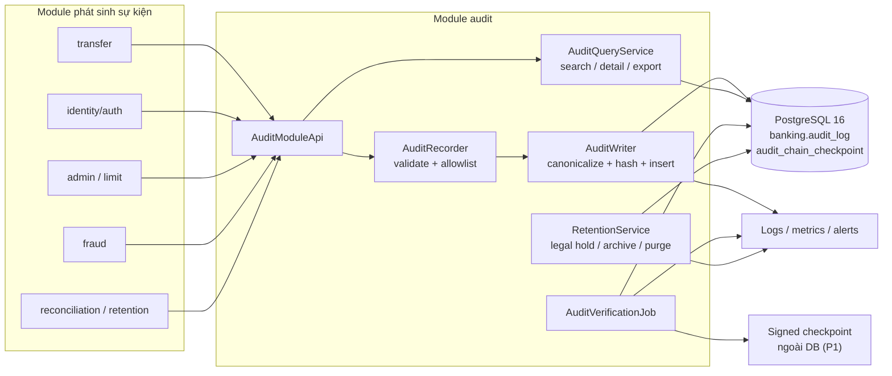
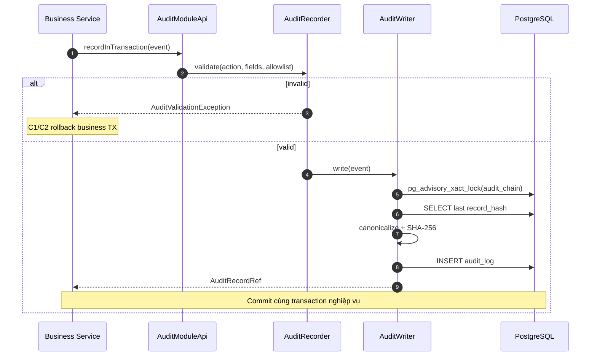
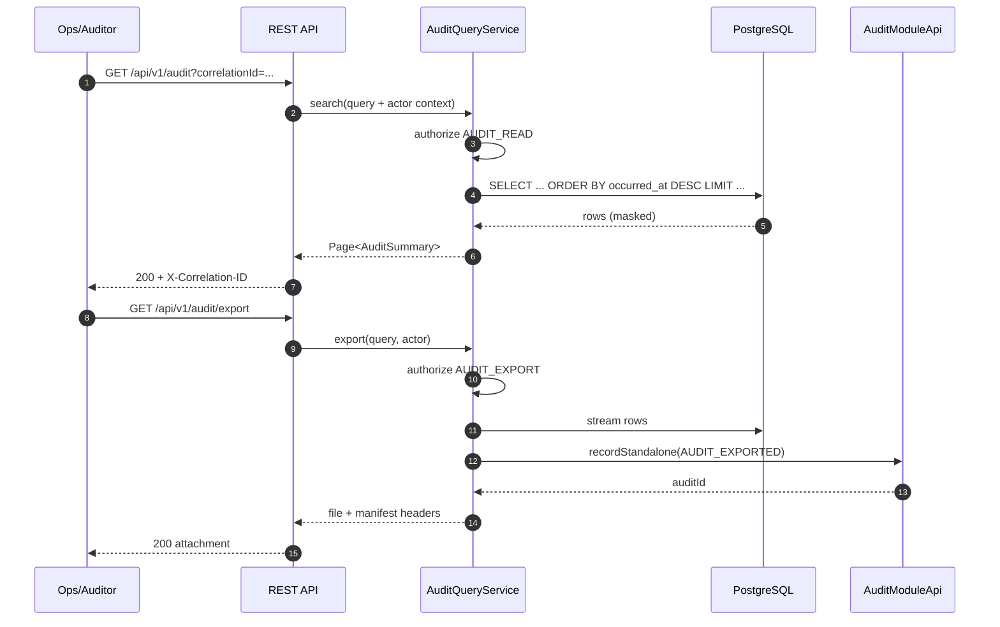
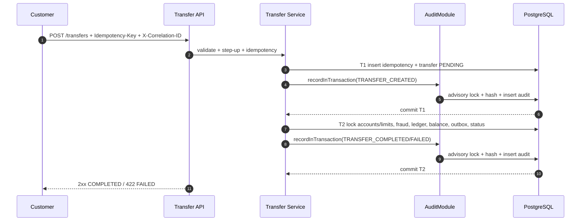
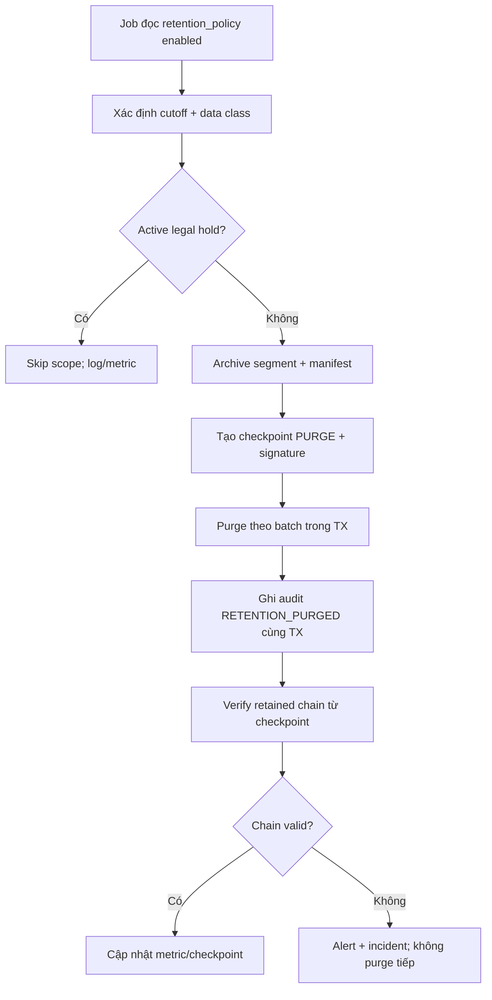

# 01. Audit & Traceability Design

> **Dự án:** Digital Banking MVP  
> **Mã tài liệu:** `DESIGN-AUD-01`  
> **Phiên bản:** 1.0  
> **Ngày:** 03/11/2026  

---

## Mục lục

- [1. Mục đích, phạm vi và cách đọc](#1-mục-đích-phạm-vi-và-cách-đọc)
- [2. Tóm tắt thiết kế](#2-tóm-tắt-thiết-kế)
- [3. Yêu cầu và driver thiết kế](#3-yêu-cầu-và-driver-thiết-kế)
- [4. Kiến trúc Audit & Traceability](#4-kiến-trúc-audit--traceability)
- [5. Phân loại sự kiện và Audit Action Catalog](#5-phân-loại-sự-kiện-và-audit-action-catalog)
- [6. Mô hình dữ liệu](#6-mô-hình-dữ-liệu)
- [7. Thiết kế toàn vẹn và hash chain](#7-thiết-kế-toàn-vẹn-và-hash-chain)
- [8. Vòng đời ghi audit theo luồng nghiệp vụ](#8-vòng-đời-ghi-audit-theo-luồng-nghiệp-vụ)
- [9. Truy vấn, xuất và kiểm soát truy cập](#9-truy-vấn-xuất-và-kiểm-soát-truy-cập)
- [10. Retention, legal hold và archival](#10-retention-legal-hold-và-archival)
- [11. Bảo mật và quyền riêng tư](#11-bảo-mật-và-quyền-riêng-tư)
- [12. Observability và vận hành](#12-observability-và-vận-hành)
- [13. Kiểm thử và nghiệm thu](#13-kiểm-thử-và-nghiệm-thu)
- [14. Traceability](#14-traceability)
- [15. Quyết định, open issues và rủi ro](#15-quyết-định-open-issues-và-rủi-ro)
- [Appendix A. Ví dụ audit event](#appendix-a-ví-dụ-audit-event)
- [Appendix B. Canonical payload và ví dụ hash](#appendix-b-canonical-payload-và-ví-dụ-hash)
- [Appendix C. Lỗi và failure message](#appendix-c-lỗi-và-failure-message)
- [Appendix D. Glossary](#appendix-d-glossary)
- [Appendix E. Tài liệu tham khảo](#appendix-e-tài-liệu-tham-khảo)

---

## 1. Mục đích, phạm vi và cách đọc

### 1.1. Mục đích

Tài liệu này đặc tả thiết kế kỹ thuật cho **audit trail bất biến** và **traceability end-to-end** của Digital Banking MVP. Tài liệu trả lời các câu hỏi:

- Sự kiện nào phải được audit, ai tạo, ở thời điểm nào và theo transaction semantics nào?
- Audit record được ghi như thế nào để **không thể sửa/xóa** và **có bằng chứng chống sửa đổi**?
- Correlation ID được sinh, propagate và lưu ở đâu để tra cứu xuyên suốt request → transfer → ledger → audit → notification?
- Audit được tra cứu, xuất bằng chứng, retention, legal hold và archival ra sao?
- Khi audit write thất bại hoặc hash chain bị phá vỡ, hệ thống xử lý thế nào để không mất tiền, không mất bằng chứng?

Tài liệu là cầu nối giữa yêu cầu nghiệp vụ (`BR-024` – `BR-028`, `FR-034` – `FR-038`, `NFR-021` – `NFR-023`) và triển khai kỹ thuật trong module `audit` của backend.

### 1.2. Phạm vi

**Trong phạm vi:**

- Audit cho mọi **money movement**: tạo, hoàn tất, thất bại, đối soát transfer.
- Audit cho **hành động nhạy cảm**: đăng nhập, lockout, step-up, logout, thay đổi hạn mức, vai trò/quyền, trạng thái tài khoản, fraud review, legal hold, retention policy.
- Audit cho **truy cập bị từ chối** và **xuất bằng chứng audit**.
- Thiết kế `audit_log`, hash chain, verification, retention/legal hold, archival.
- API tra cứu/chi tiết/export audit và kiểm soát quyền.
- Correlation ID xuyên suốt HTTP request, transaction, ledger, audit và notification.
- Kiểm thử, bằng chứng nghiệm thu và vận hành.

**Ngoài phạm vi:**

- Audit hạ tầng mạng, OS, database engine, container runtime (dùng công cụ vận hành riêng).
- Chứng nhận tuân thủ PCI DSS/ISO/kiểm toán độc lập; tài liệu chỉ tham chiếu các thực hành tốt.
- Chữ ký số từng người dùng, PKI/HSM production, trusted timestamp authority (TSA) — được nêu như hướng mở rộng.
- Audit nội dung notification/email/SMS; chỉ audit trạng thái nghiệp vụ và correlation.
- Phân tích gian lận nâng cao; xem [[03. fraud-detection-rules]].
- Thiết kế consistency/locking chi tiết; xem [[02. consistency-concurrency]].

### 1.3. Đối tượng đọc

| Vai trò | Cách đọc |
|---|---|
| Backend developer | Mục 4–8, 11, Appendix A–C để implement module `audit` và tích hợp |
| QA | Mục 3, 8.6, 10, 13, 14 để viết test và thu bằng chứng |
| Audit/Security | Mục 5–7, 9–12, 14 để review coverage, integrity và access control |
| DevOps/SRE | Mục 10–12 để cấu hình job, alert, backup, retention |
| BA/Product | Mục 1–3, 9, 15 để xác nhận hành vi và open issues |

### 1.4. Tài liệu tham chiếu

**Nội bộ:**

| Tài liệu | Nội dung sử dụng |
|---|---|
| [[02. BRD]] | `BR-024` – `BR-028`, mục 4.4.4 Audit Record Requirements, `BR-041` retention |
| [[03. SRS]] | `FR-034` – `FR-038`, `NFR-021` – `NFR-023`, UC-012, AC-018 – AC-022, AC-034, mục 2.13.3, 7.6 |
| [[04. Database design & analysis]] | `audit_log`, `legal_hold`, `retention_policy`, hash chain, index, retention |
| [[05. Technical stack]] | Spring Boot, PostgreSQL 16, Flyway, logging, observability |
| [[06. System architecture]] | `AD-05`, T1/T2, module `audit`, mục 7.5, 8.5, 9.5, 12 |
| [[07. API contracts]] | Header, correlation ID, `API-AUD-01` – `API-AUD-03`, schema `AuditSummary`/`AuditDetail` |
| [[Requirement Common]] | Audit bất biến, traceability, failure scenarios, demo D4 |

**Bên ngoài (tham khảo thực hành tốt, không phải cam kết tuân thủ):**

- RFC 8785 — JSON Canonicalization Scheme (JCS).
- RFC 6234 — SHA-256 và các thuật toán hash.
- RFC 9457 — Problem Details for HTTP APIs.
- RFC 3161 — Time-Stamp Protocol (hướng mở rộng external anchor).
- NIST SP 800-92 — Guide to Computer Security Log Management.
- NIST SP 800-53 Rev. 5 — Audit and Accountability (AU) controls.
- OWASP Logging Cheat Sheet; OWASP ASVS — logging/error handling.
- PCI DSS v4.0.1 Requirement 10 — audit logs (chỉ tham chiếu).
- PostgreSQL 16 — advisory locks, triggers, privileges.

Danh sách đầy đủ ở [Appendix E](#appendix-e-tài-liệu-tham-khảo).

### 1.5. Quy ước

| Quy ước | Ý nghĩa |
|---|---|
| **Bắt buộc / MUST** | Không được bỏ qua trong MVP; thiếu là defect |
| **Nên / SHOULD** | Ưu tiên làm; nếu defer phải ghi lý do, owner, kế hoạch |
| **Có thể / MAY** | Tùy chọn, không ảnh hưởng acceptance |
| `snake_case` | Tên cột/bảng trong PostgreSQL |
| `camelCase` | Field trong JSON API |
| `UPPER_SNAKE_CASE` | Audit action, enum value, entity type |
| Thời gian | Lưu `TIMESTAMPTZ` UTC; API trả ISO 8601 UTC; hiển thị theo timezone cấu hình |
| Tiền | `NUMERIC(19,2)`, VND; trong JSON là chuỗi thập phân |
| PII | Không lưu full PII trong audit; dùng ID và giá trị đã mask |
| **Đề xuất** | Thay đổi so với baseline, cần review trước khi coi là cam kết |

### 1.6. Quan hệ với baseline và nguyên tắc thay đổi

Thiết kế này **bám sát baseline** trong `03. SRS`, `04. Database design & analysis`, `06. System architecture` và `07. API contracts`. Các điểm cần bổ sung được đánh dấu rõ là **đề xuất** tại mục 6.5 và 15.2, gồm:

- `audit_log.subject_customer_id` để hỗ trợ legal hold/truy vấn theo chủ thể dữ liệu.
- Bảng `audit_chain_checkpoint` để bảo toàn khả năng verify sau purge/archival.
- Ràng buộc `record_hash` unique và `prev_hash` không null (application luôn ghi).
- Quy ước `actor_type=SYSTEM`, `actor_role=ANONYMOUS` cho login failure của username không tồn tại (thay vì thêm enum mới).
- Header manifest cho audit export.

Không có thay đổi nào trong tài liệu này được tự động áp dụng vào DB/API baseline; các thay đổi phải được chấp nhận tại mục 15.2 và cập nhật tài liệu tương ứng.

---

## 2. Tóm tắt thiết kế

### 2.1. Tóm tắt một trang

Audit của Digital Banking MVP là **một phần của transaction nghiệp vụ**, không phải log phụ. Mọi money movement và hành động nhạy cảm tạo một **audit record append-only** trong PostgreSQL, có actor, role snapshot, action, entity, before/after state đã mask, amount/currency, outcome, correlation ID và request ID.

Tính bất biến được bảo vệ theo **nhiều lớp**:

1. **Application:** không có API update/delete; audit record chỉ được tạo bởi `AuditWriter`.
2. **Transaction:** audit critical (C1/C2) nằm trong cùng transaction với nghiệp vụ; audit fail → rollback nghiệp vụ.
3. **Database:** role `app_rw` chỉ có `INSERT`/`SELECT` trên `audit_log`; trigger chặn `UPDATE`/`DELETE`/`TRUNCATE`; quyền `DELETE` chỉ qua function retention có kiểm soát.
4. **Cryptography:** hash chain toàn cục `record_hash = SHA-256(canonical_payload || prev_hash)`; verify job recompute định kỳ.
5. **External anchor:** checkpoint/tail hash được ký và lưu ngoài DB (đề xuất P1) để phát hiện tail truncation.
6. **Retention/legal hold:** archive/purge theo policy; purge chỉ sau checkpoint; legal hold chặn purge.

Correlation ID được sinh ở filter (nếu client không gửi), lưu MDC, trả header, và propagate vào `transfer`, `ledger_entry`, `audit_log`, `notification`, `auth_challenge`. `request_id` là định danh nội bộ của từng HTTP request/job run.

### 2.2. Sơ đồ khối



**Hình 1 — Kiến trúc Audit & Traceability**

### 2.3. Quyết định thiết kế chính

| ID | Quyết định | Lý do | Hệ quả |
|---|---|---|---|
| `DD-AUD-01` | Audit log là **business record** trong PostgreSQL, tách khỏi technical log | Cần bằng chứng nghiệp vụ, truy vấn, retention, hash chain | Không dùng JSON log làm bằng chứng chính |
| `DD-AUD-02` | Audit critical (C1/C2) ghi **cùng transaction** với nghiệp vụ | AC-034: không COMPLETED nếu audit chưa bền vững | Audit fail → rollback nghiệp vụ; latency tăng |
| `DD-AUD-03` | Hash chain **toàn cục**, serialize bằng `pg_advisory_xact_lock` | Đơn giản, verify một chuỗi, phù hợp 20 RPS | Là điểm tuần tự; cần scale-out path |
| `DD-AUD-04` | Canonical JSON theo **RFC 8785 JCS**, SHA-256, `hash_version` | Deterministic, cross-language verify | Cần thư viện JCS và test vector |
| `DD-AUD-05` | `audit_id` là thứ tự chain; **gap số là bình thường** | Identity sequence có thể gap khi rollback | Verify theo `prev_hash`, không theo số liên tiếp |
| `DD-AUD-06` | Append-only bằng **privilege + trigger + no API mutation** | Defense in depth | Retention cần đường ghi có kiểm soát |
| `DD-AUD-07` | Retention/purge chỉ sau **checkpoint** | Purge làm mất genesis của retained chain | Cần bảng checkpoint + archive manifest |
| `DD-AUD-08` | Tail truncation cần **external anchor** | Hash chain nội bộ không phát hiện cắt đuôi | P1: signed checkpoint/WORM/TSA |
| `DD-AUD-09` | Correlation ID propagate DB + MDC + header; `request_id` tách biệt | Trace end-to-end, phân biệt flow và request | Client nên reuse correlation ID khi step-up/retry |
| `DD-AUD-10` | Audit payload dùng **allowlist**, không serialize entity đầy đủ | Tránh PII/secret rò rỉ | Cần validator + test PII |
| `DD-AUD-11` | Audit search **không** tạo audit; export **có** audit; truy cập bị từ chối **có** audit | Tránh write amplification, vẫn kiểm soát hành vi nhạy cảm | Search chỉ ghi access log kỹ thuật |
| `DD-AUD-12` | Legal hold ưu tiên hơn retention; không hard delete hold | BR-041, FR-053 | Cần scope resolution rõ |
| `DD-AUD-13` | System job dùng `actor_type=SYSTEM`, `actor_role=SYSTEM`; login ẩn danh dùng `SYSTEM`/`ANONYMOUS` | Tương thích schema/API hiện tại | Không thêm enum `ANONYMOUS` ở API |
| `DD-AUD-14` | Audit export kèm manifest hash | Bằng chứng có thể kiểm chứng độc lập | Bổ sung header export |

### 2.4. Nguyên tắc bất biến

Các invariant sau phải luôn đúng; test/verification phải chứng minh:

| ID | Invariant | Cơ chế |
|---|---|---|
| `I-AUD-01` | Mọi transfer đạt `COMPLETED`/`FAILED` có audit record tương ứng | C1 trong T1/T2, fail-closed |
| `I-AUD-02` | Không có audit record bị sửa/xóa qua API hoặc application role | Append-only + trigger + privilege |
| `I-AUD-03` | Chuỗi hash liên tục từ genesis/checkpoint đến tail | `prev_hash` + verify job |
| `I-AUD-04` | Mọi audit record có correlation ID hợp lệ | Filter + validator NOT NULL |
| `I-AUD-05` | Không có full PII/secret trong audit payload | Allowlist + PII scan |
| `I-AUD-06` | Legal hold active chặn purge/archival của scope liên quan | Retention job check hold |
| `I-AUD-07` | Audit write failure không làm phát sinh trạng thái tiền không nhất quán | Cùng transaction + rollback |
| `I-AUD-08` | Retained chain vẫn verify được sau purge | Checkpoint trước purge |

---

## 3. Yêu cầu và driver thiết kế

### 3.1. Yêu cầu nghiệp vụ và chức năng

| ID | Yêu cầu | Thiết kế đáp ứng |
|---|---|---|
| `BR-024` / `FR-034` | Mọi giao dịch tiền có audit record bất biến với actor, thời gian, action, entity, amount, status, correlation ID | Mục 5, 6, 7, 8.1 |
| `BR-025` / `FR-035` | Mọi hành động nhạy cảm được audit | Mục 5.3, 8.2, 8.3 |
| `BR-026` / `FR-036` | Ops/Auditor tra cứu audit theo quyền; không sửa/xóa | Mục 9 |
| `BR-027` / `FR-038` | Traceability end-to-end qua correlation ID | Mục 4.6, 9.1 |
| `BR-028` / `FR-037` | Audit có bằng chứng chống sửa đổi, lưu theo policy | Mục 7, 10, 11 |
| `BR-041` / `FR-053` | Retention/archival/legal hold | Mục 10 |
| `BR-005` / `FR-007` | Sự kiện xác thực/bảo mật quan trọng có correlation ID | Mục 8.2 |
| `BR-030` / `FR-039` | PII masking trong audit/log/response | Mục 5.5, 11.3 |
| `BR-021` / `FR-030` | Lịch sử giao dịch read-only | Audit là read-only; transfer history read-only |

### 3.2. NFR

| ID | Yêu cầu | Target | Cách đáp ứng |
|---|---|---|---|
| `NFR-021` | Audit immutability | Append-only/tamper-evident | Privilege + trigger + hash chain + anchor |
| `NFR-022` | Audit retention | ≥ 5 năm (đề xuất); legal hold | `retention_policy`, checkpoint, archive |
| `NFR-023` | Audit coverage | 100% money movement/sensitive action có audit + correlation | Action catalog + C1/C2 mandatory |
| `NFR-025` | Observability | Structured log + correlation + metrics + health | Mục 12 |
| `NFR-001` – `NFR-004` | Performance | p95 transfer ≤ 2s ở 20 RPS | Audit write budget, lock ngắn, index tối thiểu |
| `NFR-014` | Encryption at rest | Dữ liệu nhạy cảm được mã hóa | Masked payload + DB/storage encryption + backup encryption |
| `NFR-020` | PII masking | Không lộ PII trong log/response | Allowlist + masking + PII scan |

### 3.3. Acceptance criteria

| ID | Tiêu chí | Bằng chứng |
|---|---|---|
| `AC-018` | Transfer COMPLETED/FAILED có audit record đầy đủ trường + correlation ID | Integration test + audit query |
| `AC-019` | Login/lockout/đổi limit/đổi role/đổi account status có audit record | Test matrix |
| `AC-020` | Ops/Auditor search audit đúng quyền; truy cập trái phép 403 + audit | Security test + audit record |
| `AC-021` | Sửa/xóa audit bị từ chối; có bằng chứng tamper-evident | Append-only test + tamper test |
| `AC-022` | Correlation ID được dùng/sinh mới và propagate đến transfer/ledger/audit/notification | Integration test |
| `AC-034` | Audit write fail → không COMPLETED; PENDING/FAILED; không double debit | Failure injection + retry test |
| `AC-029` | Retention/legal hold hoạt động; chỉ dữ liệu synthetic | Retention test + policy review |

### 3.4. Ràng buộc và giả định

| ID | Nội dung | Ảnh hưởng thiết kế |
|---|---|---|
| `TC-001` | Spring Boot + PostgreSQL | JPA/JDBC, transaction, Flyway |
| `TC-002` | REST/JSON qua HTTPS | API audit, Problem Details, correlation header |
| `TC-008` / `OC-001` | Môi trường demo, không production SLA | Không cần WORM/HSM production; vẫn giữ thiết kế mở rộng |
| `RC-002` | Audit bất biến, tra cứu được | Append-only, retention, legal hold |
| `RC-003` | Không chứng nhận PCI/ISO | Không tuyên bố compliant; chỉ tham chiếu |
| `CON-009` | Audit bất biến | Hash chain + DB controls |
| `ASM-001` | MVP/demo | Ưu tiên đơn giản, tránh over-engineering |
| `OI-002` | Retention 5 năm chưa chốt | Thiết kế cấu hình được; mặc định 5 năm |

### 3.5. Mục tiêu thiết kế và non-goals

**Mục tiêu:**

- Audit coverage đầy đủ cho money movement và sensitive action.
- Bằng chứng có thể tra cứu, xuất và kiểm chứng.
- Không đánh đổi tính đúng đắn của tiền để lấy availability.
- Giữ được end-to-end trace trong mọi luồng, kể cả retry/step-up/reconciliation.
- Vận hành được ở mức MVP: PostgreSQL + Spring Boot + Docker Compose.

**Non-goals:**

- Không xây dựng SIEM/observability platform riêng.
- Không đảm bảo legal non-repudiation cấp tòa án.
- Không audit mọi request đọc thông thường (tránh write amplification).
- Không triển khai blockchain/distributed ledger.
- Không thay thế backup/DR.

---

## 4. Kiến trúc Audit & Traceability

### 4.1. Thành phần

| Thành phần | Trách nhiệm | Không làm |
|---|---|---|
| `AuditModuleApi` | Interface cho module khác ghi/đọc audit | Không chứa business logic của module khác |
| `AuditRecorder` | Validate action catalog, required fields, allowlist PII, size limit | Không tính hash/không ghi DB |
| `AuditWriter` | Canonicalize, lấy prev hash, tính hash, insert, xử lý lock | Không quyết định business outcome |
| `AuditQueryService` | Search/detail/export read-only, permission + masking | Không update/delete |
| `AuditVerificationJob` | Recompute hash chain, checkpoint, alert | Không sửa audit record |
| `RetentionService` | Đọc policy, check legal hold, archive, checkpoint, purge | Không purge record đang hold |
| `LegalHoldService` | Place/release hold, approval, audit | Không hard delete hold |
| `AuditExportService` | Tạo CSV/JSONL + manifest, audit export | Không trả full PII |

### 4.2. Module boundary

- Module `audit` sở hữu `audit_log`, `legal_hold`, `retention_policy` (và đề xuất `audit_chain_checkpoint`).
- Module khác **không ghi trực tiếp** bảng `audit_log`; phải gọi `AuditModuleApi`.
- `audit` không phụ thuộc nghiệp vụ của `transfer`/`account`/`identity`; chỉ nhận `AuditEvent` đã chuẩn hóa.
- `common` cung cấp correlation filter, MDC, error model; `audit` dùng nhưng không sở hữu.
- `admin` gọi `audit` cho legal hold/retention; `audit` không gọi ngược `admin`.

### 4.3. Internal API

```java
public interface AuditModuleApi {

    /**
     * Ghi audit trong transaction hiện tại (Propagation.MANDATORY).
     * Dùng cho C1/C2: money movement và sensitive state change.
     * Audit fail => exception => transaction nghiệp vụ rollback.
     */
    AuditRecordRef recordInTransaction(AuditEvent event);

    /**
     * Ghi audit trong transaction riêng (Propagation.REQUIRES_NEW).
     * Dùng cho C3 best-effort: login failure, access denied, logout...
     * Không rollback nghiệp vụ; lỗi được log/metric/alert.
     */
    Optional<AuditRecordRef> recordStandalone(AuditEvent event);

    PageResult<AuditSummary> search(AuditSearchQuery query);

    AuditDetail get(long auditId);

    AuditExportResult export(AuditSearchQuery query, ExportFormat format);
}
```

**`AuditEvent` tối thiểu:**

| Field | Kiểu | Bắt buộc | Ghi chú |
|---|---|---|---|
| `action` | enum/string | Có | Phải có trong catalog |
| `actorType` | `USER`/`SYSTEM` | Có | `SYSTEM` cho job/anonymous |
| `actorUserId` | Long | Có nếu `USER` | Null nếu `SYSTEM` |
| `actorRole` | String | Có | Snapshot; `SYSTEM`/`ANONYMOUS` cho system |
| `entityType` | enum/string | Có | Mục 6.3 |
| `entityId` | String | Có | Mục 6.3 |
| `beforeState` | Map/JSON | Không | Allowlist; đã mask |
| `afterState` | Map/JSON | Không | Allowlist; đã mask |
| `amount` | BigDecimal | Không | Chỉ money event |
| `currency` | String | Không | `VND` nếu có amount |
| `outcome` | `SUCCESS`/`FAILURE`/`REJECTED` | Có | Mục 5.4 |
| `correlationId` | String | Có | Từ context |
| `requestId` | String | Có | Server-generated |
| `clientInfo` | Map | Không | IP/user-agent đã mask |
| `occurredAt` | Instant | Có | App event time |
| `subjectCustomerId` | Long | Không | Đề xuất cho legal hold |

### 4.4. Luồng ghi audit



**Hình 2 — Ghi audit critical trong cùng transaction**

**Nguyên tắc:**

- `recordInTransaction` dùng `Propagation.MANDATORY`: nếu không có transaction, fail fast.
- `AuditWriter` thực hiện **insert là thao tác DB cuối cùng trước commit** để giảm thời gian giữ advisory lock. Các cập nhật trạng thái/idempotency/outbox phải hoàn tất trước đó.
- Không gọi external service (OTP/notification/fraud HTTP) sau khi đã lấy audit lock.
- Với C3 best-effort, `recordStandalone` dùng transaction riêng; lỗi không làm thay đổi response nghiệp vụ.
- Với C4 operational, job tự quản lý transaction; lỗi job được retry/alert.

### 4.5. Luồng đọc và export



**Hình 3 — Tra cứu và xuất audit**

- Search/detail là read-only; không tạo audit record (theo `API-AUD-01`).
- Export thành công phải ghi `AUDIT_EXPORTED` trước khi trả file; nếu audit export fail → không trả file, trả lỗi hệ thống.
- Truy cập trái phép (403) ghi `SECURITY_ACCESS_DENIED` best-effort.
- Mọi response audit có `Cache-Control: no-store`.

### 4.6. Correlation và trace model

**Định danh:**

| Định danh | Nguồn | Phạm vi | Lưu ở đâu |
|---|---|---|---|
| `correlationId` | Client `X-Correlation-ID` hoặc server sinh UUID | Toàn bộ flow nghiệp vụ, có thể nhiều HTTP request | MDC, response header/body, `transfer`, `ledger_entry`, `audit_log`, `notification`, `auth_challenge` |
| `requestId` | Server sinh UUID cho mỗi HTTP request/job run | Một request/job | MDC, log, `audit_log.request_id` |
| `reference` | Transfer reference | Một transfer | `transfer`, API, audit `entity_id` |
| `idempotencyKey` | Client | Một retry window | `idempotency_record`; không lưu raw trong audit nếu không cần |

**Quy tắc:**

1. Correlation filter chạy **trước** authentication/authorization để mọi lỗi 401/403 đều có correlation ID.
2. Nếu client gửi header hợp lệ (`^[A-Za-z0-9._:-]{1,64}$`), dùng lại; nếu thiếu, sinh UUID; nếu sai định dạng, trả `400 VALIDATION_ERROR` (chống log injection).
3. Response header `X-Correlation-ID` có trong **mọi** response, kể cả lỗi; body `Problem` có `correlationId`.
4. Không tái sử dụng correlation ID của request khác; client có thể reuse cho retry/step-up hợp lệ.
5. `requestId` luôn do server sinh, không nhận từ client; dùng để phân biệt các request trong cùng correlation flow.
6. Với luồng step-up nhiều request: client **nên** reuse cùng `X-Correlation-ID`; nếu không, liên kết qua `challengeId` + `idempotencyKey` + `transfer.reference`.
7. Với job (reconciliation/retention/verification): `correlationId` là job run ID; nếu job xử lý một transfer cụ thể, dùng `correlationId` gốc của transfer và `requestId` là job run ID.
8. Notification outbox copy `correlationId` từ transfer; ledger entry copy từ transfer.
9. Không đưa PII vào correlation ID/request ID.

**Bảng propagate:**

| Bảng | Cột correlation | Cột request | Ghi chú |
|---|---|---|---|
| `transfer` | `correlation_id` | — | T1/T2 cùng giá trị |
| `ledger_entry` | `correlation_id` | — | Copy từ transfer |
| `audit_log` | `correlation_id` | `request_id` | Mọi record |
| `notification` | `correlation_id` | — | Outbox |
| `auth_challenge` | `correlation_id` | — | Step-up/login |
| `idempotency_record` | — | — | Liên kết qua `transfer_id`; không cần correlation riêng |

### 4.7. Runtime và deployment

- Audit module chạy trong cùng Spring Boot app (modular monolith), cùng datasource với nghiệp vụ để đảm bảo C1/C2 cùng transaction.
- Không dùng datasource riêng cho audit critical; nếu dùng datasource riêng sẽ mất atomicity.
- `AuditVerificationJob` và `RetentionService` có thể dùng cùng datasource nhưng transaction riêng; job chạy một instance hoặc dùng ShedLock/advisory lock.
- Ở scale-out nhiều instance, audit advisory lock là điểm tuần tự toàn cục; xem 8.7 và 15.3.
- Audit không cache trong bộ nhớ; đọc từ PostgreSQL.
- Backup/restore phải bao gồm `audit_log`, `audit_chain_checkpoint`, `legal_hold`, `retention_policy`; backup mã hóa.

---

## 5. Phân loại sự kiện và Audit Action Catalog

### 5.1. Tiêu chí chọn sự kiện

Một sự kiện được ghi vào `audit_log` khi thỏa **ít nhất một** tiêu chí:

1. **Money movement:** tạo/hoàn tất/thất bại/đối soát transfer; bất kỳ thay đổi nào ảnh hưởng ledger hoặc số dư.
2. **Sensitive action:** thay đổi quyền, hạn mức, trạng thái tài khoản, trạng thái user, retention/legal hold, fraud review.
3. **Security control:** đăng nhập thành công/thất bại, lockout, step-up, logout, truy cập bị từ chối, idempotency conflict.
4. **Compliance/evidence:** export audit, retention/purge, legal hold, thay đổi policy.
5. **Reconciliation:** xác định lại trạng thái cuối cùng của transfer PENDING.

Không ghi audit cho:

- Mọi request đọc thông thường (account list, transaction history, audit search/detail).
- Validation error trước khi có bất kỳ trạng thái nghiệp vụ nào.
- Health check, metrics, debug log.
- Notification delivery retry (đã có trạng thái trong `notification` + technical log).

### 5.2. Criticality classes và transaction semantics

| Class | Ý nghĩa | Transaction | Khi audit fail | Ví dụ |
|---|---|---|---|---|
| **C1 – Financial atomic** | Money movement/ledger state | Cùng transaction nghiệp vụ (`MANDATORY`) | Rollback toàn bộ; không trả COMPLETED | `TRANSFER_CREATED`, `TRANSFER_COMPLETED`, `TRANSFER_FAILED`, `TRANSFER_RECONCILED` |
| **C2 – Sensitive state atomic** | Thay đổi quyền/hạn mức/trạng thái/legal hold/retention policy/export | Cùng transaction với state change; export dùng transaction riêng trước khi trả file | Rollback state change; export không trả file | `LIMIT_CHANGE_APPROVED`, `ROLE_CHANGE_APPROVED`, `ACCOUNT_STATUS_CHANGED`, `LEGAL_HOLD_PLACED`, `AUDIT_EXPORTED` |
| **C3 – Security best-effort** | Sự kiện bảo mật không làm thay đổi tiền; security control ưu tiên hơn audit durability | Transaction riêng (`REQUIRES_NEW`); state change đã commit trước | Không rollback; ghi security log + metric + alert | `AUTH_LOGIN_FAILED`, `AUTH_ACCOUNT_LOCKED`, `AUTH_SESSION_LOGOUT`, `AUTH_STEP_UP_FAILED`, `SECURITY_ACCESS_DENIED` |
| **C4 – Operational** | Job/telemetry không ảnh hưởng trực tiếp nghiệp vụ | Transaction riêng của job | Job retry/alert; không ảnh hưởng response khách hàng | `RETENTION_ARCHIVED`, `FRAUD_ENGINE_ERROR` |

**Quy tắc chọn class:**

- Nếu audit fail mà có thể làm sai tiền/trạng thái → C1/C2.
- Nếu audit fail mà security control vẫn phải tiếp tục (lockout, từ chối truy cập) → C3.
- Nếu sự kiện chỉ phục vụ vận hành, không phải bằng chứng nghiệp vụ → C4 hoặc technical log.

> **Lưu ý:** C3 là trade-off có kiểm soát. Khi audit write C3 thất bại, hệ thống ghi một **security log** JSON có cùng `correlationId`, `action`, `actor`, `outcome` và phát alert. Đây là bằng chứng dự phòng, không thay thế `audit_log`; gap phải được điều tra.

### 5.3. Audit Action Catalog

Action là **mã ổn định**, không đổi nghĩa; mọi thay đổi phải version hóa catalog và cập nhật test.

| Action | Nhóm | Class | Actor | Entity | Trigger / điều kiện | Transaction |
|---|---|---|---|---|---|---|
| `AUTH_LOGIN_SUCCESS` | Auth | C2 | USER | `APP_USER` | Đăng nhập password/passcode/FIDO/OTP thành công, tạo session | Cùng TX tạo session |
| `AUTH_LOGIN_FAILED` | Auth | C3 | USER hoặc SYSTEM/ANONYMOUS | `APP_USER` | Sai credential, OTP sai, device không tin cậy | Standalone sau khi trả lỗi |
| `AUTH_ACCOUNT_LOCKED` | Auth | C3 | SYSTEM | `APP_USER` | Vượt ngưỡng lockout; khóa tạm/tài khoản | State lockout commit trước; audit standalone |
| `AUTH_SESSION_LOGOUT` | Auth | C3 | USER | `SESSION` | Logout/revoke session | Session revoke commit trước; audit standalone |
| `AUTH_CHALLENGE_CREATED` | Auth | C2 | USER | `AUTH_CHALLENGE` | Tạo OTP challenge cho login thiết bị mới/step-up | Cùng TX tạo challenge |
| `AUTH_CHALLENGE_RESENT` | Auth | C2 | USER | `AUTH_CHALLENGE` | Gửi lại OTP trong policy | Cùng TX cập nhật challenge |
| `AUTH_CHALLENGE_LOCKED` | Auth | C3 | SYSTEM | `AUTH_CHALLENGE` | Vượt số lần thử OTP/challenge | State lock commit trước; audit standalone |
| `AUTH_STEP_UP_VERIFIED` | Auth | C2 | USER | `AUTH_CHALLENGE` | Verify OTP/FIDO/passcode thành công | Cùng TX challenge → VERIFIED |
| `AUTH_STEP_UP_FAILED` | Auth | C3 | USER | `AUTH_CHALLENGE` | Verify thất bại/hết hạn | Standalone |
| `TRANSFER_CREATED` | Transfer | C1 | USER | `TRANSFER` | T1 tạo transfer PENDING + idempotency record | T1, audit là insert cuối |
| `TRANSFER_COMPLETED` | Transfer | C1 | USER | `TRANSFER` | T2 debit/credit thành công, status COMPLETED | T2, audit là insert cuối |
| `TRANSFER_FAILED` | Transfer | C1 | USER | `TRANSFER` | T2 business failure/auto-block; không ghi ledger | T2, audit là insert cuối |
| `TRANSFER_RECONCILED` | Transfer | C1 | SYSTEM | `TRANSFER` | Reconciliation xác định COMPLETED/FAILED | Cùng TX reconciliation |
| `SECURITY_IDEMPOTENCY_CONFLICT` | Security | C3 | USER | `TRANSFER` | Cùng key, payload khác | Standalone |
| `LIMIT_CHANGE_REQUESTED` | Limit | C2 | USER | `APPROVAL_REQUEST` | Maker tạo yêu cầu đổi hạn mức | Cùng TX tạo approval |
| `LIMIT_CHANGE_APPROVED` | Limit | C2 | USER | `APPROVAL_REQUEST` | Checker approve; áp dụng limit | Cùng TX áp dụng |
| `LIMIT_CHANGE_REJECTED` | Limit | C2 | USER | `APPROVAL_REQUEST` | Checker reject | Cùng TX cập nhật approval |
| `ROLE_CHANGE_REQUESTED` | Admin | C2 | USER | `APPROVAL_REQUEST` | Maker tạo yêu cầu đổi role/quyền | Cùng TX tạo approval |
| `ROLE_CHANGE_APPROVED` | Admin | C2 | USER | `APPROVAL_REQUEST` | Checker approve; áp dụng role/privilege | Cùng TX áp dụng |
| `ROLE_CHANGE_REJECTED` | Admin | C2 | USER | `APPROVAL_REQUEST` | Checker reject | Cùng TX cập nhật approval |
| `ACCOUNT_STATUS_CHANGED` | Account | C2 | USER | `ACCOUNT` | Admin/Ops đổi trạng thái tài khoản | Cùng TX đổi trạng thái |
| `FRAUD_FLAG_CREATED` | Fraud | C2 | SYSTEM | `FRAUD_FLAG` | Rule khớp trong T2, flag được insert | Cùng T2 |
| `FRAUD_FLAG_REVIEWED` | Fraud | C2 | USER | `FRAUD_FLAG` | Ops ghi quyết định review | Cùng TX cập nhật flag |
| `FRAUD_ENGINE_ERROR` | Fraud | C4 | SYSTEM | `TRANSFER` | Rule engine lỗi trong T2, fail-open | Standalone/log; không chặn giao dịch |
| `LEGAL_HOLD_PLACED` | Retention | C2 | USER | `LEGAL_HOLD` | Admin đặt legal hold | Cùng TX insert hold |
| `LEGAL_HOLD_RELEASED` | Retention | C2 | USER | `LEGAL_HOLD` | Admin release hold sau approval | Cùng TX update hold |
| `RETENTION_POLICY_CHANGED` | Retention | C2 | USER | `RETENTION_POLICY` | Policy retention/archive/purge được approve và áp dụng | Cùng TX áp dụng |
| `RETENTION_ARCHIVED` | Retention | C4 | SYSTEM | `RETENTION_POLICY` | Job archive dữ liệu theo policy | Job TX; audit best-effort |
| `RETENTION_PURGED` | Retention | C2 | SYSTEM | `RETENTION_POLICY` | Job purge dữ liệu sau checkpoint, không hold | Cùng TX purge batch |
| `AUDIT_EXPORTED` | Audit | C2 | USER | `AUDIT_LOG` | Auditor export bằng chứng thành công | Standalone trước khi trả file |
| `SECURITY_ACCESS_DENIED` | Security | C3 | USER hoặc SYSTEM/ANONYMOUS | Entity bị truy cập | 403 do thiếu quyền/ownership/scope | Standalone sau khi trả 403 |

**Ghi chú:**

- `FRAUD_FLAG_CREATED` là C2 vì flag phải bền vững cùng kết quả giao dịch; nếu audit fail, T2 rollback (bao gồm flag) và transfer giữ PENDING.
- `AUDIT_EXPORTED` là C2: file chỉ được trả sau khi audit export bền vững. Nếu audit fail, export fail; không có bằng chứng "export mà không được ghi nhận".
- `AUTH_ACCOUNT_LOCKED` là C3: ưu tiên khóa tài khoản; audit fail không được làm mất hiệu lực lockout. Alert bắt buộc.
- Các action `AUTH_CHALLENGE_*` chỉ áp dụng cho challenge tồn tại; không audit mỗi lần gửi OTP thất bại của gateway (technical log).

### 5.4. Quy tắc action và outcome

| Outcome | Dùng khi | Ví dụ |
|---|---|---|
| `SUCCESS` | Hành động hoàn tất và state đã được ghi bền vững | `TRANSFER_COMPLETED`, `LIMIT_CHANGE_APPROVED` |
| `FAILURE` | Hành động đã được thực thi nhưng thất bại trong xử lý; state cuối là FAILED hoặc rollback | `AUTH_LOGIN_FAILED`, `TRANSFER_FAILED`, `AUDIT_EXPORTED` fail |
| `REJECTED` | Bị từ chối bởi authorization/policy/validation trước khi có hiệu ứng | `SECURITY_ACCESS_DENIED`, `LIMIT_CHANGE_REJECTED` |

**Quy tắc:**

- Không dùng `SUCCESS` cho hành động không xảy ra.
- `TRANSFER_FAILED` dùng `FAILURE`, kể cả khi failure do fraud auto-block (`FRAUD_BLOCKED`).
- `SECURITY_ACCESS_DENIED` dùng `REJECTED`.
- `AUTH_LOGIN_FAILED` dùng `FAILURE`; `AUTH_ACCOUNT_LOCKED` dùng `SUCCESS` vì lockout đã được áp dụng.
- Action name không chứa dữ liệu động (không `TRANSFER_FAILED_INSUFFICIENT_BALANCE`); lý do nằm trong `after_state.failureCode`.

### 5.5. Required fields theo nhóm action

| Nhóm | Required ngoài các field chung | Ghi chú |
|---|---|---|
| Chung | `action`, `actor_type`, `actor_role`, `entity_type`, `entity_id`, `outcome`, `correlation_id`, `request_id`, `occurred_at` | `actor_user_id` bắt buộc nếu `USER` |
| Money (`TRANSFER_*`) | `amount`, `currency`, `before_state.status`, `after_state.status`, reference trong `entity_id` | `TRANSFER_CREATED` before null |
| Auth login | `entity_id=user_id` hoặc pseudonymous ID; `after_state.reasonCode`; `client_info_masked` | Không lưu username/password/OTP |
| Challenge/step-up | `entity_id=challengeId`; `after_state.purpose`, `method`, `status`, `attemptCount` | Không lưu OTP |
| Limit/role | `entity_id=approvalId`; `after_state.targetType`, `targetId`, `makerId`, `checkerId`, `decision` | Before/after limit/role values |
| Account status | `entity_id=accountId`; `before_state.status`, `after_state.status`, `reasonCode` | Không lưu full account number |
| Fraud | `entity_id=flagId`; `after_state.transferReference`, `ruleCode`, `severity`, `decision` | `matchedValue` chỉ amount/count/window |
| Legal hold | `entity_id=holdId`; `after_state.entityType`, `entityId`, `status`, `reasonCode` | Không copy free-text reason nếu có PII |
| Retention | `entity_id=policyId`; `after_state.dataClass`, `counts`, `range`, `checkpointId` | Không chứa dữ liệu bị purge |
| Export | `entity_id=exportId`; `after_state.rowCount`, `from`, `to`, `format`, `fileHash`, `filterHash` | Không chứa nội dung file |
| System/job | `entity_id=jobRunId` hoặc entity liên quan; `after_state.jobName`, `result`, `counts` | `correlation_id` là job run ID hoặc giao dịch gốc |

### 5.6. PII allowlist theo entity

`before_state`/`after_state` **không** phải serialization của entity. Chỉ các field sau được phép; mọi field khác bị từ chối bởi validator.

| Entity | Field được phép | Field bị cấm |
|---|---|---|
| `TRANSFER` | `reference`, `status`, `failureCode`, `sourceAccountId`, `destinationAccountId`, `amount`, `currency`, `createdAt`, `completedAt`, `transferType` | `description`, full account number, tên/phone/email, raw request body |
| `ACCOUNT` | `accountId`, `customerId`, `status`, `last4`, `availableBalance`, `ledgerBalance`, `reasonCode` | Full `accountNo`, customer name, address |
| `APP_USER` | `userId`, `roleCodes`, `status`, `lockedUntil`, `reasonCode` | `username`, password hash, OTP hash, token |
| `CUSTOMER` | `customerId`, `status`, `reasonCode` | Name, phone, email, address, device fingerprint |
| `LIMIT_CONFIG` | `configId`, `scopeType`, `scopeId`, `perTransactionLimit`, `dailyLimit`, `effectiveFrom`, `effectiveTo`, `status` | Customer PII |
| `APPROVAL_REQUEST` | `approvalId`, `requestType`, `targetType`, `targetId`, `status`, `makerId`, `checkerId`, `decision` | Free-text notes có PII |
| `FRAUD_FLAG` | `flagId`, `transferReference`, `ruleCode`, `ruleVersion`, `severity`, `status`, `decision`, `matchedValue` (amount/count/window) | Review notes tự do, PII |
| `AUTH_CHALLENGE` | `challengeId`, `purpose`, `method`, `status`, `attemptCount`, `expiresAt` | OTP, OTP hash, raw device fingerprint |
| `SESSION` | `sessionId`, `userId`, `deviceId`, `status`, `reasonCode` | Session token/token hash |
| `LEGAL_HOLD` | `holdId`, `entityType`, `entityId`, `status`, `reasonCode`, `placedAt`, `releasedAt` | Free-text reason, PII |
| `RETENTION_POLICY` | `policyId`, `dataClass`, `retentionDays`, `archiveAfterDays`, `purgeAfterDays`, `enabled` | — |
| `AUDIT_LOG` | `exportId`, `filterHash`, `rowCount`, `from`, `to`, `format`, `fileHash` | Nội dung file export, full PII |
| `IDEMPOTENCY_RECORD` | `keyHash`, `transferReference`, `status` | Raw idempotency key nếu có thể chứa PII |
| `DATA_SCOPE` | `scopeType`, `scopeHash`, `recordCount`, `range` | Raw scope chứa PII |

**Quy tắc bổ sung:**

- Mọi ID trả về dạng chuỗi; money/balance dạng chuỗi thập phân; boolean giữ boolean.
- Không lưu free-text do người dùng nhập (`description`, `notes`) trong audit; nếu cần, lưu hash hoặc reason code.
- `client_info_masked`: IP mask (ví dụ `203.0.113.***`), user-agent cắt tối đa 256 ký tự, không lưu raw fingerprint.
- Payload tối đa **32 KB**; vượt → reject. C1/C2 fail-closed; C3 ghi security log và bỏ audit record.
- PII scanner chạy trước insert: kiểm tra key nằm trong allowlist và value không khớp pattern account number/email/phone/OTP/token.

### 5.7. Sự kiện không ghi `audit_log`

| Sự kiện | Xử lý thay thế | Lý do |
|---|---|---|
| Audit search/detail thành công | Technical access log (route, user, status, correlation) | Tránh write amplification; API contract quy định search không audit |
| Validation error trước khi tạo transfer | Technical log/metric | Không có state nghiệp vụ |
| Notification delivery retry | `notification.status` + technical log/metric | Không phải money movement |
| Audit chain verification success/failure | `audit_chain_checkpoint` + metric + alert | Tránh self-referential chain growth |
| Health/metrics/actuator | Technical log | Không phải audit nghiệp vụ |
| Rate limit | Metric + security log (tùy chọn) | Có thể bổ sung action nếu policy yêu cầu |
| Debug/trace chi tiết | Technical log | Không phải bằng chứng |

> Nếu Audit/Security yêu cầu audit cả lượt xem audit (audit-of-audit), bổ sung action `AUDIT_VIEWED`/`AUDIT_SEARCHED` có sampling; xem `OI-AUD-06`.

---

## 6. Mô hình dữ liệu

### 6.1. Bảng `banking.audit_log`

**Mục đích:** audit trail append-only, tamper-evident cho money movement và hành động nhạy cảm.

| Column | Type | Null | Default | Check / ghi chú | Mô tả |
|---|---|---|---|---|---|
| `audit_id` | `BIGINT` | NO | `IDENTITY` | PK | Định danh; thứ tự chain |
| `occurred_at` | `TIMESTAMPTZ` | NO | — | — | Thời điểm sự kiện (app clock) |
| `recorded_at` | `TIMESTAMPTZ` | NO | `now()` | — | Thời điểm ghi DB |
| `actor_type` | `VARCHAR(8)` | NO | — | `IN ('USER','SYSTEM')` | Loại actor |
| `actor_user_id` | `BIGINT` | YES | — | FK `app_user`; null cho SYSTEM | User actor |
| `actor_role` | `VARCHAR(32)` | NO | — | — | Role snapshot; `SYSTEM`/`ANONYMOUS` cho system |
| `action` | `VARCHAR(64)` | NO | — | — | Audit action (catalog) |
| `entity_type` | `VARCHAR(32)` | NO | — | — | Loại entity (mục 6.3) |
| `entity_id` | `VARCHAR(64)` | NO | — | — | ID entity (mục 6.3) |
| `before_state` | `JSONB` | YES | — | — | Snapshot trước, đã mask |
| `after_state` | `JSONB` | YES | — | — | Snapshot sau, đã mask |
| `amount` | `NUMERIC(19,2)` | YES | — | `>= 0` nếu có | Số tiền liên quan |
| `currency` | `CHAR(3)` | YES | — | `VND` nếu có amount | Tiền tệ |
| `correlation_id` | `VARCHAR(64)` | NO | — | — | Trace ID |
| `request_id` | `VARCHAR(64)` | YES | — | — | Request/job ID |
| `outcome` | `VARCHAR(16)` | NO | — | `IN ('SUCCESS','FAILURE','REJECTED')` | Kết quả |
| `client_info_masked` | `JSONB` | YES | — | — | IP/user-agent đã mask |
| `prev_hash` | `CHAR(64)` | YES | — | 64 hex; genesis dùng `0`*64 | Hash record trước |
| `record_hash` | `CHAR(64)` | NO | — | 64 hex | Hash record này |
| `hash_version` | `SMALLINT` | NO | `1` | `> 0` | Version canonicalization |
| `subject_customer_id` | `BIGINT` | YES | — | **Đề xuất**; index | Chủ thể dữ liệu cho legal hold |

**Checks baseline:**

- `actor_type='USER'` ⇒ `actor_user_id IS NOT NULL`.
- `hash_version >= 1`.
- `amount IS NULL OR amount >= 0`.
- `currency IS NULL OR currency = 'VND'` (MVP).

**Đề xuất bổ sung:**

- `prev_hash IS NOT NULL` (application luôn ghi `0`*64 cho genesis).
- `record_hash` unique.
- `subject_customer_id` không FK (audit có thể tồn tại lâu hơn customer; tránh cross-module FK), nhưng có index.
- `client_info_masked` chỉ chứa `ipMasked`, `userAgent`, `deviceIdHash` (nếu cần); không raw IP/fingerprint.

### 6.2. Index và query pattern

**Index baseline (04):**

| Index | Cột | Mục đích |
|---|---|---|
| `ix_audit_occurred` | `occurred_at` | Search theo thời gian |
| `ix_audit_correlation` | `correlation_id` | Trace |
| `ix_audit_entity` | `entity_type`, `entity_id` | Entity audit |
| `ix_audit_actor` | `actor_user_id` | Điều tra actor |
| `ix_audit_action` | `action` | Điều tra action |
| `ix_audit_record_hash` | `record_hash` | Verification |

**Đề xuất bổ sung (khi query pattern rõ):**

| Index | Cột | Lý do |
|---|---|---|
| `uq_audit_record_hash` | `record_hash` UNIQUE | Chống trùng/va chạm; verify nhanh |
| `ix_audit_entity_time` | `entity_type`, `entity_id`, `occurred_at DESC` | Entity + time |
| `ix_audit_actor_time` | `actor_user_id`, `occurred_at DESC` | Actor + time |
| `ix_audit_action_time` | `action`, `occurred_at DESC` | Action + time |
| `ix_audit_subject_time` | `subject_customer_id`, `occurred_at DESC` | Legal hold/data subject (đề xuất) |
| `ix_audit_checkpoint` | `audit_chain_checkpoint` (`through_audit_id`) | Verify resume |

- Không dùng GIN JSONB trừ khi thực sự query bên trong `before_state`/`after_state`.
- Với dữ liệu lớn, cân nhắc BRIN trên `occurred_at` và partition theo tháng; MVP chưa cần.
- Mọi query audit phải có `ORDER BY occurred_at DESC, audit_id DESC` và `LIMIT`; tránh full scan.

### 6.3. Quy ước `entity_type` và `entity_id`

| `entity_type` | `entity_id` dùng | Ghi chú |
|---|---|---|
| `TRANSFER` | `reference_no` (ví dụ `TXN20261103A1B2C3D4`) | Human-readable, stable; API `reference` map trực tiếp |
| `ACCOUNT` | `account_id` dạng chuỗi | Không dùng full account number |
| `APP_USER` | `user_id` dạng chuỗi | Login ẩn danh dùng pseudonymous ID (mục 8.2) |
| `CUSTOMER` | `customer_id` dạng chuỗi | — |
| `LIMIT_CONFIG` | `config_id` hoặc scope key | — |
| `APPROVAL_REQUEST` | `approval_id` | Cho limit/role change |
| `FRAUD_FLAG` | `flag_id` | `after_state.transferReference` liên kết transfer |
| `AUTH_CHALLENGE` | `challenge_id` | — |
| `SESSION` | `session_id` | — |
| `LEGAL_HOLD` | `hold_id` | — |
| `RETENTION_POLICY` | `policy_id` hoặc `data_class` | — |
| `AUDIT_LOG` | `exportId` hoặc `CHECKPOINT` | Export/verification |
| `DATA_SCOPE` | scope hash/ID do policy định nghĩa | Legal hold/retention |
| `IDEMPOTENCY_RECORD` | `keyHash` | Không dùng raw key |
| `SYSTEM` | job/run ID | Sự kiện hệ thống |

**Quy tắc:**

- `entity_type` uppercase, cố định; không dùng free-text.
- `entity_id` không chứa PII; nếu cần tham chiếu user, dùng ID hoặc hash.
- Với `TRANSFER`, luôn dùng `reference_no`; không dùng `transfer_id` nội bộ để tránh lệch API.
- Với login failure username không tồn tại: `entity_type=APP_USER`, `entity_id='anon:' + 16 hex SHA-256(username chuẩn hóa)`; không lưu username.

### 6.4. `legal_hold` và `retention_policy`

Baseline schema được giữ nguyên; tóm tắt:

**`legal_hold`:**

| Column | Ghi chú |
|---|---|
| `hold_id` PK | — |
| `entity_type` | `CUSTOMER`, `ACCOUNT`, `TRANSFER`, `AUDIT_LOG`, `DATA_SCOPE` |
| `entity_id` | ID/scope; phải khớp quy ước 6.3 |
| `reason` | Free-text; không copy vào audit nếu có PII |
| `status` | `ACTIVE`, `RELEASED` |
| `placed_by`, `placed_at` | Admin maker |
| `released_by`, `released_at` | Admin checker sau approval |
| `approval_id` | Approval request |
| `correlation_id` | Trace |

**`retention_policy`:**

| Column | Ghi chú |
|---|---|
| `policy_id` PK | — |
| `data_class` UK | `AUDIT_LOG`, `TRANSFER`, `LEDGER_ENTRY`, ... |
| `retention_days` | Tổng thời hạn |
| `archive_after_days` | Archive trước purge |
| `purge_after_days` | Purge sau archive |
| `legal_hold_supported` | Mặc định true |
| `enabled` | — |
| `created_by`, `approved_by` | Maker/checker |
| `effective_from` | — |

- Thay đổi policy phải qua approval + audit `RETENTION_POLICY_CHANGED`.
- Không áp dụng hồi tố nếu đang legal hold.
- Job đọc policy enabled, archive trước purge, check hold, ghi audit.

### 6.5. Đề xuất bổ sung schema

Các đề xuất dưới đây **chưa có trong baseline 04**; cần review và migration riêng. Thiết kế hoạt động được với baseline, nhưng các đề xuất này xử lý các gap đã xác định.

#### 6.5.1. `audit_log.subject_customer_id`

**Vấn đề:** `legal_hold.entity_type=CUSTOMER` cần xác định mọi audit record liên quan đến customer. Baseline chỉ có `entity_type/entity_id`; audit của transfer không chứa customer ID, phải join qua `transfer`; audit auth event map qua `app_user`. Cách này fragile và bỏ sót record không có entity trực tiếp.

**Đề xuất:**

```sql
ALTER TABLE banking.audit_log
    ADD COLUMN subject_customer_id BIGINT NULL;

CREATE INDEX ix_audit_subject_time
    ON banking.audit_log (subject_customer_id, occurred_at DESC);
```

- Populate cho mọi event liên quan customer (transfer, account, customer, auth của customer).
- Không FK để tránh cross-module dependency và bảo toàn audit khi customer bị close.
- Nếu được chấp nhận **trước record đầu tiên**: đưa `subject_customer_id` vào canonical payload của `hash_version=1`.
- Nếu thêm **sau** khi đã có record: dùng `hash_version=2`; verifier dispatch theo version; không sửa record cũ.
- Nếu không chấp nhận: fallback mapping qua `transfer.customer_id`/`account.customer_id`/`app_user`; ghi rõ giới hạn trong `OI-AUD-03`.

#### 6.5.2. Bảng `audit_chain_checkpoint`

**Vấn đề:** Purge/archival làm mất genesis của retained chain; verify không thể bắt đầu từ record đầu tiên còn lại nếu `prev_hash` trỏ đến record đã purge. Tail truncation cũng không phát hiện được nếu không có anchor.

**Đề xuất:**

```sql
CREATE TABLE banking.audit_chain_checkpoint (
    checkpoint_id      BIGINT GENERATED ALWAYS AS IDENTITY PRIMARY KEY,
    checkpoint_type    VARCHAR(16) NOT NULL
                       CHECK (checkpoint_type IN ('VERIFIED','PURGE','ANCHOR')),
    through_audit_id   BIGINT NOT NULL,
    through_record_hash CHAR(64) NOT NULL,
    hash_version       SMALLINT NOT NULL CHECK (hash_version > 0),
    record_count       BIGINT NULL,
    archive_location   VARCHAR(255) NULL,
    signature          VARCHAR(128) NULL,
    key_id             VARCHAR(32) NULL,
    correlation_id     VARCHAR(64) NOT NULL,
    created_at         TIMESTAMPTZ NOT NULL DEFAULT now(),
    created_by         BIGINT NULL REFERENCES banking.app_user(user_id)
);

CREATE INDEX ix_audit_checkpoint_through
    ON banking.audit_chain_checkpoint (through_audit_id DESC);

CREATE UNIQUE INDEX uq_audit_checkpoint_verified
    ON banking.audit_chain_checkpoint (through_audit_id, checkpoint_type);
```

- `VERIFIED`: kết quả verify job; dùng để resume incremental.
- `PURGE`: checkpoint ngay trước khi purge; `through_record_hash` là hash record cuối bị purge.
- `ANCHOR`: checkpoint được ký và ghi ra ngoài DB (file/object storage).
- Bảng append-only; không update/delete (trừ migration).
- `signature` là HMAC-SHA-256 của canonical checkpoint bằng key ngoài DB; `key_id` cho rotation.
- Job ghi checkpoint dùng `ON CONFLICT DO NOTHING` (idempotent) cho cùng `(through_audit_id, checkpoint_type)`.
- Nếu không có bảng này, verify phải chạy từ genesis và purge không được phép.

#### 6.5.3. Ràng buộc bổ sung

| Đề xuất | Lý do |
|---|---|
| `prev_hash NOT NULL` | Application luôn ghi `0`*64 cho genesis; null là bất thường |
| `record_hash UNIQUE` | Tránh trùng hash; verify nhanh |
| `subject_customer_id` index | Legal hold/data subject |
| Composite indexes | Query search hiệu quả |
| `CHECK (outcome IN (...))` | Baseline đã có; giữ |
| `CHECK (actor_type IN ('USER','SYSTEM'))` | Baseline đã có; giữ |

### 6.6. Quan hệ với bảng khác

- `audit_log.actor_user_id` FK `app_user`: giữ; user không hard delete.
- `audit_log.entity_type/entity_id` là **polymorphic reference**, không FK vật lý (theo 04).
- `legal_hold.entity_type/entity_id` polymorphic; application validate.
- `audit_chain_checkpoint.through_audit_id` logic reference `audit_log.audit_id`; không FK vì record có thể đã purge.
- `subject_customer_id` logic reference `customer.customer_id`; không FK (đề xuất).
- `retention_policy` độc lập; job đọc policy và áp dụng cho data class.

### 6.7. Data classification và retention

| Data class | Sensitivity | Retention | Archive | Purge | Ghi chú |
|---|---|---|---|---|---|
| `AUDIT_LOG` | High | 5 năm (đề xuất) | Sau 4 năm | Sau archive, tối thiểu 5 năm | Hash chain, legal hold |
| `LEGAL_HOLD` | High | Không purge khi active; giữ lịch sử | — | Không hard delete | Release giữ record |
| `RETENTION_POLICY` | Medium | Giữ version history | — | Không hard delete | Approval + audit |
| `AUDIT_CHAIN_CHECKPOINT` | High | ≥ retention của audit | — | Không purge trước audit | Cần cho verify |

- Audit payload chỉ chứa dữ liệu allowlist; PII không lưu full.
- Financial amount/balance trong audit là High; bảo vệ bằng DB privilege, storage encryption, backup encryption và access control.
- Không dùng `audit_log` để lưu secret/token/OTP/password.

---

## 7. Thiết kế toàn vẹn và hash chain

### 7.1. Mục tiêu và threat model

**Mục tiêu:**

- Phát hiện sửa đổi/xóa record trong chuỗi.
- Phát hiện chèn record giả nếu không có khả năng ghi DB.
- Cho phép verify độc lập bằng canonical payload + hash.
- Giữ được khả năng verify sau retention/purge.

**Threat model:**

| Threat | Control | Residual risk |
|---|---|---|
| App user sửa/xóa audit qua SQL | Revoke UPDATE/DELETE; trigger; app role | DB admin/superuser có thể bypass; cần external anchor/DB hardening |
| Sửa một record ở giữa chuỗi | Hash chain; verify job | Phát hiện khi verify; cần điều tra |
| Xóa một record ở giữa | `prev_hash` mismatch; verify job | Phát hiện |
| Cắt đuôi chuỗi (tail truncation) | External signed checkpoint/WORM | Nếu chưa có anchor: không phát hiện |
| Chèn record giả ở cuối | Hash chain + external anchor + DB privilege | Nếu attacker có app role + key: có thể tạo chain giả; anchor giúp phát hiện |
| Sửa `record_hash` của record cuối | Hash chain + anchor | Phát hiện nếu anchor tồn tại |
| DB admin sửa toàn bộ chain | External anchor + backup + separation of duties | MVP internal chain không chống được DB admin; ghi rõ |
| PII rò rỉ qua audit payload | Allowlist + PII scan + masking | Cần test/review |
| Audit gap do write failure | C1/C2 fail-closed; reconciliation; alert | C3 best-effort có gap tạm thời |

> Hash chain là **tamper-evident**, không phải **tamper-proof**. Cần kết hợp privilege, backup, external anchor và separation of duties.

### 7.2. Canonical payload

`canonical_payload` là JSON object chứa **các field immutable** của `hash_version` tương ứng; mỗi field trong tập của version luôn có mặt (kể cả null):

| Field | Kiểu canonical | Ghi chú |
|---|---|---|
| `occurred_at` | String | ISO 8601 UTC, đúng 6 chữ số fractional giây, hậu tố `Z` |
| `actor_type` | String | `USER`/`SYSTEM` |
| `actor_user_id` | String hoặc null | BIGINT dạng chuỗi |
| `actor_role` | String | Snapshot |
| `action` | String | Catalog |
| `entity_type` | String | Catalog |
| `entity_id` | String | Quy ước 6.3 |
| `before_state` | Object hoặc null | Đã mask; ID/money/balance dạng chuỗi, counter nguyên dạng number |
| `after_state` | Object hoặc null | Đã mask; ID/money/balance dạng chuỗi, counter nguyên dạng number |
| `amount` | String hoặc null | Fixed 2 decimals (`150000.00`) |
| `currency` | String hoặc null | `VND` |
| `correlation_id` | String | — |
| `request_id` | String hoặc null | — |
| `outcome` | String | `SUCCESS`/`FAILURE`/`REJECTED` |
| `client_info_masked` | Object hoặc null | Masked |
| `hash_version` | Number | `1` |
| `subject_customer_id` | String hoặc null | Chỉ khi đề xuất 6.5.1 được chấp nhận; nếu thêm sau record đầu tiên, thuộc `hash_version=2` |

**Quy ước số:** ID/money/balance/limit dùng string; counter (`attemptCount`, `rowCount`, `count`, `recordCount`) và `hash_version` dùng integer; không dùng float. Field set của mỗi `hash_version` là cố định; không thêm/bớt field tùy event.

**Không** nằm trong canonical payload:

- `audit_id` (identity, sinh sau).
- `recorded_at` (DB `now()`, sinh sau).
- `prev_hash` (được nối riêng trong công thức).
- `record_hash` (kết quả hash).

**Quy tắc canonicalization:**

- Dùng **RFC 8785 JCS** trên JSON object; key sort theo UTF-16 code units, number theo ECMAScript, string escape theo spec.
- Tất cả ID/money/balance trong `before_state`/`after_state` là **string**, không number, để tránh sai số và khác biệt JSONB.
- Không dùng `float`/`double` cho money.
- `occurred_at` chuyển về UTC và format cố định 6 fractional digits; ví dụ `2026-11-03T10:15:31.123456Z`.
- `null` được giữ nguyên; không bỏ key.
- Payload UTF-8; hash input là bytes UTF-8.

### 7.3. Công thức hash

```
genesis_prev_hash = "0000000000000000000000000000000000000000000000000000000000000000"

canonical_json = JCS(canonical_payload)

record_hash = lowercase_hex(
    SHA-256( UTF8(canonical_json) || "|" || prev_hash )
)
```

- `prev_hash` là `record_hash` của record liền trước trong chain; genesis dùng 64 ký tự `0`.
- `hash_version` nằm **trong** `canonical_payload`; không nối thêm lần hai.
- `record_hash` lưu 64 hex lowercase.
- `prev_hash` của record đầu tiên là 64 zeros; application luôn ghi, không để NULL.

> **Alignment note:** `04. Database design & analysis` mục 4.6.1 ghi công thức `SHA256(canonical_payload || prev_hash || hash_version)`, trong khi mục 9.4 và `06` mục 8.5 đặt `hash_version` trong canonical payload. Tài liệu này chốt theo **9.4/06**: `hash_version` nằm trong canonical payload, không nối thêm lần hai. Khi cập nhật 04, sửa câu chữ 4.6.1 cho thống nhất.

### 7.4. Genesis và thứ tự chain

- Chain toàn cục, không per-entity.
- Thứ tự chain là **thứ tự insert** `audit_id` dưới advisory lock; không dùng `occurred_at` để sắp chain.
- `audit_id` có thể gap do sequence/rollback; **gap không phải tamper**. Verify dựa trên `prev_hash`.
- `occurred_at` có thể không đơn điệu giữa các record do concurrency/clock; `recorded_at` là thời điểm DB ghi.
- Nếu cần ordering chặt theo thời gian, dùng `recorded_at`/`audit_id`; không dùng `occurred_at` cho chain.

### 7.5. Write protocol

```
BEGIN; -- transaction nghiệp vụ (T1/T2 hoặc standalone)

-- 1. Business updates (transfer, ledger, balance, status, outbox...)
-- 2. Audit write là thao tác DB cuối cùng trước commit:

SELECT pg_advisory_xact_lock(:audit_chain_lock_key);

SELECT record_hash
FROM banking.audit_log
ORDER BY audit_id DESC
LIMIT 1;
-- Nếu chưa có record:
--   - có checkpoint PURGE/ANCHOR → prev_hash = checkpoint.through_record_hash
--   - chưa từng có record/checkpoint → prev_hash = genesis (64 zeros)

-- 3. Canonicalize event với prev_hash
-- 4. record_hash = SHA-256(canonical_json || '|' || prev_hash)
INSERT INTO banking.audit_log (
    occurred_at, actor_type, actor_user_id, actor_role,
    action, entity_type, entity_id,
    before_state, after_state, amount, currency,
    correlation_id, request_id, outcome, client_info_masked,
    prev_hash, record_hash, hash_version
) VALUES (...);
-- Nếu đề xuất 6.5.1 được chấp nhận, thêm subject_customer_id vào canonical payload và INSERT.

COMMIT;
```

**Chi tiết:**

- `pg_advisory_xact_lock` giữ đến hết transaction; do đó audit insert phải là thao tác cuối trước commit.
- `audit_chain_lock_key` là hằng số 64-bit (ví dụ `hashtext('banking.audit_log.chain')`); ghi vào code/config, không đổi tùy tiện.
- Đọc last hash theo `ORDER BY audit_id DESC LIMIT 1` (PK index) dưới lock; nếu bảng rỗng nhưng có checkpoint `PURGE`, dùng `through_record_hash` làm prev.
- Không dùng genesis khi đã có checkpoint purge; nếu không, chain retained sẽ không verify được.
- Nếu transaction rollback, audit insert rollback theo; sequence có thể gap; chain vẫn liền vì record chưa commit không được người khác thấy.
- Nếu lock timeout/lỗi insert: C1/C2 rollback; C3 log/alert; C4 retry.
- `lock_timeout` đề xuất 2 giây; `statement_timeout` theo cấu hình; khi timeout trả `AUDIT_WRITE_FAILED` (C1/C2).
- Không dùng `pg_advisory_lock` (session-level) vì dễ leak lock; dùng `_xact_`.

### 7.6. Verification job

**Mục tiêu:** phát hiện sửa/xóa/chèn và xác nhận chain còn nguyên.

**Thuật toán:**

1. Đọc checkpoint `VERIFIED` hoặc `PURGE` gần nhất; nếu không có, bắt đầu từ genesis.
2. Fetch audit record theo batch 1.000, `ORDER BY audit_id ASC`, `audit_id > last_verified_id`.
3. Với mỗi record:
   - Rebuild `canonical_payload` từ cột DB, đúng `hash_version`.
   - Tính `expected_prev = previous_record_hash` (hoặc checkpoint hash cho record đầu).
   - So sánh `record.prev_hash == expected_prev`.
   - Tính `expected_hash = SHA-256(JCS(payload) || "|" || prev_hash)`.
   - So sánh `record.record_hash == expected_hash`.
4. Nếu tất cả pass: ghi checkpoint `VERIFIED` (append-only) với `through_audit_id`, `through_record_hash`, `record_count`.
5. Nếu mismatch: dừng, ghi metric `audit_chain_verify_failure_total`, alert; không advance checkpoint; không purge.
6. Full verify định kỳ (daily/weekly) từ genesis hoặc checkpoint `PURGE`; incremental mỗi 15 phút.

**Tần suất đề xuất:**

| Job | Tần suất | Mục đích |
|---|---|---|
| Incremental verify | 15 phút | Phát hiện sớm record mới |
| Full verify | Hằng ngày (off-peak) | Recompute toàn bộ từ genesis/checkpoint |
| Anchor | Hằng ngày | Ký tail hash ra ngoài DB |
| Retention check | Hằng ngày | Archive/purge theo policy |

- Verify job dùng read-only connection/role `auditor_ro`; ghi checkpoint qua role `audit_verifier` hoặc function.
- Không sửa audit record khi mismatch.
- Nếu `hash_version` không hỗ trợ: fail verify, alert; không bỏ qua.

### 7.7. External anchor và tail truncation

Hash chain nội bộ **không phát hiện** việc xóa các record cuối (tail truncation) vì phần còn lại vẫn tạo thành chuỗi hợp lệ. Cần anchor ngoài DB.

**MVP (P1 đề xuất):**

- Mỗi ngày, job đọc `(last_audit_id, last_record_hash, anchored_at)`.
- Tạo canonical checkpoint JSON:
  ```json
  {"anchor_type":"AUDIT_CHAIN","through_audit_id":"123456","through_record_hash":"...","hash_version":1,"anchored_at":"2026-11-03T23:59:59.000000Z"}
  ```
- Ký HMAC-SHA-256 bằng key ngoài DB (env/vault); lưu file/object storage ngoài DB (ví dụ `audit-anchor/2026/11/03.json`) và/hoặc log tập trung.
- Ghi `audit_chain_checkpoint` type `ANCHOR` với `signature`, `key_id`, `archive_location`.
- Verification so sánh tail hiện tại với anchor gần nhất:
  - Nếu `last_audit_id` hiện tại < anchor → tail truncation.
  - Nếu `last_record_hash` tại `through_audit_id` khác anchor → tamper.
  - Nếu anchor signature invalid → key/compromise incident.

**Tương lai:**

- WORM/object lock storage.
- RFC 3161 TSA cho trusted timestamp.
- Merkle tree/transparency log (RFC 6962) nếu volume lớn.
- HSM/KMS cho signing key.

> Nếu chưa triển khai anchor, ghi rõ residual risk trong báo cáo security/audit; không tuyên bố chống được DB admin/tail truncation.

### 7.8. Retention/purge và chain continuity

Khi purge record cũ, chain retained bắt đầu từ record có `prev_hash` trỏ đến record đã purge. Cần checkpoint:

1. Xác định cutoff và danh sách record được purge (không legal hold).
2. Archive segment (JSONL + manifest) trước khi xóa.
3. Tạo checkpoint `PURGE` với `through_audit_id` = record cuối bị purge, `through_record_hash` = hash record đó, `archive_location`, `signature`.
4. Purge theo batch trong transaction; nếu fail, rollback batch, không advance checkpoint.
5. Ghi audit `RETENTION_PURGED` (C2) trong cùng transaction với batch purge.
6. Verification retained chain bắt đầu từ checkpoint `PURGE`; record đầu tiên còn lại phải có `prev_hash == checkpoint.through_record_hash`.
7. Không purge checkpoint; checkpoint retention ≥ audit retention.

**Nếu không có checkpoint:** không được purge; chỉ archive. Đây là điều kiện bắt buộc của thiết kế.

### 7.9. Giới hạn và phương án thay thế

| Phương án | Ưu điểm | Nhược điểm | Quyết định |
|---|---|---|---|
| Application JSON log only | Đơn giản, rẻ | Mutable, không query, không evidence | Loại |
| Hibernate Envers/generic DB audit | Tự động, ít code | Không hash chain, không business semantics, khó append-only | Loại cho business audit |
| Hash chain toàn cục (chọn) | Đơn giản, verify một chuỗi, phù hợp 20 RPS | Serialize write, tail truncation cần anchor | **Chọn** |
| Per-entity hash chain | Song song, isolate entity | Nhiều chain, khó ordering cross-entity, verify phức tạp | Không chọn MVP |
| Merkle tree/transparency log | Scale, proof inclusion | Phức tạp, overkill MVP | Tương lai |
| Audit service + message broker | Scale, decouple | Mất atomicity với money; distributed consistency | Không chọn MVP |
| Outbox + single writer | Decouple, scale | Audit không cùng transaction; AC-034 khó | Cân nhắc khi scale |
| WORM storage | Chống sửa/xóa vật lý | Chi phí, vận hành | P1/P2 cho archive |
| External anchor/TSA | Tail truncation, trusted time | Phụ thuộc dịch vụ/key | P1 |

### 7.10. Ví dụ hash

Ví dụ đầy đủ ở [Appendix B](#appendix-b-canonical-payload-và-ví-dụ-hash). Tóm tắt:

- Canonical payload (JCS) được tạo từ event.
- `prev_hash` lấy từ record trước.
- `record_hash = SHA-256(canonical_json + "|" + prev_hash)`.
- Kết quả là 64 hex lowercase.

---

## 8. Vòng đời ghi audit theo luồng nghiệp vụ

### 8.1. Transfer T1/T2



**Hình 4 — Audit trong T1/T2**

| Bước | Audit record | Before | After | Ghi chú |
|---|---|---|---|---|
| T1 | `TRANSFER_CREATED` | null | `status=PENDING`, reference, amount, currency | Cùng T1; nếu fail, rollback T1 |
| T2 success | `TRANSFER_COMPLETED` | `status=PENDING` | `status=COMPLETED`, completedAt | Cùng T2; nếu fail, rollback T2, giữ PENDING |
| T2 business failure | `TRANSFER_FAILED` | `status=PENDING` | `status=FAILED`, `failureCode` | Không ghi ledger; cùng T2 |
| T2 fraud auto-block | `TRANSFER_FAILED` | `status=PENDING` | `status=FAILED`, `failureCode=FRAUD_BLOCKED` | Cùng T2; fraud flag cũng trong T2 |
| Reconciliation | `TRANSFER_RECONCILED` | `status=PENDING` | `status=COMPLETED/FAILED`, `reconciled=true` | Cùng transaction reconciliation |

**Quy tắc:**

- `TRANSFER_CREATED` và `TRANSFER_COMPLETED/FAILED` là hai record riêng, cùng `correlation_id`.
- Audit completion là **insert cuối cùng** trong T2; trước đó đã update status/idempotency/outbox.
- Không trả `COMPLETED` nếu audit completion chưa commit (AC-034).
- Nếu T2 fail vì audit: rollback T2; transfer PENDING; idempotency `IN_PROGRESS`; API trả `500 AUDIT_WRITE_FAILED` (retryable cùng key).
- Nếu T2 fail vì business: transfer FAILED + audit `TRANSFER_FAILED`; không ledger; API 422.
- Nếu T1 fail vì audit: rollback T1; không transfer; API 500/503; client retry cùng key là request mới (chưa có record).
- `amount`/`currency` bắt buộc; `before_state`/`after_state` chỉ chứa field allowlist.

### 8.2. Auth, session và step-up

| Luồng | Audit action | Class | Transaction | Ghi chú |
|---|---|---|---|---|
| Login password/passcode/FIDO thành công | `AUTH_LOGIN_SUCCESS` | C2 | Cùng TX tạo session | Nếu audit fail, không tạo session |
| Login thất bại (user tồn tại) | `AUTH_LOGIN_FAILED` | C3 | Standalone | `actor_user_id` = user; reason code |
| Login thất bại (username không tồn tại) | `AUTH_LOGIN_FAILED` | C3 | Standalone | `actor_type=SYSTEM`, `actor_role=ANONYMOUS`, `entity_id='anon:'+hash` |
| Lockout | `AUTH_ACCOUNT_LOCKED` | C3 | State lockout trước, audit standalone | Audit fail không làm mất lockout; alert |
| Logout | `AUTH_SESSION_LOGOUT` | C3 | Session revoke trước, audit standalone | Audit fail không chặn logout; alert |
| Tạo challenge login mới/step-up | `AUTH_CHALLENGE_CREATED` | C2 | Cùng TX tạo challenge | Nếu audit fail, không tạo challenge |
| Gửi lại OTP | `AUTH_CHALLENGE_RESENT` | C2 | Cùng TX cập nhật challenge | — |
| Vượt attempt challenge | `AUTH_CHALLENGE_LOCKED` | C3 | State lock trước, audit standalone | Alert |
| Step-up verify thành công | `AUTH_STEP_UP_VERIFIED` | C2 | Cùng TX challenge → VERIFIED | Nếu audit fail, verify fail |
| Step-up verify thất bại | `AUTH_STEP_UP_FAILED` | C3 | Standalone | Alert |
| Truy cập trái phép | `SECURITY_ACCESS_DENIED` | C3 | Standalone | Response 403; audit best-effort |

**Login ẩn danh:**

- Không lưu username; `entity_id = 'anon:' + first16Hex(SHA-256(lowercase(username)))`.
- `after_state.reasonCode = 'INVALID_CREDENTIALS'`; `client_info_masked` có IP/user-agent mask.
- Không phân biệt "username không tồn tại" và "sai password" trong response.

**Step-up trace:**

- Challenge lưu `correlation_id`, `request_hash`, `idempotency_key`.
- Client nên reuse `X-Correlation-ID` qua verify + retry transfer; nếu không, liên kết qua `challengeId`/`idempotencyKey`.
- `TRANSFER_CREATED` sau step-up dùng correlation của request retry; audit challenge dùng correlation gốc. Search theo challenge/reference để xem toàn bộ.

### 8.3. Limit, role, account status, fraud

| Luồng | Audit records | Class | Transaction |
|---|---|---|---|
| Maker tạo yêu cầu limit | `LIMIT_CHANGE_REQUESTED` | C2 | Cùng TX tạo `approval_request` |
| Checker approve limit | `LIMIT_CHANGE_APPROVED` | C2 | Cùng TX áp dụng limit + approval APPLIED |
| Checker reject limit | `LIMIT_CHANGE_REJECTED` | C2 | Cùng TX approval REJECTED |
| Maker tạo yêu cầu role | `ROLE_CHANGE_REQUESTED` | C2 | Cùng TX approval |
| Checker approve role | `ROLE_CHANGE_APPROVED` | C2 | Cùng TX áp dụng role/privilege |
| Checker reject role | `ROLE_CHANGE_REJECTED` | C2 | Cùng TX approval |
| Đổi trạng thái account | `ACCOUNT_STATUS_CHANGED` | C2 | Cùng TX account status |
| Fraud flag được tạo | `FRAUD_FLAG_CREATED` | C2 | Cùng T2 |
| Fraud review decision | `FRAUD_FLAG_REVIEWED` | C2 | Cùng TX cập nhật flag |
| Fraud engine lỗi | `FRAUD_ENGINE_ERROR` | C4 | Standalone/log; fail-open |

**Quy tắc maker/checker:**

- Maker ≠ checker; audit `after_state.makerId`, `checkerId` để chứng minh.
- Checker phải strong-auth trước khi approve; audit `AUTH_STEP_UP_VERIFIED` tương ứng.
- Audit limit/role phải có before/after giá trị cụ thể (không chỉ "changed").
- Không audit free-text notes nếu có PII.

### 8.4. Reconciliation, retention, verification

| Job | Audit record | Class | Transaction |
|---|---|---|---|
| Reconciliation transfer PENDING | `TRANSFER_RECONCILED` | C1 | Cùng TX xác định trạng thái + ledger/outbox |
| Retention archive | `RETENTION_ARCHIVED` | C4 | Job TX; audit best-effort |
| Retention purge | `RETENTION_PURGED` | C2 | Cùng TX purge batch + checkpoint |
| Verification success/failure | Không ghi audit_log | C4 | Checkpoint + metric/alert |
| Legal hold place/release | `LEGAL_HOLD_PLACED/RELEASED` | C2 | Cùng TX hold |
| Policy change | `RETENTION_POLICY_CHANGED` | C2 | Cùng TX policy |

**Reconciliation:**

- Nếu ledger đủ debit+credit và audit completion đã có → ghi `TRANSFER_RECONCILED` với `after_state.status=COMPLETED`; không ghi thêm `TRANSFER_COMPLETED` cho cùng transition. Báo cáo dùng `action IN ('TRANSFER_COMPLETED','TRANSFER_RECONCILED')`.
- Nếu ledger đủ nhưng thiếu audit completion → giữ PENDING, alert audit gap, retry audit/reconcile; không tạo COMPLETED khi audit chưa bền vững.
- Nếu ledger không đủ → FAILED/compensate; audit `TRANSFER_RECONCILED` với `result=FAILED`.
- Không sửa audit cũ; reconciliation tạo record mới.

### 8.5. Idempotency và replay

| Tình huống | Audit behavior |
|---|---|
| Retry cùng key + cùng payload, đã có response | Không tạo audit mới; trả response cũ; `Idempotent-Replayed: true` |
| Retry cùng key, đang xử lý | Không tạo audit mới; `409 IDEMPOTENCY_IN_PROGRESS` |
| Cùng key + payload khác | `SECURITY_IDEMPOTENCY_CONFLICT` (C3) + `409 IDEMPOTENCY_CONFLICT`; không tạo transfer |
| Key hết hạn | Coi là request mới; nếu tạo transfer → audit mới |
| Step-up 428 | `AUTH_CHALLENGE_CREATED`; chưa tạo transfer/idempotency record |
| Step-up verified + retry | `TRANSFER_CREATED`/completion; challenge audit đã có |
| Audit completion fail + retry | Không tạo audit trùng; reconciliation/retry T2 tạo completion đúng một lần |

**Nguyên tắc:** audit record gắn với **state transition**, không gắn với mỗi lần HTTP request. Replay không tạo state transition mới → không audit mới.

### 8.6. Failure matrix

| Tình huống | Kết quả | Audit | Response |
|---|---|---|---|
| T1 audit fail | Rollback T1; không transfer/idempotency | Không có record | `500 AUDIT_WRITE_FAILED` hoặc `503`; retry |
| T2 audit fail | Rollback T2; transfer PENDING | `TRANSFER_CREATED` còn; completion không có | `500 AUDIT_WRITE_FAILED`, retry cùng key |
| T2 business fail | Transfer FAILED; không ledger | `TRANSFER_FAILED` trong T2 | `422 TRANSFER_FAILED`/`FRAUD_BLOCKED` |
| Audit lock timeout | C1/C2 rollback | Không completion | `500 AUDIT_WRITE_FAILED`; alert |
| Audit insert succeeds, response lost | Transfer committed | Audit đầy đủ | Retry trả response cũ |
| DB down | Không commit | Không record | `503 SERVICE_UNAVAILABLE` |
| Chain verification mismatch | Incident | Không sửa record | Alert; không purge; điều tra |
| Audit gap sau crash | Transfer PENDING/FAILED | Có thể thiếu completion | Reconciliation/alert; không COMPLETED |
| Legal hold active | Skip purge/archive | Audit hold event | Job log/metric |
| Export audit fail | Không trả file | Không `AUDIT_EXPORTED` | `500 INTERNAL_ERROR` |
| C3 audit fail | Business response giữ nguyên | Security log + alert | Không đổi response |
| C4 audit fail | Job retry/alert | Metric/log | Không ảnh hưởng khách hàng |

**Audit gap handling:**

1. Phát hiện qua reconciliation job hoặc metric `audit_gap_total`.
2. Không tạo audit record giả; không sửa transfer thành COMPLETED nếu thiếu audit.
3. Giữ PENDING/FAILED; chạy lại T2/reconcile nếu an toàn.
4. Nếu không thể tự động: Operations review; ghi incident; lưu evidence.
5. Root cause: audit write failure, lock timeout, DB issue, code bug; fix + test.

### 8.7. Lock order và performance

**Lock order trong T2 (theo 06):**

`transfer` → `auth_challenge` → `account ASC` → `limit_usage` customer → account → **audit advisory lock**.

- Audit lock là **cuối cùng**, giữ đến commit.
- Audit insert là thao tác DB cuối cùng; không update gì sau đó.
- `lock_timeout` audit đề xuất 2 giây; nếu timeout, rollback C1/C2 và trả lỗi retryable.
- Không gọi external service sau audit lock.
- Với C3 standalone, audit lock chỉ ảnh hưởng transaction ngắn.

**Budget đề xuất:**

| Metric | Target |
|---|---|
| Audit write latency p95 | ≤ 50 ms |
| Audit lock wait p95 | ≤ 100 ms |
| Transfer p95 | ≤ 2 s (NFR-001) |
| Audit write throughput | ≥ 40 record/s (2 record/transfer ở 20 RPS) |
| Payload size | ≤ 32 KB |

- Ở 20 RPS, global chain chấp nhận được. Nếu vượt, xem xét single writer/outbox (nhưng phải giữ AC-034).
- Monitor `pg_locks`, lock wait, audit insert time; alert khi p95 vượt budget.

### 8.8. Audit của chính hành vi audit

- Audit search/detail thành công: không tạo audit; technical access log.
- Audit export: `AUDIT_EXPORTED` C2.
- Truy cập audit trái phép: `SECURITY_ACCESS_DENIED` C3.
- Thay đổi retention/legal hold: audit C2.
- Không có API update/delete audit.
- Nếu cần audit-of-audit cho search/detail: xem `OI-AUD-06`; cân nhắc sampling để tránh write amplification.

---

## 9. Truy vấn, xuất và kiểm soát truy cập

### 9.1. Role và permission

| Chức năng | Customer | Operations | Admin | Auditor |
|---|---|---|---|---|
| Xem audit trail (`AUDIT_READ`) | — | R | R | R |
| Xem chi tiết audit | — | R | R | R |
| Export bằng chứng (`AUDIT_EXPORT`) | — | — | — | E |
| Retention/legal hold | — | — | Maker/Checker | R |
| Sửa/xóa audit | — | — | — | — |

**Quy tắc:**

- Permission check ở cả endpoint (`@PreAuthorize`) và service (data scope).
- MVP: `AUDIT_READ` cho phép đọc toàn bộ audit record (đã mask PII); row-level scope theo customer/account là open issue cho production (`OI-AUD-11`).
- Customer không có quyền; truy cập → `403 AUTH_FORBIDDEN` + `SECURITY_ACCESS_DENIED`.
- Auditor chỉ đọc/export; mọi write bị 403.
- Response audit có `Cache-Control: no-store`; không cache dữ liệu audit.

### 9.2. API audit

#### 9.2.1. `GET /api/v1/audit`

**Mục đích:** tra cứu audit read-only.

**Quyền:** `AUDIT_READ`.

**Query:**

| Param | Kiểu | Ghi chú |
|---|---|---|
| `correlationId` | string | Exact |
| `reference` | Reference | Map `entity_type=TRANSFER`, `entity_id=reference` |
| `actorUserId` | ID | Exact |
| `actorType` | `USER`/`SYSTEM` | — |
| `action` | string | Catalog |
| `entityType` | string | Catalog |
| `entityId` | string | — |
| `outcome` | `SUCCESS`/`FAILURE`/`REJECTED` | — |
| `from`, `to` | Instant | `from` inclusive, `to` exclusive; default 30 ngày; max 366 ngày |
| `page`, `size`, `sort` | — | Page 0-based; size 1–100; sort `occurredAt` only |

**Response 200:** `PageResponse<AuditSummary>`; `X-Correlation-ID`.

**Lỗi:** `400 VALIDATION_ERROR`, `401`, `403 AUTH_FORBIDDEN`, `500`, `503`.

**Quy tắc:**

- Read-only; không có API update/delete.
- Không trả `beforeState`/`afterState` ở list; chỉ detail.
- Search thành công không tạo audit record.
- Truy cập trái phép → 403 + `SECURITY_ACCESS_DENIED`.
- `reference` chỉ áp dụng cho transfer; filter khác giữ nguyên.
- Sort ngoài whitelist → 400.

#### 9.2.2. `GET /api/v1/audit/{auditId}`

**Mục đích:** xem chi tiết một audit record.

**Quyền:** `AUDIT_READ`.

**Response 200:** `AuditDetail` gồm `AuditSummary` + `requestId`, `beforeState`, `afterState`, `clientInfo` (masked).

**Lỗi:** `404 AUDIT_NOT_FOUND`, `403`, `400`, `500`, `503`.

**Quy tắc:**

- Hash fields (`recordHash`, `prevHash`, `hashVersion`) hiển thị để kiểm chứng.
- `beforeState`/`afterState` đã mask; không full PII.
- Read-only; không tạo audit record.

#### 9.2.3. `GET /api/v1/audit/export`

**Mục đích:** xuất bằng chứng audit.

**Quyền:** `AUDIT_EXPORT` (Auditor).

**Query:** như `GET /api/v1/audit` + `format=CSV|JSONL` (default CSV), `maxRows` (default/max 10.000).

**Response 200:**

- `Content-Type: text/csv; charset=utf-8` hoặc `application/x-ndjson; charset=utf-8`.
- `Content-Disposition: attachment; filename="audit-YYYYMMDD-HHMMSS.csv"`.
- Stream; không pagination.
- Manifest headers (đề xuất):
  - `X-Audit-Row-Count`
  - `X-Audit-First-Id`
  - `X-Audit-Last-Id`
  - `X-Audit-First-Hash`
  - `X-Audit-Last-Hash`
  - `X-Audit-Manifest-Signature`
  - `X-Audit-Manifest-Key-Id`

**Lỗi:** `400`, `401`, `403`, `413 EXPORT_TOO_LARGE`, `429 RATE_LIMITED`, `500`, `503`.

**Quy tắc:**

- Export thành công ghi `AUDIT_EXPORTED` trước khi trả file; nếu audit fail → không trả file.
- Export record không bao gồm chính nó trong file.
- CSV header cố định; timestamp ISO 8601; PII mask.
- JSONL chứa full masked record (bao gồm before/after/clientInfo).
- Nếu vượt `maxRows`, trả 413; không cắt âm thầm.
- Export file không chứa secret/token.
- File hash và filter hash lưu trong `AUDIT_EXPORTED.after_state`.

### 9.3. Query, index và pagination

- Mọi query có `ORDER BY occurred_at DESC, audit_id DESC`; `LIMIT` bắt buộc.
- Default 30 ngày; max 366 ngày; page size max 100.
- `totalElements` có thể `null` nếu dùng cursor tương lai; MVP offset.
- Filter kết hợp dùng bitmap index; nếu chậm, thêm composite index theo 6.2.
- Không `SELECT *`; projection `AuditSummary` cho list; detail mới lấy JSONB.
- Không query JSONB bằng GIN trừ khi có yêu cầu; ưu tiên cột top-level.
- Audit export stream theo batch 1.000; không load toàn bộ vào memory.
- Với bảng lớn, partition theo tháng và BRIN `occurred_at`; MVP chưa cần.

### 9.4. Masking trong response

| Dữ liệu | Hiển thị | Ghi chú |
|---|---|---|
| Account number | `**** **** 1234` | Không full |
| Phone | `********123` | 3 cuối |
| Email | `n***@example.com` | — |
| Họ tên | `Nguyễn V*** A` | Theo role |
| IP | `203.0.113.***` | Không raw |
| User agent | Cắt 256 ký tự | Không fingerprint |
| OTP/password/token | Không bao giờ | — |
| `beforeState`/`afterState` | Chỉ allowlist | Đã mask trước khi ghi |

- Masking áp dụng ở **write time** (audit payload) và **read time** (response) — defense in depth.
- `clientInfo` chỉ có `ipMasked`, `userAgent`; không raw IP/fingerprint.
- Log không chứa payload audit.

### 9.5. Audit của hành vi đọc audit

| Hành vi | Audit? | Lý do |
|---|---|---|
| Search audit thành công | Không | Tránh write amplification; API contract |
| Xem detail audit | Không | Technical access log |
| Export audit | Có (`AUDIT_EXPORTED`) | Hành vi nhạy cảm, bằng chứng |
| Truy cập audit trái phép | Có (`SECURITY_ACCESS_DENIED`) | Security event |
| Thay đổi retention/legal hold | Có (C2) | State change |

- Nếu Audit/Security yêu cầu audit-of-audit cho search/detail, bổ sung action có sampling; xem `OI-AUD-06`.
- Technical access log phải có: actor, route, query hash (không raw PII), status, correlation ID.

### 9.6. Export evidence package

**CSV columns (fixed):**

`audit_id, occurred_at, recorded_at, actor_type, actor_user_id, actor_role, action, entity_type, entity_id, amount, currency, correlation_id, request_id, outcome, record_hash, prev_hash, hash_version`

- CSV không chứa `before_state`/`after_state` để giảm rủi ro PII; dùng JSONL nếu cần full masked record.
- Timestamp ISO 8601 UTC; amount chuỗi; hash lowercase hex.

**JSONL:** mỗi dòng là `AuditDetail` (masked) + hash fields.

**Manifest (đề xuất):**

```json
{
  "exportId": "3f4c2a1e-...",
  "generatedAt": "2026-11-03T10:15:30.123456Z",
  "filterHash": "sha256:...",
  "rowCount": 1250,
  "firstAuditId": "7001",
  "lastAuditId": "8250",
  "firstHash": "...",
  "lastHash": "...",
  "format": "CSV",
  "fileHash": "sha256:...",
  "keyId": "audit-manifest-v1"
}
```

- `filterHash` = SHA-256 của canonical query (không chứa PII).
- `fileHash` = SHA-256 của file export.
- `X-Audit-Manifest-Signature` = HMAC-SHA-256(canonical manifest) bằng key ngoài DB.
- Lưu manifest cùng file; có thể tái tạo/verify độc lập.
- `AUDIT_EXPORTED.after_state` lưu `exportId`, `rowCount`, `from`, `to`, `format`, `fileHash`, `filterHash`.

### 9.7. Rate limit và bảo vệ

| Nhóm | Giới hạn | Ghi chú |
|---|---|---|
| Audit search | 120 request/phút/user | Global API limit |
| Audit detail | 120 request/phút/user | — |
| Audit export | 5 request/giờ/user | Theo API contract |
| Export max rows | 10.000 | 413 nếu vượt |

- `429` trả `Retry-After`; không ảnh hưởng audit.
- Export là hành vi nhạy cảm; log/metric + audit.
- Không cho export qua email/chat; chỉ tải trực tiếp qua HTTPS.

---

## 10. Retention, legal hold và archival

### 10.1. Retention policy

| Data class | Retention | Archive | Purge | Legal hold |
|---|---|---|---|---|
| `TRANSFER` | 5 năm (đề xuất) | Sau 4 năm | Sau archive, tối thiểu 5 năm | Có |
| `LEDGER_ENTRY` | 5 năm | Sau 4 năm | Sau archive, tối thiểu 5 năm | Có |
| `AUDIT_LOG` | 5 năm | Sau 4 năm | Sau archive, tối thiểu 5 năm | Có |
| `FRAUD_FLAG` | 5 năm | Sau 4 năm | Sau archive, tối thiểu 5 năm | Có |
| `LIMIT_HISTORY` | 5 năm | Sau 4 năm | Sau archive, tối thiểu 5 năm | Có |
| `AUTH_CHALLENGE` | 90 ngày | — | Sau 90 ngày | — |
| `SESSION` | 30 ngày sau hết hạn | — | Sau 30 ngày | — |
| `NOTIFICATION` | 90 ngày | — | Sau 90 ngày | — |
| `IDEMPOTENCY_RECORD` | 24 giờ | — | Sau 24 giờ | — |

- Giá trị là đề xuất, kế thừa `OI-002`; cấu hình qua `retention_policy`.
- Không purge nếu `legal_hold` active.
- Không hard delete dữ liệu tài chính/audit; dùng status/retention/archive.
- Audit/ledger có thể partition khi dữ liệu lớn; MVP chưa cần.

### 10.2. Legal hold scope

| `legal_hold.entity_type` | Phạm vi giữ | Cách resolve |
|---|---|---|
| `CUSTOMER` | Customer, account, transfer, ledger, audit liên quan | `subject_customer_id` (đề xuất) hoặc mapping qua customer/account/transfer |
| `ACCOUNT` | Account, transfer/ledger liên quan, audit entity ACCOUNT | `account_id` + transfer references |
| `TRANSFER` | Transfer, ledger entries, audit entity TRANSFER | `reference_no` |
| `AUDIT_LOG` | Audit record/range | `audit_id` hoặc range trong `DATA_SCOPE` |
| `DATA_SCOPE` | Scope do policy định nghĩa (date range, customer segment) | `reason`/scope config; cần approval |

**Quy tắc:**

- Active hold **chặn purge và archive** của scope liên quan; archive chỉ được phép nếu đảm bảo truy xuất và hold metadata, mặc định block cả hai.
- Release hold cần Admin Maker/Checker + strong auth + approval + audit `LEGAL_HOLD_RELEASED`.
- Không hard delete hold; giữ `RELEASED` + `released_by/at`.
- Hold reason có thể chứa PII; không copy vào audit; audit chỉ lưu `reasonCode`/`holdId`.
- Nếu hold được đặt sau khi record đã purge: restore từ archive; điều tra quy trình.
- Legal hold phải được kiểm tra lại ngay trước mỗi batch purge (tránh race).

### 10.3. Quy trình archive/purge



**Hình 5 — Archive/purge có checkpoint**

**Chi tiết:**

1. Đọc policy enabled; cutoff theo `retention_days`/`purge_after_days`.
2. Resolve legal hold; nếu active → skip + metric.
3. Archive segment (JSONL + manifest) trước khi xóa; lưu encrypted/WORM nếu có.
4. Tạo checkpoint `PURGE` với `through_audit_id`, `through_record_hash`, `archive_location`, `signature`.
5. Purge batch (1.000–5.000 record) trong transaction; recheck hold trong transaction.
6. Ghi `RETENTION_PURGED` C2 cùng transaction với batch purge; nếu audit fail → rollback batch.
7. Verify retained chain từ checkpoint; nếu fail → alert, dừng purge.
8. Ghi metric, checkpoint `VERIFIED`.

**Quy tắc purge theo đoạn:**

- Chỉ purge **đoạn cũ liên tục từ đầu chain** của data class; không purge xen kẽ/xóa giữa chain.
- Dừng ngay tại record đầu tiên bị legal hold; không purge bất kỳ record nào sau nó (để giữ chain liên tục).
- Nếu hold được đặt trong lúc job chạy, batch hiện tại rollback; job dừng và alert.
- Không purge nếu archive/checkpoint của đoạn chưa hoàn tất.

**Không được purge nếu:**

- Chưa có checkpoint.
- Archive chưa thành công/không verify được.
- Legal hold active.
- Chain verification gần nhất fail.
- Policy không enabled.

### 10.4. Chain continuity sau purge

- Retained chain bắt đầu từ record đầu tiên còn lại; `prev_hash` của nó phải bằng `checkpoint.through_record_hash`.
- Verification job dùng checkpoint `PURGE` làm genesis tạm thời; verify forward.
- Không sửa `prev_hash` của record còn lại.
- Checkpoint `PURGE` phải được giữ lâu hơn audit retention; backup/archive.
- Nếu checkpoint bị mất, không thể verify retained chain; phục hồi từ backup/archive.

### 10.5. Evidence package cho retention

Một gói retention gồm:

- Archive file (JSONL) + manifest (range, count, first/last hash, checkpoint ID).
- Checkpoint `PURGE` (DB + signed copy ngoài DB).
- `RETENTION_PURGED` audit record.
- Policy snapshot tại thời điểm chạy.
- Legal hold check result.
- Job log/metric.

### 10.6. Job audit

- `RETENTION_PURGED` C2: bắt buộc, cùng TX với purge.
- `RETENTION_ARCHIVED` C4: best-effort; nếu audit fail, job retry/alert.
- `RETENTION_POLICY_CHANGED` C2: maker/checker + audit.
- Không audit từng record bị purge; audit tổng hợp batch.
- `after_state` chứa `dataClass`, `count`, `fromAuditId`, `toAuditId`, `checkpointId`; không chứa nội dung record.

---

## 11. Bảo mật và quyền riêng tư

### 11.1. DB roles, privilege và trigger

**Role đề xuất:**

| Role | Quyền | Dùng bởi |
|---|---|---|
| `audit_owner` | Owner table/function; NOLOGIN | Migration/owner |
| `retention_owner` | Owner purge function; NOLOGIN | Function owner |
| `migration` | DDL; chạy Flyway | CI/deploy |
| `app_rw` | Business DML; `SELECT`/`INSERT` audit; không `UPDATE`/`DELETE`/`TRUNCATE` audit | Backend runtime |
| `audit_writer` | `INSERT` audit only | Audit writer chuyên dụng (tương lai) |
| `auditor_ro` | `SELECT` audit + read views | Auditor/verification read |
| `audit_verifier` | `SELECT` audit; `INSERT` checkpoint | Verification job |
| `retention_worker` | `EXECUTE` function purge; không direct `DELETE` | Retention job |

**SQL mẫu:**

```sql
REVOKE ALL ON banking.audit_log FROM PUBLIC;

GRANT SELECT, INSERT ON banking.audit_log TO app_rw;
REVOKE UPDATE, DELETE, TRUNCATE ON banking.audit_log FROM app_rw;

GRANT SELECT ON banking.audit_log TO auditor_ro;
GRANT INSERT ON banking.audit_log TO audit_writer;
GRANT SELECT ON banking.audit_log TO audit_verifier;
-- Nếu có bảng checkpoint (đề xuất 6.5.2):
GRANT INSERT, SELECT ON banking.audit_chain_checkpoint TO audit_verifier;

-- Cấp quyền dùng identity sequence (tên có thể khác theo schema):
GRANT USAGE ON SEQUENCE banking.audit_log_audit_id_seq TO app_rw, audit_writer;
```

**Trigger append-only:**

```sql
CREATE OR REPLACE FUNCTION banking.block_audit_update_delete()
RETURNS trigger
LANGUAGE plpgsql
AS $$
BEGIN
    IF TG_OP = 'DELETE'
       AND current_user = 'retention_owner'
       AND current_setting('banking.audit_purge', true) = 'on' THEN
        RETURN OLD; -- chỉ cho phép DELETE trong purge function
    END IF;
    RAISE EXCEPTION 'banking.audit_log is append-only';
END;
$$;

CREATE TRIGGER trg_audit_no_update_delete
BEFORE UPDATE OR DELETE ON banking.audit_log
FOR EACH ROW EXECUTE FUNCTION banking.block_audit_update_delete();

CREATE OR REPLACE FUNCTION banking.block_audit_truncate()
RETURNS trigger
LANGUAGE plpgsql
AS $$
BEGIN
    RAISE EXCEPTION 'banking.audit_log is append-only';
END;
$$;

CREATE TRIGGER trg_audit_no_truncate
BEFORE TRUNCATE ON banking.audit_log
FOR EACH STATEMENT EXECUTE FUNCTION banking.block_audit_truncate();
```

**Purge function (SECURITY DEFINER):**

```sql
CREATE OR REPLACE FUNCTION banking.purge_audit_batch(
    p_from_audit_id BIGINT,
    p_to_audit_id BIGINT,
    p_checkpoint_id BIGINT
) RETURNS BIGINT
LANGUAGE plpgsql
SECURITY DEFINER
SET search_path = banking, pg_catalog
AS $$
DECLARE
    v_count BIGINT;
BEGIN
    -- 1. Verify checkpoint tồn tại và khớp range
    -- 2. Verify không có legal_hold active cho range
    -- 3. Set flag cho trigger
    PERFORM set_config('banking.audit_purge', 'on', true);
    DELETE FROM banking.audit_log
    WHERE audit_id BETWEEN p_from_audit_id AND p_to_audit_id;
    GET DIAGNOSTICS v_count = ROW_COUNT;
    RETURN v_count;
END;
$$;

REVOKE ALL ON FUNCTION banking.purge_audit_batch(BIGINT, BIGINT, BIGINT) FROM PUBLIC;
GRANT EXECUTE ON FUNCTION banking.purge_audit_batch(BIGINT, BIGINT, BIGINT)
    TO retention_worker;
```

- Function owner `retention_owner`; `app_rw`/`retention_worker` không có direct `DELETE`.
- Trigger kiểm tra `current_user` + flag; app không thể set `current_user=retention_owner`.
- Không cho `TRUNCATE`; chỉ migration owner có thể drop/alter.
- `audit_chain_checkpoint` cũng append-only; trigger tương tự.
- Revoke `CREATE` trên schema public; giới hạn `search_path`; không dùng superuser cho app.
- DB role là lớp phòng thủ thứ hai; application vẫn enforce.
- Các bước `Verify checkpoint`/`Verify legal hold` trong function là **bắt buộc**; code mẫu lược phần query kiểm tra để ngắn gọn.

### 11.2. Encryption và key management

| Lớp | Cơ chế | Ghi chú |
|---|---|---|
| In transit | TLS 1.2+ | Nginx/API/DB nếu qua mạng |
| At rest | Storage/volume encryption; backup encryption | Audit payload masked; financial vẫn High |
| PII business tables | AES-256-GCM `*_enc` + HMAC blind index | Không áp dụng cho audit payload |
| Audit anchor | HMAC-SHA-256 key ngoài DB | `key_id`, rotation |
| Secrets | Env/vault; không hard-code | Không log |

- Audit payload không chứa full PII/secret; do đó không cần application-level encryption cho `before_state`/`after_state` trong MVP. Nếu policy yêu cầu, dùng cột `payload_enc` + metadata, nhưng sẽ mất JSONB query; xem `OI-AUD-10`.
- Key anchor phải tách khỏi DB credential; rotate theo policy; lưu `key_id` trong checkpoint.
- Backup phải encrypted + restore test; audit chain verify sau restore.

### 11.3. PII minimization

- Allowlist field (5.6) + PII scanner trước insert.
- Không lưu free-text người dùng nhập.
- Mask IP/user-agent; không lưu raw fingerprint.
- Log redaction: `Authorization`, `Cookie`, `X-CSRF-Token`, body auth/transfer.
- Audit detail chỉ trả masked; full PII không có endpoint trong MVP.
- Data classification: audit High; access theo role; export chỉ Auditor.

### 11.4. Threat controls

| Threat | Control | Test |
|---|---|---|
| Sửa audit qua SQL | Revoke UPDATE/DELETE; trigger; no API | T-AUD-03/04 |
| Xóa audit | Trigger; purge function only; checkpoint | T-AUD-03/04/13 |
| Chèn record giả | Hash chain + anchor + privilege | T-AUD-02/11 |
| Tail truncation | External anchor/WORM | T-AUD-11 |
| PII leak | Allowlist + scanner + mask | T-AUD-16 |
| Secret leak | No secret fields; log redaction | Review |
| Audit gap | C1/C2 fail-closed; reconciliation; alert | T-AUD-06/07/17 |
| Export leak | RBAC + rate limit + no email | T-AUD-10/15 |
| Legal hold bypass | Hold check in purge function; approval | T-AUD-13 |
| Clock tampering/skew | DB `recorded_at`; NTP; anchor timestamp | T-AUD-23 |
| DB admin compromise | External anchor + backup + separation of duties | Residual risk |

### 11.5. Giới hạn non-repudiation

Thiết kế này cung cấp:

- Danh tính actor qua session đã xác thực + role snapshot.
- Bằng chứng hành động qua audit record + hash chain + external anchor.
- Thời điểm event + DB record time.

Thiết kế này **không** cung cấp:

- Chữ ký số của từng người dùng (user không ký record).
- Trusted timestamp độc lập (RFC 3161) trong MVP.
- Chống DB admin/superuser sửa toàn bộ chain nếu không có external anchor.
- Giá trị pháp lý/non-repudiation cấp tòa án.

Để tăng cường: user signing/HSM, TSA, WORM storage, independent verifier, separation of duties. Ghi rõ trong báo cáo security/audit; không tuyên bố compliant.

---

## 12. Observability và vận hành

### 12.1. Logs

- JSON structured log: `timestamp`, `level`, `service`, `env`, `correlation_id`, `request_id`, `user_id` (mask), `route`, `status`, `latency_ms`, `action`, `audit_id`, `outcome`, `error_code`.
- Không log `before_state`/`after_state`, payload transfer, PII, token, OTP, password.
- Audit success có thể log ở DEBUG/INFO; lỗi ở WARN/ERROR.
- `audit_id` trong log giúp liên kết log với audit record.
- Log aggregation (ELK/Loki) là P2; MVP Docker logs + file.

### 12.2. Metrics

| Metric | Kiểu | Mục đích |
|---|---|---|
| `audit_write_total{action,criticality,outcome}` | Counter | Coverage/throughput |
| `audit_write_failure_total{reason}` | Counter | Alert |
| `audit_write_latency_seconds` | Histogram | p95/p99 |
| `audit_lock_wait_seconds` | Histogram | Contention |
| `audit_chain_length` | Gauge | Growth |
| `audit_chain_last_verified_id` | Gauge | Progress |
| `audit_chain_verify_failure_total` | Counter | Integrity |
| `audit_chain_verify_last_success_timestamp` | Gauge | Staleness |
| `audit_gap_total` | Counter | Missing completion |
| `audit_search_requests_total` | Counter | Usage |
| `audit_export_total` / `audit_export_rows` | Counter | Export |
| `legal_hold_active_count` | Gauge | Compliance |
| `audit_table_size_bytes` | Gauge | Capacity |
| `audit_purge_total` / `audit_archive_total` | Counter | Retention |

### 12.3. Alerts

| Alert | Ngưỡng đề xuất | Hành động |
|---|---|---|
| Audit write failure | > 0 trong 5 phút | Pager; kiểm tra DB/lock/trigger |
| Audit chain invalid | Bất kỳ mismatch | Incident; freeze purge; điều tra |
| Verification stale | > 2× interval | Kiểm tra job |
| Audit gap | Bất kỳ gap C1/C2 | Điều tra reconciliation |
| Audit lock wait p95 | > 500 ms | Kiểm tra contention/scale |
| Audit table growth | > 20%/ngày bất thường | Điều tra volume/loop |
| Export volume | > 20 export/giờ/user | Security review |
| Legal hold purge blocked | Bất kỳ | Informational; kiểm tra scope |
| Audit payload reject | > 0 | Code/data issue |

### 12.4. Jobs

| Job | Tần suất | Idempotent | Ghi chú |
|---|---|---|---|
| Incremental verify | 15 phút | Có | Từ checkpoint `VERIFIED` |
| Full verify | Hằng ngày | Có | Từ genesis/checkpoint `PURGE` |
| Anchor | Hằng ngày | Có | Ký tail hash |
| Retention archive/purge | Hằng ngày | Có | Check hold, checkpoint |
| Audit table stats | Hằng giờ | Có | Metrics |

- Job chạy một instance hoặc ShedLock/advisory lock.
- Job fail → retry/alert; không purge nếu verify fail.

### 12.5. Runbooks

#### R-AUD-01 — Audit write failure (`AUDIT_WRITE_FAILED`)

1. Kiểm tra DB connectivity, disk, trigger, lock wait.
2. Kiểm tra audit chain verification gần nhất.
3. Không bypass audit; không trả COMPLETED.
4. Retry/reconcile transfer PENDING; cùng idempotency key.
5. Nếu do lock contention: kiểm tra transaction dài/scale; tăng timeout có kiểm soát.
6. Ghi incident; xác nhận không có audit gap.

#### R-AUD-02 — Audit chain invalid

1. Dừng retention/purge/archive.
2. Preserve DB, WAL, backup, anchor files.
3. Xác định record mismatch (audit_id, expected/actual hash).
4. So sánh với anchor gần nhất; kiểm tra tail truncation.
5. Không sửa record; điều tra DB admin/app compromise.
6. Restore từ backup nếu cần; verify lại; báo Audit/Security.

#### R-AUD-03 — Audit gap

1. Xác định transfer/ledger/audit liên quan.
2. Không tạo audit giả; không COMPLETED nếu thiếu audit.
3. Chạy reconciliation; kiểm tra T2 rollback/retry.
4. Nếu không tự động: Operations review; incident.
5. Root cause + test.

#### R-AUD-04 — Legal hold/purge

1. Xác nhận hold active/scope.
2. Dừng purge scope; giữ archive.
3. Release hold cần approval + strong auth + audit.
4. Restore từ archive nếu cần.

#### R-AUD-05 — Export anomaly

1. Kiểm tra user/permission/filter.
2. Kiểm tra row count/file hash/manifest.
3. Nếu export lớn bất thường: rate limit/security review.
4. Không gửi file qua email/chat.

---

## 13. Kiểm thử và nghiệm thu

### 13.1. Chiến lược test

| Lớp | Công cụ | Phạm vi |
|---|---|---|
| Unit | JUnit 5, AssertJ | Canonicalization, hash, validator, masking, action catalog |
| Integration | Spring Boot Test + Testcontainers PostgreSQL 16 | Transaction, lock, trigger, privilege, hash chain, purge, API |
| Contract | MockMvc/WebTestClient + OpenAPI validation | Status/header/schema/error |
| Security/tamper | SQL script + test | UPDATE/DELETE/TRUNCATE, hash mismatch, tail truncation |
| Load | k6 | 20 RPS, audit write p95, lock wait |
| DR | Restore backup + verify | Chain continuity, checkpoint |

- Không dùng H2 cho test transaction/lock/trigger/partial index.
- Test data synthetic; không PII thật.
- Test concurrency dùng nhiều thread/connection; Awaitility.

### 13.2. Test matrix

| ID | Kịch bản | Kỳ vọng | AC/NFR |
|---|---|---|---|
| `T-AUD-01` | Canonicalization JCS: key order, unicode, null, numeric string, timestamp 6 digits | Hash ổn định, cross-run giống nhau | NFR-021 |
| `T-AUD-02` | Append + verify chain nhiều record | `prev_hash`/`record_hash` đúng; verify pass | NFR-021 |
| `T-AUD-03` | `UPDATE`/`DELETE`/`TRUNCATE` audit bằng app role | Bị từ chối; record không đổi | AC-021 |
| `T-AUD-04` | Privilege: auditor_ro write, app delete | Bị từ chối | AC-021 |
| `T-AUD-05` | 50 thread ghi audit đồng thời | Một chain liền; không mất record | NFR-021 |
| `T-AUD-06` | Inject audit completion fail trong T2 | T2 rollback; transfer PENDING; retry không double debit; completion sau retry | AC-034 |
| `T-AUD-07` | Inject audit fail trong T1 | T1 rollback; không transfer | AC-034 |
| `T-AUD-08` | Retry cùng idempotency key | Không audit trùng; response cũ | AC-010 |
| `T-AUD-09` | Transfer + auth + limit/role + account status | Có audit record đầy đủ field | AC-018/019 |
| `T-AUD-10` | Ops/Auditor search; customer/không quyền | 200 đúng quyền; 403 + SECURITY_ACCESS_DENIED | AC-020 |
| `T-AUD-11` | Sửa record giữa, xóa record, tail truncation | Verify fail; anchor phát hiện tail | AC-021 |
| `T-AUD-12` | Correlation có/không header; retry/step-up | Dùng/sinh mới; propagate DB/notification; response header | AC-022 |
| `T-AUD-13` | Legal hold active; purge job | Skip purge; hold release cần approval; audit | AC-029 |
| `T-AUD-14` | Purge + checkpoint; verify retained chain | Chain valid từ checkpoint | NFR-022 |
| `T-AUD-15` | Export CSV/JSONL; manifest; audit record | File + headers; AUDIT_EXPORTED; no self-record | AC-020 |
| `T-AUD-16` | PII scanner: accountNo/phone/email/OTP/description | Reject; không ghi audit | NFR-020 |
| `T-AUD-17` | Verification mismatch | Alert/metric; không purge | NFR-021 |
| `T-AUD-18` | 20 RPS × 10 phút | p95 transfer ≤ 2s; audit write p95 ≤ 50ms; no inconsistency | NFR-001–004 |
| `T-AUD-19` | Backup/restore + verify/anchor | Chain valid; checkpoint khôi phục | NFR-022 |
| `T-AUD-20` | Contract audit endpoints | Header/schema/error đúng OpenAPI | NFR-026 |
| `T-AUD-21` | Hash version tương lai | Verifier dispatch đúng; unsupported → alert | NFR-021 |
| `T-AUD-22` | Unknown username login fail | Audit `SYSTEM/ANONYMOUS`; no username | AC-019 |
| `T-AUD-23` | Clock skew `occurred_at` vs `recorded_at` | Ghi nhận metric/alert; verify không phụ thuộc occurred_at order | NFR-021 |

### 13.3. Demo evidence D3/D4

**D3 — Failure/recovery + audit gap:**

- Inject audit completion failure; API trả `500 AUDIT_WRITE_FAILED`; transfer PENDING.
- Retry cùng idempotency key; không double debit.
- Reconciliation/retry tạo `TRANSFER_COMPLETED`/`TRANSFER_FAILED`; audit đầy đủ.
- Evidence: test log, SQL query transfer/ledger/audit, API response, correlation ID.

**D4 — Security/audit review:**

- Audit search theo correlation/reference/time; kết quả đúng, masked.
- Customer/không quyền → 403 + `SECURITY_ACCESS_DENIED`.
- `UPDATE`/`DELETE` audit → trigger error; hash chain verify.
- Tamper test: sửa record giữa → verify fail; tail truncation → anchor fail.
- Export CSV/JSONL + manifest; verify hash/signature.
- Evidence: test report, SQL output, audit records, export manifest, chain verify CLI.

### 13.4. Contract tests

- [ ] Mọi response audit có `X-Correlation-ID`.
- [ ] `AuditSummary`/`AuditDetail` đúng schema OpenAPI.
- [ ] `GET /audit` filter/sort/pagination đúng.
- [ ] `GET /audit/{id}` 404 `AUDIT_NOT_FOUND`.
- [ ] Export `Content-Type`, `Content-Disposition`, manifest headers.
- [ ] Export > maxRows → 413 `EXPORT_TOO_LARGE`.
- [ ] 403 audit search → `SECURITY_ACCESS_DENIED`.
- [ ] `AUDIT_WRITE_FAILED` 500 retryable + correlationId.

### 13.5. Definition of Done

- Tất cả C1/C2 action có audit record + test.
- AC-018 – AC-022, AC-034 pass.
- Hash chain verify pass; tamper test fail đúng.
- Append-only trigger/privilege test pass.
- Legal hold/retention/checkpoint test pass.
- Export manifest test pass.
- PII scanner test pass; no full PII.
- Contract tests pass; OpenAPI updated nếu có thay đổi.
- Load test audit budget pass.
- Runbook/alert documented.
- Audit/Security review sign-off.

---

## 14. Traceability

### 14.1. Requirement → Design → Test

| Requirement | Design section | Test/evidence |
|---|---|---|
| `BR-024` / `FR-034` / `AC-018` | 5.3, 5.5, 6.1, 7, 8.1 | `T-AUD-06`, `T-AUD-09`, D3 |
| `BR-025` / `FR-035` / `AC-019` | 5.3, 8.2, 8.3 | `T-AUD-09`, `T-AUD-22` |
| `BR-026` / `FR-036` / `AC-020` | 9.1–9.3 | `T-AUD-10`, `T-AUD-15` |
| `BR-027` / `FR-038` / `AC-022` | 4.6, 9.2 | `T-AUD-12` |
| `BR-028` / `FR-037` / `AC-021` | 7, 11.1 | `T-AUD-02/03/04/11` |
| `NFR-021` | 7, 11.1 | `T-AUD-02/03/11` |
| `NFR-022` / `FR-053` / `AC-029` | 10 | `T-AUD-13/14/19` |
| `NFR-023` | 5, 8 | `T-AUD-09` |
| `AC-034` | 8.1, 8.6 | `T-AUD-06/07` |
| `BR-005` / `FR-007` | 8.2 | `T-AUD-09/12` |
| `BR-030` / `FR-039` / `AC-023` | 5.6, 9.4, 11.3 | `T-AUD-16` |
| `NFR-025` | 12 | Metrics/log evidence |
| `BR-042` / D3/D4 | 13.3 | Evidence |
| `CON-009` / `DIR-008` | 7, 11.1 | `T-AUD-03/04` |

### 14.2. Open items → Design impact

| Open item | Ảnh hưởng | Xử lý |
|---|---|---|
| `OI-002` retention | 10.1 values | Chốt policy; default 5 năm |
| `OA-02` external anchor | 7.7 | P1 signed checkpoint/WORM |
| `OI-AUD-03` subject_customer_id | 6.5.1, 10.2 | Migration nếu chấp nhận |
| `OI-AUD-04` checkpoint table | 6.5.2, 7.8 | Migration |
| `OI-AUD-06` audit-of-audit | 9.5 | Sampling/extension |
| `OI-AUD-13` scale-out | 8.7 | Single writer/outbox |

---

## 15. Quyết định, open issues và rủi ro

### 15.1. Design decisions bổ sung

Các quyết định `DD-AUD-01` – `DD-AUD-14` đã nêu tại 2.3. Bổ sung:

| ID | Quyết định | Lý do | Hệ quả |
|---|---|---|---|
| `DD-AUD-15` | Đề xuất `subject_customer_id` | Legal hold/data subject | Cần migration; fallback mapping |
| `DD-AUD-16` | Đề xuất `audit_chain_checkpoint` | Verify sau purge/tail | Cần migration |
| `DD-AUD-17` | Export manifest headers | Bằng chứng độc lập | API contract update |
| `DD-AUD-18` | Search/detail không audit; export audit | Tránh write amplification | Cần access log |
| `DD-AUD-19` | C3 fallback security log | Không chặn security control | Gap phải alert/điều tra |
| `DD-AUD-20` | Không app-level encrypt audit payload MVP | Payload masked; JSONB query | Storage encryption bắt buộc |
| `DD-AUD-21` | Purge qua SECURITY DEFINER function | Append-only + retention | Cần function/role |
| `DD-AUD-22` | Không audit thành công của verify job | Tránh self-reference/noise | Checkpoint/metric thay thế |

### 15.2. Open issues

| ID | Vấn đề | Ảnh hưởng | Đề xuất | Owner |
|---|---|---|---|---|
| `OI-AUD-01` | Chốt retention 5 năm/archive/purge | 10.1 | Kế thừa `OI-002`; chốt trước demo | BA/Audit |
| `OI-AUD-02` | External anchor: signed checkpoint/WORM/TSA | 7.7 | P1 signed checkpoint; WORM/TSA sau | Security/DevOps |
| `OI-AUD-03` | `subject_customer_id` | Legal hold scope | Thêm cột/index; cập nhật canonical | DB/BE |
| `OI-AUD-04` | `audit_chain_checkpoint` | Verify sau purge | Thêm bảng + migration | DB/BE |
| `OI-AUD-05` | `actor_type` cho login ẩn danh | AC-019 | Dùng `SYSTEM/ANONYMOUS`; không thêm enum | BE |
| `OI-AUD-06` | Audit search/detail có cần audit? | Audit-of-audit | Sampling nếu policy yêu cầu | Audit/Security |
| `OI-AUD-07` | Công thức hash 4.6.1 vs 9.4 | Verify | Chốt 9.4/06; sửa 04 | BE/Docs |
| `OI-AUD-08` | Thư viện JCS/verifier cross-language | Verify | Java JCS + CLI/Python verifier; test vector | BE |
| `OI-AUD-09` | Trusted time/NTP | occurred_at | NTP; TSA sau | DevOps/Security |
| `OI-AUD-10` | App-level encryption audit payload | NFR-014 | Storage encryption + mask; nếu cần, payload_enc | Security/DB |
| `OI-AUD-11` | Data scope audit read | Production | MVP all records masked; bổ sung scope | Security/BA |
| `OI-AUD-12` | Export CSV columns/manifest contract | API | Chốt header; cập nhật 07 | BE/FE |
| `OI-AUD-13` | Scale-out audit chain | >20 RPS | Single writer/outbox; giữ atomicity | Architect |
| `OI-AUD-14` | Payload size/delta vs snapshot | Storage | Snapshot allowlist; max 32 KB | BE |
| `OI-AUD-15` | Privacy unknown username | AC-019 | Pseudonymous hash; không lưu username | Security/BA |
| `OI-AUD-16` | `record_hash` unique/`prev_hash` NOT NULL | Integrity | Migration khi chốt | DB |

### 15.3. Rủi ro và trade-off

| Rủi ro | Khả năng | Tác động | Biện pháp |
|---|---|---|---|
| Global advisory lock giảm throughput | Trung bình | Cao | 20 RPS chấp nhận; single writer/outbox khi scale |
| Audit write fail làm transfer fail | Trung bình | Trung bình | Fail-closed theo AC-034; retry/reconcile; alert |
| Tail truncation không phát hiện nếu chưa anchor | Trung bình | Cao | P1 anchor/WORM; ghi residual risk |
| DB admin compromise | Thấp | Cao | External anchor, backup, separation of duties |
| PII lọt vào audit payload | Trung bình | Cao | Allowlist + scanner + test |
| Purge làm mất chain | Thấp | Cao | Checkpoint + verify + no purge nếu thiếu |
| Legal hold scope bỏ sót | Trung bình | Cao | subject_customer_id/mapping; test |
| Clock skew | Trung bình | Thấp | NTP; recorded_at DB; anchor timestamp |
| Export leak | Thấp | Cao | RBAC, rate limit, no email |
| C3 audit gap | Trung bình | Trung bình | Security log + alert + incident |
| Hash version drift | Thấp | Trung bình | Versioned verifier + test vector |
| Payload size vượt | Thấp | Trung bình | Allowlist + 32 KB limit |

**Trade-off chính:**

- **Atomicity vs availability:** C1/C2 fail-closed, chấp nhận transfer fail khi audit/DB lỗi.
- **Global chain vs throughput:** đơn giản/verify mạnh, nhưng serialize write; phù hợp MVP.
- **Audit coverage vs noise:** chỉ audit sự kiện có ý nghĩa; search/detail không audit.
- **Retention vs chain integrity:** purge phải checkpoint; không purge nếu thiếu.
- **Security control vs audit durability:** C3 ưu tiên security control, audit best-effort + alert.
- **PII vs evidence:** mask tại write/read; không lưu full PII; dùng ID/hash.

### 15.4. Change log

| Version | Ngày | Thay đổi |
|---|---|---|
| 1.0 | 03/11/2026 | Khởi tạo thiết kế Audit & Traceability từ BRD/SRS/DB/Architecture/API; bổ sung action catalog, hash chain, retention/legal hold, test matrix, open issues |

### 15.5. Approval

| Vai trò | Tên | Ngày | Trạng thái |
|---|---|---|---|
| Author | Qoderian (AI) | 03/11/2026 | Draft |
| Backend review | — | — | Chưa |
| QA review | — | — | Chưa |
| Audit/Security review | — | — | Chưa |
| DevOps review | — | — | Chưa |
| Product/BA approval | — | — | Chưa |

---

## Appendix A. Ví dụ audit event

> Tất cả ví dụ dùng dữ liệu synthetic; không PII thật. `beforeState`/`afterState` là allowlist, không phải full entity.

### A.1. `TRANSFER_CREATED`

```json
{
  "auditId": "7001",
  "occurredAt": "2026-11-03T10:15:30.123456Z",
  "actor": { "type": "USER", "userId": "1001", "role": "CUSTOMER" },
  "action": "TRANSFER_CREATED",
  "entity": { "type": "TRANSFER", "id": "TXN20261103A1B2C3D4" },
  "beforeState": null,
  "afterState": { "status": "PENDING", "amount": "150000.00", "currency": "VND" },
  "amount": "150000.00",
  "currency": "VND",
  "correlationId": "0f8fad5b-d9cb-469f-a165-70867728950e",
  "requestId": "req-123",
  "outcome": "SUCCESS"
}
```

### A.2. `TRANSFER_COMPLETED`

```json
{
  "auditId": "7002",
  "occurredAt": "2026-11-03T10:15:31.123456Z",
  "actor": { "type": "USER", "userId": "1001", "role": "CUSTOMER" },
  "action": "TRANSFER_COMPLETED",
  "entity": { "type": "TRANSFER", "id": "TXN20261103A1B2C3D4" },
  "beforeState": { "status": "PENDING" },
  "afterState": { "status": "COMPLETED", "failureCode": null },
  "amount": "150000.00",
  "currency": "VND",
  "correlationId": "0f8fad5b-d9cb-469f-a165-70867728950e",
  "requestId": "req-123",
  "outcome": "SUCCESS"
}
```

### A.3. `AUTH_LOGIN_FAILED` (username không tồn tại)

```json
{
  "auditId": "7003",
  "occurredAt": "2026-11-03T10:16:00.000000Z",
  "actor": { "type": "SYSTEM", "userId": null, "role": "ANONYMOUS" },
  "action": "AUTH_LOGIN_FAILED",
  "entity": { "type": "APP_USER", "id": "anon:9f2c1a7b3d4e5f60" },
  "beforeState": null,
  "afterState": { "reasonCode": "INVALID_CREDENTIALS" },
  "amount": null,
  "currency": null,
  "correlationId": "1a2b3c4d-5e6f-4a7b-8c9d-0e1f2a3b4c5d",
  "requestId": "req-124",
  "outcome": "FAILURE"
}
```

### A.4. `LIMIT_CHANGE_APPROVED`

```json
{
  "auditId": "7004",
  "occurredAt": "2026-11-03T10:20:00.000000Z",
  "actor": { "type": "USER", "userId": "2001", "role": "ADMIN" },
  "action": "LIMIT_CHANGE_APPROVED",
  "entity": { "type": "APPROVAL_REQUEST", "id": "9001" },
  "beforeState": { "perTransactionLimit": "5000000.00", "dailyLimit": "20000000.00" },
  "afterState": {
    "perTransactionLimit": "10000000.00",
    "dailyLimit": "50000000.00",
    "makerId": "2000",
    "checkerId": "2001",
    "decision": "APPROVE"
  },
  "amount": null,
  "currency": null,
  "correlationId": "2b3c4d5e-6f7a-4b8c-9d0e-1f2a3b4c5d6e",
  "requestId": "req-125",
  "outcome": "SUCCESS"
}
```

### A.5. `SECURITY_ACCESS_DENIED`

```json
{
  "auditId": "7005",
  "occurredAt": "2026-11-03T10:22:00.000000Z",
  "actor": { "type": "USER", "userId": "1002", "role": "CUSTOMER" },
  "action": "SECURITY_ACCESS_DENIED",
  "entity": { "type": "TRANSFER", "id": "TXN20261103A1B2C3D4" },
  "beforeState": null,
  "afterState": { "reasonCode": "OWNERSHIP_DENIED", "requiredPermission": "TRANSFER_READ" },
  "amount": null,
  "currency": null,
  "correlationId": "3c4d5e6f-7a8b-4c9d-0e1f-2a3b4c5d6e7f",
  "requestId": "req-126",
  "outcome": "REJECTED"
}
```

### A.6. `LEGAL_HOLD_PLACED`

```json
{
  "auditId": "7006",
  "occurredAt": "2026-11-03T10:25:00.000000Z",
  "actor": { "type": "USER", "userId": "2002", "role": "ADMIN" },
  "action": "LEGAL_HOLD_PLACED",
  "entity": { "type": "LEGAL_HOLD", "id": "501" },
  "beforeState": null,
  "afterState": { "entityType": "CUSTOMER", "entityId": "3001", "status": "ACTIVE", "reasonCode": "INVESTIGATION" },
  "amount": null,
  "currency": null,
  "correlationId": "4d5e6f7a-8b9c-4d0e-1f2a-3b4c5d6e7f80",
  "requestId": "req-127",
  "outcome": "SUCCESS"
}
```

### A.7. `AUDIT_EXPORTED`

```json
{
  "auditId": "7007",
  "occurredAt": "2026-11-03T10:30:00.000000Z",
  "actor": { "type": "USER", "userId": "3001", "role": "AUDITOR" },
  "action": "AUDIT_EXPORTED",
  "entity": { "type": "AUDIT_LOG", "id": "3f4c2a1e-8b9d-4e0f-a1b2-c3d4e5f6a7b8" },
  "beforeState": null,
  "afterState": {
    "rowCount": 1250,
    "from": "2026-10-01T00:00:00Z",
    "to": "2026-11-01T00:00:00Z",
    "format": "CSV",
    "fileHash": "sha256:...",
    "filterHash": "sha256:..."
  },
  "amount": null,
  "currency": null,
  "correlationId": "5e6f7a8b-9c0d-4e1f-2a3b-4c5d6e7f8091",
  "requestId": "req-128",
  "outcome": "SUCCESS"
}
```

### A.8. `RETENTION_PURGED`

```json
{
  "auditId": "7008",
  "occurredAt": "2026-11-04T01:00:00.000000Z",
  "actor": { "type": "SYSTEM", "userId": null, "role": "SYSTEM" },
  "action": "RETENTION_PURGED",
  "entity": { "type": "RETENTION_POLICY", "id": "1" },
  "beforeState": null,
  "afterState": {
    "dataClass": "AUDIT_LOG",
    "count": 5000,
    "fromAuditId": "1001",
    "toAuditId": "6000",
    "checkpointId": "12"
  },
  "amount": null,
  "currency": null,
  "correlationId": "retention-20261104-0100",
  "requestId": "job-retention-20261104-0100",
  "outcome": "SUCCESS"
}
```

---

## Appendix B. Canonical payload và ví dụ hash

### B.1. Canonical payload

Ví dụ cho `TRANSFER_COMPLETED` (các field đã mask):

```json
{
  "action": "TRANSFER_COMPLETED",
  "actor_role": "CUSTOMER",
  "actor_type": "USER",
  "actor_user_id": "1001",
  "after_state": { "failureCode": null, "status": "COMPLETED" },
  "amount": "150000.00",
  "before_state": { "status": "PENDING" },
  "client_info_masked": { "ipMasked": "203.0.113.***", "userAgent": "DigitalBanking/1.0" },
  "correlation_id": "0f8fad5b-d9cb-469f-a165-70867728950e",
  "currency": "VND",
  "entity_id": "TXN20261103A1B2C3D4",
  "entity_type": "TRANSFER",
  "hash_version": 1,
  "occurred_at": "2026-11-03T10:15:31.123456Z",
  "outcome": "SUCCESS",
  "request_id": "req-123"
}
```

### B.2. Canonical JSON (JCS)

Sau JCS, key được sort, không khoảng trắng:

```text
{"action":"TRANSFER_COMPLETED","actor_role":"CUSTOMER","actor_type":"USER","actor_user_id":"1001","after_state":{"failureCode":null,"status":"COMPLETED"},"amount":"150000.00","before_state":{"status":"PENDING"},"client_info_masked":{"ipMasked":"203.0.113.***","userAgent":"DigitalBanking/1.0"},"correlation_id":"0f8fad5b-d9cb-469f-a165-70867728950e","currency":"VND","entity_id":"TXN20261103A1B2C3D4","entity_type":"TRANSFER","hash_version":1,"occurred_at":"2026-11-03T10:15:31.123456Z","outcome":"SUCCESS","request_id":"req-123"}
```

### B.3. Hash

Giả sử `prev_hash`:

```text
9c1f5b2e7a4d8c6f0a3b5d7e9f1c2a4b6d8e0f2a4c6e8b0d2f4a6c8e0b2d4f6a
```

Hash input:

```text
<canonical_json>|<prev_hash>
```

`record_hash` (SHA-256, lowercase hex):

```text
1c221546084975b20527994c4c1fd739741c63f7b184e2b1f1f6d203ec07405e
```

### B.4. Verify steps

1. Đọc record từ DB.
2. Rebuild canonical payload từ cột (không dùng `record_hash`/`prev_hash`/`audit_id`/`recorded_at`).
3. JCS canonicalize.
4. Tính `SHA-256(canonical_json + "|" + prev_hash)`.
5. So sánh với `record_hash`; kiểm tra `prev_hash` bằng hash record trước/checkpoint.
6. Lặp đến tail; so sánh anchor.

> Ví dụ trên dùng Python `json.dumps(sort_keys=True, separators=(',', ':'))` để minh họa; implementation phải dùng thư viện RFC 8785 JCS và test vector chính thức.

---

## Appendix C. Lỗi và failure message

### C.1. Public error codes

| Code | HTTP | Retryable | Ý nghĩa |
|---|---|---|---|
| `AUDIT_NOT_FOUND` | 404 | Không | Audit record không tồn tại |
| `AUDIT_WRITE_FAILED` | 500 | Có (cùng idempotency key) | Không ghi được audit; transfer PENDING/FAILED; audit gap |
| `EXPORT_TOO_LARGE` | 413 | Không | Export vượt maxRows; thu hẹp filter |
| `AUTH_FORBIDDEN` | 403 | Không | Thiếu quyền audit |
| `VALIDATION_ERROR` | 400 | Không | Filter/sort/header sai |
| `SERVICE_UNAVAILABLE` | 503 | Có | DB/temporary unavailable |
| `INTERNAL_ERROR` | 500 | Có (idempotent) | Lỗi không xác định |
| `RATE_LIMITED` | 429 | Có (sau backoff) | Vượt rate limit export/search |

### C.2. Internal error codes

| Code | Ý nghĩa | Xử lý |
|---|---|---|
| `AUDIT_VALIDATION_FAILED` | Action/field/allowlist không hợp lệ | C1/C2 rollback; C3 log |
| `AUDIT_PAYLOAD_TOO_LARGE` | Payload > 32 KB | C1/C2 rollback; C3 log |
| `AUDIT_LOCK_TIMEOUT` | Không lấy advisory lock | C1/C2 rollback; alert |
| `AUDIT_CHAIN_INVALID` | Hash/prev mismatch | Incident; no purge |
| `AUDIT_CHAIN_CHECKPOINT_MISSING` | Purge thiếu checkpoint | Block purge |
| `AUDIT_ANCHOR_INVALID` | Signature/anchor mismatch | Incident |
| `RETENTION_HOLD_ACTIVE` | Legal hold chặn purge | Skip/log |
| `RETENTION_ARCHIVE_FAILED` | Archive fail | Retry; no purge |

### C.3. Problem Details example

```json
{
  "type": "https://api.demo.local/problems/audit-write-failed",
  "title": "Audit write failed",
  "status": 500,
  "code": "AUDIT_WRITE_FAILED",
  "detail": "Không ghi được audit; giao dịch đang PENDING và có thể retry cùng idempotency key.",
  "instance": "/api/v1/transfers",
  "correlationId": "0f8fad5b-d9cb-469f-a165-70867728950e",
  "retryable": true
}
```

- Không trả stack trace/SQL/table name.
- `correlationId` luôn có.
- Client retry `500 AUDIT_WRITE_FAILED` cùng key; không tạo transfer mới.

---

## Appendix D. Glossary

| Thuật ngữ | Định nghĩa |
|---|---|
| Audit record | Bản ghi append-only của một sự kiện nghiệp vụ/bảo mật |
| Audit trail | Chuỗi audit record phục vụ tra soát/kiểm toán |
| Append-only | Chỉ thêm, không sửa/xóa |
| Tamper-evident | Có bằng chứng phát hiện sửa đổi |
| Hash chain | Chuỗi hash, mỗi record chứa hash record trước |
| Genesis hash | Hash khởi tạo (64 zeros) |
| Checkpoint | Mốc verify/purge/anchor |
| Anchor | Bản ghi hash tail được ký/lưu ngoài DB |
| Canonicalization | Chuẩn hóa JSON để hash deterministic |
| JCS | JSON Canonicalization Scheme (RFC 8785) |
| Correlation ID | ID xuyên suốt flow nghiệp vụ |
| Request ID | ID nội bộ của một HTTP request/job |
| Actor | Người/hệ thống thực hiện hành động |
| Subject | Chủ thể dữ liệu bị tác động (customer) |
| Criticality C1/C2/C3/C4 | Phân loại audit durability/transaction |
| Legal hold | Lệnh giữ dữ liệu, chặn purge/archive |
| Retention | Thời hạn lưu dữ liệu |
| Archive | Lưu dài hạn trước purge |
| Purge | Xóa theo policy sau checkpoint |
| WORM | Write Once Read Many |
| Non-repudiation | Chống chối bỏ hành động |
| PII | Personally Identifiable Information |
| TSA | Time-Stamp Authority (RFC 3161) |
| RPO/RTO | Recovery Point/Time Objective |

---

## Appendix E. Tài liệu tham khảo

### E.1. Nội bộ

- [[01. Introduction]]
- [[02. BRD]]
- [[03. SRS]]
- [[04. Database design & analysis]]
- [[05. Technical stack]]
- [[06. System architecture]]
- [[07. API contracts]]
- [[Requirement Common]]
- [[08. Deployment infrastructure]]
- [[09. Test plan]]

### E.2. Tiêu chuẩn và thực hành tốt

- RFC 8785 — JSON Canonicalization Scheme (JCS): https://www.rfc-editor.org/rfc/rfc8785
- RFC 6234 — US Secure Hash Algorithms (SHA and SHA-based HMAC): https://www.rfc-editor.org/rfc/rfc6234
- RFC 9457 — Problem Details for HTTP APIs: https://www.rfc-editor.org/rfc/rfc9457
- RFC 3161 — Internet X.509 Public Key Infrastructure Time-Stamp Protocol (TSP): https://www.rfc-editor.org/rfc/rfc3161
- NIST SP 800-92 — Guide to Computer Security Log Management: https://csrc.nist.gov/pubs/sp/800/92/final
- NIST SP 800-53 Rev. 5 — Security and Privacy Controls (AU family): https://csrc.nist.gov/pubs/sp/800/53/r5/upd1/final
- OWASP Logging Cheat Sheet: https://cheatsheetseries.owasp.org/cheatsheets/Logging_Cheat_Sheet.html
- OWASP Application Security Verification Standard (ASVS): https://owasp.org/www-project-application-security-verification-standard/
- PCI DSS v4.0.1 — Requirement 10 (Log and Monitor All Access): https://www.pcisecuritystandards.org/document_library/
- ISO/IEC 27001:2022 — Annex A 8.15 Logging, 8.16 Monitoring activities
- PostgreSQL 16 — Explicit Locking / Advisory Locks: https://www.postgresql.org/docs/16/explicit-locking.html#ADVISORY-LOCKS
- PostgreSQL 16 — CREATE TRIGGER: https://www.postgresql.org/docs/16/sql-createtrigger.html
- PostgreSQL 16 — GRANT: https://www.postgresql.org/docs/16/sql-grant.html
- Spring Framework — Transaction Management: https://docs.spring.io/spring-framework/reference/data-access/transaction.html

> Các tài liệu ngoài chỉ dùng để tham chiếu thực hành tốt. Dự án **không** tuyên bố tuân thủ PCI DSS/ISO hoặc được kiểm toán độc lập (RC-003).


