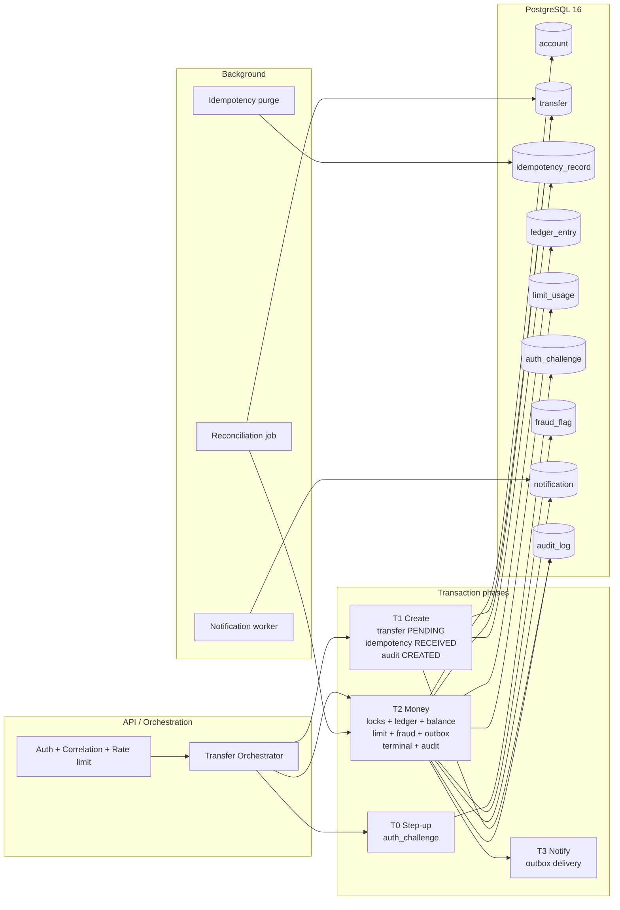
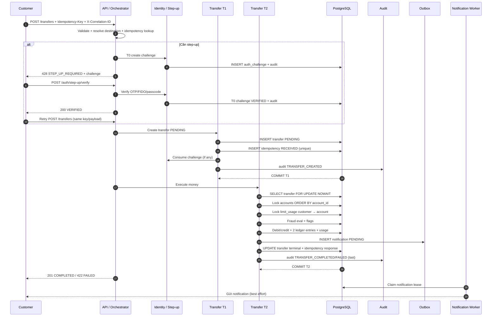
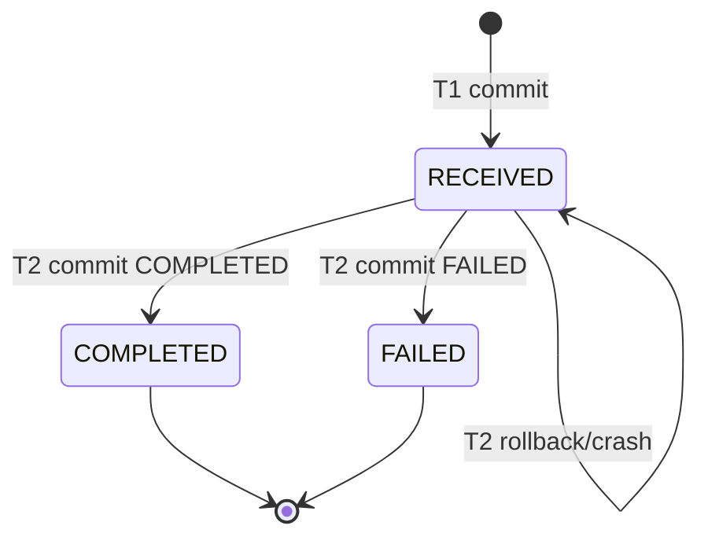
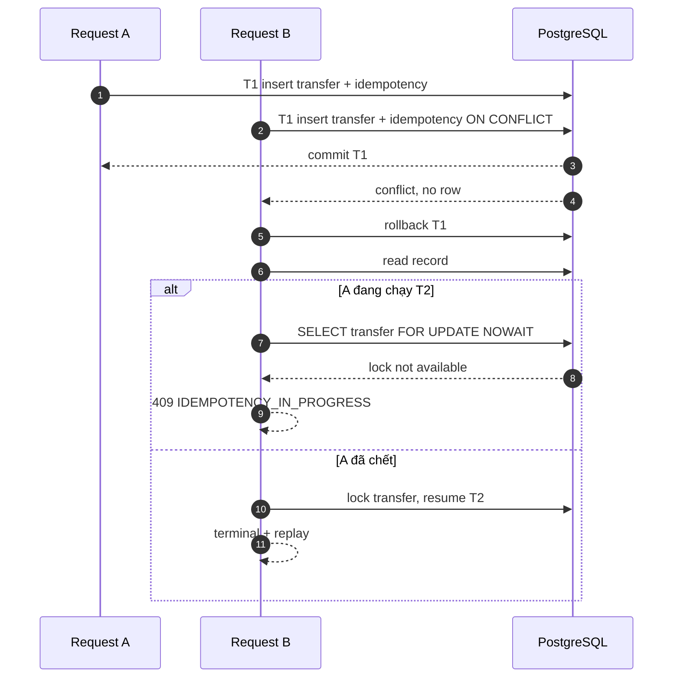
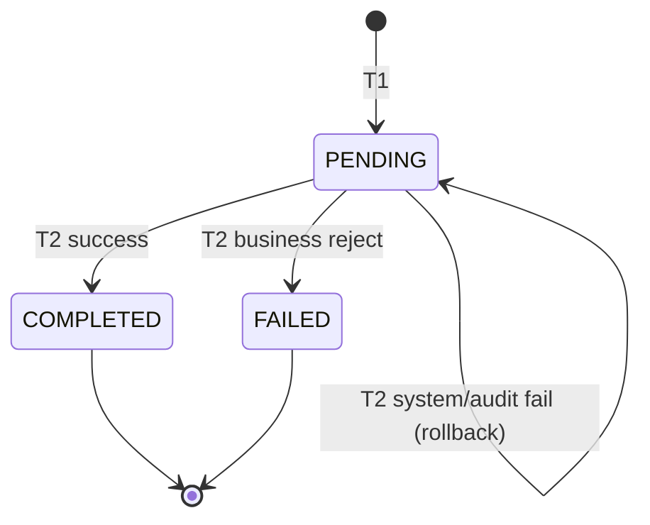
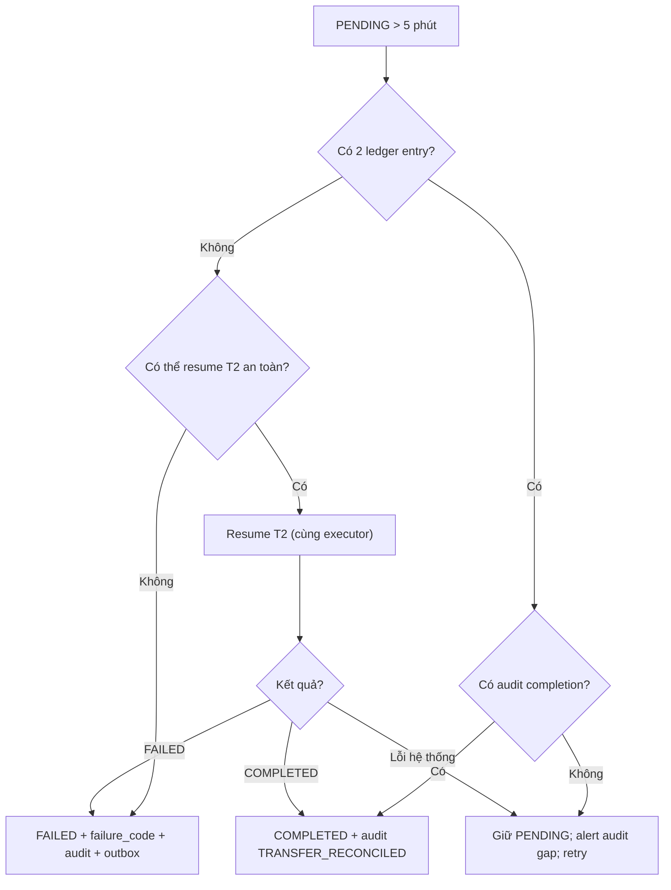

# 02. Consistency & Concurrency Design

> **Dự án:** Digital Banking MVP
>
> **Mã tài liệu:** `DESIGN-CON-02`
>
> **Phiên bản:** 1.0
>
> **Ngày:** 03/11/2026
>
> **Trạng thái:** Draft — chờ review
>
> **Owner:** System Architect / Backend Lead
>
> **Reviewer:** Backend, QA, DevOps/SRE, Security, Audit
>

---

## Mục lục

- [1. Mục đích, phạm vi và cách đọc](#1-mục-đích-phạm-vi-và-cách-đọc)
- [2. Tóm tắt thiết kế](#2-tóm-tắt-thiết-kế)
- [3. Yêu cầu và driver thiết kế](#3-yêu-cầu-và-driver-thiết-kế)
- [4. Mô hình nhất quán và kiến trúc](#4-mô-hình-nhất-quán-và-kiến-trúc)
- [5. Ranh giới transaction T0–T3](#5-ranh-giới-transaction-t0t3)
- [6. Thiết kế idempotency](#6-thiết-kế-idempotency)
- [7. Khóa, isolation và retry](#7-khóa-isolation-và-retry)
- [8. Bất biến tiền tệ, ledger và trạng thái](#8-bất-biến-tiền-tệ-ledger-và-trạng-thái)
- [9. Đồng bộ hóa các domain phụ trợ](#9-đồng-bộ-hóa-các-domain-phụ-trợ)
- [10. Failure recovery và reconciliation](#10-failure-recovery-và-reconciliation)
- [11. Hướng dẫn triển khai Spring Boot/JPA](#11-hướng-dẫn-triển-khai-spring-bootjpa)
- [12. Mô hình dữ liệu, ràng buộc và SQL](#12-mô-hình-dữ-liệu-ràng-buộc-và-sql)
- [13. Observability và vận hành](#13-observability-và-vận-hành)
- [14. Kiểm thử và nghiệm thu](#14-kiểm-thử-và-nghiệm-thu)
- [15. Traceability](#15-traceability)
- [16. Quyết định, open issues và rủi ro](#16-quyết-định-open-issues-và-rủi-ro)
- [Appendix A. SQL patterns](#appendix-a-sql-patterns)
- [Appendix B. Pseudocode](#appendix-b-pseudocode)
- [Appendix C. Mã lỗi và HTTP mapping](#appendix-c-mã-lỗi-và-http-mapping)
- [Appendix D. Kịch bản kiểm thử trọng tâm](#appendix-d-kịch-bản-kiểm-thử-trọng-tâm)
- [Appendix E. Glossary](#appendix-e-glossary)
- [Appendix F. Tài liệu tham khảo](#appendix-f-tài-liệu-tham-khảo)

---

## 1. Mục đích, phạm vi và cách đọc

### 1.1. Mục đích

Tài liệu này đặc tả thiết kế **consistency (nhất quán)** và **concurrency (đồng thời)** cho money path của Digital Banking MVP. Tài liệu trả lời các câu hỏi:

- Debit/credit, cập nhật số dư, ghi ledger, trạng thái transfer, limit usage, fraud flag và audit completion được gắn kết trong những transaction nào?
- Khi nhiều request đồng thời hoặc retry, điều gì bảo đảm **không double debit**, **không số dư âm**, **không mất update**, **không ghi đè trạng thái terminal**?
- Idempotency key được kiểm tra, lưu và replay như thế nào? Điều gì xảy ra khi hai request cùng key chạy song song hoặc khi service crash giữa chừng?
- Khóa (lock) nào được dùng, theo thứ tự nào, isolation level nào, timeout và retry ra sao?
- Khi audit write, notification, fraud engine hoặc database gặp lỗi, hệ thống giữ nhất quán tiền tệ và phục hồi như thế nào?
- Thiết kế nào cần kiểm chứng bằng test concurrency, failure injection và load test trước khi nghiệm thu?

Tài liệu là cầu nối giữa yêu cầu `BR-013` – `BR-016`, `FR-017` – `FR-022`, `NFR-009` – `NFR-012`, `AC-010` – `AC-013`, `AC-031`, `AC-033`, `AC-034` và triển khai trong các module `transfer`, `account`, `ledger`, `limit`, `audit`, `fraud`, `notification`.

### 1.2. Phạm vi

**Trong phạm vi:**

- Luồng transfer đồng bộ: T0 step-up, T1 tạo transfer PENDING + idempotency record, T2 xử lý tiền + ledger + limit + fraud + outbox + audit + trạng thái terminal, T3 gửi notification.
- Idempotency: canonical request hash, insert-first, replay, conflict, in-progress, resume, TTL/purge.
- Khóa và isolation: account row locks, transfer row lock, `auth_challenge` lock, `limit_usage` locks, audit advisory lock; thứ tự khóa; deadlock; lock timeout; retry.
- Bất biến tiền tệ: double-entry, số dư materialized, all-or-nothing, trạng thái terminal immutable.
- Đồng bộ hóa limit usage, step-up challenge, fraud flag, audit completion, notification outbox.
- Reconciliation transfer PENDING, crash windows, recovery, runbook vận hành.
- Hướng dẫn triển khai Spring Boot/JPA, SQL pattern, test concurrency và bằng chứng nghiệm thu.

**Ngoài phạm vi:**

- Distributed transaction/Saga xuyên nhiều database hoặc CBS thật; MVP dùng một PostgreSQL.
- Payment gateway, settlement, cancellation/reversal, fees/interest/FX; xem phạm vi tại [[02. BRD]] và [[03. SRS]].
- Multi-region active-active, read replica consistency, sharding, Kafka/Redis lock.
- Thiết kế chi tiết audit hash chain, retention/legal hold; xem [[01. audit-traceability]].
- Thiết kế chi tiết rule fraud và ngưỡng; xem [[03. fraud-detection-rules]].
- Mã hóa, RBAC, session security; xem [[04. security]].
- Tuning PostgreSQL chuyên sâu ngoài ngưỡng 20 RPS của MVP.

### 1.3. Đối tượng đọc

| Vai trò | Cách đọc |
|---|---|
| Backend developer | Mục 4–12, Appendix A–C để implement transaction, lock, idempotency, reconciliation |
| QA | Mục 3, 5–10, 14, Appendix D để viết test concurrency/failure và thu bằng chứng |
| DevOps/SRE | Mục 10, 13 để cấu hình timeout, alert, job, runbook |
| Security/Audit | Mục 6, 9.4, 12, 16 để review idempotency, audit coupling, cross-customer key |
| BA/Product | Mục 1–3, 6, 16 để xác nhận hành vi retry/409/TTL và open issues |

### 1.4. Tài liệu tham chiếu

**Nội bộ:**

| Tài liệu | Nội dung sử dụng |
|---|---|
| [[02. BRD]] | `BR-013` – `BR-016`, `BRL-013` – `BRL-017`, `MET-002`, `BR-042`; failure scenarios và demo bắt buộc |
| [[03. SRS]] | `FR-017` – `FR-022`, `NFR-009` – `NFR-012`, `AC-010` – `AC-013`, `AC-031`, `AC-033`, `AC-034`, D1–D3/D5, error codes |
| [[04. Database design & analysis]] | Schema `account`, `transfer`, `ledger_entry`, `idempotency_record`, `limit_usage`, `auth_challenge`, `fraud_flag`, `notification`; mục 7.7 transaction boundaries |
| [[05. Technical stack]] | Java 21, Spring Boot, PostgreSQL 16, Spring Data JPA, HikariCP, Flyway, Testcontainers, k6 |
| [[06. System architecture]] | `AD-03` – `AD-05`, `AD-08`, `AD-09`, T0–T3, lock order, invariants I-01 – I-11, reconciliation |
| [[07. API contracts]] | `Idempotency-Key`, canonical request hash, replay, `409 IDEMPOTENCY_*`, `428 STEP_UP_REQUIRED`, retry policy |
| [[Requirement Common]] | Strong transactional consistency, idempotent transfer, failure scenarios, demo D1/D2 |

**Bên ngoài (tham khảo thực hành tốt, không phải cam kết tuân thủ):**

- PostgreSQL 16 — MVCC, transaction isolation, explicit locking, serialization failure handling.
- Spring Framework — transaction management; Spring Data JPA — transactions và locking.
- RFC 8785 — JSON Canonicalization Scheme (JCS).
- RFC 9457 — Problem Details for HTTP APIs.
- Stripe idempotency — mô hình idempotency key/replay tham khảo.
- HikariCP — connection pool; Testcontainers — PostgreSQL integration test; k6 — load test.

Danh sách đầy đủ ở [Appendix F](#appendix-f-tài-liệu-tham-khảo).

### 1.5. Quy ước

| Quy ước | Ý nghĩa |
|---|---|
| **Bắt buộc / MUST** | Không được bỏ qua trong MVP; thiếu là defect |
| **Nên / SHOULD** | Ưu tiên làm; nếu defer phải ghi lý do, owner, kế hoạch |
| **Có thể / MAY** | Tùy chọn, không ảnh hưởng acceptance |
| `T0`, `T1`, `T2`, `T3` | Các pha transaction của luồng transfer theo [[06. System architecture]] |
| `snake_case` | Tên cột/bảng PostgreSQL |
| `camelCase` | Field JSON API |
| `UPPER_SNAKE_CASE` | Enum, error code, audit action |
| Tiền | `NUMERIC(19,2)`, VND; Java `BigDecimal`; JSON là chuỗi thập phân |
| Thời gian | Lưu `TIMESTAMPTZ` UTC; API ISO 8601 UTC; business date theo timezone cấu hình |
| SQLSTATE | `40001` serialization failure; `40P01` deadlock; `55P03` lock not available; `23505` unique violation |
| **Đề xuất** | Khác hoặc làm rõ so với baseline, cần review trước khi coi là cam kết |

### 1.6. Quan hệ với baseline và nguyên tắc thay đổi

Thiết kế này **bám sát** các quyết định kiến trúc `AD-03` (T0–T3), `AD-04` (idempotency record trong T1), `AD-05` (audit completion trong T2), `AD-08` (`READ COMMITTED` + explicit row lock), `AD-09` (ledger all-or-nothing) và schema tại [[04. Database design & analysis]].

Các điểm sau là **làm rõ** hoặc **đề xuất**, không tự động thay đổi baseline:

1. **Làm rõ trạng thái idempotency:** `RECEIVED` là trạng thái bền vững của "đã tạo, chưa terminal"; `IN_PROGRESS` chỉ là marker tạm thời trong T2 và không dùng làm cơ chế phối hợp. Cơ chế phối hợp thật là row lock trên `transfer`. Đề xuất cập nhật state diagram tại [[07. API contracts]] mục 5.3 và mục 8.1 của [[01. audit-traceability]].
2. **Resume protocol:** retry cùng key khi transfer row **không bị khóa** sẽ resume T2; khi đang bị khóa trả `409 IDEMPOTENCY_IN_PROGRESS`. Điều này giữ đúng hợp đồng API nhưng tăng khả năng tự phục hồi sau crash.
3. **Customer-level `limit_usage` row** được dùng làm mutex tuần tự hóa theo customer (kể cả khi không có customer-level limit), để bảo vệ daily limit và high-frequency count. Đây là làm rõ semantics, không đổi schema.
4. **Phân loại lỗi:** business rejection trong T2 được ghi `FAILED` và **commit**; system/audit failure **rollback** và giữ `PENDING`. Đây là quy tắc bắt buộc để tránh biến một lỗi nghiệp vụ thành PENDING treo.
5. **Cross-customer idempotency key:** key unique toàn cục nhưng phải kiểm tra ownership trước khi replay; không trả response của customer khác.
6. **Đề xuất P1:** các cột/index bổ sung cho reconciliation, per-customer idempotency scope, unique notification outbox và deferred ledger constraint (mục 12.5); cần cập nhật [[04. Database design & analysis]] và migration trước khi áp dụng.

Không có thay đổi schema hoặc API nào trong tài liệu này được tự động áp dụng; các đề xuất phải được chấp nhận tại mục 16.2 và cập nhật tài liệu tương ứng.

---

## 2. Tóm tắt thiết kế

### 2.1. Tóm tắt một trang

Consistency của MVP là **strong consistency trong một PostgreSQL**. Mọi thay đổi tiền của một transfer — debit/credit, hai ledger entry, cập nhật `account.available_balance`/`ledger_balance`, limit usage, fraud flag, notification outbox, trạng thái terminal và audit completion — nằm trong **một transaction T2 duy nhất**. Không dùng distributed transaction, message broker hay eventual consistency cho money path.

Luồng được chia thành bốn pha:

1. **T0 — Step-up:** tạo/verify `auth_challenge`; không tạo transfer, không ghi ledger.
2. **T1 — Create:** tạo `transfer` PENDING + `idempotency_record` + audit `TRANSFER_CREATED`; unique key bảo vệ race.
3. **T2 — Money:** khóa transfer row, khóa account theo `account_id ASC`, khóa limit usage, đánh giá fraud (fail-open), ghi ledger, cập nhật balance/usage, ghi notification PENDING, cập nhật trạng thái terminal + idempotency response, ghi audit completion **cuối cùng**; commit atomically.
4. **T3 — Notify:** worker gửi notification từ outbox sau commit; lỗi gửi không ảnh hưởng tiền.

Các invariant được bảo vệ theo bốn lớp:

- **Constraint:** PK/unique idempotency, unique `(transfer_id, entry_seq)`, unique `reference_no`, unique `step_up_challenge_id`, CHECK số dư/trạng thái.
- **Row lock:** transfer row, account rows theo thứ tự cố định, limit usage rows, `auth_challenge` row.
- **Conditional update + state machine:** `WHERE status='PENDING'`, `WHERE available_balance >= amount`, terminal immutable.
- **Transaction + audit fail-closed + reconciliation:** audit completion nằm trong T2; audit fail thì rollback, giữ PENDING; job reconciliation xác định terminal state và chứng minh ledger/audit.

Idempotency dùng **insert-first**: T1 insert `idempotency_record` với `request_hash` SHA-256 (canonical JCS). Cùng key + cùng hash + terminal → replay response cũ; cùng key + khác hash → `409 IDEMPOTENCY_CONFLICT`; cùng key + đang xử lý → `409 IDEMPOTENCY_IN_PROGRESS` hoặc resume T2 nếu lock đã được giải phóng. Không có lần debit thứ hai.

### 2.2. Sơ đồ khối



**Hình 1 — Thành phần và luồng consistency/concurrency**

### 2.3. Quyết định thiết kế chính

| ID | Quyết định | Lý do | Hệ quả |
|---|---|---|---|
| `DD-CON-01` | Một PostgreSQL, một transaction T2 cho toàn bộ money movement | ACID, không cần Saga; đúng `CON-004`, `AD-02` | DB là SPOF; cần backup/restore |
| `DD-CON-02` | `READ COMMITTED` + explicit row lock, không dùng `SERIALIZABLE` toàn cục | Đủ cho invariant tiền tệ; tránh abort/retry diện rộng | Phải khóa đúng và test kỹ |
| `DD-CON-03` | Chia T0/T1/T2/T3 | T1 bền vững trước khi xử lý tiền; T2 atomic; T3 ngoài money path | Có crash window giữa T1/T2; cần reconciliation |
| `DD-CON-04` | Idempotency insert-first với unique PK | DB là trọng tài race; không phụ thuộc application check | Unique conflict phải xử lý đúng, không để transaction aborted |
| `DD-CON-05` | Replay chỉ với terminal response; không replay lỗi transient | Tránh cache lỗi 5xx; retry phải resume được | `response_body` chỉ lưu terminal |
| `DD-CON-06` | Retry cùng key: `FOR UPDATE NOWAIT` trên transfer row; live → 409, stale → resume T2 | Bảo vệ khỏi chạy song song, vẫn tự phục hồi sau crash | Client phải tôn trọng `Retry-After` |
| `DD-CON-07` | `RECEIVED` là trạng thái in-progress bền vững; `IN_PROGRESS` là transient | Một transaction T2 không thể commit riêng `IN_PROGRESS` | Làm rõ state diagram; không dùng `IN_PROGRESS` làm lease |
| `DD-CON-08` | Thứ tự khóa cố định: transfer → challenge (nếu cần) → account ASC → limit usage customer → account → audit | Chống deadlock; mọi module tuân thủ | Thay đổi thứ tự phải review toàn hệ |
| `DD-CON-09` | Account row lock + conditional update + CHECK | Chống lost update, số dư âm; DB là chốt cuối | Lock contention trên tài khoản hot |
| `DD-CON-10` | Customer-level `limit_usage` row là mutex theo customer; account-level row khóa sau | Bảo vệ daily limit và high-frequency count | Transfer cùng customer bị tuần tự hóa |
| `DD-CON-11` | Business rejection commit `FAILED`; system/audit failure rollback `PENDING` | Phân biệt lỗi nghiệp vụ và lỗi hạ tầng; tránh PENDING treo | Exception policy phải rõ trong code |
| `DD-CON-12` | Audit completion là insert cuối T2, fail-closed | AC-034: không COMPLETED nếu audit chưa bền vững | Audit lock là điểm tuần tự toàn cục |
| `DD-CON-13` | Notification outbox insert trong T2; delivery sau commit với lease | Không mất thông báo; không giữ lock khi gọi external | At-least-once; có thể trùng |
| `DD-CON-14` | Fraud eval trong T2 sau customer lock, fail-open; flag trong T2 | Flag bền vững cùng kết quả; engine lỗi không chặn tiền | T2 dài hơn; cần budget |
| `DD-CON-15` | Không gọi external service trong T2; OTP/FIDO trước T1, notification sau commit | Tránh giữ lock khi chờ network | Cần outbox/worker cho notification |
| `DD-CON-16` | Reconciliation per-transfer với `SKIP LOCKED`, dùng lại logic T2 idempotent | Không double ledger; nhiều instance an toàn | Cần chống retry vô hạn |
| `DD-CON-17` | Cross-customer idempotency key bị từ chối, không replay | Tránh lộ dữ liệu/chiếm key | Key toàn cục có thể bị DoS; xem OI-CON-04 |
| `DD-CON-18` | Không dùng `@Version` cho account/transfer money state | Row lock + conditional update đơn giản, ít retry | `@Version` chỉ dùng cho config không phải tiền |

### 2.4. Nguyên tắc bất biến

Các invariant sau phải luôn đúng; test/verification phải chứng minh:

| ID | Invariant | Cơ chế | Bằng chứng |
|---|---|---|---|
| `I-CON-01` | Không có `available_balance < 0` hoặc `ledger_balance < 0` | Row lock + conditional update + CHECK | Concurrency test |
| `I-CON-02` | `available_balance <= ledger_balance` (MVP không hold) | CHECK + cập nhật cùng amount | Reconciliation |
| `I-CON-03` | Transfer `COMPLETED` có đúng 2 ledger entry: 1 DEBIT, 1 CREDIT, cùng amount/currency | T2 insert + unique `(transfer_id, entry_seq)` + reconciliation | Ledger audit |
| `I-CON-04` | Transfer `PENDING`/`FAILED` không có ledger entry | T2 chỉ insert sau khi pass business; rollback all-or-nothing | Test AC-012 |
| `I-CON-05` | Một idempotency key tạo tối đa một transfer; không double debit | PK unique + T1/T2 + replay/resume | D2 test |
| `I-CON-06` | Cùng key + khác `request_hash` bị từ chối, không tạo transfer | So sánh hash + `409 IDEMPOTENCY_CONFLICT` | AC-011 |
| `I-CON-07` | Chỉ `PENDING → COMPLETED/FAILED`; terminal immutable | State machine + conditional update + trigger | State test |
| `I-CON-08` | Không `COMPLETED` nếu audit completion chưa bền vững | Audit trong T2, fail-closed | AC-034 |
| `I-CON-09` | Mọi terminal transfer có idempotency record tương ứng | FK + unique `transfer_id` | Reconciliation |
| `I-CON-10` | Step-up challenge được dùng tối đa một lần | Row lock + `consumed_at` + unique `step_up_challenge_id` | AC-033 |
| `I-CON-11` | Daily limit không bị vượt khi nhiều transfer đồng thời | `limit_usage` row lock + check/increment trong T2 | AC-009 |
| `I-CON-12` | Chỉ transfer `COMPLETED` mới tăng usage | Increment sau khi money thành công, cùng T2 | Reconciliation |
| `I-CON-13` | Balance materialized khớp ledger | T2 cập nhật cùng transaction + reconciliation | Ledger reconciliation |
| `I-CON-14` | PENDING transfer được xử lý hoặc chuyển manual review trong ngưỡng | Reconciliation startup/scheduled + alert | AC-013 |
| `I-CON-15` | Không có external call trong T2 | Code review + ArchUnit/test | Architecture test |
| `I-CON-16` | Key của customer A không replay response của customer B | Ownership check + audit security event | Security test |
| `I-CON-17` | Notification outbox row bền vững cùng kết quả transfer | Insert trong T2 | Outbox test |
| `I-CON-18` | Audit chain không có hai record cùng `prev_hash` | Advisory lock + hash chain | Audit verification |

### 2.5. Mức bảo đảm theo domain

| Domain | Mức bảo đảm | Cơ chế | Ghi chú |
|---|---|---|---|
| `account.available_balance`/`ledger_balance` | Strong, linearizable theo account | Row lock + conditional update + CHECK | Đọc thấy dữ liệu committed |
| `ledger_entry` | Strong, append-only | Cùng T2; unique seq | Không update/delete |
| `transfer.status` | Strong, terminal một lần | Row lock + conditional update | Đọc có thể thấy PENDING |
| `idempotency_record` | Strong | PK unique + T1/T2 | Replay/resume |
| `limit_usage` | Serializable theo customer | Row lock customer → account | Transfer cùng customer tuần tự |
| `auth_challenge` | Strong | Row lock + unique active step-up | Consume một lần |
| `fraud_flag` | Strong trong T2; engine fail-open | Insert cùng T2 | Flag bền vững cùng kết quả |
| `audit_log` | Strong + append-only + hash chain | Cùng T1/T2, advisory lock | Fail-closed với money |
| `notification` | Eventual, at-least-once | Outbox + worker lease | Trễ/trùng chấp nhận được |
| `limit_config`/`fraud_rule_config` | Read committed; versioned | Version + partial unique active | Có thể đọc old/new khi đổi |
| Read history/audit search | Read committed snapshot | Index + pagination | Không dirty read; có thể thấy PENDING |

---

## 3. Yêu cầu và driver thiết kế

### 3.1. Yêu cầu nghiệp vụ và chức năng

| ID | Yêu cầu | Thiết kế đáp ứng |
|---|---|---|
| `BR-013` / `FR-017` | Idempotency key bắt buộc; replay cùng key; conflict payload khác | Mục 6; unique PK; canonical hash; replay/conflict |
| `BR-014` / `FR-018` | Tạo transfer PENDING với reference duy nhất trước khi xử lý tiền | T1; unique `reference_no`; audit CREATED |
| `BR-014` / `FR-019` | Debit/credit nguyên tử; PENDING → COMPLETED/FAILED | T2; một transaction; state machine |
| `BR-015` / `FR-020` | Debit thành công/credit thất bại phải rollback/compensate; không mất tiền | T2 rollback all-or-nothing; FAILED không ledger; reconciliation |
| `BR-013`/`BR-015` / `FR-021` | Retry timeout cùng key không debit lần hai | Idempotency replay/resume; unique key |
| `BR-015` / `FR-022` | Crash/restart phải đối soát PENDING | Reconciliation job; crash windows |
| `BR-012` / `FR-016` | Enforce per-transaction/daily limit | `limit_config` + `limit_usage` row lock |
| `BR-002` / `FR-026` | Step-up trước transfer rủi ro; không ledger trước verify | T0; challenge consume T1; unique binding |
| `BR-024`/`BR-028` / `FR-034`, `FR-037` | Audit bất biến, không COMPLETED nếu audit chưa bền vững | Audit trong T1/T2; fail-closed; [[01. audit-traceability]] |
| `BR-033` / `FR-041` | Notification không chặn giao dịch | Outbox trong T2; worker T3 |
| `BR-044` – `BR-048` / `FR-044` – `FR-048` | Fraud flag, fail-open, auto-block trước ledger | Fraud eval trong T2; flag/auto-block; [[03. fraud-detection-rules]] |
| `BR-042` | Demo concurrency, duplicate, failure/recovery, load test | Mục 14; D1/D2/D3/D5 |

### 3.2. NFR

| ID | Yêu cầu | Target | Cách đáp ứng |
|---|---|---|---|
| `NFR-001` | Transfer API latency | p95 ≤ 2s; p99 ≤ 5s ở 20 RPS | T1/T2 ngắn; lock timeout; index; pool |
| `NFR-004` | Load test | 20 RPS × 10 phút; lỗi < 1% | Budget mục 13.6; k6 |
| `NFR-006` | Crash recovery | Không ledger inconsistency; reconcile PENDING trong 5 phút | Reconciliation startup/scheduled |
| `NFR-008` | External failure | Notification/fraud failure không chặn giao dịch | Outbox; fraud fail-open |
| `NFR-009` | Atomicity/no negative balance | Debit/credit nguyên tử; ledger cân bằng | T2 + CHECK + reconciliation |
| `NFR-010` | Concurrency safety | Không lost update/double debit | Row lock + idempotency + test |
| `NFR-011` | Idempotency retention | ≥ 24 giờ (đề xuất) | TTL + purge; OI-CON-01 |
| `NFR-012` | Status integrity | PENDING → COMPLETED/FAILED; terminal immutable | State machine + trigger |
| `NFR-024` | Scalability | 20 RPS; scale ngang cơ bản | DB coordination; multi-instance safe |
| `NFR-025` | Observability | Logs/metrics/health | Mục 13 |
| `NFR-027` | Automated tests | Critical paths + coverage ≥ 80% (Should) | Mục 14 |

### 3.3. Acceptance criteria và demo

| ID | Kịch bản | Kỳ vọng | Thiết kế |
|---|---|---|---|
| `AC-010` | Retry cùng key sau khi transfer hoàn tất | Cùng status/body; không transfer/debit mới | Replay mục 6.5 |
| `AC-011` | Cùng key, payload khác | `409 IDEMPOTENCY_CONFLICT`; không transfer; audit | Mục 6.4 |
| `AC-012` | Debit thành công, credit thất bại | Transfer FAILED; rollback/compensate; ledger cân bằng; audit | Mục 8 |
| `AC-013` | PENDING + restart | Reconciliation xác định COMPLETED/FAILED hoặc manual review; không mất tiền | Mục 10 |
| `AC-031` | Load test 20 RPS × 10 phút | p95 ≤ 2s; lỗi < 1%; không inconsistency | Mục 13.6, 14.5 |
| `AC-033` | Transfer cần step-up | 428; không transfer/ledger; verify + retry đúng một lần | Mục 5.1, 9.1 |
| `AC-034` | Audit completion fail | Không COMPLETED; PENDING/FAILED; retry không double debit | Mục 5.3, 10 |
| `D1` | Nhiều transfer đồng thời cùng source | Không âm số dư; không double debit; ledger cân bằng | Mục 14.2 |
| `D2` | Retry cùng key nhiều lần/đồng thời | Chỉ một transfer; cùng response; không debit thêm | Mục 14.2 |
| `D3` | Credit fail; audit fail; restart PENDING | FAILED/compensate; audit fail không COMPLETED; reconcile | Mục 10, 14.4 |
| `D5` | Load test | p95/lỗi/invariant | Mục 13.6, 14.5 |

### 3.4. Ràng buộc và giả định

| ID | Ràng buộc/giả định | Ảnh hưởng |
|---|---|---|
| `CON-004` | Spring Boot + PostgreSQL | Thiết kế dùng ACID/MVCC/row lock của PostgreSQL |
| `CON-005` | VND; không phí/lãi/FX | Mỗi transfer có đúng 2 entry, amount bằng nhau |
| `CON-006` | Dữ liệu demo, không tiền thật | Không cần settlement/CBS |
| `CON-009` | Audit bất biến | Audit completion là điều kiện của COMPLETED |
| Giả định A1 | Một PostgreSQL primary trong một region | Không xử lý multi-region/active-active |
| Giả định A2 | 20 RPS, một deployable backend | Lock contention trong ngưỡng; audit global lock chấp nhận |
| Giả định A3 | Đồng hồ các instance được đồng bộ NTP; business date lấy từ DB time | Giảm race tại ranh giới ngày |
| Giả định A4 | Notification provider mô phỏng, có thể trùng | Outbox at-least-once; template idempotent |
| Giả định A5 | Không có external ledger/CBS trong T2 | All-or-nothing bằng rollback; không cần Saga |
| Giả định A6 | Mọi thay đổi tiền đi qua transfer service | Không module nào tự update balance ngoài T2 |

### 3.5. Mục tiêu thiết kế và non-goals

**Mục tiêu:**

- Chứng minh bằng test rằng không có double debit, lost update, số dư âm, ledger lệch hoặc audit gap trong các kịch bản concurrency/failure.
- Giữ transaction ngắn, lock order rõ, không gọi external trong money path.
- Có đường phục hồi tự động cho mọi crash window và một runbook cho trường hợp không tự động được.
- Có thể chạy nhiều instance backend mà vẫn an toàn nhờ DB coordination.
- Có thể mở rộng lên external ledger/Saga mà không phá vỡ hợp đồng idempotency.

**Non-goals:**

- Không đảm bảo exactly-once end-to-end cho notification (chấp nhận at-least-once).
- Không đảm bảo serializable cho read history/audit search.
- Không xử lý cancellation/reversal, chargeback, settlement.
- Không tối ưu cho >20 RPS trong MVP; scale-out path chỉ nêu định hướng.

### 3.6. Catalog hiểm họa concurrency

| Hiểm họa | Ví dụ | Tác động | Kiểm soát |
|---|---|---|---|
| Lost update | Hai debit cùng đọc balance cũ | Mất tiền/âm quỹ | Account row lock + conditional update |
| Write skew | Hai transfer cùng check daily limit | Vượt hạn mức | `limit_usage` row lock customer |
| Phantom | High-frequency count không thấy transfer mới | Bỏ flag | Count sau customer lock; flag-only |
| Dirty write | Ghi đè trạng thái terminal | Sai trạng thái | Conditional update + trigger |
| Deadlock | A→B và B→A khóa ngược thứ tự | Request fail | Account ID order + retry |
| Duplicate processing | Retry tạo transfer thứ hai | Double debit | Idempotency unique + T1/T2 |
| Unique race | Hai request cùng key cùng lúc | Một request lỗi | Insert-first + `ON CONFLICT` |
| Double consume | Một challenge dùng cho hai transfer | Bypass step-up | Challenge row lock + unique binding |
| Audit gap | Tiền commit, audit fail | Không bằng chứng | Audit trong T2, fail-closed |
| Outbox loss | Notification không được tạo | Không thông báo | Insert outbox trong T2 |
| Lock timeout | Lock chờ quá lâu | 5xx/latency | `lock_timeout`, retry, alert |
| Pool exhaustion | Giữ connection khi chờ external | Hết pool | Không external trong T2; pool monitoring |
| Retry storm | Client retry dồn dập | Quá tải | 409 + `Retry-After`; backoff |
| Clock skew | Ranh giới ngày limit | Vượt limit | DB time/business date tập trung |
| Cross-customer key | Key của A bị B đoán | Lộ response/DoS | Ownership check; audit |
| Stale config | Limit đổi giữa T2 | Dùng config cũ/mới | Versioned config; đọc một lần |
| Long transaction | Giữ lock khi gọi OTP/notification | Block toàn hệ | External ngoài T2 |
| Double scheduler | Hai instance chạy cùng job | Xử lý trùng | `SKIP LOCKED`/lease |

---

## 4. Mô hình nhất quán và kiến trúc

### 4.1. Thành phần và trách nhiệm

| Thành phần | Trách nhiệm consistency/concurrency | Không làm |
|---|---|---|
| `transfer` application service | Orchestration T1/T2; idempotency; state machine; lock order | Không gọi external trong T2 |
| `account` repository | Row lock/conditional update balance; status check | Không tự quyết định transfer |
| `ledger` repository | Insert 2 entry; balance_after; reconciliation | Không update/delete entry |
| `limit` service | Đọc config; khóa/cập nhật usage; check daily/per-txn | Không giữ lock khi gọi external |
| `identity`/step-up | T0 challenge; verify; consume binding | Không tạo transfer/ledger |
| `audit` writer | Audit trong T1/T2; hash chain; advisory lock | Không async cho C1/C2 |
| `fraud` engine | Eval trong T2; flag/auto-block; fail-open | Không block khi engine lỗi |
| `notification` | Outbox trong T2; worker T3; lease/retry | Không ảnh hưởng kết quả tiền |
| Reconciliation job | Đối soát PENDING; resume T2/FAILED; alert | Không sửa ledger/audit tùy tiện |

### 4.2. Ranh giới module

- Mỗi bảng có một module sở hữu ghi; module khác đọc qua interface/projection ([[06. System architecture]] mục 8.1).
- `transfer` sở hữu `transfer`, `idempotency_record`; `ledger` sở hữu `ledger_entry`; `account` sở hữu balance/status; `limit` sở hữu `limit_config`/`limit_usage`; `audit` sở hữu `audit_log`.
- T2 gọi các module qua internal API trong **cùng transaction** (Spring propagation `REQUIRED`), không qua HTTP/message.
- Không join tùy tiện giữa module trong write path; read model được khai báo rõ.
- Audit writer là dependency bắt buộc của T1/T2; không được thay bằng log kỹ thuật.

### 4.3. Internal API (khái niệm)

| API | Input | Output | Transaction |
|---|---|---|---|
| `IdempotencyService.find(key)` | key, customer | record + transfer projection | Read-only, ngoài T1 |
| `TransferT1Service.create(cmd)` | request, customer, challenge | transferId/reference | `@Transactional` riêng |
| `TransferT2Service.execute(transferId, cmd)` | transferId, customer, correlation | outcome COMPLETED/FAILED | `@Transactional` riêng |
| `AccountService.lockAndDebit(...)` | accountId, amount | balanceAfter hoặc business reject | Tham gia T2 |
| `LimitService.lockAndCheck(...)` | customer, account, amount, date | usage rows | Tham gia T2 |
| `FraudService.evaluate(...)` | transfer, history | flags/autoBlock/error | Tham gia T2 (in-process) |
| `AuditWriter.recordInTransaction(...)` | event | auditId | Tham gia T1/T2 |
| `NotificationOutbox.enqueue(...)` | transfer, result | notification PENDING | Tham gia T2 |
| `ReconciliationService.reconcile(transferId)` | transferId | COMPLETED/FAILED/PENDING | Transaction riêng từng transfer |

### 4.4. Luồng runtime T0–T3



**Hình 2 — Sequence T0–T3**

### 4.5. Catalog transaction phase

| Phase | Nội dung | Transaction | Isolation | Lock chính | Ghi chú |
|---|---|---|---|---|---|
| **T0** | Tạo/verify `auth_challenge` step-up | Transaction ngắn riêng | `READ COMMITTED` | challenge row khi verify | Không transfer/ledger |
| **T1** | Insert `transfer` PENDING + `idempotency_record` + audit CREATED; consume challenge | Một transaction | `READ COMMITTED` | challenge row; audit advisory | Unique key bảo vệ race |
| **T2** | Lock transfer/accounts/limit; fraud; ledger; balance/usage; outbox; terminal; idempotency response; audit completion | Một transaction | `READ COMMITTED` | transfer → challenge (nếu cần) → account ASC → limit usage → audit | Audit fail → rollback toàn bộ |
| **T3** | Gửi notification từ outbox | Không transaction money | — | notification lease | Retry/backoff; at-least-once |

### 4.6. Read/write path và nhất quán khi đọc

- **Account balance:** đọc `READ COMMITTED`; chỉ thấy dữ liệu committed; có thể thấy số dư trước/sau một transfer đang chạy. Không đọc uncommitted.
- **Transfer status:** có thể thấy `PENDING` trong khoảng T1–T2; đây là trạng thái hợp lệ; client query theo reference.
- **History:** cursor/pagination trên `transfer` + `ledger_entry`; snapshot từng statement; có thể thấy transfer mới ở trang sau; chấp nhận.
- **Audit search:** đọc committed `audit_log`; reconciliation/verification job dùng snapshot/lock theo [[01. audit-traceability]].
- **Limit remaining:** đọc `limit_usage` committed; có thể lệch nhẹ so với transfer đang chạy; chỉ là hiển thị, enforcement nằm trong T2.
- **Fraud flag:** đọc committed; flag có thể xuất hiện sau khi transfer terminal; UI/ops chấp nhận.

### 4.7. Hành vi multi-instance

- DB là coordinator; không dùng in-memory lock cho money path.
- Mọi instance dùng cùng lock order và unique constraint; request có thể rơi vào bất kỳ instance nào.
- Scheduler (reconciliation, notification, purge) dùng `SKIP LOCKED`/lease để nhiều instance không xử lý trùng.
- Session/idempotency/limit đều ở DB; không cần sticky session.
- Clock: business date lấy từ DB time; log/metric dùng UTC.
- Rate limit in-memory (Bucket4j) chỉ là best-effort theo instance; không dùng để bảo vệ invariant tiền.

### 4.8. Cache và read model

- Không cache `account.balance`, `transfer.status`, `limit_usage`, `idempotency_record`.
- Có thể cache read-only config (`limit_config`, `fraud_rule_config`) với TTL ngắn và version; nhưng **không** dùng cache để enforce limit trong T2; T2 đọc DB.
- Read model/history có thể dùng projection/index; không dùng eventual consistency cho trạng thái tiền.
- Nếu thêm read replica sau này, chỉ dùng cho reporting; money path và enforcement vẫn primary.

---

## 5. Ranh giới transaction T0–T3

### 5.1. Pre-flight và T0 — Step-up

**Pre-flight (không transaction tiền):**

1. Xác thực session, quyền `TRANSFER_CREATE`, CSRF, correlation ID, rate limit.
2. Validate schema/header: `Idempotency-Key`, amount scale, source ≠ destination, currency, description.
3. Resolve destination nếu dùng `accountNumber`; đọc account để pre-check ownership/status/balance (chỉ là UX; T2 kiểm tra lại dưới lock).
4. Idempotency lookup:
   - Record terminal → replay ngay, không đánh giá lại risk/step-up.
   - Record đang xử lý → `409 IDEMPOTENCY_IN_PROGRESS` hoặc resume (mục 6.6).
   - Record khác hash/khác customer → `409 IDEMPOTENCY_CONFLICT`; audit security event.
   - Không có record → tiếp tục.
5. Đánh giá risk/step-up. Nếu cần step-up:
   - T0 tạo `auth_challenge` purpose `TRANSFER_STEP_UP`, bind `user_id`, `request_hash`, `idempotency_key`, `expires_at`, `correlation_id`.
   - Trả `428 STEP_UP_REQUIRED` + challenge; **không** tạo `transfer`, `idempotency_record` hoặc ledger.
   - Dispatch OTP/FIDO/passcode ra ngoài transaction DB (sau commit T0); nếu dispatch fail → `503 OTP_DISPATCH_FAILED`, challenge được đánh dấu/invalidate theo policy; không có transfer.
6. Client verify challenge qua endpoint step-up:
   - T0 transaction ngắn: lock challenge row, kiểm tra trạng thái/TTL/attempt, tăng `attempt_count` atomic, set `VERIFIED` + `verified_at`, audit.
   - Verify sai vượt ngưỡng → `LOCKED`; hết hạn → `EXPIRED`; audit.
7. Client retry `POST /transfers` với **cùng key + cùng payload**; T1 consume challenge.

**Quy tắc:**

- 428 không tạo idempotency record; vì vậy 428 không được replay như một kết quả transfer.
- Challenge gắn với `request_hash` + `idempotency_key`; không dùng cho request khác.
- `auth_challenge` chỉ có một active step-up cho mỗi `(idempotency_key, request_hash)` nhờ partial unique index.
- Verify challenge là transaction riêng; không giữ lock khi chờ user nhập OTP.
- Challenge đã `VERIFIED` nhưng hết hạn trước T1: T1 từ chối; client phải step-up lại.
- Challenge đã consume ở T1; nếu T1 rollback, `consumed_at` rollback theo; nếu T2 fail, challenge vẫn consumed vì T1 đã commit; retry dùng transfer đã tạo.

### 5.2. T1 — Tạo transfer PENDING + idempotency + audit

**Mục tiêu:** tạo một “neo” bền vững (transfer + idempotency + audit CREATED) trước khi xử lý tiền, để crash/retry có thể phục hồi và không tạo giao dịch thứ hai.

**Thứ tự thực hiện trong một transaction:**

1. Sinh `reference_no` unique; insert `banking.transfer` trạng thái `PENDING`, `failure_code=NULL`, `correlation_id`, `step_up_challenge_id` (nếu có).
2. Insert `banking.idempotency_record`:

   ```sql
   INSERT INTO banking.idempotency_record
     (idempotency_key, request_hash, transfer_id, status, expires_at)
   VALUES (:key, :hash, :transferId, 'RECEIVED', now() + interval '24 hours')
   ON CONFLICT (idempotency_key) DO NOTHING
   RETURNING idempotency_key;
   ```

   - Nếu trả về row → tiếp tục.
   - Nếu không trả về row → đã có request khác thắng race. **Throw một exception đặc biệt để rollback toàn bộ T1** (bao gồm transfer vừa insert). Orchestrator bắt exception này **ngoài transaction**, đọc lại record trong transaction mới và trả replay/409. Không để orphan transfer PENDING.
3. Nếu có step-up:
   - `SELECT ... FROM banking.auth_challenge WHERE challenge_id = :id FOR UPDATE;`
   - Kiểm tra `purpose='TRANSFER_STEP_UP'`, `user_id` khớp customer, `status='VERIFIED'`, `expires_at > now()`, `consumed_at IS NULL`, `request_hash` và `idempotency_key` khớp.
   - Set `consumed_at = now()`; cập nhật `transfer.step_up_challenge_id` (unique constraint là chốt cuối).
   - Nếu không hợp lệ → rollback T1; trả `409 STEP_UP_CHALLENGE_MISMATCH` hoặc `410 AUTH_CHALLENGE_EXPIRED`.
4. Gọi `AuditWriter.recordInTransaction(TRANSFER_CREATED)`; audit insert là thao tác cuối của T1 (advisory lock cuối).
5. Commit T1.

**Quy tắc:**

- T1 **không** khóa account, không đọc/ghi balance, không ghi ledger.
- T1 có thể chạy đồng thời cho nhiều key khác nhau; unique key xử lý race cùng key.
- Nếu audit T1 fail → rollback T1; không transfer/idempotency; trả `500 AUDIT_WRITE_FAILED`/`503`; retry cùng key là request mới (chưa có record).
- Nếu T1 commit nhưng response mất → retry thấy record + transfer PENDING; resume/reconcile.
- `expires_at` = `created_at + TTL` (mặc định 24h, cấu hình); không null.
- `response_status`/`response_body` còn null cho đến T2 terminal.

**T1 race với hai request cùng key:**

| Thời điểm | Request A | Request B | Kết quả |
|---|---|---|---|
| Cả hai pre-check | Không thấy record | Không thấy record | Cả hai vào T1 |
| Insert transfer | A insert transfer A | B insert transfer B | Cả hai tạm có transfer |
| Insert idempotency | A thắng unique | B `ON CONFLICT` không có row | B throw → rollback T1 (transfer B biến mất) |
| Sau T1 | A commit record | B đọc lại record | A xử lý T2; B replay/409/resume theo trạng thái |

> Điểm quan trọng: transfer của bên thua **phải rollback**; nếu không sẽ có transfer PENDING mồ côi không idempotency. Vì vậy dùng `ON CONFLICT DO NOTHING RETURNING` và throw để rollback, không catch rồi tiếp tục trong cùng transaction.

### 5.3. T2 — Money transaction

T2 là transaction duy nhất chứa thay đổi tiền. Nó bắt đầu bằng việc **claim transfer row** và kết thúc bằng audit completion + commit.

**Bước 1 — Claim transfer row:**

```sql
SELECT transfer_id, status, customer_id, source_account_id, destination_account_id,
       step_up_challenge_id, amount, currency
FROM banking.transfer
WHERE transfer_id = :transferId
FOR UPDATE NOWAIT;
```

- Nếu `55P03 lock_not_available` → một worker/request khác đang xử lý → `409 IDEMPOTENCY_IN_PROGRESS` + `Retry-After`.
- Nếu không có row → lỗi dữ liệu nội bộ; alert.
- Nếu `status` terminal → giải phóng lock (commit/rollback read-only) và replay response từ idempotency record.
- Nếu `status='PENDING'` → tiếp tục; lock được giữ đến hết T2.
- Nếu là retry/reconciliation, đây là điểm resume; không tạo transfer/ledger mới.

**Bước 2 — Re-check step-up (conditional):**

- Trong luồng chuẩn, challenge đã được consume ở T1; T2 **không** cần khóa lại challenge và **không** từ chối chỉ vì challenge hết hạn sau T1. Step-up có hiệu lực tại thời điểm T1.
- Nếu implementation muốn re-validate binding, khóa challenge row `FOR UPDATE` ngay sau transfer row; giữ đúng lock order. Mặc định coi bước này là no-op.

**Bước 3 — Khóa account theo thứ tự:**

```sql
SELECT account_id, customer_id, status, available_balance, ledger_balance
FROM banking.account
WHERE account_id IN (:sourceId, :destinationId)
ORDER BY account_id
FOR UPDATE;
```

- Source và destination có thể cùng customer hoặc khác customer; vẫn khóa theo `account_id ASC`.
- Nếu source = destination → validation pre-T1 đã chặn; T2 vẫn kiểm tra lại và trả business reject nếu vi phạm.
- Re-check ownership source (source.customer_id = transfer.customer_id), status source/destination `ACTIVE`; nếu không → business failure `ACCOUNT_INACTIVE`/`ACCOUNT_NOT_FOUND` (transfer đã tạo → FAILED, không ledger).
- Re-check amount/currency immutable; không đọc từ request body lần nữa nếu đã lưu ở transfer.

**Bước 4 — Khóa limit usage:**

1. Xác định `usage_date` một lần bằng DB time theo timezone cấu hình (mục 9.2).
2. Upsert + lock customer-level row (luôn dùng làm mutex theo customer):

   ```sql
   INSERT INTO banking.limit_usage
     (customer_id, account_id, usage_date, currency, used_amount, transfer_count)
   VALUES (:customerId, NULL, :usageDate, 'VND', 0, 0)
   ON CONFLICT (customer_id, usage_date) WHERE account_id IS NULL DO NOTHING;

   SELECT usage_id, used_amount, transfer_count
   FROM banking.limit_usage
   WHERE customer_id = :customerId AND account_id IS NULL AND usage_date = :usageDate
   FOR UPDATE;
   ```

3. Nếu có account-level limit config: upsert + lock account-level row theo sau customer-level.
4. Đọc `limit_config` active cho customer/account (một lần); nếu cả hai scope tồn tại, enforce cả hai, giới hạn chặt hơn thắng.
5. Check `used_amount + amount <= daily_limit` và per-transaction limit. Chưa increment ở bước này; chỉ increment sau khi money thành công.

> Customer-level row được tạo/lock kể cả khi không có customer-level limit để làm mutex cho high-frequency fraud count và tránh write skew. Đây là làm rõ semantics, không đổi schema.

**Bước 5 — Fraud evaluation (in-process, fail-open):**

- Chạy sau customer lock để count high-frequency nhìn thấy các transfer cùng customer đã commit trước đó.
- Engine lỗi → log/metric + audit best-effort `FRAUD_ENGINE_ERROR` (C4, ngoài T2 nếu cần); tiếp tục giao dịch.
- Rule khớp → insert `fraud_flag` trong cùng T2 (`UNIQUE (transfer_id, rule_code, rule_version)`).
- Auto-block được cấu hình → kết thúc T2 theo nhánh **business FAILED** với `failure_code='FRAUD_BLOCKED'`; không ghi ledger, không tăng usage; audit `TRANSFER_FAILED`; outbox notification; idempotency FAILED.
- Mặc định chỉ flag và tiếp tục; không tự động chặn nếu chưa cấu hình.

**Bước 6 — Debit/credit + ledger + usage:**

1. Kiểm tra status/ownership của cả source và destination **trước khi** ghi; đây là authoritative check dưới lock.
2. Debit source bằng conditional update; nếu row count 0 → `INSUFFICIENT_BALANCE`/`ACCOUNT_INACTIVE` (đọc lại row đang lock) → nhánh business FAILED, chưa có thay đổi tiền nào.
3. Credit destination; vì status đã kiểm tra, row count 0 chỉ là bất thường/constraint → throw system error, rollback T2, giữ PENDING; không cố commit FAILED sau khi đã debit.
4. Insert đúng 2 ledger entry với `entry_seq` 1/2 và `balance_after` lấy từ kết quả update.
5. Increment customer-level usage (và account-level nếu có) sau khi money thành công.
6. Mọi thao tác trong cùng T2; nếu bất kỳ system error → rollback toàn bộ, transfer PENDING.

**Bước 7 — Outbox, terminal state, idempotency response:**

1. Insert `notification` PENDING (transactional outbox) cho kênh/kết quả cấu hình; payload đã mask; `correlation_id`.
2. Update transfer terminal bằng conditional update:

   ```sql
   UPDATE banking.transfer
   SET status = :status,
       completed_at = CASE WHEN :status = 'COMPLETED' THEN now() ELSE completed_at END,
       failed_at = CASE WHEN :status = 'FAILED' THEN now() ELSE failed_at END,
       failure_code = :failureCode,
       failure_message = :failureMessage,
       updated_at = now()
   WHERE transfer_id = :transferId AND status = 'PENDING'
   RETURNING transfer_id;
   ```

   Row count 0 → trạng thái đã đổi bởi transaction khác (không nên xảy ra khi đang giữ lock) → rollback/alert.
3. Update idempotency record terminal + response replay (`status`, `response_status`, `response_body`, `completed_at`).
4. Business FAILED path: không ledger, không usage; vẫn outbox + terminal + idempotency + audit FAILED; commit.
5. System/audit failure path: throw → rollback T2; transfer PENDING; idempotency RECEIVED; không outbox/ledger/usage; response 500/503 retryable.

**Bước 8 — Audit completion (cuối cùng):**

- Gọi `AuditWriter.recordInTransaction(TRANSFER_COMPLETED/TRANSFER_FAILED)`; audit insert là thao tác DB cuối cùng trước commit.
- Audit writer lấy `pg_advisory_xact_lock` và ghi hash chain; nếu fail/timeout → rollback T2.
- Sau audit insert không update gì khác trong T2 (theo [[01. audit-traceability]] mục 8.1).
- API chỉ trả `COMPLETED` sau khi T2 commit thành công.

**Bảng thứ tự T2:**

| Thứ tự | Hành động | Lock/Constraint | Ghi chú |
|---|---|---|---|
| 1 | Claim transfer | `FOR UPDATE NOWAIT` | Live → 409; terminal → replay |
| 2 | Re-check step-up (conditional) | challenge row `FOR UPDATE` | Mặc định no-op sau T1 |
| 3 | Lock accounts | `ORDER BY account_id FOR UPDATE` | Source/destination |
| 4 | Lock limit usage | customer row → account row | Mutex per customer |
| 5 | Fraud eval | Read config/history; insert flag | Fail-open; auto-block |
| 6 | Debit/credit + ledger | Conditional update + unique seq | All-or-nothing |
| 7 | Outbox + terminal + idempotency | Update conditional | Response replay |
| 8 | Audit completion | Advisory lock + insert | Last; fail-closed |

**Business rejection vs system failure:**

| Loại | Ví dụ | Hành vi | Dữ liệu |
|---|---|---|---|
| Business reject (pre-T1) | Validation, source=destination, inactive account pre-check, insufficient pre-check | Trả 4xx; không tạo transfer | Không có gì |
| Business reject (T2) | Insufficient balance, account inactive do race, limit exceeded, fraud auto-block | Transfer `FAILED` + failure_code; **commit T2**; không ledger | Transfer + audit FAILED + outbox |
| System failure (T2) | DB error, constraint ngoài dự kiến, timeout, lock timeout | Throw; **rollback T2**; transfer `PENDING` | T1 còn; idempotency RECEIVED |
| Audit failure (T2) | Audit insert/lock fail | Throw; **rollback T2**; transfer `PENDING` | `500 AUDIT_WRITE_FAILED`; retry/reconcile |
| Notification failure (T3) | Gateway/network fail | Không đổi transfer; outbox retry | Notification FAILED/RETRYING |

> Quy tắc bắt buộc: **không throw exception nghiệp vụ dự kiến ra khỏi T2** nếu muốn commit FAILED. Cách an toàn là trả `TransferOutcome` và persist; hoặc dùng exception với `noRollbackFor` nhưng phải kiểm tra không bị đánh dấu rollback-only bởi nested transaction. Xem mục 11.5.

> **Trường hợp biên:** nếu T2 đã xác định business FAILED nhưng audit completion lại fail, toàn bộ T2 rollback; transfer trở về PENDING (không phải FAILED). Retry/reconciliation sau đó có thể đánh giá lại điều kiện nghiệp vụ (ví dụ số dư được bổ sung) và cho kết quả khác. Đây là hệ quả của fail-closed và được chấp nhận trong MVP; nếu cần giữ nguyên FAILED, phải có cơ chế audit độc lập đảm bảo trước khi trả kết quả. Alert audit gap là bắt buộc.

### 5.4. T3 — Notification delivery

- Worker (scheduler) claim notification bằng lease:

  ```sql
  UPDATE banking.notification
  SET status = 'RETRYING',
      next_retry_at = now() + interval '1 minute',
      retry_count = retry_count + 1,
      updated_at = now()
  WHERE notification_id = (
    SELECT notification_id
    FROM banking.notification
    WHERE status IN ('PENDING','RETRYING')
      AND (next_retry_at IS NULL OR next_retry_at <= now())
    ORDER BY created_at
    LIMIT 1
    FOR UPDATE SKIP LOCKED
  )
  RETURNING notification_id, customer_id, transfer_id, payload_masked;
  ```

- Commit claim (lease) **trước khi** gọi gateway; gọi gateway ngoài transaction; sau đó update `SENT`/`FAILED`/`RETRYING` + backoff.
- Crash sau claim → lease hết hạn, worker khác retry; at-least-once.
- Provider/template dùng idempotency key `transfer_id:notification_type:channel` để giảm trùng.
- Lỗi gửi không rollback transfer, không đổi `transfer.status`, không ảnh hưởng ledger/audit.
- Retry tối đa theo cấu hình; quá ngưỡng → `FAILED` + alert.

### 5.5. Crash windows và trạng thái bền vững

| Crash point | Dữ liệu bền vững | Response tới client | Phục hồi |
|---|---|---|---|
| Trước T1 commit | Không có transfer/idempotency | 5xx/timeout | Retry cùng key là request mới |
| Sau T1 commit, trước T2 | Transfer PENDING + idempotency RECEIVED + audit CREATED | 5xx/timeout | Retry resume T2 hoặc reconciliation |
| Trong T2, trước commit | T2 rollback; transfer PENDING; RECEIVED | 5xx/timeout | Retry resume/reconcile |
| Sau T2 commit, trước response | Transfer terminal + idempotency response + audit + outbox | Timeout | Retry replay response cũ |
| Sau T2 commit, trước T3 | Terminal + outbox PENDING | Đã trả hoặc timeout | Worker gửi; không ảnh hưởng tiền |
| Verify challenge xong, trước T1 | Challenge VERIFIED; chưa transfer | 5xx/timeout | Retry T1; kiểm tra expiry |
| Trong T1 sau insert transfer, trước idempotency | T1 rollback | 5xx | Retry tạo mới |
| Trong audit insert T1/T2 | Transaction rollback | 5xx | Retry; PENDING nếu T1 đã commit |
| Trong notification send | Outbox RETRYING + lease | Không liên quan | Lease hết hạn; retry |
| DB connection loss sau commit | Không rõ từ client | Timeout | Retry cùng key → replay |

### 5.6. Quy tắc ranh giới transaction

- Transaction boundary đặt tại application service, không ở controller.
- T1 và T2 là **hai transaction riêng**; không gộp bằng một `@Transactional` outer method (sẽ làm mất T1 khi T2 rollback).
- T2 không gọi external service; fraud engine là in-process; audit/outbox là DB local.
- Không mở transaction khi chờ user input/OTP verification.
- Không giữ transaction qua nhiều HTTP request.
- Mỗi transaction có timeout hữu hạn; lock timeout/statement timeout ngắn hơn API timeout.
- Retry phải bắt đầu lại toàn bộ T2 (không retry từng statement) và phải idempotent.
- Reconciliation dùng cùng logic T2, không copy-paste logic rút gọn.
- MVP xử lý đồng bộ trong request: T1 + T2 trước khi trả response; không dùng `202 PENDING`/queue. Nếu chuyển async sau này, vẫn giữ T1/T2/idempotency/reconciliation và dùng worker claim transfer.

---

## 6. Thiết kế idempotency

### 6.1. Phạm vi và quy tắc key

- Bắt buộc cho `POST /api/v1/transfers`.
- Không áp dụng cho `GET`; có thể mở rộng cho admin POST sau này.
- Key 1–255 ký tự, pattern `^[A-Za-z0-9._:~-]{1,255}$`, không chứa PII.
- Key unique toàn cục trong MVP; một key → tối đa một transfer.
- Client tạo key bằng UUID v4 hoặc chuỗi random đủ entropy; dùng cùng key cho toàn bộ cửa sổ retry.
- Server không log raw key; log fingerprint/hash nếu cần điều tra.
- Key hết hạn TTL được coi là request mới; đây là giới hạn cửa sổ chống trùng, không phải bảo đảm vĩnh viễn (OI-CON-01).

### 6.2. Canonical request hash

**Mục tiêu:** cùng một yêu cầu logic phải cho cùng hash, bất kể thứ tự field/format tương đương; payload khác phải cho hash khác.

**Canonical object:**

```json
{
  "customerId": "2001",
  "sourceAccountId": "3001",
  "destination": {
    "type": "ACCOUNT_NUMBER",
    "value": "0123456789"
  },
  "amount": "150000.00",
  "currency": "VND",
  "description": "Chuyển tiền tháng 11"
}
```

**Quy tắc chuẩn hóa:**

| Field | Quy tắc |
|---|---|
| `customerId` | Lấy từ session, không lấy từ body; dạng chuỗi thập phân |
| `sourceAccountId` | Dạng chuỗi thập phân; không leading zero |
| `destination.type` | `ACCOUNT_ID` hoặc `ACCOUNT_NUMBER` |
| `destination.value` | `ACCOUNT_ID`: chuỗi ID; `ACCOUNT_NUMBER`: giữ nguyên chuỗi số, không bỏ leading zero, trim |
| `amount` | `BigDecimal.setScale(2)`, `toPlainString()`; bỏ leading zero; không dùng `double` |
| `currency` | Uppercase; MVP `VND` |
| `description` | Trim; `null` và rỗng cùng thành `""`; chuẩn hóa Unicode NFC (đề xuất) |
| Serialization | RFC 8785 JCS |
| Hash | `lowercase_hex(SHA-256(UTF-8(JCS(payload))))`, lưu `CHAR(64)` |
| Không đưa vào hash | Header, timestamp, correlation ID, device info, resolved destination ID |

> Nếu client gửi `ACCOUNT_NUMBER` lần đầu và `ACCOUNT_ID` lần retry cho cùng người nhận, hash sẽ khác → `IDEMPOTENCY_CONFLICT`. Đây là hành vi có chủ đích: representation là một phần của yêu cầu. Client phải retry đúng payload.

### 6.3. Mô hình trạng thái



**Hình 3 — Trạng thái bền vững của idempotency record**

| Trạng thái | Ý nghĩa | Bền vững? | Hành vi khi retry |
|---|---|---|---|
| `RECEIVED` | Đã tạo ở T1; T2 chưa terminal | Có | 409 nếu T2 đang chạy; resume nếu lock free |
| `IN_PROGRESS` | Marker tạm trong T2 (nếu có) | Không (rollback nếu crash) | Xử lý như `RECEIVED` |
| `COMPLETED` | T2 commit COMPLETED; response lưu | Có | Replay response |
| `FAILED` | T2 commit FAILED; response lưu | Có | Replay response |

> **Làm rõ:** với T2 là một transaction, update `IN_PROGRESS` không thể được thấy từ bên ngoài trước khi T2 commit; nếu T2 rollback, nó biến mất. Vì vậy `RECEIVED` là trạng thái “đang xử lý” bền vững; `IN_PROGRESS` chỉ có ý nghĩa nếu tách một transaction heartbeat/lease (P1). API coi cả `RECEIVED` và `IN_PROGRESS` là đang xử lý.

### 6.4. Thuật toán insert-first

**New key:**

1. Insert transfer PENDING (T1).
2. Insert idempotency `ON CONFLICT DO NOTHING RETURNING`.
3. Nếu insert thành công → consume challenge (nếu có), audit CREATED, commit T1.
4. Nếu insert không thành công → throw để rollback T1; đọc lại record ngoài transaction.

**Existing key:**

```text
record = find(key)
if record == null: continue as new
if record.request_hash != hash: 409 IDEMPOTENCY_CONFLICT + security audit
if record.transfer.customer_id != authenticatedCustomer: 409 conflict/security audit
if record.status in (COMPLETED, FAILED): replay stored response
if record.status in (RECEIVED, IN_PROGRESS):
    try lock transfer FOR UPDATE NOWAIT
    if lock unavailable: 409 IDEMPOTENCY_IN_PROGRESS + Retry-After
    else:
        re-read transfer status
        if terminal: replay stored response
        else: resume T2
```

**Tại sao insert-first?**

- DB unique constraint là trọng tài duy nhất đáng tin cậy khi nhiều instance/thread.
- Application check-then-insert có race; hai request cùng thấy “chưa có” rồi cùng insert.
- `ON CONFLICT DO NOTHING` không làm abort transaction; nếu dùng plain insert và catch `DataIntegrityViolationException`, transaction đã aborted, phải rollback/savepoint phức tạp.

### 6.5. Replay

- Chỉ replay khi record terminal (`COMPLETED`/`FAILED`) và response đã lưu.
- Trả đúng `response_status` + `response_body` đã mask; thêm header `Idempotent-Replayed: true`.
- Không tạo transfer/ledger/audit mới; không tăng usage; không gửi notification mới (notification đã có trong outbox từ T2; nếu đã gửi thì không gửi lại do replay).
- `response_body` là JSONB; body replay giữ `correlationId` gốc của lần xử lý đầu; header `X-Correlation-ID` phản ánh request hiện tại để trace. Ghi rõ hành vi này trong API docs (OI-CON-13).
- Replay không đánh giá lại risk/step-up/limit/fraud; kết quả là bất biến.
- Nếu response body cũ thiếu field mới do versioning, không “làm giàu” từ DB; trả nguyên bản hoặc version-aware (P1). MVP giữ nguyên.
- Không replay lỗi transient (`500`, `503`, `504`, `409 IN_PROGRESS`); các lỗi này không được lưu terminal.

### 6.6. Resume protocol

**Mục tiêu:** tránh 409 vĩnh viễn khi request đầu đã chết sau T1 nhưng trước T2.

**Điều kiện resume:**

- Record `RECEIVED`/`IN_PROGRESS`, cùng hash, đúng customer.
- Transfer `PENDING`.
- Transfer row lock có thể acquire bằng `FOR UPDATE NOWAIT` (không có worker sống đang giữ).
- Challenge (nếu có) đã consume; không cần step-up lại.

**Trình tự:**

1. `SELECT ... FOR UPDATE NOWAIT` trên transfer row.
2. Nếu lock fail → `409 IDEMPOTENCY_IN_PROGRESS` + `Retry-After` (1–5s).
3. Nếu lock thành công → kiểm tra status:
   - Terminal → replay.
   - PENDING → chạy T2 (resume).
4. T2 dùng cùng idempotency record/transfer; không insert transfer/ledger mới; unique `(transfer_id, entry_seq)` bảo vệ nếu ledger đã tồn tại (trường hợp bất thường).
5. Nếu T2 thành công → terminal + response; nếu business fail → FAILED; nếu system/audit fail → rollback, vẫn PENDING.
6. Reconciliation job cũng dùng cùng protocol; không cần chờ client.

**Live worker vs stale:**

- Nếu worker đang chạy T2, nó giữ transfer row lock; retry nhận 409 ngay (NOWAIT), không xếp hàng.
- Nếu worker chết, lock được PostgreSQL giải phóng khi connection/transaction kết thúc; retry resume.
- Không dùng timestamp/lease trong `idempotency_record` để quyết định “stale” trong MVP; row lock là nguồn sự thật. Timestamp chỉ dùng cho alert/reconciliation threshold.

### 6.7. Hành vi khi nhiều request cùng key



**Hình 4 — Hai request cùng idempotency key**

| Kịch bản | Kết quả |
|---|---|
| N request cùng key/payload, chạy đồng thời | Đúng một transfer; một request thực thi, còn lại 409 hoặc replay/resume; không double debit |
| N request cùng key, payload khác | Một transfer (nếu request đầu thắng); các request khác 409 conflict; không transfer mới |
| Retry sau terminal | Replay response cũ; không side effect |
| Retry khi T2 đang chạy | 409 + `Retry-After`; client retry sau |
| Retry khi worker chết | Resume T2; một kết quả duy nhất |
| Key hết hạn/purge | Request mới; có thể tạo transfer mới — documented risk |

### 6.8. TTL, purge và giới hạn chống trùng

- TTL mặc định 24h (`expires_at = created_at + 24h`), cấu hình được; kế thừa `BRL-013`/`OI-001`.
- Purge job chỉ xóa record terminal (`COMPLETED`/`FAILED`) và `expires_at < now()`; không xóa `RECEIVED`/`IN_PROGRESS`.
- Purge theo batch, `FOR UPDATE SKIP LOCKED`, transaction ngắn; không ảnh hưởng transfer/ledger/audit.
- Không purge record đang được legal hold/audit investigation giữ (nếu có cơ chế hold mở rộng; MVP audit hold không áp dụng idempotency).
- Sau purge, cùng key được coi là mới; client nên query transfer theo reference trước khi tạo lại.
- Nếu cần chống trùng dài hạn: tăng TTL, thêm `client_request_id` unique dài hạn, hoặc lưu fingerprint transfer vĩnh viễn (P1).
- Purge không được chạy đồng thời với reconciliation cần record; reconciliation chỉ cần record cho PENDING, mà PENDING không bị purge.

### 6.9. Idempotency không bao phủ gì

- Hai request **khác key** nhưng cùng giao dịch logic → có thể tạo hai transfer; idempotency không thay thế việc client giữ key ổn định.
- 428 step-up không tạo record; retry 428 không được replay.
- Notification delivery không exactly-once; outbox at-least-once.
- Admin API (`/admin/limits`, `/admin/roles`) chưa bắt buộc idempotency trong MVP; có thể bổ sung cùng cơ chế.
- Query/read không cần key.
- Idempotency không bảo vệ against user cố tình tạo nhiều giao dịch hợp lệ; đó là fraud/risk control.

### 6.10. Mã lỗi idempotency

| Tình huống | HTTP | Code | Retryable | Ghi chú |
|---|---|---|---|---|
| Thiếu key/sai format | 400 | `VALIDATION_ERROR` | Không | Không tạo gì |
| Cùng key + payload khác | 409 | `IDEMPOTENCY_CONFLICT` | Không | Audit security event |
| Cùng key đang xử lý | 409 | `IDEMPOTENCY_IN_PROGRESS` | Có (sau `Retry-After`) | Không tạo mới |
| Key của customer khác | 409 | `IDEMPOTENCY_CONFLICT` | Không | Không replay; audit |
| Record terminal | 2xx/4xx gốc | — | Theo response gốc | `Idempotent-Replayed: true` |
| Audit/DB fail | 500/503 | `AUDIT_WRITE_FAILED`/`SERVICE_UNAVAILABLE` | Có (cùng key) | Transfer PENDING |

---

## 7. Khóa, isolation và retry

### 7.1. MVCC và hành vi cần hiểu

- PostgreSQL dùng MVCC: mỗi statement thấy snapshot; reader không block writer.
- `READ COMMITTED` (mặc định): mỗi statement có snapshot mới; hai `SELECT` liên tiếp có thể thấy dữ liệu khác nếu transaction khác commit.
- Khi `UPDATE`/`SELECT FOR UPDATE` gặp row đã bị transaction khác update, PostgreSQL chờ; nếu transaction kia commit, nó áp dụng lên phiên bản mới và re-evaluate `WHERE`; nếu rollback, áp dụng lên row gốc.
- `SELECT FOR UPDATE` khóa row; `NOWAIT` trả lỗi ngay nếu không lock được; `SKIP LOCKED` bỏ qua row đang khóa (chỉ dùng cho job, không dùng money path).
- `READ COMMITTED` không ngăn write skew/phantom; ta dùng row lock trên đúng “điểm đồng bộ” (account, limit usage, transfer) để ngăn.
- `SERIALIZABLE` ngăn anomaly nhưng có thể abort `40001`; không dùng mặc định vì MVP có thể bảo vệ invariant bằng lock rõ ràng.

### 7.2. Chọn isolation

| Transaction | Isolation | Lý do |
|---|---|---|
| T0 challenge create/verify | `READ COMMITTED` + row lock | Ngắn; row lock đủ |
| T1 create | `READ COMMITTED` + unique | Unique constraint là chốt |
| T2 money | `READ COMMITTED` + explicit row locks | Kiểm soát lock order; tránh abort diện rộng |
| Reconciliation | `READ COMMITTED` + `SKIP LOCKED`/row lock | Cùng logic T2 |
| History/audit read | `READ COMMITTED`, `readOnly=true` | Không cần lock |
| Admin config change | `READ COMMITTED` + row lock/partial unique | Versioned config |
| Audit verification | Snapshot/`REPEATABLE READ` + advisory lock (design 01) | Đọc chuỗi ổn định |

**Khi nào dùng `SERIALIZABLE`:** nếu xuất hiện invariant mới không thể bảo vệ bằng row lock/unique (ví dụ aggregate đa bảng không có điểm đồng bộ). Khi đó phải có retry `40001` và đo abort rate.

### 7.3. Thứ tự khóa toàn cục

| Thứ tự | Tài nguyên | Lock | Acquire ở | Timeout | Mục đích |
|---|---|---|---|---|---|
| 1 | `transfer` row | `FOR UPDATE NOWAIT` | T2/retry | NOWAIT | Chống chạy song song; state guard |
| 2 | `auth_challenge` row | `FOR UPDATE` | T1 consume; T2 conditional | `lock_timeout` | Consume một lần |
| 3 | `account` rows | `FOR UPDATE` `ORDER BY account_id` | T2 | `lock_timeout` | Balance/status |
| 4 | `limit_usage` customer | `FOR UPDATE` | T2 | `lock_timeout` | Mutex per customer |
| 5 | `limit_usage` account | `FOR UPDATE` | T2 | `lock_timeout` | Account limit |
| 6 | `audit_log` chain | `pg_advisory_xact_lock` | T1/T2 audit | `lock_timeout` | Serialize hash chain |

**Quy tắc:**

- Không transaction nào được acquire audit lock rồi acquire account/limit lock; audit luôn cuối.
- Không acquire account-level usage trước customer-level.
- Không khóa account theo thứ tự ID giảm dần hoặc theo thứ tự request.
- Admin/account status change cũng phải khóa account theo `account_id ASC` nếu update nhiều account.
- Reconciliation/resume dùng đúng thứ tự T2.
- Nếu một module mới cần khóa nhiều loại resource, phải chèn vào bảng này và review.

### 7.4. Account locks và cập nhật số dư

- Khóa source + destination trong một query `ORDER BY account_id FOR UPDATE`; dùng native SQL và xác nhận bằng `EXPLAIN (ANALYZE)` rằng `LockRows` nằm trên `Sort` (lock theo thứ tự). Nếu plan không đảm bảo, sort ID ở application và lock từng row theo thứ tự.
- Sau khi khóa, re-check status/ownership/balance; không tin pre-check.
- Debit/credit dùng conditional update; row count 0 → business reject (không throw system).
- Vì đã khóa row, conditional update chủ yếu là defense-in-depth và bảo vệ trước code path khác không lock.
- `CHECK (available_balance >= 0)` và `CHECK (available_balance <= ledger_balance)` là chốt cuối; nếu vi phạm → system error/alert, không nuốt lỗi.
- Không update `account.balance` ngoài T2. Admin status change chỉ update `status` (không balance), khóa account theo `account_id ASC` và audit; đây là ngoại lệ có kiểm soát.
- Nếu sau này có hold: `available_balance` có thể nhỏ hơn `ledger_balance`; debit chỉ trừ available, ledger entry vẫn ghi amount; cần thiết kế bổ sung.

### 7.5. Limit usage locks

- Customer-level row là mutex per customer; luôn upsert + lock, kể cả khi không có customer limit.
- Account-level row chỉ dùng khi có account-level limit; lock sau customer-level.
- Check + increment trong cùng transaction; increment chỉ sau khi money thành công.
- `usage_date` lấy một lần từ DB time theo timezone cấu hình; dùng cùng giá trị cho customer/account.
- Nếu cả hai scope: enforce cả hai; lock customer → account; nếu một scope fail → business FAILED, không ledger, không increment.
- Nếu row không tồn tại: `INSERT ... ON CONFLICT DO NOTHING` + `SELECT ... FOR UPDATE`. Insert có thể block trên unique index; chấp nhận trong T2 ngắn.
- Daily reset là implicit theo `usage_date`; không có job reset; purge row cũ theo retention.
- Read “remaining limit” không lock; có thể lệch nhẹ; enforcement ở T2.

### 7.6. Transfer row lock và state guard

- `FOR UPDATE NOWAIT` ở đầu T2; đây là lock quan trọng nhất để chống hai worker xử lý cùng transfer.
- Terminal status check sau khi lock; nếu terminal → replay, không update.
- Update terminal dùng `WHERE status='PENDING'` + row count; trigger chặn update terminal.
- Không dùng optimistic `@Version` cho transfer; row lock + conditional update đủ và ít exception hơn.
- Reconciliation/resume cũng lock transfer row; không dùng `SKIP LOCKED` cho một transfer cụ thể (sẽ bỏ qua và không xử lý).
- Transfer row lock giữ đến hết T2; T2 phải ngắn (mục 13.6).

### 7.7. Challenge lock

- Verify T0: lock challenge row; kiểm tra status/TTL/attempt; update `attempt_count`, `status`, `verified_at`; audit.
- Consume T1: lock challenge row; kiểm tra `VERIFIED`, `consumed_at IS NULL`, binding hash/key/customer; set `consumed_at`; unique `transfer.step_up_challenge_id` là chốt cuối.
- Hai transfer khác key dùng cùng challenge: một thắng unique; request kia lỗi `STEP_UP_CHALLENGE_MISMATCH`/`INVALID_STATE_TRANSITION`; không tạo transfer thứ hai.
- Challenge verify đồng thời: row lock serialize; một verify thành công, request còn lại thấy `VERIFIED`/`consumed` và bị từ chối theo state.
- OTP attempt counter: update atomic dưới row lock; không dùng read-modify-write ở application.
- PIN lockout identity: dùng atomic `UPDATE app_user SET failed_attempt_count = failed_attempt_count + 1 ... RETURNING` + row lock; tránh lost update khi 5 request sai đồng thời (AC-06).

### 7.8. Audit advisory lock

- Audit writer gọi `pg_advisory_xact_lock` với key cố định cho chain (ví dụ `hashtextextended('audit:chain', 0)`).
- Lock này serialize toàn bộ audit insert; giữ đến commit.
- Trong T2, audit lock là lock cuối; T2 đã giữ account/limit locks trong lúc chờ audit lock. Đây là trade-off chấp nhận ở 20 RPS; budget audit lock wait p95 ≤ 100ms.
- Không gọi external service sau audit lock.
- Audit insert là thao tác DB cuối cùng; nếu cần update gì sau audit, thiết kế sai.
- Scale-out: nếu throughput vượt ngưỡng, dùng single writer/outbox có kiểm soát; vẫn phải giữ điều kiện audit trước COMPLETED (design 01).
- Advisory lock key phải tránh collision với job lock; dùng namespace riêng.

### 7.9. Config/admin locks

- `limit_config`: thay đổi tạo version mới; lock active row(s), set `SUPERSEDED`, insert `ACTIVE`; partial unique đảm bảo một ACTIVE.
- Hai approval đồng thời: một thắng unique/row lock; request còn lại `409`/retry.
- `fraud_rule_config`: version mới + `effective_to`; partial unique active; T2 đọc active rule.
- `account.status`: admin change lock account row; T2 cũng lock account; một trong hai đi trước, kết quả linearizable.
- Không giữ lock config trong khi chờ approval/user input; approval là transaction riêng.
- T2 đọc config một lần; nếu config đổi giữa T2, transfer dùng phiên bản đã đọc; chấp nhận (OI-CON-05).

### 7.10. Timeout, retry và SQLSTATE

**Timeout đề xuất:**

| Tham số | Giá trị | Ghi chú |
|---|---|---|
| API request timeout | 10s | Theo [[07. API contracts]] |
| T1 transaction timeout | 2s | T1 ngắn; audit lock |
| T2 transaction timeout | 5s | Bao gồm lock wait + audit |
| `lock_timeout` T2 | 2s | Set local; tránh chờ vô hạn |
| `statement_timeout` T2 | 5s | Chốt trên |
| `idle_in_transaction_session_timeout` | 60s | Tránh treo connection |
| `deadlock_timeout` | 1s (mặc định) | PostgreSQL tự phát hiện |
| Client `Retry-After` | 1–5s | Cho 409/429/503 |

**SQLSTATE và hành vi:**

| SQLSTATE | Ý nghĩa | Hành vi |
|---|---|---|
| `40001` | serialization_failure | Retry toàn transaction (nếu dùng Serializable) |
| `40P01` | deadlock_detected | Retry T2 có giới hạn + backoff/jitter |
| `55P03` | lock_not_available | `NOWAIT` → 409; `lock_timeout` → 503/retryable |
| `57014` | query_canceled (statement_timeout) | Rollback; 503/retryable |
| `23505` | unique_violation | Idempotency race → replay/conflict; ledger seq → internal error |
| `23514` | check_violation | Bug/invariant breach; alert; rollback |
| `40001`/`40P01` | audit lock timeout | `AUDIT_WRITE_FAILED`; PENDING |

**Retry policy:**

- Chỉ retry lỗi transient: deadlock, serialization, lock timeout, connection loss trước commit.
- Không retry business error, validation, unique idempotency conflict (xử lý riêng), check violation.
- Tối đa 2–3 lần; exponential backoff 50–200ms + jitter; mỗi lần là transaction mới.
- Retry phải chạy lại toàn bộ T2, không retry statement lẻ.
- Nếu hết retry → 503/500 retryable; transfer PENDING; reconciliation.
- Client retry dùng cùng idempotency key; server không tự retry mù.

### 7.11. Deadlock: kịch bản và phòng tránh

| Kịch bản | Nguyên nhân | Phòng tránh |
|---|---|---|
| A→B và B→A | Khóa account theo thứ tự request | `ORDER BY account_id ASC` |
| Customer/account usage | Một path lock account usage trước customer | Luôn customer → account |
| Audit vs money | Transaction lock audit rồi lock account | Audit luôn cuối; cấm audit-before-money |
| Admin change vs transfer | Admin lock nhiều account không theo thứ tự | Áp dụng cùng thứ tự account ASC |
| Reconciliation vs transfer | Reconciliation lock theo thứ tự khác | Dùng cùng T2 order |
| Limit config vs transfer | Config change lock usage không đúng thứ tự | Config change không lock usage trong T2; nếu cần, review order |
| Notification vs transfer | Worker lock notification rồi transfer | Worker chỉ lock notification; không lock transfer |

- PostgreSQL tự abort một transaction khi deadlock; application retry T2.
- Log deadlock graph (`log_lock_waits`, `deadlock_timeout`) và metric; điều tra nếu tăng.
- Không dựa vào deadlock detection để điều khiển luồng; lock order đúng là chính.

### 7.12. Transaction dài, connection pool, idle-in-transaction

- T2 không gọi external; không chờ user; không xử lý batch lớn.
- T1/T2 mỗi transaction lấy một connection; trả connection sau commit/rollback.
- Hikari pool phải đủ cho concurrency DB thực tế; monitor `active`, `idle`, `waiting`, `timeout`.
- `idle_in_transaction_session_timeout` tránh connection treo giữ lock.
- Không dùng `@Transactional` trên controller hoặc trên method bao gồm gọi HTTP.
- Batch reconciliation xử lý từng transfer một transaction; không giữ transaction cho cả batch.
- Notification worker claim/lease ngắn; gửi ngoài transaction.

### 7.13. Monitoring lock

```sql
-- Các transaction đang chờ lock
SELECT a.pid, a.state, a.wait_event_type, a.wait_event,
       now() - a.query_start AS query_age, a.query
FROM pg_stat_activity a
WHERE a.wait_event_type = 'Lock'
ORDER BY query_age DESC;

-- Lock đang giữ/chờ
SELECT l.pid, l.locktype, l.mode, l.granted,
       l.relation::regclass, l.transactionid
FROM pg_locks l
WHERE NOT l.granted
ORDER BY l.pid;
```

- Alert khi lock wait p95 > 500ms, deadlock > 5/phút, hoặc có transaction > 5s.
- Theo dõi `pg_stat_activity` cho `idle in transaction`.
- Dashboard: T2 duration, lock wait, audit lock wait, pool usage.

### 7.14. Phương án thay thế đã cân nhắc

| Phương án | Ưu | Nhược | Quyết định |
|---|---|---|---|
| `SERIALIZABLE` toàn cục | Giảm logic lock; ngăn write skew | Abort/retry nhiều; khó dự đoán | Không dùng mặc định |
| Optimistic `@Version` cho account | Không block | Retry nhiều, lost update vẫn có thể nếu không retry đúng; không bảo vệ cross-row | Không dùng cho tiền |
| Redis distributed lock | Scale ngang | Thêm SPOF, không atomic với DB; clock/lease | Không dùng |
| Message queue/Saga | Tách service | Phức tạp, eventual; MVP một DB | Không dùng |
| Single writer cho toàn bộ transfer | Đơn giản | Bottleneck; khó HA | Không dùng; chỉ audit có single writer path |
| Pessimistic row lock + unique + conditional update | Đơn giản, đúng, phù hợp 20 RPS | Lock contention; cần kỷ luật thứ tự | **Chọn** |

---

## 8. Bất biến tiền tệ, ledger và trạng thái

### 8.1. Mô hình double-entry MVP

- Mỗi transfer COMPLETED có đúng 2 `ledger_entry`: DEBIT source, CREDIT destination.
- Cùng `amount`, `currency`; `entry_seq` 1/2; unique `(transfer_id, entry_seq)`.
- Không phí/lãi/FX → không có entry thứ ba.
- `balance_after` là snapshot sau bút toán; dùng để audit/reconcile.
- `account.available_balance` và `ledger_balance` là materialized; được cập nhật cùng T2; ledger là nguồn sự thật.
- Transfer FAILED/PENDING không có ledger entry (all-or-nothing MVP).
- Không UPDATE/DELETE ledger; điều chỉnh sau này bằng entry mới (ngoài MVP).

### 8.2. Giao thức cập nhật số dư

1. Lock source + destination theo `account_id ASC`.
2. Kiểm tra source ownership, status, balance; destination status.
3. Debit source conditional; credit destination conditional.
4. Insert 2 ledger entry với `balance_after` từ kết quả update.
5. Increment limit usage.
6. Outbox + terminal + idempotency + audit; commit.

```sql
-- Debit source
UPDATE banking.account
SET available_balance = available_balance - :amount,
    ledger_balance = ledger_balance - :amount,
    updated_at = now()
WHERE account_id = :sourceId
  AND status = 'ACTIVE'
  AND available_balance >= :amount
RETURNING available_balance, ledger_balance;

-- Credit destination
UPDATE banking.account
SET available_balance = available_balance + :amount,
    ledger_balance = ledger_balance + :amount,
    updated_at = now()
WHERE account_id = :destinationId
  AND status = 'ACTIVE'
RETURNING available_balance, ledger_balance;
```

- Nếu debit row count 0: đọc row đang lock; nếu `status != 'ACTIVE'` → `ACCOUNT_INACTIVE`; ngược lại → `INSUFFICIENT_BALANCE`. Cả hai là business FAILED (commit).
- Kiểm tra status/ownership của cả source và destination **trước khi** debit/credit; đây là authoritative check dưới lock.
- Nếu debit row count 0: đọc row đang lock; `ACCOUNT_INACTIVE` hoặc `INSUFFICIENT_BALANCE` → business FAILED (chưa có thay đổi tiền).
- Nếu credit row count 0 sau khi đã debit: đây là bất thường (status đã check) hoặc constraint; **throw system error**, rollback T2, giữ PENDING, alert. Không commit FAILED sau khi đã debit.
- CHECK constraints là chốt cuối; vi phạm → rollback/alert.

### 8.3. All-or-nothing, rollback và compensation

- **MVP một DB:** debit + credit + ledger nằm trong một transaction; nếu bất kỳ bước nào fail, rollback toàn bộ. Không cần compensating entry.
- **Business FAILED:** không thực hiện debit/credit; chỉ ghi trạng thái FAILED + audit + outbox. Không có tiền di chuyển, không cần compensation.
- **System failure sau debit trước credit:** rollback transaction; không có trạng thái tiền dở dang. Nếu commit không rõ (connection loss), reconciliation kiểm tra ledger/balance.
- **Tương lai external ledger/CBS:** một DB transaction không bao phủ external; cần Saga/outbox + compensation entry. Khi đó `FAILED` có thể có compensating ledger; phải cập nhật invariant và test. Ngoài MVP.
- **Không dùng compensating entry trong MVP** vì ledger yêu cầu FAILED không có entry; dùng rollback.

### 8.4. Đúng hai ledger entry và cân bằng

- Application insert đúng 2 entry; unique `(transfer_id, entry_seq)` chặn duplicate.
- Tổng debit = tổng credit cho mỗi transfer; có thể enforce bằng:
  - Application invariant + reconciliation (MVP).
  - Deferred constraint trigger kiểm tra tại commit (đề xuất P1; xem 12.5).
- Reconciliation query:

  ```sql
  SELECT t.transfer_id,
         SUM(CASE WHEN le.entry_type='DEBIT' THEN le.amount ELSE 0 END) AS debit,
         SUM(CASE WHEN le.entry_type='CREDIT' THEN le.amount ELSE 0 END) AS credit,
         COUNT(*) AS entries
  FROM banking.transfer t
  JOIN banking.ledger_entry le ON le.transfer_id = t.transfer_id
  WHERE t.status = 'COMPLETED'
  GROUP BY t.transfer_id
  HAVING COUNT(*) <> 2
      OR SUM(CASE WHEN le.entry_type='DEBIT' THEN le.amount ELSE 0 END)
         <> SUM(CASE WHEN le.entry_type='CREDIT' THEN le.amount ELSE 0 END);
  ```

- Kết quả khác rỗng → incident; không tự sửa; điều tra code/migration.

### 8.5. State machine và terminal immutability



**Hình 5 — Trạng thái transfer**

- Chỉ `PENDING → COMPLETED/FAILED`; không có chuyển ngược.
- Update terminal dùng `WHERE status='PENDING'` + row count; trigger chặn update status/amount/accounts/reference sau terminal.
- Reconciliation có thể chuyển PENDING → terminal; không sửa terminal đã có.
- Không có `CANCELLED`/`REVERSED` trong MVP.
- Mọi transition terminal có audit tương ứng.

### 8.6. Phân loại lỗi và hành vi

| Lớp lỗi | Ví dụ | Transaction outcome | Response | Recovery |
|---|---|---|---|---|
| Validation/pre-T1 | Amount ≤ 0, source=destination, missing key | Không tạo gì | 400 | Client sửa |
| Business pre-T1 | Account inactive, insufficient (pre-check) | Không tạo gì | 404/409/422 | Client sửa/query |
| Business T2 | Insufficient do race, inactive do race, limit, fraud auto-block | `FAILED` commit | 422 | Không retry mù; query reference |
| System T2 | DB error, constraint, timeout, lock timeout | Rollback, `PENDING` | 500/503 | Retry cùng key/reconcile |
| Audit T2 | Audit insert/lock fail | Rollback, `PENDING` | 500 `AUDIT_WRITE_FAILED` | Retry/reconcile |
| Notification T3 | Gateway fail | Không đổi transfer | Không trả cho client | Worker retry |
| Fraud engine | Engine error | Fail-open, transfer tiếp tục | Theo kết quả | Log/audit/alert |
| Step-up | OTP/FIDO fail/expired | Không transfer/ledger | 401/410/423/428 | Step-up lại |

### 8.7. Reconciliation idempotent

- Reconciliation dùng cùng T2 executor; nếu transfer đã terminal → replay/không làm gì.
- Nếu ledger đã có (do commit một phần? không thể trong một transaction, nhưng phòng thủ) → kiểm tra `(transfer_id, entry_seq)` trước khi insert; không insert trùng.
- Nếu update balance đã xảy ra nhưng ledger thiếu (dữ liệu bất thường) → incident; không tự đoán; manual review.
- Nếu T2 rollback, không có ledger/balance change; resume an toàn.
- Audit completion chỉ ghi một lần; nếu đã có audit completion + status PENDING (bất thường), reconciliation có thể set status COMPLETED với audit `TRANSFER_RECONCILED`; nhưng phải kiểm tra ledger.
- Reconciliation không tạo audit trùng cho cùng transition.

### 8.8. Ví dụ

**Ví dụ 1 — Hai transfer đồng thời từ cùng source:**

- Source A balance 1,000,000; hai transfer 600,000 chạy đồng thời.
- T2 thứ nhất lock A, debit thành công, balance 400,000, commit.
- T2 thứ hai chờ lock A; sau commit đọc balance 400,000; conditional update row count 0 → `INSUFFICIENT_BALANCE`; transfer FAILED, không ledger.
- Kết quả: một COMPLETED (2 ledger entry), một FAILED (0 entry), balance 400,000; không âm.

**Ví dụ 2 — Retry sau timeout:**

- Request A hoàn tất T2 nhưng response mất.
- Client retry cùng key; record COMPLETED; replay 201 + body cũ; không T2, không debit.
- Nếu A chết sau T1 trước T2: retry thấy record RECEIVED/transfer PENDING; lock free → resume T2; một kết quả.

**Ví dụ 3 — Audit completion fail:**

- T2 debit/credit/ledger/outbox/status/idempotency đã update trong transaction; audit insert fail.
- Toàn bộ T2 rollback; transfer PENDING; idempotency RECEIVED; không ledger/balance/outbox.
- API trả 500 `AUDIT_WRITE_FAILED`; retry cùng key resume T2; audit completion ghi một lần; không double debit.

**Ví dụ 4 — Destination bị đóng đồng thời:**

- Transfer A→B; admin đóng B đồng thời.
- Nếu T2 lock B trước: transfer COMPLETED; admin đóng sau (linearizable).
- Nếu admin lock B trước: T2 chờ; sau admin commit, T2 thấy B CLOSED → transfer FAILED `ACCOUNT_INACTIVE`; không ledger.
- Không có trạng thái vừa COMPLETED vừa đóng trước giao dịch.

---

## 9. Đồng bộ hóa các domain phụ trợ

### 9.1. Step-up và identity

| Tình huống | Cơ chế | Kết quả |
|---|---|---|
| Verify OTP đồng thời | Challenge row lock; atomic attempt_count | Một verify thành công; request khác thấy VERIFIED/LOCKED |
| Consume challenge đồng thời | Challenge row lock + unique `transfer.step_up_challenge_id` | Một transfer; request khác mismatch |
| Challenge hết hạn | Check `expires_at` khi verify và T1 | Không transfer; step-up lại |
| PIN lockout đồng thời | Atomic update `failed_attempt_count = failed_attempt_count + 1 RETURNING` + row lock | Không lost update; lockout đúng ngưỡng (AC-06) |
| Session last_activity | Atomic update; có thể coalesce | Không ảnh hưởng money |
| Login/session race | Row lock/unique session token hash | Một session hợp lệ |

- Verify challenge và tạo transfer là hai transaction; không giữ lock challenge khi chờ OTP.
- `request_hash`/`idempotency_key` binding phải được kiểm tra trước khi set `VERIFIED`/consume.
- Audit các sự kiện step-up theo [[01. audit-traceability]].
- Không log OTP/hash; không trả OTP trong response.

### 9.2. Limits

**Config:**

- `limit_config` versioned; một scope chỉ một `ACTIVE` nhờ partial unique.
- Thay đổi qua maker/checker; approval transaction lock active row(s), set `SUPERSEDED`, insert `ACTIVE`; hai approval đồng thời một thắng unique.
- T2 đọc active config một lần; nếu config đổi giữa T2, dùng bản đã đọc; chấp nhận (OI-CON-05).
- Per-transaction limit check trước/không cần lock usage; vẫn check trong T2 để chống config cũ.
- Daily limit check dưới customer/account usage lock.

**Usage:**

- Customer-level row luôn tồn tại/lock như mutex; account-level nếu có config.
- Check `used_amount + amount <= daily_limit`; increment sau khi money thành công.
- Chỉ COMPLETED tăng usage; FAILED rollback không tăng.
- `usage_date` lấy từ DB time tại T2 start, timezone cấu hình; dùng cùng giá trị cho cả hai scope.
- Daily reset implicit; purge row cũ; reconciliation aggregate từ transfer/ledger nếu counter lệch.
- Read remaining limit không lock; có thể lệch nhẹ.

**Ranh giới ngày:**

- Dùng `(now() AT TIME ZONE :tz)::date` hoặc `SELECT CURRENT_DATE` với session timezone; không dùng `LocalDate.now()` trên từng instance nếu clock skew.
- Transaction xuyên midnight dùng ngày tại T2 start; không đổi giữa chừng.
- Test boundary 23:59:59/00:00:00; đảm bảo không double-count.

### 9.3. Fraud

- Eval trong T2 sau customer lock; engine in-process; fail-open.
- High-frequency count: count transfer trong window cho customer; chạy sau customer lock để thấy transfer đã commit trước đó.
- Rule semantics (count PENDING/COMPLETED/FAILED, có tính transfer hiện tại hay không, dùng `>=` hay `>`) chốt tại [[03. fraud-detection-rules]]; mặc định đếm transfer đã tạo trong window, có thể cấu hình. Phải định nghĩa rõ off-by-one vì transfer hiện tại cũng nằm trong window.
- Flag insert cùng T2; unique `(transfer_id, rule_code, rule_version)`.
- Auto-block → FAILED trước ledger; không tăng usage; audit FAILED.
- Engine error → `FRAUD_ENGINE_ERROR` best-effort; transfer tiếp tục; metric/alert.
- Review decision: lock `fraud_flag` row; conditional update terminal; hai reviewer đồng thời một thắng; audit.
- Fraud count index `(customer_id, created_at)`; tránh full scan.
- Fraud flag không được làm chậm T2 quá budget; nếu cần, cache rule config (read-only) nhưng vẫn eval trong T2.

### 9.4. Audit

- T1 audit `TRANSFER_CREATED`; T2 audit `TRANSFER_COMPLETED/FAILED`.
- Audit completion là insert cuối T2; fail → rollback.
- Audit writer dùng advisory lock + hash chain; chi tiết [[01. audit-traceability]].
- Replay/resume không tạo audit mới cho cùng transition; reconciliation audit `TRANSFER_RECONCILED` nếu cần.
- Audit phải có `correlation_id`, amount/currency, reference, status, actor; before/after allowlist.
- Audit gap detection: reconciliation/metric; không set COMPLETED nếu thiếu completion.
- Audit lock contention: monitor; scale-out path theo design 01.

### 9.5. Notification outbox

- Insert `notification` PENDING trong T2; payload masked; correlation.
- Worker claim/lease như mục 5.4; gửi ngoài transaction.
- At-least-once; duplicate có thể xảy ra; provider/template idempotent.
- Retry backoff; max attempts; FAILED + alert; không ảnh hưởng transfer.
- OTP delivery: tạo notification gắn `auth_challenge_id`; dispatch ngoài transaction; lỗi → `OTP_DISPATCH_FAILED`; không tạo session/transfer.
- Outbox backlog metric; alert nếu PENDING quá lâu.
- Nếu insert outbox fail trong T2 → T2 rollback (system failure); tiền không commit; retry.

### 9.6. Admin/approval

- Maker/checker: maker ≠ checker; checker strong-auth; audit.
- Approval apply transaction: lock target config, update status, insert/activate new version, audit; partial unique.
- Concurrent approvals: one wins; other gets conflict/retry; no dual active.
- Role/permission changes: version/assignment transaction; audit; no money impact.
- Account status change: lock account row; same order as T2; audit.
- Legal hold/retention: does not lock money tables; design 01.

### 9.7. Read paths

| Luồng | Consistency | Ghi chú |
|---|---|---|
| Account list/balance | Read committed; committed only | Có thể thấy trước/sau transfer đang chạy |
| Transfer detail | Read committed | Có thể PENDING; client poll/query |
| History | Read committed; cursor | Có thể thấy transfer mới ở trang sau |
| Limits | Read committed | Remaining có thể lệch nhẹ |
| Audit search | Read committed | Không tạo audit; access log |
| Fraud flags | Read committed | Flag có thể xuất hiện sau terminal |
| Notification status | Read committed | Có thể PENDING/RETRYING |

- Không dùng read path để enforce invariant.
- Không cache dữ liệu tiền.
- Nếu thêm read replica: chỉ reporting; không dùng cho T2/pre-check quyết định.

---

## 10. Failure recovery và reconciliation

### 10.1. Phân loại failure

| Nhóm | Ví dụ | Phát hiện | Ảnh hưởng | Hành động |
|---|---|---|---|---|
| Client timeout | Mất response sau commit | Client retry | Không rõ kết quả | Replay/resume bằng key |
| Crash trước T1 | Process chết | Không có record | Không có giao dịch | Retry là request mới |
| Crash sau T1 | Process chết | Transfer PENDING + RECEIVED | Chưa xử lý tiền | Resume/reconcile |
| Crash trong T2 | Process/DB chết | T2 rollback | Transfer PENDING | Resume/reconcile |
| Crash sau T2 | Response mất | Terminal + response | Đã xử lý tiền | Replay |
| Audit fail | Audit insert/lock lỗi | Exception/metric | T2 rollback | PENDING; retry/reconcile |
| DB failover | Connection loss | 5xx/timeout | Có thể rollback | Retry/reconcile |
| Lock timeout | Contention | SQLSTATE `55P03`/`57014` | Transaction rollback | Retry có giới hạn |
| Deadlock | Lock order conflict | SQLSTATE `40P01` | Một transaction abort | Retry T2 |
| Notification fail | Gateway lỗi | Outbox FAILED/RETRYING | Không ảnh hưởng tiền | Worker retry |
| Fraud engine fail | Exception | Metric/log | Không chặn tiền | Fail-open + audit |
| Pool exhausted | Hikari timeout | Metric/5xx | Request fail | Alert; tune pool |
| Clock skew | Business date lệch | Reconciliation | Có thể sai limit | DB time; NTP |

### 10.2. Crash windows và hành động phục hồi

| Crash point | Trạng thái | Hành động tự động | Hành động thủ công |
|---|---|---|---|
| Trước T1 commit | Không có gì | Client retry với key | — |
| Sau T1 commit | PENDING + RECEIVED + audit CREATED | Retry resume hoặc reconciliation | Nếu kẹt > ngưỡng: review challenge/limit |
| Trong T2 | PENDING + RECEIVED | Retry resume/reconcile | Nếu lỗi lặp: điều tra lock/DB |
| Sau T2 commit trước response | Terminal + response | Replay | — |
| Sau T2 commit trước T3 | Terminal + outbox PENDING | Worker gửi | Nếu backlog: kiểm tra worker/gateway |
| Audit T2 fail | PENDING + RECEIVED | Retry/reconcile; alert audit gap | Kiểm tra audit lock/DB |
| Challenge verify xong trước T1 | VERIFIED challenge | Client retry T1/re-step-up | Nếu hết hạn: tạo challenge mới |
| Notification send crash | RETRYING + lease | Lease hết hạn, retry | Kiểm tra provider |
| DB failover | Có thể rollback/commit | Retry/reconcile | Kiểm tra backup/restore nếu mất dữ liệu |

### 10.3. Reconciliation job

**Trigger:**

- Khi application startup.
- Theo scheduler (đề xuất mỗi 1 phút hoặc 5 phút; cấu hình).
- Có thể chạy thủ công qua admin/CLI cho một transfer/reference.

**Query candidate:**

```sql
SELECT transfer_id
FROM banking.transfer
WHERE status = 'PENDING'
  AND created_at < now() - interval '5 minutes'
ORDER BY created_at
LIMIT 1
FOR UPDATE SKIP LOCKED;
```

- `SKIP LOCKED` cho phép nhiều instance chạy song song, mỗi instance xử lý transfer khác.
- Xử lý **một transfer trong một transaction**: method `reconcileOne` phải claim và chạy logic T2 trong **cùng transaction** (T2 executor tham gia `REQUIRED`); nếu claim ở transaction riêng rồi commit, row lock mất và hai instance có thể xử lý cùng transfer.
- Không batch nhiều transfer trong một transaction dài.
- Nếu không có row, kết thúc lượt; scheduler chạy lại sau.

**Logic quyết định:**



**Hình 6 — Reconciliation quyết định trạng thái**

**Quy tắc:**

- Nếu transfer đã terminal khi reconciliation lock → bỏ qua/replay, không làm gì.
- Nếu không có ledger và có thể resume T2 → resume; không tạo transfer mới.
- Nếu không thể resume (business precondition fail, dữ liệu không hợp lệ) → FAILED + failure_code + audit + outbox.
- Nếu có ledger đầy đủ nhưng thiếu audit completion → **không** COMPLETED; giữ PENDING; alert audit gap; retry audit/reconcile.
- Nếu có ledger nhưng transfer FAILED/PENDING bất thường → incident; không sửa ledger; manual review.
- Nếu có audit completion nhưng thiếu ledger → incident; không COMPLETED.
- Mọi hành động reconciliation ghi audit (`TRANSFER_RECONCILED` hoặc failure) và metric.
- Không ghi đè terminal state; không tạo ledger trùng; unique `(transfer_id, entry_seq)` là chốt.
- Giới hạn số lần thử: đề xuất 3–5 lần hoặc 15 phút; sau đó alert/manual (OI-CON-07). Nếu chưa có cột đếm, dùng audit/metric.
- Reconciliation không chạy đồng thời với purge idempotency cho PENDING (purge không xóa PENDING).

**Kiểm tra sau T2 commit nhưng response mất:**

- Không cần reconciliation; retry cùng key replay response.
- Nếu client không retry, transfer vẫn terminal; không cần làm gì.

### 10.4. Runbook vận hành

#### R-CON-01 — Transfer PENDING quá 5 phút

1. Kiểm tra `transfer.status`, `created_at`, `updated_at`, `idempotency_record.status`, ledger entries, audit completion.
2. Nếu không có ledger, không có audit completion, idempotency RECEIVED: chạy reconciliation/resume; kiểm tra lock/DB.
3. Nếu có ledger đủ + audit completion: reconciliation có thể set COMPLETED; kiểm tra tại sao status còn PENDING.
4. Nếu có ledger thiếu/không cân bằng: incident; không sửa; escalate backend/DBA.
5. Ghi log/audit/metric; không trả lời khách hàng là COMPLETED khi chưa xác nhận.

#### R-CON-02 — Idempotency record kẹt `RECEIVED`

1. Kiểm tra transfer tương ứng; có PENDING hay terminal?
2. Nếu terminal nhưng record chưa terminal: bug; reconciliation/repair có kiểm soát; audit.
3. Nếu PENDING: kiểm tra lock/worker; resume/reconcile.
4. Nếu quá TTL: không purge; alert; điều tra.
5. Không tạo transfer mới cho cùng key.

#### R-CON-03 — Deadlock/lock timeout tăng

1. Xem `pg_locks`, `pg_stat_activity`; xác định query/module.
2. Kiểm tra lock order trong code mới; đối chiếu mục 7.3.
3. Nếu do hot account: giảm contention (queue/retry), không tăng isolation mù.
4. Nếu do audit lock: kiểm tra audit throughput/batch; theo dõi design 01.
5. Nếu do admin change: áp dụng account ID order.
6. Ghi incident; bổ sung test.

#### R-CON-04 — Ledger mismatch

1. Query reconciliation mục 8.4.
2. Không UPDATE/DELETE ledger; không sửa balance trực tiếp.
3. Xác định transfer bị ảnh hưởng; kiểm tra T2/audit.
4. Nếu do bug: fix code, viết migration/repair có dual control + audit.
5. Nếu do dữ liệu demo: reset seed; ghi lại.
6. Escalate audit/security nếu tiền thật (ngoài MVP).

#### R-CON-05 — Audit gap

1. Kiểm tra `audit_log` theo transfer/correlation.
2. Nếu audit completion thiếu: giữ PENDING; retry audit/reconcile; không COMPLETED.
3. Nếu audit chain invalid: incident theo design 01.
4. Nếu audit lock timeout: kiểm tra contention; retry.
5. Ghi metric `audit_gap_total`.

#### R-CON-06 — Notification backlog

1. Kiểm tra `notification` PENDING/RETRYING, `next_retry_at`, `retry_count`.
2. Kiểm tra worker/scheduler chạy; lease có bị kẹt.
3. Kiểm tra gateway; retry/backoff.
4. Không rollback transfer; không đổi status.
5. Alert nếu backlog > ngưỡng hoặc tuổi > SLA.

#### R-CON-07 — Connection pool exhaustion

1. Kiểm tra Hikari metrics, `pg_stat_activity`, transaction dài/idle in transaction.
2. Tìm transaction giữ connection (external call, batch, lock wait).
3. Kill query/transaction treo có kiểm soát; rollback.
4. Tune pool/timeout; không tăng pool vô hạn.
5. Bổ sung test/alert.

#### R-CON-08 — DB failover/connection loss

1. Xác định transaction nào commit/rollback.
2. Retry cùng key hoặc reconciliation; không tạo giao dịch mới.
3. Kiểm tra ledger/balance/audit.
4. Nếu DB mất dữ liệu: restore theo runbook 08; RPO/RTO.
5. Ghi incident.

### 10.5. Chính sách sửa dữ liệu

- Không UPDATE/DELETE `ledger_entry`, `audit_log`, terminal `transfer` bằng tay.
- Sửa dữ liệu chỉ qua:
  - Reconciliation/resume idempotent.
  - Migration/repair script có review, backup, dual control, audit.
- Mọi sửa đổi phải có correlation/incident ID và audit.
- Không “làm đẹp” dữ liệu để pass test; phải xác định root cause.
- Nếu phải compensate ngoài MVP: tạo entry mới, không sửa entry cũ; cập nhật invariant/tài liệu.

### 10.6. Backup/restore và RPO/RTO

- Backup `pg_dump`/WAL theo [[08. Deployment infrastructure]].
- RPO ≤ 5 phút, RTO ≤ 30 phút (đề xuất, NFR-007).
- Restore phải giữ tính nhất quán: transfer terminal + ledger + audit + idempotency cùng snapshot.
- Sau restore, chạy reconciliation/verification trước khi nhận traffic.
- Không restore riêng lẻ bảng tiền; luôn restore cùng schema/snapshot.

---

## 11. Hướng dẫn triển khai Spring Boot/JPA

### 11.1. Transaction manager và vị trí `@Transactional`

- Dùng `DataSourceTransactionManager`/`JpaTransactionManager` mặc định của Spring Boot; một DataSource.
- Đặt `@Transactional` tại application service, không ở controller/repository cho luồng nghiệp vụ.
- T1 và T2 là hai bean/method riêng, được orchestrator gọi qua proxy:

```java
@Service
public class TransferOrchestrator {
    private final TransferT1Service t1;
    private final TransferT2Service t2;
    private final IdempotencyQueryService idem;

    public TransferResult create(TransferCommand cmd, AuthContext ctx) {
        var existing = idem.find(cmd.key(), ctx.customerId());
        if (existing.isPresent()) {
            return handleExisting(existing.get(), cmd);
        }
        var created = t1.create(cmd, ctx); // @Transactional
        try {
            return t2.execute(created.transferId(), cmd, ctx); // @Transactional
        } catch (AuditWriteException e) {
            return TransferResult.pending(created.reference(), "AUDIT_WRITE_FAILED");
        } catch (TransientDataAccessException e) {
            return TransferResult.pending(created.reference(), "SERVICE_UNAVAILABLE");
        }
    }
}
```

- Không đặt một `@Transactional` bao quanh cả `t1.create` và `t2.execute`; nếu T2 rollback, T1 cũng mất, phá vỡ thiết kế phase.
- Self-invocation (`this.t2()`) không qua proxy → không có transaction; phải inject bean hoặc dùng `TransactionTemplate`.

### 11.2. Isolation, readOnly và timeout

```java
@Transactional(
    isolation = Isolation.READ_COMMITTED,
    timeout = 5,
    rollbackFor = Exception.class
)
public TransferResult execute(long transferId, TransferCommand cmd, AuthContext ctx) {
    jdbc.execute("SET LOCAL lock_timeout = '2s'");
    jdbc.execute("SET LOCAL statement_timeout = '5s'");
    // ...
}
```

- `@Transactional(timeout=5)` là timeout của Spring; đặt `statement_timeout`/`lock_timeout` ở DB để chặn query treo.
- Query read-only dùng `@Transactional(readOnly = true)`; không dùng cho T2.
- Không dùng `Isolation.SERIALIZABLE` cho T2 trừ khi có quyết định mới + retry `40001`.
- `SET LOCAL` chỉ có hiệu lực trong transaction; đừng set session-level cho toàn pool nếu không muốn ảnh hưởng job khác.

### 11.3. Pessimistic locking với Spring Data JPA

**Cách khuyến nghị cho money path:** native SQL/JdbcTemplate để kiểm soát chính xác `ORDER BY`, `FOR UPDATE`, `NOWAIT`, `SKIP LOCKED`.

```java
List<AccountRow> lockAccounts(long sourceId, long destinationId) {
    return jdbc.query("""
        SELECT account_id, customer_id, status, available_balance, ledger_balance
        FROM banking.account
        WHERE account_id IN (?, ?)
        ORDER BY account_id
        FOR UPDATE
        """, accountRowMapper, sourceId, destinationId);
}
```

**Nếu dùng Spring Data JPA:**

```java
@Lock(LockModeType.PESSIMISTIC_WRITE)
@Query("""
    select a from Account a
    where a.accountId in :ids
    order by a.accountId
    """)
List<Account> findAllForUpdateOrderById(@Param("ids") Collection<Long> ids);
```

- Kiểm tra SQL thực tế có `FOR UPDATE` và `ORDER BY`; Hibernate có thể thay đổi plan/order.
- `@Lock` không hỗ trợ `NOWAIT`/`SKIP LOCKED` portable; dùng native query cho các trường hợp đó.
- `PESSIMISTIC_WRITE` có thể dùng `jakarta.persistence.lock.timeout`; hành vi tùy provider/DB; không thay thế `lock_timeout` DB.
- Không dùng `findAll()` rồi sort trong memory; lock order phải ở SQL.
- Với `@Modifying` bulk update, dùng `clearAutomatically = true, flushAutomatically = true` hoặc tách persistence context; money path nên dùng JdbcTemplate.

### 11.4. Idempotency insert-first trong Spring

```java
@Transactional
public CreatedTransfer create(TransferCommand cmd, AuthContext ctx) {
    long transferId = transferRepository.insertPending(cmd, ctx);
    int inserted = idempotencyRepository.insertIfAbsent(
        cmd.key(), cmd.requestHash(), transferId, cmd.ttl());
    if (inserted == 0) {
        throw new IdempotencyRaceException(cmd.key());
    }
    if (cmd.challengeId() != null) {
        challengeService.consume(cmd.challengeId(), cmd.key(), cmd.requestHash(), ctx);
    }
    auditWriter.recordInTransaction(TransferAudit.created(...));
    return new CreatedTransfer(transferId, cmd.reference());
}
```

- `insertIfAbsent` dùng `ON CONFLICT DO NOTHING RETURNING`; trả 0 nếu conflict.
- `IdempotencyRaceException` phải được bắt **ngoài** transaction T1; orchestrator đọc lại record trong transaction mới.
- Không catch `DataIntegrityViolationException` trong cùng transaction rồi tiếp tục; transaction đã aborted.
- Không dùng `saveAndFlush` + catch unique; dùng native upsert.
- `requestHash` tính trước khi vào T1; không tính lại trong T2 từ entity đã thay đổi.

### 11.5. Business rejection vs rollback

**Khuyến nghị:** T2 trả `TransferOutcome` thay vì throw cho lỗi nghiệp vụ dự kiến.

```java
@Transactional
public TransferOutcome execute(...) {
    var outcome = doExecute(...); // COMPLETED hoặc FAILED(reason)
    persistTerminal(outcome);     // update transfer/idempotency/outbox
    auditWriter.recordInTransaction(outcome.auditEvent());
    return outcome;
}
```

- Nếu dùng exception cho business reject:
  - `@Transactional(noRollbackFor = BusinessRejectException.class)`.
  - Đảm bảo exception không đi qua một nested `@Transactional` method default rollback (sẽ mark rollback-only).
  - Không throw sau khi đã set rollback-only.
- System/audit failure phải throw unchecked để rollback; không catch rồi commit PENDING.
- Không dùng checked exception cho system failure nếu `rollbackFor` không cấu hình.
- Test riêng: business reject phải commit FAILED; audit fail phải rollback PENDING.

### 11.6. Retry

- Retry phải bao ngoài transaction, mỗi attempt là transaction mới.
- Có thể dùng Spring Retry `@Retryable` trên orchestrator method (không transaction) gọi `t2.execute` (transaction).
- Hoặc `TransactionTemplate` trong loop:

```java
for (int attempt = 1; attempt <= MAX_ATTEMPTS; attempt++) {
    try {
        return transactionTemplate.execute(status -> t2.execute(...));
    } catch (TransientDataAccessException e) {
        if (attempt == MAX_ATTEMPTS || !isRetryable(e)) throw e;
        sleep(backoff(attempt));
    }
}
```

- Chỉ retry `40P01`, `40001`, lock timeout, connection loss trước commit; không retry business/validation/unique idempotency.
- Không retry `409 IDEMPOTENCY_IN_PROGRESS` ở server; trả cho client.
- Log attempt, SQLSTATE, transferId; metric `transfer_retry_total`.
- Retry không được tạo transfer mới; dùng cùng transferId/key.

### 11.7. Batch, scheduler và `SKIP LOCKED`

- Reconciliation xử lý từng transfer một transaction; method `reconcileOne` claim bằng `FOR UPDATE SKIP LOCKED` và gọi T2 executor trong cùng transaction (không claim ở transaction riêng rồi commit).
- Notification worker claim/lease một row, commit, gửi ngoài transaction, update.
- Purge idempotency batch nhỏ; `SKIP LOCKED`; không purge PENDING.
- Nếu cần singleton job: dùng `pg_advisory_xact_lock`/ShedLock; nhưng `SKIP LOCKED` thường đủ.
- Không gọi `@Transactional` method từ cùng bean (self-invocation) trong scheduler; tách bean.
- Scheduler phải chịu được chạy đồng thời nhiều instance; test 2 instance.

### 11.8. Connection pool và cấu hình

```yaml
spring:
  datasource:
    hikari:
      maximum-pool-size: 20
      minimum-idle: 5
      connection-timeout: 3000
      idle-timeout: 600000
      max-lifetime: 1800000
      leak-detection-threshold: 10000
  jpa:
    properties:
      hibernate:
        jdbc:
          time_zone: UTC
    open-in-view: false
  transaction:
    default-timeout: 10s
```

- `open-in-view=false` để tránh giữ EntityManager/connection ngoài transaction.
- Pool size cần cân bằng với DB max connections và concurrency; 20 RPS × latency thấp thường đủ; monitor wait.
- `leak-detection-threshold` giúp phát hiện connection không trả.
- Đặt `idle_in_transaction_session_timeout` ở DB/connection init.
- Không giữ connection khi gọi HTTP/gateway.

### 11.9. Audit integration

- Audit writer là bean riêng, tham gia transaction hiện tại (`Propagation.REQUIRED`).
- Không dùng `@Async`/`REQUIRES_NEW` cho audit C1/C2; nếu audit commit riêng, money có thể commit mà audit fail.
- Audit lock + insert là bước cuối T1/T2.
- Map audit failure thành `AuditWriteException` unchecked; T2 rollback.
- Audit payload allowlist; không serialize entity; PII masking.
- Test audit fail injection: T2 rollback; retry; exactly one completion.

### 11.10. Checklist code review

| Hạng mục | Câu hỏi |
|---|---|
| Transaction boundary | `@Transactional` ở service đúng? T1/T2 tách? Không self-invocation? |
| Lock order | Có theo transfer → challenge → account ASC → limit customer → account → audit? |
| Account update | Có lock trước, conditional update, kiểm tra row count? |
| Idempotency | Insert-first? `ON CONFLICT`? Conflict rollback? Ownership check? |
| Business reject | Có commit FAILED, không throw rollback? |
| System/audit fail | Có rollback PENDING, không nuốt exception? |
| External calls | Có ngoài T2? Notification qua outbox? |
| Retry | Ngoài transaction? Chỉ transient? Có giới hạn/backoff? |
| Audit | Cùng transaction? Insert cuối? Fail-closed? |
| Outbox | Insert trong T2? Worker lease? |
| PII | Không log key/OTP/PII? Response masked? |
| Test | Có concurrency/failure test? PostgreSQL thật? |

---

## 12. Mô hình dữ liệu, ràng buộc và SQL

### 12.1. Bảng và cột liên quan concurrency

| Bảng | Cột chính | Vai trò trong consistency |
|---|---|---|
| `account` | `account_id`, `status`, `available_balance`, `ledger_balance`, `updated_at` | Row lock, conditional update, CHECK |
| `transfer` | `transfer_id`, `reference_no`, `status`, `customer_id`, `source_account_id`, `destination_account_id`, `amount`, `step_up_challenge_id`, `completed_at`, `failed_at`, `failure_code`, `correlation_id` | State machine, unique reference, transfer row lock |
| `ledger_entry` | `transfer_id`, `account_id`, `entry_seq`, `entry_type`, `amount`, `balance_after`, `correlation_id` | Double-entry, unique seq, append-only |
| `idempotency_record` | `idempotency_key`, `request_hash`, `transfer_id`, `status`, `response_status`, `response_body`, `expires_at` | Unique key, replay, TTL |
| `limit_usage` | `customer_id`, `account_id`, `usage_date`, `used_amount`, `transfer_count` | Mutex per customer/account, daily counter |
| `auth_challenge` | `challenge_id`, `user_id`, `purpose`, `status`, `attempt_count`, `request_hash`, `idempotency_key`, `expires_at`, `consumed_at` | Step-up binding, one-time consume |
| `fraud_flag` | `transfer_id`, `rule_code`, `rule_version`, `status` | Flag bền vững, unique |
| `notification` | `transfer_id`, `notification_type`, `channel`, `status`, `next_retry_at`, `retry_count` | Outbox, lease |
| `audit_log` | `audit_id`, `prev_hash`, `record_hash`, `correlation_id` | Append-only, hash chain |

### 12.2. Ràng buộc bảo vệ invariant

| Constraint | Bảng | Bảo vệ |
|---|---|---|
| PK `idempotency_key` | `idempotency_record` | Một key → một record/transfer |
| UNIQUE `transfer_id` | `idempotency_record` | Một transfer → một record |
| UNIQUE `reference_no` | `transfer` | Reference duy nhất |
| UNIQUE `(transfer_id, entry_seq)` | `ledger_entry` | Không duplicate entry |
| UNIQUE `step_up_challenge_id` (partial) | `transfer` | Một challenge → một transfer |
| UNIQUE active step-up `(idempotency_key, request_hash)` | `auth_challenge` | Một challenge active/key/hash |
| UNIQUE `(transfer_id, rule_code, rule_version)` | `fraud_flag` | Không duplicate flag |
| Partial unique active customer/account | `limit_config` | Một config ACTIVE/scope |
| Partial unique customer/account usage | `limit_usage` | Một counter/scope/ngày |
| CHECK balance ≥ 0, available ≤ ledger | `account` | Không âm/quỹ |
| CHECK status/timestamps | `transfer` | State nhất quán |
| CHECK amount > 0, currency VND | `transfer`, `ledger_entry` | Domain |
| CHECK idempotency terminal response | `idempotency_record` | Response đầy đủ |
| Trigger terminal immutable | `transfer` | Không sửa terminal |
| Trigger audit append-only | `audit_log` | Không sửa/xóa audit |

### 12.3. Mapping invariant → constraint/lock

| Invariant | Constraint | Lock | Test |
|---|---|---|---|
| `I-CON-01` | CHECK balance ≥ 0 | account row | T-CON-01/02 |
| `I-CON-03` | UNIQUE seq; FK | account row + T2 | T-CON-01 |
| `I-CON-05` | PK idempotency | unique + transfer row | T-IDEM-01 |
| `I-CON-07` | CHECK status; trigger | transfer row | T-STATE-01 |
| `I-CON-08` | audit insert | audit advisory | T-AUD-01 |
| `I-CON-10` | partial unique challenge | challenge row | T-STEP-01 |
| `I-CON-11` | partial unique usage | usage row | T-LIM-01 |
| `I-CON-14` | index status/time | SKIP LOCKED | T-REC-01 |

### 12.4. SQL patterns

Các pattern đầy đủ ở [Appendix A](#appendix-a-sql-patterns):

- Lock account theo thứ tự.
- Debit/credit conditional.
- Insert ledger 2 entry.
- Insert idempotency `ON CONFLICT`.
- Đọc idempotency + transfer.
- Upsert/lock limit usage.
- Claim transfer `NOWAIT`.
- Claim reconciliation `SKIP LOCKED`.
- Claim notification lease.
- Audit advisory lock.
- Update terminal/response.

### 12.5. Đề xuất bổ sung schema (P1)

Các đề xuất sau **không bắt buộc cho MVP**, cần review và migration nếu áp dụng:

| Đề xuất | Mục đích | Lợi ích | Chi phí |
|---|---|---|---|
| `transfer.reconciliation_attempts INT DEFAULT 0`, `transfer.last_reconciled_at TIMESTAMPTZ` | Backoff/alert reconciliation, tránh retry vô hạn | Vận hành rõ ràng | Migration + cập nhật entity |
| `idempotency_record.customer_id BIGINT`, unique `(customer_id, idempotency_key)` | Scope key theo customer, tránh cross-customer DoS | An toàn hơn | Đổi PK/unique; ảnh hưởng API semantics |
| Unique `notification(transfer_id, notification_type, channel)` partial | Chống outbox duplicate khi resume | Defense in depth | Cần xử lý conflict/backfill |
| Deferred constraint trigger kiểm tra 2 entry/cân bằng | DB chốt invariant ledger | Strong hơn | Overhead trigger; cần test |
| `idempotency_record.last_heartbeat_at` | Lease/observability nếu tách T2 | Theo dõi stuck | Không cần nếu dùng row lock |
| Index `idempotency_record(status, created_at)` | Tìm record kẹt RECEIVED | Alert/reconcile | Index nhỏ |
| `transfer(status, updated_at)` | Tìm PENDING theo updated_at | Reconciliation chính xác | Index nhỏ |

- Nếu không bổ sung cột, reconciliation dùng `created_at` và audit/metric; chấp nhận retry lặp và alert.
- Mọi thay đổi schema phải cập nhật [[04. Database design & analysis]], migration Flyway và test.

### 12.6. Index cho concurrency

| Index | Bảng | Dùng cho |
|---|---|---|
| `uq_idempotency_key` (PK) | `idempotency_record` | Lookup/unique race |
| `uq_idempotency_transfer` | `idempotency_record` | 1:1 |
| `ix_idempotency_status` | `idempotency_record` | Tìm RECEIVED/IN_PROGRESS |
| `ix_transfer_status_time` | `transfer` | Reconciliation PENDING |
| `ix_transfer_customer_time` | `transfer` | Fraud high-frequency, history |
| `ix_transfer_source_time`/`destination_time` | `transfer` | History/ops |
| `uq_ledger_transfer_seq` | `ledger_entry` | Chống duplicate |
| `ix_ledger_account_time` | `ledger_entry` | Reconciliation/history |
| Unique usage partial | `limit_usage` | Lock/check |
| `ix_notification_status_retry` | `notification` | Worker claim |
| `ix_auth_challenge_idempotency` | `auth_challenge` | Step-up lookup |

- Không thêm index tràn lan; mỗi index phục vụ query cụ thể.
- Theo dõi index bloat/usage; drop index không dùng.

### 12.7. Migration/backfill

- Flyway versioned migration; không sửa migration đã chạy.
- Backfill idempotency/usage/audit phải chạy ngoài giờ hoặc batch nhỏ; không khóa bảng lâu.
- Thêm unique/index trên bảng lớn dùng `CREATE INDEX CONCURRENTLY` (không trong transaction) theo kế hoạch.
- Sau migration, chạy reconciliation/verification trước khi nhận traffic.
- Rollback plan: migration mới để revert; không revert bằng tay trên production.

---

## 13. Observability và vận hành

### 13.1. Metrics

| Metric | Loại | Label | Mục đích/Alert |
|---|---|---|---|
| `transfer_created_total` | Counter | status | T1 volume |
| `transfer_completed_total` | Counter | — | Thành công |
| `transfer_failed_total` | Counter | failure_code | Business failure |
| `transfer_pending_age_seconds` | Gauge/Histogram | — | Alert > 5 phút |
| `transfer_t1_duration_seconds` | Histogram | — | p95 budget |
| `transfer_t2_duration_seconds` | Histogram | — | p95 ≤ 800ms |
| `transfer_lock_wait_seconds` | Histogram | lock_type | p95 ≤ 100ms |
| `transfer_retry_total` | Counter | reason | Deadlock/lock timeout |
| `idempotency_replay_total` | Counter | — | Replay rate |
| `idempotency_conflict_total` | Counter | reason | Security spike |
| `idempotency_in_progress_total` | Counter | — | 409 rate |
| `idempotency_stuck_total` | Gauge | — | RECEIVED > threshold |
| `limit_exceeded_total` | Counter | scope | Business |
| `fraud_flag_total` | Counter | rule | Risk |
| `reconciliation_total` | Counter | result | COMPLETED/FAILED/PENDING |
| `reconciliation_duration_seconds` | Histogram | — | Job health |
| `notification_backlog` | Gauge | status | Backlog alert |
| `notification_retry_total` | Counter | — | Gateway |
| `audit_write_duration_seconds` | Histogram | — | p95 ≤ 50ms |
| `audit_gap_total` | Counter | — | Incident |
| `db_pool_active`/`db_pool_waiting` | Gauge | — | Pool alert |
| `db_deadlock_total` | Counter | — | Contention |

- Không dùng label có cardinality cao (key, account id, correlation id).
- Metrics phải có trong Prometheus/Actuator; dashboard cho demo.

### 13.2. Logs

- JSON structured: `timestamp`, `level`, `service`, `correlation_id`, `request_id`, `transfer_id`, `reference`, `action`, `outcome`, `duration_ms`, `sqlstate`, `attempt`.
- Không log: raw idempotency key, OTP, password, token, full account number, PII.
- Log key fingerprint (SHA-256 prefix) nếu cần điều tra.
- Log lock/retry với transferId, lock type, wait time; không log toàn bộ SQL chứa PII.
- Audit log là business record; technical log không thay thế audit.
- Log level: INFO cho state transition; WARN cho retry/lock; ERROR cho system/audit failure.

### 13.3. Alerts

| Alert | Điều kiện | Mức | Hành động |
|---|---|---|---|
| PENDING quá hạn | `transfer_pending_age_seconds > 300` | Page | R-CON-01 |
| Idempotency kẹt | `idempotency_stuck_total > 0` 10 phút | Page | R-CON-02 |
| Deadlock tăng | `db_deadlock_total > 5/phút` | Warn | R-CON-03 |
| Lock wait cao | p95 > 500ms 5 phút | Warn | R-CON-03 |
| Pool cạn | active > 90% 5 phút | Page | R-CON-07 |
| Audit gap | `audit_gap_total > 0` | Page | R-CON-05 |
| Ledger mismatch | Job phát hiện | Page | R-CON-04 |
| Reconciliation fail | Tỷ lệ fail > 1% | Warn | R-CON-01 |
| Notification backlog | > 100 hoặc tuổi > 10 phút | Warn | R-CON-06 |
| Conflict spike | `idempotency_conflict_total` tăng đột biến | Warn/Security | Điều tra |
| T2 p95 > 2s | 5 phút | Warn | Điều tra lock/DB |

### 13.4. Dashboards

- Transfer throughput/success/failure/latency.
- Idempotency replay/conflict/in-progress/stuck.
- Lock wait/deadlock/pool.
- PENDING age/reconciliation.
- Audit write/gap.
- Notification backlog/retry.
- DB CPU/IO/connections.

### 13.5. Runbook summary

Đã liệt kê R-CON-01 – R-CON-08 tại mục 10.4. Dashboard/alert phải link tới runbook tương ứng.

### 13.6. Capacity và budget

| Hạng mục | Budget | Ghi chú |
|---|---|---|
| Transfer API p95 | ≤ 2s | NFR-001 |
| T1 p95 | ≤ 200ms | Tạo record + audit |
| T2 p95 | ≤ 800ms | Lock + ledger + audit |
| Lock wait p95 | ≤ 100ms | Account/limit/audit |
| Audit write p95 | ≤ 50ms | Design 01 |
| Error rate | < 1% | NFR-004 |
| Audit throughput | ≥ 40 record/s | 2 record/transfer @20 RPS |
| DB CPU | < 70% | Demo |
| Pool waiting | 0 phần lớn thời gian | Alert |

- 20 RPS × 10 phút = 12,000 request; T1/T2 tương ứng; audit ~24,000 record.
- Little's law: concurrency ≈ RPS × latency; pool phải đủ cho DB time, không chỉ API time.
- Nếu vượt budget: điều tra lock/index/pool trước khi tăng tài nguyên.

### 13.7. Load test

- k6 scenario: login/seed token, tạo transfer với key ngẫu nhiên, query status; 20 RPS × 10 phút; ramp-up.
- Theo dõi p95/p99, error rate, T2 duration, lock wait, pool, deadlock, PENDING.
- Invariant post-load: không balance âm; ledger balanced; không duplicate debit; idempotency count; audit coverage.
- Chạy trên Docker Compose giống demo; ghi rõ giới hạn môi trường.
- D5 là điều kiện nghiệm thu, không phải kết quả mặc định; cần lưu report.

---

## 14. Kiểm thử và nghiệm thu

### 14.1. Chiến lược

- Unit: domain state machine, idempotency decision, limit calculation, fraud rule.
- Integration: Spring Boot + Testcontainers PostgreSQL 16; transaction/lock/idempotency/audit thật.
- Concurrency: nhiều thread, mỗi thread transaction riêng; `CountDownLatch`/`CyclicBarrier`; chạy lặp.
- Failure injection: audit fail, DB connection kill, app restart, gateway fail, lock timeout.
- Contract: replay headers/status/body, error codes.
- Load: k6 20 RPS × 10 phút.
- Không dùng H2 cho transaction/lock; hành vi khác PostgreSQL.

### 14.2. Test matrix

| ID | Kịch bản | Kỳ vọng | Requirement |
|---|---|---|---|
| `T-CON-01` | 20 transfer đồng thời từ cùng source, đủ balance | Tất cả COMPLETED; balance đúng; 2 entry/transfer; không âm | NFR-009/010, D1 |
| `T-CON-02` | 20 transfer đồng thời, tổng vượt balance | Chỉ số lượng đủ balance COMPLETED; còn lại FAILED; không âm; ledger khớp | NFR-009/010, D1 |
| `T-CON-03` | A→B và B→A đồng thời | Không deadlock hoặc retry thành công; balance đúng | NFR-010 |
| `T-CON-04` | Nhiều transfer khác customer/account | Không ảnh hưởng; ledger đúng | NFR-010 |
| `T-IDEM-01` | 10 request cùng key/payload đồng thời | Đúng 1 transfer; 1 debit; response replay/409; không audit trùng | AC-010, D2 |
| `T-IDEM-02` | Cùng key, payload khác đồng thời | 1 transfer; còn lại 409 conflict; audit security | AC-011 |
| `T-IDEM-03` | Retry sau COMPLETED | Replay status/body; `Idempotent-Replayed`; không side effect | AC-010 |
| `T-IDEM-04` | Retry khi T2 đang chạy | 409 `IDEMPOTENCY_IN_PROGRESS` + Retry-After | FR-017 |
| `T-IDEM-05` | Crash sau T1, retry | Resume T2; 1 transfer; không double debit | AC-013, D3 |
| `T-IDEM-06` | Key của customer khác | Không replay; 409; audit | I-CON-16 |
| `T-LIM-01` | 20 transfer đồng thời cùng customer, daily limit | Chỉ trong limit; usage = sum; không vượt | AC-009, NFR-010 |
| `T-LIM-02` | Customer + account limit cùng lúc | Enforce cả hai; lock order đúng | FR-016 |
| `T-LIM-03` | Ranh giới ngày 23:59/00:00 | usage_date đúng; không double-count | NFR-010 |
| `T-STEP-01` | Hai transfer dùng cùng challenge | 1 transfer; còn lại mismatch; không ledger thứ hai | AC-033, I-CON-10 |
| `T-STEP-02` | Verify OTP đồng thời | 1 verify; attempt count đúng | AC-003/033 |
| `T-FRAUD-01` | Fraud engine fail và auto-block | Fail-open: transfer tiếp tục; auto-block: FAILED, không ledger | FR-044 – FR-046, NFR-008 |
| `T-STATE-01` | Update terminal lần hai | Bị chặn; status không đổi | NFR-012 |
| `T-AUD-01` | Audit completion fail trong T2 | T2 rollback; PENDING; retry; 1 completion; không double debit | AC-034 |
| `T-AUD-02` | Audit T1 fail | Không transfer/idempotency | AC-034 |
| `T-REC-01` | PENDING + restart, không ledger | Reconciliation resume; 1 kết quả; audit | AC-013 |
| `T-REC-02` | PENDING + ledger đủ + audit đủ | Reconciliation COMPLETED; không duplicate | AC-013 |
| `T-REC-03` | PENDING + ledger đủ + audit thiếu | Giữ PENDING; alert; không COMPLETED | AC-034 |
| `T-REC-04` | Hai instance reconciliation đồng thời | `SKIP LOCKED`; mỗi transfer xử lý một lần | NFR-006 |
| `T-OUT-01` | Notification gateway fail | Transfer không đổi; outbox retry; không rollback | NFR-008 |
| `T-OUT-02` | Worker crash sau claim | Lease hết hạn; retry; at-least-once | NFR-008 |
| `T-LOCK-01` | Lock timeout/contention | Rollback; 503/retry; không mất dữ liệu | NFR-001/010 |
| `T-LOCK-02` | Deadlock retry | Retry T2 thành công; 1 kết quả | NFR-010 |
| `T-POOL-01` | Pool cạn/connection leak | Alert; không treo transaction | NFR-025 |
| `T-RETRY-01` | DB connection loss trước commit | Retry/reconcile; không double debit | NFR-006 |
| `T-RETRY-02` | DB connection loss sau commit | Replay; không double debit | AC-010 |

### 14.3. Thiết kế test concurrency

- Dùng `ExecutorService` với N thread; mỗi task gọi service qua proxy Spring để có transaction riêng.
- Dùng `CountDownLatch` để tất cả thread bắt đầu cùng lúc; `CyclicBarrier` cho kịch bản cần đồng bộ.
- Mỗi thread dùng key riêng (trừ test idempotency dùng cùng key).
- Test idempotency: dùng cùng key/payload; một số thread có thể nhận 409/replay; assert tổng transfer = 1.
- Assert sau khi tất cả thread xong:
  - `account.available_balance`, `ledger_balance` đúng.
  - `COUNT(ledger_entry)` = 2 × số COMPLETED; không entry cho FAILED.
  - `SUM(debit) = SUM(credit)` theo transfer.
  - `COUNT(transfer)`/`COUNT(idempotency_record)` đúng.
  - Không có `available_balance < 0`.
  - Audit count/transition đúng.
- Chạy lặp 5–10 lần cho test race; dùng timeout để tránh treo.
- Test trên PostgreSQL thật; không mock lock.
- Dọn dữ liệu bằng reset schema/Testcontainers; không dùng transaction rollback cho test concurrency (sẽ che race).
- Đo lock wait/pool nếu có thể; ít nhất assert timeout.

### 14.4. Failure injection

| Kịch bản | Cách inject | Kỳ vọng |
|---|---|---|
| Audit completion fail | Mock AuditWriter throw | T2 rollback; PENDING; retry; 1 completion |
| Audit T1 fail | Mock throw | Không transfer |
| Credit fail | Constraint/trigger hoặc mock repo | Rollback; không ledger; PENDING/FAILED theo phân loại |
| App crash sau T1 | Kill context/thread; restart | PENDING; reconciliation resume |
| App crash trong T2 | Kill connection/transaction | Rollback; PENDING; resume |
| DB connection loss trước commit | Toxiproxy/kill connection | Retry/reconcile; không double |
| DB connection loss sau commit | Kill sau commit trước response | Client retry replay |
| Notification gateway fail | Mock throw/timeout | Transfer unaffected; outbox retry |
| Lock timeout | Giữ lock ở thread khác | Rollback; 503/retry |
| Deadlock | Tạo hai transaction lock ngược (test-only) | Một abort; retry thành công |
| Fraud engine fail | Mock throw | Fail-open; transfer tiếp tục |
| Clock skew | Set business date/DB time | usage_date đúng; không double limit |

- Ghi lại log/metric/audit làm bằng chứng D3.
- Không dùng fault injection trên production.

### 14.5. Demo evidence D1/D2/D3/D5

| Demo | Bằng chứng | Nội dung |
|---|---|---|
| D1 — Concurrency | Test report + SQL output | Số thread, final balances, ledger count/sum, không âm |
| D2 — Duplicate protection | Test report + idempotency rows + response | 1 transfer/key, replay/409, không double debit |
| D3 — Failure/recovery | Fault injection log + audit + restart | T2 rollback, PENDING, reconcile, audit fail |
| D5 — Load test | k6 report + metrics + invariant queries | p95/p99, error rate, zero negative/duplicate |

- Lưu artifact trong repo/evidence; ghi môi trường, commit hash, thời gian.
- Không tuyên bố pass nếu chưa có report; D5 cần môi trường đủ điều kiện.

### 14.6. Definition of Done

- Tất cả test `Must` pass trên PostgreSQL 16.
- Không có invariant violation trong 5–10 lần chạy concurrency.
- Audit fail/restart/reconciliation có bằng chứng.
- Load test đạt p95/error/invariant (hoặc có quyết định defer rõ).
- Không còn open issue mức High chưa xử lý.
- Runbook/alert/dashboard đã cấu hình.
- Tài liệu API/DB cập nhật nếu có thay đổi baseline.

### 14.7. Contract tests

- `POST /transfers`:
  - Thiếu key → 400.
  - Replay → đúng status/body + `Idempotent-Replayed`.
  - Conflict → 409 `IDEMPOTENCY_CONFLICT`.
  - In-progress → 409 + `Retry-After`.
  - Audit fail → 500 `AUDIT_WRITE_FAILED`, transfer PENDING.
  - Step-up → 428 + challenge; verify + retry → 201.
- Response schema/Problem Details đúng [[07. API contracts]].
- Không lộ PII/full account; correlation ID có trong body/header.
- OpenAPI validation trong CI.

---

## 15. Traceability

### 15.1. Requirement → Design → Test

| Requirement | Design section | Test |
|---|---|---|
| `BR-013`/`FR-017` idempotency | 6 | T-IDEM-01 – 06 |
| `BR-014`/`FR-018` PENDING/reference | 5.2, 8.5 | T-CON-01, T-STATE-01 |
| `BR-014`/`FR-019` atomic debit/credit | 5.3, 8.1–8.3 | T-CON-01/02 |
| `BR-015`/`FR-020` rollback/compensate | 8.3, 10 | T-CON-02, T-AUD-01 |
| `BR-013`/`FR-021` timeout retry | 6.5–6.6, 10 | T-IDEM-03/04/05 |
| `BR-015`/`FR-022` crash reconcile | 10 | T-REC-01 – 04 |
| `BR-012`/`FR-016` limits | 9.2 | T-LIM-01 – 03 |
| `BR-002`/`FR-026` step-up | 5.1, 9.1 | T-STEP-01/02 |
| `BR-024`/`FR-034` audit | 9.4; design 01 | T-AUD-01/02 |
| `BR-033`/`FR-041` notification | 5.4, 9.5 | T-OUT-01/02 |
| `BR-044` – `BR-048` fraud | 9.3 | T-FRAUD-01 |
| `NFR-009`/`NFR-010` consistency | 7, 8, 14 | T-CON-01 – 04 |
| `NFR-011` idempotency TTL | 6.8 | T-IDEM-06 |
| `NFR-012` status integrity | 8.5 | T-STATE-01 |
| `NFR-006` recovery | 10 | T-REC-01 – 04 |
| `NFR-008` external failure | 9.3, 9.5 | T-OUT-01, T-FRAUD-01 |
| `AC-010` – `AC-013` | 6, 8, 10 | T-IDEM/T-CON/T-REC |
| `AC-031`/D5 | 13.6, 14.5 | Load report |
| `AC-033` | 5.1, 9.1 | T-STEP-01/02 |
| `AC-034` | 5.3, 9.4, 10 | T-AUD-01/02, T-REC-03 |

### 15.2. Acceptance → Evidence

| AC | Evidence |
|---|---|
| AC-010 | Test report replay; idempotency rows; response log |
| AC-011 | Test report conflict; audit security event |
| AC-012 | Test report failure injection; ledger balanced |
| AC-013 | Test report restart/reconcile; audit/notification |
| AC-031 | k6 report + invariant queries |
| AC-033 | Test report step-up; challenge/transfer counts |
| AC-034 | Test report audit fail; PENDING; retry; audit completion |

### 15.3. Open issues → Impact

| Open issue | Ảnh hưởng thiết kế | Xử lý |
|---|---|---|
| OI-CON-01 TTL 24h | Post-TTL duplicate risk | Product/BA chốt; có thể thêm client_request_id |
| OI-CON-02 IN_PROGRESS semantics | State diagram/API docs | Cập nhật [[04. Database design & analysis]], [[06. System architecture]], [[07. API contracts]], [[01. audit-traceability]] |
| OI-CON-03 409 vs resume | UX/client retry | FE/BE确认; giữ `Retry-After` |
| OI-CON-04 cross-customer key | Security/DoS | Cân nhắc per-customer key |
| OI-CON-05 config read | Limit behavior | BA/Backend chốt |
| OI-CON-06 fraud count | Rule semantics | Fraud owner chốt |
| OI-CON-07 reconciliation attempts | Ops | Thêm cột/backoff |
| OI-CON-08 ledger trigger | DB invariant | Backend/DBA quyết định |
| OI-CON-09 business date | Limit boundary | Backend/BA chốt |
| OI-CON-10 audit throughput | Scale | Architect review |
| OI-CON-11 notification duplicate | Provider | Product/Backend |
| OI-CON-12 scheduler multi-instance | Ops | DevOps/Backend |
| OI-CON-13 replay correlation | API/FE | API owner |

---

## 16. Quyết định, open issues và rủi ro

### 16.1. Quyết định thiết kế chi tiết

| ID | Quyết định | Phương án khác | Lý do chọn | Hệ quả |
|---|---|---|---|---|
| `DD-CON-01` | Một transaction T2 cho money | Saga/outbox liên service | MVP một DB; ACID; đơn giản | DB SPOF; T2 dài hơn |
| `DD-CON-02` | READ COMMITTED + explicit locks | Serializable | Ít abort; kiểm soát lock | Phải kỷ luật lock order |
| `DD-CON-03` | T1/T2 tách | Một transaction | T1 bền vững; crash recovery; audit CREATED | Crash window; reconciliation |
| `DD-CON-04` | Insert-first idempotency | Check-then-insert | DB chốt race | Unique conflict handling |
| `DD-CON-05` | Replay terminal only | Replay cả 5xx | Tránh cache lỗi tạm | Phải resume/reconcile |
| `DD-CON-06` | NOWAIT + resume | Luôn 409 | Tự phục hồi; không chạy song song | Client cần Retry-After |
| `DD-CON-07` | RECEIVED durable; IN_PROGRESS transient | Tách heartbeat transaction | Đơn giản; đúng một transaction | Làm rõ docs |
| `DD-CON-08` | Lock order cố định | Lock theo nhu cầu | Chống deadlock | Hot account contention |
| `DD-CON-09` | Row lock + conditional update | Optimistic version | Ít retry; DB check | Lock wait |
| `DD-CON-10` | Customer usage mutex | Advisory lock/Redis | Dùng schema sẵn; bền vững | Serialize per customer |
| `DD-CON-11` | Business FAILED commit | Rollback mọi lỗi | Tránh PENDING treo; rõ nghĩa | Exception policy phức tạp |
| `DD-CON-12` | Audit fail-closed | Audit async | AC-034; bằng chứng | Audit lock contention |
| `DD-CON-13` | Outbox + lease | Gửi trong T2 | Không giữ lock external | At-least-once |
| `DD-CON-14` | Fraud trong T2 fail-open | Async fraud | Flag bền vững; không chặn tiền | T2 dài hơn |
| `DD-CON-15` | External ngoài T2 | Gọi trong T2 | Tránh lock lâu | Cần worker |
| `DD-CON-16` | Reconciliation dùng lại T2 | Logic riêng | Tránh lệch hành vi | Cần idempotent executor |
| `DD-CON-17` | Cross-customer key reject | Replay mù | Bảo mật | Có thể DoS; OI-CON-04 |
| `DD-CON-18` | Không @Version cho money | Optimistic | Row lock đủ | Code review |

### 16.2. Open issues

| ID | Vấn đề | Ảnh hưởng | Owner | Đề xuất |
|---|---|---|---|---|
| `OI-CON-01` | TTL idempotency 24h; key hết hạn có thể tạo transfer mới | Duplicate sau TTL | Product/BA | Chốt TTL; cân nhắc `client_request_id`; query reference trước |
| `OI-CON-02` | `IN_PROGRESS` không bền vững trong một transaction T2 | State diagram/API docs | Backend | Cập nhật [[04. Database design & analysis]], [[06. System architecture]], [[07. API contracts]], [[01. audit-traceability]]; coi RECEIVED là in-progress |
| `OI-CON-03` | 409 vs resume cho retry khi worker chết | UX/client | FE/BE | Giữ 409 live, resume stale; Retry-After 1–5s |
| `OI-CON-04` | Key unique toàn cục có thể bị customer khác đoán/DoS | Security | Security/Backend | Cân nhắc `(customer_id, key)` P1 |
| `OI-CON-05` | Limit config đổi giữa T2 | Limit behavior | BA/Backend | Đọc một lần; ghi config version vào audit; hoặc lock `FOR SHARE` nếu cần |
| `OI-CON-06` | High-frequency count gồm PENDING/COMPLETED/FAILED và có tính transfer hiện tại? | Fraud flag | Fraud/BA | Chốt tại [[03. fraud-detection-rules]]; mặc định đếm transfer tạo trong window |
| `OI-CON-07` | Reconciliation retry vô hạn/ngưỡng manual | Ops | Backend/Ops | Thêm `reconciliation_attempts`/`last_reconciled_at` P1; alert |
| `OI-CON-08` | Deferred constraint trigger ledger | DB invariant | Backend/DBA | Cân nhắc P1; MVP application + reconciliation |
| `OI-CON-09` | Nguồn business date/timezone | Limit boundary | Backend/BA | Dùng DB time + timezone cấu hình; test boundary |
| `OI-CON-10` | Audit global lock throughput >20 RPS | Scale | Architect | Single writer/outbox P1; monitor; giữ audit trước COMPLETED |
| `OI-CON-11` | Notification duplicate/at-least-once | UX/provider | Product/Backend | Provider idempotency key; template dedupe |
| `OI-CON-12` | Scheduler multi-instance | Ops | DevOps/Backend | `SKIP LOCKED`/lease; test 2 instance |
| `OI-CON-13` | Replay body/header correlation ID | API/FE | API owner | Ghi rõ body giữ correlation gốc; header request hiện tại |

### 16.3. Rủi ro và trade-off

| Rủi ro | Mức | Ảnh hưởng | Giảm thiểu |
|---|---|---|---|
| Lock contention tài khoản hot | Trung bình | Latency/5xx | Lock order, timeout, retry, queue; scale sau |
| Customer-level serialization | Trung bình | Throughput per customer | Chấp nhận MVP; shard theo account sau |
| Audit global lock | Trung bình | T2 latency | Budget, monitor, single writer P1 |
| 409 in-progress UX | Thấp | Client retry | Retry-After; resume; FE handling |
| Idempotency TTL | Trung bình | Duplicate sau 24h | Query reference; tăng TTL/client_request_id |
| Reconciliation phức tạp | Trung bình | Ops burden | Test kỹ; runbook; attempt columns |
| PENDING treo | Trung bình | Không rõ kết quả | Alert >5 phút; reconcile; manual |
| DB SPOF | Cao | Downtime | Backup/restore/DR; [[08. Deployment infrastructure]] |
| External ledger tương lai | Cao | Cần Saga | Thiết kế mở rộng; không trộn MVP |
| Audit fail block money | Thấp | Availability | Chấp nhận AC-034; monitor; retry |
| Notification duplicate | Thấp | UX | Provider idempotency; chấp nhận at-least-once |
| Clock skew | Thấp | Limit boundary | DB time/NTP; test |
| Cross-customer key | Thấp/Trung bình | Security/DoS | Ownership check; per-customer key P1 |

### 16.4. Change log

| Version | Ngày | Nội dung | Author |
|---|---|---|---|
| 1.0 | 03/11/2026 | Bản draft đầu tiên: consistency/concurrency design, T0–T3, idempotency, locks, recovery, test | System Architect / Backend Lead |

### 16.5. Approval

| Vai trò | Tên | Chữ ký | Ngày |
|---|---|---|---|
| System Architect | | | |
| Backend Lead | | | |
| QA Lead | | | |
| DevOps/SRE | | | |
| Security/Audit | | | |

---

## Appendix A. SQL patterns

> Tất cả SQL dùng schema `banking`, PostgreSQL 16. Các tham số `:name` là bind parameter; không nối chuỗi.

### A.1. Set timeout đầu T2

```sql
SET LOCAL lock_timeout = '2s';
SET LOCAL statement_timeout = '5s';
SET LOCAL idle_in_transaction_session_timeout = '60s';
```

### A.2. Claim transfer

```sql
SELECT transfer_id, status, customer_id, source_account_id, destination_account_id,
       step_up_challenge_id, amount, currency, reference_no
FROM banking.transfer
WHERE transfer_id = :transferId
FOR UPDATE NOWAIT;
```

- `55P03` → `409 IDEMPOTENCY_IN_PROGRESS`.
- Terminal → replay; PENDING → tiếp tục.

### A.3. Lock accounts theo thứ tự

```sql
SELECT account_id, customer_id, status, available_balance, ledger_balance
FROM banking.account
WHERE account_id IN (:sourceId, :destinationId)
ORDER BY account_id
FOR UPDATE;
```

### A.4. Debit/credit conditional

```sql
-- Debit
UPDATE banking.account
SET available_balance = available_balance - :amount,
    ledger_balance = ledger_balance - :amount,
    updated_at = now()
WHERE account_id = :sourceId
  AND status = 'ACTIVE'
  AND available_balance >= :amount
RETURNING available_balance, ledger_balance;

-- Credit
UPDATE banking.account
SET available_balance = available_balance + :amount,
    ledger_balance = ledger_balance + :amount,
    updated_at = now()
WHERE account_id = :destinationId
  AND status = 'ACTIVE'
RETURNING available_balance, ledger_balance;
```

### A.5. Insert ledger entries

```sql
INSERT INTO banking.ledger_entry
  (transfer_id, account_id, entry_seq, entry_type, amount, currency,
   balance_after, correlation_id)
VALUES
  (:transferId, :sourceId, 1, 'DEBIT', :amount, 'VND',
   :sourceBalanceAfter, :correlationId),
  (:transferId, :destinationId, 2, 'CREDIT', :amount, 'VND',
   :destinationBalanceAfter, :correlationId);
```

### A.6. Insert idempotency

```sql
INSERT INTO banking.idempotency_record
  (idempotency_key, request_hash, transfer_id, status, expires_at)
VALUES
  (:key, :requestHash, :transferId, 'RECEIVED', now() + interval '24 hours')
ON CONFLICT (idempotency_key) DO NOTHING
RETURNING idempotency_key;
```

### A.7. Read idempotency + transfer

```sql
SELECT ir.idempotency_key, ir.request_hash, ir.status AS idem_status,
       ir.response_status, ir.response_body, ir.transfer_id,
       t.customer_id, t.reference_no, t.status AS transfer_status
FROM banking.idempotency_record ir
JOIN banking.transfer t ON t.transfer_id = ir.transfer_id
WHERE ir.idempotency_key = :key;
```

### A.8. Upsert/lock limit usage

```sql
-- Customer-level row
INSERT INTO banking.limit_usage
  (customer_id, account_id, usage_date, currency, used_amount, transfer_count)
VALUES
  (:customerId, NULL, :usageDate, 'VND', 0, 0)
ON CONFLICT (customer_id, usage_date) WHERE account_id IS NULL DO NOTHING;

SELECT usage_id, used_amount, transfer_count
FROM banking.limit_usage
WHERE customer_id = :customerId
  AND account_id IS NULL
  AND usage_date = :usageDate
FOR UPDATE;

-- Account-level row (nếu có account limit)
INSERT INTO banking.limit_usage
  (customer_id, account_id, usage_date, currency, used_amount, transfer_count)
VALUES
  (:customerId, :accountId, :usageDate, 'VND', 0, 0)
ON CONFLICT (account_id, usage_date) WHERE account_id IS NOT NULL DO NOTHING;

SELECT usage_id, used_amount, transfer_count
FROM banking.limit_usage
WHERE account_id = :accountId
  AND usage_date = :usageDate
FOR UPDATE;
```

### A.9. Update usage sau khi money thành công

```sql
UPDATE banking.limit_usage
SET used_amount = used_amount + :amount,
    transfer_count = transfer_count + 1,
    updated_at = now()
WHERE usage_id = :usageId;
```

### A.10. Update transfer terminal

```sql
UPDATE banking.transfer
SET status = :status,
    completed_at = CASE WHEN :status = 'COMPLETED' THEN now() ELSE completed_at END,
    failed_at = CASE WHEN :status = 'FAILED' THEN now() ELSE failed_at END,
    failure_code = :failureCode,
    failure_message = :failureMessage,
    updated_at = now()
WHERE transfer_id = :transferId
  AND status = 'PENDING'
RETURNING transfer_id;
```

### A.11. Update idempotency terminal

```sql
UPDATE banking.idempotency_record
SET status = :status,
    response_status = :responseStatus,
    response_body = CAST(:responseBody AS jsonb),
    completed_at = now()
WHERE idempotency_key = :key
  AND status IN ('RECEIVED','IN_PROGRESS')
RETURNING idempotency_key;
```

### A.12. Insert notification outbox

```sql
INSERT INTO banking.notification
  (customer_id, transfer_id, notification_type, channel, template_code,
   payload_masked, status, correlation_id)
VALUES
  (:customerId, :transferId, 'TRANSFER_RESULT', :channel, :templateCode,
   CAST(:payload AS jsonb), 'PENDING', :correlationId);
```

### A.13. Claim notification lease

```sql
UPDATE banking.notification
SET status = 'RETRYING',
    next_retry_at = now() + interval '1 minute',
    retry_count = retry_count + 1,
    updated_at = now()
WHERE notification_id = (
  SELECT notification_id
  FROM banking.notification
  WHERE status IN ('PENDING','RETRYING')
    AND (next_retry_at IS NULL OR next_retry_at <= now())
  ORDER BY created_at
  LIMIT 1
  FOR UPDATE SKIP LOCKED
)
RETURNING notification_id, customer_id, transfer_id, payload_masked, retry_count;
```

### A.14. Reconciliation candidate

```sql
SELECT transfer_id
FROM banking.transfer
WHERE status = 'PENDING'
  AND created_at < now() - interval '5 minutes'
ORDER BY created_at
LIMIT 1
FOR UPDATE SKIP LOCKED;
```

### A.15. Audit advisory lock

```sql
SELECT pg_advisory_xact_lock(hashtextextended('audit:chain', 0));
```

### A.16. Kiểm tra ledger của transfer

```sql
SELECT t.transfer_id, t.status, COUNT(le.entry_id) AS entries,
       SUM(CASE WHEN le.entry_type='DEBIT' THEN le.amount ELSE 0 END) AS debit,
       SUM(CASE WHEN le.entry_type='CREDIT' THEN le.amount ELSE 0 END) AS credit
FROM banking.transfer t
LEFT JOIN banking.ledger_entry le ON le.transfer_id = t.transfer_id
WHERE t.transfer_id = :transferId
GROUP BY t.transfer_id, t.status;
```

---

## Appendix B. Pseudocode

### B.1. Orchestrator

```text
function createTransfer(request, customer):
    validate(request)                                  // 400 nếu invalid
    destination = resolveDestination(request)
    existing = idempotency.find(request.key)
    if existing != null:
        return handleExisting(existing, request, customer)

    if risk.requiresStepUp(request):
        challenge = stepUp.create(request, customer)   // T0
        return 428 STEP_UP_REQUIRED(challenge)
        // client verify rồi retry cùng key/payload

    created = t1.create(request, customer, challenge?) // @Transactional
    try:
        return t2.execute(created.transferId, request, customer) // @Transactional
    catch AuditWriteException:
        return 500 AUDIT_WRITE_FAILED(reference=created.reference, status=PENDING)
    catch TransientDataAccessException:
        return 503 SERVICE_UNAVAILABLE(reference=created.reference, status=PENDING)
```

### B.2. Handle existing idempotency

```text
function handleExisting(record, request, customer):
    if record.requestHash != request.hash:
        audit.securityIdempotencyConflict(record.key, customer)
        return 409 IDEMPOTENCY_CONFLICT
    if record.transfer.customerId != customer.id:
        audit.securityIdempotencyConflict(record.key, customer)
        return 409 IDEMPOTENCY_CONFLICT
    if record.status in (COMPLETED, FAILED):
        return replay(record.responseStatus, record.responseBody) // Idempotent-Replayed

    // RECEIVED / IN_PROGRESS
    locked = tryLockTransferNowait(record.transferId)
    if not locked:
        return 409 IDEMPOTENCY_IN_PROGRESS + Retry-After
    try:
        if locked.status == terminal:
            return replay(record.responseStatus, record.responseBody)
        return t2.execute(record.transferId, request, customer) // resume
    finally:
        unlock/commit
```

### B.3. T1

```text
@Transactional
function t1.create(request, customer, challenge?):
    reference = generateUniqueReference()
    transferId = insertTransfer(
        reference, customer, request,
        status=PENDING, correlationId=request.correlationId,
        stepUpChallengeId=challenge?.id
    )
    inserted = insertIdempotencyIfAbsent(
        key=request.key, hash=request.hash,
        transferId=transferId, status=RECEIVED,
        expiresAt=now()+TTL
    )
    if not inserted:
        throw IdempotencyRaceException  // rollback T1, orchestrator re-reads

    if challenge != null:
        lockChallenge(challenge.id)
        validateChallenge(challenge, request, customer)
        consumeChallenge(challenge.id)
        updateTransferChallenge(transferId, challenge.id)

    audit.recordInTransaction(TRANSFER_CREATED, transferId)
    return Created(transferId, reference)
```

### B.4. T2

```text
@Transactional(isolation=READ_COMMITTED, timeout=5)
function t2.execute(transferId, request, customer):
    setLocal(lock_timeout='2s', statement_timeout='5s')

    transfer = claimTransferForUpdateNowait(transferId)
    if transfer == null: throw InternalError
    if transfer.status == terminal: return replayFromIdempotency(transfer)
    // transfer PENDING; lock held

    // optional: re-check challenge binding; normally no-op
    accounts = lockAccountsOrderById(transfer.sourceId, transfer.destinationId)
    validateOwnershipAndStatus(accounts, transfer, customer)
    usage = lockAndCheckLimits(transfer, accounts)
    fraud = fraud.evaluate(transfer, customer) // fail-open
    if fraud.autoBlock:
        return finishFailed(transfer, 'FRAUD_BLOCKED', usage? no increment)

    if accounts.source.status != ACTIVE: return finishFailed('ACCOUNT_INACTIVE')
    if accounts.source.available < transfer.amount: return finishFailed('INSUFFICIENT_BALANCE')
    if accounts.destination.status != ACTIVE: return finishFailed('ACCOUNT_INACTIVE')

    debit = debitSource(transfer.sourceId, transfer.amount)
    credit = creditDestination(transfer.destinationId, transfer.amount)
    insertLedgerEntries(transfer, debit.balanceAfter, credit.balanceAfter)
    incrementUsage(usage, transfer.amount)

    enqueueNotification(transfer, COMPLETED)
    updateTransferTerminal(transfer, COMPLETED)
    updateIdempotencyTerminal(COMPLETED, 201, responseBody)
    audit.recordInTransaction(TRANSFER_COMPLETED, transfer)
    return COMPLETED
```

### B.5. Finish failed

```text
@Transactional (same T2)
function finishFailed(transfer, code):
    enqueueNotification(transfer, FAILED, code)
    updateTransferTerminal(transfer, FAILED, code)
    updateIdempotencyTerminal(FAILED, 422, failedBody)
    audit.recordInTransaction(TRANSFER_FAILED, transfer, code)
    return FAILED
    // commit T2
```

### B.6. Reconciliation

```text
function reconcileLoop():
    while true:
        try:
            handled = reconcileOne()
        catch AuditWriteException e:
            alertAuditGap(e.transferId)
            handled = true
        catch Exception e:
            alertReconciliation(e.transferId)
            handled = true
        if not handled: break

@Transactional
function reconcileOne():
    transfer = claimPendingOlderThan(5m, skipLocked=true) // FOR UPDATE SKIP LOCKED
    if transfer == null: return false
    t2.executeInCurrentTransaction(transfer.transferId, ...) // REQUIRED; lock held
    return true
```

### B.7. Notification worker

```text
function notificationLoop():
    claim = claimNotificationLease() // UPDATE ... RETURNING, commit
    if claim == null: return
    try:
        provider.send(claim.payload, idempotencyKey=claim.transferId+':'+type+':'+channel)
        markSent(claim.id)
    catch:
        markRetryOrFailed(claim.id, backoff)
```

---

## Appendix C. Mã lỗi và HTTP mapping

| Code | HTTP | Retryable | Ngữ cảnh | Ghi chú |
|---|---|---|---|---|
| `VALIDATION_ERROR` | 400 | Không | Input/key/header | Không tạo gì |
| `AUTH_SESSION_EXPIRED` | 401 | Có (login) | Session | — |
| `AUTH_FORBIDDEN` | 403 | Không | Ownership/quyền | Audit |
| `ACCOUNT_NOT_FOUND` | 404 | Không | Source/destination | — |
| `ACCOUNT_INACTIVE` | 409 | Không | Source/destination | T2 có thể FAILED |
| `INSUFFICIENT_BALANCE` | 422 | Không | Source | T2 FAILED |
| `LIMIT_EXCEEDED` | 422 | Không | Per-txn/daily | T2 FAILED |
| `FRAUD_BLOCKED` | 422 | Không | Auto-block | Không ledger |
| `TRANSFER_FAILED` | 422 | Không | Business fail khác | Có reference |
| `IDEMPOTENCY_CONFLICT` | 409 | Không | Key/hash/customer | Audit security |
| `IDEMPOTENCY_IN_PROGRESS` | 409 | Có (Retry-After) | Đang xử lý | Không tạo mới |
| `STEP_UP_REQUIRED` | 428 | Có (sau verify) | Risk | Challenge |
| `STEP_UP_CHALLENGE_MISMATCH` | 409 | Không | Binding | Không transfer |
| `AUTH_CHALLENGE_EXPIRED` | 410 | Có (tạo mới) | Step-up | — |
| `AUTH_CHALLENGE_LOCKED` | 423 | Không | Attempt | — |
| `AUDIT_WRITE_FAILED` | 500 | Có (cùng key) | Audit T1/T2 | PENDING |
| `SERVICE_UNAVAILABLE` | 503 | Có | DB/lock timeout | PENDING |
| `INTERNAL_ERROR` | 500 | Có (idempotent) | Unexpected | PENDING/alert |
| `OTP_DISPATCH_FAILED` | 503 | Có | OTP gateway | Không session/transfer |

- Mọi lỗi dùng RFC 9457 Problem Details + `code`, `correlationId`, `retryable`.
- Không trả stack trace/SQL/PII.
- `INVALID_STATE_TRANSITION` dùng cho terminal/challenge state không hợp lệ.

---

## Appendix D. Kịch bản kiểm thử trọng tâm

### D.1. T-CON-02 — Tranh chấp số dư

**Setup:** source balance 1,000,000; 20 transfer 100,000; cùng source, key khác nhau.

**Thực hiện:** 20 thread đồng thời; barrier; mỗi thread gọi service.

**Kỳ vọng:** đúng 10 COMPLETED, 10 FAILED `INSUFFICIENT_BALANCE`; balance 0; 20 ledger entry; không âm; audit 20 CREATED + 10 COMPLETED + 10 FAILED.

### D.2. T-IDEM-01 — 10 request cùng key

**Setup:** source đủ balance; cùng key + payload; 10 thread.

**Kỳ vọng:** 1 transfer; 2 ledger entry; 1 idempotency record; các response còn lại replay/409; không double debit; audit chỉ 1 CREATED + 1 COMPLETED.

### D.3. T-IDEM-05 — Crash sau T1

**Setup:** gọi T1 trực tiếp (hoặc inject crash sau T1); transfer PENDING + RECEIVED; không T2.

**Thực hiện:** retry cùng key.

**Kỳ vọng:** resume T2; 1 transfer; 2 ledger entry; COMPLETED; audit completion 1; không tạo transfer mới.

### D.4. T-AUD-01 — Audit completion fail

**Setup:** mock AuditWriter throw ở completion; source đủ balance.

**Thực hiện:** gọi transfer; sau đó retry với audit hoạt động.

**Kỳ vọng:** lần 1 T2 rollback; transfer PENDING; không ledger/balance change; 500 `AUDIT_WRITE_FAILED`; lần 2 resume/commit; 1 debit; 1 completion; audit fail metric.

### D.5. T-LIM-01 — Daily limit race

**Setup:** customer daily limit 1,000,000; 20 transfer 100,000 đồng thời.

**Kỳ vọng:** đúng 10 COMPLETED; usage 1,000,000; 10 FAILED `LIMIT_EXCEEDED`; không vượt; usage = sum completed; lock order customer → account.

### D.6. T-STEP-01 — Challenge dùng hai lần

**Setup:** một challenge VERIFIED; hai transfer khác key cùng challenge (hoặc cùng key khác payload).

**Kỳ vọng:** chỉ một transfer; transfer còn lại mismatch/conflict; không ledger thứ hai; challenge consumed một lần.

### D.7. T-REC-02 — Ledger đủ, thiếu status/audit

**Setup:** tạo transfer PENDING + ledger giả lập (test-only) hoặc crash sau T2 commit trước status (không thể trong code đúng; dùng fault injection).

**Kỳ vọng:** reconciliation không tạo ledger trùng; nếu audit completion thiếu → giữ PENDING/alert; nếu đủ → COMPLETED + audit `TRANSFER_RECONCILED`; không double.

### D.8. T-OUT-01 — Gateway fail

**Setup:** notification provider throw.

**Kỳ vọng:** transfer COMPLETED; ledger đúng; outbox RETRYING/FAILED; không rollback; metric/alert.

### D.9. T-LOCK-02 — Deadlock retry

**Setup:** test-only tạo hai transaction lock ngược thứ tự (hoặc dùng tài khoản A/B và cố tình bỏ order trong test helper).

**Kỳ vọng:** PostgreSQL abort một transaction; service retry T2 thành công; một kết quả; không mất tiền. Đồng thời test production code luôn order đúng.

---

## Appendix E. Glossary

| Thuật ngữ | Ý nghĩa |
|---|---|
| **Idempotency** | Cùng một yêu cầu/khóa được xử lý một lần; retry trả kết quả cũ |
| **Idempotency key** | Khóa client gửi để nhận diện yêu cầu retry |
| **Canonical hash** | Hash payload chuẩn hóa (JCS + SHA-256) để so sánh yêu cầu |
| **Replay** | Trả response đã lưu cho request trùng key |
| **Resume** | Tiếp tục T2 cho transfer PENDING khi worker trước đã chết |
| **T0/T1/T2/T3** | Các pha step-up/create/money/notify |
| **Row lock** | Khóa row PostgreSQL (`FOR UPDATE`) |
| **NOWAIT** | Trả lỗi ngay nếu không lock được |
| **SKIP LOCKED** | Bỏ qua row đang khóa; dùng cho job |
| **Lost update** | Hai transaction ghi đè kết quả của nhau |
| **Write skew** | Hai transaction đọc/ghi chéo vi phạm invariant |
| **Deadlock** | Hai transaction chờ lock của nhau |
| **Terminal state** | COMPLETED/FAILED; không đổi |
| **Outbox** | Bảng notification PENDING ghi cùng transaction, gửi sau commit |
| **Reconciliation** | Đối soát transfer PENDING/ledger/audit để xác định trạng thái |
| **Fail-open** | Fraud engine lỗi không chặn giao dịch |
| **Fail-closed** | Audit lỗi chặn COMPLETED/rollback |
| **All-or-nothing** | Debit/credit/ledger cùng commit hoặc cùng rollback |
| **Business reject** | Lỗi nghiệp vụ dự kiến; ghi FAILED và commit |
| **System failure** | Lỗi hạ tầng; rollback, giữ PENDING |

---

## Appendix F. Tài liệu tham khảo

### F.1. Nội bộ

- [[02. BRD]] — business requirements/rules.
- [[03. SRS]] — FR/NFR/AC/use case.
- [[04. Database design & analysis]] — schema, constraints, transaction boundaries.
- [[05. Technical stack]] — Spring Boot, PostgreSQL, JPA, test.
- [[06. System architecture]] — AD-03/04/05/08/09, T0–T3, invariants.
- [[07. API contracts]] — idempotency, errors, retry.
- [[01. audit-traceability]] — audit design.
- [[03. fraud-detection-rules]] — fraud rules (khi hoàn thiện).
- [[04. security]] — security design (khi hoàn thiện).
- [[Requirement Common]] — critical requirements/failure scenarios/demo.

### F.2. Tiêu chuẩn và thực hành tốt

- PostgreSQL 16 Documentation — MVCC, Transaction Isolation, Explicit Locking, Serialization Failure Handling.
- Spring Framework Reference — Transaction Management.
- Spring Data JPA Reference — Transactions and Locking.
- RFC 8785 — JSON Canonicalization Scheme (JCS).
- RFC 9457 — Problem Details for HTTP APIs.
- Stripe API — Idempotent requests (tham khảo mô hình key/replay).
- HikariCP — Connection pool configuration.
- Testcontainers — PostgreSQL integration testing.
- k6 — Load testing.
- OWASP ASVS — logging/error handling (tham khảo).

---

> **Ghi chú cuối:** Tài liệu này là draft thiết kế, không thay thế baseline [[03. SRS]], [[04. Database design & analysis]], [[06. System architecture]] hoặc [[07. API contracts]]. Các đề xuất tại mục 12.5 và open issues tại mục 16.2 cần được review/chấp nhận trước khi cập nhật schema/API. Bằng chứng concurrency/failure/load phải được thu thập theo mục 14 trước khi sign-off.
