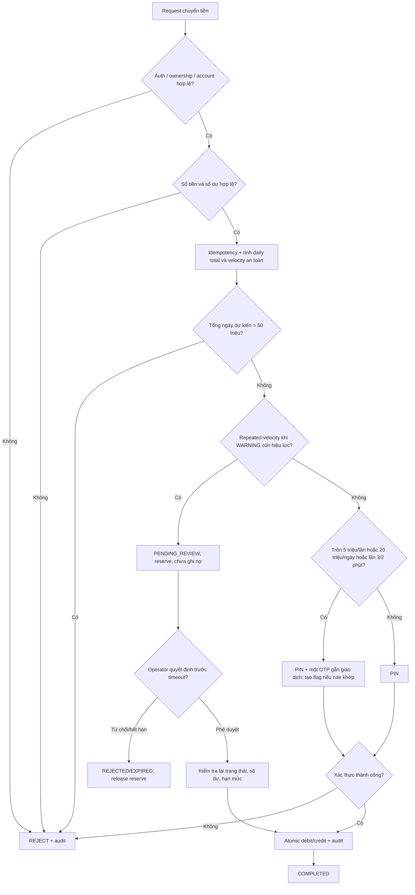

# 03. fraud-detection-rules

## 1. Mục đích, phạm vi và cách đọc

**Quyết định phải rõ.** Tài liệu đặc tả các quy tắc đánh giá tại T2, điều kiện tạo fraud flag, mức độ xác thực và vòng đời giao dịch chờ duyệt. Cùng một tình huống phải dẫn đến một kết quả nhất quán, có căn cứ kiểm tra và lưu được dấu vết xử lý.

Các quy tắc sẵn có trong API/team contract được đánh dấu **BASELINE**; phần mở rộng phương án B được đánh dấu **DESIGN-B**. Phân loại này phục vụ kiểm soát phạm vi tài liệu.

Phạm vi gồm: large-value, daily accumulated value, high-frequency, unusual pattern, PIN/OTP abuse, fraud flags, review, fail-open/failure isolation, dữ liệu và observability. Ngoài phạm vi: nhận diện khuôn mặt, chấm điểm bằng mô hình học máy và kết nối thanh toán ngân hàng thật. Hệ thống chỉ xử lý giao dịch mô phỏng.

## 2. Yêu cầu và driver thiết kế

| Driver | Yêu cầu / ràng buộc |
| --- | --- |
| Money correctness | Không ghi nợ/ghi có hai lần, không cho giao dịch đang review tự chuyển tiền |
| Baseline số tiền | 2.000–10.000.000 VND cho mỗi giao dịch |
| Baseline xác thực | Giao dịch không quá 5.000.000 VND dùng PIN; trên 5.000.000 VND dùng PIN + OTP |
| Baseline PIN | PIN 6 số; sai 5 lần liên tiếp thì khóa 15 phút |
| Baseline OTP recovery | OTP 6 số, hết hạn 120 giây, chỉ dùng một lần; sai 5 lần thì vô hiệu |
| Security | Ownership, RBAC, idempotency, kiểm soát race condition; không đưa secret vào audit |
| Vận hành | Phát hiện dấu hiệu rủi ro, cho Operator xem/đánh giá và Auditor tra cứu lịch sử |
| Mở rộng B | Dùng ngưỡng theo ngày và velocity để kích hoạt step-up, warning hoặc giữ giao dịch |

**Không gộp ngưỡng.** Giới hạn từng lần xác định cách xác thực; tổng tiền trong ngày xác định mức bảo vệ bổ sung; tần suất giao dịch phát hiện hành vi bất thường. Thiết kế rule-based deterministic nhờ đó tạo ra quyết định nhất quán, có thể truy vết và kiểm thử tại các ranh giới.

## 3. Khái niệm và thuật ngữ

| Thuật ngữ | Ý nghĩa |
| --- | --- |
| Transaction T2 | Điểm đánh giá rủi ro trong luồng xử lý chuyển tiền được đề cập trong đề cương SRS; tên bước cần đối chiếu thiết kế transaction chính thức |
| Step-up authentication | Yêu cầu thêm OTP ngoài PIN khi có điều kiện tăng rủi ro |
| Daily threshold | Mốc cộng dồn tiền trong ngày làm tăng mức xác thực, **không** phải trần chuyển tiền |
| Daily cap | Hạn mức cứng trong ngày; vượt phải từ chối |
| Velocity | Số giao dịch trong cửa sổ trượt thời gian |
| Risk flag | Bản ghi dấu hiệu bất thường kèm rule, căn cứ và mức độ |
| Hold / PENDING_REVIEW | Chưa thực hiện chuyển tiền; chờ quyết định của Operator |
| Reservation | Giữ chỗ hạn mức/khả dụng cho giao dịch đang chờ để tránh vượt giới hạn |
| Fail-open | Lỗi thành phần không trọng yếu không được làm hỏng giao dịch hợp lệ |
| Fail-closed | Không cho chuyển tiền khi không thể thực hiện kiểm tra an toàn bắt buộc |
| Idempotency | Retry cùng một yêu cầu không làm giao dịch phát sinh nhiều lần |

## 4. Rule catalog và ngưỡng

### 4.1. Quy tắc baseline từ contract

| Rule ID | Điều kiện | Phản ứng | Nguồn |
| --- | --- | --- | --- |
| BASE-01 | Transfer dưới 2.000 hoặc trên 10.000.000 VND/lần | REJECT | API/team contract |
| BASE-02 | Transfer từ 2.000 đến 5.000.000 VND/lần | PIN | API/team contract |
| BASE-03 | Transfer trên 5.000.000 đến 10.000.000 VND/lần | PIN + OTP | API/team contract |
| BASE-04 | Sai PIN 5 lần liên tiếp | Khóa PIN 15 phút | API/team contract |
| BASE-05 | Recovery OTP quá hạn, dùng lại hoặc sai 5 lần | Từ chối/vô hiệu challenge | API/team contract |
| BASE-06 | Sai ownership/role, idempotency replay/conflict | REJECT hoặc trả kết quả cũ; ghi audit | API/team contract |

### 4.2. Rule catalog đề xuất — phương án B

| Rule ID | Phát hiện | Ngưỡng | Quyết định | Mức |
| --- | --- | --- | --- | --- |
| FRD-01 LARGE_VALUE | Giá trị một giao dịch | Trên 5 triệu/lần, tối đa 10 triệu | PIN + OTP theo baseline | LOW / xác thực |
| FRD-02 DAILY_STEP_UP | Tổng chuyển đi dự kiến trong ngày | **Trên 20 triệu VND/ngày** | PIN + OTP và DAILY_THRESHOLD flag | MEDIUM |
| FRD-03 DAILY_CAP | Tổng chuyển đi dự kiến trong ngày | **Trên 50 triệu VND/ngày** | REJECT; không cho Operator bỏ qua | HIGH / giới hạn |
| FRD-04 HIGH_FREQUENCY | Cùng customer thực hiện giao dịch liên tục | **Giao dịch thứ 3 trong 120 giây** | PIN + OTP, WARNING flag | MEDIUM |
| FRD-05 REPEATED_VELOCITY | Tiếp tục chuyển khi cảnh báo velocity còn hiệu lực sau một lần step-up | Giao dịch tiếp theo trong chuỗi cảnh báo | PENDING_REVIEW; Operator quyết định | HIGH |
| FRD-06 UNUSUAL_PATTERN | Mẫu giao dịch bất thường khác (ví dụ nhiều người nhận mới) | Chưa chốt ngưỡng | Chỉ tạo flag theo chế độ quan sát, không tự block | PROPOSED / OPEN |
| FRD-07 AUTH_ABUSE | Nhiều lỗi PIN/OTP trước ngưỡng khóa | Đề xuất 3 lỗi/5 phút | Flag; khóa PIN vẫn theo BASE-04 | MEDIUM |
| FRD-08 OPERATOR_ANOMALY | Tra cứu bất thường tại quầy | Đề xuất 20 lần/10 phút | Risk flag phục vụ audit | MEDIUM |

**Phạm vi hệ thống mô phỏng:** mốc 20 triệu đồng/ngày kích hoạt OTP bổ sung; 50 triệu đồng/ngày là hạn mức cứng. Xác thực sinh trắc học không thuộc đặc tả này. FRD-06 và FRD-08 thuộc nhóm mở rộng. Hai quy tắc này được tách khỏi luồng kiểm soát tiền bắt buộc để không làm thay đổi hành vi giao dịch khi chưa có ngưỡng vận hành.

### 4.3. Thứ tự ưu tiên quyết định

1. Auth, RBAC, ownership, account status, dữ liệu hợp lệ, idempotency.
2. Kiểm tra số tiền mỗi lần, số dư và các điều kiện chuyển tiền bắt buộc.
3. Tính tổng ngày/velocity bằng dữ liệu giao dịch đã commit cộng reservation và giao dịch dự kiến.
4. Nếu vượt daily cap: REJECT trước khi gửi OTP hoặc tạo review.
5. Nếu đã rơi vào repeated velocity: PENDING_REVIEW; không ghi nợ.
6. Ngược lại, nếu cần step-up vì >5 triệu/lần, >20 triệu/ngày hoặc high-frequency thì yêu cầu PIN + **một** OTP cho cùng giao dịch.
7. Nếu không có rule tăng xác thực, chỉ cần PIN; sau khi hợp lệ mới commit giao dịch an toàn.
8. Ghi audit/risk events và kết quả cuối cùng; OTP thành công không reset cửa sổ gian lận.

### 4.4. Các ví dụ minh họa

| Tình huống | Quyết định |
| --- | --- |
| 4,9 triệu, chưa có bất thường | PIN |
| 6 triệu, chưa có bất thường | PIN + OTP |
| 19,6 triệu đã chuyển trong ngày, tiếp 4,9 triệu | Tổng 24,5 triệu: PIN + OTP và flag DAILY_THRESHOLD |
| 49 triệu đã chuyển/giữ hạn mức, tiếp 2 triệu | REJECT do vượt cap 50 triệu |
| 3 giao dịch 4,9 triệu trong 2 phút | Giao dịch thứ 3 yêu cầu OTP và WARNING |
| Giao dịch thứ 4 sau OTP, WARNING còn hiệu lực | PENDING_REVIEW, chưa ghi nợ |
| Quá 30 phút không có Operator review | EXPIRED, giải phóng reservation, không tự duyệt |

## 5. Cấu hình và versioning rule

Đề xuất lưu các giá trị dưới dạng cấu hình thay vì hardcode: `min_transfer_vnd=2000`, `max_transfer_vnd=10000000`, `single_step_up_vnd=5000000`, `daily_step_up_vnd=20000000`, `daily_cap_vnd=50000000`, `velocity_count=3`, `velocity_window_seconds=120`, `warning_ttl_minutes=15`, `review_timeout_minutes=30`.

**Đổi ngưỡng, giữ dấu vết.** Mỗi rule lưu mã định danh, ngưỡng kích hoạt, hành động, mức ưu tiên, phiên bản và thời điểm hiệu lực. Bản ghi fraud flag gắn với `ruleVersion` để quyết định cũ vẫn có thể giải thích khi cấu hình được cập nhật; cấu hình lỗi không được vô hiệu hóa các kiểm soát bắt buộc.

## 6. Luồng đánh giá trong transaction T2

**T2 quyết định đường đi.** Việc kiểm tra hạn mức và trạng thái rủi ro gắn với giao dịch ghi sổ an toàn, trong khi SMS và các tác vụ phụ trợ được xử lý tách biệt để tránh kéo dài transaction. Hai yêu cầu đồng thời không thể cùng vượt qua ngưỡng tổng ngày rồi tạo số dư sai.

### 6.1. Cửa sổ thời gian và chính sách reset

- Ngày nghiệp vụ theo `Asia/Ho_Chi_Minh` từ 00:00:00 đến trước 00:00 ngày kế tiếp; timestamp lưu UTC.
- Daily used = tổng đã hoàn tất trong ngày + reservation còn hiệu lực, không tính trùng một giao dịch. Giao dịch rejected/expired giải phóng reservation.
- Velocity là cửa sổ trượt 120 giây, không bị reset bởi mốc nửa đêm hoặc OTP đúng.
- WARNING kéo dài 15 phút từ sự kiện rủi ro gần nhất, chỉ hạ khi không còn risk event mới và không có case mở cần xử lý.
- PENDING_REVIEW quá 30 phút là EXPIRED, không auto-approve.
- Review case tạo trước nửa đêm giữ business date và reservation gốc cho đến quyết định; tránh chuyển sang ngày mới để né cap. Đây là policy đề xuất cần xác nhận với thiết kế money ledger.

## 7. Flag, auto-block và ops review

### 7.1. Trạng thái tách biệt

- `accountRiskState`: NORMAL, WARNING, RESTRICTED.
- `transactionStatus`: INITIATED, AWAITING_OTP, PENDING_REVIEW, APPROVED, REJECTED, EXPIRED, COMPLETED.
- `fraudFlagStatus`: OPEN, UNDER_REVIEW, CLOSED_FALSE_POSITIVE, CLOSED_CONFIRMED.

Không tự đồng nhất APPROVED với COMPLETED: chỉ sau khi revalidate và ghi sổ một lần thì mới COMPLETED.

### 7.2. Auto-block

**Chặn giao dịch. Không chặn oan tài khoản.** Vượt hạn mức 50 triệu đồng/ngày dẫn đến từ chối giao dịch; vượt mốc 20 triệu đồng/ngày chỉ làm tăng xác thực. Cơ chế khóa PIN 15 phút hoạt động độc lập, còn hạn chế toàn tài khoản phải tuân theo chính sách kiểm soát và quyền thao tác riêng.

### 7.3. Operator review workflow

1. Risk engine phát hiện repeated velocity, tạo `fraud_flag`, `review_case` và transaction PENDING_REVIEW.
2. Customer nhận trạng thái đang chờ xem xét; chưa ghi nợ hoặc ghi có cho người nhận.
3. Operator có quyền xem lý do, lịch sử liên quan đã giới hạn và quyết định APPROVE hoặc REJECT, kèm lý do. **API approve/reject là tính năng cần đặc tả bổ sung, không khẳng định đã tồn tại trong repo.**
4. Nếu APPROVE trước 30 phút, backend kiểm tra lại số dư/account/limit/uniqueness trước commit; không cho approve case đã EXPIRED.
5. Nếu REJECT hoặc hết hạn, giải phóng reservation; ghi audit actor, thời điểm, action và reason.
6. Auditor chỉ đọc audit/risk review, không thực hiện money mutation. Quyền CUSTOMER, OPERATOR, AUDITOR, ADMIN theo API contract.

## 8. Fail-open và failure isolation

**Tiền phải đúng.** Lỗi phụ trợ không được khiến giao dịch đã hoàn tất bị ghi lặp hoặc đảo sai. Ngược lại, khi một bước kiểm soát bắt buộc không hoạt động, hệ thống dừng giao dịch thay vì bỏ qua ràng buộc. Hai nhóm lỗi được xử lý như sau:

| Thành phần lỗi | Chính sách | Lý do |
| --- | --- | --- |
| Lỗi gửi event analytics hoặc ghi metric không quan trọng | Fail-open có kiểm soát, retry/outbox và ghi operational alert | Không làm hỏng giao dịch hợp lệ đã commit |
| Lỗi dịch vụ thêm thông tin cảnh báo không quyết định money path | Fail-open nếu policy cho phép; không được làm mất rule mandatory | Failure isolation |
| Không đọc/khóa được daily counter, không xác định được cap | Fail-closed với transfer mới | Không thể bảo đảm giới hạn cứng |
| Không bảo đảm reservation / idempotency / atomic debit-credit | Fail-closed hoặc rollback | Ngăn chuyển trùng/sai số dư |
| OTP/PIN verification không khả dụng | Fail-closed cho giao dịch cần xác thực | Không bỏ qua bước bảo vệ |
| Lỗi sau commit khi xuất audit/notification | Không đảo giao dịch đã commit chỉ vì lỗi bên ngoài; retry riêng | Không tạo inconsistent money path |

**Phân tách rõ.** Các chức năng cảnh báo bổ trợ có thể fail-open theo chính sách failure isolation. Ngược lại, hạn mức cứng, xác thực, idempotency và ghi sổ nguyên tử là điều kiện bảo vệ bắt buộc; khi không thể xác minh chúng, giao dịch không được thực hiện.

## 9. Mô hình dữ liệu

### 9.1. fraud_rule_config — cấu hình quy tắc

| Trường đề xuất | Vai trò |
| --- | --- |
| rule_id, rule_code, version | Định danh và phiên bản |
| enabled, priority, severity | Bật/tắt, ưu tiên, mức cảnh báo |
| metric_type, operator, threshold_value | Điều kiện định lượng |
| window_seconds, action | Cửa sổ và hành động |
| effective_from, effective_to | Hiệu lực cấu hình |
| created_at, updated_at, approved_by | Audit thay đổi |

### 9.2. fraud_flag — bằng chứng rule match

| Trường đề xuất | Vai trò |
| --- | --- |
| flag_id, rule_id, rule_version | Truy vết rule |
| actor_id, account_id, transaction_id | Đối tượng liên quan |
| detected_at, observed_value, time_window | Căn cứ phát hiện |
| severity, action, status | Mức độ và kết quả |
| correlation_id, review_case_id | Liên kết request và review |
| reviewed_by, reviewed_at, review_reason | Lịch sử review |

**Dữ liệu phục vụ truy vết.** `fraud_rule_config` quản lý cấu hình, `fraud_flag` giữ bằng chứng rule match và kết quả xử lý. Quan hệ với review case và reservation bảo đảm giao dịch chờ duyệt có trạng thái rõ ràng, không làm vượt hạn mức khi nhận yêu cầu đồng thời. PIN/OTP không được lưu ở dạng rõ.

## 10. Audit và observability

- Ghi thời điểm UTC, request/correlation ID, customer/account/transfer reference, matchedRule, ruleVersion, action và status; mask thông tin nhạy cảm.
- Đo số rule match, OTP step-up, số giao dịch PENDING_REVIEW, thời gian chờ, approve/reject/expired, false positive, lỗi evaluation và lệch số dư.
- Audit event phải truy vết được hành động Operator; không để quyền Customer sửa flag hay audit.
- Lỗi hệ thống cần log an toàn và có chỉ báo giám sát, không trả secret trong response.

## 11. Kiểm thử và tiêu chí nghiệm thu

| TC | Điều kiện | Kết quả kỳ vọng |
| --- | --- | --- |
| FRD-T01 | Chuyển đúng 5 triệu | PIN |
| FRD-T02 | Chuyển 5.000.001 VND | PIN + OTP |
| FRD-T03 | Chuyển trên 10 triệu | REJECT, không debit |
| FRD-T04 | Tổng dự kiến chính xác 20 triệu | Chưa trigger daily >20M |
| FRD-T05 | Tổng dự kiến 20.000.001 VND | STEP_UP_OTP + flag |
| FRD-T06 | Tổng dự kiến đúng 50 triệu | Không bị từ chối chỉ bởi daily cap |
| FRD-T07 | Tổng dự kiến 50.000.001 VND | REJECT_DAILY_CAP |
| FRD-T08 | Giao dịch thứ 3 trong 120 giây | OTP + WARNING |
| FRD-T09 | Giao dịch thứ 4 khi WARNING còn hiệu lực sau OTP | PENDING_REVIEW, không debit |
| FRD-T10 | Operator approve hợp lệ | Revalidate, commit đúng một lần |
| FRD-T11 | Operator reject / quá 30 phút | REJECTED/EXPIRED, release reservation |
| FRD-T12 | Auditor hoặc Customer gọi approve | 403, không biến đổi giao dịch |
| FRD-T13 | Retry cùng idempotency key | Không sinh giao dịch/hold trùng |
| FRD-T14 | 2 request cùng làm vượt cap | Không vượt 50 triệu vì race |
| FRD-T15 | Pending qua 00:00 | Không tự duyệt; giữ reserve policy |
| FRD-T16 | OTP đúng trong lúc velocity còn hiệu lực | Không reset risk window |
| FRD-T17 | Risk metrics service lỗi | Không double debit; xử lý theo fail-open policy |
| FRD-T18 | Daily cap service lỗi | Fail-closed, không chuyển tiền |

**Acceptance:** mỗi test có expected/actual, version/commit, môi trường và bằng chứng thực thi; phần chưa chạy ghi NOT_TESTED. Một rule đạt yêu cầu thiết kế khi rõ condition, threshold, action, reset, audit, ownership và expected test.

## 12. Traceability

| Yêu cầu đầu vào | Nội dung trong tài liệu |
| --- | --- |
| SRS 2.10 Fraud and Anomaly | Rule catalog, high-frequency, unusual pattern (mục 4) |
| SRS 2.13.5 Fraud Evaluation | T2 decision và fail-open/failure isolation (mục 6, 8) |
| SRS AC-026 | Acceptance test cho fraud rules (mục 11; cần đối chiếu wording AC gốc) |
| Design 02 consistency-concurrency | Reservation, idempotency, atomic commit (mục 6, 8) |
| Database design 04 | fraud_rule_config, fraud_flag (mục 9) |
| API contracts 07 | PIN/OTP, transfer, RBAC, audit/risk endpoints (mục 2, 7) |
| Master Timelines 10 | Tiến độ triển khai các rule chỉ khi đã được duyệt scope |

**Tham chiếu:** [Digital Banking MVP repository](https://github.com/TNoLisme/cloude) — SRS, thiết kế concurrency, database và API contract. Bảng traceability liên kết từng nhóm yêu cầu với quy tắc, hành động và kết quả kiểm thử.

## 13. Quyết định, open issues và change log

### 13.1. Quyết định thiết kế

- Dùng phương án B: baseline 5 triệu/lần PIN/OTP, đề xuất daily step-up 20 triệu, daily cap 50 triệu, velocity 3 giao dịch/2 phút, repeated velocity giữ transaction chờ Operator.
- WARNING TTL đề xuất 15 phút; review timeout đề xuất 30 phút; Cloud không thuộc thiết kế fraud mà là giai đoạn triển khai sau khi hoàn thiện ứng dụng.
- Mức rủi ro đủ cao dẫn đến HOLD cho **giao dịch**, không tự động khóa toàn bộ tài khoản.

### 13.2. Các điểm cần chốt trong thiết kế

- [ ]  Nhóm duyệt đưa phần nào của Option B vào MVP hoặc đưa sang release sau?
- [ ]  Xác nhận wording chính xác AC-026 và hành vi fail-open ở SRS/Design 02.
- [ ]  Xác nhận quy tắc reservation/hạn mức khi pending qua 00:00.
- [ ]  Xác nhận API Operator approve/reject và cách triển khai review queue.
- [ ]  Xác nhận unusual-pattern threshold và cách quản lý cấu hình rule.
- [ ]  Bổ sung ảnh/sơ đồ [draw.io](http://draw.io) sau khi nhóm chốt flow.

### 13.3. Change log

| Phiên bản | Ngày | Thay đổi | Trạng thái |
| --- | --- | --- | --- |
| 0.1 | 03/11/2026 | Đề cương ban đầu | Draft |
| 1.0 | 06/11/2026 | Hoàn thiện đặc tả theo đề cương, tích hợp phương án B, luồng T2, quản lý cảnh báo và kiểm thử | Bản thiết kế |