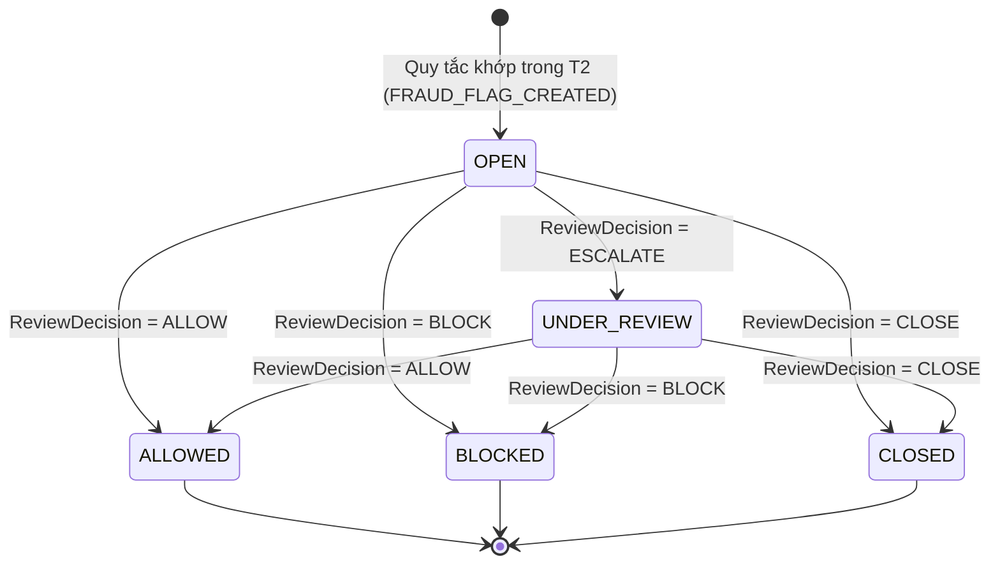
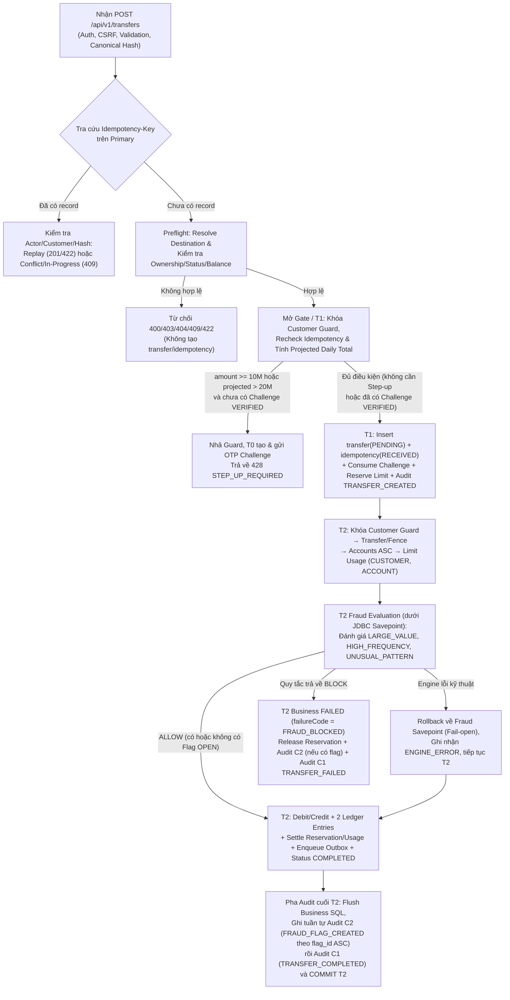

# 03. Thiết kế Quy tắc Phát hiện Gian lận và Đánh giá Rủi ro (`Fraud Detection Rules Design`)

> **Dự án:** Digital Banking MVP
> **Mã tài liệu:** `DESIGN-FRD-03`
> **Phiên bản:** 1.0
> **Ngày:** 18/11/2026
> **Trạng thái:** Hoàn thành
> **Owner:** Risk & Fraud Domain Owner / System Architect
> **Reviewer:** Backend Lead, Security, Audit, QA, Product/BA
> **Nguồn tham chiếu:** [[digitalbanking-docs/docs-common/03. SRS.md]], [[digitalbanking-docs/docs-common/04. Database design & analysis.md]], [[digitalbanking-docs/docs-common/06. System architecture.md]], [[digitalbanking-docs/docs-common/07. API contracts.md]], [[digitalbanking-docs/docs-common/design/01. audit-traceability.md]], [[digitalbanking-docs/docs-common/design/02. consistency-concurrency.md]], [[digitalbanking-docs/docs-common/design/04. security.md]], [[digitalbanking-docs/docs-common/design/05. Modules contract.md]]

---

## 1. Mục đích, phạm vi và cách đọc

### 1.1. Mục đích

Tài liệu này là đặc tả kỹ thuật chuẩn (source of truth) cho cơ chế đánh giá rủi ro xác thực tăng cường (`Step-Up Authentication` tại `T0`) và bộ máy phát hiện gian lận nội bộ (`In-Process Fraud Detection Engine` tại `T2`) của hệ thống Digital Banking MVP. Tài liệu trả lời các câu hỏi:

1. Ngưỡng kích hoạt xác thực tăng cường (`Step-up T0` trước khi tạo giao dịch `T1`) và quy tắc đánh giá gian lận (`Fraud Evaluation` trong giao dịch `T2`) được phân tách và phối hợp như thế nào?
2. Danh mục quy tắc gian lận (`LARGE_VALUE`, `HIGH_FREQUENCY`, `UNUSUAL_PATTERN`), công thức cửa sổ thời gian và cách quản lý phiên bản cấu hình (`rule_version`) hoạt động ra sao?
3. Vòng đời của cờ cảnh báo gian lận (`FlagStatus`: `OPEN`, `UNDER_REVIEW`, `ALLOWED`, `BLOCKED`, `CLOSED`) và quy trình thẩm định của nhân viên vận hành (`ReviewDecision`: `ALLOW`, `BLOCK`, `ESCALATE`, `CLOSE`) được thực thi thế nào?
4. Khi bộ máy gian lận gặp lỗi kỹ thuật hoặc khi ghi nhật ký kiểm toán `C2` (`FRAUD_FLAG_CREATED`) thất bại, hệ thống cô lập lỗi (`fail-open` qua JDBC savepoint) và bảo vệ tính nguyên tử tiền tệ (`fail-closed` đối với kiểm toán) ra sao?

### 1.2. Trong phạm vi

- Phân định rõ ranh giới giữa đánh giá ngưỡng Step-up tại `T0` (`amount >= 10,000,000 VND` đơn lẻ hoặc tổng dự kiến ngày `> 20,000,000 VND`) và đánh giá quy tắc gian lận tại `T2`.
- Thiết kế chi tiết 3 loại quy tắc gian lận chuẩn: `LARGE_VALUE`, `HIGH_FREQUENCY` và `UNUSUAL_PATTERN`.
- Mô hình dữ liệu của bảng cấu hình quy tắc `banking.fraud_rule_config` và bảng cờ cảnh báo `banking.fraud_flag` theo đúng `04. Database design & analysis.md` §4.7.1–4.7.2.
- Giao thức đánh giá đồng bộ trong `T2` sau khi khóa tài khoản/hạn mức, cơ chế JDBC savepoint cho `fail-open`, và thứ tự ghi kiểm toán `C2` (`FRAUD_FLAG_CREATED`) trước `C1` (`TRANSFER_COMPLETED`/`TRANSFER_FAILED`).
- Quy trình tra cứu (`GET /api/v1/fraud-flags`) và thẩm định cờ gian lận (`POST /api/v1/fraud-flags/{flagId}/review`) dành cho nhân viên có quyền `FRAUD_READ` / `FRAUD_REVIEW`.
- Chỉ số quan sát (`metrics`), nhật ký kiểm toán, ma trận kiểm thử (`T-FRAUD-*`, `FRD-T*`) và bảng truy vết yêu cầu.

### 1.3. Ngoài phạm vi

- Huấn luyện hoặc suy luận mô hình học máy (`Machine Learning / AI scoring`) ngoài tiến trình.
- Tự động khóa vĩnh viễn tài khoản khách hàng hoặc giữ treo giao dịch chuyển tiền chờ duyệt thủ công (máy trạng thái `transfer` của MVP chỉ có 3 trạng thái chuẩn: `PENDING`, `COMPLETED`, `FAILED`).
- Kết nối hệ thống phòng chống rửa tiền (`AML`) hoặc danh sách cấm vận quốc tế bên ngoài.

---

## 2. Yêu cầu và driver thiết kế

### 2.1. Yêu cầu nghiệp vụ, chức năng và phi chức năng liên quan

| Mã yêu cầu | Nội dung yêu cầu | Mục thiết kế đáp ứng |
|---|---|---|
| `BR-007`, `FR-018`, `FR-026`, `AC-033` | Xác thực tăng cường (`Step-up`) trước khi tạo giao dịch vượt ngưỡng rủi ro; trả về `428 STEP_UP_REQUIRED` mà không tạo bản ghi `transfer` hay bút toán sổ cái | Mục 3.2, Mục 6.1 |
| `BR-035` – `BR-038`, `FR-044` | Đánh giá quy tắc gian lận đồng bộ trong luồng chuyển tiền `T2` trước khi ghi sổ cái | Mục 4, Mục 6.2 |
| `FR-045`, `AC-026` | Phát hiện và gắn cờ giao dịch giá trị lớn (`LARGE_VALUE`) khi `amount >= threshold_amount` | Mục 4.1 |
| `FR-046`, `AC-026` | Phát hiện và gắn cờ giao dịch tần suất cao (`HIGH_FREQUENCY`) trong cửa sổ thời gian trượt | Mục 4.1, Mục 6.3 |
| `FR-047` | Hỗ trợ quy tắc mẫu bất thường (`UNUSUAL_PATTERN`) và quản lý phiên bản quy tắc (`rule_version`) | Mục 4.1, Mục 5 |
| `FR-048`, `AC-026`, `AC-027` | Cho phép nhân viên Operations (`FRAUD_REVIEW`) xem và thẩm định cờ cảnh báo gian lận kèm nhật ký kiểm toán | Mục 7 |
| `NFR-008`, `IC-003` | Lỗi kỹ thuật của bộ máy gian lận không được làm gián đoạn giao dịch hợp lệ (`Fail-open` có kiểm soát) | Mục 8 |
| `NFR-009`, `NFR-010`, `NFR-012` | Đảm bảo tính nguyên tử tiền tệ, an toàn đồng thời và máy trạng thái `transfer` chỉ gồm `PENDING → COMPLETED / FAILED` | Mục 3.1, Mục 6, Mục 8 |
| `NFR-021` – `NFR-023`, `AC-034` | Cờ gian lận đã tạo phải có bản ghi kiểm toán `FRAUD_FLAG_CREATED` (`C2`) bền vững trong cùng giao dịch `T2` | Mục 8.2, Mục 10 |

### 2.2. Các quyết định thiết kế cốt lõi (`Fraud Design Decisions`)

| Mã quyết định | Quyết định thiết kế | Lý do | Hệ quả / Biện pháp kiểm soát |
|---|---|---|---|
| `DD-FRD-01` | Tách biệt rõ **Step-Up (`T0`)** và **Fraud Evaluation (`T2`)** | Step-up là kiểm soát xác thực trước khi tạo intent (`T1`), trong khi Fraud Evaluation là kiểm soát giám sát/chặn trong giao dịch tiền tệ (`T2`) | `T0` trả `428` không tạo `transfer`; `T2` đánh giá quy tắc dưới khóa và lưu `fraud_flag` cùng kết quả giao dịch |
| `DD-FRD-02` | Giữ nguyên máy trạng thái `transfer` chuẩn gồm 3 trạng thái: `PENDING`, `COMPLETED`, `FAILED` | Tuân thủ tuyệt đối `03. SRS.md`, `04. Database design` và `07. API contracts`; tránh tạo trạng thái chờ duyệt làm treo khóa hoặc lệch sổ cái | Cờ gian lận có vòng đời độc lập (`OPEN` → `UNDER_REVIEW` → `ALLOWED`/`BLOCKED`/`CLOSED`) trên bảng `banking.fraud_flag` |
| `DD-FRD-03` | Quy tắc khớp mặc định tạo `fraud_flag(status='OPEN')` + kiểm toán `C2` và cho phép giao dịch tiếp tục (`ALLOW`) | Phù hợp mô hình giám sát hậu kiểm của MVP mà không làm gián đoạn trải nghiệm chuyển tiền hợp lệ | Nếu quy tắc được cấu hình hành động chặn tự động (`BLOCK`), giao dịch chuyển sang `FAILED` (`failureCode = 'FRAUD_BLOCKED'`) trước khi ghi sổ cái |
| `DD-FRD-04` | Cô lập lỗi kỹ thuật của Fraud Engine bằng **JDBC Savepoint** trong `T2` | Đảm bảo nếu truy vấn/đánh giá của Fraud Engine gặp lỗi SQL hoặc runtime exception, giao dịch `T2` không bị đánh dấu `rollback-only` | Khôi phục về savepoint, xóa các cờ dở dang của bước lỗi, trả `ENGINE_ERROR` để ghi metric/log và tiếp tục hoàn tất chuyển tiền |
| `DD-FRD-05` | Ghi kiểm toán `FRAUD_FLAG_CREATED` (`C2`) ở pha cuối của `T2` theo thứ tự `flag_id ASC` trước `C1` | Không giữ khóa chuỗi băm kiểm toán (`audit chain lock`) trong lúc chạy logic tiền tệ và đảm bảo mọi cờ đã lưu đều có bằng chứng kiểm toán | Nếu ghi kiểm toán `C2` thất bại, toàn bộ giao dịch `T2` (bao gồm cả cờ gian lận và biến động tiền) hoàn tác (`fail-closed`) |

---

## 3. Khái niệm, Thuật ngữ và Máy trạng thái

### 3.1. Phân tách trạng thái Giao dịch (`Transfer Status`) và Trạng thái Cờ gian lận (`Fraud Flag Status`)

Hệ thống tách biệt hoàn toàn vòng đời của giao dịch chuyển tiền (`banking.transfer`) với vòng đời thẩm định cờ gian lận (`banking.fraud_flag`):

1. **Trạng thái giao dịch chuyển tiền (`Transfer Status` — bảng `banking.transfer`):**
   - Chỉ bao gồm 3 trạng thái chuẩn:
     - `PENDING`: Đã khởi tạo intent ở `T1`, đang chờ hoặc đang thực thi `T2`.
     - `COMPLETED`: Đã hoàn tất ghi nợ, ghi có, sinh 2 bút toán sổ cái cân bằng và ghi kiểm toán ở `T2`.
     - `FAILED`: Từ chối nghiệp vụ hoặc bị chặn tự bởi quy tắc gian lận (`failure_code = 'FRAUD_BLOCKED'`) ở `T2`, không phát sinh bút toán sổ cái.
   - Trạng thái `COMPLETED` và `FAILED` là trạng thái kết thúc bất biến (`terminal immutable`). Việc nhân viên vận hành thẩm định cờ gian lận sau đó **không** thay đổi trạng thái hay bút toán sổ cái của giao dịch đã kết thúc.

2. **Trạng thái cờ gian lận (`FlagStatus` — cột `banking.fraud_flag.status`):**
   - `OPEN`: Cờ mới được tạo tự động trong `T2` khi giao dịch khớp quy tắc gian lận, đang chờ nhân viên vận hành xem xét.
   - `UNDER_REVIEW`: Nhân viên vận hành đã tiếp nhận và chuyển lên mức xác minh sâu hơn (`ESCALATE`).
   - `ALLOWED`: Nhân viên vận hành xác nhận giao dịch hợp lệ / cảnh báo giả (`ALLOW`).
   - `BLOCKED`: Nhân viên vận hành xác nhận giao dịch có dấu hiệu gian lận (`BLOCK`).
   - `CLOSED`: Nhân viên vận hành đóng cờ cảnh báo sau khi đã hoàn tất xử lý (`CLOSE`).

3. **Quyết định thẩm định của nhân viên vận hành (`ReviewDecision` — cột `banking.fraud_flag.decision`):**
   - `ALLOW`: Chuyển trạng thái cờ sang `ALLOWED`.
   - `BLOCK`: Chuyển trạng thái cờ sang `BLOCKED`.
   - `ESCALATE`: Chuyển trạng thái cờ sang `UNDER_REVIEW`.
   - `CLOSE`: Chuyển trạng thái cờ sang `CLOSED`.



### 3.2. Phân biệt Step-Up Authentication (`T0`) và Fraud Evaluation (`T2`)

| Tiêu chí | Step-Up Authentication (`T0` / Gate trước `T1`) | Fraud Evaluation (`T2` — Trong giao dịch tiền tệ) |
|---|---|---|
| **Thời điểm thực thi** | Trước khi tạo bản ghi `transfer` hoặc `idempotency_record` (`T0`) | Bên trong giao dịch `T2`, sau khi đã khóa `customer guard → transfer → accounts ASC → limit_usage` và trước khi ghi nợ/ghi có |
| **Điều kiện kích hoạt chuẩn** | `amount >= 10,000,000 VND` (đơn lẻ) **hoặc** `projected_daily_total > 20,000,000 VND` (tổng tiền đã `COMPLETED` trong ngày hiện tại + toàn bộ các reservation `PENDING` còn hiệu lực + số tiền lệnh mới) | Đánh giá độc lập từng quy tắc đang `enabled = true` và còn hiệu lực trong `banking.fraud_rule_config`: `LARGE_VALUE`, `HIGH_FREQUENCY`, `UNUSUAL_PATTERN` |
| **Phản ứng khi khớp** | Trả về `428 STEP_UP_REQUIRED` kèm thông tin thử thách OTP; không tạo `transfer`, không tạo `fraud_flag` | Tạo bản ghi `banking.fraud_flag` (`status = 'OPEN'`) + sự kiện kiểm toán `FRAUD_FLAG_CREATED` (`C2`); mặc định trả `ALLOW` để tiếp tục chuyển tiền (hoặc `BLOCK` → `FAILED` nếu cấu hình chặn) |
| **Chính sách khi gặp lỗi kỹ thuật** | **Fail-closed**: Nếu không đọc được cấu hình/guard hoặc không gửi được OTP (`503 OTP_DISPATCH_FAILED`), từ chối tạo giao dịch | **Fail-open có kiểm soát**: Nếu bộ máy đánh giá lỗi kỹ thuật, khôi phục về JDBC savepoint, ghi nhận `ENGINE_ERROR` và tiếp tục giao dịch (nhưng nếu lỗi ghi kiểm toán `C2` thì **Fail-closed** hoàn tác `T2`) |

---

## 4. Danh mục Quy tắc Gian lận (`Fraud Rule Catalog`) và Ngưỡng Chuẩn

### 4.1. Danh mục các quy tắc trong `banking.fraud_rule_config`

| Mã quy tắc (`rule_code`) | Loại quy tắc (`rule_type`) | Điều kiện kích hoạt chuẩn | Tham số cấu hình mặc định | Mức độ (`severity`) | Hành động mặc định trong `T2` | Nguồn yêu cầu |
|---|---|---|---|---|---|---|
| `LARGE_VALUE_TRANSFER` | `LARGE_VALUE` | Giá trị giao dịch lớn hơn hoặc bằng ngưỡng cấu hình: `amount >= threshold_amount` | `threshold_amount = 10000000.00` (`10,000,000 VND`) | `HIGH` | Tạo `fraud_flag(OPEN)` + ghi kiểm toán `C2` và cho phép giao dịch tiếp tục (`ALLOW`) | `FR-045`, `AC-026` |
| `HIGH_FREQUENCY_TRANSFER` | `HIGH_FREQUENCY` | Số lượng intent chuyển tiền đã commit ở `T1` của cùng khách hàng trong cửa sổ trượt `(terminal_at - window_seconds, terminal_at]` lớn hơn nghiêm ngặt ngưỡng cấu hình: `intent_count > threshold_count` | `threshold_count = 5`<br>`window_seconds = 600` (`10 phút`) | `MEDIUM` | Tạo `fraud_flag(OPEN)` + ghi kiểm toán `C2` và cho phép giao dịch tiếp tục (`ALLOW`) | `FR-046`, `AC-026` |
| `UNUSUAL_PATTERN_TRANSFER` | `UNUSUAL_PATTERN` | Giao dịch khớp mẫu bất thường theo quy tắc cấu hình (ví dụ: vượt ngưỡng cả số tiền lẫn tần suất trong cửa sổ cấu hình) | Cấu hình theo phiên bản quy tắc (`threshold_amount`, `threshold_count`, `window_seconds`) | `HIGH` / `CRITICAL` | Tạo `fraud_flag(OPEN)` + ghi kiểm toán `C2`; tiếp tục (`ALLOW`) hoặc chặn (`BLOCK` → `FAILED`) tùy cấu hình | `FR-047`, `AC-026` |

### 4.2. Quy tắc toán học tại giá trị biên (`Boundary Semantics`)

1. **Ngưỡng Step-up đơn lẻ (`T0`) và Quy tắc `LARGE_VALUE` (`T2`):**
   - Sử dụng phép so sánh **lớn hơn hoặc bằng (`>=`)**:
     - `amount = 9,999,999.99 VND` → Không kích hoạt Step-up đơn lẻ, không gắn cờ `LARGE_VALUE`.
     - `amount = 10,000,000.00 VND` → Kích hoạt Step-up tại `T0`; sau khi xác thực Step-up và vào `T2`, tạo cờ `LARGE_VALUE`.
2. **Ngưỡng Step-up tổng dự kiến trong ngày (`T0`):**
   - Sử dụng phép so sánh **lớn hơn nghiêm ngặt (`>`)** đối với `20,000,000.00 VND`:
     - Tổng dự kiến `= 20,000,000.00 VND` (với lệnh đơn lẻ `< 10,000,000 VND`) → Không kích hoạt Step-up theo tổng ngày.
     - Tổng dự kiến `= 20,000,000.01 VND` → Kích hoạt Step-up (`428 STEP_UP_REQUIRED`).
3. **Quy tắc tần suất cao `HIGH_FREQUENCY` (`T2`):**
   - Sử dụng phép so sánh **lớn hơn nghiêm ngặt (`>`)** đối với `threshold_count` (mặc định `> 5` trong cửa sổ nửa mở `(terminal_at - 600s, terminal_at]`):
     - Có đúng `5` intent trong cửa sổ `(terminal_at - 600s, terminal_at]` → Không gắn cờ `HIGH_FREQUENCY`.
     - Intent thứ `6` trong cửa sổ `(terminal_at - 600s, terminal_at]` → Gắn cờ `HIGH_FREQUENCY`.
   - Biên dưới `created_at == terminal_at - 600s` **không** được tính; biên trên `created_at == terminal_at` **được** tính.

### 4.3. Bảng ví dụ minh họa quyết định tại `T0` và `T2`

| Tình huống giao dịch | Quyết định tại `T0` (Step-Up Gate) | Quyết định tại `T2` (Fraud Evaluation) |
|---|---|---|
| Giao dịch `6,000,000 VND`, tổng dự kiến ngày `6,000,000 VND`, intent thứ 1 trong 10 phút | Không yêu cầu Step-up; đi thẳng vào `T1` | Không khớp quy tắc nào; hoàn tất `COMPLETED` không có `fraud_flag` |
| Giao dịch `10,000,000 VND`, tổng dự kiến ngày `10,000,000 VND`, intent thứ 1 trong 10 phút | Yêu cầu Step-up (`428 STEP_UP_REQUIRED`); sau khi verify OTP mới tạo `T1` | Khớp `LARGE_VALUE_TRANSFER`; tạo `fraud_flag(OPEN)` + `FRAUD_FLAG_CREATED` (`C2`), hoàn tất `COMPLETED` |
| Đã chuyển `19,600,000 VND` trong ngày, chuyển tiếp `400,000 VND` (tổng dự kiến đúng `20,000,000 VND`), intent thứ 2 | Không yêu cầu Step-up (vì `20,000,000 <= 20,000,000` và `400,000 < 10,000,000`) | Không khớp quy tắc nào; hoàn tất `COMPLETED` |
| Đã chuyển `19,600,000 VND` trong ngày, chuyển tiếp `500,000 VND` (tổng dự kiến `20,100,000 VND`), intent thứ 2 | Yêu cầu Step-up (`428 STEP_UP_REQUIRED`) do tổng dự kiến `> 20,000,000 VND` | Không khớp `LARGE_VALUE` (vì đơn lẻ `500,000 < 10,000,000`) và không khớp `HIGH_FREQUENCY` (`2 <= 5`); hoàn tất `COMPLETED` |
| Khách hàng thực hiện 6 lệnh chuyển tiền `500,000 VND` liên tiếp trong vòng 5 phút (tổng ngày `3,000,000 VND`) | Không yêu cầu Step-up cho cả 6 lệnh | 5 lệnh đầu không gắn cờ; lệnh thứ 6 (`count = 6 > 5`) tạo cờ `HIGH_FREQUENCY_TRANSFER` (`OPEN`) + `FRAUD_FLAG_CREATED` (`C2`) và hoàn tất `COMPLETED` |

---

## 5. Quản lý Cấu hình và Phiên bản Quy tắc (`Rule Configuration & Versioning`)

- Mỗi quy tắc trong `banking.fraud_rule_config` được định danh bởi khóa chính tổ hợp **`(rule_code, version)`**, trong đó `version` là số nguyên dương (`INT > 0`).
- Tại mọi thời điểm, mỗi `rule_code` chỉ có tối đa một phiên bản đang hoạt động (`enabled = true` và `effective_to IS NULL`), được cưỡng chế bởi chỉ mục duy nhất có điều kiện `uq_fraud_rule_active` (`04. Database design` §4.7.1).
- Khi cập nhật ngưỡng hoặc điều kiện của một quy tắc:
  1. Không ghi đè làm mất lịch sử phiên bản cũ đã từng gắn với các bản ghi `fraud_flag`.
  2. Đóng hiệu lực phiên bản cũ (`effective_to = now()`, `enabled = false`) và chèn phiên bản mới (`version = old_version + 1`, `enabled = true`, `effective_from = now()`) có lưu vết `created_by` và `approved_by`.
- Mỗi bản ghi `banking.fraud_flag` lưu cả `rule_code`, `rule_version` và cột `matched_value JSONB` (chứa đầy đủ giá trị thực tế đã khớp, ngưỡng cấu hình tại thời điểm đánh giá và dấu thời gian cửa sổ) để đảm bảo khả năng giải trình kiểm toán độc lập ngay cả khi cấu hình quy tắc thay đổi về sau.

---

## 6. Luồng Đánh giá và Ranh giới Giao dịch (`Evaluation Flow & Transaction Boundary`)

### 6.1. Sơ đồ luồng tổng thể từ `T0` đến `T2`



### 6.2. Trình tự thực thi chi tiết của Fraud Engine trong `T2`

Trong giao dịch `T2` (mức cô lập `READ COMMITTED`), sau khi `transfer` đã giữ `customer guard`, khóa dòng `transfer`, khóa hai dòng `account` theo `account_id ASC`, lấy dấu thời gian `terminal_at = clock_timestamp()` một lần trên DB primary và khóa/kiểm tra `limit_usage`:

1. `transfer` gọi `FraudEvaluation.evaluateTransfer(FraudFacts)` trong cùng giao dịch (`Propagation.MANDATORY`).
2. `FraudFacts` bao gồm: `transferId`, `customerId`, `sourceAccountId`, `destinationAccountId`, `amount`, `currency`, `terminalAt` và `correlationId`.
3. Bên trong điểm đánh giá, hệ thống thiết lập một **JDBC Savepoint** (`fraud_eval_sp`) trước khi truy vấn cấu hình quy tắc và chèn cờ gian lận:
   - Đọc danh sách các quy tắc đang hoạt động (`enabled = true` và `effective_from <= terminalAt` và `(effective_to IS NULL OR effective_to > terminalAt)`).
   - Đánh giá từng quy tắc độc lập:
     - Với mỗi quy tắc khớp, chèn một dòng vào `banking.fraud_flag` với `status = 'OPEN'` và `matched_value JSONB`.
     - Ràng buộc `UNIQUE (transfer_id, rule_code, rule_version)` ngăn chặn việc tạo cờ trùng lặp cho cùng một giao dịch và phiên bản quy tắc.
   - Trả về `FraudDecision` gồm quyết định (`ALLOW` hoặc `BLOCK`) và danh sách các descriptor cờ đã tạo (sắp xếp theo `flag_id ASC`) để `transfer` chuyển cho `audit` ở pha cuối của `T2`.

### 6.3. Quy tắc tính cửa sổ trượt cho `HIGH_FREQUENCY`

- Nhờ `T1` và `T2` của cùng một khách hàng đều đi qua `customer guard`, tại thời điểm đánh giá `HIGH_FREQUENCY` trong `T2`, mọi giao dịch trước đó của khách hàng đó đã có trạng thái nhất quán.
- Truy vấn đếm số lượng intent chuyển tiền của cùng `customer_id` thỏa mãn:
  ```sql
  SELECT COUNT(*)
  FROM banking.transfer t
  WHERE t.customer_id = :customerId
    AND t.created_at > (:terminalAt - make_interval(secs => :windowSeconds))
    AND t.created_at <= :terminalAt;
  ```
  (Sử dụng chỉ mục `ix_transfer_customer_time` trên `(customer_id, created_at)`).
- Quy tắc đếm:
  - Đếm mỗi bản ghi `banking.transfer` đã commit ở `T1` đúng một lần (bao gồm cả `PENDING`, `COMPLETED` và `FAILED`).
  - Bản ghi `transfer` hiện tại đang chạy trong `T2` được tính đúng 1 lần nếu `created_at` của nó nằm trong khoảng `(terminal_at - 600s, terminal_at]`; nếu giao dịch hiện tại bị trễ quá 600 giây mới chạy `T2` thì `created_at <= terminal_at - 600s` nên không cộng thêm.
  - Các yêu cầu bị chặn ở `428 STEP_UP_REQUIRED` (chưa vào `T1`) hoặc các lần thử lại phát lại cùng `Idempotency-Key` không tạo dòng `transfer` mới nên không làm tăng bộ đếm.
  - Việc xác thực OTP thành công hoặc bước qua thời điểm nửa đêm (`00:00`) **không** đặt lại (reset) cửa sổ trượt 600 giây.
- Nếu `intent_count > threshold_count` (mặc định `> 5`), hệ thống tạo bản ghi `fraud_flag` với `matched_value`:
  ```json
  {
    "observedCount": 6,
    "thresholdCount": 5,
    "windowSeconds": 600,
    "windowStart": "2026-11-18T10:05:00.000000Z",
    "windowEnd": "2026-11-18T10:15:00.000000Z"
  }
  ```

---

## 7. Quản lý Cờ Gian lận và Quy trình Thẩm định (`Operator Review Workflow`)

### 7.1. Phân quyền truy cập (`RBAC`)

Theo `07. API contracts.md` §3.4–3.5 và `04. security.md` §5.1:

| Quyền hạn (`Permission`) | Vai trò được cấp | Thao tác được phép |
|---|---|---|
| `FRAUD_READ` | `OPERATIONS`, `ADMIN`, `AUDITOR` | Xem danh sách cờ gian lận (`GET /api/v1/fraud-flags`) và xem cờ gian lận đính kèm trong chi tiết giao dịch (`GET /api/v1/transfers/{reference}`) |
| `FRAUD_REVIEW` | `OPERATIONS` | Thẩm định và cập nhật quyết định xử lý cờ gian lận (`POST /api/v1/fraud-flags/{flagId}/review`) |
| Không có quyền (`CUSTOMER`) | `CUSTOMER` | Tuyệt đối không được xem trường `fraudFlags` trong phản hồi giao dịch và bị chặn `403 AUTH_FORBIDDEN` nếu gọi `/api/v1/fraud-flags/**` |

### 7.2. Hợp đồng API Tra cứu và Thẩm định Cờ Gian lận

1. **Tra cứu danh sách cờ gian lận (`GET /api/v1/fraud-flags` — `API-FRD-01`):**
   - **Quyền yêu cầu:** `FRAUD_READ` hoặc `FRAUD_REVIEW`.
   - **Bộ lọc hỗ trợ:** `status` (`OPEN`, `UNDER_REVIEW`, `ALLOWED`, `BLOCKED`, `CLOSED`), `severity` (`LOW`, `MEDIUM`, `HIGH`, `CRITICAL`), `ruleCode`, `reference` (mã tham chiếu giao dịch), `from`, `to`, cùng phân trang `page`, `size`, `sort`.
   - **Phản hồi `200 OK`:** Danh sách phân trang các đối tượng `FraudFlagItem` chứa `flagId`, `transferReference`, `ruleCode`, `ruleVersion`, `severity`, `status`, `matchedValue`, `decision`, `reviewedBy`, `reviewedAt`, `notes`, `correlationId`, `createdAt`.

2. **Thẩm định cờ gian lận (`POST /api/v1/fraud-flags/{flagId}/review` — `API-FRD-02`):**
   - **Quyền yêu cầu:** `FRAUD_REVIEW` (chỉ dành cho `OPERATIONS`; nếu `AUDITOR`, `ADMIN` hoặc `CUSTOMER` gọi sẽ nhận `403 AUTH_FORBIDDEN` kèm kiểm toán `SECURITY_ACCESS_DENIED`).
   - **Payload đầu vào:**
     ```json
     {
       "decision": "ALLOW",
       "notes": "Đã xác minh qua điện thoại với chủ tài khoản, giao dịch hợp lệ."
     }
     ```
     Trong đó `decision` thuộc tập `ALLOW`, `BLOCK`, `ESCALATE`, `CLOSE`; `notes` bắt buộc (1–1000 ký tự, không chứa PII thô khi đưa vào `audit_log`).
   - **Trình tự xử lý nguyên tử trong giao dịch:**
     1. Khóa dòng `banking.fraud_flag` bằng `SELECT ... WHERE flag_id = :flagId FOR UPDATE`. Nếu không tồn tại → trả `404 FRAUD_FLAG_NOT_FOUND`.
     2. Kiểm tra trạng thái hiện tại của cờ: chỉ cho phép thẩm định khi `status IN ('OPEN', 'UNDER_REVIEW')`. Nếu cờ đã ở trạng thái kết thúc (`ALLOWED`, `BLOCKED`, `CLOSED`) → trả `409 INVALID_STATE_TRANSITION`.
     3. Ánh xạ `decision` sang trạng thái `status` mới:
        - `ALLOW` → `status = 'ALLOWED'`
        - `BLOCK` → `status = 'BLOCKED'`
        - `ESCALATE` → `status = 'UNDER_REVIEW'`
        - `CLOSE` → `status = 'CLOSED'`
     4. Cập nhật `status`, `decision`, `reviewed_by = actorUserId`, `reviewed_at = now()`, `notes`.
     5. Ghi bản ghi kiểm toán `FRAUD_FLAG_REVIEWED` (`C2`, `Propagation.MANDATORY`) trong cùng giao dịch với `before_state` (`status` cũ) và `after_state` (`flagId`, `transferReference`, `ruleCode`, `ruleVersion`, `severity`, `status` mới, `decision`; không sao chép nguyên văn chuỗi `notes` tự do vào `audit_log` để phòng ngừa rò rỉ PII).
     6. Commit giao dịch và trả về `200 OK` kèm đối tượng `FraudFlagItem` đã cập nhật.

---

## 8. Cơ chế Cô lập Lỗi (`Fail-Open`) và Bảo toàn Toàn vẹn (`Failure Isolation`)

Hệ thống phân định rạch ròi giữa **lỗi kỹ thuật của bộ máy đánh giá gian lận** (áp dụng `fail-open` qua savepoint) và **lỗi của các kiểm soát bảo vệ tiền tệ/kiểm toán bắt buộc** (áp dụng `fail-closed` hoàn tác giao dịch):

| Tình huống lỗi | Chính sách xử lý | Cơ chế thực thi kỹ thuật trong `T2` | Kết quả giao dịch & Bằng chứng |
|---|---|---|---|
| **Lỗi kỹ thuật bên trong Fraud Engine** (ngoại lệ runtime, timeout truy vấn thống kê phụ, lỗi giải mã `matched_value`) | **Fail-open có kiểm soát** (`NFR-008`, `IC-003`) | 1. Bắt ngoại lệ tại ranh giới adapter của Fraud Engine.<br>2. Gọi `Connection.rollback(fraudSavepoint)` để hủy bỏ mọi thao tác SQL dở dang của bước đánh giá gian lận.<br>3. Xóa bỏ các entity/descriptor cờ gian lận đã bị rollback khỏi bộ nhớ.<br>4. Xác nhận giao dịch DB và ngữ cảnh ORM vẫn ở trạng thái hoạt động bình thường (`usable`), trả về `ENGINE_ERROR`. | Giao dịch chuyển tiền tiếp tục bước ghi nợ/ghi có và hoàn tất `COMPLETED`. Ghi nhận metric `banking_fraud_engine_error_total` và sự kiện vận hành `FRAUD_ENGINE_ERROR` (`C4`). |
| **Savepoint rollback thất bại hoặc kết nối DB đã hỏng (`rollback-only`)** | **Fail-closed** | Nếu không thể khôi phục về savepoint hoặc giao dịch DB đã bị đánh dấu hủy, ném ngoại lệ hệ thống để hoàn tác toàn bộ `T2`. | Giao dịch giữ trạng thái `PENDING` (chưa trừ tiền); tiến trình đối soát sẽ xử lý lại sau. |
| **Lỗi ghi bản ghi kiểm toán `FRAUD_FLAG_CREATED` (`C2`)** đối với cờ đã được tạo hợp lệ | **Fail-closed** (`AC-034`, `NFR-021`) | Sự kiện `FRAUD_FLAG_CREATED` là kiểm toán bắt buộc (`C2`). Khi `AuditWriter.recordInTransaction` ném lỗi ở pha cuối của `T2`, không bao giờ áp dụng `fail-open` để nuốt lỗi này; toàn bộ giao dịch `T2` hoàn tác. | Cả biến động tiền tệ, bút toán sổ cái lẫn bản ghi `fraud_flag` đều được hoàn tác cùng nhau; trả về `500 AUDIT_WRITE_FAILED`. |
| **Quy tắc gian lận khớp cấu hình chặn tự động (`BLOCK`)** | **Từ chối nghiệp vụ (`Business Reject`)** | Không thực hiện ghi nợ/ghi có và không chèn bút toán sổ cái. Giải phóng reservation hạn mức, giữ lại bản ghi `fraud_flag`, cập nhật `transfer.status = 'FAILED'` (`failure_code = 'FRAUD_BLOCKED'`), lưu phản hồi `422` vào `idempotency_record`, ghi kiểm toán `C2` (`FRAUD_FLAG_CREATED`) rồi `C1` (`TRANSFER_FAILED`) và **commit `T2`**. | Trả về `422 FRAUD_BLOCKED`; số dư tài khoản không đổi; cờ gian lận và kiểm toán được lưu bền vững. |
| **Lỗi không đọc/khóa được `customer guard`, `account` hoặc `limit_usage`** | **Fail-closed** | Hoàn tác giao dịch ngay lập tức. | Không thực hiện chuyển tiền khi không thể kiểm chứng số dư và hạn mức cứng. |

---

## 9. Mô hình Dữ liệu (`Database Schema`)

Mô hình dữ liệu của module `fraud` tuân thủ chính xác thiết kế tại `04. Database design & analysis.md` §4.7.1 và §4.7.2.

### 9.1. Bảng `banking.fraud_rule_config` — Cấu hình quy tắc gian lận

| Tên cột (`Column`) | Kiểu dữ liệu (`Type`) | Ràng buộc (`Null / Default / Check`) | Mô tả |
|---|---|---|---|
| `rule_code` | `VARCHAR(64)` | `NOT NULL`, `PK (rule_code, version)` | Mã định danh quy tắc (ví dụ: `LARGE_VALUE_TRANSFER`, `HIGH_FREQUENCY_TRANSFER`) |
| `version` | `INT` | `NOT NULL`, `PK (rule_code, version)`, `CHECK (version > 0)` | Số phiên bản quy tắc nguyên dương |
| `rule_name` | `VARCHAR(128)` | `NOT NULL` | Tên hiển thị của quy tắc |
| `rule_type` | `VARCHAR(32)` | `NOT NULL`, `CHECK (rule_type IN ('LARGE_VALUE', 'HIGH_FREQUENCY', 'UNUSUAL_PATTERN'))` | Phân loại thuật toán đánh giá quy tắc |
| `threshold_amount` | `NUMERIC(19,2)` | `NULL`, `CHECK (threshold_amount IS NULL OR threshold_amount > 0)` | Ngưỡng số tiền kích hoạt (VND) |
| `threshold_count` | `INT` | `NULL`, `CHECK (threshold_count IS NULL OR threshold_count > 0)` | Ngưỡng số lượng giao dịch trong cửa sổ |
| `window_seconds` | `INT` | `NULL`, `CHECK (window_seconds IS NULL OR window_seconds > 0)` | Độ rộng cửa sổ thời gian trượt (tính bằng giây) |
| `severity` | `VARCHAR(16)` | `NOT NULL`, `CHECK (severity IN ('LOW', 'MEDIUM', 'HIGH', 'CRITICAL'))` | Mức độ nghiêm trọng của cảnh báo |
| `enabled` | `BOOLEAN` | `NOT NULL DEFAULT true` | Trạng thái bật/tắt của phiên bản quy tắc |
| `effective_from` | `TIMESTAMPTZ` | `NOT NULL` | Thời điểm bắt đầu có hiệu lực |
| `effective_to` | `TIMESTAMPTZ` | `NULL`, `CHECK (effective_to IS NULL OR effective_to > effective_from)` | Thời điểm kết thúc hiệu lực (`NULL` nếu đang hiện hành) |
| `created_by` | `BIGINT` | `NULL`, `FK banking.app_user(user_id)` | Nhân viên tạo cấu hình |
| `approved_by` | `BIGINT` | `NULL`, `FK banking.app_user(user_id)` | Nhân viên phê duyệt cấu hình |

**Ràng buộc và chỉ mục trên `banking.fraud_rule_config`:**
- `PRIMARY KEY (rule_code, version)`.
- `CHECK (threshold_amount IS NOT NULL OR threshold_count IS NOT NULL)`: Mỗi quy tắc phải định nghĩa ít nhất một ngưỡng định lượng.
- Chỉ mục duy nhất có điều kiện `uq_fraud_rule_active` trên `(rule_code) WHERE enabled = true AND effective_to IS NULL`: Đảm bảo mỗi `rule_code` chỉ có tối đa một phiên bản đang hoạt động.

### 9.2. Bảng `banking.fraud_flag` — Bản ghi cờ cảnh báo gian lận

| Tên cột (`Column`) | Kiểu dữ liệu (`Type`) | Ràng buộc (`Null / Default / Check`) | Mô tả |
|---|---|---|---|
| `flag_id` | `BIGINT` | `GENERATED ALWAYS AS IDENTITY PRIMARY KEY` | Định danh duy nhất của cờ cảnh báo |
| `transfer_id` | `BIGINT` | `NOT NULL`, `FK banking.transfer(transfer_id)` | Giao dịch chuyển tiền phát sinh cảnh báo |
| `rule_code` | `VARCHAR(64)` | `NOT NULL`, `FK (rule_code, rule_version) -> fraud_rule_config(rule_code, version)` | Mã quy tắc đã khớp |
| `rule_version` | `INT` | `NOT NULL`, `CHECK (rule_version > 0)` | Phiên bản quy tắc tại thời điểm đánh giá |
| `severity` | `VARCHAR(16)` | `NOT NULL`, `CHECK (severity IN ('LOW', 'MEDIUM', 'HIGH', 'CRITICAL'))` | Mức độ nghiêm trọng được chụp từ quy tắc |
| `status` | `VARCHAR(16)` | `NOT NULL DEFAULT 'OPEN'`, `CHECK (status IN ('OPEN', 'UNDER_REVIEW', 'ALLOWED', 'BLOCKED', 'CLOSED'))` | Trạng thái xử lý của cờ cảnh báo |
| `matched_value` | `JSONB` | `NOT NULL` | Dữ kiện định lượng đã khớp (số tiền, số lượt, ngưỡng, cửa sổ thời gian) |
| `reviewed_by` | `BIGINT` | `NULL`, `FK banking.app_user(user_id)` | Nhân viên vận hành thực hiện thẩm định |
| `reviewed_at` | `TIMESTAMPTZ` | `NULL` | Thời điểm thẩm định |
| `decision` | `VARCHAR(16)` | `NULL`, `CHECK (decision IS NULL OR decision IN ('ALLOW', 'BLOCK', 'ESCALATE', 'CLOSE'))` | Quyết định thẩm định của nhân viên vận hành |
| `notes` | `VARCHAR(1000)` | `NULL` | Ghi chú kết quả thẩm định |
| `correlation_id` | `VARCHAR(64)` | `NOT NULL` | Mã tương quan truy vết xuyên suốt |
| `created_at` | `TIMESTAMPTZ` | `NOT NULL DEFAULT now()` | Thời điểm tạo cờ cảnh báo trong `T2` |

**Ràng buộc và chỉ mục trên `banking.fraud_flag`:**
- `UNIQUE (transfer_id, rule_code, rule_version)` (`uq_fraud_flag_transfer_rule`): Chống tạo cờ trùng lặp cho cùng một giao dịch và quy tắc.
- `CHECK ((status = 'OPEN' AND reviewed_by IS NULL AND reviewed_at IS NULL AND decision IS NULL) OR (status <> 'OPEN' AND reviewed_by IS NOT NULL AND reviewed_at IS NOT NULL AND decision IS NOT NULL))`: Đảm bảo tính nhất quán giữa trạng thái cờ và thông tin người duyệt.
- Chỉ mục truy vấn: `ix_fraud_flag_status_time (status, created_at DESC)`, `ix_fraud_flag_transfer (transfer_id)` và `ix_fraud_flag_correlation (correlation_id)`.

---

## 10. Kiểm toán và Khả năng Quan sát (`Audit & Observability`)

### 10.1. Sự kiện Kiểm toán (`Audit Events`)

| Hành động (`Action`) | Phân loại | Thời điểm & Giao dịch | Nội dung `after_state` (Allowlist) |
|---|---|---|---|
| `FRAUD_FLAG_CREATED` | `C2` (`MANDATORY`) | Pha kiểm toán cuối cùng của `T2`, ghi tuần tự theo `flag_id ASC` trước `TRANSFER_COMPLETED`/`TRANSFER_FAILED` | `flagId`, `transferReference`, `ruleCode`, `ruleVersion`, `severity`, `status` (`OPEN`), `matchedValue` (chỉ chứa số tiền/số lượng/cửa sổ, không chứa PII) |
| `FRAUD_FLAG_REVIEWED` | `C2` (`MANDATORY`) | Trong cùng giao dịch cập nhật quyết định thẩm định của `POST /api/v1/fraud-flags/{flagId}/review` | `flagId`, `transferReference`, `ruleCode`, `ruleVersion`, `severity`, `status` mới, `decision` (không đưa ghi chú tự do `notes` vào `audit_log`) |
| `FRAUD_ENGINE_ERROR` | `C4` (Operational) | Ghi nhận độc lập sau khi đã khôi phục về savepoint khi Fraud Engine gặp lỗi kỹ thuật | `transferReference`, `errorCategory`, `fallbackDecision` (`ALLOW`) |

### 10.2. Chỉ số Giám sát (`Metrics`) và Nhật ký (`Logs`)

- **Metrics bắt buộc:**
  - `banking_fraud_evaluation_total{outcome="ALLOW|BLOCK|ENGINE_ERROR"}`: Tổng số lần đánh giá gian lận trong `T2`.
  - `banking_fraud_flag_created_total{rule_code, severity}`: Số lượng cờ gian lận được tạo theo từng quy tắc và mức độ.
  - `banking_fraud_review_total{decision}`: Số lượng quyết định thẩm định của nhân viên vận hành.
  - `banking_fraud_evaluation_duration_seconds`: Thời gian thực thi đánh giá gian lận trong `T2` (mục tiêu `p95 ≤ 50ms`).
- **Quy tắc vệ sinh Log:**
  - Mọi dòng log đều đính kèm `correlation_id`, `transfer_id`/`reference` và `rule_code`.
  - Tuyệt đối không ghi số tài khoản đầy đủ, họ tên, số điện thoại hoặc nội dung chuyển tiền vào log của module `fraud`.

---

## 11. Ma trận Kiểm thử và Tiêu chí Nghiệm thu (`Test Matrix & Acceptance Criteria`)

| Mã kịch bản | Điều kiện kiểm thử (`Given / When`) | Kết quả kỳ vọng (`Expected Result`) | Liên kết Yêu cầu / AC |
|---|---|---|---|
| `FRD-T01` | Giao dịch có `amount = 9,999,999.99 VND`, tổng dự kiến ngày `<= 20,000,000 VND`, số intent trong 600s `<= 5` | Không yêu cầu Step-up ở `T0`; không tạo `fraud_flag` ở `T2`; giao dịch hoàn tất `COMPLETED` | `FR-018`, `FR-045`, `AC-026`, `AC-033` |
| `FRD-T02` (`T-FRAUD-B02`) | Giao dịch có `amount = 10,000,000.00 VND`, chưa có thử thách Step-up `VERIFIED` | `T0` trả về `428 STEP_UP_REQUIRED` mà không tạo bản ghi `transfer`; sau khi verify OTP và thử lại cùng khóa, `T2` tạo cờ `LARGE_VALUE_TRANSFER` (`OPEN`) + kiểm toán `FRAUD_FLAG_CREATED` (`C2`) và hoàn tất `COMPLETED` | `FR-018`, `FR-045`, `AC-026`, `AC-033` |
| `FRD-T03` (`T-FRAUD-B03`) | Giao dịch có `amount = 10,000,000.01 VND` (nằm trong hạn mức tài khoản/khách hàng) đã xác thực Step-up | Tạo cờ `LARGE_VALUE_TRANSFER` (`OPEN`) + kiểm toán `FRAUD_FLAG_CREATED` (`C2`) và hoàn tất `COMPLETED` | `FR-045`, `AC-026` |
| `FRD-T04` | Tổng dự kiến trong ngày bằng đúng `20,000,000.00 VND` (với `amount < 10,000,000 VND`) | Không kích hoạt Step-up theo tổng ngày; hoàn tất `COMPLETED` | `FR-018`, `AC-033` |
| `FRD-T05` | Tổng dự kiến trong ngày bằng `20,000,000.01 VND` (bao gồm tiền đã `COMPLETED` trong ngày + reservation `PENDING` + lệnh mới, với `amount < 10,000,000 VND`) | Kích hoạt Step-up (`428 STEP_UP_REQUIRED`) tại `T0` | `FR-018`, `AC-033` |
| `FRD-T06` (`T-FRAUD-B04`, `T-FRAUD-B05`) | Khách hàng thực hiện lần lượt 4 rồi 5 intent chuyển tiền trong cửa sổ `(terminal_at - 600s, terminal_at]` | Không tạo cờ `HIGH_FREQUENCY_TRANSFER` ở cả intent thứ 4 và thứ 5 | `FR-046`, `AC-026` |
| `FRD-T07` (`T-FRAUD-B06`) | Khách hàng thực hiện intent chuyển tiền thứ 6 trong cửa sổ `(terminal_at - 600s, terminal_at]` | Tạo cờ `HIGH_FREQUENCY_TRANSFER` (`status = 'OPEN'`, `observedCount = 6`) + kiểm toán `FRAUD_FLAG_CREATED` (`C2`); giao dịch tiếp tục hoàn tất `COMPLETED` | `FR-046`, `AC-026` |
| `FRD-T08` | Kiểm tra biên cửa sổ thời gian `HIGH_FREQUENCY`: intent cũ có `created_at == terminal_at - 600s` và intent tại `created_at == terminal_at` | Bản ghi tại đúng mốc `terminal_at - 600s` bị loại trừ khỏi cửa sổ; bản ghi trong `(terminal_at - 600s, terminal_at]` được tính đúng 1 lần; các lần phát lại cùng `Idempotency-Key` hoặc `428` không làm tăng số đếm | `FR-046`, `AC-026` |
| `FRD-T09` (`T-FRAUD-B08`) | Hai giao dịch đủ điều kiện gắn cờ của cùng một khách hàng chạy đồng thời | Nhờ `customer guard`, cả hai giao dịch được đánh giá tuần tự chính xác, không mất cờ, không vi phạm `UNIQUE (transfer_id, rule_code, rule_version)` | `FR-044`–`046`, `NFR-010`, `AC-026` |
| `FRD-T10` (`T-FRAUD-B07`) | Nhân viên `OPERATIONS` có quyền `FRAUD_REVIEW` gọi `POST /api/v1/fraud-flags/{flagId}/review` với `decision = 'ALLOW'` / `'BLOCK'` / `'ESCALATE'` / `'CLOSE'` | Cập nhật đúng `status` (`ALLOWED`/`BLOCKED`/`UNDER_REVIEW`/`CLOSED`), `reviewed_by`, `reviewed_at`, `notes` và ghi kiểm toán `FRAUD_FLAG_REVIEWED` (`C2`); gọi thẩm định lần hai khi cờ đã đóng (`ALLOWED`/`BLOCKED`/`CLOSED`) trả về `409 INVALID_STATE_TRANSITION` | `FR-048`, `AC-026`, `AC-027` |
| `FRD-T11` | `CUSTOMER` hoặc `AUDITOR` (chỉ có `FRAUD_READ`, không có `FRAUD_REVIEW`) gọi `POST /api/v1/fraud-flags/{flagId}/review` | Bị từ chối với `403 AUTH_FORBIDDEN` và ghi bản ghi kiểm toán `SECURITY_ACCESS_DENIED` (`C3`); trạng thái cờ không đổi | `FR-040`, `FR-048`, `AC-024` |
| `FRD-T12` (`T-FRAUD-01`) | Tiêm lỗi kỹ thuật vào Fraud Engine trong `T2` so với tiêm lỗi vào bước ghi kiểm toán `FRAUD_FLAG_CREATED` (`C2`) | Lỗi Fraud Engine được khôi phục về JDBC savepoint và giao dịch vẫn `COMPLETED` (`fail-open`); ngược lại, lỗi ghi kiểm toán `C2` làm hoàn tác toàn bộ `T2` (`fail-closed`, trả `500 AUDIT_WRITE_FAILED`) | `NFR-008`, `AC-034` |
| `FRD-T13` | Quy tắc được cấu hình hành động chặn tự động (`BLOCK`) trong `T2` | Giao dịch chuyển sang `FAILED` (`422 FRAUD_BLOCKED`) mà không ghi nợ/ghi có hay tạo bút toán sổ cái; bản ghi `fraud_flag` cùng kiểm toán `C2` và `C1` (`TRANSFER_FAILED`) được commit bền vững | `FR-044`, `AC-026` |

---

## 12. Ma trận Truy vết (`Traceability`)

| Nguồn yêu cầu / Thiết kế | Nội dung đối chiếu | Mục tương ứng trong `03. fraud-detection-rules.md` | Kịch bản kiểm thử |
|---|---|---|---|
| `03. SRS.md` §2.10 (`FR-044`–`FR-048`), `AC-026`, `AC-027` | Danh mục quy tắc gian lận, gắn cờ `LARGE_VALUE`/`HIGH_FREQUENCY`/`UNUSUAL_PATTERN` và thẩm định của Operations | Mục 4, Mục 5, Mục 7 | `FRD-T01`–`FRD-T11`, `T-FRAUD-B01`–`B08` |
| `03. SRS.md` §2.13.5, `NFR-008`, `IC-003`, `AC-033`, `AC-034` | Step-up tại `T0` trước `T1`; đánh giá gian lận trong `T2`, cô lập lỗi `fail-open` và kiểm toán `fail-closed` | Mục 3.2, Mục 6, Mục 8 | `FRD-T02`, `FRD-T05`, `FRD-T12`, `FRD-T13` |
| `04. Database design & analysis.md` §4.7.1, §4.7.2 | Lược đồ bảng `banking.fraud_rule_config` và `banking.fraud_flag` | Mục 9.1, Mục 9.2 | `FRD-T09`, `FRD-T10` |
| `07. API contracts.md` §6, §8.6 (`API-FRD-01`, `API-FRD-02`) | Hợp đồng Step-up `428`, `GET /api/v1/fraud-flags` và `POST /api/v1/fraud-flags/{flagId}/review` | Mục 3.1, Mục 6.1, Mục 7.2 | `CT-API-010`, `CT-API-021`, `FRD-T10`, `FRD-T11` |
| `design/01. audit-traceability.md` §4.4, §5.3 | Ghi kiểm toán `FRAUD_FLAG_CREATED` (`C2`), `FRAUD_FLAG_REVIEWED` (`C2`) và `FRAUD_ENGINE_ERROR` (`C4`) | Mục 8, Mục 10.1 | `T-AUD-06`, `FRD-T12` |
| `design/02. consistency-concurrency.md` §5.3, §9.3 | Thứ tự khóa trong `T2`, `customer guard`, cửa sổ `terminal_at` và JDBC savepoint | Mục 6.2, Mục 6.3, Mục 8 | `T-FRAUD-01`, `FRD-T08`, `FRD-T09` |
| `design/05. Modules contract.md` §11.2, §13.4 (`TRFC-FR-01`) | Hợp đồng `fraud.api.FraudEvaluation.evaluateTransfer(FraudFacts) → FraudDecision` | Mục 6.2, Mục 8 | `FRD-T12`, `FRD-T13` |

---

## 13. Quyết định đã chốt và Nhật ký thay đổi

### 13.1. Bảng quyết định thiết kế đã chốt (`Resolved Fraud Design Decisions`)

| Mã quyết định | Vấn đề thiết kế | Quyết định chuẩn đã chốt (`Baseline v1.0`) | Trạng thái |
|---|---|---|---|
| `OI-FRD-01` | Đồng bộ ngưỡng tiền Step-up (`T0`) và quy tắc `LARGE_VALUE` (`T2`) | Ngưỡng Step-up tại `T0` là `amount >= 10,000,000 VND` đơn lẻ hoặc tổng dự kiến ngày `> 20,000,000 VND`; quy tắc `LARGE_VALUE` tại `T2` có ngưỡng mặc định `threshold_amount = 10,000,000 VND` (`amount >= threshold_amount`). | **Đã chốt** |
| `OI-FRD-02` | Công thức đếm và cửa sổ trượt của quy tắc `HIGH_FREQUENCY` | Đếm số lượng intent chuyển tiền đã commit ở `T1` (`PENDING`, `COMPLETED`, `FAILED`) của cùng `customer_id` có `created_at` nằm trong `(terminal_at - 600s, terminal_at]`; kích hoạt cờ khi `count > 5` (`threshold_count = 5`, `window_seconds = 600`). | **Đã chốt** |
| `OI-FRD-03` | Máy trạng thái giao dịch `transfer` so với vòng đời thẩm định cờ gian lận | Giao dịch `transfer` chỉ có 3 trạng thái `PENDING`, `COMPLETED`, `FAILED` (không có trạng thái treo chờ duyệt). Cờ gian lận có vòng đời riêng (`OPEN`, `UNDER_REVIEW`, `ALLOWED`, `BLOCKED`, `CLOSED`) được thẩm định qua `POST /api/v1/fraud-flags/{flagId}/review`. | **Đã chốt** |
| `OI-FRD-04` | Cơ chế cô lập lỗi `fail-open` của Fraud Engine và tính nguyên tử với kiểm toán `C2` | Sử dụng JDBC savepoint bao quanh bước đánh giá gian lận trong `T2`: lỗi kỹ thuật của engine khôi phục về savepoint và cho phép giao dịch tiếp tục (`ENGINE_ERROR`), nhưng mọi cờ đã lưu hợp lệ bắt buộc phải ghi được bản ghi kiểm toán `FRAUD_FLAG_CREATED` (`C2`) ở pha cuối của `T2` (nếu lỗi kiểm toán `C2` thì hoàn tác toàn bộ `T2`). | **Đã chốt** |
| `OI-FRD-05` | Lược đồ cơ sở dữ liệu và kiểu phiên bản quy tắc (`rule_version`) | Chuẩn hóa hoàn toàn theo `04. Database design` §4.7.1–4.7.2: `banking.fraud_rule_config` dùng khóa chính `(rule_code, version INT > 0)` và `banking.fraud_flag` có ràng buộc `UNIQUE (transfer_id, rule_code, rule_version)`. | **Đã chốt** |

### 13.2. Nhật ký thay đổi (`Change Log`)

| Phiên bản | Ngày | Nội dung thay đổi | Trạng thái |
|---|---|---|---|
| `0.1` | 03/11/2026 | Khởi tạo đề cương quy tắc phát hiện gian lận. | Draft |
| `0.2` | 15/11/2026 | Cập nhật ngưỡng Step-up `10M`/`20M` và quy tắc `HIGH_FREQUENCY` `> 5` intent trong `600s`. | Draft |
| `1.0` | 18/11/2026 | Chuẩn hóa toàn bộ tài liệu theo cấu trúc `design/`, đồng bộ tuyệt đối trạng thái `transfer` (`PENDING`/`COMPLETED`/`FAILED`), trạng thái cờ (`OPEN`/`UNDER_REVIEW`/`ALLOWED`/`BLOCKED`/`CLOSED`), quyết định thẩm định (`ALLOW`/`BLOCK`/`ESCALATE`/`CLOSE`), lược đồ DB §4.7.1–4.7.2 và cơ chế savepoint `fail-open` / kiểm toán `C2` `fail-closed`. | Hoàn thành |
