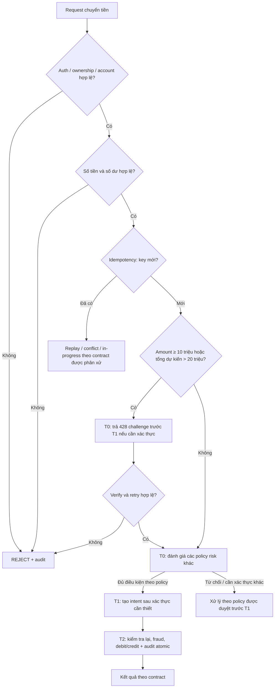

# 03. fraud-detection-rules

## 1. Mục đích, phạm vi và cách đọc

**Quyết định phải rõ.** Tài liệu đề xuất các quy tắc đánh giá fraud, điều kiện tạo flag và vòng đời giao dịch chờ duyệt; quyết định step-up thực hiện trước T1 theo `07` §6. Cùng một tình huống phải dẫn đến một kết quả nhất quán, có căn cứ kiểm tra và lưu được dấu vết xử lý.

Các mã `BASE-*` và `FRD-*` giữ để truy vết bản thiết kế cũ, không tự chứng minh chúng là API hay policy đã duyệt. Ngoài ngưỡng step-up tại DEC-TRF-002, các điều kiện về PIN, min/max, daily cap, velocity và review vẫn là đề xuất cần đối chiếu nguồn và phê duyệt riêng.

> **Trạng thái đối chiếu Transfer:** [DEC-TRF-001](../../../DECISIONS.md) xác định thành phần tổng dự kiến trong ngày; DEC-TRF-002 chọn ngưỡng step-up `amount ≥ 10.000.000 VND` hoặc `tổng dự kiến > 20.000.000 VND/ngày`. Quyết định không duyệt PIN bắt buộc, min/max, cap, flag, velocity, timezone hay các trạng thái review bên dưới. Với 428, SRS AC-033/`07` yêu cầu trước khi tạo transfer; protocol/race mở xem §6 và `design/05` §10.1.

Phạm vi gồm: large-value, daily accumulated value, high-frequency, unusual pattern, PIN/OTP abuse, fraud flags, review, fail-open/failure isolation, dữ liệu và observability. Ngoài phạm vi: nhận diện khuôn mặt, chấm điểm bằng mô hình học máy và kết nối thanh toán ngân hàng thật. Hệ thống chỉ xử lý giao dịch mô phỏng.

## 2. Yêu cầu và driver thiết kế

| Driver | Yêu cầu / ràng buộc |
| --- | --- |
| Money correctness | Không ghi nợ/ghi có hai lần, không cho giao dịch đang review tự chuyển tiền |
| Giá trị transfer | Amount > 0 theo SRS/API; khoảng 2.000–10.000.000 VND/lần là đề xuất cũ, không coi là min/max đã duyệt |
| Ngưỡng step-up tiền | `amount ≥ 10.000.000 VND` hoặc `tổng dự kiến > 20.000.000 VND/ngày` theo DEC-TRF-002; rủi ro khác vẫn có thể yêu cầu step-up |
| PIN | PIN 6 số; sai 5 lần liên tiếp khóa 15 phút là đề xuất cũ, cần xác nhận riêng |
| OTP recovery | OTP 6 số, TTL 120 giây, sai 5 lần vô hiệu là đề xuất cũ, cần đối chiếu Identity/Security |
| Security | Ownership, RBAC, idempotency, kiểm soát race condition; không đưa secret vào audit |
| Vận hành | Phát hiện dấu hiệu rủi ro, cho Operator xem/đánh giá và Auditor tra cứu lịch sử |
| Mở rộng B | Velocity, warning và giữ giao dịch là đề xuất cần duyệt riêng; ngưỡng step-up ngày theo DEC-TRF-002 |

**Không gộp ngưỡng.** Hai điều kiện tiền được kết hợp OR; hạn mức từng lần/ngày là kiểm soát riêng, còn velocity là đề xuất phát hiện hành vi bất thường. Các quyết định phải truy vết và kiểm thử được tại ranh giới.

## 3. Khái niệm và thuật ngữ

| Thuật ngữ | Ý nghĩa |
| --- | --- |
| Transaction T2 | Điểm đánh giá rủi ro trong luồng xử lý chuyển tiền được đề cập trong đề cương SRS; tên bước cần đối chiếu thiết kế transaction chính thức |
| Step-up authentication | Xác thực bổ sung theo phương thức/policy Identity; điều kiện tiền dùng ngưỡng DEC-TRF-002, không tự khẳng định PIN bắt buộc |
| Daily threshold | Mốc cộng dồn tiền trong ngày làm tăng mức xác thực, **không** phải trần chuyển tiền |
| Daily cap | Hạn mức cứng trong ngày; vượt phải từ chối |
| Velocity | Số giao dịch trong cửa sổ trượt thời gian |
| Risk flag | Bản ghi dấu hiệu bất thường kèm rule, căn cứ và mức độ |
| Hold / PENDING_REVIEW | Chưa thực hiện chuyển tiền; chờ quyết định của Operator |
| Reservation | Giữ chỗ hạn mức/khả dụng cho giao dịch đang chờ để tránh vượt giới hạn |
| Fail-open | Lỗi thành phần không trọng yếu không được làm hỏng giao dịch hợp lệ |
| Fail-closed | Không cho chuyển tiền khi không thể thực hiện kiểm tra an toàn bắt buộc |
| Idempotency | Retry cùng một yêu cầu không làm giao dịch phát sinh nhiều lần |

## 4. Rule catalog và ngưỡng

### 4.1. Quy tắc và đề xuất cần đối chiếu contract

| Rule ID | Điều kiện | Phản ứng | Nguồn |
| --- | --- | --- | --- |
| BASE-01 | Amount không hợp lệ, hoặc vượt hạn mức áp dụng | Từ chối theo SRS/API/Limit; min 2.000 và max 10 triệu là đề xuất cũ, chưa duyệt | `03` FR-015–016; `07` §8.3 |
| BASE-02 | Amount < 10 triệu và tổng dự kiến ≤ 20 triệu | Không trigger bởi hai ngưỡng tiền; các điều kiện risk khác vẫn được kiểm | DEC-TRF-002 |
| BASE-03 | Amount ≥ 10 triệu hoặc tổng dự kiến > 20 triệu VND/ngày | Step-up theo Identity/API trước T1; không coi PIN là bắt buộc chỉ từ quyết định ngưỡng | DEC-TRF-001/002; `07` §6 |
| BASE-04 | Sai PIN 5 lần liên tiếp | Khóa PIN 15 phút là đề xuất, cần xác nhận | Thiết kế fraud cũ |
| BASE-05 | Recovery OTP quá hạn, dùng lại hoặc sai nhiều lần | Từ chối/vô hiệu theo policy Identity; ngưỡng 5 là đề xuất, cần đối chiếu | Identity/`07` §6 |
| BASE-06 | Sai ownership/role, idempotency replay/conflict | REJECT hoặc trả kết quả cũ; ghi audit | API/team contract |

### 4.2. Rule catalog đề xuất — phương án B

| Rule ID | Phát hiện | Ngưỡng | Quyết định | Mức |
| --- | --- | --- | --- | --- |
| FRD-01 LARGE_VALUE | Giá trị một giao dịch | **Từ 10 triệu VND/lần** | Step-up; fraud flag độc lập cần review | LOW / xác thực |
| FRD-02 DAILY_STEP_UP | Tổng chuyển đi dự kiến trong ngày | **Trên 20 triệu VND/ngày** | Step-up; DAILY_THRESHOLD flag là đề xuất riêng | MEDIUM |
| FRD-03 DAILY_CAP | Tổng chuyển đi dự kiến trong ngày | **Trên 50 triệu VND/ngày** | REJECT là đề xuất, chưa thành policy hạn mức | HIGH / giới hạn |
| FRD-04 HIGH_FREQUENCY | Cùng customer thực hiện giao dịch liên tục | **Giao dịch thứ 3 trong 120 giây** | Step-up, WARNING flag là đề xuất cần duyệt | MEDIUM |
| FRD-05 REPEATED_VELOCITY | Tiếp tục chuyển khi cảnh báo velocity còn hiệu lực sau một lần step-up | Giao dịch tiếp theo trong chuỗi cảnh báo | PENDING_REVIEW; Operator quyết định | HIGH |
| FRD-06 UNUSUAL_PATTERN | Mẫu giao dịch bất thường khác (ví dụ nhiều người nhận mới) | Chưa chốt ngưỡng | Chỉ tạo flag theo chế độ quan sát, không tự block | PROPOSED / OPEN |
| FRD-07 AUTH_ABUSE | Nhiều lỗi PIN/OTP trước ngưỡng khóa | Đề xuất 3 lỗi/5 phút | Flag; khóa PIN vẫn theo BASE-04 | MEDIUM |
| FRD-08 OPERATOR_ANOMALY | Tra cứu bất thường tại quầy | Đề xuất 20 lần/10 phút | Risk flag phục vụ audit | MEDIUM |

**Phạm vi hệ thống mô phỏng:** mốc tiền step-up theo DEC-TRF-002 là cấu hình mặc định; 50 triệu/ngày, velocity, review và các flag trong bảng là đề xuất, không tự trở thành hạn mức cứng. Phương thức step-up và scope/version cấu hình do Identity/Security phối hợp; không mặc định cấm FIDO/PASSCODE được `07` mô tả.

### 4.3. Thứ tự ưu tiên quyết định

1. Auth, RBAC, ownership, account status, dữ liệu hợp lệ, idempotency.
2. Kiểm tra số tiền mỗi lần, số dư và các điều kiện chuyển tiền bắt buộc.
3. Tính tổng ngày/velocity bằng dữ liệu giao dịch đã commit cộng reservation và giao dịch dự kiến.
4. Nếu vượt hạn mức được duyệt: REJECT theo contract; cap 50 triệu và thứ tự chi tiết còn là đề xuất.
5. Nhánh PENDING_REVIEW cho repeated velocity là đề xuất, không phải trạng thái Transfer MVP được duyệt.
6. Nếu amount ≥10 triệu/lần hoặc tổng dự kiến >20 triệu/ngày, yêu cầu step-up trước T1 theo `07` §6; các điều kiện risk khác có thể yêu cầu thêm. High-frequency/flag cần phê duyệt riêng.
7. Nếu không có điều kiện step-up, tiếp tục kiểm tra các policy xác thực/transfer khác; không suy ra PIN bắt buộc hoặc đã được miễn toàn bộ kiểm soát.
8. Ghi audit/risk events và kết quả cuối cùng; OTP thành công không reset cửa sổ gian lận.

### 4.4. Các ví dụ minh họa

| Tình huống | Quyết định |
| --- | --- |
| 6 triệu, tổng dự kiến 6 triệu, không có điều kiện risk khác | Không trigger bởi hai ngưỡng tiền |
| 10 triệu, tổng dự kiến 10 triệu, không có điều kiện risk khác | Step-up vì chạm ngưỡng từng lần |
| 19,6 triệu đã hoàn tất/đang xử lý, tiếp 0,4 triệu | Tổng đúng 20 triệu: không trigger bởi ngưỡng ngày; vẫn kiểm ngưỡng lần/risk khác |
| 19,6 triệu đã hoàn tất/đang xử lý, tiếp 4,9 triệu | Tổng 24,5 triệu: step-up theo ngưỡng ngày; flag là đề xuất riêng |
| 49 triệu đã chuyển/giữ hạn mức, tiếp 2 triệu | Cap 50 triệu và từ chối là ví dụ đề xuất, chỉ áp dụng nếu được duyệt |
| 3 giao dịch trong 2 phút, hoặc giao dịch tiếp theo khi WARNING còn hiệu lực | Step-up/flag hoặc PENDING_REVIEW là phương án velocity cần duyệt, không mặc định runtime |

## 5. Cấu hình và versioning rule

Ngưỡng step-up cấu hình được, mặc định một lần `10000000` VND (so sánh `≥`) và tổng ngày `20000000` VND (so sánh `>`); một nguồn cấu hình do owner chọn, không tạo hai ngưỡng OTP độc lập. Các giá trị `min_transfer_vnd=2000`, `max_transfer_vnd=10000000`, `daily_cap_vnd=50000000`, `velocity_count=3`, `velocity_window_seconds=120`, `warning_ttl_minutes=15`, `review_timeout_minutes=30` chỉ là ví dụ đề xuất, không phải policy đã phê duyệt.

**Đổi ngưỡng, giữ dấu vết.** Mỗi rule lưu mã định danh, ngưỡng kích hoạt, hành động, mức ưu tiên, phiên bản và thời điểm hiệu lực. Bản ghi fraud flag gắn với `ruleVersion` để quyết định cũ vẫn có thể giải thích khi cấu hình được cập nhật; cấu hình lỗi không được vô hiệu hóa các kiểm soát bắt buộc.

## 6. Luồng đánh giá và transaction

**Ranh giới:** step-up được quyết định trước T1; T2 kiểm tra lại các điều kiện money/limit và đánh giá fraud theo contract. Sơ đồ mô tả ý định, chưa chứng minh serialization, lock order hoặc các race quanh `428`; protocol được đề xuất tại `design/05` §10.1 và phải được kiểm chứng. Notification gửi sau commit.

> **Điểm phối hợp Transfer:** [DEC-TRF-001](../../../DECISIONS.md) chọn thành phần tổng dự kiến; DEC-TRF-002 chọn ngưỡng tiền. Không suy ra đã chốt business date, scope, phương thức xác thực hoặc quy tắc review trong tài liệu fraud. Phương án guard/reservation, lock order và race 428 vẫn chờ review/proof tại `design/05` §10.1.

### 6.1. Cửa sổ thời gian và chính sách reset

Các cấu hình và lifecycle ngoài ngưỡng DEC-TRF-002 trong mục này là đề xuất, chưa xác nhận policy hay implementation.

- Ngày nghiệp vụ `Asia/Ho_Chi_Minh` từ 00:00:00 đến trước 00:00 ngày kế tiếp là đề xuất cần BA/Limit xác nhận; timestamp lưu UTC.
- Daily used = tổng đã hoàn tất trong ngày + reservation còn hiệu lực, không tính trùng một giao dịch. Việc release reservation phải tuân theo protocol được duyệt và trạng thái terminal an toàn; không tự release chỉ vì TTL/lease hết khi transfer còn PENDING hoặc có thể execute (`design/05` §10.1).
- Velocity là cửa sổ trượt 120 giây, không bị reset bởi mốc nửa đêm hoặc OTP đúng.
- WARNING kéo dài 15 phút từ sự kiện rủi ro gần nhất, chỉ hạ khi không còn risk event mới và không có case mở cần xử lý.
- PENDING_REVIEW quá 30 phút là EXPIRED, không auto-approve.
- Review case tạo trước nửa đêm giữ business date và reservation gốc cho đến quyết định; tránh chuyển sang ngày mới để né cap. Đây là policy đề xuất cần xác nhận với thiết kế money ledger.

## 7. Flag, auto-block và ops review

Các trạng thái, flag và luồng review ở mục này là đề xuất cần duyệt; không thay state machine Transfer MVP trong `03`/`04`/`07` và không khẳng định provider hay API đã tồn tại.

### 7.1. Trạng thái tách biệt

- `accountRiskState`: NORMAL, WARNING, RESTRICTED.
- `transactionStatus`: INITIATED, AWAITING_OTP, PENDING_REVIEW, APPROVED, REJECTED, EXPIRED, COMPLETED.
- `fraudFlagStatus`: OPEN, UNDER_REVIEW, CLOSED_FALSE_POSITIVE, CLOSED_CONFIRMED.

Không tự đồng nhất APPROVED với COMPLETED: chỉ sau khi revalidate và ghi sổ một lần thì mới COMPLETED.

### 7.2. Auto-block

**Chặn giao dịch. Không chặn oan tài khoản.** Vượt hạn mức đã được duyệt dẫn đến từ chối giao dịch; con số 50 triệu/ngày là đề xuất chưa được quyết định. Ngưỡng step-up ngày >20 triệu chỉ làm tăng xác thực theo DEC-TRF-002, không tự đặt hạn mức tiền. Cơ chế khóa PIN 15 phút là đề xuất; hạn chế toàn tài khoản phải tuân theo chính sách kiểm soát và quyền thao tác riêng.

### 7.3. Operator review workflow

1. Risk engine phát hiện repeated velocity, tạo `fraud_flag`, `review_case` và transaction PENDING_REVIEW.
2. Customer nhận trạng thái đang chờ xem xét; chưa ghi nợ hoặc ghi có cho người nhận.
3. Operator có quyền xem lý do, lịch sử liên quan đã giới hạn và quyết định APPROVE hoặc REJECT, kèm lý do. **API approve/reject là tính năng cần đặc tả bổ sung, không khẳng định đã tồn tại trong repo.**
4. Nếu APPROVE trước 30 phút, backend kiểm tra lại số dư/account/limit/uniqueness trước commit; không cho approve case đã EXPIRED.
5. Nếu REJECT hoặc hết hạn, chỉ giải phóng reservation khi trạng thái terminal đã an toàn và theo protocol được duyệt; PENDING/có thể execute không release đơn thuần do TTL. Ghi audit actor, thời điểm, action và reason.
6. Auditor chỉ đọc audit/risk review, không thực hiện money mutation. Quyền CUSTOMER, OPERATOR, AUDITOR, ADMIN theo API contract.

## 8. Fail-open và failure isolation

**Tiền phải đúng.** Lỗi phụ trợ không được khiến giao dịch đã hoàn tất bị ghi lặp hoặc đảo sai. Ngược lại, khi một bước kiểm soát bắt buộc không hoạt động, hệ thống dừng giao dịch thay vì bỏ qua ràng buộc. Hai nhóm lỗi được xử lý như sau:

| Thành phần lỗi | Chính sách | Lý do |
| --- | --- | --- |
| Lỗi gửi event analytics hoặc ghi metric không quan trọng | Fail-open có kiểm soát, retry/outbox và ghi operational alert | Không làm hỏng giao dịch hợp lệ đã commit |
| Lỗi dịch vụ thêm thông tin cảnh báo không quyết định money path | Fail-open nếu policy cho phép; không được làm mất rule mandatory | Failure isolation |
| Không đọc/khóa được daily counter, không xác định được cap | Fail-closed với transfer mới | Không thể bảo đảm giới hạn cứng |
| Không bảo đảm reservation / idempotency / atomic debit-credit | Fail-closed hoặc rollback | Ngăn chuyển trùng/sai số dư |
| OTP/PIN verification không khả dụng | Fail-closed cho giao dịch cần xác thực | Không bỏ qua bước bảo vệ |
| Lỗi sau commit khi xuất audit/notification | Không đảo giao dịch đã commit chỉ vì lỗi bên ngoài; retry riêng | Không tạo inconsistent money path |

**Phân tách rõ.** Các chức năng cảnh báo bổ trợ có thể fail-open theo chính sách failure isolation. Ngược lại, hạn mức cứng, xác thực, idempotency và ghi sổ nguyên tử là điều kiện bảo vệ bắt buộc; khi không thể xác minh chúng, giao dịch không được thực hiện.

## 9. Mô hình dữ liệu

### 9.1. fraud_rule_config — cấu hình quy tắc

| Trường đề xuất | Vai trò |
| --- | --- |
| rule_id, rule_code, version | Định danh và phiên bản |
| enabled, priority, severity | Bật/tắt, ưu tiên, mức cảnh báo |
| metric_type, operator, threshold_value | Điều kiện định lượng |
| window_seconds, action | Cửa sổ và hành động |
| effective_from, effective_to | Hiệu lực cấu hình |
| created_at, updated_at, approved_by | Audit thay đổi |

### 9.2. fraud_flag — bằng chứng rule match

| Trường đề xuất | Vai trò |
| --- | --- |
| flag_id, rule_id, rule_version | Truy vết rule |
| actor_id, account_id, transaction_id | Đối tượng liên quan |
| detected_at, observed_value, time_window | Căn cứ phát hiện |
| severity, action, status | Mức độ và kết quả |
| correlation_id, review_case_id | Liên kết request và review |
| reviewed_by, reviewed_at, review_reason | Lịch sử review |

**Dữ liệu phục vụ truy vết.** `fraud_rule_config` quản lý cấu hình, `fraud_flag` giữ bằng chứng rule match và kết quả xử lý. Quan hệ với review case và reservation bảo đảm giao dịch chờ duyệt có trạng thái rõ ràng, không làm vượt hạn mức khi nhận yêu cầu đồng thời. PIN/OTP không được lưu ở dạng rõ.

## 10. Audit và observability

- Ghi thời điểm UTC, request/correlation ID, customer/account/transfer reference, matchedRule, ruleVersion, action và status; mask thông tin nhạy cảm.
- Đo số rule match, OTP step-up, số giao dịch PENDING_REVIEW, thời gian chờ, approve/reject/expired, false positive, lỗi evaluation và lệch số dư.
- Audit event phải truy vết được hành động Operator; không để quyền Customer sửa flag hay audit.
- Lỗi hệ thống cần log an toàn và có chỉ báo giám sát, không trả secret trong response.

## 11. Kiểm thử và tiêu chí nghiệm thu

| TC | Điều kiện | Kết quả kỳ vọng |
| --- | --- | --- |
| FRD-T01 | Amount `9.999.999,99` VND, tổng dưới ngưỡng ngày, không có risk khác | Không trigger bởi ngưỡng tiền; các policy khác vẫn áp dụng |
| FRD-T02 | Amount `10.000.000,00` VND, tổng không vượt ngưỡng ngày | STEP_UP_REQUIRED theo ngưỡng từng lần; nếu chưa xác thực trả 428 trước T1 |
| FRD-T03 | Amount `10.000.000,01` VND hợp lệ theo limit fixture | STEP_UP_REQUIRED theo ngưỡng từng lần, không mặc định bị REJECT vì max cũ chưa duyệt |
| FRD-T04 | Tổng dự kiến chính xác `20.000.000,00` VND, amount <10 triệu, không có risk khác | Chưa trigger bởi ngưỡng ngày `>20M` |
| FRD-T05 | Tổng dự kiến `20.000.000,01` VND, amount <10 triệu | STEP_UP_REQUIRED theo ngưỡng ngày; flag là đề xuất riêng |
| FRD-T06 | Tổng dự kiến đúng 50 triệu | Cap 50 triệu: chỉ test khi policy đó được duyệt, không kết luận từ DEC-TRF-002 |
| FRD-T07 | Tổng dự kiến 50.000.001 VND | REJECT_DAILY_CAP chỉ nếu cap 50 triệu được duyệt |
| FRD-T08 | Giao dịch thứ 3 trong 120 giây | OTP + WARNING chỉ theo policy velocity được duyệt |
| FRD-T09 | Giao dịch thứ 4 khi WARNING còn hiệu lực sau OTP | PENDING_REVIEW chỉ theo policy review được duyệt, không debit trước review |
| FRD-T10 | Operator approve hợp lệ | Revalidate, commit đúng một lần |
| FRD-T11 | Operator reject / quá 30 phút | Theo policy review được duyệt; chỉ release reservation khi terminal an toàn, không release PENDING đơn thuần do TTL |
| FRD-T12 | Auditor hoặc Customer gọi approve | 403, không biến đổi giao dịch |
| FRD-T13 | Retry cùng idempotency key | Không sinh giao dịch/hold trùng |
| FRD-T14 | 2 request cùng làm vượt cap | Không vượt cap đã duyệt vì race; 50 triệu chỉ là fixture đề xuất |
| FRD-T15 | Pending qua 00:00 | Không tự duyệt; giữ reserve policy |
| FRD-T16 | OTP đúng trong lúc velocity còn hiệu lực | Không reset risk window |
| FRD-T17 | Risk metrics service lỗi | Không double debit; xử lý theo fail-open policy |
| FRD-T18 | Daily cap service lỗi | Fail-closed, không chuyển tiền |

**Acceptance:** các test là kế hoạch, chưa có kết quả thực thi; FRD-T01–05 cô lập điều kiện tiền, các ngưỡng/rule khác theo fixture và policy thực sự được duyệt. Mỗi test có expected/actual, version/commit, môi trường và bằng chứng thực thi; phần chưa chạy ghi NOT_TESTED. Một rule đạt yêu cầu thiết kế khi rõ condition, threshold, action, reset, audit, ownership và expected test.

## 12. Traceability

| Yêu cầu đầu vào | Nội dung trong tài liệu |
| --- | --- |
| SRS 2.10 Fraud and Anomaly | Rule catalog, high-frequency, unusual pattern (mục 4) |
| SRS 2.13.5 Fraud Evaluation; AC-033 | Fraud T2; step-up T0 trước T1 và fail-open/failure isolation (mục 6, 8) |
| SRS AC-026 | Acceptance test cho fraud rules (mục 11; cần đối chiếu wording AC gốc) |
| Design 02 consistency-concurrency | Reservation, idempotency, atomic commit (mục 6, 8) |
| Database design 04 | fraud_rule_config, fraud_flag (mục 9) |
| API contracts 07 | PIN/OTP, transfer, RBAC, audit/risk endpoints (mục 2, 7) |
| Master Timelines 10 | Tiến độ triển khai các rule chỉ khi đã được duyệt scope |

**Tham chiếu:** [Digital Banking MVP repository](https://github.com/TNoLisme/cloude) — SRS, thiết kế concurrency, database và API contract. Bảng traceability liên kết từng nhóm yêu cầu với quy tắc, hành động và kết quả kiểm thử.

## 13. Quyết định, open issues và change log

### 13.1. Quyết định thiết kế

- DEC-TRF-002: step-up từ 10 triệu VND/lần hoặc tổng dự kiến trên 20 triệu VND/ngày; DEC-TRF-001 xác định thành phần tổng. Các phần khác của phương án B (daily cap 50 triệu, velocity 3 giao dịch/2 phút, repeated velocity/review) vẫn là đề xuất cần duyệt; không suy ra PIN hay flag bắt buộc từ quyết định ngưỡng.
- WARNING TTL đề xuất 15 phút; review timeout đề xuất 30 phút; Cloud không thuộc thiết kế fraud mà là giai đoạn triển khai sau khi hoàn thiện ứng dụng.
- Mức rủi ro đủ cao dẫn đến HOLD cho **giao dịch**, không tự động khóa toàn bộ tài khoản.

### 13.2. Các điểm cần chốt trong thiết kế

- [ ]  Nhóm duyệt đưa phần nào của Option B vào MVP hoặc đưa sang release sau?
- [ ]  Xác nhận wording chính xác AC-026 và hành vi fail-open ở SRS/Design 02.
- [ ]  Xác nhận quy tắc reservation/hạn mức khi pending qua 00:00.
- [ ]  Xác nhận API Operator approve/reject và cách triển khai review queue.
- [ ]  Xác nhận unusual-pattern threshold và cách quản lý cấu hình rule.
- [ ]  Bổ sung ảnh/sơ đồ [draw.io](http://draw.io) sau khi nhóm chốt flow.

### 13.3. Change log

| Phiên bản | Ngày | Thay đổi | Trạng thái |
| --- | --- | --- | --- |
| 1.2 draft | 15/11/2026 | Đồng bộ DEC-TRF-002: ngưỡng tiền step-up, ranh giới, ví dụ/test và tách các policy fraud chưa duyệt. | Draft |
| 1.1 draft | 15/11/2026 | Liên kết DEC-TRF-001, làm rõ giới hạn ngưỡng và vị trí step-up; protocol/reservation chờ review. | Draft |
| 0.1 | 03/11/2026 | Đề cương ban đầu | Draft |
| 1.0 | 06/11/2026 | Hoàn thiện đặc tả theo đề cương, tích hợp phương án B, luồng T2, quản lý cảnh báo và kiểm thử | Bản thiết kế |
