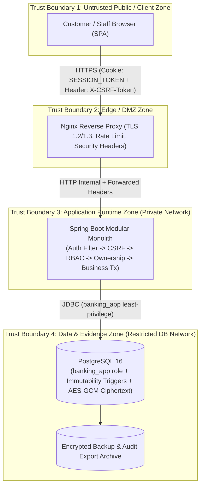

# 04. Security Architecture & Threat Control Design

> **Dự án:** Digital Banking MVP
> **Mã tài liệu:** `DESIGN-SEC-04`
> **Phiên bản:** 1.0
> **Ngày:** 07/11/2026
> **Trạng thái:** Hoàn thành — v1.0
> **Nguồn tham chiếu:** [[digitalbanking-docs/docs-common/03. SRS.md]], [[digitalbanking-docs/docs-common/04. Database design & analysis.md]], [[digitalbanking-docs/docs-common/05. Technical stack.md]], [[digitalbanking-docs/docs-common/06. System architecture.md]], [[digitalbanking-docs/docs-common/07. API contracts.md]], [[digitalbanking-docs/docs-common/design/01. audit-traceability.md]], [[digitalbanking-docs/docs-common/design/02. consistency-concurrency.md]]

---

## 1. Mục đích, phạm vi và cách đọc

### 1.1. Mục đích

Tài liệu này là thiết kế chi tiết chuẩn (source of truth) về kiến trúc bảo mật, mô hình mối đe dọa (Threat Model), cơ chế xác thực & quản lý phiên (Authentication & Session), phân quyền đa tầng (RBAC, Ownership Isolation & Maker-Checker), mã hóa dữ liệu & quản lý khóa (Encryption & Key Management), bảo vệ dữ liệu định danh cá nhân (PII Masking), phòng chống lạm dụng API (CSRF, CORS, Rate Limiting) và kiểm chứng an toàn thông tin cho hệ thống Digital Banking MVP.

### 1.2. Trong phạm vi

- Mô hình mối đe dọa theo STRIDE và ranh giới tin cậy (Trust Boundaries).
- Xác thực người dùng (`CUSTOMER` và `STAFF`), quản lý thiết bị tin cậy (`user_device`), OTP Challenge (`LOGIN_MFA`, `TRANSFER_STEP_UP`, `SENSITIVE_ACTION`), và cơ chế Opaque Server-Side Session (`HttpOnly` Cookie + `X-CSRF-Token`).
- Phân quyền truy cập theo vai trò (`RBAC`), kiểm tra quyền sở hữu tài nguyên (`Object-Level Ownership / Anti-IDOR`), và phê duyệt 4 mắt (`Maker-Checker / Dual Control`).
- Mã hóa trên đường truyền (`TLS 1.2/1.3`) và mã hóa dữ liệu nhạy cảm ở trạng thái nghỉ (`AES-256-GCM`), băm tra cứu một chiều (`HMAC-SHA256`), băm mật khẩu/OTP (`Argon2id` / `BCrypt` / `SHA-256`).
- Phân loại dữ liệu (`Data Classification`), quy tắc che dấu PII (`PII Masking`) trong API/Log/Audit/Notification, và quản lý bí mật (`Secret Management`).
- Bảo vệ API theo OWASP API Security Top 10: Input Validation, Idempotency binding, Rate Limiting, Security Headers.
- Ghi nhận sự kiện bảo mật (`Security Audit Logging`), cảnh báo và quy trình ứng phó sự cố bảo mật.
- Tiêu chí kiểm thử bảo mật (`D4` Security & Audit Demonstration, `AC-030`).

### 1.3. Ngoài phạm vi

- Chứng nhận tuân thủ pháp lý chính thức (PCI-DSS, ISO 27001, SOC 2) trên hạ tầng đám mây thương mại.
- Tích hợp phần cứng HSM vật lý hoặc KMS/Vault thương mại (MVP sử dụng cơ chế nạp khóa qua biến môi trường được cô lập, thiết kế sẵn giao diện `KeyProvider` để nâng cấp lên KMS).
- Liên kết định danh bên ngoài (SSO/OIDC/SAML doanh nghiệp) hoặc sinh trắc học phần cứng FIDO2/WebAuthn đầy đủ (chỉ giữ mức hook kiến trúc).

---

## 2. Yêu cầu và driver thiết kế

### 2.1. Yêu cầu chức năng và phi chức năng liên quan

| Mã yêu cầu | Nội dung tóm tắt | Mục thiết kế đáp ứng |
|---|---|---|
| `BR-001` – `BR-006`, `FR-001` – `FR-008` | Đăng nhập, khóa tài khoản tạm thời khi sai liên tiếp, OTP thiết bị mới, quản lý và thu hồi session | Mục 4 |
| `BR-007`, `FR-018`, `AC-033` | Xác thực tăng cường (Step-up OTP) trước khi tạo giao dịch vượt ngưỡng hoặc duyệt hành động nhạy cảm | Mục 4.5 |
| `BR-025`, `BR-029`, `FR-040` – `FR-043` | Phân quyền RBAC tách biệt Customer/Staff, cô lập dữ liệu chủ sở hữu (Ownership), phê duyệt Maker-Checker | Mục 5 |
| `NFR-013` | Bảo mật truyền dẫn bằng HTTPS / TLS 1.2+ (ưu tiên TLS 1.3) | Mục 6.1 |
| `NFR-014` | Mã hóa dữ liệu nhạy cảm ở trạng thái nghỉ (Encryption at Rest) | Mục 6.2 |
| `NFR-015` | Băm mật khẩu và OTP an toàn, không lưu plaintext | Mục 6.3 |
| `NFR-016` | Kiểm soát phiên đăng nhập an toàn (idle timeout 15 phút, absolute timeout 8 giờ, thu hồi tức thì) | Mục 4.3 |
| `NFR-017` | Kiểm soát truy cập tối thiểu (Least Privilege) ở cả tầng ứng dụng và tầng Database | Mục 5.1, 6.5 |
| `NFR-018` | Chống brute-force và giới hạn tần suất gọi API (Rate Limiting) | Mục 8.3 |
| `NFR-019` | Quản lý secret bên ngoài source code và artifact | Mục 6.4 |
| `NFR-020`, `FR-039`, `AC-023` | Che dấu PII (PII Masking) trên API response, technical log, audit log và thông báo | Mục 7 |
| `NFR-021` – `NFR-023`, `AC-020`, `AC-021` | Tính bất biến của bằng chứng kiểm toán (Audit Immutability) và ghi nhận truy cập trái phép | Mục 9 |
| `AC-030` | Hoàn thành danh mục kiểm tra bảo mật (Security Review Checklist) | Mục 10, 11 |

### 2.2. Các quyết định kiến trúc bảo mật cốt lõi (`Security Design Decisions`)

| ID | Quyết định | Lý do | Hệ quả / Trade-off |
|---|---|---|---|
| `DD-SEC-01` | Sử dụng **Opaque Server-Side Session** lưu trong PostgreSQL thay vì Stateless JWT | Cho phép thu hồi phiên tức thì (`Immediate Revocation`) khi đổi quyền, khóa tài khoản hoặc phát hiện bất thường (`BR-006`) | Cần 1 truy vấn đọc `banking.sessions` theo PK/Unique hash trên mỗi request xác thực (độ trễ `< 1ms` qua index) |
| `DD-SEC-02` | Truyền Session Token qua **`HttpOnly` Cookie** kết hợp **Synchronizer CSRF Token (`X-CSRF-Token`)** | Chống đánh cắp token qua XSS (`HttpOnly`) đồng thời chống tấn công CSRF trên các lệnh thay đổi trạng thái | Client SPA phải đọc `csrfToken` từ response login và đính kèm vào header `X-CSRF-Token` |
| `DD-SEC-03` | Mã hóa cấp cột (`AES-256-GCM`) kết hợp cột băm mù (`HMAC-SHA256`) và cột 4 số cuối (`last4`) cho Số tài khoản & CCCD | Vừa bảo vệ dữ liệu nhạy cảm khi DB dump bị lộ, vừa cho phép tìm kiếm chính xác `O(1)` qua B-Tree index trên cột HMAC và hiển thị che dấu nhanh không cần giải mã | Tăng nhẹ kích thước dòng và cần quản lý cặp khóa `APP_PII_AES_KEY` + `APP_HMAC_KEY` |
| `DD-SEC-04` | Xác thực Step-up (`T0`) thực hiện **trước** khi khởi tạo bản ghi `transfer` hoặc `idempotency_record` (`T1`) | Đảm bảo `AC-033`: Giao dịch chưa xác thực Step-up không được tạo bất kỳ tác dụng phụ tài chính hay giữ khóa tài nguyên nào | Challenge Step-up phải gắn kết chặt (`payload_hash`) với thông số giao dịch để chống đánh tráo nội dung sau khi verify OTP |
| `DD-SEC-05` | Tách biệt tài khoản kết nối PostgreSQL: `banking_migrator` (DDL) và `banking_app` (DML giới hạn, cấm `UPDATE`/`DELETE` trên `ledger_entry` và `audit_log`) | Phòng thủ chiều sâu (`Defense in Depth`): Ngay cả khi ứng dụng có lỗi SQL Injection hoặc lập trình viên gọi nhầm lệnh xóa, DB vẫn từ chối | Cần cấu hình 2 bộ credential trong Flyway và HikariCP |

---

## 3. Threat Model và Ranh giới Tin cậy (`Trust Boundaries`)

### 3.1. Sơ đồ Ranh giới Tin cậy (`Trust Boundary Diagram`)



### 3.2. Phân tích Mối đe dọa theo STRIDE và Biện pháp Kiểm soát

| Nhóm STRIDE | Kịch bản Tấn công Cụ thể | Mức độ Rủi ro | Biện pháp Kiểm soát trong Thiết kế (`Control Mechanism`) |
|---|---|---|---|
| **S — Spoofing (Giả mạo định danh)** | Đánh cắp mật khẩu (Credential Stuffing / Brute-force), đánh cắp Session ID qua XSS, hoặc đăng nhập từ thiết bị lạ. | **Cao** | - Băm mật khẩu bằng `Argon2id` (`m=65536, t=3, p=4`).<br>- Khóa tạm thời tài khoản `15 phút` sau `5` lần nhập sai liên tiếp (`BR-002`).<br>- Kiểm tra `device_fingerprint_hash` trong `banking.user_device`; bắt buộc OTP `LOGIN_MFA` nếu thiết bị chưa tin cậy (`BR-003`).<br>- Lưu Session Token trong `HttpOnly, Secure, SameSite=Strict` cookie; chỉ lưu `SHA-256(token)` trong DB. |
| **T — Tampering (Sửa đổi dữ liệu trái phép)** | Sửa đổi số tiền/tài khoản đích sau khi đã xác thực Step-up OTP; sửa đổi payload khi retry cùng `Idempotency-Key`; sửa/xóa lịch sử sổ cái hoặc nhật ký kiểm toán. | **Nghiêm trọng** | - Khóa chặt Step-up Challenge với `payload_hash = SHA-256(sourceAccountId + ":" + destAccountNo + ":" + amount + ":" + currency)`.<br>- So khớp `request_hash` (RFC 8785 JCS) trên `idempotency_record`; trả về `409 IDEMPOTENCY_KEY_CONFLICT` nếu khác biệt.<br>- Thu hồi quyền `UPDATE`/`DELETE` của `banking_app` trên `ledger_entry` và `audit_log` + Trigger chặn sửa đổi + Hash Chain `SHA-256` tuần tự. |
| **R — Repudiation (Chối bỏ hành vi)** | Khách hàng chối bỏ đã thực hiện lệnh chuyển tiền giá trị lớn; nhân viên ngân hàng chối bỏ đã nâng hạn mức hoặc xuất dữ liệu kiểm toán. | **Cao** | - Mọi giao dịch tiền tệ (`C1`) và hành động nhạy cảm (`C2`) đều ghi `audit_log` **Fail-closed** trong cùng DB transaction.<br>- Lưu vết `step_up_challenge_id` đã tiêu thụ (`CONSUMED`) trên cả `transfer` và `approval_request`.<br>- Bắt buộc ghi `AUDIT_EXPORTED` kèm `fileHash` trước khi trả tệp xuất kiểm toán. |
| **I — Information Disclosure (Lộ lọt thông tin)** | Tấn công IDOR (xem tài khoản/giao dịch của khách hàng khác); lộ số tài khoản/CCCD/mật khẩu/OTP qua API response, log hoặc DB dump. | **Nghiêm trọng** | - Kiểm tra Ownership nghiêm ngặt tại tầng Service (`account.customer_id == principal.customerId`); trả về `403 AUTH_FORBIDDEN` và ghi audit `SECURITY_ACCESS_DENIED` khi vi phạm.<br>- Mã hóa `AES-256-GCM` cho số tài khoản và CCCD trong DB.<br>- Che dấu PII (`******1234`) trên API/Log/Notification; quét PII Allowlist trước khi ghi `audit_log`. |
| **D — Denial of Service (Từ chối dịch vụ)** | Bắn hàng loạt request đăng nhập/OTP hoặc giữ khóa DB làm cạn kiệt Connection Pool (`HikariCP`). | **Trung bình – Cao** | - Rate limiting theo IP và theo User tại Nginx và tầng Filter (`429 RATE_LIMITED`).<br>- Đặt `spring.jpa.open-in-view=false`, `SET LOCAL lock_timeout = '2s'`, `statement_timeout = '5s'` trong giao dịch `T2`, và dùng `FOR UPDATE NOWAIT` khi claim `transfer` / `approval_request`. |
| **E — Elevation of Privilege (Leo thang đặc quyền)** | Khách hàng gọi API `/api/v1/admin/**`; nhân viên tự phê duyệt đề xuất hạn mức/quyền của chính mình. | **Nghiêm trọng** | - Tách biệt `user_type` (`CUSTOMER` vs `STAFF`) và kiểm tra `@PreAuthorize` theo cả Role lẫn Permission.<br>- Ràng buộc Maker-Checker ở cả tầng ứng dụng và tầng DB (`CHECK (maker_id <> checker_id)`).<br>- Tự động thu hồi toàn bộ `sessions` của nhân viên ngay khi quyền RBAC của họ thay đổi. |

---

## 4. Authentication, Session, MFA và Step-Up Security

### 4.1. Xác thực Mật khẩu và Chính sách Khóa Tài khoản (`Lockout Policy`)

1. **Thuật toán băm mật khẩu (`NFR-015`):**
   - Sử dụng **`Argon2id`** (`memory = 64 MB`, `iterations = 3`, `parallelism = 4`, `salt = 16 bytes`, `hashLength = 32 bytes`) làm thuật toán mặc định.
   - Hỗ trợ tương thích `BCrypt` (`strength = 12`) qua `DelegatingPasswordEncoder`.
2. **Chống दò tài khoản (`Anti-Enumeration`):**
   - Khi đăng nhập với `username` không tồn tại, hệ thống vẫn thực hiện một phép băm `Argon2id` giả lập (dummy verification) để cân bằng thời gian phản hồi và trả về cùng một mã lỗi chung `401 AUTH_INVALID_CREDENTIALS`.
3. **Chính sách Đếm lỗi và Khóa tạm thời (`BR-002`):**
   - Mỗi lần sai mật khẩu, tăng `users.failed_login_count` trong một transaction độc lập (`REQUIRES_NEW`).
   - Khi `failed_login_count >= 5`: cập nhật `status = 'LOCKED'`, `locked_until = now() + INTERVAL '15 minutes'`, ghi sự kiện `AUTH_ACCOUNT_LOCKED` (`C3`) và trả về `423 AUTH_ACCOUNT_LOCKED`.
   - Khi đăng nhập thành công sau khi hết thời gian khóa: đặt lại `failed_login_count = 0`, `locked_until = NULL`, `status = 'ACTIVE'`.

### 4.2. Nhận diện Thiết bị Tin cậy và MFA khi Đăng nhập (`BR-003`)

- Sau khi xác thực mật khẩu đúng, hệ thống băm dấu vân tay thiết bị `device_fingerprint_hash = HMAC-SHA256(deviceId + "|" + normalizedUserAgentFamily, APP_HMAC_KEY)` và tra cứu trong bảng `banking.user_device`.
- **Thiết bị đã tin cậy (`trusted = true`):** Khởi tạo phiên đăng nhập ngay và trả về `200 OK` (`mfaRequired = false`).
- **Thiết bị mới hoặc chưa tin cậy:**
  - Chưa tạo dòng trong `banking.sessions`.
  - Tạo bản ghi `banking.auth_challenge` với `purpose = 'LOGIN_MFA'`, `ttl = 5 phút`, `max_attempts = 5`.
  - Trả về `202 Accepted` (`mfaRequired = true`, `challengeId = ...`).
  - Chỉ sau khi người dùng xác thực đúng OTP qua `POST /api/v1/auth/step-up/{id}/verify`, hệ thống mới đánh dấu thiết bị là `trusted = true` và cấp phát Session.

### 4.3. Quản lý Vòng đời Session & Bảo vệ CSRF (`NFR-016`)

| Thông số Phiên (`banking.sessions`) | Giá trị Chuẩn | Cơ chế Thực thi |
|---|---|---|
| **Định dạng Session Token** | `32 bytes` (`256 bits`) sinh từ `SecureRandom`, mã hóa `Base64Url` | Gửi cho Client qua cookie `SESSION_TOKEN`; trong DB chỉ lưu `token_hash = SHA-256(rawToken)`. |
| **Thuộc tính Cookie `SESSION_TOKEN`** | `HttpOnly; Secure; SameSite=Strict; Path=/api` | Ngăn JavaScript đọc token khi có lỗi XSS; ngăn trình duyệt tự gửi cookie từ trang web bên thứ ba. |
| **CSRF Token (`X-CSRF-Token`)** | `32 bytes` ngẫu nhiên, lưu `csrf_token_hash` trong `banking.sessions` | Bắt buộc kiểm tra bằng `MessageDigest.isEqual` trên mọi request `POST`, `PUT`, `PATCH`, `DELETE` có sử dụng session cookie. |
| **Idle Timeout (Thời gian chờ không hoạt động)** | **`15 phút`** (`idle_expires_at`) | Mỗi request hợp lệ gia hạn `idle_expires_at = LEAST(now() + 15m, absolute_expires_at)`. Quá hạn -> trả về `401 AUTH_SESSION_EXPIRED`. |
| **Absolute Timeout (Thời gian sống tối đa)** | **`8 giờ`** (`absolute_expires_at`) | Không thể gia hạn vượt mốc này; bắt buộc đăng nhập lại sau 8 giờ. |
| **Giới hạn Phiên Đồng thời (`Max Concurrent Sessions`)** | `CUSTOMER`: tối đa **3** phiên mở.<br>`STAFF`: tối đa **1** phiên mở. | Khi vượt ngưỡng, tự động thu hồi phiên có `created_at` cũ nhất (`revoked_reason = 'CONCURRENT_LIMIT_EXCEEDED'`). |

### 4.4. Thiết kế Xác thực Tăng cường (`Step-Up Authentication` — `T0`)

- **Các trường hợp bắt buộc Step-up OTP (`purpose`):**
  1. `TRANSFER_STEP_UP`: Lệnh chuyển tiền có `amount >= 10,000,000 VND` hoặc làm tổng tiền chuyển trong ngày vượt `20,000,000 VND`.
  2. `SENSITIVE_ACTION`: Nhân viên (`Checker`) thực hiện phê duyệt/từ chối thay đổi hạn mức (`LIMIT_CHANGE`) hoặc thay đổi quyền (`ROLE_CHANGE`).
- **Bảo vệ chống phát lại và chống đánh tráo (`Single-Use & Payload Binding`):**
  - Mã OTP `6 chữ số` được băm kèm ngữ cảnh: `otp_hash = HMAC-SHA256(challengeId + ":" + otpCode, APP_HMAC_KEY)`.
  - Mỗi challenge chỉ có hiệu lực `5 phút`, tối đa `5` lần nhập sai (nhập sai lần thứ 5 chuyển ngay sang `status = 'LOCKED'`).
  - Khi giao dịch chính (`T1` của chuyển tiền hoặc transaction phê duyệt của Checker) tiêu thụ challenge, hệ thống thực hiện cập nhật có điều kiện nguyên tử:
    ```sql
    UPDATE banking.auth_challenge
    SET status = 'CONSUMED', consumed_at = clock_timestamp()
    WHERE challenge_id = :challengeId
      AND user_id = :actorUserId
      AND purpose = :expectedPurpose
      AND payload_hash = :expectedPayloadHash
      AND status = 'VERIFIED'
      AND expires_at > clock_timestamp();
    ```
    Nếu số dòng cập nhật bằng `0`, giao dịch bị từ chối ngay lập tức (`403 STEP_UP_INVALID`), ngăn chặn hoàn toàn việc dùng 1 challenge cho 2 request đồng thời (`T-STEP-01`).

---

## 5. Authorization: RBAC, Ownership Isolation và Maker-Checker

### 5.1. Ma trận Phân quyền RBAC (`Role & Permission Matrix`)

Hệ thống tách biệt cứng giữa `user_type = 'CUSTOMER'` và `user_type = 'STAFF'` ngay trên bảng `banking.users`. Một tài khoản không bao giờ đồng thời mang cả hai loại hình này.

| Quyền hạn (`Permission Code`) | `CUSTOMER` | `OPERATIONS` (Staff) | `RISK_COMPLIANCE` (Staff) | `ADMIN_SECURITY` (Staff) |
|---|:---:|:---:|:---:|:---:|
| Xem hồ sơ cá nhân, tài khoản, lịch sử giao dịch & hạn mức của chính mình | **Có** (Chỉ dữ liệu sở hữu) | Không | Không | Không |
| Khởi tạo lệnh chuyển tiền (`POST /api/v1/transfers`) | **Có** (Chỉ từ tài khoản sở hữu) | Không | Không | Không |
| `CUSTOMER_READ`, `ACCOUNT_READ`, `TRANSACTION_READ` (Tra cứu hỗ trợ khách hàng) | Không | **Có** | **Có** | **Có** |
| `FRAUD_READ`, `FRAUD_REVIEW` (Xem và thẩm định cờ cảnh báo gian lận) | Không | **Có** | **Có** | **Có** |
| `LIMIT_PROPOSE` (Maker tạo đề xuất thay đổi hạn mức) | Không | **Có** | Không | **Có** |
| `LIMIT_APPROVE` (Checker phê duyệt/từ chối thay đổi hạn mức) | Không | Không | **Có** | **Có** |
| `ROLE_PROPOSE` (Maker tạo đề xuất cấp/thu hồi role nhân viên) | Không | Không | Không | **Có** |
| `ROLE_APPROVE` (Checker phê duyệt/từ chối thay đổi role nhân viên) | Không | Không | **Có** | **Có** |
| `APPROVAL_READ` (Xem danh sách yêu cầu phê duyệt Maker-Checker) | Không | **Có** | **Có** | **Có** |
| `AUDIT_READ` (Tra cứu nhật ký kiểm toán) | Không | **Có** (Phạm vi vận hành) | **Có** (Toàn bộ) | **Có** (Toàn bộ) |
| `AUDIT_EXPORT` (Xuất tệp bằng chứng kiểm toán CSV/JSONL) | Không | Không | **Có** | **Có** |

### 5.2. Cô lập Quyền sở hữu Tài nguyên (`Object-Level Ownership / Anti-IDOR`)

Mọi truy vấn hoặc thao tác của `CUSTOMER` trên tài khoản, giao dịch chuyển tiền và bút toán sổ cái phải kiểm tra `customer_id`:
- **Quy tắc bắt buộc (`DAR-001`):** Khi `Customer A` truy cập vào `accountId` hoặc `transferReference` tồn tại trong hệ thống nhưng thuộc về `Customer B`:
  1. Từ chối yêu cầu với HTTP Status **`403 Forbidden` (`error.code = "AUTH_FORBIDDEN"`)**.
  2. Ghi nhận ngay bản ghi kiểm toán bảo mật `action = 'SECURITY_ACCESS_DENIED'` (`C3` trong `REQUIRES_NEW` transaction) với `actor_user_id`, `target_type`, `target_id` và `correlation_id`.
  3. Tuyệt đối không tiết lộ bất kỳ thông tin số dư hay tên chủ tài khoản của `Customer B` trong thông báo lỗi.

### 5.3. Nguyên tắc Kiểm soát Kép (`Maker-Checker / Four-Eyes Principle`)

Mọi thay đổi đối với cấu hình hạn mức (`LIMIT_CHANGE`) và phân quyền nhân viên (`ROLE_CHANGE`) bắt buộc đi qua bảng `banking.approval_request`:
1. **Cấm tự phê duyệt (`INV-MC-01`):** `maker_id <> checker_id` được cưỡng chế ở cả tầng Service (`403 MAKER_CHECKER_VIOLATION`) và tầng PostgreSQL Constraint (`chk_approval_maker_ne_checker`).
2. **Cấm Maker tự nâng quyền cho chính mình:** Khi tạo đề xuất `ROLE_CHANGE`, `target_user_id` không được trùng với `maker_id`.
3. **Bắt buộc Step-up khi phê duyệt:** Checker phải xác thực OTP (`SENSITIVE_ACTION`) trước khi lệnh `APPROVE` hoặc `REJECT` được thực thi.

---

## 6. Mã hóa (`Encryption`) và Quản lý Khóa (`Key Management`)

### 6.1. Bảo mật Truyền dẫn (`Encryption in Transit` — `NFR-013`)

- Toàn bộ lưu lượng từ trình duyệt người dùng đến Nginx Reverse Proxy bắt buộc sử dụng **HTTPS với TLS 1.2 hoặc TLS 1.3** (vô hiệu hóa SSLv3, TLS 1.0, TLS 1.1 và các cipher suite yếu như RC4, 3DES, CBC không có AEAD).
- Cấu hình HTTP Security Headers tại Nginx và Spring Security:
  - `Strict-Transport-Security: max-age=31536000; includeSubDomains`
  - `Content-Security-Policy: default-src 'self'; frame-ancestors 'none'; object-src 'none'`
  - `X-Content-Type-Options: nosniff`
  - `X-Frame-Options: DENY`
  - `Referrer-Policy: no-referrer`
  - `Cache-Control: no-store, no-cache, must-revalidate, max-age=0` (bắt buộc trên mọi phản hồi `/api/v1/**`).

### 6.2. Mã hóa Dữ liệu ở Trạng thái Nghỉ (`Encryption at Rest` — `NFR-014`)

Đối với các trường định danh nhạy cảm cao (`account.account_no_enc`, `customer.national_id_enc`), hệ thống áp dụng mã hóa xác thực **`AES-256-GCM`** ở tầng ứng dụng trước khi ghi xuống PostgreSQL:

- **Cấu trúc mảng byte lưu trong cột `BYTEA`:**
  $$\text{Ciphertext\_Blob} = \text{IV}_{12\text{ bytes}} \mathbin{\Vert} \text{Ciphertext}_{N\text{ bytes}} \mathbin{\Vert} \text{GCM\_Auth\_Tag}_{16\text{ bytes}}$$
  Trong đó $\text{IV}$ (`12 bytes` / `96 bits`) được sinh mới hoàn toàn bằng `SecureRandom` cho mỗi lần mã hóa.
- **Tra cứu chính xác không cần giải mã (`Blind Index via HMAC-SHA256`):**
  - Để tìm kiếm tài khoản theo số tài khoản khi chuyển tiền hoặc kiểm tra trùng CCCD mà không thể dùng `AES-256-GCM` (do IV ngẫu nhiên làm mỗi lần mã hóa ra kết quả khác nhau), hệ thống lưu kèm cột `account_no_hash` và `national_id_hash`:
    $$\text{blind\_hash} = \text{HexLower}\left(\text{HMAC-SHA256}\left(\text{normalize}(\text{plaintext}), \text{APP\_HMAC\_KEY}\right)\right)$$
  - Khóa `APP_HMAC_KEY` (`256-bit`) tách biệt hoàn toàn với khóa `APP_PII_AES_KEY` (`256-bit`).

### 6.3. Tổng hợp Chuẩn Băm & Mã hóa theo Loại Dữ liệu

| Đối tượng Dữ liệu | Thuật toán Chuẩn | Lưu trữ tại Cột | Ghi chú Bảo mật |
|---|---|---|---|
| **Mật khẩu người dùng** | `Argon2id` (`m=64MB, t=3, p=4`) | `users.password_hash` | Một chiều, có salt ngẫu nhiên 16 byte mỗi user. |
| **Mã OTP Challenge** | `HMAC-SHA256(challengeId + ":" + otp, HMAC_KEY)` | `auth_challenge.otp_hash` | Ràng buộc chặt vào `challenge_id`, tự hủy sau 5 phút. |
| **Session Token & CSRF Token** | `SHA-256` (`64` ký tự hex) | `sessions.token_hash`, `sessions.csrf_token_hash` | Nếu bảng `sessions` bị lộ ở mức đọc, kẻ tấn công vẫn không có raw token để giả mạo cookie. |
| **Số tài khoản & Số CCCD** | `AES-256-GCM` + `HMAC-SHA256` + `last4` | `*_enc` (`BYTEA`), `*_hash` (`CHAR(64)`), `*_last4` (`CHAR(4)`) | Đảm bảo bảo mật, tra cứu `O(1)` và hiển thị che dấu nhanh. |
| **Bản ghi Kiểm toán (`audit_log`)** | `SHA-256(JCS(payload) + "|" + prev_hash)` | `audit_log.record_hash` | Phát hiện mọi hành vi sửa đổi hoặc xóa dòng trong chuỗi kiểm toán. |

### 6.4. Quản lý Khóa và Vòng đời Bí mật (`Secret & Key Lifecycle` — `NFR-019`)

1. **Ngoại hóa hoàn toàn khỏi Source Code:**
   - Mọi khóa (`APP_PII_AES_KEY_BASE64`, `APP_HMAC_KEY_BASE64`, `DB_APP_PASSWORD`, `DB_MIGRATION_PASSWORD`) được tiêm qua biến môi trường hoặc Docker Secrets lúc khởi chạy container.
   - Khi khởi động, `PiiCryptoService` kiểm tra độ dài khóa giải mã Base64 phải đúng `32 bytes` (`256 bits`); nếu thiếu hoặc dùng giá trị placeholder không hợp lệ trên môi trường `demo`/`prod`, ứng dụng dừng khởi động ngay lập tức (`Fail-Fast`).
2. **Hỗ trợ Xoay vòng Khóa (`Key Rotation Design`):**
   - Cấu hình hỗ trợ `active-key-id` (ví dụ `k-v1`) và danh sách `previous-keys` trong bộ nhớ để giải mã dữ liệu cũ và mã hóa lại bằng khóa mới trong các đợt bảo trì định kỳ.

### 6.5. Phân tách Đặc quyền Tầng Cơ sở Dữ liệu (`Database Least Privilege` — `NFR-017`)

- **`banking_migrator`:** Chỉ chạy trong pha khởi động Flyway để thực thi DDL (`CREATE`, `ALTER`), sau đó đóng kết nối.
- **`banking_app`:** Tài khoản duy nhất mà ứng dụng Spring Boot sử dụng trong suốt quá trình vận hành:
  - Không có quyền `SUPERUSER`, `CREATEDB`, `CREaterole`, không có quyền `DROP` hoặc `TRUNCATE` trên bất kỳ bảng nào.
  - Trên 2 bảng bằng chứng bất biến `banking.ledger_entry` và `banking.audit_log`: chỉ được cấp quyền **`SELECT, INSERT`** (thu hồi hoàn toàn `UPDATE, DELETE`).

---

## 7. Phân loại Dữ liệu và Bảo vệ Quyền riêng tư (`Data Classification & PII Masking`)

### 7.1. Bảng Phân loại Dữ liệu (`Data Classification Matrix` — `NFR-030`)

| Cấp độ Phân loại | Dữ liệu Đại diện | Quy tắc Lưu trữ DB | Quy tắc Hiển thị API | Quy tắc Ghi Log & Audit |
|---|---|---|---|---|
| **Level 4 — Critical Secret** | Mật khẩu, mã OTP, Session Token, CSRF Token, Khóa AES/HMAC | Chỉ lưu mã băm (`Argon2id`/`SHA-256`); Khóa mật mã không lưu DB | Không bao giờ trả về (trừ lúc cấp mới Session/CSRF tại Login) | **Cấm tuyệt đối** trong mọi log và audit. |
| **Level 3 — Restricted PII** | Số tài khoản đầy đủ, Số CCCD/CMND đầy đủ | Mã hóa `AES-256-GCM` (`*_enc`) + `HMAC-SHA256` (`*_hash`) | Mặc định che dấu (`******1234`, `********5678`) | **Cấm lưu bản rõ**; chỉ được phép lưu `accountId` (UUID) hoặc `last4`. |
| **Level 2 — Confidential Business** | Số dư tài khoản, Số tiền giao dịch, Họ tên, Email, Số điện thoại, Nội dung chuyển tiền (`description`) | Lưu trong các cột có kiểm soát quyền sở hữu (`Ownership`) | Chỉ trả về cho chủ sở hữu hoặc Staff có quyền RBAC | Trong `audit_log`: cho phép lưu `amount`, `balanceAfter`, nhưng **cấm** lưu `description`, `fullName`, `email`, `phone`. |
| **Level 1 — Internal / Technical** | `correlationId`, `requestId`, `transfer.reference`, `auditId`, `ruleCode`, `status` | Lưu chuẩn | Trả về trong header/body phục vụ đối chiếu | Ghi đầy đủ trong Structured Log và Audit Log. |

### 7.2. Quy tắc Che dấu Chuẩn (`Standard Masking Rules` — `NFR-020`)

- **Số tài khoản (`Account Number`):** Luôn hiển thị định dạng `"******" + account_no_last4` (ví dụ: `"******1001"`).
- **Số định danh cá nhân (`National ID`):** Luôn hiển thị định dạng `"********" + national_id_last4` (ví dụ: `"********1234"`).
- **Địa chỉ IP trong Audit (`client_info_masked`):** Giữ lại mạng con hoặc lưu ở cột kiểm soát truy cập của Auditor; trong payload chia sẻ chung dùng dạng che dấu octet cuối (`203.0.113.***`).
- **Dữ liệu Thử nghiệm (`Synthetic Data Mandate` — `NFR-032`):** Toàn bộ môi trường `local`, `test`, `demo` bắt buộc chỉ sử dụng dữ liệu giả lập (synthetic); nghiêm cấm sử dụng tên, CCCD, số điện thoại hoặc số tài khoản thật của bất kỳ cá nhân nào.

---

## 8. Bảo mật API và Phòng chống Lạm dụng (`API Security & Abuse Prevention`)

### 8.1. Kiểm tra Đầu vào và Phòng chống Injection (`Input Validation`)

1. **Validation chặt chẽ theo Schema (`JSR-380 Bean Validation`):**
   - Mọi Request DTO phải gắn `@Valid`, kiểm tra kiểu dữ liệu, độ dài chuỗi (`@Size`), định dạng biểu thức chính quy (`@Pattern`) và miền giá trị số (`@Min(1000)`, `@Positive`).
   - Từ chối các trường JSON lạ không khai báo (`spring.jackson.deserialization.fail-on-unknown-properties=true`) để chống tấn công Mass Assignment.
2. **Chống Log Injection trên Header Truy vết:**
   - `CorrelationAndRequestIdFilter` kiểm tra header `X-Correlation-ID` theo biểu thức chính quy nghiêm ngặt `^[A-Za-z0-9._:-]{1,64}$`. Nếu chứa ký tự xuống dòng (`\r`, `\n`) hoặc ký tự đặc biệt ngoài danh mục -> từ chối ngay với `400 VALIDATION_ERROR`.
3. **Chống SQL Injection:**
   - 100% truy vấn qua Spring Data JPA hoặc `NamedParameterJdbcTemplate` sử dụng tham số ràng buộc (`:paramName`). Nghiêm cấm nối chuỗi SQL thủ công từ dữ liệu đầu vào của người dùng.

### 8.2. Chính sách CORS (`Cross-Origin Resource Sharing`)

- Chỉ cho phép danh sách Origin tường minh từ cấu hình `app.security.cors-allowed-origins` (không bao giờ dùng `*` khi `allowCredentials = true`).
- Allowed Methods: `GET, POST, OPTIONS`.
- Allowed Headers: `Content-Type, X-CSRF-Token, Idempotency-Key, X-Step-Up-Challenge, X-Correlation-ID`.
- Exposed Headers: `X-Correlation-ID, X-Request-ID, Idempotent-Replayed, Retry-After, X-Export-SHA256, X-Export-Audit-Id`.

### 8.3. Giới hạn Tần suất Gọi API (`Rate Limiting` — `NFR-018`)

Hệ thống áp dụng bộ giới hạn tần suất (Token Bucket) tại Nginx và/hoặc Filter ứng dụng, trả về `429 Too Many Requests` (`error.code = "RATE_LIMITED"`, kèm header `Retry-After`):

| Nhóm Endpoint | Khóa Giới hạn (`Rate Limit Key`) | Ngưỡng Mặc định | Mục đích Bảo vệ |
|---|---|---|---|
| `POST /api/v1/auth/login` | Theo `Client IP` + Theo `Username` | `10 req / phút / IP`<br>`5 req / phút / Username` | Chống Brute-force và Credential Stuffing. |
| `POST /api/v1/auth/step-up/**` | Theo `actorUserId` | `10 req / 5 phút / User` | Chống vét cạn mã OTP 6 số. |
| `POST /api/v1/transfers` | Theo `actorUserId` | `20 req / phút / User` | Chống spam lệnh chuyển tiền làm nghẽn khóa tài khoản. |
| `GET /api/v1/audit/export` | Theo `actorUserId` | `5 req / giờ / Staff User` | Chống trích xuất dữ liệu kiểm toán hàng loạt bất thường (`R-AUD-05`). |
| Các API đọc thông thường (`GET /api/v1/**`) | Theo `actorUserId` (hoặc `IP`) | `120 req / phút / User` | Bảo vệ tài nguyên DB chung. |

---

## 9. Ghi nhận Sự kiện Bảo mật, Giám sát và Ứng phó Sự cố (`Security Logging & Incident Response`)

### 9.1. Sự kiện Bảo mật Bắt buộc Ghi vào `banking.audit_log`

Mọi sự kiện bảo mật trọng yếu phải được ghi vào bảng `banking.audit_log` kèm `correlation_id` và `request_id`:
- Đăng nhập & Phiên: `AUTH_LOGIN_SUCCESS` (`C2`), `AUTH_LOGIN_FAILED` (`C3`), `AUTH_ACCOUNT_LOCKED` (`C3`), `AUTH_SESSION_LOGOUT` (`C3`).
- Xác thực MFA / Step-up: `AUTH_CHALLENGE_CREATED` (`C2`), `AUTH_CHALLENGE_LOCKED` (`C3`), `AUTH_STEP_UP_VERIFIED` (`C2`), `AUTH_STEP_UP_FAILED` (`C3`).
- Vi phạm Phân quyền & Idempotency: `SECURITY_ACCESS_DENIED` (`C3`), `SECURITY_IDEMPOTENCY_CONFLICT` (`C3`).
- Quản trị Đặc quyền & Bằng chứng: `LIMIT_CHANGE_*` (`C2`), `ROLE_CHANGE_*` (`C2`), `AUDIT_EXPORTED` (`C2`).

### 9.2. Phân loại Mức độ Nghiêm trọng Sự cố Bảo mật (`Security Incident Severity`)

| Mức độ | Dấu hiệu Kích hoạt (`Trigger`) | Hành động Ứng phó Tức thì (`Immediate Response`) |
|---|---|---|
| **SEV-1 (Critical)** | - Phát hiện đứt gãy chuỗi băm `audit_log` (`banking_audit_chain_tamper_detected_total > 0`).<br>- Phát hiện lệch sổ cái hoặc số dư âm.<br>- Lộ khóa mật mã hoặc rò rỉ PII hàng loạt. | 1. Dừng ngay mọi tiến trình `Retention/Purge`.<br>2. Đóng băng tài khoản liên quan hoặc chuyển ứng dụng sang chế độ bảo trì.<br>3. Cô lập bản sao lưu bằng chứng và thực hiện Runbook `R-AUD-02` / `R-CON-04`. |
| **SEV-2 (High)** | - Đột biến lỗi `SECURITY_ACCESS_DENIED` (`403`) từ một tài khoản (dấu hiệu quét IDOR hoặc leo thang đặc quyền).<br>- Nhân viên cố tình tự duyệt yêu cầu Maker-Checker.<br>- Tần suất xuất dữ liệu kiểm toán (`AUDIT_EXPORTED`) vượt ngưỡng. | 1. Thu hồi ngay lập tức toàn bộ `sessions` của tài khoản nghi vấn.<br>2. Khóa tạm thời tài khoản (`status = 'LOCKED'`).<br>3. Rà soát toàn bộ hành chuỗi hành động của tài khoản đó qua `GET /api/v1/audit?actorUserId=...`. |
| **SEV-3 (Medium)** | - Tăng đột biến `AUTH_LOGIN_FAILED` / `AUTH_ACCOUNT_LOCKED` từ một dải IP.<br>- Tăng tỷ lệ `FRAUD_FLAG_CREATED` trên một nhóm tài khoản. | 1. Kích hoạt chặn IP tại Reverse Proxy hoặc siết ngưỡng Rate Limit.<br>2. Chuyển danh sách cờ gian lận `OPEN` cho bộ phận `RISK_COMPLIANCE` thẩm định qua `POST /api/v1/fraud-flags/{id}/review`. |

---

## 10. Secure SDLC, Kiểm soát Dependency và Security Review Checklist (`AC-030`)

### 10.1. Quy tắc An toàn trong Chu trình Phát triển (`Secure SDLC`)

1. **Quản lý Thư viện Phụ thuộc (`Dependency Hygiene`):**
   - Cố định phiên bản (`Pin versions`) cho Spring Boot, PostgreSQL Driver, Flyway, Jackson, Argon2 (`bouncycastle`). Không dùng phiên bản `LATEST` hoặc `SNAPSHOT`.
2. **Kiểm tra Tự động trong CI Gate:**
   - Quét tìm secret vô tình commit trong Git (`gitleaks` / regex scan).
   - Chạy bộ kiểm thử bảo mật tự động (`D4 Security Suite`) để xác nhận không có endpoint nào bị thiếu `@PreAuthorize` hoặc thiếu kiểm tra Ownership.

### 10.2. Danh mục Kiểm tra Bảo mật Trước Nghiệm thu (`AC-030 Security Checklist`)

| Mã Kiểm tra | Hạng mục Kiểm chứng | Tiêu chí Đạt (`Pass Criteria`) |
|---|---|---|
| `SEC-CHK-01` | Xác thực & Khóa tài khoản | Mật khẩu băm bằng `Argon2id`; nhập sai 5 lần khóa tài khoản 15 phút (`423`) và ghi `AUTH_ACCOUNT_LOCKED`. |
| `SEC-CHK-02` | An toàn Session & CSRF | Cookie `SESSION_TOKEN` có đủ cờ `HttpOnly; SameSite=Strict`; mọi lệnh `POST` thiếu hoặc sai `X-CSRF-Token` bị chặn với `403`. |
| `SEC-CHK-03` | Xác thực Step-up (`T0`) | Giao dịch vượt ngưỡng không có `X-Step-Up-Challenge` nhận `428` mà không tạo bản ghi `transfer`; mỗi challenge chỉ dùng được đúng 1 lần cho đúng payload. |
| `SEC-CHK-04` | Chống IDOR / Ownership | Khách hàng A truy cập tài khoản/giao dịch của Khách hàng B nhận `403 AUTH_FORBIDDEN` và sinh bản ghi `SECURITY_ACCESS_DENIED`. |
| `SEC-CHK-05` | Tách biệt Role & Maker-Checker | `CUSTOMER` gọi `/api/v1/admin/**` nhận `403`; Maker tự gọi `/approve` trên đề xuất của chính mình nhận `403 MAKER_CHECKER_VIOLATION`. |
| `SEC-CHK-06` | Mã hóa & Che dấu PII | Số tài khoản và CCCD lưu dạng mã hóa `AES-256-GCM` trong DB; API và Log chỉ hiển thị dạng che dấu `******1234`. |
| `SEC-CHK-07` | Vệ sinh Log & Secret | Không có mật khẩu, OTP, session token, khóa mật mã hay số tài khoản đầy đủ xuất hiện trong application log hoặc response lỗi. |
| `SEC-CHK-08` | Tính Bất biến của Audit & Sổ cái | User DB `banking_app` bị từ chối khi chạy `UPDATE`/`DELETE` trên `audit_log` và `ledger_entry`; chuỗi băm `record_hash` kiểm định hợp lệ 100%. |

---

## 11. Kiểm thử Bảo mật và Nghiệm thu (`D4 Verification Matrix`)

| Mã Kịch bản | Mục tiêu Kiểm thử | Liên kết Yêu cầu / AC | Kết quả Kỳ vọng |
|---|---|---|---|
| `CT-API-001` – `005` | Đăng nhập, MFA thiết bị mới, hết hạn phiên 15m/8h, đăng xuất thu hồi phiên | `FR-001`–`008`, `AC-001`–`004` | Trả về đúng mã trạng thái (`200`, `202`, `401`, `423`), phiên bị thu hồi không thể gọi lại API. |
| `CT-API-010` | Step-up OTP cho giao dịch giá trị lớn và phê duyệt nhạy cảm | `FR-018`, `AC-033` | Trả về `428 STEP_UP_REQUIRED` khi chưa có challenge; chặn tái sử dụng challenge (`403 STEP_UP_INVALID`). |
| `CT-API-015` | Kiểm thử chống IDOR giữa 2 khách hàng khác nhau | `FR-040`, `AC-024` | Trả về `403 AUTH_FORBIDDEN`, không lộ dữ liệu, ghi nhận `SECURITY_ACCESS_DENIED`. |
| `CT-API-016` | Kiểm thử RBAC giữa các nhóm quyền Staff và Maker-Checker | `FR-041`–`043`, `AC-028` | Chặn truy cập trái quyền (`403`) và chặn tự phê duyệt (`403 MAKER_CHECKER_VIOLATION`). |
| `CT-API-017`, `T-AUD-16` | Kiểm thử che dấu PII trên Response, Log, Notification và Audit | `FR-039`, `NFR-020`, `AC-023` | Trình quét PII không phát hiện bất kỳ chuỗi số tài khoản/CCCD đầy đủ hoặc secret nào. |
| `T-AUD-03`, `T-AUD-04` | Kiểm thử chống sửa xóa `audit_log` và phát hiện can thiệp chuỗi băm | `FR-037`, `NFR-021`, `AC-021` | Lệnh sửa/xóa bị chặn bởi DB privilege + trigger; trình kiểm định phát hiện mọi thay đổi trái phép. |

---

## 12. Traceability Matrix

| Nguồn Yêu cầu (`SRS / Arch / API`) | Mục tương ứng trong `04. security.md` | Tài liệu Thực thi Backend liên kết |
|---|---|---|
| `NFR-013` (TLS / HTTPS & Security Headers) | Mục 3.1, Mục 6.1 | `[[digitalbanking-docs/docs-backend/api/01-rest-conventions-and-pipelines]]` |
| `NFR-014`, `NFR-015` (AES-256-GCM, HMAC, Argon2id) | Mục 4.1, Mục 6.2, Mục 6.3 | `[[digitalbanking-docs/docs-backend/modules/01-common-and-security-core]]` |
| `NFR-016`, `FR-001`–`FR-008`, `FR-018` (Session, MFA, Step-up) | Mục 4.2, Mục 4.3, Mục 4.4 | `[[digitalbanking-docs/docs-backend/modules/02-identity-and-auth]]` |
| `NFR-017`, `FR-040`–`FR-043` (RBAC, Ownership, Maker-Checker, DB Role) | Mục 5.1, Mục 5.2, Mục 5.3, Mục 6.5 | `[[digitalbanking-docs/docs-backend/modules/03-customer-and-account]]`, `[[digitalbanking-docs/docs-backend/modules/05-limit-and-admin-approval]]` |
| `NFR-018` (Rate Limiting & Anti-Abuse) | Mục 8.1, Mục 8.2, Mục 8.3 | `[[digitalbanking-docs/docs-backend/api/01-rest-conventions-and-pipelines]]` |
| `NFR-019`, `NFR-020`, `NFR-030`–`032` (Secrets, PII Masking, Synthetic Data) | Mục 6.4, Mục 7.1, Mục 7.2 | `[[digitalbanking-docs/docs-backend/operations/01-config-observability-runbook]]` |
| `NFR-021`–`NFR-023`, `AC-020`, `AC-021`, `AC-030` (Security Audit & Verification) | Mục 9, Mục 10, Mục 11 | `[[digitalbanking-docs/docs-backend/modules/06-audit-and-traceability]]`, `[[digitalbanking-docs/docs-backend/testing/01-backend-test-matrix]]` |

---

## 13. Quyết định, Open Issues và Change Log

### 13.1. Trạng thái các vấn đề mở (`Resolved / Open Security Issues`)

| Mã Issue | Mô tả | Cách Giải quyết trong v1.0 | Trạng thái |
|---|---|---|---|
| `OI-SEC-01` | Ngưỡng idle timeout (`15m`), absolute timeout (`8h`), lockout (`5 lần / 15m`), OTP TTL (`5m`) | Đặt làm giá trị chuẩn mặc định và ngoại hóa qua `@ConfigurationProperties` (`app.security.*`) trong `application.yml`. | **Đã đóng (Resolved)** |
| `OI-SEC-02` | Ngưỡng kích hoạt Step-up cho chuyển tiền (`>= 10,000,000 VND` đơn lẻ hoặc `> 20,000,000 VND` luỹ kế ngày) | Đặt làm giá trị chuẩn mặc định trong `app.security.step-up.*`, đánh giá tại pha `T0` trước `T1`. | **Đã đóng (Resolved)** |
| `OI-SEC-03` | Tích hợp KMS/HSM quản lý khóa mã hóa trên môi trường Cloud Production | Trong phạm vi MVP/Simulator, nạp khóa qua biến môi trường cô lập (`APP_PII_AES_KEY_BASE64`, `APP_HMAC_KEY_BASE64`) thông qua interface `KeyProvider`. | **Deferred (Ngoài phạm vi MVP)** |

### 13.2. Change Log

| Phiên bản | Ngày | Nội dung thay đổi |
|---|---|---|
| `0.1` | 03/11/2026 | Khởi tạo khung mục lục tài liệu thiết kế bảo mật (`Đang viết`). |
| `1.0` | 07/11/2026 | Hoàn thiện toàn bộ 13 mục thiết kế bảo mật: STRIDE Threat Model, Opaque Session + CSRF, Argon2id + Lockout, Step-up `T0` Payload Binding, RBAC + Ownership + Maker-Checker, AES-256-GCM + HMAC Blind Index, PII Masking, Rate Limiting, Security Audit và Checklist nghiệm thu `AC-030`. |
