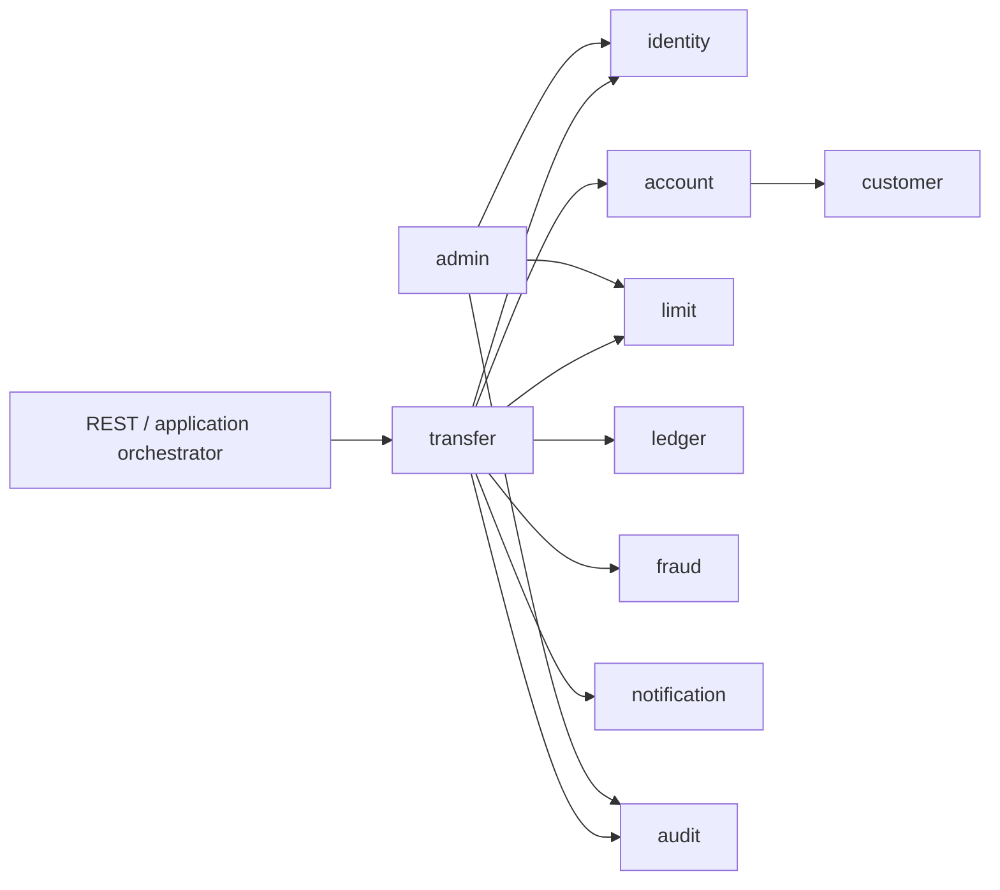

# 05. Hợp đồng giao tiếp giữa các module

> **Dự án:** Digital Banking MVP — Single-Bank, Core Simulated
> **Mã tài liệu:** `DESIGN-MOD-05`
> **Phiên bản:** v0.1
> **Ngày cập nhật:** 15/11/2026

## 1. Mục đích, phạm vi và cách đọc

Tài liệu xác định **provider, consumer, dữ liệu trao đổi, transaction, lỗi và cách kiểm chứng** cho các điểm tích hợp backend. Mục tiêu là cho phép các owner phát triển song song và phát hiện sai lệch sớm. Đây là hợp đồng **nội bộ trong một Spring Boot modular monolith**, không phải REST hay message contract giữa các microservice; HTTP công khai vẫn theo `07` và OpenAPI.

**Trạng thái nội dung:** Các bất biến gắn nguồn là baseline; tên operation, DTO, chữ ký và các chi tiết được đánh dấu **Đề xuất** là bản dự thảo để các owner chốt, không phải API đã triển khai hoặc đã được duyệt. `docs-common/01–11` ưu tiên hơn `design/`, sau đó mới đến `docs-backend/`; không tự chọn khi các nguồn `01–11` mâu thuẫn. Nếu `design/` khác nguồn cấp trên, ghi chênh lệch và chuyển owner xử lý; tài liệu này không sửa chính sách nghiệp vụ.

Cách dùng: owner đọc §2–§4, rồi tìm operation của module mình tại §5–§12; cùng consumer chốt DTO/lỗi và contract tests theo §13 trước khi code. §14 ghi quyết định mở và trách nhiệm. Những câu lệnh giả mã không phải class hoặc schema đã có.

## 2. Bản đồ module và quyền sở hữu

Nguồn: `06` §6.2–§6.3, §8.1; `04` §4. Một bảng có **một write-owner**; consumer không ghi trực tiếp, không truy cập repository/entity của provider. Read cross-module qua public API hoặc projection được khai báo và review; không join tùy tiện trong write path.

| Provider | Dữ liệu / chức năng sở hữu | Consumer chính | Contract |
|---|---|---|---|
| `identity` | user, role/permission, session, challenge | `transfer`, `admin`; security SPI tại `common` | §5 |
| `customer` | customer, hồ sơ/PII | `account`, `identity` khi cần ánh xạ, `admin` | §6 |
| `account` | account, ownership, status, materialized balance | `transfer`, `ledger` cho read, `admin` | §7 |
| `transfer` | transfer, idempotency; orchestration T0–T2 | adapter REST, composition đọc được phân công | §8 |
| `ledger` | ledger entries append-only | `transfer`, reconciliation/read do owner phân công | §9 |
| `limit` | limit config/usage | `transfer`, `admin` | §10 |
| `audit` | audit log, retention/legal hold | mọi owner cần audit, `admin` | §11.1 |
| `fraud` | rule config, flag | `transfer`, `admin`/ops theo quyền | §11.2 |
| `notification` | notification/outbox, delivery | `transfer`; `identity` dùng gateway OTP theo hợp đồng riêng | §11.3 |
| `admin` | approval request, điều phối maker/checker | REST/ops; gọi provider identity, limit, audit | §12.1 |
| `common` | error, context, crypto, Clock, security infrastructure; **không có business table** | mọi module | §12.2 |

Dependency đi **từ consumer tới `<provider>.api`**; `common` không import business; identity/customer/account không phụ thuộc transfer; business không phụ thuộc admin. Ledger/fraud/notification không import `transfer.api` để callback khi Transfer đã gọi chúng: Transfer truyền facts bằng DTO do **provider** sở hữu. Với query cần tổng hợp, caller ở lớp điều phối ghép projection, hoặc thiết kế read model được phê duyệt; không tạo cycle. `ModuleBoundaryArchTest` hiện kiểm tra cycle ở cấp module và một số rule khác; chưa coi đó là bằng chứng mọi import ngoài `api` đã được enforce.

Sơ đồ chỉ thể hiện chiều dependency điển hình, không khẳng định mọi interface đã tồn tại hoặc cho phép cycle bổ sung. `common` được mọi module sử dụng nhưng không vẽ các cạnh để dễ đọc.

## 3. Quy ước hợp đồng chung

### 3.1. Package, kiểu và bảo mật

- Interface và input/output nội bộ đặt trong `com.simulatedbank.banking.<provider>.api`; implementation ở `application`/`adapter/out`. Module khác không import `application`, `domain`, `adapter` hay JPA entity của provider. Trường hợp SPI kỹ thuật đã có ở `common` được ghi riêng tại §5.1.
- DTO là immutable record/value type, tách REST DTO/entity; không trả `Object`, lazy proxy hay mutable entity. Các chữ ký dưới đây là **pseudo-Java**, tên/bao bì cụ thể cần hai owner duyệt; không sao chép nguyên enum/error HTTP vào mọi module.
- `Id` biểu diễn định danh nội bộ có kiểu rõ ràng; mapping HTTP string ↔ DB BIGINT theo `04`/`07`. Giá trị tiền dùng `BigDecimal` tối đa 2 decimal, VND; amount transfer phải > 0, balance/usage/remaining có thể bằng 0, còn delta có dấu chỉ khi operation quy định rõ; không dùng `double`. Timestamp là `Instant` UTC; business date theo policy được chốt. Không trộn `userId`, `customerId`, `accountId` hay reference.
- `ActorContext` **đề xuất**: `actorType`, `userId?`, `customerId?`, permission snapshot cần thiết, `correlationId`, `requestId`; do server tạo từ principal và request context, không tin body client. Job dùng actor SYSTEM. Không truyền raw session token, OTP, full account number hay raw idempotency key qua DTO/log nếu không thật sự cần. Challenge binding có thể cần key; chỉ identity/transfer xử lý, không log.
- Mỗi provider kiểm tra precondition/ownership trong phạm vi mình phụ trách; permission tại endpoint không thay service-level scope. Projection chỉ trả field tối thiểu; `AccountRef` hiển thị masked/last4, không trả encrypted blob/hash. Giao tiếp nội bộ không tự động đồng nghĩa quyền truy cập dữ liệu của người dùng.

### 3.2. Transaction và lỗi

| Ký hiệu | Yêu cầu đối với operation | Failure/điểm kiểm tra |
|---|---|---|
| **R** | Read; không tạo side effect. Dữ liệu trước lock có thể stale. | Không dùng kết quả preflight thay authoritative check dưới lock. |
| **OWN** | Provider mở transaction ngắn riêng cho use case độc lập, không giữ qua request/chờ user/network. | Không gọi từ T2 nếu nó tách commit khỏi transaction tiền. |
| **JOIN** | Phải tham gia transaction caller hiện tại, cùng datasource/transaction manager; không `REQUIRES_NEW`/commit riêng. | Đề xuất fail fast khi không có transaction (`MANDATORY`) ở các operation bắt buộc T1/T2; xác nhận wiring thực tế. `REQUIRED` chỉ an toàn nếu caller thực sự đã mở transaction. |
| **AFTER** | Delivery sau transaction nghiệp vụ commit; worker dùng transaction claim/lease riêng. | Gọi gateway ngoài lock; at-least-once, xử lý retry/trùng. |

Business rejection là outcome có kiểu, được caller map về catalog `07`; không mặc định throw exception gây rollback khi contract yêu cầu commit `FAILED`. Lỗi DB/technical, invariant hoặc audit C1/C2 phải lan ra để transaction rollback; không bắt rồi tiếp tục trong transaction đã bị đánh dấu rollback-only. Các tên lỗi trong bảng là **nhóm lỗi nội bộ**, không tự tạo HTTP code mới. `common`/adapter chịu trách nhiệm map public Problem theo `07` và không lộ SQL/stack/PII. C3 failure không làm mất quyết định từ chối; fallback security log + metric + alert theo `design/01`.

### 3.3. Định dạng ví dụ contract

Trong §5–§12, mỗi operation ghi `Provider ← Consumer`, `Input → Output`, `TX`, precondition/side effect và lỗi. Dấu `?` là nullable; danh sách field là **tối thiểu đề xuất**, không cho phép giả định provider đã thực hiện đầy đủ. `correlationId`/`requestId` có thể được truyền qua `ActorContext`, nhưng phải được kiểm chứng qua ranh giới thread/job; không dựa vào thread-local sau async.

## 4. Luồng phối hợp chuẩn và điểm tích hợp

| Pha | Ai điều phối | Contract chính | Ranh giới và bằng chứng |
|---|---|---|---|
| Preflight/T0 | Transfer + Identity | Session, resolve account, usage tham khảo, challenge | `428` trước transfer/idempotency/ledger; user verify challenge ngoài DB transaction. |
| T1 | Transfer | consume challenge + create PENDING/idempotency + audit CREATED | Một transaction ngắn; insert transfer trước idempotency FK; thua unique rollback tất cả và đọc lại ngoài transaction. |
| T2 | Transfer | lock transfer → account ASC → limit customer/account → fraud → money/ledger/usage → outbox/status → audit | Một PostgreSQL transaction, READ COMMITTED; audit bắt buộc cuối; không network. |
| T3 | Notification | claim/lease outbox → gateway → cập nhật kết quả | Sau commit T2, retry không đổi transfer. |
| Recovery | Transfer | lock PENDING + ledger/audit evidence + cùng T2 executor | `SKIP LOCKED` và xử lý một candidate cùng transaction; không tạo ledger kép. |
| Approval | Admin | identity step-up + identity/limit apply + audit | Maker khác checker; apply và approval state/audit cùng transaction theo use case. |

`COMPLETED` chỉ sau T2 commit, đúng hai ledger entries cân bằng và audit bền vững. Business failure đã có T1 có thể được commit `FAILED` theo `design/02`; system/audit failure rollback T2 và giữ `PENDING`. Các khác biệt với AC-006/AC-012 và rủi ro step-up được ghi ở §14, không coi đã được phân xử. Không retry từng statement sau SQL error: chỉ retry toàn bộ transaction mới, có giới hạn và chỉ khi operation an toàn/idempotent.

## 5. Provider `identity`

Nguồn: `03` FR-001–007, FR-026, AC-033; `06` §7.1; `07` §3, §6; `design/02` §5.1–§5.2.

### 5.1. Session SPI đã tồn tại

`common.config.SessionAuthenticator.authenticate(String opaqueToken) → Optional<Session>` là interface **đã có trong source**; identity cung cấp implementation. `Session` hiện gồm `userId`, `customerId?`, `authorities`, `csrfTokenHash`; `toString()` redacted. Provider kiểm tra token/session/user active, expiry/revocation và permission snapshot theo policy; invalid trả empty, DB/system failure không giả thành login hợp lệ. Không log token hoặc hash CSRF. `common` chỉ biết SPI, không import identity; test phải chứng minh wiring identity thật, expiry/revocation và CSRF. Không tạo interface trùng để thay SPI này.

### 5.2. Step-up challenge — Đề xuất `identity.api.StepUpChallengePort`

| Operation / consumer | Input → Output | TX và hành vi | Lỗi / consumer xử lý |
|---|---|---|---|
| `requestChallenge` ← Transfer/Admin | `purpose`, actor/user, binding (`requestHash`, `idempotencyKey` cho transfer hoặc action binding cho admin), correlation → `challengeRef`, method, expiry, thông tin hiển thị an toàn | **OWN/T0**; tạo challenge theo policy; dispatch OTP/FIDO theo gateway identity sau transaction; không tạo transfer/ledger. Không trả OTP. | Dispatch lỗi theo `07`; invalidate/đánh dấu challenge theo policy; không đi tiếp T1. |
| `verifyChallenge` ← identity adapter | challengeRef + credential → `VERIFIED`/rejection | **OWN/T0**; lock, verify user/purpose/expiry/attempt, cập nhật atomic và audit theo class. | Sai/hết hạn/locked map theo catalog auth; không lộ credential. |
| `consumeVerified` ← Transfer/Admin | challengeRef, actor, purpose, binding → `ConsumedChallenge(challengeId)` | **JOIN/T1 hoặc approval**; lock row, khớp user/purpose/hash/key, `VERIFIED`, chưa consume, chưa hết hạn; consume tối đa một lần; rollback caller hoàn lại consume. | Mismatch/expired/already consumed là business rejection theo `07`; không tạo side effect tiền. T2 không yêu cầu verify lại chỉ vì challenge hết hạn sau T1 commit. |

**Contract tests:** cùng challenge bị hai transaction consume chỉ một thắng; sai user/hash/key/purpose, hết hạn, max attempts; rollback T1 trả challenge về trạng thái trước consume; challenge được xác thực lại/retry theo policy. Kiểm tra `428` không có transfer/idempotency/ledger. Policy trigger/serialization của step-up lũy kế chưa chốt (§14).

### 5.3. Role/session command — Đề xuất `identity.api.IdentityRoleCommand`

`applyApprovedRoleChange(approvalId, targetUserId, roleChange, expectedVersion, actorContext) → RoleChangeResult` ← Admin; **JOIN** cùng approval transaction. Identity xác thực target, quyền, version và transition; cập nhật bảng identity, xử lý revoke session theo policy; admin giữ maker/checker và approval state. Không import `admin` DTO/entity vào identity; `approvalId` là ID và input được kiểm tra. Stale version/invalid state là business conflict; lỗi DB/audit C2 rollback cả approval và thay đổi. Kiểm thử maker/checker, stale approval, revoke và rollback. Vai trò, permission, quy tắc revoke chi tiết theo `07` và owner Identity/Admin chốt.

## 6. Provider `customer` — Đề xuất `customer.api.CustomerQuery`

Nguồn: `03` FR-008–011, FR-039; `06` §6.2; `07` §3.6, §8.2.

| Operation / consumer | Input → Output | TX / điều kiện | Lỗi / test contract |
|---|---|---|---|
| `findByUserId` ← Identity/Account | userId → `Optional<CustomerIdentity(customerId, userId, status, kycStatus)>` | **R**; chỉ snapshot tối thiểu, không full PII. Identity cần mapping phải xác nhận hướng dependency không tạo vòng. | Không thấy khác lỗi DB; test inactive/KYC, mapping nhất quán. |
| `getCustomerView` ← Account/Admin | customerId + actor/scope → masked profile theo quyền | **R**; service consumer và provider phân định rõ ai kiểm ownership/permission; không trả national ID đầy đủ. | Not found/forbidden không lộ PII; test cross-customer và staff scope. |

Không giả định mọi transfer cần điều kiện KYC bổ sung ngoài SRS/policy đã duyệt. Nếu Identity cũng cần gọi Customer, Customer không import ngược Identity; identity ID là value, không là identity entity. Mã hóa, blind index và masking thuộc owner customer qua common primitives.

## 7. Provider `account`

Nguồn: `03` FR-012, FR-015; `04` §4.3; `06` §8.1–§8.3; `design/02` §5.3, Appendix A.

### 7.1. Read — Đề xuất `account.api.AccountQuery`

| Operation / consumer | Input → Output | Điều kiện / lỗi / test |
|---|---|---|
| `resolveDestination` ← Transfer | `accountId` **hoặc** accountNumber → `AccountSnapshot(accountId, customerId, status, currency, maskedNumber, last4)` | **R**; number normalize/HMAC lookup do account sở hữu, không log số đầy đủ; trả not-found/inactive an toàn. Kết quả preflight không thay kiểm tra T2. |
| `getAccountView` / `assertOwnership` ← Transfer/Ledger/Admin | accountId + actor/customer scope → masked projection hoặc kết quả từ chối | **R**; kiểm quyền/ownership và customer scope; test source không thuộc customer, staff thiếu quyền và account không tồn tại. |

### 7.2. Money — Đề xuất `account.api.AccountBalance`

Tất cả operation dưới đây **JOIN T2**, cùng connection/transaction; caller đã lock transfer, account provider lock cả hai theo `accountId ASC`. `LockedAccount` chỉ là snapshot/ID có hiệu lực **trong transaction hiện tại**, không được cache hoặc xem như lock token sau commit.

| Operation | Input → Output | Side effect / lỗi phải xử lý |
|---|---|---|
| `lockTransferAccounts` | sourceId, destinationId → `LockedAccounts(source, destination)` gồm ID, owner, status, currency, balances | `SELECT … ORDER BY account_id FOR UPDATE`; reject cùng ID/không tồn tại; caller/provider phối hợp re-check source owner và cả hai ACTIVE/currency. Timeout/deadlock là technical, rollback/retry toàn transaction. |
| `debitConditional` | locked sourceId, amount → `DebitResult(balanceAfterAvailable, balanceAfterLedger)` hoặc `Insufficient/Inactive` | Conditional update `available_balance >= amount` và ACTIVE, kiểm affected rows. `0 rows` chưa có debit → business result sau xác định nguyên nhân; không âm. |
| `credit` | locked destinationId, amount → `CreditResult(balanceAfterAvailable, balanceAfterLedger)` | Sau debit đã thành công mà credit bất thường/0 rows → **system error**, rollback toàn T2; không commit FAILED trong cùng transaction đang có debit. |

Cả available và ledger balance cập nhật theo mô hình `04`; Ledger nhận `balanceAfter` từ kết quả Account, không tự ghi bảng account. Test trên PostgreSQL: A→B/B→A, cùng nguồn vượt balance, status đổi giữa preflight/T2, failure sau debit, isolation và tổng số dư; thứ tự lock giảm deadlock chứ không bảo đảm không bao giờ xảy ra.

## 8. Provider `transfer`

Nguồn: `03` FR-013–026; `07` §5, §8.3; `design/02` §5–§6, §10. Transfer là **orchestrator**, sở hữu `transfer` và `idempotency_record`, không chuyển write ownership sang consumer.

### 8.1. Các use case application — Đề xuất

| Operation / consumer | Input → Output | Transaction / lỗi |
|---|---|---|
| `createTransfer` ← Transfer REST adapter | actor + `CreateTransfer(sourceId, destination, amount, currency, description)` + idempotency key → `Completed/Failed/StepUpRequired/InProgress/Replay` | Không có outer transaction bao T0–T2. Orchestrator gọi T1/T2 qua bean/transaction boundary thực sự; HTTP adapter map theo `07`. |
| `getByReference` ← adapter/composition được phân quyền | reference + actor/scope → masked `TransferView(reference,status,amount,currency,accounts,timestamps,correlationId)` | **R**; customer tham gia transfer hoặc staff có quyền/scope; không trả fraud flags cho customer; not-found/forbidden theo `07`. |
| `reconcileOne` ← scheduler/ops được phép | system context + candidate → `Skipped/Resolved/Incident` | Claim `FOR UPDATE SKIP LOCKED` và xử lý cùng transaction; ledger/audit evidence đủ và quyết định §14 được chốt. Không cho provider Ledger/Fraud/Notification callback Transfer tạo cycle. |

### 8.2. Idempotency và binding

Theo `07` §5: key global, 1–255 ký tự, cùng key/hash terminal replay status/body gốc, khác hash hoặc actor bị từ chối không lộ kết quả; key PENDING đang khóa → `409 IDEMPOTENCY_IN_PROGRESS` + `Retry-After`. `design/02` đề xuất resume T2 nếu lock rảnh, cần thống nhất với consumer. Normalize object gồm customerId, source ID, destination type/value, amount 2 decimals, currency uppercase, description trim/null→rỗng; SHA-256 UTF-8 JCS. T1 insert transfer rồi idempotency theo FK, unique thua rollback T1 trước khi đọc lại. Chỉ lưu response terminal đã mask; không replay 5xx tạm. Sau purge, key có thể tạo request mới: không hứa chống trùng vĩnh viễn. `07` replay 201/422 nhưng OpenAPI có 200 replay; đồng bộ theo nguồn `07` qua owner API/FE (§14).

**Contract tests:** same-key concurrent một transfer/debit; khác payload/actor không lộ kết quả; replay 201/422; crash trước/sau T1/T2; ownership query; TTL và purge không xóa PENDING. Chi tiết `T-IDEM-01–06`, `T-REC-01–04` trong `09` §7.

## 9. Provider `ledger` — Đề xuất `ledger.api.LedgerPosting` và `LedgerQuery`

Nguồn: `03` FR-019–020, AC-012; `04` §4.4.2; `06` §8.4; `design/02` §5.3, §10.

| Operation / consumer | Input → Output | TX / bảo đảm / lỗi |
|---|---|---|
| `postDoubleEntry` ← Transfer | `PostingCommand(transferId, sourceId, destinationId, amount, currency, sourceBalanceAfter, destinationBalanceAfter, correlationId)` → `PostingRef(debitEntryId, creditEntryId)` | **JOIN T2**; đúng 2 dòng append-only seq 1 DEBIT nguồn, seq 2 CREDIT đích, cùng amount/currency; unique `(transfer_id,entry_seq)`. Không tự update account, không commit riêng. Duplicate/partial/constraint sau claim là invariant/system error, rollback T2; không mặc định coi unique violation là thành công. |
| `findEvidence` ← Transfer reconciliation | transferId → `LedgerEvidence(entries)` gồm entry ID, seq, type, account ID, amount/currency, balanceAfter | **R**, dùng transaction reconciliation nếu cần tính nhất quán; trả dữ kiện đủ phân biệt không có/đủ/thiếu/lệch, không chỉ boolean. Không tự sửa/delete ledger. |
| `listAccountEntries` ← adapter/read composition có quyền | accountId + paging/filter + actor scope → masked entry projections + page | **R**; ownership được kiểm theo `07`, whitelist sort/filter; không lộ entity/PII. Consumer chịu trách nhiệm composition với account khi cần. |

**Contract tests:** hai entry đúng phía/tổng, duplicate/partial không commit, rollback sau insert, evidence mismatch và không update/delete. Dùng PostgreSQL thật; cân bằng và số dư chỉ được chứng minh khi Account + Ledger cùng T2.

## 10. Provider `limit`

Nguồn: `03` FR-016, FR-031; `04` §4.5; `06` §8.3; `design/02` §5.3, §9.

| Operation / consumer | Input → Output | TX / điều kiện / lỗi |
|---|---|---|
| `getUsageSnapshot` ← Transfer/limit adapter | customerId, accountId, business date/context → `UsageView(used,remaining,configVersion,date)` | **R**; số liệu hiển thị/preflight có thể stale, không bảo đảm ngưỡng step-up khi concurrency. Date/timezone và cấu hình phải thống nhất. |
| `lockAndCheck` ← Transfer | customerId, sourceId, amount, currency, businessDate → `LimitDecision(allowed, usageRef, effectiveConfigVersion, reason?)` | **JOIN T2** sau account lock; upsert/lock usage CUSTOMER rồi ACCOUNT khi áp dụng; kiểm cả per-transaction/daily theo policy. `LIMIT_EXCEEDED` là business result trước ghi tiền. UsageRef chỉ dùng trong transaction hiện tại. |
| `incrementUsage` ← Transfer | `usageRef`, amount → `UsageAfter` | **JOIN T2**, chỉ sau money/ledger thành công; rollback cùng T2; không increment FAILED. Không dùng preflight snapshot để cộng. |
| `applyApprovedLimitChange` ← Admin | approvalId, scope, giới hạn mới, expectedVersion, actor → `ConfigApplied(id,version)` | **JOIN approval TX**; limit sở hữu validation/version/transition config; admin sở hữu approval, permission và maker/checker. Stale/mismatch → conflict; audit C2 fail rollback cả hai. |

**Contract tests:** concurrent cùng customer trên nhiều account không vượt daily limit, customer lock trước account, rollback usage khi audit/ledger fail, business-date boundary và stale config; maker/checker, duplicate approval và version conflict. Không khẳng định ngưỡng 20 triệu hay timezone là policy release nếu chưa chốt.

## 11. Provider `audit`, `fraud`, `notification`

### 11.1. Audit — `audit.api.AuditModuleApi`

Nguồn: `03` FR-034–038, AC-034; `design/01` §4.3–§4.4, §6; `design/02` §5.3. `design/01` đã định nghĩa tên operation ở mức thiết kế; implementation runtime business chưa có. Interface nhận **AuditEvent do audit sở hữu**, không import DTO của module gọi.

| Operation / consumer | Input → Output | TX / lỗi |
|---|---|---|
| `recordInTransaction` ← mọi business module | `AuditEvent` → `AuditRecordRef` | **JOIN**, `MANDATORY`; C1/C2 trong transaction nghiệp vụ; validate catalog/allowlist, append/hash chain; lỗi ném ra → rollback nghiệp vụ. Với T1/T2 audit phase cuối sau các thay đổi khác và trước commit. |
| `recordStandalone` ← caller cần C3 | `AuditEvent` → `Optional<AuditRecordRef>` | Transaction riêng `REQUIRES_NEW`, best-effort theo `design/01`; thất bại ghi security fallback log + metric + alert, không đảo quyết định deny/revoke; không dùng thay C1/C2. Không tự giả định có thể ghi FK tham chiếu dữ liệu chưa commit của caller. |
| `search/get` ← admin/audit adapter | actor + permission/scope + filter/page → masked result | **R** cho truy vấn; audit kiểm quyền/data scope theo `07`; security audit khi bị từ chối theo policy, không lộ raw payload/secret. |
| `export` ← admin/audit adapter | actor + scope + filter/format → masked export | Kiểm quyền và tạo file; ghi `AUDIT_EXPORTED` C2 bền vững trong transaction riêng **trước** trả file; nếu audit lỗi không trả file. Export có side effect audit, không phân loại toàn operation là R. |
| `findTransferCompletionEvidence` ← Transfer reconciliation | transferId/reference + correlation/context → evidence tối thiểu (action, outcome, linkage) hoặc absent | **R**, cùng transaction reconciliation khi cần; mismatch phải nhận diện được, lỗi DB không coi là absent. Chỉ trả field cần thiết, không raw payload; chưa suy tìm thấy là đủ để tự COMPLETED khi MOD-OI-03 chưa chốt. |

`AuditEvent` tối thiểu: `action`, `actorType`, `actorUserId?`, `actorRole` snapshot, `entityType`, `entityId`, `beforeState?`, `afterState?` allowlist/masked, `amount?`, `currency?`, `outcome`, `correlationId`, `requestId`, `occurredAt`, `clientInfo?` đã mask. Truyền đủ identity/trace, không truyền password/OTP/session token/full account/raw key; audit là owner chuẩn hóa/hash chain, không phải log kỹ thuật.

**Nhiều audit event trong T2:** `FRAUD_FLAG_CREATED` là C2, `TRANSFER_COMPLETED/FAILED` là C1. Fail-open của fraud không được nuốt lỗi audit C2. Audit/Fraud/Transfer cần chốt cách gom event đã được validate và ghi **cuối T2**, C2 trước completion, cùng transaction và lock chain, hoặc phương án khác đáp ứng cả hai yêu cầu; batch API chỉ là **đề xuất** (§14), không khẳng định đã tồn tại. Không ghi completion trước khi các thay đổi tiền/outbox/status hoàn tất. Test audit C1/C2 fail rollback, concurrent chain, fallback C3 và không giữ audit lock xuyên money path.

### 11.2. Fraud — Đề xuất `fraud.api.FraudEvaluation`

Nguồn: `03` FR-044–048, AC-026; `design/03` §4–§8; `design/02` §5.3, §9.4.

`evaluateTransfer(FraudFacts) → FraudDecision` ← Transfer, **JOIN T2**, in-process sau account/limit lock. `FraudFacts` do fraud sở hữu gồm `transferId`, `customerId`, source/destination ID, amount/currency, event time, thông tin rule tối thiểu và correlation; không import `Transfer` entity/DTO. `FraudDecision` đề xuất `ALLOW`, `BLOCK` hoặc `ENGINE_ERROR` (chỉ sau khi đã rollback phần engine qua savepoint an toàn), danh sách flag với `ruleCode`, `ruleVersion`, severity, và thông tin audit cần thiết; flag có thể đi cùng ALLOW. Fraud sở hữu `fraud_rule_config`/`fraud_flag`, unique theo `04` §4.7.2 `(transfer_id, rule_code, rule_version)`. Không tự debit hay sửa transfer/limit.

- Rule match theo config → lưu flag cùng T2; chỉ auto-block khi policy được bật. BLOCK là business outcome; Transfer hoàn tất nhánh FAILED không ledger/usage.
- Engine lỗi kỹ thuật được **fail-open** theo nguồn: cô lập bằng savepoint có khả năng phục hồi transaction thực sự, rollback phần đánh giá lỗi, trả `ENGINE_ERROR` cho caller để log/metric/audit C4 theo policy; không bắt exception rồi tiếp tục nếu transaction đã rollback-only. Không fail-open cho lỗi audit bắt buộc C1/C2 hoặc invariant tiền.
- Rule/version, count window, thời gian và phương án fraud review/reservation đang mở; không tự thêm trạng thái transfer mới hay áp rule đề xuất như policy đã chốt.
- **Contract tests:** ALLOW có/không flag, BLOCK, engine exception + savepoint trên PostgreSQL, lỗi audit flag → rollback T2, rule version/unique, race count theo policy. Không mock chứng minh savepoint/transaction.

### 11.3. Notification / OTP gateway

Nguồn: `03` FR-041–043; `04` §4.8; `06` §7.5–§7.6; `design/02` §5.4, §10–§11.

| Operation / consumer | Input → Output | TX / side effect / lỗi |
|---|---|---|
| `enqueueTransferOutcome` ← Transfer | `NotificationCommand(transferId, reference, customerId/recipient, outcome, amount, currency, maskedAccountRefs, templateType, correlationId)` → outbox ref | **JOIN T2**; notification sở hữu insert `notification`/masked payload, không gọi gateway. Persist fail → rollback T2; không log PII. Cả outcome thành công/thất bại theo policy/template đã chốt. |
| `deliverClaimed` ← worker notification | outbox ID + lease → gateway result `SENT/RETRYABLE/PERMANENT_FAILURE` | **AFTER** commit; claim/lease ở transaction ngắn, gateway ngoài lock, update kết quả sau đó; retry/backoff/alert, at-least-once; provider dedupe key theo thỏa thuận. Lease/dedupe và schema/migration tương ứng là đề xuất cần owner/Ops chốt, không giả định cột đã tồn tại trong `04`. Gateway lỗi không đảo tiền. |
| `sendOtp` ← Identity qua gateway port | challenge reference, destination an toàn, OTP tạm thời, expiry → accepted/retryable/failed | **Sau T0 commit, ngoài transaction**, không log/lưu plaintext OTP trong outbox. Tracking masked không thể khôi phục OTP; policy crash/resend/expiry và sinh lại thuộc Identity/Security (§14). Dispatch failure không tạo transfer. |

`NotificationCommand` là DTO notification sở hữu, không chứa entity Transfer hay account number đầy đủ. Việc provider nhận/gửi OTP tạm thời cần security review, thời gian tồn tại ngắn, không giả định retry worker có thể đọc lại OTP đã hash. **Contract tests:** commit outbox cùng T2, rollback khi insert lỗi, gateway fail/crash sau send, lease/multi-worker, trùng notification và masking; OTP dispatch failure/expiry/resend theo policy.

## 12. `admin`, `common` và các luồng đọc

### 12.1. Admin là orchestrator approval

Nguồn: `03` FR-032–033, FR-049–051, AC-028; `04` §4.5.3; `06` §8.1; `07` §3, §8.

Admin sở hữu `approval_request` và endpoint điều phối; identity/limit sở hữu dữ liệu được thay đổi. Interface nội bộ đề xuất cho admin adapter: `propose(change, actor) → ApprovalRef`, `approve(approvalId, expectedVersion, checker, challenge) → ApprovalResult`, `reject(approvalId, reason, checker) → ApprovalResult`. Các DTO thuộc `admin.api`, không được provider identity/limit import. Các trạng thái phải theo `04` (`PENDING`, `APPROVED`, `REJECTED`, `APPLIED`, `CANCELLED`) và transition cụ thể theo use case, không tự thêm trạng thái từ overview.

1. Kiểm permission, actor/scope, maker ≠ checker và step-up theo `07`; lock approval và re-check trạng thái/version.
2. Trong cùng transaction, gọi `identity.consumeVerified` nếu cần, gọi `limit.applyApprovedLimitChange` hoặc `identity.applyApprovedRoleChange` bằng input provider-owned, cập nhật approval/applied timestamp, ghi C2 audit cuối và commit. Không provider ghi bảng approval hoặc gọi ngược admin.
3. Reject không áp dụng thay đổi. Stale, đã xử lý hoặc maker=checker trả lỗi catalog phù hợp; lỗi audit/DB rollback toàn bộ. Test concurrent checker, duplicate/stale approval, revoke session, rollback và denied security audit.

### 12.2. Common là nền một chiều

Nguồn: `06` §6.2–§6.3; [[digitalbanking-docs/docs-backend/modules/common/CURRENT-STATE.md]]. Common hiện cung cấp `SessionAuthenticator` SPI, error/Problem, request context, `Clock`, JCS/SHA/HMAC, masking/crypto, security filters và HTTP telemetry. Owner nghiệp vụ tự normalize business payload, quyết định data scope, gọi crypto và xây audit facts; common không sở hữu business persistence/transaction hay import business module. Không thay password hashing bằng SHA/HMAC.

`RequestContext` phải được copy có chọn lọc vào command/job, làm sạch MDC sau request; không dùng correlation ID làm metric label. `RequestRateLimitFilter` hiện là in-process: không suy ra quota phân tán/customer trong multi-instance; wiring với identity thật cần integration test. Code common hoặc unit test của nó không chứng minh authorization/transaction của business module.

### 12.3. Query composition và history

`07` §8 và `06` §7.7 là nguồn endpoint, quyền, pagination; các owner xác định use case composition cụ thể khi implementation. Transfer trả projection transfer theo reference; Account trả masked account view; Ledger trả entry projection; module/adapter được giao điều phối gọi từng provider và kiểm quyền/scope trước khi ghép, không lộ entity và không bypass ownership. Không tạo `transfer → ledger → transfer` bằng cách cho ledger callback Transfer. Nếu history cần join/projection hiệu quả, ghi chủ sở hữu read model, cách cấp quyền, độ trễ và test; thiết kế projection này phải được hai owner/Architect review, không mặc nhiên cho phép cross-table write.

## 13. Quy trình làm việc độc lập và kiểm thử hợp đồng

### 13.1. Quy trình chốt một contract

1. Provider và consumer tạo/đối chiếu contract ID, operation, version, inputs/outputs/nullability, precondition, permission, transaction, lock order, error/outcome, idempotency, PII, test vectors và nguồn; liệt kê owner/reviewer và quyết định mở. Ví dụ: `account.lockTransferAccounts` có input 2 ID, output snapshot, **JOIN**, thứ tự ID, lỗi timeout, test A↔B.
2. Hai owner review và đồng bộ interface/DTO trong `provider.api` qua PR nhỏ trên shared branch; không khai báo mỗi team một bản DTO khác nhau hoặc import implementation. Xác nhận integration branch/build strategy với team; tài liệu này không giả định đã có multi-module artifact.
3. Provider có thể triển khai sau: consumer dùng fake/stub **chỉ ở test/dev**, có cùng signature và test vectors. Không đưa stub giả thành bean production để đóng dependency hay báo readiness; stub không giữ lock hoặc chứng minh rollback.
4. Provider chạy cùng contract suite trên implementation thật; khi sẵn sàng, ghép implementation, chạy integration và report. Consumer phải kiểm tra mapping rejection/system failure, provider kiểm side effect/ownership; cả hai cùng chịu trách nhiệm compatibility.
5. Thay đổi contract theo PR có consumer review, migration strategy/version và test. Đổi field bắt buộc, kiểu, nghĩa, lỗi hoặc transaction là breaking change; thêm field cũng cần kiểm serializer/consumer. Không silently đổi hành vi, không xóa contract cũ trước khi consumer migrate. Runtime là cùng deployable: version hợp đồng là quy trình source/build, không tự dựng remote version negotiation.

### 13.2. Bộ contract test tối thiểu

| Contract | Test dùng chung của consumer/provider | Bằng chứng integration bắt buộc |
|---|---|---|
| Identity session/step-up | Principal/permissions, invalid/expired/revoked; challenge bind/expiry/single-use | SessionAuthenticator thật; 2 transaction consume, rollback T1 và `AC-033`. |
| Customer/Account read | Projection, masked fields, owner/forbidden/not-found | DB lookup blind index, IDOR customer/staff, logs không PII. |
| Account money + Ledger | Input/output và kết quả conditional debit/credit/post | PostgreSQL độc lập connection: rollback sau debit/credit/ledger, ledger cân bằng, `T-CON-01–04`. |
| Limit | Allowed/rejected, config/date/version | Race cùng customer/tài khoản, usage lock/increment/rollback `T-LIM-*`. |
| Transfer idempotency | New/replay/conflict/in-progress, canonical vector | `T-IDEM-01–06`, 2 request cùng key, crash windows, trạng thái DB/ledger. |
| Audit | C1/C2 mandatory fail-closed; C3 fallback | `T-AUD-06/07`, audit C2 fraud flag, chain, crash/rollback, không lộ PII. |
| Fraud/Notification | Decision/outbox shape, engine lỗi vs block, gateway lỗi | Savepoint thật, outbox atomic, worker lease/retry và trùng `T-OUT-01/02`. |
| Admin | Maker/checker, stale, no double apply | Hai checker song song; rollback approval + config/role + audit. |
| Reconciliation | Evidence không có/đủ/thiếu/lệch, response/status | `T-REC-01–04`, multi-instance cùng transaction, manual/alert khi bằng chứng không an toàn. |

Unit và fake chạy nhanh, nhưng **không** chứng minh PostgreSQL lock, unique, savepoint, transaction propagation hay audit/ledger atomicity. Dùng Testcontainers PostgreSQL, connection độc lập, barrier/latch, kiểm DB + response; không H2/mock cho invariant. Evidence theo `09` §10: revision, lệnh, môi trường, test ID, kết quả và artifact synthetic không PII; dependency chưa sẵn sàng ghi **Blocked**. D1–D5, load và release gate vẫn theo `09`, không tự nhận đạt từ contract tests.

### 13.3. Handoff cho mỗi provider

- [ ] PR interface/DTO, owner và consumer đã review; mapping field/nullability, lỗi và security scope rõ.
- [ ] Transaction/lock và side effects rõ; provider không import ngược consumer, không ghi bảng chéo.
- [ ] Test vectors/fake và provider contract suite dùng cùng oracle; README mô tả cách chạy.
- [ ] Integration thật với dependency, migration, rollback/concurrency và evidence; phần chưa có ghi Blocked với owner/ngày theo dõi.
- [ ] Các thay đổi breaking có kế hoạch phối hợp, test và cập nhật tài liệu nguồn; không tự sign-off thay module khác.

## 14. Open issues và quyết định cần phối hợp

Các mục sau chưa phải quyết định đã phê duyệt. Chủ trì/những bên tham gia là **đề xuất**, cần xác nhận theo kế hoạch nhân sự hiện hành.

| ID | Câu hỏi và rủi ro | Người phối hợp / điều kiện đóng |
|---|---|---|
| MOD-OI-01 | **P0:** hai transfer key khác nhau cùng kiểm tra tổng ngày ở T0 có thể cùng dưới ngưỡng rồi vượt sau T2; recheck sau T1 không tự đáp ứng `428` không tạo transfer. | Identity + Limit + Transfer + Architect + BA chốt policy/protocol serialization hoặc reservation, contract và concurrent test trước release. |
| MOD-OI-02 | `03` AC-006 nói thiếu số dư/inactive không tạo transfer; `design/02` §5.3 có FAILED nếu điều kiện đổi sau T1. `03` AC-012 và nhánh credit lỗi technical trong `design/02` cũng cần oracle thống nhất. | BA + QA + Architect + Account/Transfer phân xử và đồng bộ nguồn; test cả preflight, race và credit failure. |
| MOD-OI-03 | `09` T-REC-02 yêu cầu hoàn tất PENDING có đủ ledger/audit không duplicate; `design/02` §10.3 cũng coi ledger/PENDING là incident. | Transfer + Ledger + Audit + Ops chốt evidence, atomic status/idempotency/response và runbook; trước đó giữ nguyên/alert, không sửa ledger. |
| MOD-OI-04 | Idempotency key global và status replay theo `07`; overview Transfer mô tả scope/key khác, OpenAPI khai báo 200 replay thay status gốc. TTL ≥ 24h là đề xuất, sau purge có thể phát sinh giao dịch mới. | API/Transfer/FE/QA đồng bộ nguồn và OpenAPI; BA/Product chốt TTL, client retry/query và rủi ro sau purge. |
| MOD-OI-05 | C2 `FRAUD_FLAG_CREATED` và C1 completion phải cùng transaction, audit chain lock cuối; batch/audit event staging chưa có interface chốt. | Audit + Fraud + Transfer thống nhất thứ tự, API, rollback và test đồng thời; không dùng fail-open để nuốt lỗi C2. |
| MOD-OI-06 | Ngưỡng/config version, business date/timezone, fraud count window, rule/version, scheduler retry và multi-instance có open issues `OI-CON-05–12`/`design/03`. | Limit + Fraud + BA + Backend/Ops chốt từng policy, version và test trước AC phụ thuộc; không hard-code giá trị đề xuất. |
| MOD-OI-07 | Gateway OTP cần secret tạm thời sau commit; crash/resend mà không lưu plaintext, invalidate challenge và notification duplicate/lease schema cần thiết kế. | Identity + Notification + Security + Product chốt lifecycle, retry, gateway contract và test; masked notification record không chứa OTP để gửi lại. |
| MOD-OI-08 | Replay body correlation gốc/header request mới là `OI-CON-13`; quyền staff, đọc chéo history/projection và ownership ở từng bước cần chốt cách chia trách nhiệm. | API + FE + Security + chủ read model/consumer chốt và contract test. |
| MOD-OI-09 | Tên/chữ ký, result type, error taxonomy nội bộ, versioning và enforcement boundary còn là đề xuất; batch audit chưa có runtime. | Từng provider + consumer + Architect review và duyệt PR interface/test trước implementation bị phụ thuộc; không xem tài liệu Draft là sign-off. |

## 15. Truy vết và mốc bàn giao

| Phạm vi | Yêu cầu / nguồn | Contract | Evidence |
|---|---|---|---|
| Auth/ownership/step-up | FR-001–007, FR-026; AC-024, AC-030, AC-033 | §5–§7 | Security + challenge tests §13 |
| Transfer/idempotency/ledger/limit | FR-012–026, FR-031; NFR-009–012; AC-006–013 | §4, §7–§10 | D1–D3, T-CON/T-IDEM/T-LIM/T-REC |
| Audit/correlation/fraud/notification | FR-034–039, FR-041–046; AC-022–026, AC-034 | §11 | T-AUD/T-OUT, fail-open/closed, trace |
| Maker/checker và integration | FR-032–033, FR-049–051; AC-028 | §5.3, §10, §12 | Concurrent approval, rollback, RBAC |

Thứ tự phối hợp đề xuất: chốt public DTO + test vectors chung trước; Identity/Customer/Account và common wiring có thể làm song song; ghép Transfer/Account/Ledger/Limit cho T1/T2; ghép Audit/Fraud/Notification; sau đó Admin, recovery, D1–D5. Đây là thứ tự dependency, không thay cam kết nhân sự/lịch ở `10`–`11`. Mỗi team có thể bắt đầu phần độc lập trước, nhưng không đánh dấu integration hoặc release **Verified** khi thiếu provider thật hay evidence tương ứng.

## Change Log

| Version | Ngày | Người cập nhật | Mô tả |
|---|---|---|---|
| 0.1 | 15/11/2026 | Codex | Dự thảo hợp đồng nội bộ, boundary, transaction, lỗi, test, phối hợp và quyết định mở; chờ owner review. |
