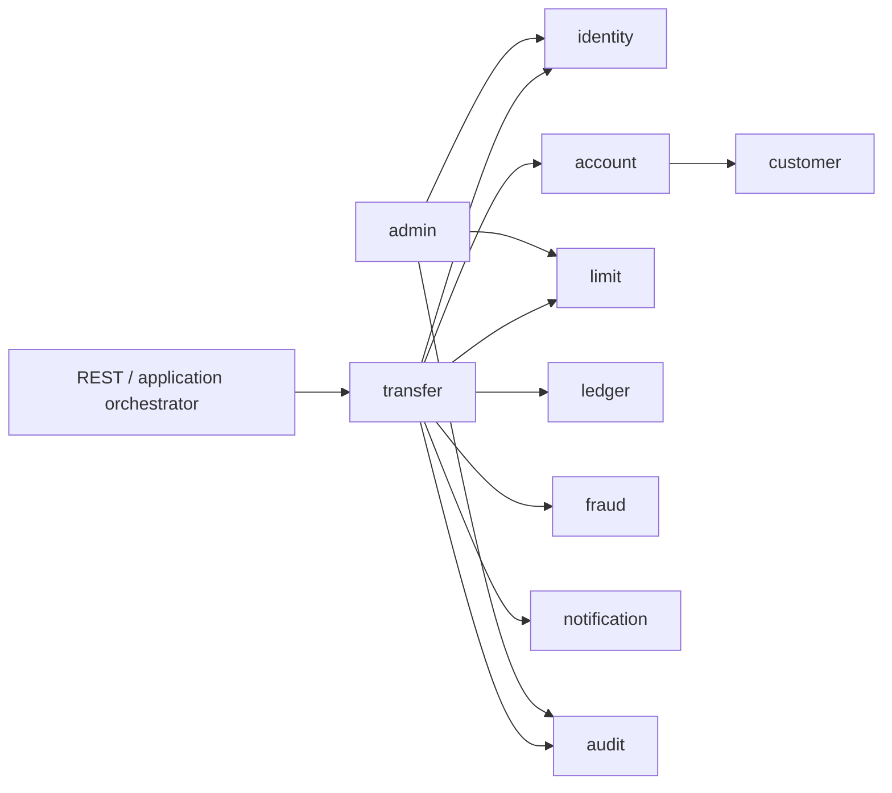

# 05. Hợp đồng giao tiếp giữa các module

> **Dự án:** Digital Banking MVP — Single-Bank, Core Simulated
> **Mã tài liệu:** `DESIGN-MOD-05`
> **Phiên bản:** v0.6 — baseline contract Transfer v1; integration chờ kiểm chứng
> **Ngày cập nhật:** 16/11/2026

## 1. Mục đích, phạm vi và cách đọc

Tài liệu xác định **provider, consumer, dữ liệu trao đổi, transaction, lỗi và cách kiểm chứng** cho các điểm tích hợp backend. Mục tiêu là cho phép các owner phát triển song song và phát hiện sai lệch sớm. Đây là hợp đồng **nội bộ trong một Spring Boot modular monolith**, không phải REST hay message contract giữa các microservice; HTTP công khai vẫn theo `07` và OpenAPI.

**Trạng thái nội dung:** Các bất biến gắn nguồn là baseline; tên operation, DTO, chữ ký và các chi tiết được đánh dấu **Đề xuất** là bản dự thảo để các owner chốt, không phải API đã triển khai hoặc đã được duyệt. `docs-common/01–11` ưu tiên hơn `design/`, sau đó mới đến `docs-backend/`; không tự chọn khi các nguồn `01–11` mâu thuẫn. Nếu `design/` khác nguồn cấp trên, ghi chênh lệch và chuyển owner xử lý; tài liệu này không sửa chính sách nghiệp vụ.

Cách dùng: owner đọc §2–§4, rồi tìm operation của module mình tại §5–§12; cùng consumer chốt DTO/lỗi và contract tests theo §13 trước khi code. §14 ghi quyết định mở và trách nhiệm. Những câu lệnh giả mã không phải class hoặc schema đã có.

## 2. Bản đồ module và quyền sở hữu

Nguồn: `06` §6.2–§6.3, §8.1; `04` §4. Một bảng có **một write-owner**; consumer không ghi trực tiếp, không truy cập repository/entity của provider. Read cross-module qua public API hoặc projection được khai báo và review; không join tùy tiện trong write path.

| Provider | Dữ liệu / chức năng sở hữu | Consumer chính | Contract |
|---|---|---|---|
| `identity` | user, role/permission, session, challenge | `transfer`, `admin`; security SPI tại `common` | §5 |
| `customer` | customer, hồ sơ/PII | `account`, `identity` khi cần ánh xạ, `admin` | §6 |
| `account` | account, ownership, status, materialized balance | `transfer`, `ledger` cho read, `admin` | §7 |
| `transfer` | transfer, idempotency; orchestration T0–T2 | adapter REST, composition đọc được phân công | §8 |
| `ledger` | ledger entries append-only | `transfer`, reconciliation/read do owner phân công | §9 |
| `limit` | limit config/usage | `transfer`, `admin` | §10 |
| `audit` | audit log, retention/legal hold | mọi owner cần audit, `admin` | §11.1 |
| `fraud` | rule config, flag | `transfer`, `admin`/ops theo quyền | §11.2 |
| `notification` | notification/outbox, delivery | `transfer`; `identity` dùng gateway OTP theo hợp đồng riêng | §11.3 |
| `admin` | approval request, điều phối maker/checker | REST/ops; gọi provider identity, limit, audit | §12.1 |
| `common` | error, context, crypto, Clock, security infrastructure; **không có business table** | mọi module | §12.2 |

Dependency đi **từ consumer tới `<provider>.api`**; `common` không import business; identity/customer/account không phụ thuộc transfer; business không phụ thuộc admin. Ledger/fraud/notification không import `transfer.api` để callback khi Transfer đã gọi chúng: Transfer truyền facts bằng DTO do **provider** sở hữu. Với query cần tổng hợp, caller ở lớp điều phối ghép projection, hoặc thiết kế read model được phê duyệt; không tạo cycle. `ModuleBoundaryArchTest` hiện kiểm tra cycle ở cấp module và một số rule khác; chưa coi đó là bằng chứng mọi import ngoài `api` đã được enforce.

Sơ đồ chỉ thể hiện chiều dependency điển hình, không khẳng định mọi interface đã tồn tại hoặc cho phép cycle bổ sung. `common` được mọi module sử dụng nhưng không vẽ các cạnh để dễ đọc.

## 3. Quy ước hợp đồng chung

### 3.1. Package, kiểu và bảo mật

- Interface và input/output nội bộ đặt trong `com.simulatedbank.banking.<provider>.api`; implementation ở `application`/`adapter/out`. Module khác không import `application`, `domain`, `adapter` hay JPA entity của provider. Trường hợp SPI kỹ thuật đã có ở `common` được ghi riêng tại §5.1.
- DTO là immutable record/value type, tách REST DTO/entity; không trả `Object`, lazy proxy hay mutable entity. Các chữ ký dưới đây là **pseudo-Java**, tên/bao bì cụ thể cần hai owner duyệt; không sao chép nguyên enum/error HTTP vào mọi module.
- `Id` biểu diễn định danh nội bộ có kiểu rõ ràng; mapping HTTP string ↔ DB BIGINT theo `04`/`07`. Giá trị tiền dùng `BigDecimal` tối đa 2 decimal, VND; amount transfer phải > 0, balance/usage/remaining có thể bằng 0, còn delta có dấu chỉ khi operation quy định rõ; không dùng `double`. Timestamp là `Instant` UTC; business date theo policy được chốt. Không trộn `userId`, `customerId`, `accountId` hay reference.
- `ActorContext` **đề xuất**: `actorType`, `userId?`, `customerId?`, permission snapshot cần thiết, `correlationId`, `requestId`; do server tạo từ principal và request context, không tin body client. Job dùng actor SYSTEM. Không truyền raw session token, OTP, full account number hay raw idempotency key qua DTO/log nếu không thật sự cần. Challenge binding có thể cần key; chỉ identity/transfer xử lý, không log.
- Mỗi provider kiểm tra precondition/ownership trong phạm vi mình phụ trách; permission tại endpoint không thay service-level scope. Projection chỉ trả field tối thiểu; `AccountRef` hiển thị masked/last4, không trả encrypted blob/hash. Giao tiếp nội bộ không tự động đồng nghĩa quyền truy cập dữ liệu của người dùng.

### 3.2. Transaction và lỗi

| Ký hiệu | Yêu cầu đối với operation | Failure/điểm kiểm tra |
|---|---|---|
| **R** | Read; không tạo side effect. Dữ liệu trước lock có thể stale. | Không dùng kết quả preflight thay authoritative check dưới lock. |
| **OWN** | Provider mở transaction ngắn riêng cho use case độc lập, không giữ qua request/chờ user/network. | Không gọi từ T2 nếu nó tách commit khỏi transaction tiền. |
| **JOIN** | Phải tham gia transaction caller hiện tại, cùng datasource/transaction manager; không `REQUIRES_NEW`/commit riêng. | Đề xuất fail fast khi không có transaction (`MANDATORY`) ở các operation bắt buộc T1/T2; xác nhận wiring thực tế. `REQUIRED` chỉ an toàn nếu caller thực sự đã mở transaction. |
| **AFTER** | Delivery sau transaction nghiệp vụ commit; worker dùng transaction claim/lease riêng. | Gọi gateway ngoài lock; at-least-once, xử lý retry/trùng. |

Business rejection là outcome có kiểu, được caller map về catalog `07`; không mặc định throw exception gây rollback khi contract yêu cầu commit `FAILED`. Lỗi DB/technical, invariant hoặc audit C1/C2 phải lan ra để transaction rollback; không bắt rồi tiếp tục trong transaction đã bị đánh dấu rollback-only. Các tên lỗi trong bảng là **nhóm lỗi nội bộ**, không tự tạo HTTP code mới. `common`/adapter chịu trách nhiệm map public Problem theo `07` và không lộ SQL/stack/PII. C3 failure không làm mất quyết định từ chối; fallback security log + metric + alert theo `design/01`.

### 3.3. Định dạng ví dụ contract

Trong §5–§12, mỗi operation ghi `Provider ← Consumer`, `Input → Output`, `TX`, precondition/side effect và lỗi. Dấu `?` là nullable; danh sách field là **tối thiểu đề xuất**, không cho phép giả định provider đã thực hiện đầy đủ. `correlationId`/`requestId` có thể được truyền qua `ActorContext`, nhưng phải được kiểm chứng qua ranh giới thread/job; không dựa vào thread-local sau async.

## 4. Luồng phối hợp chuẩn và điểm tích hợp

| Pha | Ai điều phối | Contract chính | Ranh giới và bằng chứng |
|---|---|---|---|
| Preflight/T0 | Transfer + Identity | Session, resolve account, guard và challenge | Request nhận `428` không tự tạo transfer/idempotency/ledger/reservation; request cùng key khác có thể commit đồng thời. Verify ngoài DB transaction. |
| T1 | Transfer | consume challenge + create PENDING/idempotency + audit CREATED | Một transaction ngắn; insert transfer trước idempotency FK; thua unique rollback tất cả và đọc lại ngoài transaction. |
| T2 | Transfer | guard CUSTOMER → transfer → account ASC → limit customer/account → fraud → money/ledger/usage → outbox/status/flush → audit | Một PostgreSQL transaction, READ COMMITTED; audit phase cuối; không network; lock order cần test thật. |
| T3 | Notification | claim/lease outbox → gateway → cập nhật kết quả | Sau commit T2, retry không đổi transfer. |
| Recovery | Transfer | discovery → durable claim → transaction xử lý/evidence | Transaction claim ngắn lấy guard rồi `FOR UPDATE SKIP LOCKED`, reread và ghi epoch/token/lease bền trước commit. Transaction xử lý tiếp theo lấy lại guard → transfer/fence, xác minh claim, đọc evidence và gọi executor **trong cùng transaction xử lý**; không tạo ledger kép (DEC-TRF-014). |
| Approval | Admin | identity step-up + identity/limit apply + audit | Maker khác checker; apply và approval state/audit cùng transaction theo use case. |

`COMPLETED` chỉ sau T2 commit, đúng hai ledger entries cân bằng và audit bền vững. Theo DEC-TRF-003, lỗi biết trước T1 không tạo intent; business rejection sau T1 ghi `FAILED` atomic. Credit lỗi sau debit: rollback phần money về savepoint rồi ghi FAILED trong cùng T2 nếu transaction/persistence context còn dùng được; nếu T2 đã abort chỉ dùng Tfail khi rollback chắc chắn, durable fence bảo vệ khỏi retry và evidence đủ. Nếu commit chưa rõ thì đọc primary, khóa/đọc lại, không đoán trạng thái; thiếu evidence giữ thực trạng và alert. Audit failure rollback khi đã xác nhận rollback. Không retry từng statement trong transaction đã lỗi. Các quyết định chưa chứng minh runtime và còn chờ owner review/test.

## 5. Provider `identity`

Nguồn: `03` FR-001–007, FR-026, AC-033; `06` §7.1; `07` §3, §6; `design/02` §5.1–§5.2.

### 5.1. Session SPI đã tồn tại

`common.config.SessionAuthenticator.authenticate(String opaqueToken) → Optional<Session>` là interface **đã có trong source**; identity cung cấp implementation. `Session` hiện gồm `userId`, `customerId?`, `authorities`, `csrfTokenHash`; `toString()` redacted. Provider kiểm tra token/session/user active, expiry/revocation và permission snapshot theo policy; invalid trả empty, DB/system failure không giả thành login hợp lệ. Không log token hoặc hash CSRF. `common` chỉ biết SPI, không import identity; test phải chứng minh wiring identity thật, expiry/revocation và CSRF. Không tạo interface trùng để thay SPI này.

### 5.2. Step-up challenge — Đề xuất `identity.api.StepUpChallengePort`

| Operation / consumer | Input → Output | TX và hành vi | Lỗi / consumer xử lý |
|---|---|---|---|
| `requestChallenge` ← Transfer/Admin | `purpose`, actor/user, binding (`requestHash`, `idempotencyKey` cho transfer hoặc action binding cho admin), correlation → `challengeRef`, method, expiry, thông tin hiển thị an toàn | **OWN/T0**; tạo challenge theo policy; dispatch OTP/FIDO theo gateway identity sau transaction; không tạo transfer/ledger. Không trả OTP. | Dispatch lỗi theo `07`; invalidate/đánh dấu challenge theo policy; không đi tiếp T1. |
| `verifyChallenge` ← identity adapter | challengeRef + credential → `VERIFIED`/rejection | **OWN/T0**; lock, verify user/purpose/expiry/attempt, cập nhật atomic và audit theo class. | Sai/hết hạn/locked map theo catalog auth; không lộ credential. |
| `findVerifiedBindingIfPresent` ← Transfer | actor server xác thực (`userId`, `customerId`), purpose `TRANSFER_STEP_UP`, requestHash, idempotencyKey, correlation → `Optional<VerifiedChallengeSnapshot(challengeRef, expiresAt)>`; schema/nullability/version cần Identity/Transfer review. | **R/T0**, lookup trong scope actor, purpose và binding chính xác; chỉ trả snapshot `VERIFIED`, chưa consume, chưa hết hạn. Read có thể stale; không consume hoặc thay T1. Không log/tiết lộ raw key, OTP hay secret. | Absent/expired/consumed khác DB/system error; lỗi đọc fail-closed, không coi là absent để phát challenge mới hay bypass. Nhiều bản ghi hợp lệ vi phạm uniqueness → invariant error/alert, không tự chọn. `consumeVerified` phải lock và kiểm lại toàn bộ tại T1; stale snapshot bị từ chối an toàn. |
| `consumeVerified` ← Transfer/Admin | challengeRef, actor, purpose, binding → `ConsumedChallenge(challengeId)` | **JOIN/T1 hoặc approval**; lock row, khớp user/purpose/hash/key, `VERIFIED`, chưa consume, chưa hết hạn; consume tối đa một lần; rollback caller hoàn lại consume. | Mismatch/expired/already consumed là business rejection theo `07`; không tạo side effect tiền. T2 không yêu cầu verify lại chỉ vì challenge hết hạn sau T1 commit. |

`findVerifiedBindingIfPresent` là **đề xuất contract chưa có runtime**. Phương án thay thế: client gửi challenge reference rõ ràng nếu `07` được owner sửa/duyệt, hoặc yêu cầu challenge mới theo policy Identity; không bỏ qua xác thực khi lookup lỗi hay snapshot stale.

**Challenge hết hạn và unique index:** `04` §4.2.5 unique active `(idempotency_key, request_hash)` gồm `CREATED/SENT/VERIFIED` chưa consume; một row đã quá `expires_at` nhưng chưa đổi status vẫn chiếm index. Khi cấp lại, Identity trong transaction ngắn khóa và kiểm challenge cũ trong scope hợp lệ, đánh dấu `EXPIRED` khi thực sự hết hạn trước insert challenge mới; không sửa challenge đã consume, không revive challenge cũ. Hai request cấp lại đồng thời phải dùng unique constraint và xử lý conflict/re-read có giới hạn, tối đa một active challenge cho binding; không lộ challenge của user khác. Chỉ dispatch sau transaction commit, theo lifecycle/gateway đã thống nhất. Nếu DB/system lỗi không coi là absent hay cấp challenge mù. Test VERIFIED hết hạn → reissue → challenge cũ không consume, hai request reissue đồng thời, rollback, uniqueness, ownership và gateway failure; provider/migration còn cần chứng minh.

**Contract tests:** tìm đúng binding VERIFIED, absent, expired/consumed, khác user/customer/purpose/hash/key và DB error; nhiều bản ghi không hợp lệ → invariant error. Snapshot hết hạn/consume giữa lookup và T1 phải bị lock/revalidate từ chối, hai transaction consume chỉ một thắng; rollback T1 trả challenge về trạng thái trước consume; max attempts và retry theo policy. Request 428 không tạo transfer/idempotency/ledger, nhưng request cùng key khác có thể commit đồng thời. [DEC-TRF-001/002/008](../../../DECISIONS.md) đã chọn thành phần tổng, threshold và guard/reservation; interface/review và proof PostgreSQL còn thiếu (§10.1/§14).

### 5.3. Role/session command — Đề xuất `identity.api.IdentityRoleCommand`

`applyApprovedRoleChange(approvalId, targetUserId, roleChange, expectedVersion, actorContext) → RoleChangeResult` ← Admin; **JOIN** cùng approval transaction. Identity xác thực target, quyền, version và transition; cập nhật bảng identity, xử lý revoke session theo policy; admin giữ maker/checker và approval state. Không import `admin` DTO/entity vào identity; `approvalId` là ID và input được kiểm tra. Stale version/invalid state là business conflict; lỗi DB/audit C2 rollback cả approval và thay đổi. Kiểm thử maker/checker, stale approval, revoke và rollback. Vai trò, permission, quy tắc revoke chi tiết theo `07` và owner Identity/Admin chốt.

## 6. Provider `customer` — Đề xuất `customer.api.CustomerQuery`

Nguồn: `03` FR-008–011, FR-039; `06` §6.2; `07` §3.6, §8.2.

| Operation / consumer | Input → Output | TX / điều kiện | Lỗi / test contract |
|---|---|---|---|
| `findByUserId` ← Identity/Account | userId → `Optional<CustomerIdentity(customerId, userId, status, kycStatus)>` | **R**; chỉ snapshot tối thiểu, không full PII. Identity cần mapping phải xác nhận hướng dependency không tạo vòng. | Không thấy khác lỗi DB; test inactive/KYC, mapping nhất quán. |
| `getCustomerView` ← Account/Admin | customerId + actor/scope → masked profile theo quyền | **R**; service consumer và provider phân định rõ ai kiểm ownership/permission; không trả national ID đầy đủ. | Not found/forbidden không lộ PII; test cross-customer và staff scope. |
| `resolveNotificationDestination` ← Notification/Identity | customerId, channel, SYSTEM actor được xác thực và purpose `TRANSFER_OUTCOME`/`OTP_DELIVERY` → destination nhạy cảm tạm thời + contact version | **R**, sau commit T2/T0 và ngay trước gửi; Customer kiểm scope/purpose, trạng thái và consent/channel policy, lấy contact hiện hành; caller không lưu destination thô vào outbox/log/audit, không cache lâu hay trả client. | Không có/disabled/không đồng ý là kết quả riêng; forbidden và lỗi DB/system không giả thành không có. Provider-owned DTO không lộ entity; kiểm quyền SYSTEM và test thay đổi contact/consent, lỗi và masking. |

Theo DEC-TRF-011, thông báo được gửi tới contact hợp lệ **tại lúc gửi**, không phải snapshot lúc tạo transfer; điều này cho phép thay đổi/thu hồi contact hoặc consent trước delivery. Notification và Identity phải dùng purpose tương ứng, không tự đọc bảng Customer. Không có endpoint nội bộ thực tế thì mock ở test/dev và chưa coi integration là sẵn sàng. Phương án thay thế không chọn cho MVP: mã hóa snapshot destination trong outbox với retention/key management và security review, hoặc chỉ gửi in-app cho transfer outcome; in-app không thay thế giả định kênh OTP. Không giả định mọi transfer cần điều kiện KYC bổ sung ngoài SRS/policy đã duyệt. Nếu Identity cũng cần gọi Customer, Customer không import ngược Identity; identity ID là value, không là identity entity. Mã hóa, blind index và masking thuộc owner customer qua common primitives.

## 7. Provider `account`

Nguồn: `03` FR-012, FR-015; `04` §4.3; `06` §8.1–§8.3; `design/02` §5.3, Appendix A.

### 7.1. Read — Đề xuất `account.api.AccountQuery`

| Operation / consumer | Input → Output | Điều kiện / lỗi / test |
|---|---|---|
| `resolveDestination` ← Transfer | `accountId` **hoặc** accountNumber → `AccountSnapshot(accountId, customerId, status, currency, maskedNumber, last4)` | **R**; number normalize/HMAC lookup do account sở hữu, không log số đầy đủ; trả not-found/inactive an toàn. Kết quả preflight không thay kiểm tra T2. |
| `getAccountView` / `assertOwnership` ← Transfer/Ledger/Admin | accountId + actor/customer scope → masked projection hoặc kết quả từ chối | **R**; kiểm quyền/ownership và customer scope; test source không thuộc customer, staff thiếu quyền và account không tồn tại. |

### 7.2. Money — Đề xuất `account.api.AccountBalance`

Các write operation dưới đây **JOIN T2**, cùng connection/transaction; caller đã lock guard CUSTOMER rồi transfer, account provider lock cả hai theo `accountId ASC`. `LockedAccount` chỉ là snapshot/ID có hiệu lực **trong transaction hiện tại**, không được cache hoặc xem như lock token sau commit.

| Operation | Input → Output | Side effect / lỗi phải xử lý |
|---|---|---|
| `lockTransferAccounts` | sourceId, destinationId → `LockedAccounts(source, destination)` gồm ID, owner, status, currency, balances | `SELECT … ORDER BY account_id FOR UPDATE`; reject cùng ID/không tồn tại; caller/provider phối hợp re-check source owner và cả hai ACTIVE/currency. Timeout/deadlock là technical, rollback/retry toàn transaction. |
| `debitConditional` | locked sourceId, amount → `DebitResult(balanceAfterAvailable, balanceAfterLedger)` hoặc `Insufficient/Inactive` | Conditional update `available_balance >= amount` và ACTIVE, kiểm affected rows. `0 rows` chưa có debit → business result sau xác định nguyên nhân; không âm. |
| `credit` | locked destinationId, amount → `CreditResult(balanceAfterAvailable, balanceAfterLedger)` | Nếu lỗi sau debit: rollback toàn phần money/ledger về savepoint; chỉ finalize FAILED trong T2 nếu transaction/persistence context còn usable và không sót thay đổi tiền. Nếu T2 abort, Tfail chỉ khi rollback xác minh + fence bền + evidence đủ; không commit debit đơn độc. |
| `findTransferMovementEvidence` ← reconciliation | transferId + SYSTEM scope → evidence hiệu ứng balance theo transfer, absent, mismatch hoặc lỗi DB; gồm identity/linkage/version tối thiểu, không PII; contract chi tiết/version chưa có runtime. | **R/JOIN** recovery trên primary theo lock order. Bằng chứng phải xác nhận hiệu ứng theo transfer, không suy từ balance hiện tại; nếu Account không thể cung cấp, phương án thay thế giữ thực trạng, alert/manual, không tự COMPLETED. Chưa xem evidence từ fake là proof. |

Cả available và ledger balance cập nhật theo mô hình `04`; Ledger nhận `balanceAfter` từ kết quả Account, không tự ghi bảng account. Test trên PostgreSQL: A→B/B→A, cùng nguồn vượt balance, status đổi giữa preflight/T2, failure sau debit, isolation và tổng số dư; thứ tự lock giảm deadlock chứ không bảo đảm không bao giờ xảy ra.

## 8. Provider `transfer`

Nguồn: `03` FR-013–026; `07` §5, §8.3; `design/02` §5–§6, §10. Transfer là **orchestrator**, sở hữu `transfer` và `idempotency_record`, không chuyển write ownership sang consumer.

### 8.1. Các use case application — Đề xuất

| Operation / consumer | Input → Output | Transaction / lỗi |
|---|---|---|
| `createTransfer` ← Transfer REST adapter | actor + `CreateTransfer(sourceId, destination, amount, currency, description)` + idempotency key → `Completed/Failed/StepUpRequired/InProgress/Replay` | Không có outer transaction bao T0–T2. Orchestrator gọi T1/T2 qua bean/transaction boundary thực sự; HTTP adapter map theo `07`. |
| `getByReference` ← adapter/composition được phân quyền | reference + actor/scope → masked `TransferView(reference,status,amount,currency,accounts,timestamps,correlationId)` | **R**; CUSTOMER có `TRANSACTION_READ_SELF`, Account xác minh ownership nguồn hoặc đích; staff có `TRANSACTION_READ` và scope server-side; fraud flags chỉ `FRAUD_READ`/`FRAUD_REVIEW`, customer không nhận; existing ngoài scope 403, not-found 404 theo `07`. |
| `reconcileOne` ← scheduler/ops được phép | system context + candidate → `Skipped/Resolved/Incident` | Đọc context không khóa để chọn guard customer; trong transaction claim ngắn lấy guard → lock transfer `FOR UPDATE SKIP LOCKED` → fence, đọc lại/verify rồi ghi durable epoch/lease/attempt và commit trước xử lý. Transaction T2/recovery tiếp theo lấy lại guard → transfer → fence, xác minh epoch trước mọi money/terminal write; lease hết hạn không chứng minh rollback hoặc cho xử lý mù. Đủ evidence Account/Ledger/Limit/Audit và response theo DEC-TRF-006 → complete atomic không post lại; thiếu/lệch/error giữ thực trạng và alert/manual. Không cho provider callback Transfer tạo cycle. |

**Fence attempt bền (DEC-TRF-003):** Transfer là owner; các operation `claimAttempt(transferId, actor) → epoch/token/lease`, `markFailurePending(transferId, epoch, failureEvidence)`, `finalizeFailure(transferId, epoch)` và `releaseOrRecoverAttempt(transferId, epoch)` là **hợp đồng thiết kế chưa triển khai**, tên/kiểu/nullable/version cần provider/consumer review. Claim có token/epoch tăng đơn điệu, CAS và lease bền trước khi chạy T2; T2, Tfail và recovery phải xác minh epoch/claim dưới guard CUSTOMER → transfer → attempt fence trong cùng transaction trước mọi money hoặc terminal write; token cũ không có quyền ghi tiền hoặc kết thúc. Không tự cho lease expiry đồng nghĩa rollback hay cho worker khác chạy khi commit chưa rõ hoặc đã có failure chờ Tfail. Tfail chỉ sau rollback được xác nhận, evidence failure/không money effect đầy đủ và fence còn hợp lệ; thiếu bất kỳ điều kiện nào giữ nguyên trạng thái, alert/manual. Failure xảy ra nhưng process crash trước khi ghi evidence không được bịa failure hay suy từ absence ledger; quy trình recovery phải kiểm tra outcome/claim an toàn. Migration và giao thức fencing cần thiết kế, test PostgreSQL trước release; không xem API/fence là đã tồn tại. Phương án thay thế được chọn khi có thể: rollback savepoint trong cùng T2 còn giữ lock rồi finalize FAILED atomic. Test crash giữa rollback và Tfail, hết lease, stale token, hai worker, timeout/unknown commit và rollback audit; fake chỉ dùng consumer test.

**Scheduler recovery (DEC-TRF-010):** chạy khi khởi động và mỗi 60 giây; chọn PENDING tuổi ≥300 giây, finite batch/cursor. Sau guard CUSTOMER → lock transfer → attempt fence như DEC-TRF-008, claim bền bằng epoch/token/lease và ghi attempt + firstAttemptAt + nextRetryAt trước xử lý; candidate bận/`SKIP LOCKED` không tốn attempt. Tối đa 5 attempt hoặc 15 phút từ first attempt, tùy điều kiện nào đến trước; khoảng retry mặc định 30/60/120/240 giây cộng jitter, cấu hình được. Quá giới hạn ghi incident/auto-stop và alert; Ops có quyền có thể rearm có audit, không sửa ledger. Lease expiry không chứng minh rollback, không cho stale worker ghi. Commit không rõ, evidence thiếu/lệch hoặc fence không an toàn → giữ thực trạng, alert/manual ngay; không blind retry T2. Cần migration và kiểm thử crash/restart, fencing, expiry và hai worker trên PostgreSQL; chưa coi schema/runtime là đã có.

### 8.2. Idempotency và binding

Theo DEC-TRF-004/005 và `07` §5: key global 1–255 ký tự; cùng `userId`, `customerId` và hash mới được terminal replay HTTP/body gốc (`201`/`422`) với `Idempotent-Replayed: true`; khác user, customer hoặc hash conflict không lộ dữ liệu, kể cả hai user cùng customer. Cùng actor/hash chưa terminal luôn trả `409 IDEMPOTENCY_IN_PROGRESS` + `Retry-After`, kể cả stale; scheduler nội bộ claim/resume an toàn, HTTP không tự chạy T2. Normalize customerId, source ID, destination type/value, amount scale 2, currency uppercase, description trim/null→rỗng; SHA-256 UTF-8 JCS. T1 insert transfer rồi idempotency theo FK, unique thua rollback T1 trước khi đọc lại. TTL mặc định/tối thiểu 24h: T1 dùng snapshot/version `TTL_T1` hợp lệ để đặt `expires_at=created_at+TTL_T1`; transaction terminal đọc snapshot/version `TTL_terminal` hợp lệ, lưu version và atomically cập nhật `completed_at`, masked response và `expires_at=max(expires_at hiện có,completed_at+TTL_terminal)`. Giảm TTL không rút ngắn expiry; cả hai snapshot ≥24h. Cấu hình không hợp lệ hoặc không đọc được → fail-closed, không commit terminal dựa trên TTL đoán; schema/version cần migration và proof thực tế. Purge chỉ terminal thật sự hết hạn, lock và recheck; còn record thì replay/conflict dù thời hạn đã qua. Không purge PENDING. Sau purge, key có thể tạo yêu cầu mới; client query reference hoặc liên hệ Ops trước tạo lại. Không lưu 5xx tạm làm terminal replay.

**Preflight và idempotency:** sau auth/schema/hash, lookup global key và kiểm actor/customer/hash trước khi đọc account/limit có thể thay đổi; terminal replay không phụ thuộc trạng thái đích hiện tại. Nếu key vắng nhưng preflight sau đó từ chối nghiệp vụ, đọc lại key trên primary trước response: record đã xuất hiện → xử lý replay/409/conflict; vẫn vắng → trả lỗi preflight, tuyến tính hóa tại lần đọc vắng. Lỗi DB không coi là vắng; request khác có thể commit sau lần đọc đó.

**Contract tests:** same-key concurrent một transfer/debit; khác payload hoặc user (kể cả cùng customer) không lộ kết quả; replay 201/422 kể cả account đích đã đổi; B đọc key vắng, A commit rồi B preflight reject → B đọc lại và replay/409/conflict theo record; crash trước/sau T1/T2; ownership query; TTL và purge không xóa PENDING; tăng/giảm TTL giữa T1 và terminal, config invalid/unavailable fail-closed, version được ghi và expiry không rút ngắn. Chi tiết `T-IDEM-01–06`, `T-REC-01–04` trong `09` §7.

## 9. Provider `ledger` — Đề xuất `ledger.api.LedgerPosting` và `LedgerQuery`

Nguồn: `03` FR-019–020, AC-012; `04` §4.4.2; `06` §8.4; `design/02` §5.3, §10.

| Operation / consumer | Input → Output | TX / bảo đảm / lỗi |
|---|---|---|
| `postDoubleEntry` ← Transfer | `PostingCommand(transferId, sourceId, destinationId, amount, currency, sourceBalanceAfter, destinationBalanceAfter, correlationId)` → `PostingRef(debitEntryId, creditEntryId)` | **JOIN T2**; đúng 2 dòng append-only seq 1 DEBIT nguồn, seq 2 CREDIT đích, cùng amount/currency; unique `(transfer_id,entry_seq)`. Không tự update account, không commit riêng. Duplicate/partial/constraint sau claim là invariant/system error, rollback T2; không mặc định coi unique violation là thành công. |
| `findEvidence` ← Transfer reconciliation | transferId → `LedgerEvidence(entries)` gồm entry ID, seq, type, account ID, amount/currency, balanceAfter | **R**, dùng transaction reconciliation nếu cần tính nhất quán; trả dữ kiện đủ phân biệt không có/đủ/thiếu/lệch, không chỉ boolean. Không tự sửa/delete ledger. |
| `listAccountEntries` ← adapter/read composition có quyền | accountId + paging/filter + actor scope → masked entry projections + page | **R**; ownership được kiểm theo `07`, whitelist sort/filter; không lộ entity/PII. Consumer chịu trách nhiệm composition với account khi cần. |

Theo DEC-TRF-009, trước audit cuối T2, Transfer yêu cầu Ledger xác minh trong cùng transaction **đúng hai** entry seq/type/account/amount/currency liên kết transfer, cân bằng và balanceAfter đúng kết quả Account; thiếu, thừa, trùng hoặc lệch là invariant/system error, rollback T2, không báo thành công. Không dùng kết quả mock làm bằng chứng transaction.

**Contract tests:** hai entry đúng phía/tổng, duplicate/partial không commit, rollback sau insert, evidence mismatch và không update/delete. Dùng PostgreSQL thật; cân bằng và số dư chỉ được chứng minh khi Account + Ledger cùng T2.

## 10. Provider `limit`

Nguồn: `03` FR-016, FR-031; `04` §4.5; `06` §8.3; `design/02` §5.3, §9.

| Operation / consumer | Input → Output | TX / điều kiện / lỗi |
|---|---|---|
| `getUsageSnapshot` ← Transfer/limit adapter | customerId, accountId, business date/context → `UsageView(used,remaining,configVersion,date)` | **R**; số liệu hiển thị/preflight có thể stale, không bảo đảm ngưỡng step-up khi concurrency. Date/timezone và cấu hình phải thống nhất. |
| `lockAndCheck` ← Transfer | customerId, sourceId, amount, currency, businessDate → `LimitDecision(allowed, usageRef, effectiveConfigVersion, reason?)` | **JOIN T2** sau account lock; upsert/lock usage CUSTOMER rồi ACCOUNT khi áp dụng; kiểm cả per-transaction/daily theo policy. `LIMIT_EXCEEDED` là business result trước ghi tiền. UsageRef chỉ dùng trong transaction hiện tại. |
| `incrementUsage` ← consumer khác theo policy | `usageRef`, amount → `UsageAfter` | **JOIN T2**, chỉ sau money/ledger thành công; rollback cùng T2; không increment FAILED. Transfer dùng `settleOrReleaseReservation` §10.1 để settle và tăng usage; không gọi thêm operation này cho cùng transfer/scope (DEC-TRF-015). |
| `applyApprovedLimitChange` ← Admin | approvalId, scope, giới hạn mới, expectedVersion, actor → `ConfigApplied(id,version)` | **JOIN approval TX**; limit sở hữu validation/version/transition config; admin sở hữu approval, permission và maker/checker. Stale/mismatch → conflict; audit C2 fail rollback cả hai. |

Theo DEC-TRF-009, sau account locks đọc cấu hình CUSTOMER và ACCOUNT đang áp dụng trong **cùng một statement** trên primary, tạo snapshot nhất quán gồm ID/version/giá trị của từng scope và lưu cùng T2; enforce cả hai, hiệu lực chặt hơn. Kiểm tra dữ liệu thiếu/không hợp lệ theo policy hiện hành, lỗi đọc không coi là không có limit; không tách hai câu đọc có thể trộn version. Config đổi sau snapshot không đổi quyết định của transaction đã chụp; transaction chụp sau sẽ dùng snapshot mới. Config CUSTOMER bắt buộc thiếu, có nhiều bản hợp lệ hoặc lỗi đọc thì fail closed; ACCOUNT chỉ optional khi policy quy định rõ. Cần migration và test concurrent đổi config/rollback.

**Contract tests:** concurrent cùng customer trên nhiều account không vượt daily limit, guard trước transfer/account, rollback usage khi audit/ledger fail, business-date boundary và stale config; maker/checker, duplicate approval và version conflict. Ngưỡng step-up mặc định 10 triệu/lệnh và 20 triệu/ngày theo [DEC-TRF-002](../../../DECISIONS.md) không phải daily limit; timezone mặc định `Asia/Ho_Chi_Minh` và protocol đã chọn theo DEC-TRF-008, nhưng config/integration còn chờ kiểm chứng.

### 10.1. Guard và reservation step-up — DEC-TRF-008

**Quyết định thiết kế, chưa chứng minh implementation/review:** chọn guard/reservation thay cho queue bền theo customer. [DEC-TRF-001/002/008](../../../DECISIONS.md) quy định guard **duy nhất theo customer**, không chia theo ngày hay config version. Dưới guard, tổng dự kiến = tiền COMPLETED của customer trong business date hiện tại + **mọi** reservation PENDING chưa terminal của customer, kể cả tạo hôm trước + lệnh đang xét. Mỗi lệnh một lần; không cộng đồng thời counter CUSTOMER và ACCOUNT. Default business zone `Asia/Ho_Chi_Minh` được cấu hình, lấy thời gian thống nhất, timestamp UTC. Tính PENDING ngày cũ là bảo thủ: có thể yêu cầu thêm OTP nhưng không bỏ sót khi qua nửa đêm. Scope/config version, clock, migration và PostgreSQL proof cần provider/Architect/Security review; chưa có runtime.

| Operation thiết kế / consumer | Dữ liệu và điều kiện | Transaction, kết quả và giới hạn |
|---|---|---|
| `lockStepUpGuard` ← Transfer | actor server đáng tin, customerId → guard context chỉ sống trong transaction | **JOIN gate/T1 hoặc T2/recovery/Tfail**; Limit sở hữu guard ổn định theo customer; lỗi lock/DB fail-closed. Không tách guard theo ngày/version; không cache lock token sau commit. |
| `evaluateStepUpUnderGuard` ← Transfer | guard + amount/currency + businessDate/config → challenge hoặc may-create + policyVersion | **JOIN gate/T1**; sau guard recheck idempotency bằng fresh READ COMMITTED snapshot. Đọc usage COMPLETED ngày hiện tại, mọi PENDING reservation và lệnh mới; không cộng trùng; lỗi/thiếu evidence không mặc định cho qua. |
| `reserveForPendingTransfer` ← Transfer | guard + transferId + amount/currency, ngày T1 để trace, policy/version → reservationRef | **JOIN T1** cùng transfer PENDING, idempotency, challenge consume nếu có, audit CREATED. Một reservation/transfer enforced unique; lỗi/unique thua rollback toàn T1. Input/output/nullability/version cần provider review. |
| `settleOrReleaseReservation` ← Transfer/recovery | guard + transferId/reservationRef + terminal outcome, `terminal_at` UTC và business date tương ứng → kết quả | **JOIN T2/Tfail/recovery**; COMPLETED atomically bỏ PENDING, tăng usage đúng một lần cho ngày logic của `terminal_at` T2; FAILED release không tăng usage. Đồng bộ money/ledger, transfer, idempotency response và audit cùng commit/rollback. Không release do TTL/qua ngày khi PENDING còn có thể execute. |
| `findReservationSettlementEvidence` ← Transfer recovery | transferId + SYSTEM scope → evidence per-transfer amount/currency/date/version và settlement, absent hoặc error | **R/JOIN recovery** sau guard; không dùng aggregate usage chứng minh một transfer. Thiếu/lệch/error → giữ thực trạng alert/manual. Nếu không có interface thật, phương án thay thế là manual review; fake chỉ dùng test/dev. |

**T0/T1 và 428:** validate/authorize, tra key; lấy guard, recheck key, đánh giá theo snapshot/version và tính tổng. Nhánh cần challenge kết thúc transaction trước dispatch/OTP, không tạo transfer, idempotency, ledger hay reservation **do chính request đó**; 428 không lưu terminal. Một request cùng key khác có thể commit T1 trong lúc challenge được dispatch hoặc response đang gửi; retry cùng key/hash theo idempotency, không tạo/consume lần hai; challenge dư expire hoặc invalidate an toàn mà không ảnh hưởng transfer đã tạo. Không giữ lock qua network/chờ OTP. Khi retry hợp lệ hoặc không cần challenge, đánh giá lại dưới guard; cùng transaction tạo transfer→idempotency FK, reservation, consume challenge VERIFIED đúng actor/hash/key/purpose/expiry và audit CREATED; unique thua rollback toàn T1 rồi đọc lại.

**Thứ tự lock và fencing:** T1 giữ guard trước create/unique/challenge/audit. T2/Tfail/recovery: plain-read immutable customer/context trên primary không lock để chọn guard → lock guard CUSTOMER → claim/lock transfer (`SKIP LOCKED` cho worker), reread xác thực customer/version/state → account ASC → usage CUSTOMER rồi ACCOUNT → hoàn tất mọi business write/flush → audit lock và append cuối. Discovery candidate không lock transfer trước guard; nếu context đổi/mất hoặc lock bận thì rollback/skip/retry, không xử lý bằng context stale. Các lock FK/unique/challenge/purge, trigger deferred và fencing cũng phải được rà soát; timeout/deadlock rollback toàn transaction, retry có giới hạn; không khẳng định thiết kế đã deadlock-free. Fence attempt bền theo transfer ngăn worker mới chạy T2 giữa rollback và Tfail: owner Transfer định nghĩa claim/token/transition monotonic, cùng lock order; nếu không có fence hoặc không chứng minh an toàn thì không tự finalize FAILED, giữ trạng thái thực tế và alert/manual. Đây là contract cần thiết kế migration và review, chưa phải schema/runtime đã có.

**Mốc ngày terminal — DEC-TRF-008:** Gate chụp mốc thời gian từ PostgreSQL primary sau khi giữ guard để xác định ngày hiện tại. Sau khi T2 lấy guard CUSTOMER và lock transfer/account, nhưng **trước khi lock usage theo business date**, T2 lấy `terminal_at` logic đúng một lần bằng `clock_timestamp()` trên PostgreSQL primary, lưu UTC và chuyển sang business date theo `Asia/Ho_Chi_Minh` cấu hình để chọn usage row; giữ các lock đến commit. Nếu `terminal_at < transfer.created_at`, rollback/alert thay vì commit với clock không hợp lệ. Cùng timestamp/date dùng nhất quán cho settlement usage, terminal `completed_at`, audit C1 và response. Đây là timestamp nghiệp vụ được lưu **không phải thời điểm commit**: nếu lấy lúc 23:59:59 rồi commit sau 00:00, giao dịch thuộc ngày cũ; reservation vẫn tính PENDING đến khi commit atomic. Chi phí lựa chọn là kết quả ngày có thể khác ngày commit thực; mọi consumer phải dùng mốc đã lưu và không suy theo thời điểm nhận response. Test barrier qua 00:00 khi lấy timestamp trước và sau nửa đêm, clock lùi, cạnh tranh gate khác, rollback/commit và no double count; cơ chế clock fixture và protocol còn cần review/kiểm chứng PostgreSQL.

**Evidence / tests bắt buộc:** hai key quanh ngưỡng; A quyết 428 rồi B cùng key commit trước response; same-key recheck; PENDING qua nửa đêm và T2 settle cạnh tranh request mới; config đổi/version; T1 rollback, unique conflict, challenge expired/consume; credit/savepoint, durable fence/Tfail crash, commit unknown; hai recovery worker; T2 audit rollback; lock/FK/unique timeout và deadlock. Fake dùng cùng vector khi provider chưa sẵn sàng, nhưng chỉ provider thật + PostgreSQL nhiều connection mới chứng minh lock/atomicity. Missing/duplicate/mismatch reservation hoặc mode/version không xác định → giữ thực trạng và alert; không tự settle/terminal. Chưa có test hoặc owner review được xác nhận.

## 11. Provider `audit`, `fraud`, `notification`

### 11.1. Audit — `audit.api.AuditModuleApi`

Nguồn: `03` FR-034–038, AC-034; `design/01` §4.3–§4.4, §6; `design/02` §5.3. `design/01` đã định nghĩa tên operation ở mức thiết kế; implementation runtime business chưa có. Interface nhận **AuditEvent do audit sở hữu**, không import DTO của module gọi.

| Operation / consumer | Input → Output | TX / lỗi |
|---|---|---|
| `recordInTransaction` ← mọi business module | `AuditEvent` → `AuditRecordRef` | **JOIN**, `MANDATORY`; C1/C2 trong transaction nghiệp vụ; validate catalog/allowlist, append/hash chain; lỗi ném ra → rollback nghiệp vụ. Với T1/T2 audit phase cuối sau các thay đổi khác và trước commit. |
| `recordStandalone` ← caller cần C3 | `AuditEvent` → `Optional<AuditRecordRef>` | Transaction riêng `REQUIRES_NEW`, best-effort theo `design/01`; thất bại ghi security fallback log + metric + alert, không đảo quyết định deny/revoke; không dùng thay C1/C2. Không tự giả định có thể ghi FK tham chiếu dữ liệu chưa commit của caller. |
| `search/get` ← admin/audit adapter | actor + permission/scope + filter/page → masked result | **R** cho truy vấn; audit kiểm quyền/data scope theo `07`; security audit khi bị từ chối theo policy, không lộ raw payload/secret. |
| `export` ← admin/audit adapter | actor + scope + filter/format → masked export | Kiểm quyền và tạo file; ghi `AUDIT_EXPORTED` C2 bền vững trong transaction riêng **trước** trả file; nếu audit lỗi không trả file. Export có side effect audit, không phân loại toàn operation là R. |
| `findTransferCompletionEvidence` ← Transfer reconciliation | transferId/reference + correlation/context → evidence tối thiểu (action, outcome, linkage) hoặc absent | **R**, cùng transaction reconciliation khi cần; mismatch phải nhận diện được, lỗi DB không coi là absent. Chỉ trả field cần thiết, không raw payload; một audit record riêng không đủ để tự COMPLETED nếu Account/Ledger/Limit/response evidence chưa đủ theo DEC-TRF-006. |

`AuditEvent` tối thiểu: `action`, `actorType`, `actorUserId?`, `actorRole` snapshot, `entityType`, `entityId`, `beforeState?`, `afterState?` allowlist/masked, `amount?`, `currency?`, `outcome`, `correlationId`, `requestId`, `occurredAt`, `clientInfo?` đã mask. Truyền đủ identity/trace, không truyền password/OTP/session token/full account/raw key; audit là owner chuẩn hóa/hash chain, không phải log kỹ thuật.

**DEC-TRF-007 — audit C2/C1 cuối T2:** Fraud trả descriptor allowlist tối thiểu cho từng flag thực sự còn trong transaction (flag ID, transfer reference, rule/version, severity, correlation); không trả entity/secret. Transfer hoàn thành và **flush** tất cả thay đổi business, outbox, terminal/idempotency và các trigger cần thiết trước khi lấy audit chain lock. Trong cùng transaction, gọi `recordInTransaction` JOIN/MANDATORY lần lượt cho từng `FRAUD_FLAG_CREATED` C2 theo flag ID tăng dần, rồi một C1 `TRANSFER_COMPLETED` hoặc `TRANSFER_FAILED`. Audit validate, canonicalize và append/hash chain dưới cùng xact lock; sau lock không business SQL, ORM deferred flush/trigger business hay network. Các deferred constraints/trigger phải được rà soát và test, không giả định flush tự chứng minh thứ tự. C1/C2 lỗi phải rollback toàn T2, kể cả tất cả event đã ghi; không trả false success. Chỉ trả kết quả sau commit; kết quả commit không rõ phải xác minh primary, không đoán rollback.

Theo DEC-TRF-010, giữ chain lock ở pha cuối và C1/C2 mandatory fail-closed; không thay bằng audit outbox bất đồng bộ. Gate hiệu năng D5: 20 RPS trong 10 phút, p95 ≤2s, p99 ≤5s, lỗi <1%, xác minh invariant sau tải; dùng đủ customer hợp lệ để giữ quota 30 request/phút/customer theo DEC-TRF-012, không tắt limiter. Nếu không đạt, profile/tối ưu mà không giảm atomicity; thiết kế không tự chứng minh đạt gate.

Nếu fraud engine lỗi được fail-open, rollback savepoint, bỏ descriptors của flag đã rollback, chỉ tiếp tục khi transaction **và persistence context** thực sự usable; lỗi C1/C2 không nằm trong catch fail-open. Audit-owned batch là phương án thay thế chưa chọn; không khẳng định interface/implementation đã tồn tại. Provider/consumer phải review schema, giới hạn flag, reentrant advisory lock/chain và kiểm thử PostgreSQL: lỗi C2 giữa các event, lỗi C1 sau C2, lỗi engine + savepoint, 2 connection, rollback và thứ tự audit. [Hồ sơ review audit](../../docs-backend/modules/transfer/tasks/evidence/BE-TRF-01-audit-proposal.md) ghi bối cảnh; DEC-TRF-007 là quyết định, không phải evidence thực thi.

### 11.2. Fraud — Đề xuất `fraud.api.FraudEvaluation`

Nguồn: `03` FR-044–048, AC-026; `design/03` §4–§8; `design/02` §5.3, §9.4.

`evaluateTransfer(FraudFacts) → FraudDecision` ← Transfer, **JOIN T2**, in-process sau account/limit lock. `FraudFacts` do fraud sở hữu gồm `transferId`, `customerId`, source/destination ID, amount/currency, event time, thông tin rule tối thiểu và correlation; không import `Transfer` entity/DTO. `FraudDecision` đề xuất `ALLOW`, `BLOCK` hoặc `ENGINE_ERROR` (chỉ sau khi đã rollback phần engine qua savepoint an toàn), danh sách flag với `ruleCode`, `ruleVersion`, severity, và thông tin audit cần thiết; flag có thể đi cùng ALLOW. Fraud sở hữu `fraud_rule_config`/`fraud_flag`, unique theo `04` §4.7.2 `(transfer_id, rule_code, rule_version)`. Không tự debit hay sửa transfer/limit.

- Rule match theo config → lưu flag cùng T2; chỉ auto-block khi policy được bật. BLOCK là business outcome; Transfer hoàn tất nhánh FAILED không ledger/usage.
- Engine lỗi kỹ thuật được **fail-open** theo nguồn: cô lập bằng savepoint có khả năng phục hồi transaction thực sự, rollback phần đánh giá lỗi, trả `ENGINE_ERROR` cho caller để log/metric/audit C4 theo policy; không bắt exception rồi tiếp tục nếu transaction đã rollback-only. Không fail-open cho lỗi audit bắt buộc C1/C2 hoặc invariant tiền.
- DEC-TRF-009 chọn rule đếm **unique transfer T1 đã commit**, mọi trạng thái, cùng customer, `created_at` thuộc `(terminal_at − 600s, terminal_at]`; >5 tạo flag, không tự block. `terminal_at` là mốc lấy một lần từ primary theo DEC-TRF-008; ghi snapshot rule/config version, count và window trong T2 để trace. Không thêm trạng thái transfer mới; cấu hình auto-block khác vẫn theo policy riêng. Cần test biên khoảng, T1 song song và version thực tế.
- **Contract tests:** ALLOW có/không flag, BLOCK, engine exception + savepoint trên PostgreSQL, lỗi audit flag → rollback T2, rule version/unique, race count theo policy. Không mock chứng minh savepoint/transaction.

### 11.3. Notification / OTP gateway

Nguồn: `03` FR-041–043; `04` §4.8; `06` §7.5–§7.6; `design/02` §5.4, §10–§11.

| Operation / consumer | Input → Output | TX / side effect / lỗi |
|---|---|---|
| `enqueueTransferOutcome` ← Transfer | `NotificationCommand(transferId, reference, customerId/recipient, outcome, amount, currency, maskedAccountRefs, templateType, correlationId)` → outbox ref | **JOIN T2**; notification sở hữu insert `notification`/masked payload, không gọi gateway. Persist fail → rollback T2; không log PII. Cả outcome thành công/thất bại theo policy/template đã chốt. |
| `deliverClaimed` ← worker notification | outbox ID + lease owner/token → gateway result `SENT/RETRYABLE/PERMANENT_FAILURE` | **AFTER** commit; claim `SKIP LOCKED` trong transaction ngắn, lưu owner/token/expiry bền; gateway ngoài transaction; CAS update theo owner/token, worker cũ không được đánh dấu kết quả. Tối đa 5 lần retry backoff+jitter, sau đó FAILED + alert; Ops replay có quyền/audit, không sửa transfer. At-least-once, gateway lỗi không đảo tiền. Schema/migration và provider thực tế cần kiểm chứng. |
| `sendOtp` ← Identity qua gateway port | challenge reference + generation, destination tạm thời, OTP tạm thời, expiry → accepted/failed/unknown | **Sau T0 commit, ngoài transaction**; không log/lưu plaintext OTP/destination. Chỉ trả 428/202 sau gateway acknowledge và persist SENT thành công bằng CAS cho generation hiện tại; failed hoặc timeout/unknown invalidate generation/challenge bền và trả 503 `OTP_DISPATCH_FAILED`. Nếu invalidate thất bại, fail closed, quarantine/alert; không cấp mã mới đến khi xử lý an toàn. Dispatch failure không tạo transfer do request đó. |

Theo DEC-TRF-011, uniqueness outbox theo `(transfer_id, customer_id, notification_type, channel)`; dùng notification ID opaque ổn định làm provider idempotency key xuyên retry khi provider hỗ trợ, trong thời hạn provider bảo đảm. Không hứa exactly-once: crash sau send trước ack vẫn có thể gửi trùng nếu provider không dedupe. Mặc định poll 2 giây, batch 50, lease 30 giây; khóa/lease phải đủ cho timeout và dùng fencing. Destination resolve tại lúc gửi qua Customer §6; không persist raw contact.

Identity sinh OTP CSPRNG trong memory, chỉ lưu hash và metadata masked, commit T0 rồi gửi; TTL 5 phút, tối đa 3 resend, cooldown 60 giây, giữ tổng attempts. Mỗi resend trong row lock sinh generation/hash mới và vô hiệu OTP cũ trước dispatch; verify/resend/consume tuần tự trên cùng row, không reset attempts hay revive VERIFIED/LOCKED/EXPIRED. Chỉ verify generation đã được ghi SENT sau gateway acknowledge; cập nhật SENT hoặc invalidate dùng CAS theo generation, ack/failure cũ không được đổi generation mới và không trả thành công cho generation đã bị thay thế. Nếu crash sau gửi trước ghi SENT, recovery vô hiệu generation chưa xác nhận trước khi cho cấp lại; không tự xác nhận đã gửi. Crash sau gửi có thể khiến người dùng nhận mã bị vô hiệu; phải cấp lại an toàn, không tái tạo OTP từ hash. Không đưa secret vào outbox hoặc log. Kênh thay thế dùng secret mã hóa sống ngắn cần quản lý key và security review, không chọn cho MVP.

`NotificationCommand` là DTO notification sở hữu, không chứa entity Transfer hay account number đầy đủ. Việc provider nhận/gửi OTP tạm thời cần security review, thời gian tồn tại ngắn, không giả định retry worker có thể đọc lại OTP đã hash. **Contract tests:** commit outbox cùng T2, rollback khi insert lỗi, gateway fail/crash sau send, lease/multi-worker, trùng notification và masking; OTP dispatch failure/expiry/resend theo policy.

## 12. `admin`, `common` và các luồng đọc

### 12.1. Admin là orchestrator approval

Nguồn: `03` FR-032–033, FR-049–051, AC-028; `04` §4.5.3; `06` §8.1; `07` §3, §8.

Admin sở hữu `approval_request` và endpoint điều phối; identity/limit sở hữu dữ liệu được thay đổi. Interface nội bộ đề xuất cho admin adapter: `propose(change, actor) → ApprovalRef`, `approve(approvalId, expectedVersion, checker, challenge) → ApprovalResult`, `reject(approvalId, reason, checker) → ApprovalResult`. Các DTO thuộc `admin.api`, không được provider identity/limit import. Các trạng thái phải theo `04` (`PENDING`, `APPROVED`, `REJECTED`, `APPLIED`, `CANCELLED`) và transition cụ thể theo use case, không tự thêm trạng thái từ overview.

1. Kiểm permission, actor/scope, maker ≠ checker và step-up theo `07`; lock approval và re-check trạng thái/version.
2. Trong cùng transaction, gọi `identity.consumeVerified` nếu cần, gọi `limit.applyApprovedLimitChange` hoặc `identity.applyApprovedRoleChange` bằng input provider-owned, cập nhật approval/applied timestamp, ghi C2 audit cuối và commit. Không provider ghi bảng approval hoặc gọi ngược admin.
3. Reject không áp dụng thay đổi. Stale, đã xử lý hoặc maker=checker trả lỗi catalog phù hợp; lỗi audit/DB rollback toàn bộ. Test concurrent checker, duplicate/stale approval, revoke session, rollback và denied security audit.

### 12.2. Common là nền một chiều

Nguồn: `06` §6.2–§6.3; [[digitalbanking-docs/docs-backend/modules/common/CURRENT-STATE.md]]. Common hiện cung cấp `SessionAuthenticator` SPI, error/Problem, request context, `Clock`, JCS/SHA/HMAC, masking/crypto, security filters và HTTP telemetry. Owner nghiệp vụ tự normalize business payload, quyết định data scope, gọi crypto và xây audit facts; common không sở hữu business persistence/transaction hay import business module. Không thay password hashing bằng SHA/HMAC.

`RequestContext` phải được copy có chọn lọc vào command/job, làm sạch MDC sau request; không dùng correlation ID làm metric label. `RequestRateLimitFilter` hiện là in-process: không suy ra quota phân tán/customer trong multi-instance; wiring với identity thật cần integration test. Code common hoặc unit test của nó không chứng minh authorization/transaction của business module.

### 12.3. Query composition và history

`07` §8 và `06` §7.7 là nguồn endpoint, quyền, pagination; các owner xác định use case composition cụ thể khi implementation. Transfer trả projection transfer theo reference; Account trả masked account view; Ledger trả entry projection; module/adapter được giao điều phối gọi từng provider và kiểm quyền/scope trước khi ghép, không lộ entity và không bypass ownership. Không tạo `transfer → ledger → transfer` bằng cách cho ledger callback Transfer. Nếu history cần join/projection hiệu quả, ghi chủ sở hữu read model, cách cấp quyền, độ trễ và test; thiết kế projection này phải được hai owner/Architect review, không mặc nhiên cho phép cross-table write.

## 13. Quy trình làm việc độc lập và kiểm thử hợp đồng

### 13.1. Quy trình chốt một contract

1. Provider và consumer tạo/đối chiếu contract ID, operation, version, inputs/outputs/nullability, precondition, permission, transaction, lock order, error/outcome, idempotency, PII, test vectors và nguồn; liệt kê owner/reviewer và quyết định mở. Ví dụ: `account.lockTransferAccounts` có input 2 ID, output snapshot, **JOIN**, thứ tự ID, lỗi timeout, test A↔B.
2. Consumer được lập trình/test độc lập theo baseline v1 tại §13.4 và fake test-only khi provider chưa sẵn sàng. Trước khi ghép các module, hai owner review, đồng bộ interface/DTO trong `provider.api` và xác nhận build strategy; không khai báo mỗi team một bản DTO khác nhau hoặc import implementation. Đây là điều kiện integration, không chặn chuẩn bị phần độc lập.
3. Provider có thể triển khai sau: consumer dùng fake/stub **chỉ ở test/dev**, có cùng signature và test vectors. Không đưa stub giả thành bean production để đóng dependency hay báo readiness; stub không giữ lock hoặc chứng minh rollback.
4. Provider chạy cùng contract suite trên implementation thật; khi sẵn sàng, ghép implementation, chạy integration và report. Consumer phải kiểm tra mapping rejection/system failure, provider kiểm side effect/ownership; cả hai cùng chịu trách nhiệm compatibility.
5. Thay đổi contract theo PR có consumer review, migration strategy/version và test. Đổi field bắt buộc, kiểu, nghĩa, lỗi hoặc transaction là breaking change; thêm field cũng cần kiểm serializer/consumer. Không silently đổi hành vi, không xóa contract cũ trước khi consumer migrate. Runtime là cùng deployable: version hợp đồng là quy trình source/build, không tự dựng remote version negotiation. DEC-TRF-012 chọn v1 immutable cho public API/DTO tại `provider.api`, thay đổi breaking tạo v2 và migration consumer; enforce bằng ArchUnit và contract tests, không consumer truy cập private table/implementation của provider. Tên trường/lỗi cuối cùng phải được hiện thực và test chứ không suy ra từ tài liệu.

### 13.2. Bộ contract test tối thiểu

| Contract | Test dùng chung của consumer/provider | Bằng chứng integration bắt buộc |
|---|---|---|
| Identity session/step-up | Principal/permissions, invalid/expired/revoked; challenge bind/expiry/single-use | SessionAuthenticator thật; 2 transaction consume, rollback T1 và `AC-033`. |
| Customer/Account read | Projection, masked fields, owner/forbidden/not-found | DB lookup blind index, IDOR customer/staff, logs không PII. |
| Account money + Ledger | Input/output và kết quả conditional debit/credit/post | PostgreSQL độc lập connection: rollback sau debit/credit/ledger, ledger cân bằng, `T-CON-01–04`. |
| Limit | Allowed/rejected, config/date/version | Race cùng customer/tài khoản, usage lock/increment/rollback `T-LIM-*`. |
| Transfer idempotency | New/replay/conflict/in-progress, canonical vector | `T-IDEM-01–06`, 2 request cùng key, crash windows, trạng thái DB/ledger. |
| Audit | C1/C2 mandatory fail-closed; C3 fallback | `T-AUD-06/07`, audit C2 fraud flag, chain, crash/rollback, không lộ PII. |
| Fraud/Notification | Decision/outbox shape, engine lỗi vs block, gateway lỗi | Savepoint thật, outbox atomic, worker lease/retry và trùng `T-OUT-01/02`. |
| Admin | Maker/checker, stale, no double apply | Hai checker song song; rollback approval + config/role + audit. |
| Reconciliation | Evidence không có/đủ/thiếu/lệch, response/status | `T-REC-01–04`, multi-instance cùng transaction, manual/alert khi bằng chứng không an toàn. |

Unit và fake chạy nhanh, nhưng **không** chứng minh PostgreSQL lock, unique, savepoint, transaction propagation hay audit/ledger atomicity. Dùng Testcontainers PostgreSQL, connection độc lập, barrier/latch, kiểm DB + response; không H2/mock cho invariant. Evidence theo `09` §10: revision, lệnh, môi trường, test ID, kết quả và artifact synthetic không PII; dependency chưa sẵn sàng ghi **Blocked**. D1–D5, load và release gate vẫn theo `09`, không tự nhận đạt từ contract tests.

### 13.3. Handoff cho mỗi provider

- [ ] PR interface/DTO, owner và consumer đã review; mapping field/nullability, lỗi và security scope rõ.
- [ ] Transaction/lock và side effects rõ; provider không import ngược consumer, không ghi bảng chéo.
- [ ] Test vectors/fake và provider contract suite dùng cùng oracle; README mô tả cách chạy.
- [ ] Integration thật với dependency, migration, rollback/concurrency và evidence; phần chưa có ghi Blocked với owner/ngày theo dõi.
- [ ] Các thay đổi breaking có kế hoạch phối hợp, test và cập nhật tài liệu nguồn; không tự sign-off thay module khác.

### 13.4. Baseline contract v1 cho Transfer phát triển độc lập (DEC-TRF-015)

Bảng này chốt **ý nghĩa và hình dạng dữ liệu tối thiểu** của các dependency Transfer để consumer có thể triển khai và test ngay. Đây là hợp đồng thiết kế v1, **không khẳng định Java interface hoặc provider đã tồn tại, cũng không thay review/integration**. Định nghĩa dữ kiện ở đây bổ sung chi tiết cho §§5–11; các điều kiện transaction, thứ tự lock, quyền và lỗi ở các mục đó vẫn áp dụng. Không tạo class giả trong package owner khác để làm production bean. Khi có provider, owner hiện thực DTO/API tại `<provider>.api`, consumer dùng đúng boundary; fake cùng semantics chỉ tồn tại trong test/dev.

**Kiểu và outcome v1:** `id` là `long > 0`; `amount` là `BigDecimal` dương, scale ≤2, currency `VND`; `instant` là `Instant` UTC; `date` là `LocalDate`; `policyVersion`/TTL config version là chuỗi khác rỗng, tối đa 128 ký tự; **fraud `ruleVersion` là INT > 0** theo `04` §4.7, không phải chuỗi. `challengeRef`/`attemptToken` là UUID, còn `challengeId` là BIGINT nội bộ khác với reference UUID. Mọi trường bắt buộc không được `null`; trường ghi `?` mới nullable. Collection không null, không chứa phần tử null, trả immutable copy; `Optional.empty` chỉ thể hiện không có kết quả nghiệp vụ sau đọc thành công, không đại diện lỗi database. Các DTO chứa số tài khoản đầy đủ, key/hash hoặc dữ liệu định danh cần redaction trong `toString`/log; không đưa entity, connection hay transaction handle qua boundary. Quyền lấy từ server-side `ActorContext`, không nhận actor/customer từ body.

| ID / operation v1 | Input → output bắt buộc | Outcome, transaction và quyền |
|---|---|---|
| `TRFC-ID-02 requestChallenge` | actor `(userId, customerId)`, purpose `TRANSFER_STEP_UP`, request hash/key và correlation → `ChallengeIssued(challengeRef UUID, method, expiresAt instant, displayMasked?)` | Tạo challenge trong **OWN T0**, dispatch ngoài transaction. Chỉ trả kết quả đã cấp sau ACK/persist đúng generation theo DEC-TRF-011; dispatch failed/unknown là lỗi hệ thống, không trả challenge dùng được. Không trả OTP hay raw contact; OTP expiry/attempts theo `07` và Identity. |
| `TRFC-ID-05 findVerifiedBindingIfPresent` | actor `(userId, customerId)`, purpose `TRANSFER_STEP_UP`, lowercase SHA-256 64 ký tự, idempotency key, correlation → `Optional<VerifiedChallenge(challengeRef UUID, expiresAt instant)>` | **R primary**. Chỉ `VERIFIED`, chưa consume, chưa hết hạn, cùng actor/purpose/hash/key; absent khác lỗi. Snapshot không phải quyền consume. Không log key/hash; khóa và kiểm lại khi T1 consume. Nhiều challenge hợp lệ là invariant error, không chọn tùy ý. |
| `TRFC-ID-04 consumeVerified` | challengeRef, actor, purpose, hash/key và correlation → `ConsumedChallenge(challengeId long)` | **JOIN T1**; revalidate binding, trạng thái và expiry dưới lock. Sai binding, đã dùng, hết hạn là rejection có kiểu; DB/system error phải propagate. Rollback T1 phục hồi consume. |
| `TRFC-AC-01 resolveDestination` | đúng một `AccountId(id)` hoặc `AccountNumber(asciiDigits 6–20)` → `Optional<AccountSnapshot(accountId, customerId, status, currency, maskedNumber, last4)>` | **R primary**; Account sở hữu normalize/blind-index và không log số gốc. `ACTIVE/LOCKED/CLOSED` là status snapshot theo `04`; not-found là empty, lỗi hệ thống khác empty. Snapshot không chứng minh ownership hay status khi T2. |
| `TRFC-AC-02 assertOwnership` | actor/scope và accountId → `OWNED`, `FORBIDDEN` hoặc `NOT_FOUND` | **R primary**; nguồn phải thuộc customer, đọc resource phải theo scope `07`. DB lỗi propagate; không trả thông tin account khi forbidden. |
| `TRFC-LI-01 getUsageSnapshot` | customerId, accountId, businessDate và actor → `UsageView(used, remaining, configVersion, businessDate)` | **R primary**; snapshot hiển thị/preflight có thể stale, không cho phép vượt guard hay thay check trong T2. Config thiếu hoặc DB lỗi fail-closed cho quyết định tiền. |
| `TRFC-AC-03 lockTransferAccounts` | sourceId, destinationId → `LockedAccounts(source, destination)`; mỗi snapshot có accountId, customerId, status, currency, availableBalance, ledgerBalance | **JOIN T2** sau guard/transfer; hai ID khác nhau, lock ID tăng dần. Thiếu/inactive là business result có kiểu; timeout/deadlock/DB là technical error; snapshot và lock chỉ hiệu lực trong transaction. |
| `TRFC-AC-04 debitConditional` / `TRFC-AC-05 credit` | locked account ID + amount/currency → `Applied(availableAfter, ledgerAfter)`; debit có thể `Insufficient`/`Inactive` trước thay đổi | **JOIN T2**; debit có điều kiện và không âm, credit technical error propagate. Không trả `Insufficient` sau debit thực sự; lỗi credit sau debit xử lý theo DEC-TRF-003, không tự commit một phía. |
| `TRFC-LI-04 lockStepUpGuard/evaluateStepUpUnderGuard` | customerId → `Guard(customerId)`; guard + amount/currency, primary gate time, business date và policy snapshot → `StepUpDecision(required boolean, policyVersion, projectedAmount)` | **JOIN gate/T1**; guard chỉ dùng trong transaction hiện tại, provider xác nhận lock đang giữ. `projectedAmount` = completed ngày hiện tại + mọi reservation PENDING + lệnh mới, mỗi lệnh một lần. Thiếu config, trạng thái hay DB error fail-closed. |
| `TRFC-LI-02 lockAndCheck` | customerId, sourceAccountId, amount/currency, terminalAt và businessDate → `Allowed(UsageRef, customerConfigId/version, accountConfigId/version?)` hoặc `LIMIT_EXCEEDED` | **JOIN T2** sau account locks; đọc config hai scope cùng statement, lock usage customer rồi account; config CUSTOMER thiếu/trùng hoặc lỗi đọc là system/invariant error, không giả là allowed. `UsageRef` chỉ sống trong TX. |
| `TRFC-LI-05 reserveForPendingTransfer` | guard + transferId, customerId, amount/currency, T1 business date, policyVersion → `ReservationRef` | **JOIN T1**; một reservation/transfer, commit/rollback cùng transfer, key, challenge và C1. Duplicate/mismatch không tự coi thành công. |
| `TRFC-LI-05 settleOrReleaseReservation` | guard + transferId, expected reservation, outcome `COMPLETED/FAILED`, terminal instant/date → `SETTLED` hoặc `RELEASED` | **JOIN T2/Tfail/recovery**; COMPLETED chuyển reservation và tăng usage của các scope áp dụng đúng một lần; FAILED chỉ release, không tăng usage. Khi dùng operation này, **không gọi thêm `incrementUsage` cho cùng transfer/scope**, tránh cộng đôi. Missing/mismatch là invariant error; PENDING không release vì TTL. |
| `TRFC-LE-01 postDoubleEntry` | transferId, source/destination IDs, amount/currency, balanceAfter hai phía và correlation → `PostingRef(debitEntryId, creditEntryId)` | **JOIN T2**; Ledger sở hữu đúng hai entry, seq 1 DEBIT và seq 2 CREDIT. Trùng, thiếu, thừa hoặc mismatch là invariant error rollback, không coi duplicate là success. `balanceAfter` dùng kết quả Account trong cùng transaction. |
| `TRFC-FR-01 evaluateTransfer` | `FraudFacts(transferId, customerId, sourceId, destinationId, amount, currency, terminalAt, correlationId)` → `FraudDecision(ALLOW/BLOCK/ENGINE_ERROR, flags)`; mỗi flag có id, ruleCode, `ruleVersion` INT > 0, severity | **JOIN T2**. `ENGINE_ERROR` chỉ được chuyển thành fail-open sau rollback savepoint và xác nhận transaction/persistence context usable; bỏ flag bị rollback. Lỗi audit C1/C2 và invariant không phải engine failure. |
| `TRFC-AU-02 recordStandalone` | Audit-owned C3 `AuditEvent` theo §11.1 → `Optional<AuditRecordRef(id)>` | **OWN/REQUIRES_NEW**, best-effort sau/độc lập với quyết định deny; lỗi được Audit/caller ghi fallback security log, metric, alert. Không dùng để thay C1/C2 hoặc trông đợi row caller chưa commit. |
| `TRFC-AU-01 recordInTransaction` | Audit-owned `AuditEvent` theo §11.1 → `AuditRecordRef(id)` | **JOIN/MANDATORY**, C2 từng flag ID tăng dần rồi C1 ở audit phase cuối; lỗi propagate rollback tất cả. C3 dùng `recordStandalone` theo §11.1, không thay C1/C2. |
| `TRFC-CU-02 resolveNotificationDestination` | SYSTEM context, customerId, channel `SMS/EMAIL/IN_APP`, purpose `TRANSFER_OUTCOME/OTP_DELIVERY` → `DestinationAvailable(destination, contactVersion)` hoặc `Unavailable(reason)` | **R sau commit và ngay trước dispatch**, Customer kiểm status/scope/consent/purpose. Destination nhạy cảm chỉ giữ tạm trong memory, không log/persist/cache; DB/system error khác Unavailable. |
| `TRFC-NO-01 enqueueTransferOutcome` | transferId, reference, recipient customerId, outcome, amount/currency, masked account references, template/channel và correlation → `NotificationRef(id)` | **JOIN T2**; không gửi gateway trong TX, lỗi insert rollback T2. Raw contact/OTP/full account không nằm trong DTO/outbox. Unique/delivery semantics theo DEC-TRF-011. |
| `TRFC-AC-06`, `TRFC-LE-02`, `TRFC-LI-06`, `TRFC-AU-03` recovery reads | transferId và SYSTEM context → per-transfer evidence hoặc empty | **R/JOIN recovery** sau guard; evidence phải đủ linkage/amount/currency/settlement/action theo owner và DEC-TRF-006. Absent, partial/mismatch và system error được phân biệt; không dùng aggregate/current balance làm chứng cứ. Thiếu evidence: giữ thực trạng và alert/manual; không re-post tiền. |

Các tên `Guard`, `LockedAccounts`, `ReservationRef` là DTO/value do provider tương ứng sở hữu, **không** là token khóa có thể lưu qua commit. T2 snapshot limit customer/account phải lấy trong cùng statement và record version/giá trị theo DEC-TRF-009. Nếu provider chưa hỗ trợ contract này, lựa chọn an toàn là không kích hoạt money path; consumer vẫn test bằng fake, không truy cập bảng hoặc entity private, không bịa ra kết quả provider. §13.2 và [BE-TRF-01 test plan](../../docs-backend/modules/transfer/tasks/evidence/BE-TRF-01-test-plan.md) là oracle dùng chung; kiểm tương thích thực trước ghép.

**Recovery evidence v1:** mỗi operation trên đọc từ primary trong transaction xử lý, sau guard và re-read transfer/fence; chỉ SYSTEM/reconciliation được phép. Các value dưới đây là dữ kiện provider-owned, không cho phép Transfer tự suy diễn từ số dư hay bảng private:

| Provider-owned evidence | Trường tối thiểu bắt buộc khi `Present` | Quy tắc đối chiếu |
|---|---|---|
| Account `MovementEvidence` | transferId, sourceAccountId, destinationAccountId, amount, currency, debitApplied, creditApplied, source/destination balanceAfterAvailable và balanceAfterLedger, movement/evidence identifier | Cả hai hiệu ứng phải có chứng cứ bền cùng transfer và khớp IDs/amount/currency với intent; chỉ số dư hiện tại không chứng minh hiệu ứng. `false`, partial, mismatch, missing hoặc duplicate không cho complete tự động. |
| Ledger `LedgerEvidence` | transferId và immutable list các `EntryEvidence(entryId, seq, type, accountId, amount, currency, balanceAfter)` | Đúng 2 entry, seq 1 DEBIT source và seq 2 CREDIT destination, khớp amount/currency và balanceAfter Account; thiếu/thừa/trùng/lệch là incident. |
| Limit `ReservationEvidence` | transferId, customerId, amount/currency, reservation state `PENDING/SETTLED/RELEASED`, policyVersion, T1 date và settlement date? | Kiểm một reservation đúng intent; `SETTLED` chỉ đúng khi usage được chứng minh theo terminal date/version. `PENDING` chỉ được settle khi evidence và mode cho phép trong cùng recovery transaction; `RELEASED` mâu thuẫn COMPLETED. Không tăng usage lại khi đã settle. |
| Audit `CompletionEvidence` | auditId, action, outcome, transferId, correlationId và occurredAt | Phải là C1 completion đúng intent/outcome/linkage; record không đúng hoặc trùng khi invariant yêu cầu duy nhất là incident. Một record audit không đủ proof money/usage/response. |

Kết quả `Absent` sau đọc thành công khác `Present` sai/partial hoặc exception hệ thống; cả ba không được tự diễn giải thành đã rollback hay an toàn để chạy lại. `response` gốc đã mask phải tồn tại để replay, trừ trường hợp chứng minh được theo DEC-TRF-006 rằng chưa từng trả response và tái tạo an toàn. Nếu provider chưa thể cung cấp evidence per-transfer hoặc atomic mode, phương án thay thế là **giữ nguyên, alert và manual**; fake không thay thế evidence thật. Các trường evidence trên là baseline mới cho provider, có thể cần migration do owner đó thực hiện; không tự tạo bảng của họ.

**Gap consumer hiện tại:**

- Candidate `TransferSettlementCandidate.Flag.ruleVersion` là `String`, không khớp provider `INT > 0`; fixture `v1` không được coi là version hợp lệ. Trước activation đổi candidate sang INT hoặc adapter chuyển đổi decimal lossless và test 1, 0/âm, overflow, nonnumeric và round-trip; không khẳng định fake hiện có chứng minh compatibility.
- Identity v1 trả `challengeRef` UUID để consume và chỉ trả `challengeId` BIGINT sau consume; `TransferIntentCandidate` hiện nhận `verifiedChallengeId` BIGINT trước consume. Candidate cần đổi boundary để giữ UUID snapshot: T1 insert transfer với `step_up_challenge_id` NULL, insert idempotency và reserve, consume UUID, rồi cập nhật FK bằng BIGINT do Identity trả về trước flush/audit và commit; mọi bước rollback cùng nhau khi sai binding/unique/audit. Hoặc đề xuất provider operation theo ID có version công khai; không suy từ UUID sang ID, không truy cập bảng Identity trực tiếp. Test wrong UUID/binding, consume race, FK và rollback với provider thật trước activation.

**Tương thích:** đây là lần cụ thể hóa contract thiết kế trước đây còn mô tả khái niệm; không có bằng chứng provider API cũ đã được triển khai hay sign-off. Consumer đang dùng signature thử nghiệm phải đối chiếu các field/outcome và điều chỉnh; thay đổi nghĩa, constructor record, exception, transaction hoặc field bắt buộc của v1 sau khi phát hành là breaking và chuyển sang v2 có migration, không âm thầm thay đổi.

## 14. Open issues và quyết định cần phối hợp

Các mục dưới đây có quyết định trong `DECISIONS.md` khi được dẫn chiếu, song review, hợp đồng triển khai và bằng chứng kiểm thử liên quan vẫn còn thiếu. Chủ trì/những bên tham gia là **đề xuất**, cần xác nhận theo kế hoạch nhân sự hiện hành.

| ID | Câu hỏi và rủi ro | Người phối hợp / điều kiện đóng |
|---|---|---|
| MOD-OI-01 | DEC-TRF-008 chọn guard/reservation CUSTOMER, tổng completed ngày hiện tại + mọi PENDING; 428 không có side effect do chính request. | Identity/Limit/Transfer/Architect/Security review contract, lock/version và PG race kể cả qua ngày, same-key 428; release Blocked khi chưa chứng minh. |
| MOD-OI-02 | DEC-TRF-003 tách preflight/sau T1; savepoint hoặc Tfail với rollback chắc chắn + fence; unknown không đoán. | BA/API/QA/Architect/Account/Transfer review và test preflight/race/credit/crash; chưa có runtime evidence. |
| MOD-OI-03 | DEC-TRF-006 chọn tự complete khi evidence per-transfer đủ, đồng bộ status/idempotency/response/audit atomic; thiếu/lệch giữ thực trạng alert. | Transfer/Ledger/Account/Limit/Audit/Ops review evidence, provider API và PostgreSQL/worker crash; không sửa ledger. |
| MOD-OI-04 | DEC-TRF-004/005 chọn global key, terminal replay status gốc, HTTP nonterminal 409, TTL 24h sau terminal. | API/DB/FE/QA kiểm YAML/overview, purge/replay và migration; provider/runtimes chưa được xác minh. |
| MOD-OI-05 | DEC-TRF-007 chọn C2 flag ID ASC rồi C1 qua API đơn tại pha audit cuối; flush business trước audit lock. | Audit/Fraud/Transfer review và test chain, savepoint, lỗi C1/C2/trigger/flush trên PostgreSQL; chưa có runtime. |
| MOD-OI-06 | DEC-TRF-009/010 chọn snapshot limit, fraud count, scheduler retry và audit target. | Limit/Fraud/Transfer/Audit/Ops implement contract, migration và test concurrency/performance; chưa có evidence runtime. |
| MOD-OI-07 | DEC-TRF-011 chọn OTP fail-closed và outbox lease/dedupe at-least-once; contact resolve theo purpose lúc gửi. | Identity/Customer/Notification/Security implement migration và test failure/crash, resend, lease, privacy; chưa có evidence runtime. |
| MOD-OI-08 | DEC-TRF-004 chọn replay correlation; DEC-TRF-012 chốt quyền đọc customer/staff và fraud flags theo `07`. | API + FE + Security + chủ read model/consumer implement và test correlation, ownership và scope. |
| MOD-OI-09 | DEC-TRF-012 chọn contract nội bộ v1 trong `provider.api`, breaking change v2 và boundary tests; DTO/signature cụ thể vẫn cần implementation. | Provider + consumer + Architect xác nhận PR interface/test; không xem quyết định thiết kế là sign-off hay runtime. |

## 15. Truy vết và mốc bàn giao

| Phạm vi | Yêu cầu / nguồn | Contract | Evidence |
|---|---|---|---|
| Auth/ownership/step-up | FR-001–007, FR-026; AC-024, AC-030, AC-033 | §5–§7 | Security + challenge tests §13 |
| Transfer/idempotency/ledger/limit | FR-012–026, FR-031; NFR-009–012; AC-006–013 | §4, §7–§10 | D1–D3, T-CON/T-IDEM/T-LIM/T-REC |
| Audit/correlation/fraud/notification | FR-034–039, FR-041–046; AC-022–026, AC-034 | §11 | T-AUD/T-OUT, fail-open/closed, trace |
| Maker/checker và integration | FR-032–033, FR-049–051; AC-028 | §5.3, §10, §12 | Concurrent approval, rollback, RBAC |

Thứ tự phối hợp đề xuất: chốt public DTO + test vectors chung trước; Identity/Customer/Account và common wiring có thể làm song song; ghép Transfer/Account/Ledger/Limit cho T1/T2; ghép Audit/Fraud/Notification; sau đó Admin, recovery, D1–D5. Đây là thứ tự dependency, không thay cam kết nhân sự/lịch ở `10`–`11`. Mỗi team có thể bắt đầu phần độc lập trước, nhưng không đánh dấu integration hoặc release **Verified** khi thiếu provider thật hay evidence tương ứng.

## Change Log

| Version | Ngày | Người cập nhật | Mô tả |
|---|---|---|---|
| 0.1 | 15/11/2026 | Codex | Dự thảo hợp đồng nội bộ, boundary, transaction, lỗi, test, phối hợp và quyết định mở; chờ owner review. |
| 0.2 | 15/11/2026 | Codex | Thêm phương án guard/reservation chờ review và làm rõ xung đột `03`/`07`, `04`/`07`; chưa phê duyệt hay xác nhận implementation. |
| 0.3 draft | 15/11/2026 | Codex | Liên kết DEC-TRF-001/002 và ngưỡng step-up mặc định; scope/ngày, protocol và integration vẫn chờ kiểm chứng. |
| 0.4 draft | 16/11/2026 | Codex | Đồng bộ DEC-TRF-003–008, guard customer, audit C2/C1, TTL/recovery; review và integration chưa được xác minh. |
| 0.5 draft | 16/11/2026 | Codex | Làm rõ transaction claim bền và transaction xử lý/evidence recovery theo DEC-TRF-014; chưa có bằng chứng runtime. |
| 0.6 draft | 16/11/2026 | Codex | Chốt baseline dữ liệu/outcome v1 cho Transfer phát triển độc lập; tách thiết kế khỏi review và integration. |
