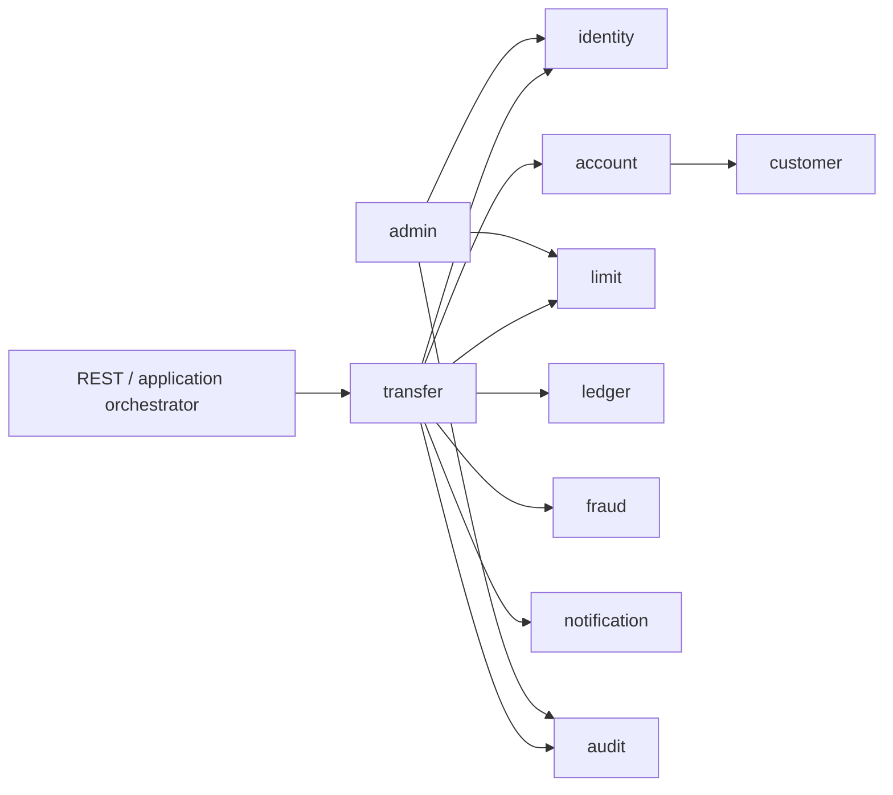

# 05. Hợp đồng giao tiếp giữa các module

> **Dự án:** Digital Banking MVP — Single-Bank, Core Simulated
> **Mã tài liệu:** `DESIGN-MOD-05`
> **Phiên bản:** v0.3 — dự thảo review
> **Ngày cập nhật:** 15/11/2026

## 1. Mục đích, phạm vi và cách đọc

Tài liệu xác định **provider, consumer, dữ liệu trao đổi, transaction, lỗi và cách kiểm chứng** cho các điểm tích hợp backend. Mục tiêu là cho phép các owner phát triển song song và phát hiện sai lệch sớm. Đây là hợp đồng **nội bộ trong một Spring Boot modular monolith**, không phải REST hay message contract giữa các microservice; HTTP công khai vẫn theo `07` và OpenAPI.

**Trạng thái nội dung:** Các bất biến gắn nguồn là baseline; tên operation, DTO, chữ ký và các chi tiết được đánh dấu **Đề xuất** là bản dự thảo để các owner chốt, không phải API đã triển khai hoặc đã được duyệt. `docs-common/01–11` ưu tiên hơn `design/`, sau đó mới đến `docs-backend/`; không tự chọn khi các nguồn `01–11` mâu thuẫn. Nếu `design/` khác nguồn cấp trên, ghi chênh lệch và chuyển owner xử lý; tài liệu này không sửa chính sách nghiệp vụ.

Cách dùng: owner đọc §2–§4, rồi tìm operation của module mình tại §5–§12; cùng consumer chốt DTO/lỗi và contract tests theo §13 trước khi code. §14 ghi quyết định mở và trách nhiệm. Những câu lệnh giả mã không phải class hoặc schema đã có.

## 2. Bản đồ module và quyền sở hữu

Nguồn: `06` §6.2–§6.3, §8.1; `04` §4. Một bảng có **một write-owner**; consumer không ghi trực tiếp, không truy cập repository/entity của provider. Read cross-module qua public API hoặc projection được khai báo và review; không join tùy tiện trong write path.

| Provider | Dữ liệu / chức năng sở hữu | Consumer chính | Contract |
|---|---|---|---|
| `identity` | user, role/permission, session, challenge | `transfer`, `admin`; security SPI tại `common` | §5 |
| `customer` | customer, hồ sơ/PII | `account`, `identity` khi cần ánh xạ, `admin` | §6 |
| `account` | account, ownership, status, materialized balance | `transfer`, `ledger` cho read, `admin` | §7 |
| `transfer` | transfer, idempotency; orchestration T0–T2 | adapter REST, composition đọc được phân công | §8 |
| `ledger` | ledger entries append-only | `transfer`, reconciliation/read do owner phân công | §9 |
| `limit` | limit config/usage | `transfer`, `admin` | §10 |
| `audit` | audit log, retention/legal hold | mọi owner cần audit, `admin` | §11.1 |
| `fraud` | rule config, flag | `transfer`, `admin`/ops theo quyền | §11.2 |
| `notification` | notification/outbox, delivery | `transfer`; `identity` dùng gateway OTP theo hợp đồng riêng | §11.3 |
| `admin` | approval request, điều phối maker/checker | REST/ops; gọi provider identity, limit, audit | §12.1 |
| `common` | error, context, crypto, Clock, security infrastructure; **không có business table** | mọi module | §12.2 |

Dependency đi **từ consumer tới `<provider>.api`**; `common` không import business; identity/customer/account không phụ thuộc transfer; business không phụ thuộc admin. Ledger/fraud/notification không import `transfer.api` để callback khi Transfer đã gọi chúng: Transfer truyền facts bằng DTO do **provider** sở hữu. Với query cần tổng hợp, caller ở lớp điều phối ghép projection, hoặc thiết kế read model được phê duyệt; không tạo cycle. `ModuleBoundaryArchTest` hiện kiểm tra cycle ở cấp module và một số rule khác; chưa coi đó là bằng chứng mọi import ngoài `api` đã được enforce.

Sơ đồ chỉ thể hiện chiều dependency điển hình, không khẳng định mọi interface đã tồn tại hoặc cho phép cycle bổ sung. `common` được mọi module sử dụng nhưng không vẽ các cạnh để dễ đọc.

## 3. Quy ước hợp đồng chung

### 3.1. Package, kiểu và bảo mật

- Interface và input/output nội bộ đặt trong `com.simulatedbank.banking.<provider>.api`; implementation ở `application`/`adapter/out`. Module khác không import `application`, `domain`, `adapter` hay JPA entity của provider. Trường hợp SPI kỹ thuật đã có ở `common` được ghi riêng tại §5.1.
- DTO là immutable record/value type, tách REST DTO/entity; không trả `Object`, lazy proxy hay mutable entity. Các chữ ký dưới đây là **pseudo-Java**, tên/bao bì cụ thể cần hai owner duyệt; không sao chép nguyên enum/error HTTP vào mọi module.
- `Id` biểu diễn định danh nội bộ có kiểu rõ ràng; mapping HTTP string ↔ DB BIGINT theo `04`/`07`. Giá trị tiền dùng `BigDecimal` tối đa 2 decimal, VND; amount transfer phải > 0, balance/usage/remaining có thể bằng 0, còn delta có dấu chỉ khi operation quy định rõ; không dùng `double`. Timestamp là `Instant` UTC; business date theo policy được chốt. Không trộn `userId`, `customerId`, `accountId` hay reference.
- `ActorContext` **đề xuất**: `actorType`, `userId?`, `customerId?`, permission snapshot cần thiết, `correlationId`, `requestId`; do server tạo từ principal và request context, không tin body client. Job dùng actor SYSTEM. Không truyền raw session token, OTP, full account number hay raw idempotency key qua DTO/log nếu không thật sự cần. Challenge binding có thể cần key; chỉ identity/transfer xử lý, không log.
- Mỗi provider kiểm tra precondition/ownership trong phạm vi mình phụ trách; permission tại endpoint không thay service-level scope. Projection chỉ trả field tối thiểu; `AccountRef` hiển thị masked/last4, không trả encrypted blob/hash. Giao tiếp nội bộ không tự động đồng nghĩa quyền truy cập dữ liệu của người dùng.

### 3.2. Transaction và lỗi

| Ký hiệu | Yêu cầu đối với operation | Failure/điểm kiểm tra |
|---|---|---|
| **R** | Read; không tạo side effect. Dữ liệu trước lock có thể stale. | Không dùng kết quả preflight thay authoritative check dưới lock. |
| **OWN** | Provider mở transaction ngắn riêng cho use case độc lập, không giữ qua request/chờ user/network. | Không gọi từ T2 nếu nó tách commit khỏi transaction tiền. |
| **JOIN** | Phải tham gia transaction caller hiện tại, cùng datasource/transaction manager; không `REQUIRES_NEW`/commit riêng. | Đề xuất fail fast khi không có transaction (`MANDATORY`) ở các operation bắt buộc T1/T2; xác nhận wiring thực tế. `REQUIRED` chỉ an toàn nếu caller thực sự đã mở transaction. |
| **AFTER** | Delivery sau transaction nghiệp vụ commit; worker dùng transaction claim/lease riêng. | Gọi gateway ngoài lock; at-least-once, xử lý retry/trùng. |

Business rejection là outcome có kiểu, được caller map về catalog `07`; không mặc định throw exception gây rollback khi contract yêu cầu commit `FAILED`. Lỗi DB/technical, invariant hoặc audit C1/C2 phải lan ra để transaction rollback; không bắt rồi tiếp tục trong transaction đã bị đánh dấu rollback-only. Các tên lỗi trong bảng là **nhóm lỗi nội bộ**, không tự tạo HTTP code mới. `common`/adapter chịu trách nhiệm map public Problem theo `07` và không lộ SQL/stack/PII. C3 failure không làm mất quyết định từ chối; fallback security log + metric + alert theo `design/01`.

### 3.3. Định dạng ví dụ contract

Trong §5–§12, mỗi operation ghi `Provider ← Consumer`, `Input → Output`, `TX`, precondition/side effect và lỗi. Dấu `?` là nullable; danh sách field là **tối thiểu đề xuất**, không cho phép giả định provider đã thực hiện đầy đủ. `correlationId`/`requestId` có thể được truyền qua `ActorContext`, nhưng phải được kiểm chứng qua ranh giới thread/job; không dựa vào thread-local sau async.

## 4. Luồng phối hợp chuẩn và điểm tích hợp

| Pha | Ai điều phối | Contract chính | Ranh giới và bằng chứng |
|---|---|---|---|
| Preflight/T0 | Transfer + Identity | Session, resolve account, usage tham khảo, challenge | `428` trước transfer/idempotency/ledger; user verify challenge ngoài DB transaction. |
| T1 | Transfer | consume challenge + create PENDING/idempotency + audit CREATED | Một transaction ngắn; insert transfer trước idempotency FK; thua unique rollback tất cả và đọc lại ngoài transaction. |
| T2 | Transfer | lock transfer → account ASC → limit customer/account → fraud → money/ledger/usage → outbox/status → audit | Một PostgreSQL transaction, READ COMMITTED; audit bắt buộc cuối; không network. |
| T3 | Notification | claim/lease outbox → gateway → cập nhật kết quả | Sau commit T2, retry không đổi transfer. |
| Recovery | Transfer | lock PENDING + ledger/audit evidence + cùng T2 executor | `SKIP LOCKED` và xử lý một candidate cùng transaction; không tạo ledger kép. |
| Approval | Admin | identity step-up + identity/limit apply + audit | Maker khác checker; apply và approval state/audit cùng transaction theo use case. |

`COMPLETED` chỉ sau T2 commit, đúng hai ledger entries cân bằng và audit bền vững. Business failure đã có T1 có thể được commit `FAILED` theo `design/02`; system/audit failure rollback T2 và giữ `PENDING`. Các khác biệt với AC-006/AC-012 và rủi ro step-up được ghi ở §14, không coi đã được phân xử. Không retry từng statement sau SQL error: chỉ retry toàn bộ transaction mới, có giới hạn và chỉ khi operation an toàn/idempotent.

## 5. Provider `identity`

Nguồn: `03` FR-001–007, FR-026, AC-033; `06` §7.1; `07` §3, §6; `design/02` §5.1–§5.2.

### 5.1. Session SPI đã tồn tại

`common.config.SessionAuthenticator.authenticate(String opaqueToken) → Optional<Session>` là interface **đã có trong source**; identity cung cấp implementation. `Session` hiện gồm `userId`, `customerId?`, `authorities`, `csrfTokenHash`; `toString()` redacted. Provider kiểm tra token/session/user active, expiry/revocation và permission snapshot theo policy; invalid trả empty, DB/system failure không giả thành login hợp lệ. Không log token hoặc hash CSRF. `common` chỉ biết SPI, không import identity; test phải chứng minh wiring identity thật, expiry/revocation và CSRF. Không tạo interface trùng để thay SPI này.

### 5.2. Step-up challenge — Đề xuất `identity.api.StepUpChallengePort`

| Operation / consumer | Input → Output | TX và hành vi | Lỗi / consumer xử lý |
|---|---|---|---|
| `requestChallenge` ← Transfer/Admin | `purpose`, actor/user, binding (`requestHash`, `idempotencyKey` cho transfer hoặc action binding cho admin), correlation → `challengeRef`, method, expiry, thông tin hiển thị an toàn | **OWN/T0**; tạo challenge theo policy; dispatch OTP/FIDO theo gateway identity sau transaction; không tạo transfer/ledger. Không trả OTP. | Dispatch lỗi theo `07`; invalidate/đánh dấu challenge theo policy; không đi tiếp T1. |
| `verifyChallenge` ← identity adapter | challengeRef + credential → `VERIFIED`/rejection | **OWN/T0**; lock, verify user/purpose/expiry/attempt, cập nhật atomic và audit theo class. | Sai/hết hạn/locked map theo catalog auth; không lộ credential. |
| `consumeVerified` ← Transfer/Admin | challengeRef, actor, purpose, binding → `ConsumedChallenge(challengeId)` | **JOIN/T1 hoặc approval**; lock row, khớp user/purpose/hash/key, `VERIFIED`, chưa consume, chưa hết hạn; consume tối đa một lần; rollback caller hoàn lại consume. | Mismatch/expired/already consumed là business rejection theo `07`; không tạo side effect tiền. T2 không yêu cầu verify lại chỉ vì challenge hết hạn sau T1 commit. |

**Contract tests:** cùng challenge bị hai transaction consume chỉ một thắng; sai user/hash/key/purpose, hết hạn, max attempts; rollback T1 trả challenge về trạng thái trước consume; challenge được xác thực lại/retry theo policy. Kiểm tra `428` không có transfer/idempotency/ledger. Thành phần tổng ngày đã chốt tại [DEC-TRF-001](../../../DECISIONS.md); threshold, serialization và protocol còn cần xử lý (§10.1/§14).

#### 5.2.1. BE-ID-IMP-07 — provider Identity và giới hạn integration

Theo [DEC-ID-007](../../../DECISIONS.md), triển khai trên `datht-backend-rework` dựa `origin/dev2@56210cc`; không coi mục này là phê duyệt protocol MOD-OI-01/09:

- Dùng lại `identity.api.StepUpChallengePort`, không tạo subsystem challenge thứ hai. `consumeVerified` bắt buộc JOIN transaction caller (`MANDATORY`), kiểm ref/user/purpose/hash/key/state/expiry và chỉ một committed consume; rollback caller hoàn lại quyền consume.
- `POST /api/v1/auth/step-up/verify` theo `07` §6.4/§8.1.5 lấy user từ session, chỉ OTP và purpose step-up/sensitive; không nhận user/hash/key từ client, không cấp session login. Method/purpose mismatch không mutate challenge.
- **Consumer chưa có:** Transfer/Limit/Account/Ledger/Audit runtime chưa triển khai trên baseline/working tree. Phương án thay thế là consumer fixture và gateway fake **chỉ trong test**, ghép port thật với PostgreSQL thật và HTTP error/security thật; không đưa fake thành bean production. Đây là provider/consumer-contract evidence, không phải integration money path.
- Binding phải so khớp nguyên vẹn; không cho PostgreSQL ép kiểu làm cắt hash/key sai thành giá trị đúng. Expiry phải được kiểm tra tại thời điểm consume sau khi lấy row lock, không dựa thời điểm transaction bắt đầu. Không thêm schema/enum challenge mới.
- Transfer phải tra idempotency trước step-up; terminal replay không consume lần hai; T1 insert-first, consume và audit cùng commit/rollback; T2 thất bại giữ challenge consumed và retry theo transfer đã tạo (`design/02` §5.1–§5.2). **Chưa có runtime để chứng minh** thứ tự này, partial unique `transfer.step_up_challenge_id`, HTTP 428 không có business writes hoặc replay terminal.
- Gate tích hợp vẫn **BLOCKED**: MOD-OI-01/09, consumer Transfer/Limit và provider transaction thật. Không coi test fixture là bằng chứng chống duplicate transfer hoặc bỏ qua policy tổng ngày.

### 5.3. Role/session command — Đề xuất `identity.api.IdentityRoleCommand`

`applyApprovedRoleChange(approvalId, targetUserId, roleChange, expectedVersion, actorContext) → RoleChangeResult` ← Admin; **JOIN** cùng approval transaction. Identity xác thực target, quyền, version và transition; cập nhật bảng identity, xử lý revoke session theo policy; admin giữ maker/checker và approval state. Không import `admin` DTO/entity vào identity; `approvalId` là ID và input được kiểm tra. Stale version/invalid state là business conflict; lỗi DB/audit C2 rollback cả approval và thay đổi. Kiểm thử maker/checker, stale approval, revoke và rollback. Vai trò, permission, quy tắc revoke chi tiết theo `07` và owner Identity/Admin chốt.

#### 5.3.1. BE-ID-IMP-11 — extension được người điều hành duyệt và boundary còn phụ thuộc

Theo [DEC-ID-011](../../../DECISIONS.md), thêm version assignment Identity và policy revoke; không coi draft §5.3 hoặc test fixture là sign-off của Admin/Audit:

- `identity.api.IdentityRoleCommand.getRoleAssignmentVersion(targetUserId)` cung cấp version authoritative cho Admin maker capture vào approval payload. Không thêm field version vào REST `07` §8.8 hoặc cho Admin đọc trực tiếp bảng Identity.
- `applyApprovedRoleChange(ApprovedRoleChange)` **JOIN/MANDATORY**. Input provider-owned: approval ID, maker/checker IDs, approval state `APPROVED`, target ID, operation `ASSIGN_ROLE/REVOKE_ROLE/GRANT_PRIVILEGE/REVOKE_PRIVILEGE`, role/privilege code, expected version và correlation/request IDs. Approval facts chỉ do trusted Admin orchestrator tạo sau khi lock/validate approval và consume step-up `SENSITIVE_ACTION`; không nhận trực tiếp object này từ HTTP client. Identity không thể xác thực row approval khi provider Admin chưa có và không được đọc/ghi chéo bảng.
- Identity đối chiếu principal Spring Security với checker, nạp quyền mới từ DB (maker Admin + `ROLE_MANAGE`; checker thêm `CHECKER`), kiểm user `ACTIVE`/`STAFF`, maker khác checker và target khác cả hai; target `ACTIVE`, role catalog và user type hợp lệ. `CHECKER` vẫn là privilege, không là role. Không sửa role/permission definitions.
- Forward migration `V4__add_role_assignment_version.sql`: `app_user.role_assignment_version BIGINT NOT NULL DEFAULT 0`, không âm. Khóa user theo ID tăng dần, refresh authoritative data sau lock, so `expectedVersion`, tăng đúng 1 khi mutation thực sự; stale/duplicate/no-op → `ROLE_CONFLICT`, không revoke/bump. Không dùng `updated_at` làm version hoặc thêm distributed lock.
- Mọi mutation revoke toàn bộ session `ACTIVE` của target thành `LOGGED_OUT` và ghi `logged_out_at` trong cùng transaction; giữ nguyên session user khác. Opaque token phải đi qua SPI validate mỗi request; không JWT, blacklist hay refresh-token subsystem.
- Result trả approval/target/operation/code, previous/resulting version, revoked-session count, correlation/request IDs. Admin update approval `APPLIED` và chuyển facts cùng maker/checker sang Audit `ROLE_CHANGE_APPROVED` **cuối cùng transaction**. Không emit event tên mới cho revoke hoặc duplicate audit trong Identity.
- Terminal approval → `APPROVAL_ALREADY_DECIDED`; pending/stale/self/no-op/type conflict → `ROLE_CONFLICT`; target thiếu → `USER_NOT_FOUND`; role không hợp lệ/disabled → `ROLE_NOT_FOUND`; actor thiếu → `AUTH_SESSION_EXPIRED`, thiếu quyền → `AUTH_FORBIDDEN`. Lỗi persistence/revoke/Audit C2 phải rollback toàn caller transaction, không trả success giả.
- **Phương án thay thế kiểm thử khi dependency thiếu:** test-only Admin/Audit fixture giữ approval/audit rows riêng, gọi Identity/step-up/JPA và security chain thật để kiểm commit/rollback/concurrency/HTTP denial. Production Admin endpoint, capture/version payload, approval lock/decision/step-up, Audit durable/hash chain và C3 failure events vẫn **BLOCKED** đến khi owner cung cấp runtime và chạy integration thật; OI-API-19/MOD-OI-09 không tự đóng.

### 5.4. BE-ID-IMP-08 — login MFA và device metadata

Theo [DEC-ID-008](../../../DECISIONS.md), người điều hành chọn **MFA cho mọi password login**, không mở rộng contract persistent device credential/lifecycle:

- `PasswordLoginService.login` chỉ trả challenge LOGIN_NEW_DEVICE; deviceRef/fingerprint/UA/IP/trusted row không cấp session hoặc bypass MFA. Primary eligibility/device metadata được commit trong transaction OWN ngắn trước khi issue challenge OWN và dispatch ngoài transaction, kể cả caller có ambient transaction; không giữ uncommitted device FK qua transaction issue.
- `auth_challenge.device_id` bind optional context đã resolve theo user; public API-AUTH-04 lấy user/device từ challenge, không từ body/header. Ref challenge không phải session token. Giữ nguyên request JSON và response 202/200 theo `07`.
- `OtpChallengeService.verifyLoginChallenge` dùng OTP state machine/Argon2id hiện có. Nhánh đúng mark VERIFIED, consume và `LoginSessionService.complete` JOIN/MANDATORY trong cùng OWN transaction; user/device recheck, session/OTP attempt/last-seen và C2 VERIFIED/LOGIN_SUCCESS commit hoặc rollback đồng thời. Wrong attempts vẫn commit; challenge đã consume không tạo session lần hai.
- Device registration metadata dùng unique user/fingerprint; không tự trust/reactivate revoked. Session có device context bị từ chối khi device owner/status không hợp lệ. Không thêm schema/enum, public trust/revoke API hoặc raw device secret.
- `OtpGateway` và Audit persistence thật còn thiếu: fail-closed khi không dispatch được; fake capture/controlled failure chỉ trong test, không coi đó là provider production. Durable resend/handoff MOD-OI-07 vẫn OPEN. Persistent trust bypass/expiry/re-registration giữ PARTIAL theo lựa chọn người điều hành.

### 5.5. BE-ID-IMP-10 — extension verification FIDO được duyệt, dependency chưa hoàn tất

Theo [DEC-ID-010](../../../DECISIONS.md), người điều hành duyệt thêm verification material trong schema Identity và policy UV required/counter/fallback. Không coi đây là sign-off thay Audit/Notification hoặc enrollment.

- API-AUTH-03 begin/finish giữ nguyên `07` §8.1.3; dùng Yubico `webauthn-server-core`, nonce durable gắn `auth_challenge`, COSE public key/userHandle/counter gắn `device`. Không tạo protocol liên module hoặc challenge subsystem mới.
- `LoginSessionService.completeFido` JOIN/MANDATORY dùng cùng session/consume/authorities pipeline với OTP. Challenge → user → device locks; signature/counter, challenge VERIFIED/consume, counter/session/attempt/C2 commit hoặc rollback cùng nhau. Failure attempt commit trước khi trả lỗi.
- Fallback chỉ bắt đầu lại API-AUTH-01 password + API-AUTH-04 OTP theo DEC-ID-008; không carry FIDO assurance, không chuyển FIDO challenge thành OTP challenge. Cancellation/capability/unavailability do client chọn password, không invent cancellation endpoint; Passcode positive còn BLOCKED.
- **Dependency thiếu:** enrollment/provisioning trusted credential, provider OTP thật và Audit persistence. Phương án thay thế kiểm thử: provision credential bằng fixture có key pair thật, gateway fake test-only, spy audit failure; verification/security/persistence/HTTP thật không mock signature. Không đưa provisioning/fake provider vào production, không coi test thay integration Audit/Notification.

### 5.6. BE-ID-IMP-12 — REST DTO và bằng chứng khi provider chưa có

- REST API-AUTH-01..07 dùng application services Identity hiện hữu; DTO không là entity hoặc DTO nội bộ cross-module. Validation hình thức và RFC 9457 dùng Common pipeline duy nhất, không thay session/CSRF/transaction boundary.
- Theo [DEC-ID-012](../../../DECISIONS.md), không tạo implementation giả cho API-AUTH-08: resend atomic cần schema/counter/generation/in-flight protocol được duyệt ở §11.3.1/MOD-OI-07. Positive Passcode/device proof còn phụ thuộc DEC-ID-009; FIDO/PASSCODE step-up chưa có provider xác thực.
- Phương án thay thế theo §13.1: test controller dùng application mocks để kiểm success DTO/error serialization; regression HTTP/PostgreSQL dùng service, token validation và security chain thật, gateway capture/audit-failure fixture chỉ test. Không suy ra external delivery, enrollment, durable Audit hoặc transfer integration từ các PASS này.
- `ChallengeView` chưa có trusted-contact projection để cấp maskedDestination; `LoginResult` chưa có Customer projection. Không bịa PII/customer ID hoặc đọc chéo bảng; Customer/Notification cung cấp API/projection được review trước khi đóng end-to-end.

## 6. Provider `customer` — Đề xuất `customer.api.CustomerQuery`

Nguồn: `03` FR-008–011, FR-039; `06` §6.2; `07` §3.6, §8.2.

| Operation / consumer | Input → Output | TX / điều kiện | Lỗi / test contract |
|---|---|---|---|
| `findByUserId` ← Identity/Account | userId → `Optional<CustomerIdentity(customerId, userId, status, kycStatus)>` | **R**; chỉ snapshot tối thiểu, không full PII. Identity cần mapping phải xác nhận hướng dependency không tạo vòng. | Không thấy khác lỗi DB; test inactive/KYC, mapping nhất quán. |
| `getCustomerView` ← Account/Admin | customerId + actor/scope → masked profile theo quyền | **R**; service consumer và provider phân định rõ ai kiểm ownership/permission; không trả national ID đầy đủ. | Not found/forbidden không lộ PII; test cross-customer và staff scope. |

Không giả định mọi transfer cần điều kiện KYC bổ sung ngoài SRS/policy đã duyệt. Nếu Identity cũng cần gọi Customer, Customer không import ngược Identity; identity ID là value, không là identity entity. Mã hóa, blind index và masking thuộc owner customer qua common primitives.

## 7. Provider `account`

Nguồn: `03` FR-012, FR-015; `04` §4.3; `06` §8.1–§8.3; `design/02` §5.3, Appendix A.

### 7.1. Read — Đề xuất `account.api.AccountQuery`

| Operation / consumer | Input → Output | Điều kiện / lỗi / test |
|---|---|---|
| `resolveDestination` ← Transfer | `accountId` **hoặc** accountNumber → `AccountSnapshot(accountId, customerId, status, currency, maskedNumber, last4)` | **R**; number normalize/HMAC lookup do account sở hữu, không log số đầy đủ; trả not-found/inactive an toàn. Kết quả preflight không thay kiểm tra T2. |
| `getAccountView` / `assertOwnership` ← Transfer/Ledger/Admin | accountId + actor/customer scope → masked projection hoặc kết quả từ chối | **R**; kiểm quyền/ownership và customer scope; test source không thuộc customer, staff thiếu quyền và account không tồn tại. |

### 7.2. Money — Đề xuất `account.api.AccountBalance`

Tất cả operation dưới đây **JOIN T2**, cùng connection/transaction; caller đã lock transfer, account provider lock cả hai theo `accountId ASC`. `LockedAccount` chỉ là snapshot/ID có hiệu lực **trong transaction hiện tại**, không được cache hoặc xem như lock token sau commit.

| Operation | Input → Output | Side effect / lỗi phải xử lý |
|---|---|---|
| `lockTransferAccounts` | sourceId, destinationId → `LockedAccounts(source, destination)` gồm ID, owner, status, currency, balances | `SELECT … ORDER BY account_id FOR UPDATE`; reject cùng ID/không tồn tại; caller/provider phối hợp re-check source owner và cả hai ACTIVE/currency. Timeout/deadlock là technical, rollback/retry toàn transaction. |
| `debitConditional` | locked sourceId, amount → `DebitResult(balanceAfterAvailable, balanceAfterLedger)` hoặc `Insufficient/Inactive` | Conditional update `available_balance >= amount` và ACTIVE, kiểm affected rows. `0 rows` chưa có debit → business result sau xác định nguyên nhân; không âm. |
| `credit` | locked destinationId, amount → `CreditResult(balanceAfterAvailable, balanceAfterLedger)` | Sau debit đã thành công mà credit bất thường/0 rows → **system error**, rollback toàn T2; không commit FAILED trong cùng transaction đang có debit. |

Cả available và ledger balance cập nhật theo mô hình `04`; Ledger nhận `balanceAfter` từ kết quả Account, không tự ghi bảng account. Test trên PostgreSQL: A→B/B→A, cùng nguồn vượt balance, status đổi giữa preflight/T2, failure sau debit, isolation và tổng số dư; thứ tự lock giảm deadlock chứ không bảo đảm không bao giờ xảy ra.

## 8. Provider `transfer`

Nguồn: `03` FR-013–026; `07` §5, §8.3; `design/02` §5–§6, §10. Transfer là **orchestrator**, sở hữu `transfer` và `idempotency_record`, không chuyển write ownership sang consumer.

### 8.1. Các use case application — Đề xuất

| Operation / consumer | Input → Output | Transaction / lỗi |
|---|---|---|
| `createTransfer` ← Transfer REST adapter | actor + `CreateTransfer(sourceId, destination, amount, currency, description)` + idempotency key → `Completed/Failed/StepUpRequired/InProgress/Replay` | Không có outer transaction bao T0–T2. Orchestrator gọi T1/T2 qua bean/transaction boundary thực sự; HTTP adapter map theo `07`. |
| `getByReference` ← adapter/composition được phân quyền | reference + actor/scope → masked `TransferView(reference,status,amount,currency,accounts,timestamps,correlationId)` | **R**; customer tham gia transfer hoặc staff có quyền/scope; không trả fraud flags cho customer; not-found/forbidden theo `07`. |
| `reconcileOne` ← scheduler/ops được phép | system context + candidate → `Skipped/Resolved/Incident` | Claim `FOR UPDATE SKIP LOCKED` và xử lý cùng transaction; ledger/audit evidence đủ và quyết định §14 được chốt. Không cho provider Ledger/Fraud/Notification callback Transfer tạo cycle. |

### 8.2. Idempotency và binding

Theo `07` §5: key global, 1–255 ký tự, cùng key/hash terminal replay status/body gốc, khác hash hoặc actor bị từ chối không lộ kết quả. Với record `RECEIVED`/`IN_PROGRESS`, `07` §5.4/§8.3 mô tả `409 IDEMPOTENCY_IN_PROGRESS` + `Retry-After`; `04` §7.7.3 lại nói retry cùng key sau audit failure chạy lại T2, và `design/02` đề xuất resume nếu lock rảnh. Đây là **điểm cần phân xử giữa `04` và `07`**, không tự chọn semantics stale/resume; xem OI-CON-03/MOD-OI-04 tại §14. Normalize object gồm customerId, source ID, destination type/value, amount 2 decimals, currency uppercase, description trim/null→rỗng; SHA-256 UTF-8 JCS. T1 insert transfer rồi idempotency theo FK, unique thua rollback T1 trước khi đọc lại. Chỉ lưu response terminal đã mask; không replay 5xx tạm. Sau purge, key có thể tạo request mới: không hứa chống trùng vĩnh viễn. `07` replay 201/422 nhưng OpenAPI có 200 replay; đồng bộ theo nguồn `07` qua owner API/FE (§14).

**Contract tests:** same-key concurrent một transfer/debit; khác payload/actor không lộ kết quả; replay 201/422; crash trước/sau T1/T2; ownership query; TTL và purge không xóa PENDING. Chi tiết `T-IDEM-01–06`, `T-REC-01–04` trong `09` §7.

## 9. Provider `ledger` — Đề xuất `ledger.api.LedgerPosting` và `LedgerQuery`

Nguồn: `03` FR-019–020, AC-012; `04` §4.4.2; `06` §8.4; `design/02` §5.3, §10.

| Operation / consumer | Input → Output | TX / bảo đảm / lỗi |
|---|---|---|
| `postDoubleEntry` ← Transfer | `PostingCommand(transferId, sourceId, destinationId, amount, currency, sourceBalanceAfter, destinationBalanceAfter, correlationId)` → `PostingRef(debitEntryId, creditEntryId)` | **JOIN T2**; đúng 2 dòng append-only seq 1 DEBIT nguồn, seq 2 CREDIT đích, cùng amount/currency; unique `(transfer_id,entry_seq)`. Không tự update account, không commit riêng. Duplicate/partial/constraint sau claim là invariant/system error, rollback T2; không mặc định coi unique violation là thành công. |
| `findEvidence` ← Transfer reconciliation | transferId → `LedgerEvidence(entries)` gồm entry ID, seq, type, account ID, amount/currency, balanceAfter | **R**, dùng transaction reconciliation nếu cần tính nhất quán; trả dữ kiện đủ phân biệt không có/đủ/thiếu/lệch, không chỉ boolean. Không tự sửa/delete ledger. |
| `listAccountEntries` ← adapter/read composition có quyền | accountId + paging/filter + actor scope → masked entry projections + page | **R**; ownership được kiểm theo `07`, whitelist sort/filter; không lộ entity/PII. Consumer chịu trách nhiệm composition với account khi cần. |

**Contract tests:** hai entry đúng phía/tổng, duplicate/partial không commit, rollback sau insert, evidence mismatch và không update/delete. Dùng PostgreSQL thật; cân bằng và số dư chỉ được chứng minh khi Account + Ledger cùng T2.

## 10. Provider `limit`

Nguồn: `03` FR-016, FR-031; `04` §4.5; `06` §8.3; `design/02` §5.3, §9.

| Operation / consumer | Input → Output | TX / điều kiện / lỗi |
|---|---|---|
| `getUsageSnapshot` ← Transfer/limit adapter | customerId, accountId, business date/context → `UsageView(used,remaining,configVersion,date)` | **R**; số liệu hiển thị/preflight có thể stale, không bảo đảm ngưỡng step-up khi concurrency. Date/timezone và cấu hình phải thống nhất. |
| `lockAndCheck` ← Transfer | customerId, sourceId, amount, currency, businessDate → `LimitDecision(allowed, usageRef, effectiveConfigVersion, reason?)` | **JOIN T2** sau account lock; upsert/lock usage CUSTOMER rồi ACCOUNT khi áp dụng; kiểm cả per-transaction/daily theo policy. `LIMIT_EXCEEDED` là business result trước ghi tiền. UsageRef chỉ dùng trong transaction hiện tại. |
| `incrementUsage` ← Transfer | `usageRef`, amount → `UsageAfter` | **JOIN T2**, chỉ sau money/ledger thành công; rollback cùng T2; không increment FAILED. Không dùng preflight snapshot để cộng. |
| `applyApprovedLimitChange` ← Admin | approvalId, scope, giới hạn mới, expectedVersion, actor → `ConfigApplied(id,version)` | **JOIN approval TX**; limit sở hữu validation/version/transition config; admin sở hữu approval, permission và maker/checker. Stale/mismatch → conflict; audit C2 fail rollback cả hai. |

**Contract tests:** concurrent cùng customer trên nhiều account không vượt daily limit, customer lock trước account, rollback usage khi audit/ledger fail, business-date boundary và stale config; maker/checker, duplicate approval và version conflict. Ngưỡng step-up mặc định 10 triệu/lệnh và 20 triệu/ngày theo [DEC-TRF-002](../../../DECISIONS.md) không phải daily limit; timezone và protocol còn chờ chốt/kiểm chứng.

### 10.1. Đề xuất review: guard và reservation cho step-up theo tổng ngày

**Trạng thái: đề xuất thiết kế cho MOD-OI-01, chưa được các owner duyệt hoặc chứng minh, không phải interface/runtime đã tồn tại.** [DEC-TRF-001](../../../DECISIONS.md) chọn tính cả lệnh đã hoàn tất và lệnh đang xử lý cho tổng dự kiến; không chọn chỉ xét usage đã commit. Các operation tại §10 hiện chưa bao gồm serialization/reservation trước T1. Cần Identity, Limit, Transfer, Architect, BA/Product và Security review giao diện, schema, phần policy còn mở và bằng chứng trước khi dùng. Phương án kỹ thuật khác là serialization toàn bộ quyết định step-up đến kết quả terminal bằng cơ chế claim/queue bền theo customer (không giữ DB transaction trong lúc chờ OTP); cách này giảm xử lý đồng thời và cũng cần thiết kế lease, crash, fairness và proof. Snapshot T0 hoặc recheck đơn thuần sau T1 không giải quyết race theo yêu cầu hiện tại.

**Mục tiêu của phương án reservation:** theo DEC-TRF-001, tính tổng dự kiến gồm tiền chuyển thành công đã commit thuộc đúng scope/ngày được duyệt cộng các reservation còn hiệu lực và amount của lệnh mới dưới một guard, không tính trùng một lệnh. Counter CUSTOMER và ACCOUNT có thể cùng phản ánh một giao dịch: không cộng cả hai; không coi counter chưa đối soát là bằng chứng một transfer đã settle. Scope, business date và cách xác minh nguồn usage còn chờ owner chốt. Reservation chỉ theo dõi phần dùng để đánh giá step-up, **không** tự ghi tiền hoặc thay kiểm tra hạn mức T2. Tính cả lệnh đang xử lý có thể yêu cầu OTP bảo thủ nếu lệnh trước sau đó FAILED. [DEC-TRF-002](../../../DECISIONS.md) chốt mặc định amount ≥ 10 triệu/lệnh hoặc tổng dự kiến > 20 triệu/ngày; timezone, version/cập nhật cấu hình và trải nghiệm vẫn cần review.

| Operation **đề xuất** / consumer | Dữ liệu và điều kiện | Transaction, kết quả và giới hạn |
|---|---|---|
| `lockStepUpGuard` ← Transfer | Actor server đã xác thực/quyền, customer và business date/policy scope → guard context chỉ sống trong transaction. Nullability, version và lỗi chưa chốt. | **JOIN transaction ngắn ở gate**; Limit sở hữu guard, lấy lock theo scope; lỗi lock/DB rollback. Version không được làm hai guard độc lập cho cùng scope. Context không dùng sau commit. |
| `evaluateStepUpUnderGuard` ← Transfer | Guard context còn hiệu lực + amount dương/currency và policy context → `CHALLENGE_REQUIRED` hoặc `MAY_CREATE_INTENT`, policy/config version. Input/output/nullability và result/error type chưa chốt. | **JOIN cùng gate transaction**; đọc committed usage và reservation dưới guard sau khi Transfer recheck idempotency; config không đọc được là lỗi kỹ thuật, không mặc định cho qua. Xử lý thay đổi policy khi có reservation cần review. Decision chỉ hiệu lực khi transaction còn giữ guard, không cache sau commit. |
| `reserveForPendingTransfer` ← Transfer | Guard context còn hiệu lực, transferId và dữ liệu amount/date/version tối thiểu → reservation reference; chỉ sau khi đã kiểm quyền, binding challenge nếu bắt buộc. | **JOIN cùng transaction tạo T1**; Limit sở hữu reservation, một reservation cho transfer theo constraint sẽ thiết kế. Transfer không ghi bảng Limit. Reservation cùng transfer PENDING, idempotency record, consume challenge nếu có và audit CREATED commit hoặc rollback đồng thời; lỗi ghi/unique không được coi thành công mặc định. Thứ tự insert/constraint FK cần proof cùng provider. |
| `settleOrReleaseReservation` ← Transfer/recovery | transferId/reservationRef, outcome terminal và guard context → kết quả chuyển usage/release; SYSTEM context cho recovery có quyền. | **JOIN T2 hoặc transaction recovery đã được duyệt**; khi COMPLETED chuyển phần reservation tương ứng sang usage đã commit đúng một lần, tránh cộng hai lần với `incrementUsage`; khi FAILED release mà không tăng usage. Các thao tác money/ledger, usage/reservation, terminal, idempotency response và audit bắt buộc phải cùng commit hoặc rollback. Kết quả thiếu, trùng hoặc lệch dữ liệu là invariant error: rollback và alert, không âm thầm release. |
| `findReservationSettlementEvidence` ← Transfer recovery | transferId + SYSTEM context có quyền → evidence tối thiểu về reservation, amount/currency/date/version, trạng thái settlement và linkage tới usage theo từng transfer, hoặc absent; kiểu/nullability/version chưa chốt. | **R trong transaction recovery**, dưới guard/lock theo protocol được duyệt; lỗi DB khác absent. Aggregate usage không đủ chứng minh phần đóng góp của một transfer; không tự increment/release khi evidence thiếu/lệch. Phương án thay thế là giữ nguyên và alert/manual hoặc bổ sung dữ liệu settlement unique sau khi owner duyệt schema; chưa đủ để tự đóng T-REC-02. |

**Luồng đề xuất và điều kiện không giữ lock chờ OTP:**

1. Sau validate/authorize và tra idempotency, mở gate transaction ngắn và gọi `lockStepUpGuard`. Sau khi lấy guard, Transfer đọc lại idempotency bằng fresh snapshot `READ COMMITTED` trước quyết định challenge hoặc consume: nếu record đã tồn tại thì kiểm actor/hash và xử lý replay/conflict/in-progress theo protocol đã phân xử; không cộng request đó lần hai. Nếu key vẫn vắng mới gọi `evaluateStepUpUnderGuard`. Recheck này không thay unique constraint, không khóa record theo thứ tự đảo và không tự giải quyết khác biệt `04`/`07`; còn cần review/proof. Nếu cần challenge mà chưa có challenge VERIFIED phù hợp, kết thúc transaction **không tạo transfer, idempotency record, ledger hoặc reservation**, rồi Identity tạo/dispatch challenge và adapter trả `428` theo `07`; không giữ guard/transaction khi gọi gateway hoặc chờ người dùng. `428` không được lưu như terminal replay. Lifecycle/dispatch challenge vẫn theo §5.2 và MOD-OI-07.
2. Khi chưa cần challenge, hoặc retry có challenge VERIFIED đúng user/purpose/hash/key chưa hết hạn, đánh giá lại dưới guard với trạng thái/policy hiện tại. Trên nhánh được phép tạo intent, T1 chạy trong **cùng transaction đang giữ guard**: tạo PENDING/idempotency, reservation và audit CREATED, đồng thời consume challenge khi bắt buộc. Không commit riêng kết quả gate rồi mới reserve. T1 rollback hoàn lại reservation và consume; nếu tranh unique idempotency thua, rollback toàn bộ trước khi đọc lại record ở transaction mới. Xác định cách xử lý challenge được gửi nhưng policy đã đổi hoặc không còn yêu cầu là điểm chờ Identity/BA/Security review.
3. Sau T1 commit, reservation gắn với transfer PENDING và tồn tại qua crash, timeout hoặc challenge hết hạn sau T1. T2/recovery phải xử lý reservation cùng trạng thái theo operation trên. Nếu owner chọn transaction `Tfail` riêng sau rollback T2 cho AC-012, transaction đó cũng phải khóa transfer rồi guard, release reservation và ghi terminal/idempotency response/audit bắt buộc cùng commit; cách này vẫn cần review AC-006/AC-012 và không giải phóng khi Tfail rollback. Không xóa/release vì TTL hay lease hết hạn trong khi transfer còn PENDING hoặc vẫn có thể execute; orphan hoặc dữ liệu lệch phải giữ nguyên và alert/manual theo protocol recovery được duyệt. Không tạo reservation bền cho nhánh 428 chưa có T1, nhằm tránh giữ quota do challenge bị bỏ dở.
4. **Lock order là điều kiện cần chứng minh, không phải bảo đảm đã đạt:** T1 giữ guard trước khi tạo intent/reservation mới; T2 theo §4 khóa transfer → account ASC → guard → limit usage CUSTOMER → ACCOUNT → audit cuối. Recovery claim transfer rồi theo cùng thứ tự T2; verify challenge riêng không được giữ challenge lock rồi chờ guard trong cùng transaction. Các lock của FK, unique idempotency, purge, config update và audit có thể tạo chu trình ngoài thứ tự này: Architect/DBA/provider phải rà toàn bộ đường ghi, chứng minh lock order và kiểm thử deadlock với nhiều connection trước khi chấp nhận. Khi timeout/deadlock, rollback và chỉ retry toàn transaction theo policy; không retry statement đã lỗi.

**Bảo mật và dữ liệu:** Guard/reservation chỉ nhận ID nội bộ, amount/currency, business date, policy version và reference cần thiết; không nhận/lưu OTP, raw session token, số tài khoản đầy đủ hoặc raw idempotency key. Transfer/Identity chịu trách nhiệm binding key/hash và challenge; DTO không lộ entity. Mọi input/actor/scope do server xác thực, không tin customer ID từ client. Giới hạn contention/abuse, orphan alert và retention của reservation phải được Security/Ops review; không ghi PII/raw key trong log hoặc metric label.

**Vector và evidence bắt buộc:** hai key khác nhau, từng amount riêng dưới ngưỡng nhưng tổng với reservation vượt ngưỡng; chặn một gate tại barrier và kiểm quyết định của gate còn lại theo policy đã duyệt. Kiểm `428` không transfer/idempotency/ledger/reservation; retry verify đúng/sai user/hash/key, expiry trước T1, rollback T1 và thua unique; crash trước/sau T1, retry T2, rollback audit và terminal FAILED/COMPLETED không double count; nếu chọn Tfail, test release/terminal/audit commit và rollback cùng nhau; recovery nhiều worker và reservation mồ côi; đổi ngày/timezone, đổi config/threshold, cancel/expiry challenge; kiểm throughput, lock timeout/deadlock và T1 giữ guard cạnh tranh insert key với T2/Tfail/recovery giữ transfer/idempotency chờ guard bằng nhiều PostgreSQL connection. Dùng fake cùng vector khi provider chưa sẵn sàng, nhưng chỉ provider thật + PostgreSQL mới chứng minh lock/atomicity. Chưa có kết quả test nào được khẳng định.

**Vector bổ sung:** hai request cùng key/hash đều đọc thấy key vắng trước gate; T1 đầu commit trong khi request hai đợi guard. Request hai phải đọc lại record và xử lý theo protocol idempotency, không trả 428 thừa, không reserve hay consume challenge thêm. Trường hợp khác: request A quyết 428 rồi rời guard, tạm dừng trước dispatch/response; request B cùng key có thể commit T1 trước khi A tiếp tục. Identity/API/Transfer phải phân xử oracle: phân biệt side effect do A với record do B tạo, xử lý challenge thừa/invalidation, binding và retry; nếu yêu cầu không có record tại thời điểm A trả 428 thì recheck dưới guard đơn thuần chưa chứng minh được invariant. Protocol và release vẫn Blocked đến khi giải quyết race này. Test recovery evidence per-transfer đã settle/chưa settle/thiếu/lệch, lỗi DB và rollback; aggregate usage không được dùng như proof một transfer đã settle.

**Mode và dữ liệu cũ:** nếu chọn phương án này, T1 phải gắn mode/policy version bền vững, đủ để recovery xác định transfer bắt buộc reservation hay là dữ liệu cũ/no-reservation được phép. Với transfer thuộc mode bắt buộc, phải có đúng một evidence tương ứng; absent, duplicate, mismatch hoặc không xác định được mode thì giữ nguyên và alert, không tự settle hay terminal. BA/Limit/Transfer/DB/Ops duyệt schema, migration và cách xử lý legacy trước khi triển khai; test cả mode bắt buộc thiếu evidence lẫn legacy hợp lệ.

**Điểm owner phải quyết định:** phạm vi guard/customer/account; business date khi qua ngày, config version khi T1/T2/recovery và ảnh hưởng thay đổi policy; trạng thái challenge hợp lệ khi policy thay đổi; schema/constraint/retention và quyền xử lý orphan; semantics nếu T2 FAILED hoặc timeout; protocol recovery và lock order xuyên module. Thành phần tổng và ngưỡng mặc định đã được quyết định tại DEC-TRF-001/002. Trước khi review và chứng minh protocol, MOD-OI-01 và release money path vẫn **Blocked**.

## 11. Provider `audit`, `fraud`, `notification`

### 11.1. Audit — `audit.api.AuditModuleApi`

Nguồn: `03` FR-034–038, AC-034; `design/01` §4.3–§4.4, §6; `design/02` §5.3. `design/01` đã định nghĩa tên operation ở mức thiết kế; implementation runtime business chưa có. Interface nhận **AuditEvent do audit sở hữu**, không import DTO của module gọi.

| Operation / consumer | Input → Output | TX / lỗi |
|---|---|---|
| `recordInTransaction` ← mọi business module | `AuditEvent` → `AuditRecordRef` | **JOIN**, `MANDATORY`; C1/C2 trong transaction nghiệp vụ; validate catalog/allowlist, append/hash chain; lỗi ném ra → rollback nghiệp vụ. Với T1/T2 audit phase cuối sau các thay đổi khác và trước commit. |
| `recordStandalone` ← caller cần C3 | `AuditEvent` → `Optional<AuditRecordRef>` | Transaction riêng `REQUIRES_NEW`, best-effort theo `design/01`; thất bại ghi security fallback log + metric + alert, không đảo quyết định deny/revoke; không dùng thay C1/C2. Không tự giả định có thể ghi FK tham chiếu dữ liệu chưa commit của caller. |
| `search/get` ← admin/audit adapter | actor + permission/scope + filter/page → masked result | **R** cho truy vấn; audit kiểm quyền/data scope theo `07`; security audit khi bị từ chối theo policy, không lộ raw payload/secret. |
| `export` ← admin/audit adapter | actor + scope + filter/format → masked export | Kiểm quyền và tạo file; ghi `AUDIT_EXPORTED` C2 bền vững trong transaction riêng **trước** trả file; nếu audit lỗi không trả file. Export có side effect audit, không phân loại toàn operation là R. |
| `findTransferCompletionEvidence` ← Transfer reconciliation | transferId/reference + correlation/context → evidence tối thiểu (action, outcome, linkage) hoặc absent | **R**, cùng transaction reconciliation khi cần; mismatch phải nhận diện được, lỗi DB không coi là absent. Chỉ trả field cần thiết, không raw payload; chưa suy tìm thấy là đủ để tự COMPLETED khi MOD-OI-03 chưa chốt. |

`AuditEvent` tối thiểu: `action`, `actorType`, `actorUserId?`, `actorRole` snapshot, `entityType`, `entityId`, `beforeState?`, `afterState?` allowlist/masked, `amount?`, `currency?`, `outcome`, `correlationId`, `requestId`, `occurredAt`, `clientInfo?` đã mask. Truyền đủ identity/trace, không truyền password/OTP/session token/full account/raw key; audit là owner chuẩn hóa/hash chain, không phải log kỹ thuật.

**Nhiều audit event trong T2:** `FRAUD_FLAG_CREATED` là C2, `TRANSFER_COMPLETED/FAILED` là C1. Fail-open của fraud không được nuốt lỗi audit C2. Audit/Fraud/Transfer cần chốt cách gom event đã được validate và ghi **cuối T2**, C2 trước completion, cùng transaction và lock chain, hoặc phương án khác đáp ứng cả hai yêu cầu; batch API chỉ là **đề xuất** (§14), không khẳng định đã tồn tại. Không ghi completion trước khi các thay đổi tiền/outbox/status hoàn tất. Test audit C1/C2 fail rollback, concurrent chain, fallback C3 và không giữ audit lock xuyên money path.

**Đề xuất giao tiếp cần review:** Fraud trả cùng decision dữ kiện tối thiểu của từng flag còn tồn tại sau savepoint (flag ID, transfer reference, rule/version, severity và correlation; schema/nullability/version do Fraud/Audit/Transfer chốt), không trả entity hay secret. Transfer giữ dữ kiện trong T2, sau mọi business write chuyển thành event allowlist do Audit xác nhận. Phương án A gọi `recordInTransaction` JOIN/MANDATORY lần lượt cho từng C2 rồi C1 trong pha audit cuối; Audit cần chứng minh các lần append giữ chain đúng và không có business DB operation sau khi lấy audit lock. Phương án B là batch API do Audit sở hữu, validate toàn bộ và append C2 rồi C1 cùng transaction; đây là interface mới chỉ đề xuất, cần chốt atomicity, giới hạn và version. Nếu engine bị rollback về savepoint, bỏ dữ kiện tương ứng flag đã rollback; chỉ tiếp tục fail-open khi transaction và persistence context còn dùng được. Lỗi C2/C1 không thuộc phạm vi fail-open và rollback toàn T2. Hai phương án, điều kiện và vector chi tiết xem [hồ sơ review audit](../../docs-backend/modules/transfer/tasks/evidence/BE-TRF-01-audit-proposal.md); chưa có owner phê duyệt hoặc provider runtime.

### 11.2. Fraud — Đề xuất `fraud.api.FraudEvaluation`

Nguồn: `03` FR-044–048, AC-026; `design/03` §4–§8; `design/02` §5.3, §9.4.

`evaluateTransfer(FraudFacts) → FraudDecision` ← Transfer, **JOIN T2**, in-process sau account/limit lock. `FraudFacts` do fraud sở hữu gồm `transferId`, `customerId`, source/destination ID, amount/currency, event time, thông tin rule tối thiểu và correlation; không import `Transfer` entity/DTO. `FraudDecision` đề xuất `ALLOW`, `BLOCK` hoặc `ENGINE_ERROR` (chỉ sau khi đã rollback phần engine qua savepoint an toàn), danh sách flag với `ruleCode`, `ruleVersion`, severity, và thông tin audit cần thiết; flag có thể đi cùng ALLOW. Fraud sở hữu `fraud_rule_config`/`fraud_flag`, unique theo `04` §4.7.2 `(transfer_id, rule_code, rule_version)`. Không tự debit hay sửa transfer/limit.

- Rule match theo config → lưu flag cùng T2; chỉ auto-block khi policy được bật. BLOCK là business outcome; Transfer hoàn tất nhánh FAILED không ledger/usage.
- Engine lỗi kỹ thuật được **fail-open** theo nguồn: cô lập bằng savepoint có khả năng phục hồi transaction thực sự, rollback phần đánh giá lỗi, trả `ENGINE_ERROR` cho caller để log/metric/audit C4 theo policy; không bắt exception rồi tiếp tục nếu transaction đã rollback-only. Không fail-open cho lỗi audit bắt buộc C1/C2 hoặc invariant tiền.
- Rule/version, count window, thời gian và phương án fraud review/reservation đang mở; không tự thêm trạng thái transfer mới hay áp rule đề xuất như policy đã chốt.
- **Contract tests:** ALLOW có/không flag, BLOCK, engine exception + savepoint trên PostgreSQL, lỗi audit flag → rollback T2, rule version/unique, race count theo policy. Không mock chứng minh savepoint/transaction.

### 11.3. Notification / OTP gateway

Nguồn: `03` FR-041–043; `04` §4.8; `06` §7.5–§7.6; `design/02` §5.4, §10–§11.

| Operation / consumer | Input → Output | TX / side effect / lỗi |
|---|---|---|
| `enqueueTransferOutcome` ← Transfer | `NotificationCommand(transferId, reference, customerId/recipient, outcome, amount, currency, maskedAccountRefs, templateType, correlationId)` → outbox ref | **JOIN T2**; notification sở hữu insert `notification`/masked payload, không gọi gateway. Persist fail → rollback T2; không log PII. Cả outcome thành công/thất bại theo policy/template đã chốt. |
| `deliverClaimed` ← worker notification | outbox ID + lease → gateway result `SENT/RETRYABLE/PERMANENT_FAILURE` | **AFTER** commit; claim/lease ở transaction ngắn, gateway ngoài lock, update kết quả sau đó; retry/backoff/alert, at-least-once; provider dedupe key theo thỏa thuận. Lease/dedupe và schema/migration tương ứng là đề xuất cần owner/Ops chốt, không giả định cột đã tồn tại trong `04`. Gateway lỗi không đảo tiền. |
| `sendOtp` ← Identity qua gateway port | challenge reference, destination an toàn, OTP tạm thời, expiry → accepted/retryable/failed | **Sau T0 commit, ngoài transaction**, không log/lưu plaintext OTP trong outbox. Tracking masked không thể khôi phục OTP; policy crash/resend/expiry và sinh lại thuộc Identity/Security (§14). Dispatch failure không tạo transfer. |

`NotificationCommand` là DTO notification sở hữu, không chứa entity Transfer hay account number đầy đủ. Việc provider nhận/gửi OTP tạm thời cần security review, thời gian tồn tại ngắn, không giả định retry worker có thể đọc lại OTP đã hash. **Contract tests:** commit outbox cùng T2, rollback khi insert lỗi, gateway fail/crash sau send, lease/multi-worker, trùng notification và masking; OTP dispatch failure/expiry/resend theo policy.

#### 11.3.1. BE-ID-IMP-06 — adapter boundary tạm thời, không đóng MOD-OI-07

Implementation theo `origin/dev2@56210cc` + IMP-01..05 (16/11/2026), xem [DEC-ID-006](../../../DECISIONS.md). Notification hiện chưa có adapter/provider thật; phương án thay thế để kiểm thử phần Identity độc lập:

- `notification.api.OtpGateway.sendOtp(challengeRef, recipientUserId, channel, char[] otp, expiresAt, correlationId) → Result(ACCEPTED/RETRYABLE/FAILED, failure enum)`. `recipientUserId` là routing handle nội bộ thay destination PII, không phải số điện thoại/email bị mask để gửi thật. Provider adapter phải resolve contact tin cậy và deadline connect/response; không có adapter thì fail `OTP_DISPATCH_FAILED`, không bean fake production.
- Chỉ gọi sau OWN T0 commit, ngoài cả transaction caller (`NOT_SUPPORTED`); borrow OTP đồng bộ, cấm giữ/log/persist và caller wipe sau call. Provider response/exception không được đưa nguyên văn vào error/log. Challenge ref là logical dedupe key; chưa có provider thật nên chưa chứng minh physical delivery dedupe.
- ACCEPTED mới đánh SENT bằng conditional update đúng verifier/chưa hết hạn; CREATED không verify OTP được. Duplicate active TRANSFER_STEP_UP không redispatch; CREATED replay trả 503. Timeout/exception/ack failure giữ fail-closed; **không retry mù** kết quả mơ hồ.
- Recovery hiện chỉ expire active challenge đã quá TTL bằng bounded `FOR UPDATE SKIP LOCKED`; không đọc lại OTP từ hash, không redeliver, không hồi sinh VERIFIED-consumed/terminal.
- **Chưa có contract được phê duyệt** cho durable secret handoff, lease/delivery attempt/backoff/exhaustion, resend generation/counter và concurrent in-flight resend. Không thêm bảng/cột hay encrypted OTP dựa trên phụ lục này. Resend/retry/crash-safe redelivery và resolver/provider thật vẫn **BLOCKED**; MOD-OI-07/09 tiếp tục OPEN. Interface này là integration seam theo §13.1, không thay review owner hoặc contract provider thật.

## 12. `admin`, `common` và các luồng đọc

### 12.1. Admin là orchestrator approval

Nguồn: `03` FR-032–033, FR-049–051, AC-028; `04` §4.5.3; `06` §8.1; `07` §3, §8.

Admin sở hữu `approval_request` và endpoint điều phối; identity/limit sở hữu dữ liệu được thay đổi. Interface nội bộ đề xuất cho admin adapter: `propose(change, actor) → ApprovalRef`, `approve(approvalId, expectedVersion, checker, challenge) → ApprovalResult`, `reject(approvalId, reason, checker) → ApprovalResult`. Các DTO thuộc `admin.api`, không được provider identity/limit import. Các trạng thái phải theo `04` (`PENDING`, `APPROVED`, `REJECTED`, `APPLIED`, `CANCELLED`) và transition cụ thể theo use case, không tự thêm trạng thái từ overview.

1. Kiểm permission, actor/scope, maker ≠ checker và step-up theo `07`; lock approval và re-check trạng thái/version.
2. Trong cùng transaction, gọi `identity.consumeVerified` nếu cần, gọi `limit.applyApprovedLimitChange` hoặc `identity.applyApprovedRoleChange` bằng input provider-owned, cập nhật approval/applied timestamp, ghi C2 audit cuối và commit. Không provider ghi bảng approval hoặc gọi ngược admin.
3. Reject không áp dụng thay đổi. Stale, đã xử lý hoặc maker=checker trả lỗi catalog phù hợp; lỗi audit/DB rollback toàn bộ. Test concurrent checker, duplicate/stale approval, revoke session, rollback và denied security audit.

### 12.2. Common là nền một chiều

Nguồn: `06` §6.2–§6.3; [[digitalbanking-docs/docs-backend/modules/common/CURRENT-STATE.md]]. Common hiện cung cấp `SessionAuthenticator` SPI, error/Problem, request context, `Clock`, JCS/SHA/HMAC, masking/crypto, security filters và HTTP telemetry. Owner nghiệp vụ tự normalize business payload, quyết định data scope, gọi crypto và xây audit facts; common không sở hữu business persistence/transaction hay import business module. Không thay password hashing bằng SHA/HMAC.

`RequestContext` phải được copy có chọn lọc vào command/job, làm sạch MDC sau request; không dùng correlation ID làm metric label. `RequestRateLimitFilter` hiện là in-process: không suy ra quota phân tán/customer trong multi-instance; wiring với identity thật cần integration test. Code common hoặc unit test của nó không chứng minh authorization/transaction của business module.

### 12.3. Query composition và history

`07` §8 và `06` §7.7 là nguồn endpoint, quyền, pagination; các owner xác định use case composition cụ thể khi implementation. Transfer trả projection transfer theo reference; Account trả masked account view; Ledger trả entry projection; module/adapter được giao điều phối gọi từng provider và kiểm quyền/scope trước khi ghép, không lộ entity và không bypass ownership. Không tạo `transfer → ledger → transfer` bằng cách cho ledger callback Transfer. Nếu history cần join/projection hiệu quả, ghi chủ sở hữu read model, cách cấp quyền, độ trễ và test; thiết kế projection này phải được hai owner/Architect review, không mặc nhiên cho phép cross-table write.

## 13. Quy trình làm việc độc lập và kiểm thử hợp đồng

### 13.1. Quy trình chốt một contract

1. Provider và consumer tạo/đối chiếu contract ID, operation, version, inputs/outputs/nullability, precondition, permission, transaction, lock order, error/outcome, idempotency, PII, test vectors và nguồn; liệt kê owner/reviewer và quyết định mở. Ví dụ: `account.lockTransferAccounts` có input 2 ID, output snapshot, **JOIN**, thứ tự ID, lỗi timeout, test A↔B.
2. Hai owner review và đồng bộ interface/DTO trong `provider.api` qua PR nhỏ trên shared branch; không khai báo mỗi team một bản DTO khác nhau hoặc import implementation. Xác nhận integration branch/build strategy với team; tài liệu này không giả định đã có multi-module artifact.
3. Provider có thể triển khai sau: consumer dùng fake/stub **chỉ ở test/dev**, có cùng signature và test vectors. Không đưa stub giả thành bean production để đóng dependency hay báo readiness; stub không giữ lock hoặc chứng minh rollback.
4. Provider chạy cùng contract suite trên implementation thật; khi sẵn sàng, ghép implementation, chạy integration và report. Consumer phải kiểm tra mapping rejection/system failure, provider kiểm side effect/ownership; cả hai cùng chịu trách nhiệm compatibility.
5. Thay đổi contract theo PR có consumer review, migration strategy/version và test. Đổi field bắt buộc, kiểu, nghĩa, lỗi hoặc transaction là breaking change; thêm field cũng cần kiểm serializer/consumer. Không silently đổi hành vi, không xóa contract cũ trước khi consumer migrate. Runtime là cùng deployable: version hợp đồng là quy trình source/build, không tự dựng remote version negotiation.

### 13.2. Bộ contract test tối thiểu

| Contract | Test dùng chung của consumer/provider | Bằng chứng integration bắt buộc |
|---|---|---|
| Identity session/step-up | Principal/permissions, invalid/expired/revoked; challenge bind/expiry/single-use | SessionAuthenticator thật; 2 transaction consume, rollback T1 và `AC-033`. |
| Customer/Account read | Projection, masked fields, owner/forbidden/not-found | DB lookup blind index, IDOR customer/staff, logs không PII. |
| Account money + Ledger | Input/output và kết quả conditional debit/credit/post | PostgreSQL độc lập connection: rollback sau debit/credit/ledger, ledger cân bằng, `T-CON-01–04`. |
| Limit | Allowed/rejected, config/date/version | Race cùng customer/tài khoản, usage lock/increment/rollback `T-LIM-*`. |
| Transfer idempotency | New/replay/conflict/in-progress, canonical vector | `T-IDEM-01–06`, 2 request cùng key, crash windows, trạng thái DB/ledger. |
| Audit | C1/C2 mandatory fail-closed; C3 fallback | `T-AUD-06/07`, audit C2 fraud flag, chain, crash/rollback, không lộ PII. |
| Fraud/Notification | Decision/outbox shape, engine lỗi vs block, gateway lỗi | Savepoint thật, outbox atomic, worker lease/retry và trùng `T-OUT-01/02`. |
| Admin | Maker/checker, stale, no double apply | Hai checker song song; rollback approval + config/role + audit. |
| Reconciliation | Evidence không có/đủ/thiếu/lệch, response/status | `T-REC-01–04`, multi-instance cùng transaction, manual/alert khi bằng chứng không an toàn. |

Unit và fake chạy nhanh, nhưng **không** chứng minh PostgreSQL lock, unique, savepoint, transaction propagation hay audit/ledger atomicity. Dùng Testcontainers PostgreSQL, connection độc lập, barrier/latch, kiểm DB + response; không H2/mock cho invariant. Evidence theo `09` §10: revision, lệnh, môi trường, test ID, kết quả và artifact synthetic không PII; dependency chưa sẵn sàng ghi **Blocked**. D1–D5, load và release gate vẫn theo `09`, không tự nhận đạt từ contract tests.

### 13.3. Handoff cho mỗi provider

- [ ] PR interface/DTO, owner và consumer đã review; mapping field/nullability, lỗi và security scope rõ.
- [ ] Transaction/lock và side effects rõ; provider không import ngược consumer, không ghi bảng chéo.
- [ ] Test vectors/fake và provider contract suite dùng cùng oracle; README mô tả cách chạy.
- [ ] Integration thật với dependency, migration, rollback/concurrency và evidence; phần chưa có ghi Blocked với owner/ngày theo dõi.
- [ ] Các thay đổi breaking có kế hoạch phối hợp, test và cập nhật tài liệu nguồn; không tự sign-off thay module khác.

### 13.4. Baseline contract v1 cho Transfer phát triển độc lập (DEC-TRF-015)

Bảng này chốt **ý nghĩa và hình dạng dữ liệu tối thiểu** của các dependency Transfer để consumer có thể triển khai và test ngay. Đây là hợp đồng thiết kế v1, **không khẳng định Java interface hoặc provider đã tồn tại, cũng không thay review/integration**. Định nghĩa dữ kiện ở đây bổ sung chi tiết cho §§5–11; các điều kiện transaction, thứ tự lock, quyền và lỗi ở các mục đó vẫn áp dụng. Không tạo class giả trong package owner khác để làm production bean. Khi có provider, owner hiện thực DTO/API tại `<provider>.api`, consumer dùng đúng boundary; fake cùng semantics chỉ tồn tại trong test/dev.

**Kiểu và outcome v1:** `id` là `long > 0`; `amount` là `BigDecimal` dương, scale ≤2, currency `VND`; `instant` là `Instant` UTC; `date` là `LocalDate`; `policyVersion`/TTL config version là chuỗi khác rỗng, tối đa 128 ký tự; **fraud `ruleVersion` là INT > 0** theo `04` §4.7, không phải chuỗi. `challengeRef`/`attemptToken` là UUID, còn `challengeId` là BIGINT nội bộ khác với reference UUID. Mọi trường bắt buộc không được `null`; trường ghi `?` mới nullable. Collection không null, không chứa phần tử null, trả immutable copy; `Optional.empty` chỉ thể hiện không có kết quả nghiệp vụ sau đọc thành công, không đại diện lỗi database. Các DTO chứa số tài khoản đầy đủ, key/hash hoặc dữ liệu định danh cần redaction trong `toString`/log; không đưa entity, connection hay transaction handle qua boundary. Quyền lấy từ server-side `ActorContext`, không nhận actor/customer từ body.

| ID / operation v1 | Input → output bắt buộc | Outcome, transaction và quyền |
|---|---|---|
| `TRFC-ID-02 requestChallenge` | actor `(userId, customerId)`, purpose `TRANSFER_STEP_UP`, request hash/key và correlation → `ChallengeIssued(challengeRef UUID, method, expiresAt instant, displayMasked?)` | Tạo challenge trong **OWN T0**, dispatch ngoài transaction. Chỉ trả kết quả đã cấp sau ACK/persist đúng generation theo DEC-TRF-011; dispatch failed/unknown là lỗi hệ thống, không trả challenge dùng được. Không trả OTP hay raw contact; OTP expiry/attempts theo `07` và Identity. |
| `TRFC-ID-05 findVerifiedBindingIfPresent` | actor `(userId, customerId)`, purpose `TRANSFER_STEP_UP`, lowercase SHA-256 64 ký tự, idempotency key, correlation → `Optional<VerifiedChallenge(challengeRef UUID, expiresAt instant)>` | **R primary**. Chỉ `VERIFIED`, chưa consume, chưa hết hạn, cùng actor/purpose/hash/key; absent khác lỗi. Snapshot không phải quyền consume. Không log key/hash; khóa và kiểm lại khi T1 consume. Nhiều challenge hợp lệ là invariant error, không chọn tùy ý. |
| `TRFC-ID-04 consumeVerified` | challengeRef, actor, purpose, hash/key và correlation → `ConsumedChallenge(challengeId long)` | **JOIN T1**; revalidate binding, trạng thái và expiry dưới lock. Sai binding, đã dùng, hết hạn là rejection có kiểu; DB/system error phải propagate. Rollback T1 phục hồi consume. |
| `TRFC-AC-01 resolveDestination` | đúng một `AccountId(id)` hoặc `AccountNumber(asciiDigits 6–20)` → `Optional<AccountSnapshot(accountId, customerId, status, currency, maskedNumber, last4)>` | **R primary**; Account sở hữu normalize/blind-index và không log số gốc. `ACTIVE/LOCKED/CLOSED` là status snapshot theo `04`; not-found là empty, lỗi hệ thống khác empty. Snapshot không chứng minh ownership hay status khi T2. |
| `TRFC-AC-02 assertOwnership` | actor/scope và accountId → `OWNED`, `FORBIDDEN` hoặc `NOT_FOUND` | **R primary**; nguồn phải thuộc customer, đọc resource phải theo scope `07`. DB lỗi propagate; không trả thông tin account khi forbidden. |
| `TRFC-LI-01 getUsageSnapshot` | customerId, accountId, businessDate và actor → `UsageView(used, remaining, configVersion, businessDate)` | **R primary**; snapshot hiển thị/preflight có thể stale, không cho phép vượt guard hay thay check trong T2. Config thiếu hoặc DB lỗi fail-closed cho quyết định tiền. |
| `TRFC-AC-03 lockTransferAccounts` | sourceId, destinationId → `LockedAccounts(source, destination)`; mỗi snapshot có accountId, customerId, status, currency, availableBalance, ledgerBalance | **JOIN T2** sau guard/transfer; hai ID khác nhau, lock ID tăng dần. Thiếu/inactive là business result có kiểu; timeout/deadlock/DB là technical error; snapshot và lock chỉ hiệu lực trong transaction. |
| `TRFC-AC-04 debitConditional` / `TRFC-AC-05 credit` | locked account ID + amount/currency → `Applied(availableAfter, ledgerAfter)`; debit có thể `Insufficient`/`Inactive` trước thay đổi | **JOIN T2**; debit có điều kiện và không âm, credit technical error propagate. Không trả `Insufficient` sau debit thực sự; lỗi credit sau debit xử lý theo DEC-TRF-003, không tự commit một phía. |
| `TRFC-LI-04 lockStepUpGuard/evaluateStepUpUnderGuard` | customerId → `Guard(customerId)`; guard + amount/currency, primary gate time, business date và policy snapshot → `StepUpDecision(required boolean, policyVersion, projectedAmount)` | **JOIN gate/T1**; guard chỉ dùng trong transaction hiện tại, provider xác nhận lock đang giữ. `projectedAmount` = completed ngày hiện tại + mọi reservation PENDING + lệnh mới, mỗi lệnh một lần. Thiếu config, trạng thái hay DB error fail-closed. |
| `TRFC-LI-02 lockAndCheck` | customerId, sourceAccountId, amount/currency, terminalAt và businessDate → `Allowed(UsageRef, customerConfigId/version, accountConfigId/version?)` hoặc `LIMIT_EXCEEDED` | **JOIN T2** sau account locks; đọc config hai scope cùng statement, lock usage customer rồi account; config CUSTOMER thiếu/trùng hoặc lỗi đọc là system/invariant error, không giả là allowed. `UsageRef` chỉ sống trong TX. |
| `TRFC-LI-05 reserveForPendingTransfer` | guard + transferId, customerId, amount/currency, T1 business date, policyVersion → `ReservationRef` | **JOIN T1**; một reservation/transfer, commit/rollback cùng transfer, key, challenge và C1. Duplicate/mismatch không tự coi thành công. |
| `TRFC-LI-05 settleOrReleaseReservation` | guard + transferId, expected reservation, outcome `COMPLETED/FAILED`, terminal instant/date → `SETTLED` hoặc `RELEASED` | **JOIN T2/Tfail/recovery**; COMPLETED chuyển reservation và tăng usage của các scope áp dụng đúng một lần; FAILED chỉ release, không tăng usage. Khi dùng operation này, **không gọi thêm `incrementUsage` cho cùng transfer/scope**, tránh cộng đôi. Missing/mismatch là invariant error; PENDING không release vì TTL. |
| `TRFC-LE-01 postDoubleEntry` | transferId, source/destination IDs, amount/currency, balanceAfter hai phía và correlation → `PostingRef(debitEntryId, creditEntryId)` | **JOIN T2**; Ledger sở hữu đúng hai entry, seq 1 DEBIT và seq 2 CREDIT. Trùng, thiếu, thừa hoặc mismatch là invariant error rollback, không coi duplicate là success. `balanceAfter` dùng kết quả Account trong cùng transaction. |
| `TRFC-FR-01 evaluateTransfer` | `FraudFacts(transferId, customerId, sourceId, destinationId, amount, currency, terminalAt, correlationId)` → `FraudDecision(ALLOW/BLOCK/ENGINE_ERROR, flags)`; mỗi flag có id, ruleCode, `ruleVersion` INT > 0, severity | **JOIN T2**. `ENGINE_ERROR` chỉ được chuyển thành fail-open sau rollback savepoint và xác nhận transaction/persistence context usable; bỏ flag bị rollback. Lỗi audit C1/C2 và invariant không phải engine failure. |
| `TRFC-AU-02 recordStandalone` | Audit-owned C3 `AuditEvent` theo §11.1 → `Optional<AuditRecordRef(id)>` | **OWN/REQUIRES_NEW**, best-effort sau/độc lập với quyết định deny; lỗi được Audit/caller ghi fallback security log, metric, alert. Không dùng để thay C1/C2 hoặc trông đợi row caller chưa commit. |
| `TRFC-AU-01 recordInTransaction` | Audit-owned `AuditEvent` theo §11.1 → `AuditRecordRef(id)` | **JOIN/MANDATORY**, C2 từng flag ID tăng dần rồi C1 ở audit phase cuối; lỗi propagate rollback tất cả. C3 dùng `recordStandalone` theo §11.1, không thay C1/C2. |
| `TRFC-CU-02 resolveNotificationDestination` | SYSTEM context, customerId, channel `SMS/EMAIL/IN_APP`, purpose `TRANSFER_OUTCOME/OTP_DELIVERY` → `DestinationAvailable(destination, contactVersion)` hoặc `Unavailable(reason)` | **R sau commit và ngay trước dispatch**, Customer kiểm status/scope/consent/purpose. Destination nhạy cảm chỉ giữ tạm trong memory, không log/persist/cache; DB/system error khác Unavailable. |
| `TRFC-NO-01 enqueueTransferOutcome` | transferId, reference, recipient customerId, outcome, amount/currency, masked account references, template/channel và correlation → `NotificationRef(id)` | **JOIN T2**; không gửi gateway trong TX, lỗi insert rollback T2. Raw contact/OTP/full account không nằm trong DTO/outbox. Unique/delivery semantics theo DEC-TRF-011. |
| `TRFC-AC-06`, `TRFC-LE-02`, `TRFC-LI-06`, `TRFC-AU-03` recovery reads | transferId và SYSTEM context → per-transfer evidence hoặc empty | **R/JOIN recovery** sau guard; evidence phải đủ linkage/amount/currency/settlement/action theo owner và DEC-TRF-006. Absent, partial/mismatch và system error được phân biệt; không dùng aggregate/current balance làm chứng cứ. Thiếu evidence: giữ thực trạng và alert/manual; không re-post tiền. |

Các tên `Guard`, `LockedAccounts`, `ReservationRef` là DTO/value do provider tương ứng sở hữu, **không** là token khóa có thể lưu qua commit. T2 snapshot limit customer/account phải lấy trong cùng statement và record version/giá trị theo DEC-TRF-009. Nếu provider chưa hỗ trợ contract này, lựa chọn an toàn là không kích hoạt money path; consumer vẫn test bằng fake, không truy cập bảng hoặc entity private, không bịa ra kết quả provider. §13.2 và [BE-TRF-01 test plan](../../docs-backend/modules/transfer/tasks/evidence/BE-TRF-01-test-plan.md) là oracle dùng chung; kiểm tương thích thực trước ghép.

**Recovery evidence v1:** mỗi operation trên đọc từ primary trong transaction xử lý, sau guard và re-read transfer/fence; chỉ SYSTEM/reconciliation được phép. Các value dưới đây là dữ kiện provider-owned, không cho phép Transfer tự suy diễn từ số dư hay bảng private:

| Provider-owned evidence | Trường tối thiểu bắt buộc khi `Present` | Quy tắc đối chiếu |
|---|---|---|
| Account `MovementEvidence` | transferId, sourceAccountId, destinationAccountId, amount, currency, debitApplied, creditApplied, source/destination balanceAfterAvailable và balanceAfterLedger, movement/evidence identifier | Cả hai hiệu ứng phải có chứng cứ bền cùng transfer và khớp IDs/amount/currency với intent; chỉ số dư hiện tại không chứng minh hiệu ứng. `false`, partial, mismatch, missing hoặc duplicate không cho complete tự động. |
| Ledger `LedgerEvidence` | transferId và immutable list các `EntryEvidence(entryId, seq, type, accountId, amount, currency, balanceAfter)` | Đúng 2 entry, seq 1 DEBIT source và seq 2 CREDIT destination, khớp amount/currency và balanceAfter Account; thiếu/thừa/trùng/lệch là incident. |
| Limit `ReservationEvidence` | transferId, customerId, amount/currency, reservation state `PENDING/SETTLED/RELEASED`, policyVersion, T1 date và settlement date? | Kiểm một reservation đúng intent; `SETTLED` chỉ đúng khi usage được chứng minh theo terminal date/version. `PENDING` chỉ được settle khi evidence và mode cho phép trong cùng recovery transaction; `RELEASED` mâu thuẫn COMPLETED. Không tăng usage lại khi đã settle. |
| Audit `CompletionEvidence` | auditId, action, outcome, transferId, correlationId và occurredAt | Phải là C1 completion đúng intent/outcome/linkage; record không đúng hoặc trùng khi invariant yêu cầu duy nhất là incident. Một record audit không đủ proof money/usage/response. |

Kết quả `Absent` sau đọc thành công khác `Present` sai/partial hoặc exception hệ thống; cả ba không được tự diễn giải thành đã rollback hay an toàn để chạy lại. `response` gốc đã mask phải tồn tại để replay, trừ trường hợp chứng minh được theo DEC-TRF-006 rằng chưa từng trả response và tái tạo an toàn. Nếu provider chưa thể cung cấp evidence per-transfer hoặc atomic mode, phương án thay thế là **giữ nguyên, alert và manual**; fake không thay thế evidence thật. Các trường evidence trên là baseline mới cho provider, có thể cần migration do owner đó thực hiện; không tự tạo bảng của họ.

**Gap consumer hiện tại:**

- Candidate `TransferSettlementCandidate.Flag.ruleVersion` dùng `int > 0`, phù hợp kiểu v1; unit test kiểm tra 1, 0 và âm. Adapter provider thật vẫn phải kiểm tra chuyển đổi lossless, overflow, nonnumeric và round-trip trước activation. Fraud savepoint là seam consumer opt-in: provider phải chứng minh rollback và persistence context usable, đồng thời cung cấp telemetry an toàn; mặc định fail-closed. Xem [evidence](../../docs-backend/modules/transfer/tasks/evidence/BE-TRF-05-savepoint.md).
- Identity v1 trả `challengeRef` UUID để consume và chỉ trả `challengeId` BIGINT sau consume. **Đã xử lý trong candidate (DEC-TRF-017):** `TransferIntentCandidate.Command` giữ `verifiedChallengeRef` UUID snapshot; T1 insert transfer với `step_up_challenge_id` NULL, insert idempotency và reserve, `consumeVerified(UUID)` trả BIGINT rồi `attachChallenge` cập nhật FK trước flush/audit/commit; sai binding/hết hạn/đã dùng ném `ChallengeRejectedException` rollback toàn T1. Không suy UUID→ID, không truy cập bảng Identity. Còn thiếu: provider thật + test wrong UUID/binding, consume race, FK và rollback trên PostgreSQL trước activation.
- **Seam T0/preflight BE-TRF-04 (đề xuất, DEC-TRF-017):** `StepUpChallengePort` consumer-owned trong `transfer.application` ánh xạ TRFC-ID-02/05; `ChallengeIssued` bổ sung trường hiển thị an toàn cho 428 (`methods`, `channel?`, `maskedDestination?`, `expiresAt`, `maxAttempts`, `remainingAttempts`) vượt baseline tối thiểu `ChallengeIssued(challengeRef, method, expiresAt, displayMasked?)` — chờ Identity review trước khi ghép. `requestChallenge` chỉ trả sau ACK + persist SENT đúng generation, dispatch lỗi/unknown ném `OtpDispatchException` (caller map `503 OTP_DISPATCH_FAILED`); `findVerifiedBindingIfPresent` là seam cho adapter preflight thật (chưa nối runtime). Seam preflight `ChallengeRequired` mang `requestHash` để bind T0; `settleCreated` trả `Settlement(outcome, receipt masked)` nhất quán status/failureCode. Đây là seam nội bộ consumer, không phải provider API đã phát hành; fake cùng semantics chỉ trong test/dev.

**Seam consumer BE-TRF-03 (đề xuất, DEC-TRF-016):** boundary HTTP Transfer dùng các port consumer-owned đặt trong `transfer.application`, ánh xạ baseline v1 ở trên, chưa phải Java API của provider: `AccountOwnershipPort.assertOwnership(customerId, accountId) → OWNED/FORBIDDEN/NOT_FOUND` (TRFC-AC-02, dùng cho GET); `AuditEventPort.recordStandalone(AuditEvent) → Optional<id>` (TRFC-AU-02, C3 best-effort + fallback log/metric); `TransferReadPort.findByReference` và `FraudFlagReadPort.findByTransfer` cho query read-only; `TransferOrchestrator.create(actor, validatedInput) → outcome` là seam cho BE-TRF-04/05 (lookup idempotency trước account reads, resolve/ownership theo TRFC-AC-01/02). Không tạo class trong `provider.api` của module khác khi provider chưa có; fake cùng semantics chỉ trong test/dev. Khi provider sẵn sàng, owner hiện thực DTO/API tại `<provider>.api` và adapter chuyển đổi; hai owner review trước khi ghép. POST ownership/resolve thật và GET ownership thật vẫn là điều kiện nghiệm thu (Blocked).

**Tương thích:** đây là lần cụ thể hóa contract thiết kế trước đây còn mô tả khái niệm; không có bằng chứng provider API cũ đã được triển khai hay sign-off. Consumer đang dùng signature thử nghiệm phải đối chiếu các field/outcome và điều chỉnh; thay đổi nghĩa, constructor record, exception, transaction hoặc field bắt buộc của v1 sau khi phát hành là breaking và chuyển sang v2 có migration, không âm thầm thay đổi.

## 14. Open issues và quyết định cần phối hợp

Các mục sau chưa phải quyết định đã phê duyệt. Chủ trì/những bên tham gia là **đề xuất**, cần xác nhận theo kế hoạch nhân sự hiện hành.

| ID | Câu hỏi và rủi ro | Người phối hợp / điều kiện đóng |
|---|---|---|
| MOD-OI-01 | **P0:** hai transfer key khác nhau cùng kiểm tra tổng ngày ở T0 có thể cùng dưới ngưỡng rồi vượt sau T2; recheck sau T1 không tự đáp ứng `428` không tạo transfer. DEC-TRF-001/002 đã chọn thành phần tổng và ngưỡng mặc định, chưa chốt protocol. | Identity + Limit + Transfer + Architect + BA review phần policy còn mở, chốt protocol serialization hoặc reservation, contract và concurrent test trước release. |
| MOD-OI-02 | `03` AC-006 nói thiếu số dư/inactive không tạo transfer, trong khi `07` §8.3 đưa ví dụ thiếu số dư FAILED sau T1 và `design/02` §5.3 có FAILED nếu điều kiện đổi sau T1. `03` AC-012 yêu cầu FAILED sau debit thành công/credit thất bại, còn nhánh credit lỗi technical của `design/02` giữ PENDING. | BA + API + QA + Architect + Account/Transfer phân xử `03`/`07` và oracle AC-012, đồng bộ nguồn; test cả preflight, race và credit failure. |
| MOD-OI-03 | `09` T-REC-02 yêu cầu hoàn tất PENDING có đủ ledger/audit không duplicate; `design/02` §10.3 cũng coi ledger/PENDING là incident. | Transfer + Ledger + Audit + Ops chốt evidence, atomic status/idempotency/response và runbook; trước đó giữ nguyên/alert, không sửa ledger. |
| MOD-OI-04 | Idempotency key global và status replay theo `07`; overview Transfer mô tả scope/key khác, OpenAPI khai báo 200 replay thay status gốc. Với request chưa terminal, `04` §7.7.3 nói retry chạy lại T2 sau audit failure, còn `07` §5.4/§8.3 mô tả 409 đang xử lý (OI-CON-03); TTL ≥ 24h là đề xuất, sau purge có thể phát sinh giao dịch mới. | API/DB/Transfer/FE/QA/Architect phân xử 04/07, đồng bộ nguồn, overview và OpenAPI; BA/Product chốt TTL, client retry/query và rủi ro sau purge. |
| MOD-OI-05 | C2 `FRAUD_FLAG_CREATED` và C1 completion phải cùng transaction, audit chain lock cuối; batch/audit event staging chưa có interface chốt. | Audit + Fraud + Transfer thống nhất thứ tự, API, rollback và test đồng thời; không dùng fail-open để nuốt lỗi C2. |
| MOD-OI-06 | Ngưỡng/config version, business date/timezone, fraud count window, rule/version, scheduler retry và multi-instance có open issues `OI-CON-05–12`/`design/03`. | Limit + Fraud + BA + Backend/Ops chốt từng policy, version và test trước AC phụ thuộc; không hard-code giá trị đề xuất. |
| MOD-OI-07 | Gateway OTP cần secret tạm thời sau commit; crash/resend mà không lưu plaintext, invalidate challenge và notification duplicate/lease schema cần thiết kế. | Identity + Notification + Security + Product chốt lifecycle, retry, gateway contract và test; masked notification record không chứa OTP để gửi lại. |
| MOD-OI-08 | Replay body correlation gốc/header request mới là `OI-CON-13`; quyền staff, đọc chéo history/projection và ownership ở từng bước cần chốt cách chia trách nhiệm. | API + FE + Security + chủ read model/consumer chốt và contract test. |
| MOD-OI-09 | Tên/chữ ký, result type, error taxonomy nội bộ, versioning và enforcement boundary còn là đề xuất; batch audit chưa có runtime. | Từng provider + consumer + Architect review và duyệt PR interface/test trước implementation bị phụ thuộc; không xem tài liệu Draft là sign-off. |

## 15. Truy vết và mốc bàn giao

| Phạm vi | Yêu cầu / nguồn | Contract | Evidence |
|---|---|---|---|
| Auth/ownership/step-up | FR-001–007, FR-026; AC-024, AC-030, AC-033 | §5–§7 | Security + challenge tests §13 |
| Transfer/idempotency/ledger/limit | FR-012–026, FR-031; NFR-009–012; AC-006–013 | §4, §7–§10 | D1–D3, T-CON/T-IDEM/T-LIM/T-REC |
| Audit/correlation/fraud/notification | FR-034–039, FR-041–046; AC-022–026, AC-034 | §11 | T-AUD/T-OUT, fail-open/closed, trace |
| Maker/checker và integration | FR-032–033, FR-049–051; AC-028 | §5.3, §10, §12 | Concurrent approval, rollback, RBAC |

Thứ tự phối hợp đề xuất: chốt public DTO + test vectors chung trước; Identity/Customer/Account và common wiring có thể làm song song; ghép Transfer/Account/Ledger/Limit cho T1/T2; ghép Audit/Fraud/Notification; sau đó Admin, recovery, D1–D5. Đây là thứ tự dependency, không thay cam kết nhân sự/lịch ở `10`–`11`. Mỗi team có thể bắt đầu phần độc lập trước, nhưng không đánh dấu integration hoặc release **Verified** khi thiếu provider thật hay evidence tương ứng.

## Change Log

| Version | Ngày | Người cập nhật | Mô tả |
|---|---|---|---|
| 0.1 | 15/11/2026 | Codex | Dự thảo hợp đồng nội bộ, boundary, transaction, lỗi, test, phối hợp và quyết định mở; chờ owner review. |
| 0.2 | 15/11/2026 | Codex | Thêm phương án guard/reservation chờ review và làm rõ xung đột `03`/`07`, `04`/`07`; chưa phê duyệt hay xác nhận implementation. |
| 0.3 draft | 15/11/2026 | Codex | Liên kết DEC-TRF-001/002 và ngưỡng step-up mặc định; scope/ngày, protocol và integration vẫn chờ kiểm chứng. |
| 0.4 draft | 16/11/2026 | Codex | Đồng bộ DEC-TRF-003–008, guard customer, audit C2/C1, TTL/recovery; review và integration chưa được xác minh. |
| 0.5 draft | 16/11/2026 | Codex | Làm rõ transaction claim bền và transaction xử lý/evidence recovery theo DEC-TRF-014; chưa có bằng chứng runtime. |
| 0.6 draft | 16/11/2026 | Codex | Chốt baseline dữ liệu/outcome v1 cho Transfer phát triển độc lập; tách thiết kế khỏi review và integration. |
| 0.7 draft | 17/11/2026 | Qoder | Ghi seam BE-TRF-04 (DEC-TRF-017): boundary challenge UUID đã xử lý trong candidate, port T0 `StepUpChallengePort` và trường hiển thị 428 đề xuất chờ Identity review, seam `Settlement` receipt; provider thật/PostgreSQL/review vẫn Blocked. |
