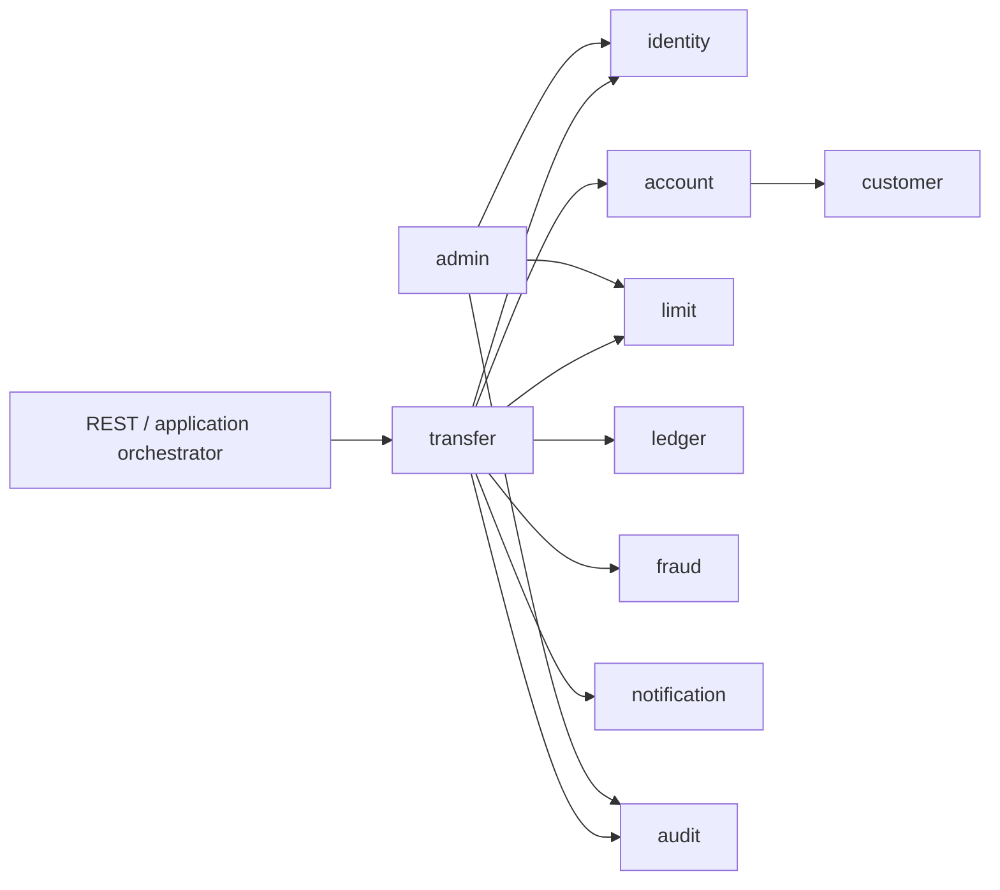

# 05. Hợp đồng giao tiếp giữa các module

> **Dự án:** Digital Banking MVP — Single-Bank, Core Simulated
> **Mã tài liệu:** `DESIGN-MOD-05`
> **Phiên bản:** v0.18 draft — baseline Transfer v1. BE-INT-03 xác minh session binding, staff read và Audit C3
> **Ngày cập nhật:** 19/11/2026

## 1. Mục đích, phạm vi và cách đọc

Tài liệu xác định **provider, consumer, dữ liệu trao đổi, transaction, lỗi và cách kiểm chứng** cho các điểm tích hợp backend. Mục tiêu là cho phép các owner phát triển song song và phát hiện sai lệch sớm. Đây là hợp đồng **nội bộ trong một Spring Boot modular monolith**, không phải REST hay message contract giữa các microservice; HTTP công khai vẫn theo `07` và OpenAPI.

**Trạng thái nội dung:** Các bất biến gắn nguồn là baseline; tên operation, DTO, chữ ký và các chi tiết được đánh dấu **Đề xuất** là bản dự thảo để các owner chốt, không phải API đã triển khai hoặc đã được duyệt. `docs-common/01–11` ưu tiên hơn `design/`, sau đó mới đến `docs-backend/`; không tự chọn khi các nguồn `01–11` mâu thuẫn. Nếu `design/` khác nguồn cấp trên, ghi chênh lệch và chuyển owner xử lý; tài liệu này không sửa chính sách nghiệp vụ.

Cách dùng: owner đọc §2–§4, rồi tìm operation của module mình tại §5–§12; cùng consumer chốt DTO/lỗi và contract tests theo §13 trước khi code. §14 ghi quyết định mở và trách nhiệm. Những câu lệnh giả mã không phải class hoặc schema đã có.

## 2. Bản đồ module và quyền sở hữu

Nguồn: `06` §6.2–§6.3, §8.1; `04` §4. Một bảng có **một write-owner**; consumer không ghi trực tiếp, không truy cập repository/entity của provider. Read cross-module qua public API hoặc projection được khai báo và review; không join tùy tiện trong write path.

| Provider | Dữ liệu / chức năng sở hữu | Consumer chính | Contract |
|---|---|---|---|
| `identity` | user, role/permission, session, challenge | `transfer`, `admin`; security SPI tại `common` | §5 |
| `customer` | customer, hồ sơ/PII | `account`, `identity` khi cần ánh xạ, `admin` | §6 |
| `account` | account, ownership, status, materialized balance | `transfer`, `ledger` cho read, `admin` | §7 |
| `transfer` | transfer, idempotency; orchestration T0–T2 | adapter REST, composition đọc được phân công | §8 |
| `ledger` | ledger entries append-only | `transfer`, reconciliation/read do owner phân công | §9 |
| `limit` | limit config/usage | `transfer`, `admin` | §10 |
| `audit` | audit log, retention/legal hold | mọi owner cần audit, `admin` | §11.1 |
| `fraud` | rule config, flag | `transfer`, `admin`/ops theo quyền | §11.2 |
| `notification` | notification/outbox, delivery | `transfer`; `identity` dùng gateway OTP theo hợp đồng riêng | §11.3 |
| `admin` | approval request, điều phối maker/checker | REST/ops; gọi provider identity, limit, audit | §12.1 |
| `common` | error, context, crypto, Clock, security infrastructure; **không có business table** | mọi module | §12.2 |

Dependency đi **từ consumer tới `<provider>.api`**; `common` không import business; identity/customer/account không phụ thuộc transfer; business không phụ thuộc admin. Ledger/fraud/notification không import `transfer.api` để callback khi Transfer đã gọi chúng: Transfer truyền facts bằng DTO do **provider** sở hữu. Với query cần tổng hợp, caller ở lớp điều phối ghép projection, hoặc thiết kế read model được phê duyệt; không tạo cycle. `ModuleBoundaryArchTest` hiện kiểm tra cycle ở cấp module và một số rule khác; chưa coi đó là bằng chứng mọi import ngoài `api` đã được enforce.



Sơ đồ chỉ thể hiện chiều dependency điển hình, không khẳng định mọi interface đã tồn tại hoặc cho phép cycle bổ sung. `common` được mọi module sử dụng nhưng không vẽ các cạnh để dễ đọc.

## 3. Quy ước hợp đồng chung

### 3.1. Package, kiểu và bảo mật

- Interface và input/output nội bộ đặt trong `com.simulatedbank.banking.<provider>.api`; implementation ở `application`/`adapter/out`. Module khác không import `application`, `domain`, `adapter` hay JPA entity của provider. Trường hợp SPI kỹ thuật đã có ở `common` được ghi riêng tại §5.1.
- DTO là immutable record/value type, tách REST DTO/entity; không trả `Object`, lazy proxy hay mutable entity. Các chữ ký dưới đây là **pseudo-Java**; trong integration, người điều hành tự chốt tên/bao bì cụ thể theo DEC-INT-003 và kiểm bằng test. Không sao chép nguyên enum/error HTTP vào mọi module.
- `Id` biểu diễn định danh nội bộ có kiểu rõ ràng; mapping HTTP string ↔ DB BIGINT theo `04`/`07`. Giá trị tiền dùng `BigDecimal` tối đa 2 decimal, VND; amount transfer phải > 0, balance/usage/remaining có thể bằng 0, còn delta có dấu chỉ khi operation quy định rõ; không dùng `double`. Timestamp là `Instant` UTC; business date theo policy được chốt. Không trộn `userId`, `customerId`, `accountId` hay reference.
- `ActorContext` **đề xuất**: `actorType`, `userId?`, `customerId?`, permission snapshot cần thiết, `correlationId`, `requestId`; do server tạo từ principal và request context, không tin body client. Job dùng actor SYSTEM. Không truyền raw session token, OTP, full account number hay raw idempotency key qua DTO/log nếu không thật sự cần. Challenge binding có thể cần key; chỉ identity/transfer xử lý, không log.
- Mỗi provider kiểm tra precondition/ownership trong phạm vi mình phụ trách; permission tại endpoint không thay service-level scope. Projection chỉ trả field tối thiểu; `AccountRef` hiển thị masked/last4, không trả encrypted blob/hash. Giao tiếp nội bộ không tự động đồng nghĩa quyền truy cập dữ liệu của người dùng.

### 3.2. Transaction và lỗi

| Ký hiệu | Yêu cầu đối với operation | Failure/điểm kiểm tra |
|---|---|---|
| **R** | Read; không tạo side effect. Dữ liệu trước lock có thể stale. | Không dùng kết quả preflight thay authoritative check dưới lock. |
| **OWN** | Provider mở transaction ngắn riêng cho use case độc lập, không giữ qua request/chờ user/network. | Không gọi từ T2 nếu nó tách commit khỏi transaction tiền. |
| **JOIN** | Phải tham gia transaction caller hiện tại, cùng datasource/transaction manager; không `REQUIRES_NEW`/commit riêng. | Đề xuất fail fast khi không có transaction (`MANDATORY`) ở các operation bắt buộc T1/T2; xác nhận wiring thực tế. `REQUIRED` chỉ an toàn nếu caller thực sự đã mở transaction. |
| **AFTER** | Delivery sau transaction nghiệp vụ commit; worker dùng transaction claim/lease riêng. | Gọi gateway ngoài lock; at-least-once, xử lý retry/trùng. |

Business rejection là outcome có kiểu, được caller map về catalog `07`; không mặc định throw exception gây rollback khi contract yêu cầu commit `FAILED`. Lỗi DB/technical, invariant hoặc audit C1/C2 phải lan ra để transaction rollback; không bắt rồi tiếp tục trong transaction đã bị đánh dấu rollback-only. Các tên lỗi trong bảng là **nhóm lỗi nội bộ**, không tự tạo HTTP code mới. `common`/adapter chịu trách nhiệm map public Problem theo `07` và không lộ SQL/stack/PII. C3 failure không làm mất quyết định từ chối; fallback security log + metric + alert theo `design/01`.

### 3.3. Định dạng ví dụ contract

Trong §5–§12, mỗi operation ghi `Provider ← Consumer`, `Input → Output`, `TX`, precondition/side effect và lỗi. Dấu `?` là nullable; danh sách field là **tối thiểu đề xuất**, không cho phép giả định provider đã thực hiện đầy đủ. `correlationId`/`requestId` có thể được truyền qua `ActorContext`, nhưng phải được kiểm chứng qua ranh giới thread/job; không dựa vào thread-local sau async.

## 4. Luồng phối hợp chuẩn và điểm tích hợp

| Pha | Ai điều phối | Contract chính | Ranh giới và bằng chứng |
|---|---|---|---|
| Preflight/T0 | Transfer + Identity | Session, resolve account, guard và challenge | Request nhận `428` không tự tạo transfer/idempotency/ledger/reservation; request cùng key khác có thể commit đồng thời. Verify ngoài DB transaction. |
| T1 | Transfer | consume challenge + create PENDING/idempotency + audit CREATED | Một transaction ngắn; insert transfer trước idempotency FK; thua unique rollback tất cả và đọc lại ngoài transaction. |
| T2 | Transfer | guard CUSTOMER → transfer → account ASC → limit customer/account → fraud → money/ledger/usage → outbox/status/flush → audit | Một PostgreSQL transaction, READ COMMITTED; audit phase cuối; không network; lock order cần test thật. |
| T3 | Notification | claim/lease outbox → gateway → cập nhật kết quả | Sau commit T2, retry không đổi transfer. |
| Recovery | Transfer | discovery → durable claim → transaction xử lý/evidence | Transaction claim ngắn lấy guard rồi `FOR UPDATE SKIP LOCKED`, reread và ghi epoch/token/lease bền trước commit. Transaction xử lý tiếp theo lấy lại guard → transfer/fence, xác minh claim, đọc evidence và gọi executor **trong cùng transaction xử lý**; không tạo ledger kép (DEC-TRF-014). |
| Approval | Admin | identity step-up + identity/limit apply + audit | Maker khác checker; apply và approval state/audit cùng transaction theo use case. |

`COMPLETED` chỉ sau T2 commit, đúng hai ledger entries cân bằng và audit bền vững. Theo DEC-TRF-003, lỗi biết trước T1 không tạo intent; business rejection sau T1 ghi `FAILED` atomic. Credit lỗi sau debit: rollback phần money về savepoint rồi ghi FAILED trong cùng T2 nếu transaction/persistence context còn dùng được; nếu T2 đã abort chỉ dùng Tfail khi rollback chắc chắn, durable fence bảo vệ khỏi retry và evidence đủ. Nếu commit chưa rõ thì đọc primary, khóa/đọc lại, không đoán trạng thái; thiếu evidence giữ thực trạng và alert. Audit failure rollback khi đã xác nhận rollback. Không retry từng statement trong transaction đã lỗi. Các quyết định chưa chứng minh runtime và còn chờ owner review/test.

## 5. Provider `identity`

Nguồn: `03` FR-001–007, FR-026, AC-033; `06` §7.1; `07` §3, §6; `design/02` §5.1–§5.2.

### 5.1. Session SPI đã tồn tại

`common.config.SessionAuthenticator.authenticate(String opaqueToken) → Optional<Session>` là interface **đã có trong source**; identity cung cấp implementation. `Session` hiện gồm `userId`, `customerId?`, `authorities`, `csrfTokenHash`; `toString()` redacted. Provider kiểm tra token/session/user active, expiry/revocation và permission snapshot theo policy; invalid trả empty, DB/system failure không giả thành login hợp lệ. Không log token hoặc hash CSRF. `common` chỉ biết SPI, không import identity; test phải chứng minh wiring identity thật, expiry/revocation và CSRF. Không tạo interface trùng để thay SPI này.

**BE-INT-03 / DEC-INT-008:** Identity resolve `customerId` cho user `CUSTOMER` qua `customer.api.CustomerQuery.findByUserId` khi tạo principal và AuthResponse (login sau MFA, `/auth/session`). Có row `ACTIVE` hoặc `INACTIVE` → trả ID; không có mapping → `customerId=null` và API self trả `404 CUSTOMER_NOT_FOUND` qua lookup authoritative; staff → null. Lỗi DB Customer → `503 SERVICE_UNAVAILABLE`, không giả thành mapping vắng. Consumer không tin `Session.customerId` như bằng chứng ownership duy nhất và không nhận binding từ client. Identity cần provider CustomerQuery trong cùng deployable. Xem [báo cáo BE-INT-03](../../docs-backend/workofteam/integration%20modules/BE-INT-03-verification.md).

### 5.2. Step-up challenge — `identity.api.StepUpChallengePort`

| Operation / consumer | Input → Output | TX và hành vi | Lỗi / consumer xử lý |
|---|---|---|---|
| `requestChallenge` ← Transfer/Admin | `purpose`, actor/user, binding (`requestHash`, `idempotencyKey` cho transfer hoặc action binding cho admin), correlation → `challengeRef`, method, expiry, thông tin hiển thị an toàn | **OWN/T0**; tạo challenge theo policy; dispatch OTP/FIDO theo gateway identity sau transaction; không tạo transfer/ledger. Không trả OTP. | Dispatch lỗi theo `07`; invalidate/đánh dấu challenge theo policy; không đi tiếp T1. |
| `verifyChallenge` ← identity adapter | challengeRef + credential → `VERIFIED`/rejection | **OWN/T0**; lock, verify user/purpose/expiry/attempt, cập nhật atomic và audit theo class. | Sai/hết hạn/locked map theo catalog auth; không lộ credential. |
| `findVerifiedBindingIfPresent` ← Transfer | `TransferBinding(userId, customerId, requestHash, bindingKey)` → `Optional<VerifiedChallenge>`; purpose cố định là `TRANSFER_STEP_UP`. | **R primary**, JOIN gate/T1 khi caller đang giữ guard, lookup trong scope actor, purpose và binding chính xác; chỉ trả snapshot `VERIFIED`, chưa consume, chưa hết hạn. Read có thể stale; không consume hoặc thay T1. Không log/tiết lộ raw key, OTP hay secret. | Absent/expired/consumed khác DB/system error; lỗi đọc fail-closed, không coi là absent để phát challenge mới hay bypass. Nhiều bản ghi hợp lệ vi phạm uniqueness → invariant error/alert, không tự chọn. `consumeVerified` phải lock và kiểm lại toàn bộ tại T1; stale snapshot bị từ chối an toàn. |
| `consumeVerified` ← Transfer/Admin | challengeRef, actor, purpose, binding → `ConsumedChallenge(challengeId)` | **JOIN/T1 hoặc approval**; lock row, khớp user/purpose/hash/key, `VERIFIED`, chưa consume, chưa hết hạn; consume tối đa một lần; rollback caller hoàn lại consume. | Mismatch/expired/already consumed là business rejection theo `07`; không tạo side effect tiền. T2 không yêu cầu verify lại chỉ vì challenge hết hạn sau T1 commit. |

BE-INT-05 thêm `requestTransferChallenge(TransferBinding, correlationId)`, `findVerifiedBindingIfPresent(TransferBinding)` và `consumeTransferChallenge(TransferBinding, challengeRef)` vào API Identity. Ba operation kiểm lại mapping user/customer qua CustomerQuery. Purpose được cố định phía server. UUID đi dưới dạng chuỗi ở API Java Identity và dạng UUID ở adapter Transfer. Consume trả cả ID BIGINT để Transfer attach FK. Retry HTTP tiếp tục dùng cùng key và payload.

**Challenge hết hạn và unique index:** `04` §4.2.5 unique active `(idempotency_key, request_hash)` gồm `CREATED/SENT/VERIFIED` chưa consume; một row đã quá `expires_at` nhưng chưa đổi status vẫn chiếm index. Khi cấp lại, Identity trong transaction ngắn khóa và kiểm challenge cũ trong scope hợp lệ, đánh dấu `EXPIRED` khi thực sự hết hạn trước insert challenge mới; không sửa challenge đã consume, không revive challenge cũ. Hai request cấp lại đồng thời phải dùng unique constraint và xử lý conflict/re-read có giới hạn, tối đa một active challenge cho binding; không lộ challenge của user khác. Chỉ dispatch sau transaction commit, theo lifecycle/gateway đã thống nhất. Nếu DB/system lỗi không coi là absent hay cấp challenge mù. Test VERIFIED hết hạn → reissue → challenge cũ không consume, hai request reissue đồng thời, rollback, uniqueness, ownership và gateway failure; Các test BE-INT-05 dùng unique index canonical của Identity.

**Contract tests:** tìm đúng binding VERIFIED, absent, expired/consumed, khác user/customer/purpose/hash/key và DB error; nhiều bản ghi không hợp lệ → invariant error. Snapshot hết hạn/consume giữa lookup và T1 phải bị lock/revalidate từ chối, hai transaction consume chỉ một thắng; rollback T1 trả challenge về trạng thái trước consume; max attempts và retry theo policy. Request 428 không tạo transfer/idempotency/ledger, nhưng request cùng key khác có thể commit đồng thời. [DEC-TRF-001/002/008](../../../DECISIONS.md) đã chọn thành phần tổng, threshold và guard/reservation; Bằng chứng T0/T1 nằm ở §8.3.

#### 5.2.1. BE-ID-IMP-07 — provider Identity và giới hạn integration

Theo [DEC-ID-007](../../../DECISIONS.md), triển khai trên `datht-backend-rework` dựa `origin/dev2@56210cc`; không coi mục này là phê duyệt protocol MOD-OI-01/09:

- Dùng lại `identity.api.StepUpChallengePort`, không tạo subsystem challenge thứ hai. `consumeVerified` bắt buộc JOIN transaction caller (`MANDATORY`), kiểm ref/user/purpose/hash/key/state/expiry và chỉ một committed consume; rollback caller hoàn lại quyền consume.
- `POST /api/v1/auth/step-up/verify` theo `07` §6.4/§8.1.5 lấy user từ session, chỉ OTP và purpose step-up/sensitive; không nhận user/hash/key từ client, không cấp session login. Method/purpose mismatch không mutate challenge.
- **Consumer chưa có:** Transfer/Limit/Account/Ledger/Audit runtime chưa triển khai trên baseline/working tree. Phương án thay thế là consumer fixture và gateway fake **chỉ trong test**, ghép port thật với PostgreSQL thật và HTTP error/security thật; không đưa fake thành bean production. Đây là provider/consumer-contract evidence, không phải integration money path.
- Binding phải so khớp nguyên vẹn; không cho PostgreSQL ép kiểu làm cắt hash/key sai thành giá trị đúng. Expiry phải được kiểm tra tại thời điểm consume sau khi lấy row lock, không dựa thời điểm transaction bắt đầu. Không thêm schema/enum challenge mới.
- Transfer phải tra idempotency trước step-up; terminal replay không consume lần hai; T1 insert-first, consume và audit cùng commit/rollback; T2 thất bại giữ challenge consumed và retry theo transfer đã tạo (`design/02` §5.1–§5.2). **Chưa có runtime để chứng minh** thứ tự này, partial unique `transfer.step_up_challenge_id`, HTTP 428 không có business writes hoặc replay terminal.
- Gate tích hợp vẫn **BLOCKED**: MOD-OI-01/09, consumer Transfer/Limit và provider transaction thật. Không coi test fixture là bằng chứng chống duplicate transfer hoặc bỏ qua policy tổng ngày.


### 5.3. Role/session command — Đề xuất `identity.api.IdentityRoleCommand`

`applyApprovedRoleChange(approvalId, targetUserId, roleChange, expectedVersion, actorContext) → RoleChangeResult` ← Admin; **JOIN** cùng approval transaction. Identity xác thực target, quyền, version và transition; cập nhật bảng identity, xử lý revoke session theo policy; admin giữ maker/checker và approval state. Không import `admin` DTO/entity vào identity; `approvalId` là ID và input được kiểm tra. Stale version/invalid state là business conflict; lỗi DB/audit C2 rollback cả approval và thay đổi. Kiểm thử maker/checker, stale approval, revoke và rollback. Vai trò, permission, quy tắc revoke chi tiết theo `07` và owner Identity/Admin chốt.

#### 5.3.1. BE-ID-IMP-11 — extension được người điều hành duyệt và boundary còn phụ thuộc

Theo [DEC-ID-011](../../../DECISIONS.md), thêm version assignment Identity và policy revoke; không coi draft §5.3 hoặc test fixture là sign-off của Admin/Audit:

- `identity.api.IdentityRoleCommand.getRoleAssignmentVersion(targetUserId)` cung cấp version authoritative cho Admin maker capture vào approval payload. Không thêm field version vào REST `07` §8.8 hoặc cho Admin đọc trực tiếp bảng Identity.
- `applyApprovedRoleChange(ApprovedRoleChange)` **JOIN/MANDATORY**. Input provider-owned: approval ID, maker/checker IDs, approval state `APPROVED`, target ID, operation `ASSIGN_ROLE/REVOKE_ROLE/GRANT_PRIVILEGE/REVOKE_PRIVILEGE`, role/privilege code, expected version và correlation/request IDs. Approval facts chỉ do trusted Admin orchestrator tạo sau khi lock/validate approval và consume step-up `SENSITIVE_ACTION`; không nhận trực tiếp object này từ HTTP client. Identity không thể xác thực row approval khi provider Admin chưa có và không được đọc/ghi chéo bảng.
- Identity đối chiếu principal Spring Security với checker, nạp quyền mới từ DB (maker Admin + `ROLE_MANAGE`; checker thêm `CHECKER`), kiểm user `ACTIVE`/`STAFF`, maker khác checker và target khác cả hai; target `ACTIVE`, role catalog và user type hợp lệ. `CHECKER` vẫn là privilege, không là role. Không sửa role/permission definitions.
- Forward migration `V4__add_role_assignment_version.sql`: `app_user.role_assignment_version BIGINT NOT NULL DEFAULT 0`, không âm. Khóa user theo ID tăng dần, refresh authoritative data sau lock, so `expectedVersion`, tăng đúng 1 khi mutation thực sự; stale/duplicate/no-op → `ROLE_CONFLICT`, không revoke/bump. Không dùng `updated_at` làm version hoặc thêm distributed lock.
- Mọi mutation revoke toàn bộ session `ACTIVE` của target thành `LOGGED_OUT` và ghi `logged_out_at` trong cùng transaction; giữ nguyên session user khác. Opaque token phải đi qua SPI validate mỗi request; không JWT, blacklist hay refresh-token subsystem.
- Result trả approval/target/operation/code, previous/resulting version, revoked-session count, correlation/request IDs. Admin update approval `APPLIED` và chuyển facts cùng maker/checker sang Audit `ROLE_CHANGE_APPROVED` **cuối cùng transaction**. Không emit event tên mới cho revoke hoặc duplicate audit trong Identity.
- Terminal approval → `APPROVAL_ALREADY_DECIDED`; pending/stale/self/no-op/type conflict → `ROLE_CONFLICT`; target thiếu → `USER_NOT_FOUND`; role không hợp lệ/disabled → `ROLE_NOT_FOUND`; actor thiếu → `AUTH_SESSION_EXPIRED`, thiếu quyền → `AUTH_FORBIDDEN`. Lỗi persistence/revoke/Audit C2 phải rollback toàn caller transaction, không trả success giả.
- **Phương án thay thế kiểm thử khi dependency thiếu:** test-only Admin/Audit fixture giữ approval/audit rows riêng, gọi Identity/step-up/JPA và security chain thật để kiểm commit/rollback/concurrency/HTTP denial. Production Admin endpoint, capture/version payload, approval lock/decision/step-up, Audit durable/hash chain và C3 failure events vẫn **BLOCKED** đến khi owner cung cấp runtime và chạy integration thật; OI-API-19/MOD-OI-09 không tự đóng.

### 5.4. BE-ID-IMP-08 — login MFA và device metadata

Theo [DEC-ID-008](../../../DECISIONS.md), người điều hành chọn **MFA cho mọi password login**, không mở rộng contract persistent device credential/lifecycle:

- `PasswordLoginService.login` chỉ trả challenge LOGIN_NEW_DEVICE; deviceRef/fingerprint/UA/IP/trusted row không cấp session hoặc bypass MFA. Primary eligibility/device metadata được commit trong transaction OWN ngắn trước khi issue challenge OWN và dispatch ngoài transaction, kể cả caller có ambient transaction; không giữ uncommitted device FK qua transaction issue.
- `auth_challenge.device_id` bind optional context đã resolve theo user; public API-AUTH-04 lấy user/device từ challenge, không từ body/header. Ref challenge không phải session token. Giữ nguyên request JSON và response 202/200 theo `07`.
- `OtpChallengeService.verifyLoginChallenge` dùng OTP state machine/Argon2id hiện có. Nhánh đúng mark VERIFIED, consume và `LoginSessionService.complete` JOIN/MANDATORY trong cùng OWN transaction; user/device recheck, session/OTP attempt/last-seen và C2 VERIFIED/LOGIN_SUCCESS commit hoặc rollback đồng thời. Wrong attempts vẫn commit; challenge đã consume không tạo session lần hai.
- Device registration metadata dùng unique user/fingerprint; không tự trust/reactivate revoked. Session có device context bị từ chối khi device owner/status không hợp lệ. Không thêm schema/enum, public trust/revoke API hoặc raw device secret.
- `OtpGateway` và Audit persistence thật còn thiếu: fail-closed khi không dispatch được; fake capture/controlled failure chỉ trong test, không coi đó là provider production. Durable resend/handoff MOD-OI-07 vẫn OPEN. Persistent trust bypass/expiry/re-registration giữ PARTIAL theo lựa chọn người điều hành.

### 5.5. BE-ID-IMP-10 — extension verification FIDO được duyệt, dependency chưa hoàn tất

Theo [DEC-ID-010](../../../DECISIONS.md), người điều hành duyệt thêm verification material trong schema Identity và policy UV required/counter/fallback. Không coi đây là sign-off thay Audit/Notification hoặc enrollment.

- API-AUTH-03 begin/finish giữ nguyên `07` §8.1.3; dùng Yubico `webauthn-server-core`, nonce durable gắn `auth_challenge`, COSE public key/userHandle/counter gắn `device`. Không tạo protocol liên module hoặc challenge subsystem mới.
- `LoginSessionService.completeFido` JOIN/MANDATORY dùng cùng session/consume/authorities pipeline với OTP. Challenge → user → device locks; signature/counter, challenge VERIFIED/consume, counter/session/attempt/C2 commit hoặc rollback cùng nhau. Failure attempt commit trước khi trả lỗi.
- Fallback chỉ bắt đầu lại API-AUTH-01 password + API-AUTH-04 OTP theo DEC-ID-008; không carry FIDO assurance, không chuyển FIDO challenge thành OTP challenge. Cancellation/capability/unavailability do client chọn password, không invent cancellation endpoint; Passcode positive còn BLOCKED.
- **Dependency thiếu:** enrollment/provisioning trusted credential, provider OTP thật và Audit persistence. Phương án thay thế kiểm thử: provision credential bằng fixture có key pair thật, gateway fake test-only, spy audit failure; verification/security/persistence/HTTP thật không mock signature. Không đưa provisioning/fake provider vào production, không coi test thay integration Audit/Notification.


### 5.6. BE-ID-IMP-12 — REST DTO và bằng chứng khi provider chưa có

- REST API-AUTH-01..07 dùng application services Identity hiện hữu; DTO không là entity hoặc DTO nội bộ cross-module. Validation hình thức và RFC 9457 dùng Common pipeline duy nhất, không thay session/CSRF/transaction boundary.
- Theo [DEC-ID-012](../../../DECISIONS.md), không tạo implementation giả cho API-AUTH-08: resend atomic cần schema/counter/generation/in-flight protocol được duyệt ở §11.3.1/MOD-OI-07. Positive Passcode/device proof còn phụ thuộc DEC-ID-009; FIDO/PASSCODE step-up chưa có provider xác thực.
- Phương án thay thế theo §13.1: test controller dùng application mocks để kiểm success DTO/error serialization; regression HTTP/PostgreSQL dùng service, token validation và security chain thật, gateway capture/audit-failure fixture chỉ test. Không suy ra external delivery, enrollment, durable Audit hoặc transfer integration từ các PASS này.
- `ChallengeView` chưa có trusted-contact projection để cấp maskedDestination; `LoginResult` chưa có Customer projection. Không bịa PII/customer ID hoặc đọc chéo bảng; Customer/Notification cung cấp API/projection được review trước khi đóng end-to-end.


## 6. Provider `customer` — Đề xuất `customer.api.CustomerQuery`

Nguồn: `03` FR-008–011, FR-039; `06` §6.2; `07` §3.6, §8.2.

| Operation / consumer | Input → Output | TX / điều kiện | Lỗi / test contract |
|---|---|---|---|
| `findByUserId` ← Identity/Account | userId → `Optional<CustomerIdentity(customerId, userId, status, kycStatus)>` | **R**; chỉ snapshot tối thiểu, không full PII. Identity cần mapping phải xác nhận hướng dependency không tạo vòng. | Không thấy khác lỗi DB; test inactive/KYC, mapping nhất quán. |
| `getCustomerView` ← Account/Admin | customerId + actor/scope → masked profile theo quyền | **R**; service consumer và provider phân định rõ ai kiểm ownership/permission; không trả national ID đầy đủ. | Not found/forbidden không lộ PII; test cross-customer và staff scope. |
| `resolveNotificationDestination` ← Notification/Identity | customerId, channel, SYSTEM actor được xác thực và purpose `TRANSFER_OUTCOME`/`OTP_DELIVERY` → destination nhạy cảm tạm thời + contact version | **R**, sau commit T2/T0 và ngay trước gửi; Customer kiểm scope/purpose, trạng thái và consent/channel policy, lấy contact hiện hành; caller không lưu destination thô vào outbox/log/audit, không cache lâu hay trả client. | Không có/disabled/không đồng ý là kết quả riêng; forbidden và lỗi DB/system không giả thành không có. Provider-owned DTO không lộ entity; kiểm quyền SYSTEM và test thay đổi contact/consent, lỗi và masking. |

Theo DEC-TRF-011, thông báo được gửi tới contact hợp lệ **tại lúc gửi**, không phải snapshot lúc tạo transfer; điều này cho phép thay đổi/thu hồi contact hoặc consent trước delivery. Notification và Identity phải dùng purpose tương ứng, không tự đọc bảng Customer. Không có endpoint nội bộ thực tế thì mock ở test/dev và chưa coi integration là sẵn sàng. Phương án thay thế không chọn cho MVP: mã hóa snapshot destination trong outbox với retention/key management và security review, hoặc chỉ gửi in-app cho transfer outcome; in-app không thay thế giả định kênh OTP. Không giả định mọi transfer cần điều kiện KYC bổ sung ngoài SRS/policy đã duyệt. Nếu Identity cũng cần gọi Customer, Customer không import ngược Identity; identity ID là value, không là identity entity. Mã hóa, blind index và masking thuộc owner customer qua common primitives.

**BE-INT-08 / DEC-INT-017:** `customer.api.CustomerDeliveryContact` là port delivery dành riêng cho caller nội bộ. `forOtpUser(userId)` chọn hồ sơ ACTIVE theo Identity ID. `forTransferOutcome(customerId)` chọn số SMS của hồ sơ ACTIVE có `transfer_sms_allowed=true`. Hai operation trả contact hiện hành và `updated_at`, hoặc kết quả typed khi vắng/hồ sơ inactive/không có số/chưa đồng ý. Lỗi DB và lỗi giải mã vẫn lan ra. Port không có HTTP route. Chỉ adapter SMS dùng số đã giải mã. Staff demo có danh bạ cấu hình server cho ID đã provision khi không có Customer row.

#### 6.1. BE-CUS-IMP-04 — `findByUserId` đã triển khai; chênh lệch kycStatus được ghi lại

Theo [DEC-CUS-003](../../../DECISIONS.md), owner Customer chốt và triển khai phần `findByUserId` trên `datht-backend-rework`; dòng `kycStatus` ở bảng trên là draft chưa được duyệt:

- Đã triển khai: `customer.api.CustomerQuery.findByUserId(long userId) → Optional<CustomerIdentity(customerId, userId, Status)>` — record bất biến, enum api `Status { ACTIVE, INACTIVE }` tách khỏi `customer.domain.CustomerStatus` để consumer không import domain. TX **R** (`readOnly = true`), không side effect, không decrypt PII, không tự tạo Customer row.
- Chênh lệch với draft: **bỏ `kycStatus`** vì `03` không có yêu cầu KYC, `04` §4.2.2 không có cột KYC/CIF, và `_overview/02-customer.md` (CIF/KYC/national ID/FROZEN/CLOSED) đã bị ghi xung đột tại CUS-OI-01; theo hierarchy nguồn (01–11 > design/ > overview) không tự bổ sung dữ liệu chưa duyệt. Nếu owner duyệt KYC sau này, mở rộng hợp đồng bằng task riêng.
- Missing mapping (user lạ hoặc user không có Customer row) → `Optional.empty()`; row `INACTIVE` vẫn trả snapshot kèm status. POST Transfer áp dụng DEC-INT-013 cho key mới. `userId <= 0` → `VALIDATION_ERROR`.
- Consumer: Account runtime chưa tồn tại trên baseline; Identity wiring `AuthResponse.customerId`/`Session.customerId` thuộc owner Identity. Customer không import ngược Identity. ArchUnit: api không phụ thuộc entity/adapter/application/domain; module ngoài không import customer internals; `CustomerQuery` chỉ được implement trong `customer.application`; api không có field String (chặn PII dạng text).
- `getCustomerView` vẫn **BLOCKED** bởi CUS-OI-02 (mask fullName cho staff) và CUS-OI-05 (scope + audit runtime), thuộc BE-CUS-IMP-06.

#### 6.2. BE-CUS-IMP-05 — REST self `GET /api/v1/customers/me` đã triển khai trên hợp đồng `findByUserId`

Theo [DEC-CUS-004](../../../DECISIONS.md), owner Customer triển khai `API-CUS-01` (07 §8.2.1) trên `datht-backend-rework`, không thêm hợp đồng mới — chỉ tiêu dùng đúng §6.1:

- `customer.adapter.in.CustomerProfileController`: principal từ `SessionAuthenticationFilter.session` (attribute tin cậy của common security chain, cùng cơ chế `AuthController`); 401/403 do chain thực thi trước handler (rule hiện hữu `GET /api/v1/customers/me → ACCOUNT_READ_SELF`); endpoint không nhận danh tính từ query/body/header.
- `customer.application.CustomerProfileService` (TX `R`): `CustomerQuery.findByUserId(actorUserId)` → mapping vắng → `404 CUSTOMER_NOT_FOUND` (không tự tạo row); mapping trúng → `CustomerPiiService.getForOwner(customerId, actorUserId)` tái kiểm ownership (mismatch → `403 AUTH_FORBIDDEN`, không decrypt) rồi trả projection owner-safe (fullName đầy đủ, phone/email mask, contact vắng → JSON null). INACTIVE vẫn 200 kèm status — eligibility là CUS-OI-06, consumer tự quyết. Lỗi persistence/crypto lan truyền nguyên trạng, không reclassify thành 404.
- `customer.adapter.in.CustomerProfileResponse`: đúng 8 field `CustomerProfile` (07 §7.2.9) — `customerId`/`userId` decimal string, `status` enum ACTIVE/INACTIVE, `createdAt`/`updatedAt` Instant UTC; không correlationId trong body (header `X-Correlation-ID` do `CorrelationAndRequestIdFilter`), `Cache-Control: no-store` do `ApiSecurityHeadersFilter` + controller.
- Tenant isolation: schema v1 (04 §4.2.2) không có tenant column — isolation là ownership 1:1 user↔customer; không tự thêm.

#### 6.3. BE-CUS-IMP-06 — REST staff `GET /api/v1/admin/customers/{customerId}` (API-ADM-01); scope tại thời điểm IMP-06

Theo [DEC-CUS-005](../../../DECISIONS.md), owner Customer triển khai phần độc lập của `getCustomerView` (07 §8.2.4) trên `datht-backend-rework` — dòng `getCustomerView` ở bảng trên là draft, hợp đồng runtime được chốt như sau:

- **REST trong owner Customer:** `customer.adapter.in.CustomerAdminDetailController` + `customer.application.StaffCustomerDetailService` + `CustomerPiiService.getForStaff` (không thêm hợp đồng `customer.api` mới — masked view chứa String PII nên phải ở `application`, ArchUnit api-no-String giữ nguyên). Admin orchestrator tương lai tiêu dùng đúng REST này hoặc mở rộng `customer.api` bằng task riêng.
- **Authorization:** chain dùng chung `hasAuthority("CUSTOMER_READ")` (rule hiện hữu, không sửa chain) + service re-check `CUSTOMER_READ` từ snapshot `SessionAuthenticationFilter.session`; sai định dạng `customerId` (`[1-9][0-9]{0,18}`, openapi `ID`) → 400 trước lookup; thiếu permission → 403 + audit **trước** lookup (anti-enumeration); row vắng → 404 `CUSTOMER_NOT_FOUND` không audit; INACTIVE vẫn 200 kèm status (CUS-OI-06).
- **Masking:** tất cả PII masked — `fullName` theo `PiiMaskingUtils.maskFullName` (DEC-CUS-005, CUS-OI-02 chờ owner chốt oracle), phone/email mask như owner (07 §8.2.4). Response tái dùng schema `CustomerProfile` 8 field (07 §7.2.9), không thêm field.
- **Audit deny:** `SECURITY_ACCESS_DENIED` C3 (REJECTED) — service-level qua `CustomerAuditPort`/`CustomerSecurityLogAuditAdapter` (pattern DEC-ID-003, security log + metric; persistence `audit_log` thuộc module audit BLOCKED) và chain-level qua `common.config.SecurityAccessDeniedAuditor` nghe `AuthorizationDeniedEvent` (gỡ BLOCKED §8 của BE-ID-IMP-13; chỉ 403-sau-xác-thực; label bounded). Truy cập staff hợp lệ không phát action audit riêng (design/01 §5.7).
- **Vẫn BLOCKED (CUS-OI-05):** data-scope staff chưa có model/hợp đồng runtime — hiện chỉ enforce permission đã duyệt, mọi staff có `CUSTOMER_READ` đọc được mọi customer row; Admin/Security/BA chốt scope trước khi coi endpoint này production-complete. Xung đột AUDITOR (07 §8.2.4 "với CUSTOMER_READ" vs seed A.2 không cấp AUDITOR `CUSTOMER_READ`) đã ghi nhận tại DEC-CUS-005 — hiện AUDITOR nhận 403 fail-closed.

**Cập nhật BE-INT-03 / DEC-INT-008:** người điều hành chốt staff data scope **single-bank MVP** là toàn bộ customer trong ngân hàng cho staff có `CUSTOMER_READ`, chỉ qua exact-ID masked view; `AUDITOR` không có permission này nên tiếp tục 403. Không có branch/segment/tenant scope trong schema v1. Dòng BLOCKED lịch sử ở trên áp dụng cho yêu cầu scope chi nhánh/segment tương lai, không còn là quyết định mở cho phạm vi MVP này. Runtime và C3 trên PostgreSQL được ghi tại [báo cáo BE-INT-03](../../docs-backend/workofteam/integration%20modules/BE-INT-03-verification.md).

#### 6.4. BE-CUS-IMP-07 — trạng thái tích hợp thật và phương án khi provider còn thiếu

- **Identity — tích hợp thật trong phạm vi Customer:** request đi qua
  `identity.adapter.out.IdentitySessionAuthenticator` → `common.config.SessionAuthenticationFilter`;
  principal `Session` tin cậy được security chain đưa vào controller. Self-service chỉ lấy `userId`
  từ principal rồi resolve bằng `CustomerQuery.findByUserId`; không nhận `customerId`, role hoặc
  permission từ client. User/session thiếu, hết hạn, disabled hoặc không resolve được đều fail-closed.
  `Session.customerId` hiện vẫn `null`; Customer không phụ thuộc field này và không import Identity
  internals, tránh cycle.
- **Account — READ DONE, WRITE/HTTP BLOCKED:** `account.api.AccountQuery`/`AccountBalance` đã
  được chốt và implement dạng interface + DTO bất biến tại BE-ACC-01 (§7.1–§7.2). BE-ACC-02 tạo
  `V8__create_account_table.sql`; BE-ACC-03 hiện thực `AccountEntity`, `AccountReadPort`/JPA reader
  và crypto AES-256-GCM + HMAC-SHA256 blind index qua Common; BE-ACC-04 hiện thực
  `AccountQueryService` (find/resolve/view/ownership, 403 + C3, 404 không audit) và
  `AccountAccessService` (resolve `userId → customerId` qua `CustomerQuery`, không nhận
  `customerId` client). REST adapter `API-ACC-01/02`, security chain/401, `owner.fullName`,
  staff data scope, durable C3 và money path `AccountBalance` vẫn chưa có runtime — thuộc
  BE-ACC-05..09 và các decision BLOCKED tương ứng. Consumer dùng `account.api` + PostgreSQL thật;
  không tạo endpoint/entity/repository Account giả và không tuyên bố end-to-end khi thiếu adapter.
- **Admin — PARTIAL:** API-ADM-01 dùng RBAC Identity thật và re-check `CUSTOMER_READ` tại service;
  metadata role/permission client gửi bị bỏ qua. Runtime data-scope staff vẫn thiếu contract/model
  (CUS-OI-05), vì vậy permission đã kiểm chứng nhưng scope production còn BLOCKED.
- **Audit — PARTIAL:** deny dùng C3 `SECURITY_ACCESS_DENIED` qua structured security log + metric,
  có actor, target, outcome, `correlationId` và `requestId`; `SafeJsonLogEncoder` chỉ serialize
  field allowlist và drop raw message/PII/token. Failure giữ nguyên quyết định 403. Contract còn
  thiếu chính xác là production `audit.api.AuditModuleApi.recordStandalone(AuditEvent)` và
  persistence `banking.audit_log`/hash chain do owner Audit cung cấp. Test adapter/failure hiện tại
  chỉ là Customer-side evidence, không phải durable Audit integration.
- ArchUnit chặn Customer phụ thuộc `identity/account/admin/audit` internals; chỉ `common` SPI hoặc
  `<provider>.api` được phép. Khi provider Account/Audit xuất hiện, owner phải chạy lại HTTP +
  PostgreSQL integration thật; không thay test double thành production bean.

#### 6.5. BE-CUS-IMP-09 — provisioning/create/update/status contract gate

Đối chiếu `03`, `04` §4.2.2, `07` §7.1/§8.2, OpenAPI và CUS-OI-01/03/04/06 cho thấy chưa có operation write Customer nào được duyệt. Chỉ hai operation đọc `GET /customers/me`, `GET /admin/customers/{customerId}` và `CustomerQuery.findByUserId` có caller/schema/quyền/lỗi rõ ràng.

- **Contract còn thiếu:** owner/caller tạo `app_user` + Customer; endpoint hoặc internal command; request/response/error; field mutable/immutable; source→target status transition; permission/scope; Customer audit action C2 và `AuditModuleApi.recordInTransaction`; idempotency key/scope/fingerprint/replay/conflict/retention; policy tác động `INACTIVE` tới Account/Transfer. Identity không có provisioning API/command; Audit/Admin/Account chỉ có skeleton hoặc dependency còn BLOCKED.
- **Không dùng thay thế production:** `CustomerPiiService.create` và các method `replace*ForOwner` là primitive nội bộ đã duyệt tại DEC-CUS-002 để kiểm chứng encryption/ownership/rollback, không phải workflow provisioning hay public mutation contract. Unique `customer.user_id` chỉ bảo đảm at-most-one row, không định nghĩa idempotent replay.
- **Phương án kiểm thử khi dependency thiếu:** seed `app_user` CUSTOMER bằng fixture, gọi primitive Customer trực tiếp, dùng PostgreSQL thật để kiểm ciphertext/FK/unique/rollback và dùng port in-memory để kiểm ownership trước decrypt. Không mock Identity/Audit thành success production, không thêm endpoint, idempotency table, status transition hoặc side effect Account/Identity. Khi owner phê duyệt contract write, thay fixture bằng provider thật và bổ sung HTTP + PostgreSQL + audit atomicity/concurrency tests.

#### 6.6. BE-CUS-IMP-10 — staff search/full-PII gate và dependency còn thiếu

Đối chiếu `03` FR-039/049/052 + DAR-002/004, `07` §3.4–§3.6/§8.2.4/§11.3, OpenAPI, security design và audit catalog cho thấy chỉ exact-ID masked detail `GET /admin/customers/{customerId}` được duyệt. `OI-API-08` (search) và `OI-API-09` (full PII) vẫn là open issue; đề xuất một path hoặc nguyên tắc “quyền + mục đích” không phải operation contract.

- **Phần đã có, không mở rộng ngầm:** Customer giữ PII encrypted, `API-ADM-01` dùng `CUSTOMER_READ`, principal Identity tin cậy, service re-check và masked projection; deny dùng `SECURITY_ACCESS_DENIED` C3. `CUSTOMER_READ` không đồng nghĩa quyền full PII.
- **Contract search còn thiếu:** approved business use case; fields/match/normalization; minimum specificity và anti-enumeration; result field/masking; page/sort/max size; role/permission; organizational/data scope; error/version contract. Không có repository query, blind index hay collection route được phép suy ra từ FR-049.
- **Contract full PII còn thiếu:** permission riêng; eligible roles; approved purpose metadata/validation; target + field-level scope; response schema/route; step-up/session control nếu cần; success/deny audit action, class và failure policy. Audit payload tiếp tục cấm raw PII.
- **Provider dependency:** Identity/DB owner phải cấp permission + role mapping đã duyệt; Admin/Security cung cấp authoritative staff scope; Audit cung cấp durable `AuditModuleApi`/`audit_log` và action catalog. Các provider này chưa có contract/runtime đủ cho IMP-10.
- **Phương án khi dependency thiếu:** không tạo fake production, temporary permission, unrestricted lookup hoặc full-PII projection. Chỉ chạy regression trên masked exact-ID boundary hiện hữu; fixture/test không được coi là BA/Security approval. Sau khi owner đóng gate, cập nhật `07` + OpenAPI contract-first, rồi chạy HTTP/PostgreSQL/authorization/scope/audit/log-leak/backward-compatibility tests với provider thật.

Quyết định giữ **P2 BLOCKED** tại DEC-CUS-008; không đổi public API, schema, RBAC seed hoặc Customer production source.


## 7. Provider `account`

Nguồn: `03` FR-012, FR-015; `04` §4.3; `06` §8.1–§8.3; `design/02` §5.3, Appendix A.

### 7.1. Read — `account.api.AccountQuery` (chốt tại BE-ACC-01, 17/11/2026)

Signature đã implement trong `digitalbanking-backend` (`account/api/AccountQuery.java`); thay đổi
signature là thay đổi hợp đồng (BE-CON-45) và phải cập nhật cả consumer.

```java
enum Status { ACTIVE, LOCKED, CLOSED }              // 04 §4.3.1 / OpenAPI AccountStatus
record AccountSnapshot(long accountId, long customerId, Status status, String currency,
                       String accountNumberMasked, String accountNumberLast4)
record AccountView(long accountId, long customerId, Status status, String currency,
                   BigDecimal availableBalance, BigDecimal ledgerBalance,
                   String accountNumberMasked, String accountNumberLast4,
                   Instant createdAt, Instant updatedAt, Instant asOf)
record AccountViewQuery(long accountId, Long ownerCustomerId, String correlationId) {
    static AccountViewQuery forOwner(long accountId, long customerId, String correlationId);
    static AccountViewQuery forStaff(long accountId, String correlationId);
}
Optional<AccountSnapshot> findAccount(long accountId);
Optional<AccountSnapshot> resolveDestination(String accountNumber);
AccountView getAccountView(AccountViewQuery query);
void assertOwnership(long accountId, long customerId, String correlationId);
```

| Operation / consumer | Input → Output | Điều kiện / lỗi / test |
|---|---|---|
| `resolveDestination` / `findAccount` ← Transfer | accountNumber **hoặc** accountId → `AccountSnapshot` | **R**; number normalize `^[0-9]{6,20}$` (OpenAPI) + HMAC lookup do account sở hữu, không log số đầy đủ; empty khi không tồn tại; sai định dạng → `VALIDATION_ERROR`. Kết quả preflight không thay kiểm tra T2. |
| `getAccountView` / `assertOwnership` ← Transfer/Ledger/Admin | `AccountViewQuery` (owner scope hoặc staff scope) + accountId/customerId → masked projection hoặc kết quả từ chối | **R**; owner mismatch → `403 AUTH_FORBIDDEN` + audit C3; không tồn tại → `404 ACCOUNT_NOT_FOUND`; staff scope chỉ sau khi caller đã enforce `ACCOUNT_READ`. Test source không thuộc customer, staff thiếu quyền và account không tồn tại. |

Ngoài phạm vi port: `owner.fullName` của `AccountDetail` do Customer provider cung cấp (§6.2
`getCustomerView` – chưa triển khai/duyệt mask oracle) và được adapter Account ghép; Account không
đọc PII Customer. List self/staff (`GET /api/v1/accounts`, `API-ADM-02`) là use case nội bộ của
Account, không thêm operation cross-module.

#### 7.1.1. BE-ACC-05 — REST `API-ACC-01/02` đã triển khai; alternative cho `owner.fullName`

`account.adapter.in.AccountController` đã hiện thực `GET /api/v1/accounts` và
`GET /api/v1/accounts/{accountId}` trên `AccountAccessService` + `AccountQuery` (owner/staff scope
chọn từ authority server-side; 401/403/404/400 theo `07` §8.2.2–8.2.3). **Alternative đã chọn**
cho `AccountDetail.owner` khi `getCustomerView` chưa có: response trả
`owner{customerId, status}` và **không** trả `fullName` — Account không được đọc/decrypt PII
Customer, `customer.api` bị ArchUnit cấm field PII text, và mask oracle chưa được duyệt
(ACC-DR-10). Khi Customer triển khai/duyệt `getCustomerView`, Account thêm `fullName` vào DTO
(hợp đồng additive, không đổi route/status/error). Chi tiết/evidence: `BE-ACC-05.md`.

#### 7.1.2. BE-ACC-09 — `API-ADM-02` staff list tại thời điểm ACC-09

`account.adapter.in.AdminCustomerAccountsController` hiện thực
`GET /api/v1/admin/customers/{customerId}/accounts` trên `AccountAccessService.listCustomerAccounts`
(route Account sở hữu theo ACC-DR-11; gate `ACCOUNT_READ` ở chain + re-check service; masked
`AccountsResponse`, `status` optional, không pagination/sort). Use case vẫn là **nội bộ Account**,
không thêm operation `account.api`/`customer.api`; `customerId` từ path chỉ chọn tập account, không
phải danh tính actor. **Alternative đã chọn** cho `404 CUSTOMER_NOT_FOUND` khi Customer chưa có
operation existence theo `customerId` (ACC-DR-10): route trả `200 {items: [], asOf}` cho customer
không tồn tại (cùng shape customer chưa có account, không lộ dữ liệu) và ghi rõ deviation trong
`BE-ACC-09.md` §G — không mở unrestricted lookup, không fail-closed giả. Data scope staff
(chi nhánh/segment) vẫn BLOCKED ở ACC-DR-13/ADM-OI-06. Khi provider được duyệt, chỉ service đổi
(additive, không đổi route/schema/200 body). Chi tiết/evidence: `BE-ACC-09.md`.

**Cập nhật BE-INT-03 / DEC-INT-008/009:** `customer.api.CustomerQuery.findByCustomerId` hiện đã có theo DEC-ADM-011, nên alternative lịch sử `200 {items: []}` cho customer không tồn tại không còn là contract mục tiêu. `API-ADM-02` phải trả `404 CUSTOMER_NOT_FOUND`; customer tồn tại không có account vẫn 200 với `items=[]`. Staff `ACCOUNT_READ` đọc account đã mask trên toàn ngân hàng single-bank MVP; `ROLE_CUSTOMER` không được vào staff branch kể cả authority snapshot bất thường. Account detail staff tái kiểm permission và role staff tại service. `owner.status` là trạng thái Customer do provider trả, gồm ACTIVE hoặc INACTIVE. Staff branch/segment/tenant scope vẫn cần contract riêng nếu dự án mở rộng. Xem bằng chứng session thật trong [báo cáo BE-INT-03](../../docs-backend/workofteam/integration%20modules/BE-INT-03-verification.md).

### 7.2. Money — `account.api.AccountBalance` (chốt tại BE-ACC-01, 17/11/2026)

```java
record LockedAccount(long accountId, long customerId, Status status, String currency,
                     BigDecimal availableBalance, BigDecimal ledgerBalance)
record LockedAccounts(LockedAccount source, LockedAccount destination)
record BalanceAfter(BigDecimal availableBalance, BigDecimal ledgerBalance)
enum DebitOutcome { APPLIED, INSUFFICIENT_BALANCE, INACTIVE }
record DebitResult(DebitOutcome outcome, BalanceAfter balanceAfter)   // null khi bị từ chối
record CreditResult(BalanceAfter balanceAfter)
LockedAccounts lockTransferAccounts(long sourceAccountId, long destinationAccountId);
DebitResult debitConditional(long sourceAccountId, BigDecimal amount);
CreditResult credit(long destinationAccountId, BigDecimal amount);    // tên canonical: credit
```

Các write operation dưới đây **JOIN T2**, cùng connection/transaction; caller đã lock guard CUSTOMER rồi transfer, account provider lock cả hai theo `accountId ASC`. `LockedAccount` chỉ là snapshot/ID có hiệu lực **trong transaction hiện tại**, không được cache hoặc xem như lock token sau commit.

Implementation dùng propagation `MANDATORY` (gọi ngoài T2 là lỗi lập trình); `ACCOUNT_NOT_FOUND`/`ACCOUNT_INACTIVE`/`INSUFFICIENT_BALANCE` là business outcome, còn 0 row ở `credit` sau debit, timeout/deadlock/SQLSTATE kỹ thuật là system error và rollback toàn T2 (BE-CON-54/59).

| Operation | Input → Output | Side effect / lỗi phải xử lý |
|---|---|---|
| `lockTransferAccounts` | sourceId, destinationId → `LockedAccounts(source, destination)` gồm ID, owner, status, currency, balances | `SELECT … ORDER BY account_id FOR UPDATE`; reject cùng ID/không tồn tại; caller/provider phối hợp re-check source owner và cả hai ACTIVE/currency. Timeout/deadlock là technical, rollback/retry toàn transaction. |
| `debitConditional` | locked sourceId, amount → `DebitResult(balanceAfterAvailable, balanceAfterLedger)` hoặc `Insufficient/Inactive` | Conditional update `available_balance >= amount` và ACTIVE, kiểm affected rows. `0 rows` chưa có debit → business result sau xác định nguyên nhân; không âm. |
| `credit` | locked destinationId, amount → `CreditResult(balanceAfterAvailable, balanceAfterLedger)` | Nếu lỗi sau debit: rollback toàn phần money/ledger về savepoint; chỉ finalize FAILED trong T2 nếu transaction/persistence context còn usable và không sót thay đổi tiền. Nếu T2 abort, Tfail chỉ khi rollback xác minh + fence bền + evidence đủ; không commit debit đơn độc. |
| `findTransferMovementEvidence` ← reconciliation | transferId + SYSTEM scope → evidence hiệu ứng balance theo transfer, absent, mismatch hoặc lỗi DB; gồm identity/linkage/version tối thiểu, không PII; contract chi tiết/version chưa có runtime. | **R/JOIN** recovery trên primary theo lock order. Bằng chứng phải xác nhận hiệu ứng theo transfer, không suy từ balance hiện tại; nếu Account không thể cung cấp, phương án thay thế giữ thực trạng, alert/manual, không tự COMPLETED. Chưa xem evidence từ fake là proof. |

Cả available và ledger balance cập nhật theo mô hình `04`; Ledger nhận `balanceAfter` từ kết quả Account, không tự ghi bảng account. Test trên PostgreSQL: A→B/B→A, cùng nguồn vượt balance, status đổi giữa preflight/T2, failure sau debit, isolation và tổng số dư; thứ tự lock giảm deadlock chứ không bảo đảm không bao giờ xảy ra.

#### 7.2.1. BE-ACC-06/07 — lock và conditional debit/credit đã triển khai

`account.application.AccountLockService.lockTransferAccounts` (gọi `AccountLockPort` →
`JdbcAccountLockAdapter`) hiện thực đúng một câu
`SELECT … WHERE account_id IN (?, ?) ORDER BY account_id FOR UPDATE` với transaction `MANDATORY`
và bound `lock_timeout` 2s chỉ khi T2 chưa đặt (`design/02` §7.10).

`account.application.AccountBalanceService` là implementor **duy nhất** của
`account.api.AccountBalance` (BE-ACC-07): ủy quyền lock cho primitive trên, `debitConditional` /
`credit` chạy conditional UPDATE `ACTIVE` (+ `available_balance >= amount` cho debit) với
`RETURNING available_balance, ledger_balance` qua `JdbcAccountBalanceAdapter` (application port
`AccountBalancePort`). Cả ba operation `MANDATORY`; amount `BigDecimal > 0`, scale ≤ 2, tối đa 17
chữ số nguyên (`Money`, `NUMERIC(19,2)`) được validate trước SQL. Debit 0 row → đọc lại dưới lock:
non-`ACTIVE` → `INACTIVE`, còn lại → `INSUFFICIENT_BALANCE`; credit 0 row sau debit → system error
`INTERNAL_ERROR` để rollback toàn T2. Không compensating entry, không retry từng câu SQL, không
idempotency key ở Account — duplicate/retry thuộc T1 idempotency + transfer state guard của
`transfer` (BE-ACC-08). Bằng chứng PostgreSQL 16: `BE-ACC-06.md`, `BE-ACC-07.md`.

## 8. Provider `transfer`

Nguồn: `03` FR-013–026; `07` §5, §8.3; `design/02` §5–§6, §10. Transfer là **orchestrator**, sở hữu `transfer` và `idempotency_record`, không chuyển write ownership sang consumer.

### 8.1. Các use case application — Đề xuất

| Operation / consumer | Input → Output | Transaction / lỗi |
|---|---|---|
| `createTransfer` ← Transfer REST adapter | actor + `CreateTransfer(sourceId, destination, amount, currency, description)` + idempotency key → `Completed/Failed/StepUpRequired/InProgress/Replay` | Không có outer transaction bao T0–T2. Orchestrator gọi T1/T2 qua bean/transaction boundary thực sự; HTTP adapter map theo `07`. |
| `getByReference` ← adapter/composition được phân quyền | reference + actor/scope → masked `TransferView(reference,status,amount,currency,accounts,timestamps,correlationId)` | **R**; CUSTOMER có `TRANSACTION_READ_SELF`, Account xác minh ownership nguồn hoặc đích; staff có `TRANSACTION_READ` và scope server-side; fraud flags chỉ `FRAUD_READ`/`FRAUD_REVIEW`, customer không nhận; existing ngoài scope 403, not-found 404 theo `07`. |
| `reconcileOne` ← scheduler/ops được phép | system context + candidate → `Skipped/Resolved/Incident` | Đọc context không khóa để chọn guard customer; trong transaction claim ngắn lấy guard → lock transfer `FOR UPDATE SKIP LOCKED` → fence, đọc lại/verify rồi ghi durable epoch/lease/attempt và commit trước xử lý. Transaction T2/recovery tiếp theo lấy lại guard → transfer → fence, xác minh epoch trước mọi money/terminal write; lease hết hạn không chứng minh rollback hoặc cho xử lý mù. Đủ evidence Account/Ledger/Limit/Audit và response theo DEC-TRF-006 → complete atomic không post lại; thiếu/lệch/error giữ thực trạng và alert/manual. Không cho provider callback Transfer tạo cycle. |

**Fence attempt bền (DEC-TRF-003):** Transfer là owner; các operation `claimAttempt(transferId, actor) → epoch/token/lease`, `markFailurePending(transferId, epoch, failureEvidence)`, `finalizeFailure(transferId, epoch)` và `releaseOrRecoverAttempt(transferId, epoch)` là **hợp đồng thiết kế chưa triển khai**, tên/kiểu/nullable/version cần provider/consumer review. Claim có token/epoch tăng đơn điệu, CAS và lease bền trước khi chạy T2; T2, Tfail và recovery phải xác minh epoch/claim dưới guard CUSTOMER → transfer → attempt fence trong cùng transaction trước mọi money hoặc terminal write; token cũ không có quyền ghi tiền hoặc kết thúc. Không tự cho lease expiry đồng nghĩa rollback hay cho worker khác chạy khi commit chưa rõ hoặc đã có failure chờ Tfail. Tfail chỉ sau rollback được xác nhận, evidence failure/không money effect đầy đủ và fence còn hợp lệ; thiếu bất kỳ điều kiện nào giữ nguyên trạng thái, alert/manual. Failure xảy ra nhưng process crash trước khi ghi evidence không được bịa failure hay suy từ absence ledger; quy trình recovery phải kiểm tra outcome/claim an toàn. Migration và giao thức fencing cần thiết kế, test PostgreSQL trước release; không xem API/fence là đã tồn tại. Phương án thay thế được chọn khi có thể: rollback savepoint trong cùng T2 còn giữ lock rồi finalize FAILED atomic. Test crash giữa rollback và Tfail, hết lease, stale token, hai worker, timeout/unknown commit và rollback audit; fake chỉ dùng consumer test.

**Scheduler recovery (DEC-TRF-010):** chạy khi khởi động và mỗi 60 giây; chọn PENDING tuổi ≥300 giây, finite batch/cursor. Sau guard CUSTOMER → lock transfer → attempt fence như DEC-TRF-008, claim bền bằng epoch/token/lease và ghi attempt + firstAttemptAt + nextRetryAt trước xử lý; candidate bận/`SKIP LOCKED` không tốn attempt. Tối đa 5 attempt hoặc 15 phút từ first attempt, tùy điều kiện nào đến trước; khoảng retry mặc định 30/60/120/240 giây cộng jitter, cấu hình được. Quá giới hạn ghi incident/auto-stop và alert; Ops có quyền có thể rearm có audit, không sửa ledger. Lease expiry không chứng minh rollback, không cho stale worker ghi. Commit không rõ, evidence thiếu/lệch hoặc fence không an toàn → giữ thực trạng, alert/manual ngay; không blind retry T2. Cần migration và kiểm thử crash/restart, fencing, expiry và hai worker trên PostgreSQL; chưa coi schema/runtime là đã có.

### 8.2. Idempotency và binding

Theo DEC-TRF-004/005 và `07` §5: key global 1–255 ký tự; cùng `userId`, `customerId` và hash mới được terminal replay HTTP/body gốc (`201`/`422`) với `Idempotent-Replayed: true`; khác user, customer hoặc hash conflict không lộ dữ liệu, kể cả hai user cùng customer. Cùng actor/hash chưa terminal luôn trả `409 IDEMPOTENCY_IN_PROGRESS` + `Retry-After`, kể cả stale; scheduler nội bộ claim/resume an toàn, HTTP không tự chạy T2. Normalize customerId, source ID, destination type/value, amount scale 2, currency uppercase, description trim/null→rỗng; SHA-256 UTF-8 JCS. T1 insert transfer rồi idempotency theo FK, unique thua rollback T1 trước khi đọc lại. TTL mặc định/tối thiểu 24h: T1 dùng snapshot/version `TTL_T1` hợp lệ để đặt `expires_at=created_at+TTL_T1`; transaction terminal đọc snapshot/version `TTL_terminal` hợp lệ, lưu version và atomically cập nhật `completed_at`, masked response và `expires_at=max(expires_at hiện có,completed_at+TTL_terminal)`. Giảm TTL không rút ngắn expiry; cả hai snapshot ≥24h. Cấu hình không hợp lệ hoặc không đọc được → fail-closed, không commit terminal dựa trên TTL đoán; schema/version cần migration và proof thực tế. Purge chỉ terminal thật sự hết hạn, lock và recheck; còn record thì replay/conflict dù thời hạn đã qua. Không purge PENDING. Sau purge, key có thể tạo yêu cầu mới; client query reference hoặc liên hệ Ops trước tạo lại. Không lưu 5xx tạm làm terminal replay.

**Preflight và idempotency:** sau auth/schema/hash, lookup global key và kiểm actor/customer/hash trước khi đọc account/limit có thể thay đổi; terminal replay không phụ thuộc trạng thái đích hiện tại. Nếu key vắng nhưng preflight sau đó từ chối nghiệp vụ, đọc lại key trên primary trước response: record đã xuất hiện → xử lý replay/409/conflict; vẫn vắng → trả lỗi preflight, tuyến tính hóa tại lần đọc vắng. Lỗi DB không coi là vắng; request khác có thể commit sau lần đọc đó.

**Contract tests:** same-key concurrent một transfer/debit; khác payload hoặc user (kể cả cùng customer) không lộ kết quả; replay 201/422 kể cả account đích đã đổi; B đọc key vắng, A commit rồi B preflight reject → B đọc lại và replay/409/conflict theo record; crash trước/sau T1/T2; ownership query; TTL và purge không xóa PENDING; tăng/giảm TTL giữa T1 và terminal, config invalid/unavailable fail-closed, version được ghi và expiry không rút ngắn. Chi tiết `T-IDEM-01–06`, `T-REC-01–04` trong `09` §7.

### 8.3. BE-INT-05 — Ghép Transfer T0/T1

[BE-INT-05](../../docs-backend/workofteam/integration%20modules/BE-INT-05.md) và [DEC-INT-012](../../../DECISIONS.md) ghi phạm vi và phương án triển khai.

| Dependency | Runtime và phương án tích hợp |
|---|---|
| Customer và Account | Transfer kiểm eligibility qua `CustomerQuery.findByUserId` sau global-key lookup. Với key mới, `INACTIVE` trả 403 và C3, trước resolve account hay issue OTP. Account cung cấp lookup theo số, snapshot và owner-scoped view có số dư. Key đã tồn tại được phân loại theo actor/customer/hash dù trạng thái Customer hoặc Account đổi. |
| Identity `TRFC-ID-02/04/05` | `TransferIdentityAdapter` gọi API tại §5.2. Lookup chạy sau guard, key recheck và quyết định cần step-up. T1 insert FK null, sau đó consume đồng transaction và attach BIGINT. Lookup vắng khác lỗi đọc hoặc duplicate; Identity giữ partial unique và expire bản cũ đủ điều kiện trước reissue. |
| Audit C1/C2/C3 | Identity ghi `AUTH_CHALLENGE_CREATED` và `AUTH_STEP_UP_VERIFIED` C2 cho purpose Transfer trong transaction lifecycle. C3 OTP/denial dùng standalone và fallback log. Transfer ghi `TRANSFER_CREATED` với reference, PENDING, amount/currency, actor/correlation cuối T1. C3 conflict dùng entity ID `UNKNOWN` và reason code; key, hash và reference của request trước không vào bản ghi C3. |
| Limit và Transfer persistence | T1 chạy JDBC trên primary, READ COMMITTED, cùng TX manager provider. Global-key collision rollback trước khi đọc lại, lỗi constraint khác lan truyền. TTL lấy từ `app.transfer.idempotency-ttl-hours` với version theo giá trị được bind. Policy version step-up chứa hai ngưỡng `app.security.step-up.*`. V13/V20 là schema canonical. |
| Tín hiệu step-up ngoài ngưỡng tiền | FR-026 còn mô tả tín hiệu thiết bị và hành vi. API hiện chưa cung cấp quyết định step-up cho hai tín hiệu này. Trong context tích hợp T0/T1, dùng policy số tiền của Limit theo DEC-TRF-002/008. Phương án khi ghép policy đầy đủ là bổ sung kết quả đánh giá đã được xác thực từ Identity/Fraud, rồi hợp nhất với quyết định dưới guard. Các tín hiệu phải có contract và bằng chứng trước khi mở production. |
| OTP transport và T2 | `TransferCreateIntegrationConfiguration` đăng ký T0/T1 theo import tường minh và yêu cầu `PostCommitSettlement`. Test dùng gateway ACK fixture và handoff ghi nhận sau commit trên kết nối độc lập. Production activation phụ thuộc T2/ledger, Audit/Fraud, OTP transport và recovery (BE-INT-06/07/08/10). Khi commit T1 không rõ, đọc lại primary và không trao quyền chạy T2 cho request đó. |


### 8.4. BE-INT-06 — Ghép Transfer T2

[BE-INT-06](../../docs-backend/workofteam/integration%20modules/BE-INT-06.md) và [DEC-INT-015](../../../DECISIONS.md) ghi kế hoạch. Bảng ghi các contract đang dùng trong T2. [Kiểm chứng BE-INT-06](../../docs-backend/workofteam/integration%20modules/BE-INT-06-verification.md)

| Dependency/gap | Phương án |
|---|---|
| Limit V20 giữ basis của reservation, còn caller T2 chỉ nhận transferId sau T1. `lockAndCheck` và `settleOrReleaseReservation` cần `Reservation`. | Bổ sung read `findPendingReservation(Guard, TransferLink) → Optional<Reservation>` trong `limit.api.TransferLimits`. Limit đọc primary trong writable T2, xác minh guard thuộc customer, chỉ trả PENDING khớp toàn bộ immutable link cùng ngày T1 và policy version đã lưu. Empty chỉ khi truy vấn thành công và vắng row. Trạng thái khác PENDING, immutable link hoặc evidence sai là lỗi invariant. Lỗi đọc propagate theo provider. Dùng DTO trả về cùng guard cho LI-02/07; không đọc bảng Limit từ Transfer. Quy trình recovery LI-06 vẫn cần mode/basis đã được chứng minh và evidence riêng. |
| Account missing pre-debit cần business outcome với TX usable. `AccountBalance` hiện có exception `ACCOUNT_NOT_FOUND` qua MANDATORY proxy. Candidate debit boolean cũng thiếu outcome INACTIVE. | `AccountBalance.findAndLockTransferAccounts(sourceId, destinationId)` trả `Optional<LockedAccounts>` trong T2. Empty xác nhận thiếu row qua câu lock. `debitConditional` giữ kiểu APPLIED/INACTIVE/INSUFFICIENT_BALANCE. `creditUnderSavepoint` trả empty khi UPDATE chạy thành công và khớp 0 row. Account giữ hai entry point ném lỗi cho caller cũ. Transfer rollback JDBC savepoint trước khi ghi `PROCESSING_ERROR`. Lỗi SQL qua proxy hoặc rollback-only abort toàn T2 theo DEC-TRF-003/014. |
| Handoff T1 chưa ghép executor thật. | Transfer sở hữu claim ngắn đã commit, fence recheck và conditional terminal/TTL/replay. Dùng `AccountBalance`, `LedgerPosting` và `TransferLimits` JOIN cùng TX. Ledger nhận ledger balance sau Account và kiểm đúng cặp; LI-07 là writer usage duy nhất. Giữ transaction mở tới outbox và audit phase cuối. Handoff HTTP dùng claim epoch 1 commit riêng và lease 120 giây. Retry trên fence còn hợp lệ sau rollback được xác nhận. Khi mất ACK commit, primary read phải khớp epoch, terminal time và response đã chuẩn bị trong T2. |
| Fraud, outbox và recovery production chưa đủ evidence. | `TransferSettlementIntegrationConfiguration` dùng Fraud thật từ BE-INT-07 và yêu cầu policy `TransferNotifications` được cấp tường minh. Context kiểm chứng dùng fixture policy/mapping IN_APP, Notification outbox thật và Audit C2→C1 thật. BE-INT-08/10 tiếp tục xác minh policy/delivery và recovery worker. |

## 9. Provider `ledger` — Đề xuất `ledger.api.LedgerPosting` và `LedgerQuery`

Nguồn: `03` FR-019–020, AC-012; `04` §4.4.2; `06` §8.4; `design/02` §5.3, §10.

| Operation / consumer | Input → Output | TX / bảo đảm / lỗi |
|---|---|---|
| `postDoubleEntry` ← Transfer | `PostingCommand(transferId, sourceId, destinationId, amount, currency, sourceBalanceAfter, destinationBalanceAfter, correlationId)` → `PostingRef(debitEntryId, creditEntryId)` | **JOIN T2**; đúng 2 dòng append-only seq 1 DEBIT nguồn, seq 2 CREDIT đích, cùng amount/currency; unique `(transfer_id,entry_seq)`. Không tự update account, không commit riêng. Duplicate/partial/constraint sau claim là invariant/system error, rollback T2; không mặc định coi unique violation là thành công. |
| `findEvidence` ← Transfer reconciliation | transferId → `LedgerEvidence(entries)` gồm entry ID, seq, type, account ID, amount/currency, balanceAfter | **R**, dùng transaction reconciliation nếu cần tính nhất quán; trả dữ kiện đủ phân biệt không có/đủ/thiếu/lệch, không chỉ boolean. Không tự sửa/delete ledger. |
| `listAccountEntries` ← adapter/read composition có quyền | accountId + paging/filter + actor scope → masked entry projections + page | **R**; ownership được kiểm theo `07`, whitelist sort/filter; không lộ entity/PII. Consumer chịu trách nhiệm composition với account khi cần. |

Theo DEC-TRF-009, trước audit cuối T2, Transfer yêu cầu Ledger xác minh trong cùng transaction **đúng hai** entry seq/type/account/amount/currency liên kết transfer, cân bằng và balanceAfter đúng kết quả Account; thiếu, thừa, trùng hoặc lệch là invariant/system error, rollback T2, không báo thành công. Không dùng kết quả mock làm bằng chứng transaction.

**Contract tests:** hai entry đúng phía/tổng, duplicate/partial không commit, rollback sau insert, evidence mismatch và không update/delete. Dùng PostgreSQL thật; cân bằng và số dư chỉ được chứng minh khi Account + Ledger cùng T2.

## 10. Provider `limit`

Nguồn: `03` FR-016, FR-031; `04` §4.5; `06` §8.3; `design/02` §5.3, §9.

| Operation / consumer | Input → Output | TX / điều kiện / lỗi |
|---|---|---|
| `getUsageSnapshot` ← Transfer/limit adapter | customerId, accountId?, asOf, businessDate → `UsageSnapshot` với config ID/version, hai giới hạn, used và remaining theo scope | **R**; số liệu hiển thị/preflight có thể stale, không bảo đảm ngưỡng step-up khi concurrency. Date/timezone và cấu hình phải thống nhất. |
| `lockAndCheck` ← Transfer | guard, reservation kỳ vọng, terminalAt UTC, businessDate → `Allowed(usageRef, scopes)` hoặc `LIMIT_EXCEEDED` | **JOIN T2** sau account lock; upsert/lock usage CUSTOMER rồi ACCOUNT khi áp dụng; kiểm cả per-transaction/daily theo policy. `LIMIT_EXCEEDED` là business result trước ghi tiền. UsageRef chỉ dùng trong transaction hiện tại. |
| `incrementUsage` ← consumer khác theo policy | `usageRef`, amount → `UsageAfter` | **JOIN T2**, chỉ sau money/ledger thành công; rollback cùng T2; không increment FAILED. Transfer dùng `settleOrReleaseReservation` §10.1 để settle và tăng usage; không gọi thêm operation này cho cùng transfer/scope (DEC-TRF-015). |
| `currentVersion` ← Admin proposal | customerId, accountId → `long` | **R**; `0` khi chưa có ACTIVE. Giá trị được Admin lưu vào payload làm `expectedVersion` trước step-up. |
| `reservePendingChange` ← Admin proposal | `LimitChangeRequest` (approvalId, actor, scope, giới hạn mới, expectedVersion) → `PendingChange(configId,version)` | **JOIN proposal TX**, `MANDATORY`; lock scope, yêu cầu ACTIVE đúng `expectedVersion`, insert `PENDING_APPROVAL` version `expectedVersion+1`; `approval_id` UNIQUE. Lỗi customer/account/ownership/policy/version đều rollback cả approval. |
| `applyApprovedLimitChange` ← Admin decision | `ApprovedLimitChange` (approvalId, checker, expectedVersion, correlation) → `ConfigApplied(id,version,effectiveFrom,previous/current values)` | **JOIN approval TX**, `MANDATORY`; đọc lại pending dưới lock, `SUPERSEDED` bản ACTIVE cũ rồi `ACTIVE` bản mới khi version khớp; stale hoặc scope còn bản đã duyệt đang chờ hiệu lực → `ROLE_CONFLICT`; apply lần hai → `INVALID_STATE_TRANSITION`. |
| `rejectPendingChange` ← Admin decision | approvalId, checker, correlation → `RejectedLimitChange` | **JOIN approval TX**, `MANDATORY`; `PENDING_APPROVAL → REJECTED`, không có ACTIVE mới; bản ghi bị từ chối không thể approve sau đó. |

Theo DEC-TRF-009, sau account locks đọc cấu hình CUSTOMER và ACCOUNT đang áp dụng trong **cùng một statement** trên primary, tạo snapshot nhất quán gồm ID/version/giá trị của từng scope và lưu cùng T2; enforce cả hai, hiệu lực chặt hơn. Kiểm tra dữ liệu thiếu/không hợp lệ theo policy hiện hành, lỗi đọc không coi là không có limit; không tách hai câu đọc có thể trộn version. Dùng `terminal_at` để chọn khoảng hiệu lực của các row đã commit. Admin dùng cùng customer guard; config và usage được xử lý theo thứ tự lấy guard. Config CUSTOMER bắt buộc thiếu, có nhiều bản hợp lệ hoặc lỗi đọc thì fail closed; ACCOUNT optional trước lần kích hoạt đầu tiên. Sau activation, thiếu coverage là lỗi hệ thống.

**Contract tests:** concurrent cùng customer trên nhiều account không vượt daily limit, guard trước transfer/account, rollback usage khi audit/ledger fail, business-date boundary và stale config; maker/checker, duplicate approval và version conflict. Ngưỡng step-up mặc định 10 triệu/lệnh và 20 triệu/ngày theo [DEC-TRF-002](../../../DECISIONS.md) không phải daily limit; timezone mặc định `Asia/Ho_Chi_Minh` và protocol đã chọn theo DEC-TRF-008, nhưng config/integration còn chờ kiểm chứng.

### 10.1. Guard và reservation step-up — DEC-TRF-008

**Guard và reservation:** [DEC-TRF-001/002/008](../../../DECISIONS.md) quy định guard **duy nhất theo customer**, không chia theo ngày hay config version. Dưới guard, tổng dự kiến = tiền COMPLETED của customer trong business date hiện tại + **mọi** reservation PENDING chưa terminal của customer, kể cả tạo hôm trước + lệnh đang xét. Mỗi lệnh một lần; không cộng đồng thời counter CUSTOMER và ACCOUNT. Default business zone `Asia/Ho_Chi_Minh` được cấu hình, lấy thời gian thống nhất, timestamp UTC. Tính PENDING ngày cũ là bảo thủ: có thể yêu cầu thêm OTP nhưng không bỏ sót khi qua nửa đêm. Provider thực hiện theo §10.2.

| Operation / consumer | Dữ liệu và điều kiện | Transaction, kết quả và giới hạn |
|---|---|---|
| `lockStepUpGuard` ← Transfer | actor server đáng tin, customerId → guard context chỉ sống trong transaction | **JOIN gate/T1 hoặc T2/recovery/Tfail**; Limit sở hữu guard ổn định theo customer; lỗi lock/DB fail-closed. Không tách guard theo ngày/version; không cache lock token sau commit. |
| `evaluateStepUpUnderGuard` ← Transfer | guard + sourceAccountId + amount/currency + policy snapshot → decision với projected amount, business date và policy version | **JOIN gate/T1**; sau guard recheck idempotency bằng fresh READ COMMITTED snapshot. Đọc usage COMPLETED ngày hiện tại, mọi PENDING reservation và lệnh mới; không cộng trùng; lỗi/thiếu evidence không mặc định cho qua. |
| `reserveForPendingTransfer` ← Transfer | guard + `TransferLink` (transfer/customer/source, amount/currency, createdAt) + decision cùng TX → `Reservation` với ngày T1 và policy version | **JOIN T1** cùng transfer PENDING, idempotency, challenge consume nếu có, audit CREATED. Một reservation/transfer enforced unique; lỗi/unique thua rollback toàn T1. |
| `settleOrReleaseReservation` ← Transfer/recovery | guard + reservation kỳ vọng + terminal outcome, `terminal_at` UTC/date và `Allowed` khi COMPLETED → `SETTLED` hoặc `RELEASED` | **JOIN T2/Tfail/recovery**; COMPLETED atomically bỏ PENDING, tăng usage đúng một lần cho ngày logic của `terminal_at` T2; FAILED release không tăng usage. Đồng bộ money/ledger, transfer, idempotency response và audit cùng commit/rollback. Không release do TTL/qua ngày khi PENDING còn có thể execute. |
| `findSettlementEvidence` ← Transfer recovery | guard + reservation kỳ vọng + SYSTEM → `Recorded`, `Missing` hoặc `Mismatch`; lỗi DB truyền ra caller | **R/JOIN recovery** sau guard; không dùng aggregate usage chứng minh một transfer. Thiếu/lệch/error → giữ thực trạng alert/manual. |

**T0/T1 và 428:** validate/authorize, tra key; lấy guard, recheck key, đánh giá theo snapshot/version và tính tổng. Nhánh cần challenge kết thúc transaction trước dispatch/OTP, không tạo transfer, idempotency, ledger hay reservation **do chính request đó**; 428 không lưu terminal. Một request cùng key khác có thể commit T1 trong lúc challenge được dispatch hoặc response đang gửi; retry cùng key/hash theo idempotency, không tạo/consume lần hai; challenge dư expire hoặc invalidate an toàn mà không ảnh hưởng transfer đã tạo. Không giữ lock qua network/chờ OTP. Khi retry hợp lệ hoặc không cần challenge, đánh giá lại dưới guard; cùng transaction tạo transfer→idempotency FK, reservation, consume challenge VERIFIED đúng actor/hash/key/purpose/expiry và audit CREATED; unique thua rollback toàn T1 rồi đọc lại.

**Thứ tự lock và fencing:** T1 giữ guard trước create/unique/challenge/audit. T2/Tfail/recovery: plain-read immutable customer/context trên primary không lock để chọn guard → lock guard CUSTOMER → claim/lock transfer (`SKIP LOCKED` cho worker), reread xác thực customer/version/state → account ASC → usage CUSTOMER rồi ACCOUNT → hoàn tất mọi business write/flush → audit lock và append cuối. Discovery candidate không lock transfer trước guard; nếu context đổi/mất hoặc lock bận thì rollback/skip/retry, không xử lý bằng context stale. Các lock FK/unique/challenge/purge, trigger deferred và fencing cũng phải được rà soát; timeout/deadlock rollback toàn transaction, retry có giới hạn; không khẳng định thiết kế đã deadlock-free. Fence attempt bền theo transfer ngăn worker mới chạy T2 giữa rollback và Tfail: owner Transfer định nghĩa claim/token/transition monotonic, cùng lock order; nếu không có fence hoặc không chứng minh an toàn thì không tự finalize FAILED, giữ trạng thái thực tế và alert/manual. Transfer sở hữu việc đấu nối durable fence vào đường chạy T2/Tfail/recovery.

**Mốc ngày terminal — DEC-TRF-008:** Gate chụp mốc thời gian từ PostgreSQL primary sau khi giữ guard để xác định ngày hiện tại. Sau khi T2 lấy guard CUSTOMER và lock transfer/account, nhưng **trước khi lock usage theo business date**, T2 lấy `terminal_at` logic đúng một lần bằng `clock_timestamp()` trên PostgreSQL primary, lưu UTC và chuyển sang business date theo `Asia/Ho_Chi_Minh` cấu hình để chọn usage row; giữ các lock đến commit. Nếu `terminal_at < transfer.created_at`, rollback/alert thay vì commit với clock không hợp lệ. Cùng timestamp/date dùng nhất quán cho settlement usage, terminal `completed_at`, audit C1 và response. Đây là timestamp nghiệp vụ được lưu **không phải thời điểm commit**: nếu lấy lúc 23:59:59 rồi commit sau 00:00, giao dịch thuộc ngày cũ; reservation vẫn tính PENDING đến khi commit atomic. Chi phí lựa chọn là kết quả ngày có thể khác ngày commit thực; mọi consumer phải dùng mốc đã lưu và không suy theo thời điểm nhận response. Test barrier qua 00:00 khi lấy timestamp trước và sau nửa đêm, clock lùi, cạnh tranh gate khác, rollback/commit và no double count; cơ chế clock fixture và protocol còn cần review/kiểm chứng PostgreSQL.

**Evidence / tests bắt buộc:** hai key quanh ngưỡng; A quyết 428 rồi B cùng key commit trước response; same-key recheck; PENDING qua nửa đêm và T2 settle cạnh tranh request mới; config đổi/version; T1 rollback, unique conflict, challenge expired/consume; credit/savepoint, durable fence/Tfail crash, commit unknown; hai recovery worker; T2 audit rollback; lock/FK/unique timeout và deadlock. Fake dùng cùng vector khi provider chưa sẵn sàng, nhưng chỉ provider thật + PostgreSQL nhiều connection mới chứng minh lock/atomicity. Missing/duplicate/mismatch reservation hoặc mode/version không xác định → giữ thực trạng và alert; không tự settle/terminal.

### 10.2. BE-INT-04 — Runtime và tương thích

[BE-INT-04](../../docs-backend/workofteam/integration%20modules/BE-INT-04.md) và [DEC-INT-011](../../../DECISIONS.md) ghi phạm vi. Các seam LI-01/02/04/05/06/07 nằm trong `limit.api.TransferLimits`; `TransferLimitAdapter` chuyển command/kết quả của candidate qua API này.

| Phần tích hợp | Quy tắc runtime |
|---|---|
| Guard và snapshot | JPA, Admin JDBC và Transfer dùng cùng advisory xact lock `hashtextextended('limit:customer:' || customerId, 0)` trên datasource primary, READ COMMITTED và writable TX. Khi caller chưa đặt `lock_timeout`, dùng `app.transfer.t2-lock-timeout-ms` (mặc định 2.000 ms); lỗi khóa/DB rollback. Guard, quyết định step-up và usage ref chỉ hợp lệ trong TX đã tạo. |
| Reserve và settlement | V20 thêm `limit_transfer_reservation` và `limit_transfer_usage_effect`. Composite FK gắn đúng facts bất biến của Transfer. `settleOrReleaseReservation` là writer usage duy nhất của đường Transfer. `LimitEnforcement` và `LimitChanges` tiếp tục hỗ trợ caller legacy; không kết hợp writer cũ với settlement mới cho cùng lệnh. Release giữ nguyên amount/count. |
| Recovery | Đọc bằng guard và context SYSTEM sau Transfer/fence re-read. `Recorded` trả reservation, terminal instant/date và scope effects gồm config ID/version/giá trị, usage ID, amount và count. `Missing`, `Mismatch` và lỗi DB là ba outcome riêng. Transfer cần mode và T1 basis từ dữ liệu bền vững trước khi tiêu thụ evidence. Adapter trả `Optional.empty()` khi mode hoặc basis chưa được chứng minh và chỉ bọc outcome provider trong `Optional` khi đã gọi Limit. Settled khớp giữ counter hiện có; legacy/partial/mismatch/read error thuộc manual. |
| Bản hiện tại và lịch hiệu lực | `currentVersion` dùng version đã duyệt mới nhất, kể cả đang chờ. Version cũ vẫn áp dụng trong khoảng đã lưu đến cutover. Bản mới có hiệu lực tại `max(effectiveFrom yêu cầu, thời điểm duyệt trên primary)`. Mỗi scope chỉ có một lịch chờ; lần apply tiếp trong khoảng chờ trả `ROLE_CONFLICT`. GET chọn cấu hình theo `asOf`; T2 chọn theo instant logic `terminal_at`. Scope có khoảng hở lịch sử chưa chứng minh coverage làm enforcement dừng. |
| ACCOUNT lần đầu | Áp dụng cho các lệnh có `terminal_at` từ cutover trở đi. Trước đó chỉ cộng CUSTOMER. Cutoff nằm ở `effective_from` của version đầu được áp dụng; không cần projection lịch sử từ Transfer. Giữ nguyên counter khi đổi version. |

BE-INT-05, BE-INT-06, BE-INT-09 và BE-INT-10 hoàn tất wiring production và xác minh transaction liên module tương ứng. Fake test-only dùng cho seam bên ngoài phạm vi có provider chưa đấu nối.

## 11. Provider `audit`, `fraud`, `notification`

### 11.1. Audit — `audit.api.AuditModuleApi`

Nguồn: `03` FR-034–038, AC-034; `design/01` §4.3–§4.4, §6; `design/02` §5.3. `design/01` đã định nghĩa tên operation ở mức thiết kế; từ BE-ADM-INT-01 (18/11/2026) phần **write side** (`recordInTransaction`, `recordStandalone`) đã có runtime thật (`audit.api`, `audit_log` V10, hash chain). Các operation `search/get/export` vẫn thuộc task Audit riêng. Interface nhận **AuditEvent do audit sở hữu**, không import DTO của module gọi.

| Operation / consumer | Input → Output | TX / lỗi |
|---|---|---|
| `recordInTransaction` ← mọi business module | `AuditEvent` → `AuditRecordRef` | **JOIN**, `MANDATORY`; C1/C2 trong transaction nghiệp vụ; validate catalog/allowlist, append/hash chain; lỗi ném ra → rollback nghiệp vụ. Với T1/T2 audit phase cuối sau các thay đổi khác và trước commit. |
| `recordStandalone` ← caller cần C3 | `AuditEvent` → `Optional<AuditRecordRef>` | Transaction riêng `REQUIRES_NEW`, best-effort theo `design/01`; thất bại ghi security fallback log + metric + alert, không đảo quyết định deny/revoke; không dùng thay C1/C2. Không tự giả định có thể ghi FK tham chiếu dữ liệu chưa commit của caller. |
| `search/get` ← admin/audit adapter | actor + permission/scope + filter/page → masked result | **R** cho truy vấn; audit kiểm quyền/data scope theo `07`; security audit khi bị từ chối theo policy, không lộ raw payload/secret. |
| `export` ← admin/audit adapter | actor + scope + filter/format → masked export | Kiểm quyền và tạo file; ghi `AUDIT_EXPORTED` C2 bền vững trong transaction riêng **trước** trả file; nếu audit lỗi không trả file. Export có side effect audit, không phân loại toàn operation là R. |
| `findTransferCompletionEvidence` ← Transfer reconciliation | transferId/reference + correlation/context → evidence tối thiểu (action, outcome, linkage) hoặc absent | **R**, cùng transaction reconciliation khi cần; mismatch phải nhận diện được, lỗi DB không coi là absent. Chỉ trả field cần thiết, không raw payload; một audit record riêng không đủ để tự COMPLETED nếu Account/Ledger/Limit/response evidence chưa đủ theo DEC-TRF-006. |

`AuditEvent` tối thiểu: `action`, `actorType`, `actorUserId?`, `actorRole` snapshot, `entityType`, `entityId`, `beforeState?`, `afterState?` allowlist/masked, `amount?`, `currency?`, `outcome`, `correlationId`, `requestId`, `occurredAt`, `clientInfo?` đã mask. Truyền đủ identity/trace, không truyền password/OTP/session token/full account/raw key; audit là owner chuẩn hóa/hash chain, không phải log kỹ thuật.

**BE-INT-03 / DEC-INT-009:** Common phát `ReadAccessDenied(actorUserId, actorRoles, entityType, entityId?, correlationId)` cho từ chối sau xác thực trên 5 route Customer/Account và cho từ chối staff ở service. Customer dùng actor đã xác thực. Account ownership dùng `CustomerQuery.findByCustomerId` để lấy user ID từ actor Customer ID. Audit nghe event đồng bộ, lấy request ID từ Common context, ghi `SECURITY_ACCESS_DENIED` C3 qua `recordStandalone`; target vắng/sai định dạng được ghi `UNKNOWN` thay input thô. Chỉ cho phép metadata IDs, role, mã lỗi và trace. Các điểm phát ghi log bảo mật. Audit bắt lỗi bên ngoài transaction C3 và đếm một lần cho mỗi lần ghi thất bại. Trường hợp lỗi trả 403 và log `SECURITY_AUDIT_FALLBACK` với actor đã che cùng correlation/request ID. Phương án này giữ Common độc lập với module Audit. Nếu Audit không bật thì log/metric cục bộ là fallback, chưa có record bền vững. Non-403 không phát event.

**DEC-TRF-007 — audit C2/C1 cuối T2:** Fraud trả descriptor allowlist tối thiểu cho từng flag thực sự còn trong transaction (flag ID, transfer reference, rule/version, severity, correlation); không trả entity/secret. Transfer hoàn thành và **flush** tất cả thay đổi business, outbox, terminal/idempotency và các trigger cần thiết trước khi lấy audit chain lock. Trong cùng transaction, gọi `recordInTransaction` JOIN/MANDATORY lần lượt cho từng `FRAUD_FLAG_CREATED` C2 theo flag ID tăng dần, rồi một C1 `TRANSFER_COMPLETED` hoặc `TRANSFER_FAILED`. Audit validate, canonicalize và append/hash chain dưới cùng xact lock; sau lock không business SQL, ORM deferred flush/trigger business hay network. Các deferred constraints/trigger phải được rà soát và test, không giả định flush tự chứng minh thứ tự. C1/C2 lỗi phải rollback toàn T2, kể cả tất cả event đã ghi; không trả false success. Chỉ trả kết quả sau commit; kết quả commit không rõ phải xác minh primary, không đoán rollback.

Theo DEC-TRF-010, giữ chain lock ở pha cuối và C1/C2 mandatory fail-closed; không thay bằng audit outbox bất đồng bộ. Gate hiệu năng D5: 20 RPS trong 10 phút, p95 ≤2s, p99 ≤5s, lỗi <1%, xác minh invariant sau tải; dùng đủ customer hợp lệ để giữ quota 30 request/phút/customer theo DEC-TRF-012, không tắt limiter. Nếu không đạt, profile/tối ưu mà không giảm atomicity; thiết kế không tự chứng minh đạt gate.

Nếu fraud engine lỗi được fail-open, rollback savepoint, bỏ descriptors của flag đã rollback, chỉ tiếp tục khi transaction **và persistence context** thực sự usable; lỗi C1/C2 không nằm trong catch fail-open. Audit-owned batch là phương án thay thế chưa chọn; không khẳng định interface/implementation đã tồn tại. Provider/consumer phải review schema, giới hạn flag, reentrant advisory lock/chain và kiểm thử PostgreSQL: lỗi C2 giữa các event, lỗi C1 sau C2, lỗi engine + savepoint, 2 connection, rollback và thứ tự audit. [Hồ sơ review audit](../../docs-backend/modules/transfer/tasks/evidence/BE-TRF-01-audit-proposal.md) ghi bối cảnh; DEC-TRF-007 là quyết định, không phải evidence thực thi.

### 11.2. Fraud — `fraud.api.FraudEvaluation`

Nguồn: `03` FR-044–048, AC-026; `design/03` §4–§8; `design/02` §5.3, §9.4.

`evaluateTransfer(FraudFacts) → FraudDecision` ← Transfer, **JOIN T2**, in-process sau account/limit lock. `FraudFacts` do fraud sở hữu gồm `transferId`, `customerId`, source/destination ID, amount/currency, `terminalAt` từ primary và correlation gốc; không import `Transfer` entity/DTO. `FraudDecision` trả `ALLOW`, `BLOCK` hoặc `ENGINE_ERROR` (chỉ sau khi đã rollback phần engine qua savepoint an toàn), danh sách flag mới gồm ID, `ruleCode`, `ruleVersion` và severity; flag có thể đi cùng ALLOW. Fraud sở hữu `fraud_rule_config`/`fraud_flag`, unique theo `04` §4.7.2 `(transfer_id, rule_code, rule_version)`. Không tự debit hay sửa transfer/limit.

- Rule match theo config → lưu flag cùng T2; chỉ auto-block khi policy được bật. BLOCK là business outcome; Transfer hoàn tất nhánh FAILED không ledger/usage.
- Engine lỗi kỹ thuật được **fail-open** theo nguồn: cô lập bằng savepoint có khả năng phục hồi transaction thực sự, rollback phần đánh giá lỗi, phát telemetry C4 từ Fraud và trả `ENGINE_ERROR` cho Transfer; không bắt exception rồi tiếp tục nếu transaction đã rollback-only. Không fail-open cho lỗi audit bắt buộc C1/C2 hoặc invariant tiền.
- DEC-TRF-009 chọn rule đếm **unique transfer T1 đã commit**, mọi trạng thái, cùng customer, `created_at` thuộc `(terminal_at − 600s, terminal_at]`; >5 tạo flag, không tự block. `terminal_at` là mốc lấy một lần từ primary theo DEC-TRF-008; ghi snapshot rule/config version, count và window trong T2 để trace. Không thêm trạng thái transfer mới; cấu hình auto-block khác vẫn theo policy riêng. Cần test biên khoảng, T1 song song và version thực tế.
- **Contract tests:** ALLOW có/không flag, BLOCK, engine exception + savepoint trên PostgreSQL, lỗi audit flag → rollback T2, rule version/unique, race count theo policy. Không mock chứng minh savepoint/transaction.

#### 11.2.1. BE-INT-07 — triển khai Fraud và Audit trong T2

| Dependency | Hợp đồng đã triển khai |
|---|---|
| Fraud đọc lịch sử intent của Transfer | V21 tạo view read-only `banking.fraud_transfer_intent_history` do Transfer sở hữu. View chỉ có `customer_id` và `created_at`, một hàng cho mỗi intent; runtime role có SELECT. Fraud đếm theo cửa sổ mỗi version dưới customer guard bằng JDBC trên cùng transaction và tái dùng count khi cửa sổ trùng nhau. View dùng index `ix_transfer_customer_time` ở bảng Transfer. Phương án truyền count qua hai lượt gọi provider đòi hỏi thêm API và cố định snapshot config giữa hai lượt. |
| Fraud bootstrap và policy | V21 giữ checksum V1–V20. Migration dừng khi có nhiều version enabled chưa có ngày kết thúc cùng code. Seed code mặc định còn thiếu với actor STAFF `__fraud_rule_bootstrap__` ở trạng thái DISABLED và không có role. Giữ config đã được quản lý ngay cả khi bị tắt. Khi ghép T2, `FraudEvaluation.verifyReady` kiểm hai code baseline và quyền đọc projection sau Flyway. |
| Bảo vệ T2 khi engine lỗi | `evaluateTransfer` là MANDATORY và dùng JDBC savepoint trên connection T2. PostgreSQL `P0001` trong đoạn Fraud, lỗi mã hóa JSON allowlisted và việc vượt ngân sách Fraud tại mốc kiểm tra là lỗi có thể khôi phục. Rollback, kiểm rollback-only và `SELECT 1` trên connection hiện tại rồi release mới trả `ENGINE_ERROR`. Lỗi integrity, dữ liệu config sai, kết nối, tranh chấp, DB cancellation hoặc lỗi khôi phục đi theo nhánh lỗi T2. SQL tuân deadline DB của T2. |
| Audit C2/C1 sau ghi outbox | Fraud chỉ trả descriptor. Transfer map sang Audit C2 SYSTEM với `flagId` ở entity ID, state gồm `transferReference`, `ruleCode`, `ruleVersion`, `severity`, `status=OPEN`. C1 FAILED có `failureCode` và outcome FAILURE. Notification coi `payload_masked` là bất biến trong JPA để commit không phát sinh UPDATE business sau audit lock. |
| Telemetry C4 và dự phòng C3 | Sau khôi phục savepoint, Fraud ghi `FRAUD_ENGINE_ERROR` qua structured log và counter `banking.fraud.engine.error` best-effort. Transfer giữ C3 REQUIRES_NEW. Nếu Audit C3 lỗi, `SECURITY_AUDIT_FALLBACK` ghi trace và actor đã che; counter `transfer.security.deny.fallback` cấp tín hiệu cho cảnh báo `TransferSecurityAuditFallback`. |

[Xác minh PostgreSQL BE-INT-07](../../docs-backend/workofteam/integration%20modules/BE-INT-07-verification.md).

### 11.3. Notification / OTP gateway

Nguồn: `03` FR-041–043; `04` §4.8; `06` §7.5–§7.6; `design/02` §5.4, §10–§11.

| Operation / consumer | Input → Output | TX / side effect / lỗi |
|---|---|---|
| `enqueueTransferOutcome` ← Transfer | `NotificationCommand(transferId, reference, customerId/recipient, outcome, amount, currency, maskedAccountRefs, templateType, correlationId)` → outbox ref | **JOIN T2**; notification sở hữu insert `notification`/masked payload, không gọi gateway. Persist fail → rollback T2; không log PII. Cả outcome thành công/thất bại theo policy/template đã chốt. |
| `deliverClaimed` ← worker notification | outbox ID + lease owner/token → gateway result `SENT/RETRYABLE/PERMANENT_FAILURE` | **AFTER** commit; claim `SKIP LOCKED` trong transaction ngắn, lưu owner/token/expiry bền; gateway ngoài transaction; CAS update theo owner/token, worker cũ không được đánh dấu kết quả. Tối đa 5 lần retry backoff+jitter, sau đó FAILED + alert; Ops replay có quyền/audit, không sửa transfer. At-least-once, gateway lỗi không đảo tiền. Schema/migration và provider thực tế cần kiểm chứng. |
| `sendOtp` ← Identity qua gateway port | challenge reference + generation, destination tạm thời, OTP tạm thời, expiry → accepted/failed/unknown | **Sau T0 commit, ngoài transaction**; không log/lưu plaintext OTP/destination. Chỉ trả 428/202 sau gateway acknowledge và persist SENT thành công bằng CAS cho generation hiện tại; failed hoặc timeout/unknown invalidate generation/challenge bền và trả 503 `OTP_DISPATCH_FAILED`. Nếu invalidate thất bại, fail closed, quarantine/alert; không cấp mã mới đến khi xử lý an toàn. Dispatch failure không tạo transfer do request đó. |

Theo DEC-TRF-011, uniqueness outbox theo `(transfer_id, customer_id, notification_type, channel)`; dùng notification ID opaque ổn định làm provider idempotency key xuyên retry khi provider hỗ trợ, trong thời hạn provider bảo đảm. Không hứa exactly-once: crash sau send trước ack vẫn có thể gửi trùng nếu provider không dedupe. Mặc định poll 2 giây, batch 50, lease 30 giây; khóa/lease phải đủ cho timeout và dùng fencing. Destination resolve tại lúc gửi qua Customer §6; không persist raw contact.

Identity sinh OTP CSPRNG trong memory, chỉ lưu hash và metadata masked, commit T0 rồi gửi; TTL 5 phút, tối đa 3 resend, cooldown 60 giây, giữ tổng attempts. Mỗi resend trong row lock sinh generation/hash mới và vô hiệu OTP cũ trước dispatch; verify/resend/consume tuần tự trên cùng row, không reset attempts hay revive VERIFIED/LOCKED/EXPIRED. Chỉ verify generation đã được ghi SENT sau gateway acknowledge; cập nhật SENT hoặc invalidate dùng CAS theo generation, ack/failure cũ không được đổi generation mới và không trả thành công cho generation đã bị thay thế. Nếu crash sau gửi trước ghi SENT, recovery vô hiệu generation chưa xác nhận trước khi cho cấp lại; không tự xác nhận đã gửi. Crash sau gửi có thể khiến người dùng nhận mã bị vô hiệu; phải cấp lại an toàn, không tái tạo OTP từ hash. Không đưa secret vào outbox hoặc log. Kênh thay thế dùng secret mã hóa sống ngắn cần quản lý key và security review, không chọn cho MVP.

`NotificationCommand` là DTO notification sở hữu, không chứa entity Transfer hay account number đầy đủ. Việc provider nhận/gửi OTP tạm thời cần security review, thời gian tồn tại ngắn, không giả định retry worker có thể đọc lại OTP đã hash. **Contract tests:** commit outbox cùng T2, rollback khi insert lỗi, gateway fail/crash sau send, lease/multi-worker, trùng notification và masking; OTP dispatch failure/expiry/resend theo policy.

#### 11.3.1. BE-INT-08 — Wiring SMS, resend và outbox

- `OtpGateway` nhận user ID của Identity và OTP mượn tạm. Notification lấy contact sau commit và gọi HTTP với deadline hữu hạn. Challenge ref + expiry xác định lần gửi. Identity chỉ đánh dấu SENT sau HTTP ACK và CAS theo hash đang hiệu lực.
- `API-AUTH-08` chỉ SMS và request không có body. V22 lưu `resend_count` và `last_resend_at`. Row lock giữ nguyên số lần đã thử, kiểm cooldown, xoay hash/TTL và ghi `AUTH_CHALLENGE_RESENT` C2 trước khi dispatch. ACK, invalidation và verify kiểm cùng hash. Không xác nhận được invalidate thì trả 503, ghi metric và giữ recovery expiry.
- Transfer cung cấp policy SMS cho sender từ facts đã khóa. `NotificationOutboxPort.enqueueTransferSmsInT2` nhận DTO provider-owned và JOIN T2. V22 enforce unique theo transfer/customer/type/channel. Worker T3 kiểm contact và consent tại lúc gửi, dùng khóa ổn định theo notification ID và retry lỗi tạm thời. Gateway chỉ nhận payload kết quả đã mask.
- Adapter SMTP/SMS của nhà cung cấp bên ngoài nằm ngoài baseline. Môi trường MVP cấu hình endpoint HTTP mô phỏng theo [hướng dẫn BE-INT-08](../../docs-backend/workofteam/integration%20modules/BE-INT-08.md). Điều kiện activation toàn đường tiền vẫn theo BE-INT-10.

#### 11.3.2. BE-ID-IMP-06 — adapter boundary lịch sử trước BE-INT-08

Implementation theo `origin/dev2@56210cc` + IMP-01..05 (16/11/2026), xem [DEC-ID-006](../../../DECISIONS.md). Notification hiện chưa có adapter/provider thật; phương án thay thế để kiểm thử phần Identity độc lập:

- `notification.api.OtpGateway.sendOtp(challengeRef, recipientUserId, channel, char[] otp, expiresAt, correlationId) → Result(ACCEPTED/RETRYABLE/FAILED, failure enum)`. `recipientUserId` là routing handle nội bộ thay destination PII, không phải số điện thoại/email bị mask để gửi thật. Provider adapter phải resolve contact tin cậy và deadline connect/response; không có adapter thì fail `OTP_DISPATCH_FAILED`, không bean fake production.
- Chỉ gọi sau OWN T0 commit, ngoài cả transaction caller (`NOT_SUPPORTED`); borrow OTP đồng bộ, cấm giữ/log/persist và caller wipe sau call. Provider response/exception không được đưa nguyên văn vào error/log. Challenge ref là logical dedupe key; chưa có provider thật nên chưa chứng minh physical delivery dedupe.
- ACCEPTED mới đánh SENT bằng conditional update đúng verifier/chưa hết hạn; CREATED không verify OTP được. Duplicate active TRANSFER_STEP_UP không redispatch; CREATED replay trả 503. Timeout/exception/ack failure giữ fail-closed; **không retry mù** kết quả mơ hồ.
- Recovery hiện chỉ expire active challenge đã quá TTL bằng bounded `FOR UPDATE SKIP LOCKED`; không đọc lại OTP từ hash, không redeliver, không hồi sinh VERIFIED-consumed/terminal.
- **Chưa có contract được phê duyệt** cho durable secret handoff, lease/delivery attempt/backoff/exhaustion, resend generation/counter và concurrent in-flight resend. Không thêm bảng/cột hay encrypted OTP dựa trên phụ lục này. Resend/retry/crash-safe redelivery và resolver/provider thật vẫn **BLOCKED**; MOD-OI-07/09 tiếp tục OPEN. Interface này là integration seam theo §13.1, không thay review owner hoặc contract provider thật.


## 12. `admin`, `common` và các luồng đọc

### 12.1. Admin là orchestrator approval

Nguồn: `03` FR-032–033, FR-049–051, AC-028; `04` §4.5.3; `06` §8.1; `07` §3, §8.

Admin sở hữu `approval_request` và endpoint điều phối; identity/limit sở hữu dữ liệu được thay đổi. Interface nội bộ đề xuất cho admin adapter: `propose(change, actor) → ApprovalRef`, `approve(approvalId, expectedVersion, checker, challenge) → ApprovalResult`, `reject(approvalId, reason, checker) → ApprovalResult`. Các DTO thuộc `admin.api`, không được provider identity/limit import. Các trạng thái phải theo `04` (`PENDING`, `APPROVED`, `REJECTED`, `APPLIED`, `CANCELLED`) và transition cụ thể theo use case, không tự thêm trạng thái từ overview.

1. Kiểm permission, actor/scope, maker ≠ checker và step-up theo `07`; lock approval và re-check trạng thái/version.
2. Trong cùng transaction, gọi `identity.consumeVerified` nếu cần, gọi `limit.applyApprovedLimitChange` hoặc `identity.applyApprovedRoleChange` bằng input provider-owned, cập nhật approval/applied timestamp, ghi C2 audit cuối và commit. Không provider ghi bảng approval hoặc gọi ngược admin.
3. Reject không áp dụng thay đổi. Stale, đã xử lý hoặc maker=checker trả lỗi catalog phù hợp; lỗi audit/DB rollback toàn bộ. Test concurrent checker, duplicate/stale approval, revoke session, rollback và denied security audit.

#### 12.1.1. BE-ADM-CON-01 — phần Admin đã triển khai và phần còn BLOCKED

Theo [DEC-ADM-001](../../../DECISIONS.md), Admin chốt contract trên baseline `04`/`07`; không mở thêm endpoint hoặc trạng thái:

- **Schema canonical:** `04` §4.5.3; `V6__create_approval_request_table.sql` có `approval_id BIGINT`, 5 status canonical, `maker_id/checker_id` FK, check maker≠checker, timestamp invariant và 5 index. Không có `EXPIRES/EXPIRED`, `step_up_challenge_id`, `result`, `idempotency_key`, `version` hoặc partial unique PENDING.
- **State machine MVP:** `PENDING→APPLIED` (provider apply + audit C2 cùng TX) hoặc `PENDING→REJECTED`; `CANCELLED` chưa mở API; `APPROVED` schema-reserved, không transition. Provider command nhận `APPROVED`; Admin persist `APPLIED`. Decision phải lock row `FOR UPDATE`; duplicate/stale trả `APPROVAL_ALREADY_DECIDED`/`ROLE_CONFLICT`.
- **Payload/target:** `LIMIT_CHANGE` → `CUSTOMER` nếu không account, `ACCOUNT` nếu có; `ROLE_CHANGE` → `APP_USER`. `expectedVersion` role do Admin capture từ `IdentityRoleCommand`, không nhận từ REST. Money VND scale ≤2; role catalog 4 giá trị, privilege `CHECKER`; maker/checker ≠ target.
- **Đã có runtime Admin:** `admin.domain`, `ApprovalRequestStore`, JPA entity/repository/store, JSONB codec; `ApprovalProposalService`/`ApprovalDecisionService`/`ApprovalStepUpService`/`AdminIdempotencyService` và REST proposal/decision có kiểm soát. Read model `ApprovalRequestReader`/`ApprovalQueryService` (`BE-ADM-DB-02`) trả `ApprovalSummaryProjection`/`ApprovalDetailProjection` với filter/page/sort whitelist; list không đọc JSONB, detail mask bỏ `expectedVersion`. Approval row dùng `SELECT … FOR UPDATE` chờ trong transaction `MANDATORY` (không `NOWAIT`; loser `409` theo `design/02` §7.9), query read-only. PostgreSQL 16/Flyway test pass. Chưa có REST list/detail hoặc data-scope (`ADM-OI-06`/`BE-ADM-API-03`); `ApprovalDetail.result` chưa persist.
- **Đã có runtime (18/11/2026, BE-ADM-INT-01):** Limit provider `limit.api.LimitConfigMutationPort` + `limit_config` (V9) chạy trong transaction approval; durable Audit `audit.api.AuditModuleApi` + `audit_log` (V10) thay adapter security-log; cả hai có test PostgreSQL/HTTP. Maker step-up (`MOD-OI-10`) và idempotency (`MOD-OI-11`) đã đóng bởi `BE-ADM-CON-03`.
- **Vẫn OPEN:** giá trị policy Limit (`OI-API-05` — runtime chỉ áp `app.limit.policy.*` khi được cấu hình), staff data scope/tenant (`ADM-OI-06`), persist `result` (`ADM-OI-11`), retention/legal hold/export của Audit. Không dùng fixture/fake làm production bean; không query chéo bảng Identity/Limit/Audit.
- **Bảng vận hành:** `admin_approval_attempt` (V11) lưu bằng chứng retry/thất bại bounded (không PII/payload), ghi `REQUIRES_NEW`; bảng này không phải business state và không đổi trạng thái approval. Chi tiết `BE-ADM-OPS-01`.
- **Consumer/provider boundary:** Admin gọi duy nhất `identity.api`, `limit.api` và `audit.api`; không import `identity/limit/audit` application/domain/adapter. Provider không import Admin internals/entity/DTO.

#### 12.1.2. BE-ADM-CON-02 — binding Checker `SENSITIVE_ACTION` (đã triển khai, DEC-ADM-002)

Theo [DEC-ADM-002](../../../DECISIONS.md), Admin dùng đúng `identity.api.StepUpChallengePort` và không thêm contract binding mới:

- **Lời gọi issue:** `requestChallenge(new ChallengeRequest(SENSITIVE_ACTION, checkerId, requestHash, approvalId, correlationId))` — `purpose` do server chọn, `userId` = checker từ session, `bindingKey` = `approvalId` đã persist (chuỗi thập phân), `requestHash` = `ADM-APPROVAL-STEPUP-V1` canonical SHA-256 (payload JCS + approval/decision/checker/maker/target). `approvalId <= 0` hoặc chưa tồn tại → reject, không tạo challenge.
- **Lời gọi consume:** `consumeVerified(new ConsumeCommand(challengeRef, checkerId, SENSITIVE_ACTION, requestHash, approvalId))` trong transaction quyết định (`MANDATORY`/JOIN). Hash tính lại từ row `SELECT … FOR UPDATE`; mọi thay đổi payload/decision/approval/checker bị Identity từ chối theo catalog `07` §6.6. Rollback caller hoàn `consumed_at`.
- **Thứ tự gate:** session → privilege `CHECKER` → `approvalId` → lock approval → `PENDING` → maker≠checker (+ role target) → consume → provider apply → transition → C2 audit cuối TX. Không entry point production nào khác được transition.
- **428:** phát trước khi mở transaction quyết định; challenge được Identity tạo trong transaction riêng và trả qua extension `challenge`; không chuyển mismatch/expired/consumed thành 428.
- **Provider:** role dùng `IdentityRoleCommand.applyApprovedRoleChange` (fact `APPROVED`, Admin persist `APPLIED`); limit approve dùng `LimitConfigMutationPort.applyApprovedLimitChange` trong cùng transaction; audit C2 dùng `AuditModuleApi.recordInTransaction` (fail-closed, insert thật trong transaction) — adapter `DurableAdminAuditAdapter` thay security-log (DEC-ADM-015).
- **Audit C2/C3 (BE-ADM-APP-04, DEC-ADM-007):** `AdminAuditPort` giữ nguyên; adapter phát fact KV `SECURITY_AUDIT` được `SafeJsonLogEncoder` allowlist (`com.simulatedbank.banking.admin.AUDIT`, action catalog Admin, `audit_class`, `request_type`, `outcome`, `reason_code` ∈ `ErrorCode`), metric `admin.audit.events{action,class,outcome}` và `admin.audit.failures{action,class}`. C3 từ security chain dùng entity `APPROVAL_REQUEST` cho `/api/v1/admin/{limits|roles|approvals}[/{id}][/approve]`; 401 và 428 không tạo C3. Khi Audit owner cung cấp provider, chỉ thay adapter, không đổi port/catalog.
- **Đã đóng (18/11/2026):** Maker step-up dùng canonical proposal hash + `Idempotency-Key` (`BE-ADM-CON-03`); REST decision/header `X-Step-Up-Challenge`/`Idempotency-Key` đã có trong `RoleAdminController`/`LimitAdminController`. Contract/security-chain test đầy đủ (CSRF/IDOR/log-leak) vẫn thuộc `BE-ADM-TST-04`.

#### 12.1.3. BE-ADM-CON-03 — Admin idempotency cho proposal/decision (đã triển khai, DEC-ADM-003)

Theo `07 §5.6` và `design/02 §6`, Admin sở hữu bảng `banking.admin_idempotency_record` (V7), **không** tái dùng
`transfer.idempotency_record`:

- **Scope:** `(actor_id, operation, scope_key, idempotency_key)`; `operation IN
  ('CREATE_LIMIT_PROPOSAL','CREATE_ROLE_PROPOSAL','DECIDE_APPROVAL')`; `scope_key=''` cho proposal và
  `approvalId` cho decision. Actor lấy từ `SessionAuthenticator.Session`; không nhận từ body. Schema single-tenant
  nên actor+resource là ranh giới chống lộ chéo; tenant tương lai phải thêm vào scope/unique index trước.
- **Canonical hash:** `ADM-IDEMPOTENCY-V1` + RFC 8785 JCS SHA-256. Role proposal loại trừ `expectedVersion`
  server-capture; step-up proposal hash riêng `ADM-PROPOSAL-STEPUP-V1` bao gồm `expectedVersion`.
- **Insert-first:** `INSERT … ON CONFLICT (actor_id, operation, scope_key, idempotency_key) DO NOTHING RETURNING`
  trong cùng transaction với approval/decision + C2 audit. Winner chạy business; loser block rồi replay/conflict.
  Business/validation/provider/audit fail rollback cả claim → retry sạch; không có `RECEIVED` bền vững sau crash.
- **Response:** `response_status` + `response_body` JSONB masked; replay đúng body, `Idempotent-Replayed: true`.
  Không replay lỗi transient; `RECEIVED` → `409 IDEMPOTENCY_IN_PROGRESS` + `Retry-After`.
- **TTL/purge:** 24h từ `completed_at` (04 §9.6, BRL-013/OI-001), cấu hình `app.admin.idempotency-ttl-hours`;
  purge theo cron retention, batch, `FOR UPDATE SKIP LOCKED`, chỉ terminal quá hạn; không xóa `RECEIVED`.
- **Maker step-up:** `identity.api.StepUpChallengePort` `SENSITIVE_ACTION`, `bindingKey=Idempotency-Key`,
  `requestHash=ADM-PROPOSAL-STEPUP-V1`. Đóng `MOD-OI-10` mà không tạo `approvalId` giả; Checker decision giữ
  binding `approvalId` của §12.1.2.
- **Identity read bổ sung:** `identity.api.IdentityUserQuery.findStaffDisplayName(userId) → Optional<String>`
  chỉ trả username của STAFF cho `ActorSummary.displayName` (07 §7.2.14). Read-only, không role/PII/credential;
  Admin fallback opaque `userId` khi không resolve được. Không mở customer search/full PII.
- **Cập nhật BE-ADM-INT-01 (18/11/2026):** `LIMIT_CHANGE` proposal/approve/reject đã dùng
  `limit.api.LimitConfigMutationPort` và `limit_config PENDING_APPROVAL` (V9); `AuditModuleApi` ghi C2/C3 bền
  (V10). Đoạn fail-closed cũ của BE-ADM-CON-03 chỉ mô tả trạng thái trước INT-01. Source branch `dev2`
  đã được BE-INT-01 gỡ luồng Admin LIMIT cũ trùng lặp và sửa common encoder; `compileJava`/`testClasses`
  đã qua ở workspace tích hợp. Kết quả test cũ vẫn phải chạy lại trên schema/runtime mới.

#### 12.1.4. BE-INT-09 — Runtime tích hợp và pha Audit (DEC-INT-018)

Admin tái sử dụng `IdentityRoleCommand`, `StepUpChallengePort`, `LimitConfigMutationPort` và `AuditModuleApi` qua `provider.api`; không tạo provider hay workflow song song. Maker capture version vào payload; Identity/Limit so lại dưới lock. Maker proof bind actor + key + canonical proposal gồm version; Checker proof bind actor + approval + payload + decision/note. Replay terminal cùng key/hash trả JSON/status đã lưu, không consume hoặc apply/audit lần hai.

Trên V22, runtime SELECT-only không thể tự `FOR SHARE` bảng role. Phương án V23 là hàm Identity-owned `banking.lock_role_for_assignment(text)` chỉ đọc/khóa role trong TX caller, SECURITY DEFINER với search_path cố định và EXECUTE chỉ cấp `banking_app` (không PUBLIC). Không cấp UPDATE catalogue, không cho Admin truy cập hàm/bảng trực tiếp. Identity refresh snapshot sau lời gọi hàm; khóa user ASC và khóa role vẫn giữ tới commit/rollback.

Approval payload JPA bất biến sau insert; update quyết định flush toàn persistence context trước khi hoàn tất idempotency rồi ghi Audit C2. Không để dirty-check JSONB tạo business SQL sau Audit. C2 cuối transaction, lỗi rollback cả approval/provider/challenge/idempotency; `admin_approval_attempt` là bằng chứng vận hành riêng theo DEC-ADM-015. Test HTTP/PostgreSQL phải dùng `banking_app`, kiểm hai Checker, stale version, binding, replay và fault sau provider write. [BE-INT-09](../../docs-backend/workofteam/integration%20modules/BE-INT-09.md) lưu bằng chứng và giới hạn. Các đoạn BLOCKED trước BE-ADM-INT-01 ở §5.3/§12.1 là lịch sử; trạng thái tích hợp hiện tại theo báo cáo BE-INT-09.

### 12.2. Common là nền một chiều

Nguồn: `06` §6.2–§6.3; [[digitalbanking-docs/docs-backend/modules/common/CURRENT-STATE.md]]. Common hiện cung cấp `SessionAuthenticator` SPI, error/Problem, request context, `Clock`, JCS/SHA/HMAC, masking/crypto, security filters và HTTP telemetry. Owner nghiệp vụ tự normalize business payload, quyết định data scope, gọi crypto và xây audit facts; common không sở hữu business persistence/transaction hay import business module. Không thay password hashing bằng SHA/HMAC.

`RequestContext` phải được copy có chọn lọc vào command/job, làm sạch MDC sau request; không dùng correlation ID làm metric label. `RequestRateLimitFilter` hiện là in-process: không suy ra quota phân tán/customer trong multi-instance; wiring với identity thật cần integration test. Code common hoặc unit test của nó không chứng minh authorization/transaction của business module.

### 12.3. Query composition và history

`07` §8 và `06` §7.7 là nguồn endpoint, quyền, pagination; người điều hành xác định use case composition cụ thể khi implementation. Transfer trả projection transfer theo reference; Account trả masked account view; Ledger trả entry projection; module/adapter được giao điều phối gọi từng provider và kiểm quyền/scope trước khi ghép, không lộ entity và không bypass ownership. Không tạo `transfer → ledger → transfer` bằng cách cho ledger callback Transfer. Nếu history cần join/projection hiệu quả, ghi chủ sở hữu read model, cách cấp quyền, độ trễ và test; người điều hành tự chốt thiết kế và kiểm thử theo DEC-INT-003, không mặc nhiên cho phép cross-table write.

## 13. Quy trình làm việc độc lập và kiểm thử hợp đồng

### 13.1. Quy trình chốt một contract

1. Provider và consumer tạo/đối chiếu contract ID, operation, version, inputs/outputs/nullability, precondition, permission, transaction, lock order, error/outcome, idempotency, PII, test vectors và nguồn; liệt kê owner/reviewer và quyết định mở. Ví dụ: `account.lockTransferAccounts` có input 2 ID, output snapshot, **JOIN**, thứ tự ID, lỗi timeout, test A↔B.
2. Consumer được lập trình/test độc lập theo baseline v1 tại §13.4 và fake test-only khi provider chưa sẵn sàng. Trong `BE-INT-01..12`, người điều hành/merge owner theo DEC-INT-003 tự đồng bộ interface/DTO trong `provider.api`, sửa adapter/implementation và quyết định merge; không cần review/sign-off của cá nhân khác. Vẫn phải đối chiếu contract, chạy test thật và ghi bằng chứng. Không khai báo mỗi module một bản DTO khác nhau hoặc import implementation.
3. Provider có thể triển khai sau: consumer dùng fake/stub **chỉ ở test/dev**, có cùng signature và test vectors. Không đưa stub giả thành bean production để đóng dependency hay báo readiness; stub không giữ lock hoặc chứng minh rollback.
4. Provider chạy cùng contract suite trên implementation thật; khi sẵn sàng, ghép implementation, chạy integration và report. Consumer phải kiểm tra mapping rejection/system failure, provider kiểm side effect/ownership; cả hai cùng chịu trách nhiệm compatibility.
5. Thay đổi contract theo PR có consumer review, migration strategy/version và test. Đổi field bắt buộc, kiểu, nghĩa, lỗi hoặc transaction là breaking change; thêm field cũng cần kiểm serializer/consumer. Không silently đổi hành vi, không xóa contract cũ trước khi consumer migrate. Runtime là cùng deployable: version hợp đồng là quy trình source/build, không tự dựng remote version negotiation. DEC-TRF-012 chọn v1 immutable cho public API/DTO tại `provider.api`, thay đổi breaking tạo v2 và migration consumer; enforce bằng ArchUnit và contract tests, không consumer truy cập private table/implementation của provider. Tên trường/lỗi cuối cùng phải được hiện thực và test chứ không suy ra từ tài liệu.

### 13.2. Bộ contract test tối thiểu

| Contract | Test dùng chung của consumer/provider | Bằng chứng integration bắt buộc |
|---|---|---|
| Identity session/step-up | Principal/permissions, invalid/expired/revoked; challenge bind/expiry/single-use | SessionAuthenticator thật; 2 transaction consume, rollback T1 và `AC-033`. |
| Customer/Account read | Projection, masked fields, owner/forbidden/not-found | DB lookup blind index, IDOR customer/staff, logs không PII. |
| Account money + Ledger | Input/output và kết quả conditional debit/credit/post | PostgreSQL độc lập connection: rollback sau debit/credit/ledger, ledger cân bằng, `T-CON-01–04`. |
| Limit | Allowed/rejected, config/date/version | Race cùng customer/tài khoản, usage lock/increment/rollback `T-LIM-*`. |
| Transfer idempotency | New/replay/conflict/in-progress, canonical vector | `T-IDEM-01–06`, 2 request cùng key, crash windows, trạng thái DB/ledger. |
| Audit | C1/C2 mandatory fail-closed; C3 fallback | `T-AUD-06/07`, audit C2 fraud flag, chain, crash/rollback, không lộ PII. |
| Fraud/Notification | Decision/outbox shape, engine lỗi vs block, gateway lỗi | Savepoint thật, outbox atomic, worker lease/retry và trùng `T-OUT-01/02`. |
| Admin | Maker/checker, stale, no double apply | Hai checker song song; rollback approval + config/role + audit. |
| Reconciliation | Evidence không có/đủ/thiếu/lệch, response/status | `T-REC-01–04`, multi-instance cùng transaction, manual/alert khi bằng chứng không an toàn. |

Unit và fake chạy nhanh, nhưng **không** chứng minh PostgreSQL lock, unique, savepoint, transaction propagation hay audit/ledger atomicity. Dùng Testcontainers PostgreSQL, connection độc lập, barrier/latch, kiểm DB + response; không H2/mock cho invariant. Evidence theo `09` §10: revision, lệnh, môi trường, test ID, kết quả và artifact synthetic không PII; dependency chưa sẵn sàng ghi **Blocked**. D1–D5, load và release gate vẫn theo `09`, không tự nhận đạt từ contract tests.

### 13.3. Handoff cho mỗi provider

- [ ] Interface/DTO và consumer đã được người điều hành đối chiếu; mapping field/nullability, lỗi và security scope rõ.
- [ ] Transaction/lock và side effects rõ; provider không import ngược consumer, không ghi bảng chéo.
- [ ] Test vectors/fake và provider contract suite dùng cùng oracle; README mô tả cách chạy.
- [ ] Integration thật với dependency, migration, rollback/concurrency và evidence; phần chưa có ghi Blocked với điều kiện kỹ thuật/ngày theo dõi.
- [ ] Các thay đổi breaking có kế hoạch migration, test và cập nhật tài liệu nguồn; người điều hành tự chốt theo DEC-INT-003.

Phiếu chốt mọi integration task thuộc người điều hành/merge owner theo DEC-INT-003; checklist trên xác định bằng chứng kỹ thuật, không đòi chữ ký cá nhân khác.

### 13.4. Baseline contract v1 cho Transfer phát triển độc lập (DEC-TRF-015)

Bảng này chốt **ý nghĩa và hình dạng dữ liệu tối thiểu** của các dependency Transfer để consumer có thể triển khai và test ngay. Đây là hợp đồng thiết kế v1, **không khẳng định Java interface hoặc provider đã tồn tại, cũng không thay bằng chứng integration**. Định nghĩa dữ kiện ở đây bổ sung chi tiết cho §§5–11; các điều kiện transaction, thứ tự lock, quyền và lỗi ở các mục đó vẫn áp dụng. Không tạo class giả trong package provider khác để làm production bean. Người điều hành hiện thực DTO/API trong `<provider>.api` và adapter consumer theo cùng boundary; fake cùng semantics chỉ tồn tại trong test/dev.

**Kiểu và outcome v1:** `id` là `long > 0`; `amount` là `BigDecimal` dương, scale ≤2, currency `VND`; `instant` là `Instant` UTC; `date` là `LocalDate`; `policyVersion`/TTL config version là chuỗi khác rỗng, tối đa 128 ký tự; **fraud `ruleVersion` là INT > 0** theo `04` §4.7, không phải chuỗi. `challengeRef`/`attemptToken` là UUID, còn `challengeId` là BIGINT nội bộ khác với reference UUID. Mọi trường bắt buộc không được `null`; trường ghi `?` mới nullable. Collection không null, không chứa phần tử null, trả immutable copy; `Optional.empty` chỉ thể hiện không có kết quả nghiệp vụ sau đọc thành công, không đại diện lỗi database. Các DTO chứa số tài khoản đầy đủ, key/hash hoặc dữ liệu định danh cần redaction trong `toString`/log; không đưa entity, connection hay transaction handle qua boundary. Quyền lấy từ server-side `ActorContext`, không nhận actor/customer từ body.

| ID / operation v1 | Input → output bắt buộc | Outcome, transaction và quyền |
|---|---|---|
| `TRFC-ID-02 requestChallenge` | actor `(userId, customerId)`, purpose `TRANSFER_STEP_UP`, request hash/key và correlation → `ChallengeIssued(challengeRef UUID, method, expiresAt instant, displayMasked?)` | Tạo challenge trong **OWN T0**, dispatch ngoài transaction. Chỉ trả kết quả đã cấp sau ACK/persist đúng generation theo DEC-TRF-011; dispatch failed/unknown là lỗi hệ thống, không trả challenge dùng được. Không trả OTP hay raw contact; OTP expiry/attempts theo `07` và Identity. |
| `TRFC-ID-05 findVerifiedBindingIfPresent` | actor `(userId, customerId)`, purpose `TRANSFER_STEP_UP`, lowercase SHA-256 64 ký tự, idempotency key → `Optional<VerifiedChallenge(challengeRef UUID, expiresAt instant)>` | **R primary**. Chỉ `VERIFIED`, chưa consume, chưa hết hạn, cùng actor/purpose/hash/key; absent khác lỗi. Snapshot không phải quyền consume. Không log key/hash; khóa và kiểm lại khi T1 consume. Nhiều challenge hợp lệ là invariant error, không chọn tùy ý. |
| `TRFC-ID-04 consumeVerified` | challengeRef, actor, purpose, hash/key và correlation → `ConsumedChallenge(challengeId long)` | **JOIN T1**; revalidate binding, trạng thái và expiry dưới lock. Sai binding, đã dùng, hết hạn là rejection có kiểu; DB/system error phải propagate. Rollback T1 phục hồi consume. |
| `TRFC-AC-01 resolveDestination` | đúng một `AccountId(id)` hoặc `AccountNumber(asciiDigits 6–20)` → `Optional<AccountSnapshot(accountId, customerId, status, currency, maskedNumber, last4)>` | **R primary**; Account sở hữu normalize/blind-index và không log số gốc. `ACTIVE/LOCKED/CLOSED` là status snapshot theo `04`; not-found là empty, lỗi hệ thống khác empty. Snapshot không chứng minh ownership hay status khi T2. |
| `TRFC-AC-02 assertOwnership` | actor/scope và accountId → `OWNED`, `FORBIDDEN` hoặc `NOT_FOUND` | **R primary**; nguồn phải thuộc customer, đọc resource phải theo scope `07`. DB lỗi propagate; không trả thông tin account khi forbidden. |
| `TRFC-LI-01 getUsageSnapshot` | customerId, accountId?, asOf, businessDate dưới quyền server → `UsageSnapshot` từng scope | **R primary**; snapshot hiển thị/preflight có thể stale, không cho phép vượt guard hay thay check trong T2. Config thiếu hoặc DB lỗi fail-closed cho quyết định tiền. |
| `TRFC-AC-03 findAndLockTransferAccounts` / `lockTransferAccounts` | sourceId, destinationId → `Optional<LockedAccounts(source, destination)>` cho T2 tích hợp; mỗi snapshot có accountId, customerId, status, currency, availableBalance, ledgerBalance | **JOIN T2** sau guard/transfer; hai ID khác nhau, lock ID tăng dần. Thiếu row trả empty ở entry point mới. Caller kiểm inactive từ snapshot dưới lock. Entry point cũ vẫn ném ACCOUNT_NOT_FOUND. Timeout/deadlock/DB là lỗi kỹ thuật. Snapshot và lock chỉ hiệu lực trong transaction. |
| `TRFC-AC-04 debitConditional` / `TRFC-AC-05 credit` | locked account ID + amount/currency → `Applied(availableAfter, ledgerAfter)`; debit có thể `Insufficient`/`Inactive` trước thay đổi; `creditUnderSavepoint` có thể trả empty khi UPDATE thành công nhưng không khớp dòng | **JOIN T2**; debit có điều kiện và không âm, credit technical error propagate. Với credit 0 row, chỉ hoàn tất FAILED sau rollback JDBC savepoint thành công và TX usable. Không trả `Insufficient` sau debit thực sự; lỗi credit sau debit xử lý theo DEC-TRF-003, không tự commit một phía. |
| `TRFC-LI-04 lockStepUpGuard/evaluateStepUpUnderGuard` | customerId → `Guard(customerId)`; guard + sourceAccountId, amount/currency và policy snapshot → `StepUpDecision(required boolean, policyVersion, projectedAmount)` | **JOIN gate/T1**; guard chỉ dùng trong transaction hiện tại, provider xác nhận lock đang giữ. `projectedAmount` = completed ngày hiện tại + mọi reservation PENDING + lệnh mới, mỗi lệnh một lần. Thiếu config, trạng thái hay DB error fail-closed. |
| `findPendingReservation` (BE-INT-06) | Guard T2 + immutable TransferLink → `Optional<Reservation>` | **JOIN T2** sau fence. Limit trả ngày T1 và policy version bền. Empty chỉ khi thiếu row. Transfer xem thiếu reservation là lỗi invariant. |
| `TRFC-LI-02 lockAndCheck` | guard, reservation kỳ vọng, terminalAt và businessDate → `Allowed(UsageRef, scopes)` hoặc `LIMIT_EXCEEDED` | **JOIN T2** sau account locks; đọc config hai scope cùng statement, lock usage customer rồi account; config CUSTOMER thiếu/trùng hoặc lỗi đọc là system/invariant error, không giả là allowed. `UsageRef` chỉ sống trong TX. |
| `TRFC-LI-05 reserveForPendingTransfer` | guard + `TransferLink` + decision cùng TX → `Reservation` | **JOIN T1**; một reservation/transfer, commit/rollback cùng transfer, key, challenge và C1. Duplicate/mismatch không tự coi thành công. |
| `TRFC-LI-07 settleOrReleaseReservation` | guard + expected reservation, outcome `COMPLETED/FAILED`, terminal instant/date, `Allowed` khi COMPLETED → `SETTLED` hoặc `RELEASED` | **JOIN T2/Tfail/recovery**; COMPLETED chuyển reservation và tăng usage của các scope áp dụng đúng một lần; FAILED chỉ release, không tăng usage. Khi dùng operation này, **không gọi thêm `incrementUsage` cho cùng transfer/scope**, tránh cộng đôi. Missing/mismatch là invariant error; PENDING không release vì TTL. |
| `TRFC-LE-01 postDoubleEntry` | transferId, source/destination IDs, amount/currency, balanceAfter hai phía và correlation → `PostingRef(debitEntryId, creditEntryId)` | **JOIN T2**; Ledger sở hữu đúng hai entry, seq 1 DEBIT và seq 2 CREDIT. Trùng, thiếu, thừa hoặc mismatch là invariant error rollback, không coi duplicate là success. `balanceAfter` dùng kết quả Account trong cùng transaction. |
| `TRFC-FR-01 evaluateTransfer` | `FraudFacts(transferId, customerId, sourceId, destinationId, amount, currency, terminalAt, correlationId)` → `FraudDecision(ALLOW/BLOCK/ENGINE_ERROR, flags)`; mỗi flag có id, ruleCode, `ruleVersion` INT > 0, severity | **JOIN T2**. `ENGINE_ERROR` chỉ được chuyển thành fail-open sau rollback savepoint và xác nhận transaction/persistence context usable; bỏ flag bị rollback. Lỗi audit C1/C2 và invariant không phải engine failure. |
| `TRFC-AU-02 recordStandalone` | Audit-owned C3 `AuditEvent` theo §11.1 → `Optional<AuditRecordRef(id)>` | **OWN/REQUIRES_NEW**, best-effort sau/độc lập với quyết định deny; lỗi được Audit/caller ghi fallback security log, metric, alert. Không dùng để thay C1/C2 hoặc trông đợi row caller chưa commit. |
| `TRFC-AU-01 recordInTransaction` | Audit-owned `AuditEvent` theo §11.1 → `AuditRecordRef(id)` | **JOIN/MANDATORY**, C2 từng flag ID tăng dần rồi C1 ở audit phase cuối; lỗi propagate rollback tất cả. C3 dùng `recordStandalone` theo §11.1, không thay C1/C2. |
| `TRFC-CU-02 resolveNotificationDestination` | SYSTEM context, customerId, channel `SMS/EMAIL/IN_APP`, purpose `TRANSFER_OUTCOME/OTP_DELIVERY` → `DestinationAvailable(destination, contactVersion)` hoặc `Unavailable(reason)` | **R sau commit và ngay trước dispatch**, Customer kiểm status/scope/consent/purpose. Destination nhạy cảm chỉ giữ tạm trong memory, không log/persist/cache; DB/system error khác Unavailable. |
| `TRFC-NO-01 enqueueTransferOutcome` | transferId, reference, recipient customerId, outcome, amount/currency, masked account references, template/channel và correlation → `NotificationRef(id)` | **JOIN T2**; không gửi gateway trong TX, lỗi insert rollback T2. Raw contact/OTP/full account không nằm trong DTO/outbox. Unique/delivery semantics theo DEC-TRF-011. |
| `TRFC-AC-06`, `TRFC-LE-02`, `TRFC-LI-06`, `TRFC-AU-03` recovery reads | transferId và SYSTEM context → per-transfer evidence hoặc empty | **R/JOIN recovery** sau guard; evidence phải đủ linkage/amount/currency/settlement/action theo owner và DEC-TRF-006. Absent, partial/mismatch và system error được phân biệt; không dùng aggregate/current balance làm chứng cứ. Thiếu evidence: giữ thực trạng và alert/manual; không re-post tiền. |

Các tên `Guard`, `LockedAccounts`, `Reservation` là DTO/value do provider tương ứng sở hữu, **không** là token khóa có thể lưu qua commit. T2 snapshot limit customer/account phải lấy trong cùng statement và record version/giá trị theo DEC-TRF-009. Nếu provider chưa hỗ trợ contract này, lựa chọn an toàn là không kích hoạt money path; consumer vẫn test bằng fake, không truy cập bảng hoặc entity private, không bịa ra kết quả provider. §13.2 và [BE-TRF-01 test plan](../../docs-backend/modules/transfer/tasks/evidence/BE-TRF-01-test-plan.md) là oracle dùng chung; kiểm tương thích thực trước ghép.

**Recovery evidence v1:** mỗi operation trên đọc từ primary trong transaction xử lý, sau guard và re-read transfer/fence; chỉ SYSTEM/reconciliation được phép. Các value dưới đây là dữ kiện provider-owned, không cho phép Transfer tự suy diễn từ số dư hay bảng private:

| Provider-owned evidence | Trường tối thiểu bắt buộc khi `Present` | Quy tắc đối chiếu |
|---|---|---|
| Account `MovementEvidence` | transferId, sourceAccountId, destinationAccountId, amount, currency, debitApplied, creditApplied, source/destination balanceAfterAvailable và balanceAfterLedger, movement/evidence identifier | Cả hai hiệu ứng phải có chứng cứ bền cùng transfer và khớp IDs/amount/currency với intent; chỉ số dư hiện tại không chứng minh hiệu ứng. `false`, partial, mismatch, missing hoặc duplicate không cho complete tự động. |
| Ledger `LedgerEvidence` | transferId và immutable list các `EntryEvidence(entryId, seq, type, accountId, amount, currency, balanceAfter)` | Đúng 2 entry, seq 1 DEBIT source và seq 2 CREDIT destination, khớp amount/currency và balanceAfter Account; thiếu/thừa/trùng/lệch là incident. |
| Limit `ReservationEvidence` | transferId, customerId, amount/currency, reservation state `PENDING/SETTLED/RELEASED`, policyVersion, T1 date và settlement date? | Kiểm một reservation đúng intent; `SETTLED` chỉ đúng khi usage được chứng minh theo terminal date/version. `PENDING` chỉ được settle khi evidence và mode cho phép trong cùng recovery transaction; `RELEASED` mâu thuẫn COMPLETED. Không tăng usage lại khi đã settle. |
| Audit `CompletionEvidence` | auditId, action, outcome, transferId, correlationId và occurredAt | Phải là C1 completion đúng intent/outcome/linkage; record không đúng hoặc trùng khi invariant yêu cầu duy nhất là incident. Một record audit không đủ proof money/usage/response. |

Kết quả `Absent` sau đọc thành công khác `Present` sai/partial hoặc exception hệ thống; cả ba không được tự diễn giải thành đã rollback hay an toàn để chạy lại. `response` gốc đã mask phải tồn tại để replay, trừ trường hợp chứng minh được theo DEC-TRF-006 rằng chưa từng trả response và tái tạo an toàn. Nếu provider chưa thể cung cấp evidence per-transfer hoặc atomic mode, phương án thay thế là **giữ nguyên, alert và manual**; fake không thay thế evidence thật. Các trường evidence trên là baseline mới cho provider, có thể cần migration do owner đó thực hiện; không tự tạo bảng của họ.

**Trạng thái consumer candidate (kiểm kê source 18/11/2026; chưa có test xuyên provider):**

- `TransferSettlementCandidate.Flag.ruleVersion` đã dùng `int > 0`; `FraudFlagView` cũng dùng `int`. Đây là sửa candidate tại consumer, chưa có `fraud.api.FraudEvaluation` hay test round-trip với provider. Vẫn cần vector 1, 0/âm, overflow, nonnumeric ở adapter nếu adapter nhận chuỗi, và rollback C2/C1 trên PostgreSQL.
- T0/T1 đã nối Identity và Transfer persistence canonical theo §8.3, gồm UUID lookup và BIGINT attach trong T1.
- **DEC-INT-001/003:** người điều hành đã chọn `TRFC-LI-05` cho reserve T1 và `TRFC-LI-07` cho settle/release T2/Tfail/recovery, sửa ID trùng trước đây; người điều hành tự thực hiện/chốt mọi integration task. Hai operation giữ nguyên semantics ở bảng trên. BE-INT-04 cung cấp các operation trên qua `TransferLimits` và bằng chứng V20. Wiring T1 thuộc BE-INT-05, wiring T2 thuộc BE-INT-06.
- Với các API provider còn thiếu (`TRFC-CU-02`, recovery evidence), phương án tạm là fake theo đúng các hàng §13.4 trong test/dev và giữ production wiring `BLOCKED`. Với `TRFC-AC-02`, adapter consumer có thể ánh xạ `assertOwnership` trả `void` thành `OWNED`, `AUTH_FORBIDDEN` thành `FORBIDDEN`, `ACCOUNT_NOT_FOUND` thành `NOT_FOUND`; lỗi kỹ thuật lan truyền. Người điều hành tự chốt mapping và chạy contract test trước khi dùng production.


**Seam consumer BE-TRF-03 (đề xuất, DEC-TRF-016):** boundary HTTP Transfer dùng các port consumer-owned đặt trong `transfer.application`, ánh xạ baseline v1 ở trên, chưa phải Java API của provider: `AccountOwnershipPort.assertOwnership(customerId, accountId) → OWNED/FORBIDDEN/NOT_FOUND` (TRFC-AC-02, dùng cho GET); `AuditEventPort.recordStandalone(AuditEvent) → Optional<id>` (TRFC-AU-02, C3 best-effort + fallback log/metric); `TransferReadPort.findByReference` và `FraudFlagReadPort.findByTransfer` cho query read-only; `TransferOrchestrator.create(actor, validatedInput) → outcome` là seam cho BE-TRF-04/05 (lookup idempotency trước account reads, resolve/ownership theo TRFC-AC-01/02). Không tạo class trong `provider.api` của module khác khi provider chưa có; fake cùng semantics chỉ trong test/dev. Người điều hành hiện thực DTO/API tại `<provider>.api` và adapter chuyển đổi, rồi tự chốt sau khi đối chiếu contract và bằng chứng test theo DEC-INT-003. POST ownership/resolve đã ghép tại §8.3. GET ownership của Transfer còn phải ghép vào đường đọc.

**Tương thích:** đây là lần cụ thể hóa contract thiết kế trước đây còn mô tả khái niệm; chưa có bằng chứng test provider/consumer cho các seam còn thiếu. Consumer đang dùng signature thử nghiệm phải đối chiếu các field/outcome và điều chỉnh; thay đổi nghĩa, constructor record, exception, transaction hoặc field bắt buộc của v1 sau khi phát hành là breaking và chuyển sang v2 có migration, không âm thầm thay đổi.

## 14. Open issues và quyết định cần phối hợp

Các mục dưới đây có quyết định trong `DECISIONS.md` khi được dẫn chiếu, song review, hợp đồng triển khai và bằng chứng kiểm thử liên quan vẫn còn thiếu. Chủ trì/những bên tham gia là **đề xuất**, cần xác nhận theo kế hoạch nhân sự hiện hành.

| ID | Câu hỏi và rủi ro | Người phối hợp / điều kiện đóng |
|---|---|---|
| MOD-OI-01 | DEC-TRF-008 chọn guard/reservation CUSTOMER, tổng completed ngày hiện tại + mọi PENDING; 428 không có side effect do chính request. | Identity/Limit/Transfer/Architect/Security review contract, lock/version và PG race kể cả qua ngày, same-key 428; release Blocked khi chưa chứng minh. |
| MOD-OI-02 | DEC-TRF-003 tách preflight/sau T1; savepoint hoặc Tfail với rollback chắc chắn + fence; unknown không đoán. | BA/API/QA/Architect/Account/Transfer review và test preflight/race/credit/crash; chưa có runtime evidence. |
| MOD-OI-03 | DEC-TRF-006 chọn tự complete khi evidence per-transfer đủ, đồng bộ status/idempotency/response/audit atomic; thiếu/lệch giữ thực trạng alert. | Transfer/Ledger/Account/Limit/Audit/Ops review evidence, provider API và PostgreSQL/worker crash; không sửa ledger. |
| MOD-OI-04 | DEC-TRF-004/005 chọn global key, terminal replay status gốc, HTTP nonterminal 409, TTL 24h sau terminal. | API/DB/FE/QA kiểm YAML/overview, purge/replay và migration; provider/runtimes chưa được xác minh. |
| MOD-OI-05 | DEC-TRF-007 chọn C2 flag ID ASC rồi C1 qua API đơn tại pha audit cuối; flush business trước audit lock. | **Đã xác minh trong BE-INT-07.** PostgreSQL 16 kiểm savepoint, thứ tự SQL, chain, rollback C2/C1 và trigger/flush. |
| MOD-OI-06 | DEC-TRF-009/010 chọn snapshot limit, fraud count, scheduler retry và audit target. | **Phần Fraud đã xác minh trong BE-INT-07.** Kiểm rule version, cửa sổ theo customer guard và race T1/T2. Limit có evidence BE-INT-04/06. Scheduler/recovery và gate hiệu năng D5 còn mở. |
| MOD-OI-07 | DEC-TRF-011 chọn OTP fail-closed và outbox lease/dedupe at-least-once; contact resolve theo purpose lúc gửi. | **Đã xác minh lát BE-INT-08 với SMS mô phỏng và PostgreSQL V22.** Gateway cấu hình theo môi trường. Ops replay có Audit và kiểm triển khai gateway là phần theo dõi riêng. |
| MOD-OI-08 | DEC-TRF-004 chọn replay correlation; DEC-TRF-012 chốt quyền đọc customer/staff và fraud flags theo `07`. | API + FE + Security + chủ read model/consumer implement và test correlation, ownership và scope. |
| MOD-OI-09 | DEC-TRF-012 chọn contract nội bộ v1 trong `provider.api`, breaking change v2 và boundary tests; DTO/signature cụ thể vẫn cần implementation. | Người điều hành tự hiện thực/đối chiếu interface/test; quyết định thiết kế không thay runtime evidence. |
| MOD-OI-10 | **Quyết định thiết kế đã có:** DEC-ADM-003 chọn Maker `SENSITIVE_ACTION` bind `ADM-PROPOSAL-STEPUP-V1` canonical proposal hash + `Idempotency-Key`; Checker vẫn bind `approvalId` theo DEC-ADM-002. Admin runtime đã triển khai; không dùng approval ID giả. | Build đã sạch; người điều hành đối chiếu `07`/OpenAPI, test mismatch/replay với provider thật. BE-INT-02 đã xử lý lỗi 11/27 lịch sử: Admin LIMIT HTTP hiện 28/28 PASS trong full build 2.285 test/202 class; report có source manifest và artifact. G1 chỉ VERIFIED cho DB canonical mới; chưa coi G0/G2 PASS. |
| MOD-OI-11 | **Quyết định thiết kế đã có:** DEC-ADM-003 chọn `admin_idempotency_record` riêng, scope actor/operation/resource, insert-first, hash canonical, terminal replay/conflict và TTL 24h; Admin runtime đã triển khai. | Người điều hành kiểm schema, HTTP/OpenAPI, concurrent/retention/purge với provider thật; staff scope còn BLOCKED. Build PASS chưa thay G0/G2. |

**BE-INT-02 — dependency dữ liệu khi hợp nhất migration:** `migration-legacy` V2–V6 có version trùng nhưng DDL/checksum khác chuỗi canonical V1–V19 (V18 giới hạn quyền UPDATE approval, V19 loại NaN ở cấu hình Limit bằng migration forward-only; V1–V17 giữ nguyên). Theo DEC-INT-004, runtime chỉ dùng chuỗi canonical và fail-closed khi gặp lịch sử legacy. Nếu cần giữ dữ liệu legacy, phương án thay thế là DB canonical mới + copy có đối chiếu từ bản restore, sau khi cung cấp dữ liệu Identity/Customer/Account và ánh xạ ID thật để tạo FK; Audit/Limit/Admin không tự tạo parent giả, không đọc/ghi bảng private qua runtime API. Theo DEC-INT-005, người điều hành chọn DB canonical mới cho tích hợp nên chuyển dữ liệu legacy thật không áp dụng cho lần nghiệm thu này; fail-closed/restore vẫn kiểm trên dữ liệu giả lập, chưa nhận là upgrade production.

**Đối chiếu regression Admin LIMIT (DEC-INT-005):** endpoint canonical theo `07` §5.6/§8.5.2: cùng key/payload replay response gốc, `effectiveFrom` có thể tương lai; lỗi customer/account/ownership/policy được provider mutation từ chối trong proposal TX và rollback toàn bộ. V18 giữ cột maker/target/request identity bất biến với `banking_app`, chỉ cấp UPDATE payload và cột quyết định. Regression không áp các kỳ vọng riêng của `LimitChanges` E4 cũ vào `LimitConfigMutationPort`; usage CUSTOMER hiện có không được reset khi thêm/đổi config. Việc hợp nhất tracking usage/reservation cho Transfer vẫn là BE-INT-04, không được suy từ regression này thành G2 PASS.

## 15. Truy vết và mốc bàn giao

| Phạm vi | Yêu cầu / nguồn | Contract | Evidence |
|---|---|---|---|
| Auth/ownership/step-up | FR-001–007, FR-026; AC-024, AC-030, AC-033 | §5–§7 | Security + challenge tests §13 |
| Transfer/idempotency/ledger/limit | FR-012–026, FR-031; NFR-009–012; AC-006–013 | §4, §7–§10 | D1–D3, T-CON/T-IDEM/T-LIM/T-REC |
| Audit/correlation/fraud/notification | FR-034–039, FR-041–046; AC-022–026, AC-034 | §11 | T-AUD/T-OUT, fail-open/closed, trace |
| Maker/checker và integration | FR-032–033, FR-049–051; AC-028 | §5.3, §10, §12 | Concurrent approval, rollback, RBAC |

Thứ tự phối hợp đề xuất: chốt public DTO + test vectors chung trước; Identity/Customer/Account và common wiring có thể làm song song; ghép Transfer/Account/Ledger/Limit cho T1/T2; ghép Audit/Fraud/Notification; sau đó Admin, recovery, D1–D5. Đây là thứ tự dependency, không thay cam kết nhân sự/lịch ở `10`–`11`. Mỗi team có thể bắt đầu phần độc lập trước, nhưng không đánh dấu integration hoặc release **Verified** khi thiếu provider thật hay evidence tương ứng.

## Change Log

| Version | Ngày | Người cập nhật | Mô tả |
|---|---|---|---|
| 0.1 | 15/11/2026 | Codex | Dự thảo hợp đồng nội bộ, boundary, transaction, lỗi, test, phối hợp và quyết định mở; chờ owner review. |
| 0.2 | 15/11/2026 | Codex | Thêm phương án guard/reservation chờ review và làm rõ xung đột `03`/`07`, `04`/`07`; chưa phê duyệt hay xác nhận implementation. |
| 0.3 draft | 15/11/2026 | Codex | Liên kết DEC-TRF-001/002 và ngưỡng step-up mặc định; scope/ngày, protocol và integration vẫn chờ kiểm chứng. |
| 0.4 draft | 16/11/2026 | Codex | Đồng bộ DEC-TRF-003–008, guard customer, audit C2/C1, TTL/recovery; review và integration chưa được xác minh. |
| 0.5 draft | 16/11/2026 | Codex | Làm rõ transaction claim bền và transaction xử lý/evidence recovery theo DEC-TRF-014; chưa có bằng chứng runtime. |
| 0.6 draft | 16/11/2026 | Codex | Chốt baseline dữ liệu/outcome v1 cho Transfer phát triển độc lập; tách thiết kế khỏi review và integration. |
| 0.7 draft | 17/11/2026 | Codex | Ghi gate BE-CUS-IMP-10: `OI-API-08/09`, Identity permission, Admin scope và durable Audit còn thiếu; không cho phép search/full-PII production hoặc test fake thay approval. |
| 0.8 draft | 17/11/2026 | Codex | BE-ADM-CON-01/DEC-ADM-001: chốt Admin schema `04` §4.5.3, state machine synchronous `APPLIED`, target/payload mapping; ghi phần domain/persistence đã có và các blocker Maker step-up/idempotency/Limit/Audit/scope. |
| 0.9 draft | 17/11/2026 | Codex | BE-ADM-CON-02/DEC-ADM-002: ghi contract binding Checker `SENSITIVE_ACTION` (`bindingKey=approvalId`, request hash canonical v1, consume JOIN trong TX quyết định, 428 trước TX, provider/Limit/Audit còn BLOCKED). |
| 0.10 draft | 18/11/2026 | Account | BE-ACC-05/06: ghi REST `API-ACC-01/02` đã có runtime và alternative `owner{customerId,status}` khi `getCustomerView` chưa duyệt (ACC-DR-10); ghi primitive `lockTransferAccounts` (`ORDER BY account_id FOR UPDATE`, `MANDATORY`, bounded wait) đã có, `AccountBalance` debit/credit còn BE-ACC-07. |
| 0.11 draft | 18/11/2026 | Account | BE-ACC-09: ghi `API-ADM-02` staff list đã có runtime (§7.1.2), gate `ACCOUNT_READ` + re-check service, không pagination/sort; alternative khi Customer chưa có existence lookup: `200 {items: [], asOf}` cho customer không tồn tại, `404 CUSTOMER_NOT_FOUND` vẫn chờ ACC-DR-10; staff data scope ACC-DR-13 BLOCKED; BE-ACC-10 vẫn BLOCKED vì Ledger/provenance contract chưa có. |
| 0.12 draft | 18/11/2026 | Integration | BE-INT-01: đồng bộ candidate `ruleVersion` INT và UUID→BIGINT; DEC-INT-001 tách `TRFC-LI-05/07`, ghi mapping Account exception/fake test-only; cập nhật Admin LIMIT runtime và MOD-OI-10/11 theo DEC-ADM-003/BE-ADM-INT-01. G0 chưa đạt. |
| 0.13 draft | 18/11/2026 | Integration | DEC-INT-002: người điều hành/merge owner tự chốt BE-INT-01, bỏ điều kiện hai owner sign-off; giữ nguyên yêu cầu bằng chứng kỹ thuật trước production wiring. |
| 0.14 draft | 18/11/2026 | Integration | DEC-INT-003: một người toàn quyền `BE-INT-01..12`; đồng bộ `AuditModuleApi` generic và `AccountQuery.findAccount`; hợp nhất Flyway V1–V17, giữ SQL module-local trùng version tại `migration-legacy`. V17 giữ canonical payload cho Audit writer cũ, hai writer dùng cùng chain lock. Fresh DB/upgrade canonical được test; DB có lịch sử migration module-local cần lộ trình chuyển dữ liệu/checksum riêng. |
| 0.15 draft | 18/11/2026 | Integration | DEC-INT-004/BE-INT-02: chốt fail-closed cho lịch sử module-local V2–V6; đường thay thế là DB canonical mới + copy có nguồn parent/đối chiếu, không `repair` checksum hoặc dựng parent giả. PostgreSQL test kiểm từng prefix và restore bản sao V6. |
| 0.16 draft | 18/11/2026 | Integration | DEC-INT-005/BE-INT-02: môi trường đích là DB canonical mới; V18 giới hạn quyền approval, V1–V17 giữ nguyên; đối chiếu regression Admin theo contract hiện hành. V19 chặn NaN ở số tiền cấu hình Limit; fixture giữ FK canonical và staff scope fake chỉ trong test. G0/G2/G3 vẫn độc lập. |
| 0.17 draft | 18/11/2026 | Integration | DEC-INT-008/BE-INT-03: chốt customerId trong session/AuthResponse qua CustomerQuery, mapping vắng khác lỗi DB; staff exact-ID masked read scope toàn ngân hàng single-bank MVP, `AUDITOR` giữ đúng permission seed; cập nhật 404 customer cho API-ADM-02 và service gate Account detail. Chưa có verification runtime BE-INT-03. |
| 0.18 draft | 19/11/2026 | Integration | BE-INT-03/DEC-INT-009: kiểm session và staff read trên PostgreSQL, mô tả Audit C3 qua Common event, trạng thái owner lấy qua CustomerQuery và lưu deviation `owner.fullName`. |
| 0.19 draft | 19/11/2026 | Integration | BE-INT-04/DEC-INT-011: provider TransferLimits, guard dùng chung, V20 reservation/effects, cutover và ACCOUNT lần đầu theo terminal instant. |
