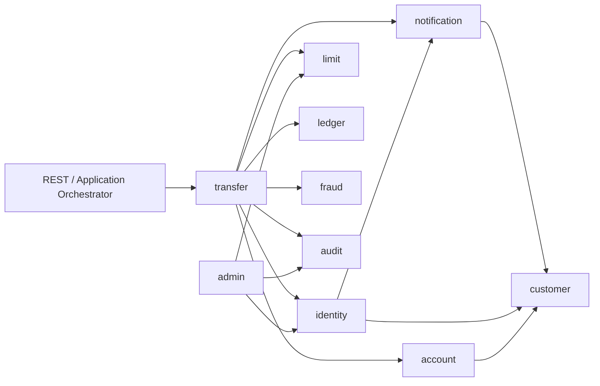

# 05. Hợp đồng Giao tiếp giữa các Module (`Modules Contract`)

> **Dự án:** Digital Banking MVP — Single-Bank, Core Simulated
> **Mã tài liệu:** `DESIGN-MOD-05`
> **Phiên bản:** 1.0
> **Ngày:** 18/11/2026
> **Trạng thái:** Hoàn thành
> **Owner:** System Architect / Backend Lead
> **Reviewer:** Module Owners (`identity`, `customer`, `account`, `transfer`, `ledger`, `limit`, `audit`, `fraud`, `notification`, `admin`, `common`), QA, Security

---

## 1. Mục đích, phạm vi và cách đọc

Tài liệu này là nguồn sự thật chuẩn (`source of truth`) xác định **provider, consumer, dữ liệu trao đổi, ranh giới transaction, phân loại lỗi và cách kiểm chứng** cho toàn bộ các điểm tích hợp giữa 11 module backend của Digital Banking MVP. Đây là hợp đồng **nội bộ trong một ứng dụng Spring Boot modular monolith**, thực thi qua lời gọi phương thức Java trong cùng tiến trình; hợp đồng HTTP công khai bên ngoài tuân theo [[digitalbanking-docs/docs-common/07. API contracts.md]] và `openapi/digital-banking-v1.yaml`.

**Nguyên tắc phát triển độc lập và kiểm thử khi module phụ thuộc chưa kích hoạt:**
- Mỗi module chỉ phụ thuộc vào gói giao diện công khai `com.simulatedbank.banking.<provider>.api` (hoặc cổng consumer-owned tương đương ánh xạ 1:1 theo hợp đồng này).
- Khi thực hiện kiểm thử một module mà module phụ thuộc (`provider`) chưa sẵn sàng ở thời điểm chạy, module tiêu thụ (`consumer`) sử dụng giao diện cổng và **mock test / test double theo đúng tài liệu giao tiếp này** (cùng chữ ký, bất biến đầu vào/đầu ra và bộ test vector chuẩn tại §13). Tuyệt đối không tạo bean giả lập trong cấu hình production và không truy cập trực tiếp bảng hoặc JPA entity nội bộ của module khác.

---

## 2. Bản đồ module và quyền sở hữu

Nguồn: `06. System architecture.md` §6.2–§6.3, §8.1; `04. Database design & analysis.md` §4.

Mỗi bảng cơ sở dữ liệu chỉ có **đúng một module sở hữu ghi (`write-owner`)**; các module khác không ghi trực tiếp và không import repository/entity nội bộ của provider. Truy vấn liên module phải đi qua API công khai hoặc projection đã được khai báo trong tài liệu này.

| Provider | Dữ liệu / chức năng sở hữu | Consumer chính | Mục hợp đồng |
|---|---|---|---|
| `identity` | `app_user`, `role`, `permission`, `user_role`, `device`, `session`, `auth_challenge`, xác thực mật khẩu/OTP/FIDO và quản lý phiên | `transfer`, `admin`; hạ tầng bảo mật tại `common` | §5 |
| `customer` | `customer`, hồ sơ định danh cá nhân (PII mã hóa `AES-256-GCM` + `HMAC-SHA256`), giải quyết địa chỉ nhận thông báo | `account`, `identity`, `notification`, `admin` | §6 |
| `account` | `account`, quyền sở hữu tài khoản, trạng thái, số dư khả dụng & số dư sổ cái (`available_balance`, `ledger_balance`), số dư đầu kỳ đối soát | `transfer`, `ledger` (đối soát), `admin` | §7, §9, §12.3 |
| `transfer` | `transfer`, `idempotency_record`, điều phối luồng chuyển tiền `T0`–`T2`, đối soát phục hồi và projection lịch sử giao dịch | REST adapter | §8, §12.3 |
| `ledger` | `ledger_entry` chỉ thêm (`append-only`), ghi bút toán kép và cung cấp bằng chứng sổ cái | `transfer`, tác vụ đối soát | §9 |
| `limit` | `limit_config`, `limit_usage`, `customer guard` và giữ chỗ hạn mức (`reservation`) cho giao dịch `PENDING` | `transfer`, `admin` | §10 |
| `audit` | `audit_log`, `audit_chain_checkpoint`, `legal_hold`, `retention_policy` | Toàn bộ các module nghiệp vụ, `admin` | §11.1 |
| `fraud` | `fraud_rule_config`, `fraud_flag`, đánh giá gian lận trong `T2` và thẩm định cờ | `transfer`, `admin`/Operations | §11.2 |
| `notification` | `notification` (transactional outbox), worker gửi thông báo `T3` và cổng gửi OTP (`OtpGateway`) | `transfer`, `identity` | §11.3 |
| `admin` | `approval_request`, điều phối phê duyệt 4 mắt (`Maker-Checker`) | REST/Operations; gọi `identity`, `limit`, `audit` | §12.1 |
| `common` | Xử lý lỗi/Problem Details, `RequestContext`, mật mã (`AES-GCM`/`HMAC`), `Clock`, bộ lọc bảo mật và rate limit; **không sở hữu bảng nghiệp vụ** | Toàn bộ các module | §12.2 |

Chiều phụ thuộc luôn đi **một chiều từ consumer tới `<provider>.api`**:
- `common` không import bất kỳ module nghiệp vụ nào.
- `identity`, `customer`, `account` không phụ thuộc `transfer`.
- Các module nghiệp vụ không phụ thuộc `admin`.
- `ledger`, `fraud`, `notification` không import ngược `transfer.api` để callback: `transfer` là orchestrator truyền dữ kiện (`facts`) xuống các provider bằng DTO do chính provider đó định nghĩa.
- Quy tắc biên giới này được kiểm tra tự động bằng ArchUnit (`ModuleBoundaryArchTest`).

---

## 3. Quy ước hợp đồng chung

### 3.1. Package, kiểu dữ liệu và bảo mật

- Giao diện (`interface`) và các DTO đầu vào/đầu ra nội bộ được đặt tại `com.simulatedbank.banking.<provider>.api` (và `api.dto`); phần cài đặt nằm trong `application` hoặc `adapter/out`. Module khác tuyệt đối không import `application`, `domain`, `adapter` hay JPA entity của provider.
- Mọi DTO giao tiếp liên module đều là bất biến (`immutable Java record`), tách biệt hoàn toàn khỏi REST DTO và JPA entity; không trả về `Object`, lazy proxy hay collection có thể sửa đổi.
- Định danh nội bộ dùng kiểu `long > 0` (`BIGINT` trong PostgreSQL); việc chuyển đổi giữa chuỗi ID trên HTTP và `long` thực hiện tại tầng adapter theo `04` và `07`.
- Giá trị tiền tệ dùng `BigDecimal` với `scale <= 2`, đơn vị `VND` (`NUMERIC(19,2)`); số tiền chuyển (`amount`) luôn `> 0`, số dư và hạn mức sử dụng `>= 0`; tuyệt đối không dùng `double`/`float`.
- Thời gian sự kiện dùng `Instant` (UTC); ngày nghiệp vụ dùng `LocalDate` tính theo múi giờ cấu hình (mặc định `Asia/Ho_Chi_Minh`).
- Ngữ cảnh tác nhân (`ActorContext`) gồm: `actorType` (`USER` / `SYSTEM`), `userId?`, `customerId?`, tập quyền (`authorities`), `correlationId` và `requestId`. Ngữ cảnh này do máy chủ trích xuất từ phiên xác thực đáng tin cậy (`principal`), không bao giờ lấy từ nội dung JSON do client gửi.
- Không truyền mật khẩu, mã OTP dạng chuỗi lâu dài, raw session token, số tài khoản/CCCD đầy đủ hoặc khóa `Idempotency-Key` thô vào log hay metric. Các DTO hiển thị tài khoản chỉ chứa giá trị đã che dấu (`**** **** 1234` / `last4`).

### 3.2. Ngữ nghĩa giao dịch (`Transaction Semantics`) và xử lý lỗi

| Ký hiệu | Yêu cầu đối với operation | Hành vi khi lỗi & Điểm kiểm tra |
|---|---|---|
| **R** | Chỉ đọc (`Read-only`); không tạo tác dụng phụ. Dữ liệu đọc trước khi lấy khóa dòng chỉ mang tính tham khảo (`preflight`). | Không dùng kết quả đọc `R` để thay thế cho bước kiểm tra có thẩm quyền dưới khóa trong `T1`/`T2`. |
| **OWN** | Provider tự mở và kết thúc một giao dịch ngắn độc lập cho use case riêng của mình; không giữ giao dịch qua bước chờ người dùng hoặc gọi mạng. | Không gọi operation `OWN` từ bên trong giao dịch tiền tệ `T2` nếu việc đó làm tách rời tính nguyên tử của `T2`. |
| **JOIN** | Bắt buộc tham gia vào giao dịch hiện hành của caller (`Propagation.MANDATORY` cho các bước ghi trong `T1`/`T2`/Approval), dùng chung `DataSource` và `PlatformTransactionManager`. | Nếu không có giao dịch đang mở thì dừng ngay (`IllegalTransactionStateException`). Không dùng `REQUIRES_NEW` hay tự commit riêng. |
| **AFTER** | Thực thi sau khi giao dịch nghiệp vụ đã commit (ví dụ gửi OTP sau `T0` hoặc gửi thông báo ở `T3`). Worker sử dụng giao dịch ngắn riêng để nhận lãnh (`claim/lease`), sau đó gọi cổng ngoài bên ngoài khóa DB. | Lỗi cổng ngoài được xử lý theo chính sách thử lại (`at-least-once` cho thông báo; `fail-closed` đối với cấp phát thử thách OTP). |

**Phân loại lỗi qua ranh giới module:**
- **Từ chối nghiệp vụ (`Business rejection`):** Được trả về dưới dạng kết quả có kiểu (`typed outcome/sealed result`) hoặc ngoại lệ nghiệp vụ đã khai báo rõ để caller ánh xạ sang mã lỗi chuẩn của `07. API contracts.md`. Trong `T2`, các từ chối nghiệp vụ dự kiến (như `INSUFFICIENT_BALANCE`, `ACCOUNT_INACTIVE`, `LIMIT_EXCEEDED`, `FRAUD_BLOCKED`) được hoàn tất vào trạng thái `FAILED` và **commit** cùng bản ghi kiểm toán `TRANSFER_FAILED`, không ném ngoại lệ gây rollback.
- **Lỗi kỹ thuật, vi phạm bất biến hoặc lỗi ghi kiểm toán `C1`/`C2`:** Phải ném ngoại lệ runtime (`DataAccessException`, `LedgerInvariantException`, `AuditWriteException`, ...) để **hoàn tác (`rollback`) toàn bộ giao dịch hiện hành**; tuyệt đối không bắt rồi nuốt lỗi trong một giao dịch đã bị đánh dấu `rollback-only`.
- **Lỗi ghi kiểm toán bảo mật `C3` (`recordStandalone`):** Chạy trong giao dịch độc lập (`REQUIRES_NEW`); nếu lỗi thì ghi nhận bộ đếm và sự kiện dự phòng `SECURITY_AUDIT_FALLBACK` mà không làm đảo ngược quyết định từ chối bảo mật (`401`/`403`/`409`/`423`).

---

## 4. Luồng phối hợp chuẩn và điểm tích hợp xuyên module

| Pha | Module điều phối | Các hợp đồng tích hợp chính | Ranh giới giao dịch và bằng chứng bảo đảm |
|---|---|---|---|
| **Preflight & `T0`** | `transfer` + `identity` | Xác thực phiên (`SessionAuthenticator`), tra cứu `idempotency_record`, giải quyết tài khoản đích (`AccountQuery`), kiểm tra `customer guard` & ngưỡng Step-up (`Limit`), phát hành thử thách (`StepUpChallengePort`) | Nếu cần Step-up mà chưa có thử thách `VERIFIED`: giải phóng guard, tạo thử thách ở `T0`, gửi OTP ngoài transaction và trả `428 STEP_UP_REQUIRED` mà không tạo `transfer`, `idempotency_record`, `reservation` hay `ledger_entry`. |
| **`T1`** | `transfer` | `limit.lockStepUpGuard` + `evaluateStepUpUnderGuard` → chèn `transfer(PENDING)` + `idempotency_record(RECEIVED)` → `identity.consumeVerified` (nếu có) → `limit.reserveForPendingTransfer` → `audit.recordInTransaction(TRANSFER_CREATED)` | Một giao dịch ngắn duy nhất. Chèn `transfer` trước `idempotency_record`; nếu thua cuộc đua `UNIQUE (idempotency_key)` thì hoàn tác toàn bộ `T1` và đọc lại bản ghi ngoài giao dịch. |
| **`T2`** | `transfer` | Thứ tự khóa: `1. customer guard → 2. transfer/fence → 3. accounts ASC → 4. limit usage CUSTOMER rồi ACCOUNT → 5. audit chain lock`. Gọi `fraud.evaluateTransfer` (savepoint) → `account.debitConditional`/`credit` (savepoint) → `ledger.postDoubleEntry` → `limit.settleOrReleaseReservation` → `notification.enqueueTransferOutcome` → `audit.recordInTransaction` (`C2` rồi `C1`) | Một giao dịch PostgreSQL (`READ COMMITTED`). Flush toàn bộ SQL nghiệp vụ trước khi lấy khóa chuỗi băm kiểm toán; ghi tuần tự `C2` (`FRAUD_FLAG_CREATED` theo `flag_id ASC`) rồi `C1` (`TRANSFER_COMPLETED`/`TRANSFER_FAILED`) ở pha cuối cùng; không gọi mạng. |
| **`T3`** | `notification` | Nhận lãnh bản ghi outbox (`claim/lease`) → `customer.resolveNotificationDestination` → gửi qua adapter → cập nhật trạng thái `SENT`/`RETRYING`/`FAILED` | Chạy sau khi `T2` đã commit; lỗi gửi thông báo không bao giờ làm thay đổi trạng thái hay số tiền của `transfer`. |
| **Recovery** | `transfer` | Quét ứng viên `PENDING` trên primary → giao dịch nhận lãnh ngắn (`customer guard → transfer SKIP LOCKED`, ghi `epoch/token/lease`) → giao dịch xử lý riêng (`customer guard → transfer/fence`, đọc bộ bằng chứng `Account`/`Ledger`/`Limit`/`Audit` theo §13.4) | Tách riêng giao dịch nhận lãnh (`claim`) và giao dịch xử lý. Chỉ tự động hoàn tất hoặc chạy lại `T2` khi bằng chứng đầy đủ và an toàn; nếu thiếu hoặc mâu thuẫn thì chuyển sang `MANUAL` và phát cảnh báo. |
| **Approval** | `admin` | `identity.consumeVerified(SENSITIVE_ACTION)` + `limit.applyApprovedLimitChange` hoặc `identity.applyApprovedRoleChange` + `audit.recordInTransaction` (`C2`) | Cưỡng chế `maker_id <> checker_id`; cập nhật cấu hình/quyền, thu hồi phiên (khi đổi quyền) và cập nhật `approval_request = 'APPLIED'` + kiểm toán `C2` trong cùng một giao dịch. |

---

## 5. Provider `identity`

Nguồn: `03. SRS.md` FR-001–008, FR-018, FR-026, AC-001–004, AC-033; `06. System architecture.md` §7.1; `07. API contracts.md` §3, §6, §8.1; `design/04. security.md` §4–§5.

### 5.1. SPI Xác thực Phiên (`common.config.SessionAuthenticator`)

- Giao diện `common.config.SessionAuthenticator.authenticate(String opaqueToken) → Optional<Session>` được khai báo tại `common` và do module `identity` cung cấp cài đặt thực tế.
- Đối tượng `Session` bất biến bao gồm: `userId`, `customerId?`, `authorities` (tập role và permission), `csrfTokenHash` (phương thức `toString()` đã che dấu toàn bộ dữ liệu nhạy cảm).
- Hành vi của provider `identity`:
  - Băm token đầu vào từ cookie `DB_SESSION` bằng `SHA-256` và tra cứu trên `banking.session.session_token_hash`.
  - Kiểm tra phiên đang ở trạng thái `ACTIVE`, chưa quá hạn `idle_expires_at` (`15 phút`) và `absolute_expires_at` (`8 giờ`), người dùng `banking.app_user` đang `ACTIVE`, và ngữ cảnh thiết bị `banking.device` (nếu gắn kèm) hợp lệ.
  - Gia hạn `idle_expires_at = LEAST(now() + 15m, absolute_expires_at)` và trả về `Optional.of(session)`; nếu token không tồn tại, đã hết hạn hoặc đã thu hồi (`LOGGED_OUT`/`REVOKED`) thì trả về `Optional.empty()`.
  - Lỗi cơ sở dữ liệu được đẩy lên tầng lọc bảo mật để dừng an toàn (`fail-closed`), tuyệt đối không biến lỗi hệ thống thành phiên hợp lệ.

### 5.2. Hợp đồng Xác thực Đăng nhập, MFA Thiết bị và FIDO2 (`Identity Auth Services`)

- **Đăng nhập mật khẩu và MFA (`PasswordLoginService` & `OtpChallengeService`):**
  - Mật khẩu và mã OTP được băm bằng `Argon2id`. Khi nhập sai mật khẩu 5 lần liên tiếp, khóa tạm thời tài khoản `10 phút` (`status = 'LOCKED'`, `locked_until = now() + 10m`) trong giao dịch độc lập (`REQUIRES_NEW`) và ghi kiểm toán `AUTH_ACCOUNT_LOCKED` (`C3`).
  - Đăng nhập mật khẩu hợp lệ cập nhật siêu dữ liệu thiết bị trong một giao dịch ngắn (`OWN`), sau đó tạo thử thách `banking.auth_challenge` với `purpose = 'LOGIN_NEW_DEVICE'` (`OWN`), gửi mã OTP qua `notification.api.OtpGateway` ngoài transaction và trả về `202 Accepted` (trừ khi luồng xác thực mật mã thiết bị tin cậy được kích hoạt).
  - Xác thực OTP đăng nhập (`POST /api/v1/auth/otp/verify`) kiểm tra mã OTP dưới khóa dòng `auth_challenge`: khi đúng thì đánh dấu `VERIFIED`, tiêu thụ thử thách, tạo phiên mới trong `banking.session` (thu hồi phiên cũ nhất nếu vượt giới hạn 3 phiên cho `CUSTOMER` hoặc 1 phiên cho `STAFF`) và ghi kiểm toán `AUTH_STEP_UP_VERIFIED` + `AUTH_LOGIN_SUCCESS` (`C2`) nguyên tử trong cùng một giao dịch.
- **Xác thực FIDO2 / WebAuthn (`LoginSessionService.completeFido`):**
  - Hỗ trợ `POST /api/v1/auth/fido/assertion/begin` và `finish` theo `07` §8.1.3 sử dụng thư viện `webauthn-server-core`, gắn nonce bền vững với `auth_challenge` và khóa công khai COSE / `sign_count` với `banking.device`.
  - Khi xác thực chữ ký và bộ đếm hợp lệ dưới thứ tự khóa `auth_challenge → app_user → device`, hệ thống tiêu thụ thử thách, cập nhật `sign_count`, cấp phát phiên `banking.session` và ghi kiểm toán `C2` trong cùng một giao dịch. Nếu huỷ hoặc thiết bị không hỗ trợ, client quay về luồng mật khẩu + OTP `LOGIN_NEW_DEVICE`.

### 5.3. Hợp đồng Thử thách Xác thực Tăng cường (`identity.api.StepUpChallengePort`)

| Operation / Consumer | Input → Output | Giao dịch (`TX`) và Hành vi | Xử lý lỗi tại Consumer |
|---|---|---|---|
| `requestChallenge` ← `transfer` / `admin` | `purpose` (`TRANSFER_STEP_UP` / `SENSITIVE_ACTION`), `actor` (`userId`, `customerId?`), `binding` (`requestHash`, `idempotencyKey` cho transfer hoặc `actionBinding` cho admin), `correlationId` → `ChallengeIssued(challengeRef UUID, method, channel?, maskedDestination?, expiresAt, maxAttempts, remainingAttempts)` | **OWN (`T0`)**: Tạo bản ghi `banking.auth_challenge` + kiểm toán `AUTH_CHALLENGE_CREATED` (`C2`); sau khi commit `T0`, gọi `OtpGateway.sendOtp` ngoài transaction và chỉ đánh dấu thử thách sẵn sàng (`SENT`) sau khi nhận ACK thành công. Không trả về mã OTP. | Nếu không gửi được OTP hoặc không lưu được ACK, ném `OtpDispatchException` để caller trả về `503 OTP_DISPATCH_FAILED` (fail-closed, không đi tiếp vào `T1`). |
| `findVerifiedBindingIfPresent` ← `transfer` | `actor` (`userId`, `customerId`), `purpose = TRANSFER_STEP_UP`, `requestHash` (64 hex lowercase), `idempotencyKey`, `correlationId` → `Optional<VerifiedChallenge(challengeRef UUID, expiresAt Instant)>` | **R (Primary)**: Chỉ trả về thử thách đang ở trạng thái `VERIFIED`, `consumed_at IS NULL`, `expires_at > clock_timestamp()` và khớp chính xác `user_id`, `purpose`, `request_hash`, `idempotency_key`. | Kết quả chỉ là snapshot kiểm tra nhanh ở bước gate; `T1` bắt buộc phải gọi `consumeVerified` dưới khóa dòng. |
| `verifyChallenge` ← `identity` REST adapter (`POST /api/v1/auth/step-up/verify`) | `actorUserId` (từ session), `challengeRef`, `credential` (`otpCode`) → `StepUpVerified` hoặc từ chối | **OWN (`T0`)**: Khóa dòng `auth_challenge`, kiểm tra chủ sở hữu, `purpose` (`TRANSFER_STEP_UP` / `SENSITIVE_ACTION`), thời hạn `expires_at` và số lần thử; cập nhật `status = 'VERIFIED'`, `verified_at` và ghi kiểm toán `AUTH_STEP_UP_VERIFIED` (`C2`). | Sai mã OTP tăng `attempt_count` (đến lần thứ 5 chuyển sang `LOCKED` `423`); quá hạn trả `410 AUTH_CHALLENGE_EXPIRED`. Không cấp phiên đăng nhập mới ở endpoint này. |
| `consumeVerified` ← `transfer` / `admin` | `challengeRef UUID`, `actor`, `purpose`, `binding` (`requestHash`, `idempotencyKey`), `correlationId` → `ConsumedChallenge(challengeId long)` | **JOIN (`MANDATORY` trong `T1` hoặc Approval TX)**: Khóa dòng `auth_challenge`, kiểm tra khớp nguyên vẹn `user_id`, `purpose`, `request_hash`, `idempotency_key`, `status = 'VERIFIED'`, `consumed_at IS NULL` và `expires_at > clock_timestamp()` tại thời điểm giữ khóa; đặt `consumed_at = clock_timestamp()` và trả về `challenge_id` (`BIGINT`) để `transfer` gắn vào `transfer.step_up_challenge_id`. | Nếu sai binding, đã tiêu thụ hoặc đã hết hạn thì ném `ChallengeRejectedException` (`409 STEP_UP_CHALLENGE_MISMATCH` / `410 AUTH_CHALLENGE_EXPIRED`) làm hoàn tác toàn bộ `T1` hoặc giao dịch phê duyệt. Khi `T1` đã commit, `T2` không yêu cầu xác thực lại chỉ vì `expires_at` trôi qua sau `T1`. |

### 5.4. Hợp đồng Quản lý Vai trò và Thu hồi Phiên (`identity.api.IdentityRoleCommand`)

| Operation / Consumer | Input → Output | Giao dịch (`TX`) và Hành vi | Xử lý lỗi & Kiểm toán |
|---|---|---|---|
| `getRoleAssignmentVersion` ← `admin` | `targetUserId long` → `long roleAssignmentVersion` | **R (Primary)**: Đọc phiên bản phân quyền hiện tại (`app_user.role_assignment_version BIGINT NOT NULL DEFAULT 0`) của nhân viên mục tiêu để Maker ghi nhận vào yêu cầu phê duyệt `ROLE_CHANGE`. | Nếu không tìm thấy nhân viên mục tiêu → `USER_NOT_FOUND` (`404`). |
| `applyApprovedRoleChange` ← `admin` | `ApprovedRoleChange(approvalId, makerUserId, checkerUserId, targetUserId, operation, roleOrPrivilegeCode, expectedVersion, correlationId, requestId)` → `RoleChangeResult(approvalId, targetUserId, operation, code, previousVersion, resultingVersion, revokedSessionCount)` | **JOIN (`MANDATORY` trong Approval TX)**: 1. Khóa dòng `app_user` theo thứ tự ID tăng dần. 2. Xác minh người thực thi là `checkerUserId` đang `ACTIVE` (`STAFF`), có quyền `ROLE_MANAGE` + đặc quyền `CHECKER`, `makerUserId <> checkerUserId` và `targetUserId` khác cả hai. 3. Kiểm tra `role_assignment_version == expectedVersion`; thực hiện `ASSIGN_ROLE` / `REVOKE_ROLE` / `GRANT_PRIVILEGE` / `REVOKE_PRIVILEGE` và tăng `role_assignment_version` thêm `1`. 4. Thu hồi tức thì toàn bộ các phiên `ACTIVE` của `targetUserId` trong `banking.session` (`status = 'LOGGED_OUT'`, `logged_out_at = clock_timestamp()`). | Nếu `expectedVersion` đã cũ, thao tác trùng lặp hoặc vi phạm loại tài khoản → trả lỗi xung đột `ROLE_CONFLICT` (`409`). Sau khi nhận `RoleChangeResult`, `admin` cập nhật `approval_request = 'APPLIED'` và gọi `audit.recordInTransaction(ROLE_CHANGE_APPROVED)` (`C2`) ở cuối giao dịch. Nếu bất kỳ bước nào lỗi, toàn bộ giao dịch hoàn tác. |

---

## 6. Provider `customer` — `customer.api.CustomerQuery` & `CustomerNotificationContactPort`

Nguồn: `03. SRS.md` FR-008–011, FR-039, FR-041; `04. Database design & analysis.md` §4.2.2; `06. System architecture.md` §6.2; `07. API contracts.md` §3.6, §8.2.

| Operation / Consumer | Input → Output | Giao dịch (`TX`) và Điều kiện | Xử lý lỗi & Bảo mật PII |
|---|---|---|---|
| `findByUserId` ← `identity` / `account` | `userId long` → `Optional<CustomerIdentity(customerId, userId, status, kycStatus)>` | **R (Primary)**: Trả về ánh xạ định danh tối thiểu giữa `user_id` và `customer_id` cùng trạng thái hoạt động, không giải mã toàn bộ PII. | Phân biệt rõ `Optional.empty()` (không có hồ sơ khách hàng) với lỗi cơ sở dữ liệu. |
| `getCustomerView` ← `account` / `admin` | `customerId long`, `ActorContext` → `CustomerProfileView` (đã che dấu theo quyền) | **R (Primary)**: Kiểm tra quyền sở hữu (`CUSTOMER` chỉ xem chính mình) hoặc quyền nhân viên (`CUSTOMER_READ`); giải mã `full_name_enc`, `phone_enc`, `email_enc` khi được phép và luôn che dấu số CCCD (`********1234` từ `national_id_last4`). | Trả về `403 AUTH_FORBIDDEN` (kèm kiểm toán `C3`) nếu truy cập chéo khách hàng; `404` nếu không tồn tại. |
| `resolveNotificationDestination` (`TRFC-CU-02`) ← `notification` / `identity` | `SYSTEM ActorContext`, `customerId long`, `channel` (`SMS` / `EMAIL` / `IN_APP`), `purpose` (`TRANSFER_OUTCOME` / `OTP_DELIVERY`) → `DestinationAvailable(destination, contactVersion)` hoặc `Unavailable(reason)` | **R (Sau commit, ngay trước khi gửi qua cổng ngoài)**: Kiểm tra trạng thái khách hàng và mục đích sử dụng hợp lệ; giải mã tạm thời số điện thoại (`phone_enc`) hoặc email (`email_enc`) trong bộ nhớ để chuyển cho adapter gửi tin. | Giá trị `destination` dạng rõ chỉ tồn tại tạm thời trong bộ nhớ lúc gọi cổng gửi, tuyệt đối không ghi vào log, không lưu vào outbox và không cache. Lỗi hệ thống DB được tách biệt với `Unavailable`. |

Module `customer` không bao giờ import ngược `identity`, `account` hay `transfer`. Toàn bộ thao tác mã hóa `AES-256-GCM` và tính chỉ mục mù `HMAC-SHA256` (`national_id_hash`, `phone_hash`, `email_hash`) do `customer` thực hiện thông qua tiện ích mật mã của `common`.

---

## 7. Provider `account`

Nguồn: `03. SRS.md` FR-012, FR-015, FR-019, FR-020; `04. Database design & analysis.md` §4.3; `06. System architecture.md` §8.1–§8.3; `design/02. consistency-concurrency.md` §5.3, §7.4, §8.2.

### 7.1. Hợp đồng Truy vấn và Kiểm tra Quyền sở hữu (`account.api.AccountQuery`)

| Operation / Consumer | Input → Output | Giao dịch (`TX`) và Hành vi |
|---|---|---|
| `resolveDestination` (`TRFC-AC-01`) ← `transfer` | Đúng một định danh `AccountId(long)` **hoặc** `AccountNumber(String 6–20 chữ số)` → `Optional<AccountSnapshot(accountId, customerId, status, currency, maskedNumber, last4)>` | **R (Primary)**: Chuẩn hóa chuỗi số tài khoản và tra cứu qua cột chỉ mục mù `account_no_hash = HMAC-SHA256(accountNo, APP_HMAC_KEY)`. Không bao giờ ghi số tài khoản đầy đủ vào log; `maskedNumber` luôn có định dạng `"**** **** " + account_no_last4`. Kết quả ở bước preflight không thay thế cho bước khóa và kiểm tra lại trong `T2`. |
| `assertOwnership` (`TRFC-AC-02`) / `getAccountView` ← `transfer` / `ledger` / `admin` | `ActorContext`, `accountId long` → `OwnershipResult` (`OWNED`, `FORBIDDEN`, `NOT_FOUND`) hoặc `AccountView` đã che dấu | **R (Primary)**: Kiểm tra tài khoản nguồn có thuộc `customerId` của người dùng hiện tại hay không (hoặc kiểm tra quyền `ACCOUNT_READ` và phạm vi của nhân viên). Khi `FORBIDDEN`, không tiết lộ bất kỳ thông tin số dư hay chủ tài khoản nào. |
| `readOpeningBalance` ← `ledger` (tác vụ đối soát) | `accountId long`, `SYSTEM ActorContext` → `Optional<OpeningBalance(accountId, amount, currency, effectiveAt, evidenceId)>` | **R (Primary)**: Cung cấp số dư mở sổ gốc bất biến của tài khoản (kể cả khi bằng `0.00`) làm điểm neo để tác vụ đối soát sổ cái kiểm chứng công thức `opening_balance + SUM(CREDIT) - SUM(DEBIT) == ledger_balance`. |

### 7.2. Hợp đồng Khóa và Cập nhật Số dư trong `T2` (`account.api.AccountBalance`)

Toàn bộ các phương thức dưới đây bắt buộc chạy ở chế độ **`JOIN` (`Propagation.MANDATORY`) bên trong giao dịch `T2`**, sau khi caller (`transfer`) đã giữ `customer guard` và khóa dòng `transfer`:

| Operation | Input → Output | Tác dụng phụ & Quy tắc xử lý lỗi |
|---|---|---|
| `lockTransferAccounts` (`TRFC-AC-03`) | `sourceAccountId long`, `destinationAccountId long` → `LockedAccounts(source, destination)` (mỗi snapshot chứa `accountId`, `customerId`, `status`, `currency`, `availableBalance`, `ledgerBalance`) | Thực thi `SELECT ... FROM banking.account WHERE account_id IN (:sourceId, :destId) ORDER BY account_id ASC FOR UPDATE`. Từ chối nếu `sourceId == destId` hoặc thiếu tài khoản. Đối tượng `LockedAccounts` chỉ có hiệu lực trong phạm vi giao dịch `T2` hiện tại, không được lưu đệm sau khi commit. |
| `debitConditional` (`TRFC-AC-04`) | `lockedSourceAccountId long`, `amount BigDecimal`, `currency String` → `DebitResult.Applied(availableAfter, ledgerAfter)` hoặc `DebitResult.Insufficient` / `DebitResult.Inactive` | Thực thi cập nhật có điều kiện `UPDATE banking.account SET available_balance = available_balance - :amount, ledger_balance = ledger_balance - :amount, updated_at = now() WHERE account_id = :sourceId AND status = 'ACTIVE' AND available_balance >= :amount RETURNING available_balance, ledger_balance`. Nếu số dòng cập nhật bằng `0` (khi chưa thay đổi tiền), phân loại chính xác thành `Inactive` hoặc `Insufficient` để `T2` hoàn tất nhánh `FAILED`. Đảm bảo không bao giờ phát sinh số dư âm. |
| `credit` (`TRFC-AC-05`) | `lockedDestinationAccountId long`, `amount BigDecimal`, `currency String` → `CreditResult.Applied(availableAfter, ledgerAfter)` | Thực thi `UPDATE banking.account SET available_balance = available_balance + :amount, ledger_balance = ledger_balance + :amount, updated_at = now() WHERE account_id = :destId AND status = 'ACTIVE' RETURNING available_balance, ledger_balance`. Nếu bước ghi có thất bại hoặc trả về `0 rows` sau khi đã ghi nợ thành công, ném ngoại lệ `ConfirmedCreditFailure` để `T2` khôi phục phần tiền về JDBC savepoint (`money savepoint`) theo §8.1. |
| `findMovementEvidence` (`TRFC-AC-06`) | `transferId long`, `SYSTEM ActorContext` → `Optional<MovementEvidence>` | **R / JOIN Recovery**: Cung cấp bằng chứng biến động số dư của giao dịch phục vụ đối soát theo §13.4. |

---

## 8. Provider `transfer`

Nguồn: `03. SRS.md` FR-013–026; `07. API contracts.md` §5, §8.3, §8.4; `design/02. consistency-concurrency.md` §5–§6, §10.

Module `transfer` là **orchestrator** sở hữu bảng `banking.transfer` và `banking.idempotency_record`.

### 8.1. Các Use Case Điều phối Chính (`transfer.api`)

| Operation / Consumer | Input → Output | Ranh giới giao dịch & Xử lý lỗi |
|---|---|---|
| `createTransfer` ← Transfer REST adapter | `ActorContext`, `CreateTransferCommand(sourceAccountId, destination, amount, currency, description)`, `idempotencyKey`, `stepUpChallengeRef?` → `TransferOutcome` (`Completed` / `Failed` / `StepUpRequired` / `InProgress` / `Replayed`) | Không đặt `@Transactional` bao trùm toàn bộ `T0`–`T2`. Điều phối tuần tự: tra cứu `idempotency_record` → preflight → Gate/`T1` (dưới `customer guard`) → đăng ký lượt thực thi bền vững (`claimAttemptDurably`) → thực thi `T2` (có JDBC savepoint cho Fraud và cho Debit/Credit). Nếu ghi có lỗi sau ghi nợ, khôi phục về `money savepoint`, làm mới ngữ cảnh ORM dưới các khóa đang giữ và hoàn tất nhánh `FAILED` (`failureCode = 'PROCESSING_ERROR'`) nguyên tử. |
| `getByReference` / `listHistory` (`TransactionHistoryQuery`) ← REST adapter | `VerifiedScope`, `reference` hoặc `(HistoryFilter, PageSpec)` → `TransferView` / `HistoryPage(items, totalElements, asOf)` | **R (Primary, `REPEATABLE READ` read-only)**: Kiểm tra phạm vi quyền sở hữu (`CUSTOMER` sở hữu tài khoản nguồn hoặc đích; `STAFF` có `TRANSACTION_READ` và nằm trong phạm vi được cấp). Chỉ trả về `fraudFlags` nếu người gọi là `STAFF` có quyền `FRAUD_READ` hoặc `FRAUD_REVIEW`. |
| `reconcileOne` ← Tác vụ đối soát (`ReconciliationScheduler`) | `SYSTEM ActorContext`, `candidate TransferId` → `ReconcileResult` (`Skipped` / `Resolved` / `ManualIncident`) | Thực hiện theo giao thức 2 pha: (1) Giao dịch ngắn lấy `customer guard → transfer (FOR UPDATE SKIP LOCKED)`, ghi nhận `epoch/token/lease` bền vững rồi commit; (2) Giao dịch xử lý riêng lấy lại `customer guard → transfer/fence`, đọc bộ bằng chứng §13.4 từ `account`, `ledger`, `limit`, `audit` và hoàn tất hoặc chạy `T2` khi đủ điều kiện an toàn. |

### 8.2. Hợp đồng Chống trùng lặp (`Idempotency`) và Chuẩn hóa Request Hash

- **Khóa và phạm vi:** `Idempotency-Key` có độ dài 1–255 ký tự (`^[A-Za-z0-9._:~-]{1,255}$`). Khi bản ghi đã tồn tại, hệ thống kiểm tra khớp đồng thời `transfer.customer_id == actor.customerId`, `transfer.initiated_by_user_id == actor.userId` và `request_hash`:
  - Khớp cả 3 điều kiện và trạng thái đã kết thúc (`COMPLETED`/`FAILED`) → Phát lại nguyên trạng mã HTTP (`201` hoặc `422`) và nội dung JSON gốc kèm header `Idempotent-Replayed: true` (giữ `correlationId` gốc trong body, trả `X-Correlation-ID` hiện tại ở header).
  - Khớp cả 3 điều kiện nhưng trạng thái đang là `RECEIVED` hoặc `IN_PROGRESS` → Luôn trả về `409 IDEMPOTENCY_IN_PROGRESS` kèm header `Retry-After` (tiến trình đối soát nội bộ chịu trách nhiệm phục hồi).
  - Bất kỳ trường nào trong 3 trường trên không khớp → Trả về `409 IDEMPOTENCY_CONFLICT` chung (không tiết lộ nội dung hay chủ sở hữu) và ghi kiểm toán `SECURITY_IDEMPOTENCY_CONFLICT` (`C3`).
- **Chuẩn hóa `request_hash`:** Tạo đối tượng JSON chuẩn gồm `customerId`, `sourceAccountId`, `destination` (`type` + `value`), `amount` (chuỗi thập phân 2 chữ số), `currency` (`VND`), `description` (đã `trim`, `null` quy về `""`); chuẩn hóa bằng RFC 8785 (JCS) và băm `SHA-256` ra 64 ký tự hex chữ thường.
- **Vòng đời TTL và thanh lọc (`Purge`):** `TTL` mặc định và tối thiểu là `24 giờ` tính từ dấu thời gian kết thúc `completed_at`. Giao dịch `T1` đặt `expires_at = created_at + TTL_T1`; khi kết thúc ở `T2`, cập nhật `expires_at = GREATEST(expires_at, completed_at + TTL_terminal)`. Tác vụ thanh lọc chỉ xóa bản ghi đã ở trạng thái kết thúc và quá hạn `expires_at < now()`, tuyệt đối không xóa bản ghi của giao dịch đang `PENDING`.

---

## 9. Provider `ledger` — `ledger.api.LedgerPosting` & `LedgerQuery`

Nguồn: `03. SRS.md` FR-019–020, AC-012; `04. Database design & analysis.md` §4.4.2; `06. System architecture.md` §8.4; `design/02. consistency-concurrency.md` §5.3, §8.1, §8.4.

| Operation / Consumer | Input → Output | Giao dịch (`TX`) & Bảo đảm toàn vẹn |
|---|---|---|
| `postDoubleEntry` (`TRFC-LE-01`) ← `transfer` | `PostingCommand(transferId, sourceAccountId, destinationAccountId, amount, currency, sourceBalanceAfter, destinationBalanceAfter, correlationId)` → `PostingRef(debitEntryId, creditEntryId)` | **JOIN (`MANDATORY` trong `T2`)**: 1. Kiểm tra đầu vào chặt chẽ: `transferId > 0`, `sourceAccountId > 0`, `destinationAccountId > 0`, `sourceAccountId <> destinationAccountId`, `amount > 0` (`scale <= 2`), `sourceBalanceAfter >= 0`, `destinationBalanceAfter >= 0`, `currency = "VND"` và `correlationId` hợp lệ. 2. Chèn đúng 2 dòng chỉ thêm (`append-only`) vào `banking.ledger_entry`: dòng 1 (`entry_seq = 1`, `entry_type = 'DEBIT'`, `account_id = sourceAccountId`, `balance_after = sourceBalanceAfter`) và dòng 2 (`entry_seq = 2`, `entry_type = 'CREDIT'`, `account_id = destinationAccountId`, `balance_after = destinationBalanceAfter`). 3. Flush và đọc lại trực tiếp bằng truy vấn scalar (`ORDER BY entry_seq, entry_id`) để xác minh toàn bộ cặp bút toán vừa ghi trên PostgreSQL khớp tuyệt đối trước khi trả về `PostingRef(debitEntryId, creditEntryId)`. |
| `findEvidence` (`TRFC-LE-02`) ← `transfer` (recovery) | `transferId long`, `SYSTEM ActorContext` → `Optional<LedgerEvidence>` | **R / JOIN Recovery (Primary)**: Đọc danh sách các bút toán của `transferId` sau khi đã giữ `customer guard` và khóa `transfer`. Trả về `Optional.empty()` chỉ khi truy vấn thành công và chưa có dòng nào; nếu có dòng thì trả nguyên danh sách `EntryEvidence` quan sát được để bộ đối soát kiểm chứng theo §13.4. |
| `listAccountEntries` ← Consumer được cấp quyền | `accountId long`, `PageSpec`, `ActorContext` → `Page<LedgerEntryView>` | **R (Primary)**: Truy vấn danh sách bút toán sổ cái chỉ đọc phục vụ đối soát và kiểm toán. |

**Phân loại lỗi của `ledger`:**
- Lỗi hợp đồng đầu vào (`InvalidPostingCommandException`), lỗi vi phạm bất biến cặp bút toán (`LedgerInvariantException`), lỗi thiếu giao dịch (`IllegalTransactionStateException`) và lỗi cơ sở dữ liệu (`DataAccessException`) đều được đẩy ra ngoài để **hoàn tác toàn bộ giao dịch `T2`** (ánh xạ qua `GlobalExceptionHandler` thành `500 INTERNAL_ERROR` hoặc `503 SERVICE_UNAVAILABLE` khi timeout/deadlock). Tuyệt đối không bao giờ coi lỗi trùng khóa `UNIQUE (transfer_id, entry_seq)` là thành công ngầm định.

---

## 10. Provider `limit` — Quản lý Hạn mức, `Customer Guard` và `Reservation`

Nguồn: `03. SRS.md` FR-016, FR-018, FR-031, AC-009, AC-033; `04. Database design & analysis.md` §4.5; `06. System architecture.md` §8.3; `design/02. consistency-concurrency.md` §5.2–§5.3, §7.5, §9.2.

Module `limit` sở hữu bảng `banking.limit_config`, `banking.limit_usage`, khóa tuần tự `customer guard` và trạng thái giữ chỗ (`reservation`) cho các giao dịch đang xử lý nhằm đảm bảo cả hai bất biến: (1) không thể vượt ngưỡng Step-up ngày (`> 20,000,000 VND`) bằng cách gửi nhiều lệnh đồng thời dưới ngưỡng, và (2) không thể vượt hạn mức chuyển tiền ngày (`daily_limit`) khi chạy đồng thời hoặc qua ranh giới nửa đêm.

| Operation / Consumer | Input → Output | Giao dịch (`TX`), Thứ tự khóa và Hành vi |
|---|---|---|
| `getUsageSnapshot` (`TRFC-LI-01`) ← `transfer` / REST adapter | `customerId long`, `accountId? long`, `businessDate LocalDate`, `ActorContext` → `UsageView(usedAmount, remainingAmount, perTransactionLimit, dailyLimit, configVersion, businessDate)` | **R (Primary)**: Trả về thông tin hạn mức và mức đã sử dụng phục vụ hiển thị (`GET /api/v1/limits`) hoặc tham khảo preflight. Không dùng kết quả này thay cho bước kiểm tra dưới khóa trong `T1`/`T2`. |
| `lockStepUpGuard` (`TRFC-LI-04a`) ← `transfer` | `customerId long`, `ActorContext` → `CustomerGuard(customerId)` | **JOIN (`MANDATORY` trong Gate / `T1` / `T2` / `Tfail` / `Recovery`)**: Lấy khóa mutex bền vững cấp khách hàng (độc lập ngày nghiệp vụ và độc lập phiên bản cấu hình) tại vị trí **số 1** trong thứ tự khóa toàn cục. Đối tượng `CustomerGuard` chỉ có hiệu lực trong giao dịch hiện tại. |
| `evaluateStepUpUnderGuard` (`TRFC-LI-04b`) ← `transfer` | `CustomerGuard`, `amount BigDecimal`, `currency String`, `gateTimestamp Instant`, `businessDate LocalDate` → `StepUpDecision(required boolean, policyVersion String, projectedDailyAmount BigDecimal)` | **JOIN (cùng giao dịch đang giữ `CustomerGuard`)**: Đọc tổng tiền đã hoàn tất (`COMPLETED`) trong ngày nghiệp vụ hiện tại cộng toàn bộ các `reservation` đang ở trạng thái `PENDING` của khách hàng đó (kể cả các giao dịch `PENDING` tạo từ ngày trước chưa kết thúc) cộng `amount` của yêu cầu hiện tại (mỗi giao dịch tính đúng 1 lần). Trả về `required = true` nếu `amount >= 10,000,000 VND` hoặc `projectedDailyAmount > 20,000,000 VND`. Nếu không đọc được cấu hình thì dừng an toàn (`fail-closed`). |
| `reserveForPendingTransfer` (`TRFC-LI-05a`) ← `transfer` | `CustomerGuard`, `transferId long`, `customerId long`, `amount BigDecimal`, `currency String`, `t1BusinessDate LocalDate`, `policyVersion String` → `ReservationRef` | **JOIN (`MANDATORY` trong `T1`)**: Tạo bản ghi giữ chỗ (`reservation` ở trạng thái `PENDING`, tối đa 1 reservation cho mỗi `transfer_id`) và commit nguyên tử cùng bản ghi `transfer(PENDING)`, `idempotency_record(RECEIVED)`, `consumeVerified` và kiểm toán `TRANSFER_CREATED`. |
| `lockAndCheck` (`TRFC-LI-02`) ← `transfer` | `customerId long`, `sourceAccountId long`, `amount BigDecimal`, `currency String`, `terminalAt Instant`, `businessDate LocalDate` → `LimitDecision.Allowed(usageRef, customerConfigId, customerConfigVersion, accountConfigId?, accountConfigVersion?)` hoặc `LimitDecision.Exceeded(scope, reasonCode)` | **JOIN (`MANDATORY` trong `T2`, sau khi đã khóa `accounts ASC`)**: Đọc cấu hình `ACTIVE` của hai cấp `CUSTOMER` và `ACCOUNT` trong cùng câu lệnh; upsert và khóa dòng `banking.limit_usage` theo đúng thứ tự **`CUSTOMER` trước, `ACCOUNT` sau** cho ngày nghiệp vụ `businessDate` (quy đổi từ `terminalAt` theo múi giờ `Asia/Ho_Chi_Minh`). Kiểm tra cả `per_transaction_limit` và `used_amount + amount <= daily_limit`. Nếu vượt hạn mức, trả về `Exceeded` (`LIMIT_EXCEEDED`) để `T2` hoàn tất nhánh `FAILED` trước khi ghi tiền. |
| `settleOrReleaseReservation` (`TRFC-LI-05b`) ← `transfer` | `CustomerGuard`, `transferId long`, `expectedReservation ReservationRef`, `outcome` (`COMPLETED` / `FAILED`), `terminalAt Instant`, `businessDate LocalDate` → `SettlementResult` (`SETTLED` / `RELEASED`) | **JOIN (`MANDATORY` trong `T2` / `Tfail` / `Recovery`)**: - Khi `outcome = COMPLETED`: Chuyển trạng thái reservation của `transferId` sang `SETTLED` và cộng dồn `used_amount = used_amount + amount`, `transfer_count = transfer_count + 1` trên các dòng `limit_usage` (`CUSTOMER` và `ACCOUNT`) đúng một lần (không gọi thêm `incrementUsage` riêng lẻ để tránh cộng đôi). - Khi `outcome = FAILED`: Chuyển trạng thái reservation sang `RELEASED` mà không tăng `limit_usage`. - Reservation của giao dịch đang `PENDING` không bao giờ bị tự động xóa do hết hạn TTL. |
| `findReservationSettlementEvidence` (`TRFC-LI-06`) ← `transfer` (recovery) | `transferId long`, `SYSTEM ActorContext` → `Optional<ReservationEvidence>` | **R / JOIN Recovery (Primary)**: Trả về bằng chứng trạng thái reservation (`PENDING` / `SETTLED` / `RELEASED`) và ngày tất toán của giao dịch phục vụ đối soát theo §13.4. |
| `applyApprovedLimitChange` ← `admin` | `approvalId long`, `scopeType`, `scopeId?`, `perTransactionLimit`, `dailyLimit`, `expectedVersion`, `ActorContext` → `ConfigApplied(configId, version)` | **JOIN (`MANDATORY` trong Approval TX)**: Khóa dòng cấu hình `ACTIVE` hiện tại của scope, kiểm tra `expectedVersion`, chuyển dòng cũ sang `SUPERSEDED` và chèn dòng cấu hình mới `ACTIVE` (`version = old + 1`). |

---

## 11. Provider `audit`, `fraud`, `notification`

### 11.1. Provider `audit` — `audit.api.AuditModuleApi`

Nguồn: `03. SRS.md` FR-034–038, AC-018–022, AC-034; `design/01. audit-traceability.md` §4.3–§4.4, §6, §7.5; `design/02. consistency-concurrency.md` §5.3, §7.8.

Module `audit` sở hữu `banking.audit_log`, `banking.audit_chain_checkpoint`, `banking.legal_hold` và `banking.retention_policy`. Giao diện `AuditModuleApi` nhận đối tượng `AuditEvent` do chính `audit` định nghĩa.

| Operation / Consumer | Input → Output | Giao dịch (`TX`) & Quy tắc xử lý lỗi |
|---|---|---|
| `recordInTransaction` (`TRFC-AU-01`) ← Mọi module nghiệp vụ | `AuditEvent` → `AuditRecordRef(auditId long, recordHash String)` | **JOIN (`Propagation.MANDATORY`)**: Dùng cho toàn bộ các sự kiện trọng yếu **`C1` (Financial atomic)** và **`C2` (Sensitive state atomic)**. Kiểm tra danh mục `action`, các trường bắt buộc, allowlist PII và giới hạn kích thước (`<= 32 KB`); lấy khóa giao dịch `pg_advisory_xact_lock(hashtextextended('audit:chain', 0))`, đọc `prev_hash`, chuẩn hóa `canonical_payload` theo RFC 8785 (JCS), tính `record_hash = SHA-256(JCS(canonical_payload) + "|" + prev_hash)` và chèn vào `banking.audit_log`. Nếu bất kỳ bước nào thất bại → ném `AuditWriteException` làm **hoàn tác toàn bộ giao dịch nghiệp vụ** (`fail-closed`). |
| `recordStandalone` (`TRFC-AU-02`) ← Caller ghi sự kiện `C3` | `AuditEvent` → `Optional<AuditRecordRef>` | **OWN (`Propagation.REQUIRES_NEW`)**: Dùng cho các sự kiện bảo mật **`C3` (Security best-effort)** như `AUTH_LOGIN_FAILED`, `AUTH_ACCOUNT_LOCKED`, `SECURITY_ACCESS_DENIED`, `SECURITY_IDEMPOTENCY_CONFLICT`. Nếu việc ghi vào DB thất bại, bắt ngoại lệ, tăng bộ đếm metric, phát cảnh báo và ghi bản ghi dự phòng `SECURITY_AUDIT_FALLBACK` (chứa `action`, `outcome`, mã băm người dùng và `correlationId`, không chứa PII) mà không làm đảo ngược quyết định từ chối bảo mật của caller. |
| `search` / `get` ← Audit REST adapter | `AuditSearchQuery`, `ActorContext` → `PageResult<AuditSummary>` / `AuditDetail` | **R (Primary)**: Kiểm tra quyền `AUDIT_READ`; không tạo bản ghi `audit_log` mới khi tìm kiếm/xem chi tiết thành công (chỉ ghi technical access log). |
| `export` ← Audit REST adapter | `AuditSearchQuery`, `ExportFormat` (`CSV` / `JSONL`), `ActorContext` → `AuditExportResult` | Kiểm tra quyền `AUDIT_EXPORT` (`AUDITOR`), giới hạn tối đa `10,000` dòng; tạo tệp xuất + tính `fileHash`/`filterHash`, ghi bền vững sự kiện `AUDIT_EXPORTED` (`C2`) trong giao dịch riêng **trước khi** trả tệp về cho client. Nếu bước ghi `AUDIT_EXPORTED` thất bại → hủy trả tệp và trả về `500 INTERNAL_ERROR`. |
| `findTransferCompletionEvidence` (`TRFC-AU-03`) ← `transfer` (recovery) | `transferReference String`, `correlationId String`, `SYSTEM ActorContext` → `Optional<CompletionEvidence>` | **R / JOIN Recovery (Primary)**: Cung cấp bằng chứng bản ghi kiểm toán hoàn tất của giao dịch phục vụ đối soát theo §13.4. |

**Quy tắc ghi nhiều sự kiện kiểm toán trong pha cuối của `T2`:**
- Trong giao dịch `T2`, toàn bộ các câu lệnh SQL nghiệp vụ (cờ gian lận, ghi nợ/ghi có, bút toán sổ cái, tất toán reservation/hạn mức, hàng đợi thông báo, cập nhật trạng thái `transfer` và `idempotency_record`) phải được **flush hoàn tất trước khi bước vào pha kiểm toán cuối cùng**.
- Tại pha kiểm toán cuối cùng của `T2`, `transfer` gọi `audit.recordInTransaction` (`MANDATORY`) tuần tự cho từng sự kiện `FRAUD_FLAG_CREATED` (`C2`) của các cờ gian lận còn hiệu lực theo thứ tự **`flagId` tăng dần**, ngay sau đó gọi `audit.recordInTransaction` cho sự kiện `TRANSFER_COMPLETED` hoặc `TRANSFER_FAILED` (`C1`), rồi kết thúc giao dịch (`COMMIT`). Không thực hiện thêm bất kỳ câu lệnh SQL nghiệp vụ hay lời gọi mạng nào sau khi đã lấy khóa `hashtextextended('audit:chain', 0)`.

### 11.2. Provider `fraud` — `fraud.api.FraudEvaluation`

Nguồn: `03. SRS.md` FR-044–048, NFR-008, AC-026, AC-027; `04. Database design & analysis.md` §4.7; `design/03. fraud-detection-rules.md` §4–§9.

| Operation / Consumer | Input → Output | Giao dịch (`TX`) & Cơ chế Savepoint |
|---|---|---|
| `evaluateTransfer` (`TRFC-FR-01`) ← `transfer` | `FraudFacts(transferId, customerId, sourceAccountId, destinationAccountId, amount, currency, terminalAt, correlationId)` → `FraudDecision(outcome: ALLOW / BLOCK / ENGINE_ERROR, flags: List<CreatedFraudFlag>)` (mỗi phần tử chứa `flagId long`, `ruleCode String`, `ruleVersion int > 0`, `severity`, `matchedValue Map`) | **JOIN (`MANDATORY` trong `T2`, chạy in-process sau khi đã khóa `accounts` và `limit_usage`)**: 1. Thiết lập một **JDBC Savepoint** (`fraud_eval_sp`) trước khi truy vấn cấu hình quy tắc và chèn cờ. 2. Đánh giá các quy tắc đang hoạt động trong `banking.fraud_rule_config`: `LARGE_VALUE` (`amount >= threshold_amount`, mặc định `10,000,000 VND`), `HIGH_FREQUENCY` (`> 5` intent đã commit của cùng khách hàng trong `(terminalAt - 600s, terminalAt]`) và `UNUSUAL_PATTERN`. 3. Khi quy tắc khớp: chèn bản ghi `banking.fraud_flag` (`status = 'OPEN'`) và trả về descriptor trong `flags` (sắp xếp theo `flagId ASC`) kèm quyết định `ALLOW` (mặc định) hoặc `BLOCK` (nếu quy tắc cấu hình chặn tự động → `T2` hoàn tất nhánh `FAILED` với `failureCode = 'FRAUD_BLOCKED'`). 4. Nếu xảy ra lỗi kỹ thuật bên trong Fraud Engine: khôi phục về `fraud_eval_sp` (`rollback to savepoint`), loại bỏ các descriptor của bước lỗi, xác nhận giao dịch DB và ngữ cảnh ORM vẫn sử dụng được, ghi nhận metric/log và trả về `FraudDecision(ENGINE_ERROR, emptyList())` để `T2` tiếp tục chuyển tiền (`fail-open`). |
| `listFlags` / `reviewFlag` ← Fraud REST adapter | Bộ lọc truy vấn hoặc `(flagId, ReviewDecision: ALLOW / BLOCK / ESCALATE / CLOSE, notes, ActorContext)` → `Page<FraudFlagItem>` / `FraudFlagItem` | `listFlags` (**R**): Yêu cầu quyền `FRAUD_READ` hoặc `FRAUD_REVIEW`. `reviewFlag` (**OWN**): Yêu cầu quyền `FRAUD_REVIEW` (`OPERATIONS`); khóa dòng `fraud_flag FOR UPDATE`, kiểm tra `status IN ('OPEN', 'UNDER_REVIEW')`, cập nhật trạng thái đích (`ALLOWED` / `BLOCKED` / `UNDER_REVIEW` / `CLOSED`), lưu người duyệt/thời điểm/ghi chú và gọi `audit.recordInTransaction(FRAUD_FLAG_REVIEWED)` (`C2`) trong cùng giao dịch. |

### 11.3. Provider `notification` — Hàng đợi Thông báo (`Outbox`) & Cổng OTP (`OtpGateway`)

Nguồn: `03. SRS.md` FR-003, FR-018, FR-041–043, NFR-008; `04. Database design & analysis.md` §4.8; `design/02. consistency-concurrency.md` §5.4, §9.5; `design/04. security.md` §4.4.

Module `notification` sở hữu bảng `banking.notification` và cung cấp hai giao diện công khai trong gói `notification.api`:

| Operation / Consumer | Input → Output | Giao dịch (`TX`) & Hành vi thực thi |
|---|---|---|
| `enqueueTransferOutcome` (`TRFC-NO-01`) ← `transfer` | `NotificationCommand(transferId, reference, recipientCustomerId, outcome, failureCode?, amount, currency, maskedSourceAccount, maskedDestinationAccount, templateCode, channel, correlationId)` → `NotificationRef(notificationId long)` | **JOIN (`MANDATORY` trong `T2`)**: Chèn bản ghi thông báo ở trạng thái `PENDING` với `payload_masked JSONB` (không chứa số tài khoản đầy đủ, số điện thoại/email thô hay nội dung chuyển tiền nhạy cảm), tuân thủ ràng buộc duy nhất `(transfer_id, customer_id, notification_type, channel)`. Tuyệt đối không giải quyết địa chỉ liên hệ và không gọi cổng gửi bên ngoài trong `T2`. Nếu lỗi chèn DB → ném ngoại lệ làm hoàn tác `T2`. |
| `deliverClaimed` ← Worker nội bộ của `notification` (`T3`) | Quét định kỳ mỗi `2 giây`, kích thước lô `50`, thời gian giữ chỗ (`lease`) `30 giây`, tối đa `5` lần thử lại có jitter | **AFTER (`T3` sau khi `T2` đã commit)**: 1. Mở giao dịch ngắn nhận lãnh bản ghi (`PENDING`/`RETRYING` đã đến hạn `next_retry_at <= now()`) bằng `FOR UPDATE SKIP LOCKED`, cập nhật `status = 'RETRYING'` kèm `lease/token` và commit. 2. Gọi `customer.resolveNotificationDestination` (`SYSTEM`, purpose `TRANSFER_OUTCOME`) để lấy địa chỉ nhận trong bộ nhớ và gửi qua cổng ngoài bên ngoài khóa DB (sử dụng khóa chống trùng `transferId:notificationType:channel`). 3. Cập nhật kết quả `SENT`, `RETRYING` (với lịch `backoff`) hoặc `FAILED` (kèm cảnh báo vận hành). Lỗi ở `T3` không bao giờ ảnh hưởng đến giao dịch chuyển tiền đã commit. |
| `sendOtp` (`OtpGateway`) ← `identity` | `challengeRef UUID`, `recipientUserId long`, `channel` (`SMS` / `EMAIL`), `char[] otp`, `expiresAt Instant`, `correlationId String` → `OtpDispatchResult` (`ACCEPTED` / `RETRYABLE` / `FAILED`) | **AFTER (`NOT_SUPPORTED` — chỉ gọi sau khi giao dịch `T0` đã commit)**: 1. Giải quyết địa chỉ nhận của `recipientUserId` qua `customer.resolveNotificationDestination` (`purpose = OTP_DELIVERY`). 2. Gửi đồng bộ với hạn thời gian (`connect/response timeout`) xác định; xóa sạch mảng `char[] otp` trong bộ nhớ ngay sau lời gọi; tuyệt đối không ghi mã OTP vào log, metric hay bảng `notification`. 3. Chỉ khi trả về `ACCEPTED`, `identity` mới đánh dấu thử thách là `SENT` để cho phép xác thực; nếu timeout hoặc `FAILED` thì `identity` dừng an toàn (`503 OTP_DISPATCH_FAILED`). |

---

## 12. Module `admin`, `common` và Hợp đồng Truy vấn Lịch sử

### 12.1. Module `admin` — Điều phối Phê duyệt 4 mắt (`Maker-Checker Orchestrator`)

Nguồn: `03. SRS.md` FR-032–033, FR-049–051, AC-028; `04. Database design & analysis.md` §4.5.3; `07. API contracts.md` §3, §8.7, §8.8.

Module `admin` sở hữu bảng `banking.approval_request` (trạng thái chuẩn theo `04`: `PENDING`, `APPROVED`, `REJECTED`, `APPLIED`, `CANCELLED`) và điều phối quy trình phê duyệt 4 mắt cho thay đổi hạn mức (`LIMIT_CHANGE`), thay đổi vai trò/quyền (`ROLE_CHANGE`) và giữ pháp lý (`LEGAL_HOLD`):

1. **Khởi tạo đề xuất (`propose` — Maker):**
   - Kiểm tra quyền của Maker (`LIMIT_MAKER` / `LIMIT_MANAGE` cho hạn mức; `ROLE_MANAGE` cho phân quyền). Với `ROLE_CHANGE`, cấm Maker tự tạo đề xuất cho chính mình (`target_user_id <> maker_id`) và gọi `identity.getRoleAssignmentVersion(targetUserId)` để chụp `expectedVersion` vào `payload`.
   - Chèn bản ghi `banking.approval_request` (`status = 'PENDING'`) và gọi `audit.recordInTransaction` (`LIMIT_CHANGE_REQUESTED` hoặc `ROLE_CHANGE_REQUESTED`, `C2`) trong cùng một giao dịch.
2. **Phê duyệt và áp dụng (`approve` — Checker):**
   - Kiểm tra Checker có quyền tương ứng kèm đặc quyền `CHECKER` và cưỡng chế **`maker_id <> checker_id`** (trả về `403 MAKER_CHECKER_VIOLATION` nếu trùng).
   - Trong một giao dịch nguyên tử duy nhất:
     1. Khóa dòng `banking.approval_request` (`FOR UPDATE NOWAIT`) và kiểm tra `status = 'PENDING'` (nếu đã xử lý trả về `409 APPROVAL_ALREADY_DECIDED`).
     2. Gọi `identity.consumeVerified` (`MANDATORY`) để tiêu thụ thử thách Step-up `SENSITIVE_ACTION` của Checker.
     3. Gọi `limit.applyApprovedLimitChange` hoặc `identity.applyApprovedRoleChange` (`MANDATORY`) với dữ kiện đã xác thực.
     4. Cập nhật `approval_request` sang `status = 'APPLIED'`, `checker_id`, `decided_at = now()`, `applied_at = now()`.
     5. Gọi `audit.recordInTransaction` (`LIMIT_CHANGE_APPROVED` hoặc `ROLE_CHANGE_APPROVED`, `C2`) ở cuối giao dịch và commit.
3. **Từ chối đề xuất (`reject` — Checker):**
   - Cưỡng chế `maker_id <> checker_id`, khóa dòng `approval_request`, tiêu thụ thử thách Step-up `SENSITIVE_ACTION`, cập nhật `status = 'REJECTED'` và ghi kiểm toán `LIMIT_CHANGE_REJECTED` / `ROLE_CHANGE_REJECTED` (`C2`) trong cùng giao dịch mà không thay đổi cấu hình đích.

### 12.2. Module `common` — Hạ tầng Kỹ thuật Một chiều

Nguồn: `06. System architecture.md` §6.2–§6.3; [[digitalbanking-docs/docs-backend/modules/_overview/11-common.md]].

Module `common` cung cấp các thành phần kỹ thuật dùng chung và không phụ thuộc vào bất kỳ module nghiệp vụ nào:
- `SessionAuthenticator` SPI, chuỗi bộ lọc bảo mật (`SecurityFilterChain`), kiểm tra CSRF (`MessageDigest.isEqual`) và bộ lọc giới hạn tần suất (`RequestRateLimitFilter`).
- `CorrelationAndRequestIdFilter`, `RequestContext` và quản lý MDC (tự động dọn sạch MDC sau mỗi request; khi chuyển ngữ cảnh sang luồng worker nền chỉ sao chép tường minh các trường cần thiết).
- Mô hình lỗi chuẩn RFC 9457 (`ProblemDetail`, `GlobalExceptionHandler`, `DatabaseErrorMapper`) và kiểm tra đầu vào JSR-380.
- Tiện ích mật mã `PiiCryptoService` (`AES-256-GCM` với IV 12 byte ngẫu nhiên, chỉ mục mù `HMAC-SHA256`), chuẩn hóa JSON theo RFC 8785 (JCS), băm `SHA-256`, quy tắc che dấu PII (`**** **** 1234`, `********1234`) và `Clock` tập trung.

### 12.3. Hợp đồng Truy vấn Lịch sử và Chi tiết Giao dịch (`API-TXN-01` & `API-TXN-02`)

Nguồn: `07. API contracts.md` §8.4; `06. System architecture.md` §7.7.

- **Quyền sở hữu truy vấn:** Module `transfer` sở hữu `transfer.api.TransactionHistoryQuery` với hai phương thức `list(VerifiedScope, HistoryFilter, PageSpec) → HistoryPage(items, totalElements, asOf)` và `get(VerifiedScope, reference) → TransferDetailResult` (`Found` / `Forbidden` / `NotFound`), truy vấn trên bảng `banking.transfer` (bao gồm cả `PENDING`, `COMPLETED` và `FAILED`). Module `ledger` không nằm trên đường đọc của lịch sử giao dịch khách hàng.
- **Kiểm soát phạm vi dữ liệu (`VerifiedScope`) và hiển thị che dấu:**
  - Phạm vi truy cập được đẩy thẳng vào điều kiện lọc SQL (`WHERE` predicate) trước khi đếm `totalElements` và phân trang: với `CUSTOMER`, giao dịch phải có `source_account_id` hoặc `destination_account_id` thuộc tập tài khoản sở hữu của khách hàng đó; với `STAFF`, phải có quyền `TRANSACTION_READ` và nằm trong phạm vi dữ liệu được cấp phép.
  - Thông tin hiển thị tài khoản (số tài khoản che dấu `**** **** 1234`, tên hiển thị đã che dấu) được lấy theo lô (`batch`) qua API của `account`.
  - Chiều giao dịch (`direction`) được tính nhất quán theo góc nhìn tài khoản đang lọc: `DEBIT` nếu là tài khoản nguồn, `CREDIT` nếu là tài khoản đích, và `INTERNAL` (hiển thị 1 dòng duy nhất) nếu khách hàng sở hữu cả tài khoản nguồn lẫn tài khoản đích.
  - Sắp xếp chỉ cho phép trên danh sách cột trắng (`createdAt`, `amount`), mặc định `createdAt DESC, transferId DESC`.

---

## 13. Quy trình Phối hợp, Kiểm thử Hợp đồng và Dữ kiện Chuẩn

### 13.1. Quy trình làm việc độc lập và kiểm thử với Mock / Test Double

1. **Thiết lập hợp đồng:** Provider và consumer thống nhất định danh hợp đồng (`TRFC-*`), chữ ký phương thức, kiểu dữ liệu record, điều kiện tiền đề, ngữ nghĩa giao dịch (`R` / `OWN` / `JOIN` / `AFTER`), thứ tự khóa và danh mục kết quả/lỗi trong `<provider>.api`.
2. **Kiểm thử độc lập bằng Mock / Test Double theo hợp đồng:** Khi module provider chưa được kích hoạt trong phạm vi kiểm thử đơn vị hoặc lát cắt của consumer, consumer viết kiểm thử dựa trên giao diện cổng (`port`) và sử dụng **test double / mock tuân thủ chính xác các quy tắc và test vector của tài liệu này**. Các đối tượng giả lập chỉ được phép tồn tại trong phạm vi mã kiểm thử (`src/test`), tuyệt đối không đăng ký làm bean trong cấu hình chạy thật (`src/main`).
3. **Kiểm thử tích hợp trên PostgreSQL 16:** Đối với các bất biến liên quan đến khóa dòng (`FOR UPDATE`, `NOWAIT`, `SKIP LOCKED`), ràng buộc duy nhất (`UNIQUE`), JDBC savepoint, lan truyền giao dịch (`MANDATORY` / `REQUIRES_NEW`), cân bằng sổ cái và chuỗi băm kiểm toán, các module bắt buộc phải chạy kiểm thử tích hợp với cài đặt provider thật trên Testcontainers PostgreSQL 16 (không dùng H2 hoặc mock để kết luận bất biến cơ sở dữ liệu).

### 13.2. Ma trận Kiểm thử Hợp đồng Tối thiểu giữa Consumer và Provider

| Nhóm hợp đồng | Kiểm thử hợp đồng dùng chung (Consumer & Provider) | Bằng chứng tích hợp bắt buộc trên PostgreSQL 16 |
|---|---|---|
| `identity` (Session / Step-up / Role) | Xác thực token `DB_SESSION`, phiên hết hạn/thu hồi; ràng buộc payload thử thách Step-up, tiêu thụ một lần; kiểm tra phiên bản phân quyền | `SessionAuthenticator` thật; 2 giao dịch cạnh tranh `consumeVerified`, hoàn tác `T1` phục hồi thử thách (`AC-033`), thu hồi phiên tức thì khi đổi quyền |
| `customer` & `account` (Read / PII) | Projection đã che dấu (`**** **** 1234`), phân biệt `OWNED` / `FORBIDDEN` / `NOT_FOUND`, giải quyết địa chỉ thông báo trong bộ nhớ | Tra cứu chỉ mục mù `HMAC-SHA256`, chặn truy cập chéo IDOR (`403` + kiểm toán `C3`), quét log không rò rỉ PII |
| `account` & `ledger` (Money path `T2`) | Kiểm tra đầu vào/đầu ra của `lockTransferAccounts`, `debitConditional`, `credit` và `postDoubleEntry` | Các kết nối PostgreSQL độc lập: chuyển ngược chiều `A↔B`, vượt số dư, lỗi ghi có sau ghi nợ khôi phục về savepoint, đúng 2 dòng bút toán cân bằng (`T-CON-01`–`04`) |
| `limit` (`Customer Guard` / `Reservation` / Usage) | Đánh giá ngưỡng Step-up `10M`/`20M` dưới guard, tạo/tất toán/giải phóng reservation, kiểm tra hạn mức ngày | Tranh chấp nhiều yêu cầu đồng thời cùng khách hàng, giao dịch `PENDING` qua nửa đêm (`23:59:59` → `00:00:00`), không cộng đôi hạn mức (`T-LIM-01`–`03`, `T-STEP-GUARD-01`) |
| `transfer` (Idempotency & TTL) | Chuẩn hóa JCS hash, phát lại kết quả gốc (`201`/`422`), từ chối xung đột payload/actor (`409`), trả `409 + Retry-After` khi đang xử lý | 10 luồng gửi trùng khóa đồng thời chỉ tạo 1 giao dịch (`T-IDEM-01`–`06`), kiểm tra vòng đời TTL `≥ 24h` từ `completed_at` và không xóa bản ghi `PENDING` (`T-TTL-01`) |
| `audit` (`C1` / `C2` / `C3`) | Kiểm tra allowlist PII, thứ tự ghi `C2` (`flag_id ASC`) rồi `C1` ở cuối `T2`, cơ chế dự phòng `C3` (`SECURITY_AUDIT_FALLBACK`) | Tiêm lỗi ghi kiểm toán trong `T1`/`T2` xác nhận hoàn tác toàn bộ (`T-AUD-06`, `T-AUD-07`), ghi đồng thời 50 luồng giữ chuỗi băm liên tục (`T-AUD-05`) |
| `fraud` & `notification` | Quyết định `ALLOW`/`BLOCK`/`ENGINE_ERROR`, chèn outbox nguyên tử trong `T2`, gửi thông báo ở `T3` và gửi OTP ngoài transaction | Khôi phục về JDBC savepoint khi Fraud Engine lỗi (`T-FRAUD-01`), hoàn tác `T2` khi lỗi chèn outbox, giữ nguyên tiền khi cổng gửi lỗi ở `T3` (`T-OUT-01`, `T-OUT-02`) |
| `admin` (Maker-Checker) | Cưỡng chế `maker_id <> checker_id`, kiểm tra `expectedVersion`, tiêu thụ Step-up `SENSITIVE_ACTION` | Hai Checker phê duyệt song song chỉ một thành công; lỗi kiểm toán `C2` hoàn tác cả thay đổi hạn mức/quyền và trạng thái phê duyệt |
| `transfer` (Reconciliation) | Phân biệt 4 trạng thái bằng chứng: vắng mặt (`Absent`), đầy đủ (`Complete`), thiếu/lệch (`Mismatch`) và lỗi DB | Nhiều worker chạy đồng thời với `SKIP LOCKED` + `epoch/token` (`T-REC-01`–`04`), hoàn tất không ghi sổ cái trùng hoặc chuyển sang `MANUAL` khi thiếu bằng chứng |

### 13.3. Danh mục Kiểm tra Bàn giao (`Provider Handoff Checklist`)

- [x] Giao diện và DTO bất biến đặt đúng trong gói `<provider>.api`; ánh xạ đầy đủ kiểu dữ liệu, tính khả rỗng (`nullability`) và phân loại lỗi.
- [x] Ngữ nghĩa giao dịch (`R` / `OWN` / `JOIN` / `AFTER`) và thứ tự khóa toàn cục được tuân thủ nghiêm ngặt; không import ngược consumer và không ghi chéo bảng của module khác.
- [x] Bộ test vector và test double cho consumer khớp hoàn toàn với bộ kiểm thử hợp đồng của provider.
- [x] Mọi trường nhạy cảm (số tài khoản đầy đủ, CCCD, OTP, session token, khóa chống trùng thô) đều được che dấu trong `toString()`, log và phản hồi.

### 13.4. Bảng Tổng hợp Hợp đồng `TRFC-*` và Quy chuẩn Bằng chứng Đối soát (`Recovery Evidence v1`)

**Quy ước kiểu dữ liệu chuẩn:**
- Định danh nội bộ (`id`): `long > 0`; mã tham chiếu thử thách/phiên (`challengeRef`, `attemptToken`): `UUID` (tách biệt với khóa chính nội bộ `challengeId BIGINT`).
- Số tiền (`amount`): `BigDecimal` dương, `scale <= 2`, đơn vị `VND`; thời điểm: `Instant` (UTC); ngày nghiệp vụ: `LocalDate`.
- Phiên bản quy tắc gian lận (`ruleVersion`): `int > 0` theo `04. Database design` §4.7; phiên bản cấu hình/chính sách (`policyVersion`): chuỗi không rỗng (`1..128` ký tự).
- `Optional.empty()` chỉ biểu thị trường hợp truy vấn thành công nhưng không có dữ liệu nghiệp vụ, tuyệt đối không dùng để che giấu lỗi cơ sở dữ liệu.

| Mã hợp đồng / Operation | Đầu vào → Đầu ra bắt buộc | Giao dịch (`TX`), Kết quả & Quy tắc bảo vệ |
|---|---|---|
| `TRFC-ID-02 requestChallenge` | `actor (userId, customerId)`, `purpose = TRANSFER_STEP_UP`, `requestHash`, `idempotencyKey`, `correlationId` → `ChallengeIssued(challengeRef UUID, method, channel?, maskedDestination?, expiresAt, maxAttempts, remainingAttempts)` | Tạo thử thách trong **`OWN T0`**, gửi OTP ngoài giao dịch. Chỉ trả về kết quả sau khi cổng gửi xác nhận (`ACK`) và lưu trạng thái `SENT` thành công; nếu lỗi gửi → ném `OtpDispatchException` (`503 OTP_DISPATCH_FAILED`). |
| `TRFC-ID-05 findVerifiedBindingIfPresent` | `actor (userId, customerId)`, `purpose = TRANSFER_STEP_UP`, `requestHash` (64 hex), `idempotencyKey`, `correlationId` → `Optional<VerifiedChallenge(challengeRef UUID, expiresAt Instant)>` | **`R` trên Primary**. Chỉ khớp thử thách `VERIFIED`, chưa tiêu thụ (`consumed_at IS NULL`), chưa hết hạn và khớp đúng `actor`/`purpose`/`hash`/`key`. |
| `TRFC-ID-04 consumeVerified` | `challengeRef UUID`, `actor`, `purpose`, `requestHash`, `idempotencyKey`, `correlationId` → `ConsumedChallenge(challengeId long)` | **`JOIN T1` (`MANDATORY`)**. Khóa dòng và kiểm tra lại toàn bộ binding + thời hạn; cập nhật `consumed_at` và trả về `challengeId` (`BIGINT`) để gắn khóa ngoại `transfer.step_up_challenge_id`. Hoàn tác `T1` khôi phục lại trạng thái chưa tiêu thụ. |
| `TRFC-AC-01 resolveDestination` | Đúng một `AccountId(id)` hoặc `AccountNumber(digits 6–20)` → `Optional<AccountSnapshot(accountId, customerId, status, currency, maskedNumber, last4)>` | **`R` trên Primary**. Chuẩn hóa và tra cứu qua chỉ mục mù `account_no_hash`; không ghi log số tài khoản gốc; `maskedNumber` định dạng `**** **** 1234`. |
| `TRFC-AC-02 assertOwnership` | `ActorContext`, `accountId long` → `OWNED`, `FORBIDDEN` hoặc `NOT_FOUND` | **`R` trên Primary**. Xác nhận quyền sở hữu tài khoản nguồn hoặc phạm vi đọc của nhân viên theo `07` §3.6. |
| `TRFC-LI-01 getUsageSnapshot` | `customerId`, `accountId?`, `businessDate`, `ActorContext` → `UsageView(used, remaining, configVersion, businessDate)` | **`R` trên Primary**. Dùng cho hiển thị hoặc kiểm tra nhanh trước giao dịch; không thay thế cho khóa trong `T1`/`T2`. |
| `TRFC-AC-03 lockTransferAccounts` | `sourceId`, `destinationId` → `LockedAccounts(source, destination)` | **`JOIN T2` (`MANDATORY`)** sau `customer guard` và `transfer`. Khóa theo thứ tự `account_id ASC FOR UPDATE`. |
| `TRFC-AC-04 debitConditional` / `TRFC-AC-05 credit` | `lockedAccountId`, `amount`, `currency` → `Applied(availableAfter, ledgerAfter)` (hoặc `Insufficient` / `Inactive` ở bước debit) | **`JOIN T2` (`MANDATORY`)**. Ghi nợ có điều kiện không âm; nếu ghi có thất bại sau khi đã ghi nợ thì khôi phục về `money savepoint` và hoàn tất nhánh `FAILED` (`PROCESSING_ERROR`). |
| `TRFC-LI-04 lockStepUpGuard` / `evaluateStepUpUnderGuard` | `customerId` → `CustomerGuard(customerId)`; `guard + amount/currency + gateTime + businessDate` → `StepUpDecision(required, policyVersion, projectedAmount)` | **`JOIN Gate / T1` (`MANDATORY`)**. Tuần tự hóa theo khách hàng; `projectedAmount` = tổng tiền đã `COMPLETED` trong ngày + toàn bộ các reservation `PENDING` + số tiền lệnh mới. |
| `TRFC-LI-02 lockAndCheck` | `customerId`, `sourceAccountId`, `amount`, `currency`, `terminalAt`, `businessDate` → `Allowed(UsageRef, customerConfigVersion, accountConfigVersion?)` hoặc `LIMIT_EXCEEDED` | **`JOIN T2` (`MANDATORY`)** sau khi khóa `accounts`. Khóa `limit_usage` theo thứ tự `CUSTOMER` rồi `ACCOUNT` cho ngày nghiệp vụ của `terminalAt`. |
| `TRFC-LI-05 reserveForPendingTransfer` | `guard`, `transferId`, `customerId`, `amount`, `currency`, `t1BusinessDate`, `policyVersion` → `ReservationRef` | **`JOIN T1` (`MANDATORY`)**. Tạo giữ chỗ gắn với `transferId` và commit nguyên tử cùng `T1`. |
| `TRFC-LI-05 settleOrReleaseReservation` | `guard`, `transferId`, `expectedReservation`, `outcome (COMPLETED/FAILED)`, `terminalAt`, `businessDate` → `SETTLED` hoặc `RELEASED` | **`JOIN T2 / Tfail / Recovery` (`MANDATORY`)**. Khi `COMPLETED` chuyển reservation sang `SETTLED` và cộng `limit_usage` đúng một lần; khi `FAILED` chuyển sang `RELEASED` không cộng hạn mức. |
| `TRFC-LE-01 postDoubleEntry` | `transferId`, `sourceId`, `destinationId`, `amount`, `currency`, `sourceBalanceAfter`, `destinationBalanceAfter`, `correlationId` → `PostingRef(debitEntryId, creditEntryId)` | **`JOIN T2` (`MANDATORY`)**. Chèn đúng 2 dòng bút toán (`seq 1 DEBIT`, `seq 2 CREDIT`) và đọc lại từ DB để xác minh toàn vẹn trước khi trả về. |
| `TRFC-FR-01 evaluateTransfer` | `FraudFacts(transferId, customerId, sourceId, destinationId, amount, currency, terminalAt, correlationId)` → `FraudDecision(ALLOW/BLOCK/ENGINE_ERROR, flags)` | **`JOIN T2` (`MANDATORY`)**. Cô lập lỗi kỹ thuật của engine bằng JDBC savepoint (`ENGINE_ERROR` → `fail-open`); giữ lại các cờ hợp lệ để ghi kiểm toán `C2` ở cuối `T2`. |
| `TRFC-AU-02 recordStandalone` | `AuditEvent` (`C3`) → `Optional<AuditRecordRef(id)>` | **`OWN` (`REQUIRES_NEW`)**. Ghi sự kiện bảo mật `C3` độc lập; khi lỗi DB thì ghi nhận `SECURITY_AUDIT_FALLBACK` + metric/alert. |
| `TRFC-AU-01 recordInTransaction` | `AuditEvent` (`C1` / `C2`) → `AuditRecordRef(id)` | **`JOIN` (`MANDATORY`)**. Ghi tuần tự từng sự kiện `C2` (`flagId ASC`) rồi đến `C1` ở pha cuối cùng của `T1`/`T2` dưới khóa `hashtextextended('audit:chain', 0)`. Lỗi ghi làm hoàn tác toàn bộ giao dịch. |
| `TRFC-CU-02 resolveNotificationDestination` | `SYSTEM context`, `customerId`, `channel (SMS/EMAIL/IN_APP)`, `purpose (TRANSFER_OUTCOME/OTP_DELIVERY)` → `DestinationAvailable(destination, contactVersion)` hoặc `Unavailable(reason)` | **`R` sau commit, ngay trước khi gửi qua cổng ngoài**. Chỉ giữ địa chỉ liên hệ dạng rõ tạm thời trong bộ nhớ lúc gửi. |
| `TRFC-NO-01 enqueueTransferOutcome` | `transferId`, `reference`, `recipientCustomerId`, `outcome`, `amount`, `currency`, `maskedAccountRefs`, `template/channel`, `correlationId` → `NotificationRef(id)` | **`JOIN T2` (`MANDATORY`)**. Chèn bản ghi outbox đã che dấu PII vào `banking.notification`; lỗi chèn làm hoàn tác `T2`. |
| `TRFC-AC-06`, `TRFC-LE-02`, `TRFC-LI-06`, `TRFC-AU-03` | `transferId`, `SYSTEM context` → Bằng chứng theo từng giao dịch (`Optional<...Evidence>`) | **`R / JOIN Recovery` trên Primary** sau khi đã giữ `customer guard` và khóa `transfer`. Dùng để đối soát theo bảng quy chuẩn dưới đây. |

**Bảng quy chuẩn Bằng chứng Đối soát theo từng giao dịch (`Recovery Evidence v1`):**

Trong pha xử lý đối soát (sau khi đã giữ `customer guard` và khóa dòng `transfer`), tiến trình đối soát thu thập 4 nguồn bằng chứng do các provider sở hữu dưới đây:

| Bằng chứng do Provider sở hữu | Các trường tối thiểu bắt buộc khi `Present` | Quy tắc đối chiếu và quyết định |
|---|---|---|
| **Account `MovementEvidence` (`TRFC-AC-06`)** | `transferId`, `sourceAccountId`, `destinationAccountId`, `amount`, `currency`, `debitApplied`, `creditApplied`, `sourceBalanceAfterAvailable`, `sourceBalanceAfterLedger`, `destinationBalanceAfterAvailable`, `destinationBalanceAfterLedger`, `evidenceId` | Cả hai vế ghi nợ và ghi có phải có bằng chứng bền vững gắn với đúng `transferId` và khớp tuyệt đối tài khoản nguồn/đích, số tiền, tiền tệ với bản ghi `transfer`. Không suy diễn hiệu ứng của một giao dịch riêng lẻ chỉ từ số dư hiện tại của tài khoản. |
| **Ledger `LedgerEvidence` (`TRFC-LE-02`)** | `transferId` và danh sách bất biến các `EntryEvidence(entryId, seq, type, accountId, amount, currency, balanceAfter, correlationId)` sắp xếp theo `seq ASC, entryId ASC` | Phải có đúng 2 dòng bút toán: `seq = 1 DEBIT` trên tài khoản nguồn và `seq = 2 CREDIT` trên tài khoản đích, khớp số tiền, tiền tệ, `correlationId` của giao dịch và khớp `balanceAfter` từ `Account`. Thiếu vế, thừa dòng hoặc lệch số tiền là sự cố nghiêm trọng (`ManualIncident`). |
| **Limit `ReservationEvidence` (`TRFC-LI-06`)** | `transferId`, `customerId`, `amount`, `currency`, `reservationState` (`PENDING` / `SETTLED` / `RELEASED`), `policyVersion`, `t1BusinessDate`, `settlementDate?` | Phải có đúng 1 reservation khớp với giao dịch. Trạng thái `SETTLED` chứng minh hạn mức đã được cộng dồn; trạng thái `PENDING` cho phép tất toán nguyên tử trong cùng giao dịch đối soát khi các bằng chứng khác đã đầy đủ; trạng thái `RELEASED` mâu thuẫn với kết quả `COMPLETED`. |
| **Audit `CompletionEvidence` (`TRFC-AU-03`)** | `auditId`, `action`, `outcome`, `transferReference`, `correlationId`, `occurredAt` | Phải là bản ghi kiểm toán `C1` (`TRANSFER_COMPLETED` / `TRANSFER_RECONCILED`) khớp mã tham chiếu, kết quả và `correlationId` của giao dịch. |

Khi cả 4 bằng chứng đều xác nhận chưa có biến động tiền/sổ cái/kiểm toán hoàn tất (và không có hàng rào lỗi ghi có), worker thực thi `T2` nội bộ. Khi đã có đầy đủ bằng chứng biến động tiền và 2 dòng bút toán sổ cái cân bằng kèm phản hồi gốc an toàn, worker hoàn tất nguyên tử trạng thái `COMPLETED`, tất toán reservation (nếu đang `PENDING`), cập nhật `idempotency_record` và ghi kiểm toán `TRANSFER_RECONCILED` (`C1`) mà không ghi nợ/ghi có lần thứ hai. Trong mọi trường hợp bằng chứng bị thiếu một phần, mâu thuẫn hoặc lỗi cơ sở dữ liệu, hệ thống giữ nguyên trạng thái thực tế, chuyển sang `MANUAL` và phát cảnh báo vận hành.

---

## 14. Bảng Quyết định Hợp đồng Liên Module Đã Chốt (`MOD-OI-01` – `MOD-OI-09`)

| Mã quyết định | Vấn đề tích hợp liên module |Các module phối hợp | Quyết định hợp đồng chuẩn đã chốt (`Baseline v1.0`) | Trạng thái |
|---|---|---|---|---|
| `MOD-OI-01` | Tuần tự hóa đánh giá ngưỡng Step-up theo tổng tiền dự kiến trong ngày (`> 20,000,000 VND`) và giữ chỗ cho giao dịch `PENDING` | `identity`, `limit`, `transfer` | Sử dụng `limit.lockStepUpGuard` (vị trí số 1 trong thứ tự khóa toàn cục) kết hợp `evaluateStepUpUnderGuard`, `reserveForPendingTransfer` (trong `T1`) và `settleOrReleaseReservation` (trong `T2`/`Tfail`/`Recovery`). Tổng dự kiến bằng tổng tiền đã `COMPLETED` trong ngày hiện tại cộng toàn bộ các reservation `PENDING` còn hiệu lực cộng số tiền lệnh mới. Nhánh `428` giải phóng guard trước khi trả về và không tạo `transfer`, `idempotency_record` hay `reservation`. | **Đã chốt** |
| `MOD-OI-02` | Phân định từ chối trước `T1` (`preflight`) so với từ chối trong `T2` và xử lý lỗi ghi có sau khi đã ghi nợ (`AC-006`, `AC-012`) | `account`, `transfer`, `audit` | Lỗi phát hiện ở preflight (số tiền không hợp lệ, tài khoản không tồn tại/không hoạt động hoặc thiếu số dư trước `T1`) từ chối ngay (`400`/`404`/`409`/`422`) mà không tạo bản ghi `transfer`. Nếu trạng thái/số dư thay đổi sau khi `T1` đã commit, `T2` kiểm tra lại dưới khóa và commit trạng thái `FAILED` (`422`) kèm kiểm toán `TRANSFER_FAILED`. Nếu lỗi ghi có xảy ra sau khi đã ghi nợ trong `T2`, khôi phục phần tiền về JDBC savepoint (`money savepoint`) và hoàn tất nhánh `FAILED` (`failureCode = 'PROCESSING_ERROR'`) nguyên tử (hoặc qua `Tfail` có hàng rào bảo vệ `durable fence` nếu `T2` bị hủy). | **Đã chốt** |
| `MOD-OI-03` | Quy tắc đối soát giao dịch `PENDING` đã có bút toán sổ cái (`T-REC-02`) | `transfer`, `account`, `ledger`, `limit`, `audit` | Áp dụng giao thức đối soát 2 pha (giao dịch `claim` ngắn ghi `epoch/token/lease` tách biệt với giao dịch xử lý) và kiểm tra bộ 4 bằng chứng `MovementEvidence`, `LedgerEvidence`, `ReservationEvidence`, `CompletionEvidence` cùng phản hồi gốc đã che dấu (§13.4). Chỉ tự động hoàn tất sang `COMPLETED` + ghi `TRANSFER_RECONCILED` khi toàn bộ bằng chứng khớp tuyệt đối; nếu thiếu hoặc lệch bất kỳ phần nào thì giữ nguyên thực trạng và chuyển sang `MANUAL` + cảnh báo. | **Đã chốt** |
| `MOD-OI-04` | Phạm vi khóa `Idempotency-Key`, mã trạng thái phát lại (`201`/`422`), hành vi thử lại khi chưa kết thúc và vòng đời TTL | `transfer`, REST adapter, `common` | Khóa `Idempotency-Key` toàn cục kèm kiểm tra khớp `customerId`, `initiatedByUserId` và `requestHash`. Khi đã kết thúc: phát lại nguyên trạng mã `201` hoặc `422` và nội dung gốc kèm `Idempotent-Replayed: true`. Khi đang xử lý (`RECEIVED`/`IN_PROGRESS`): luôn trả về `409 IDEMPOTENCY_IN_PROGRESS` + `Retry-After`. TTL tối thiểu `24 giờ` tính từ `completed_at` (`expires_at = GREATEST(expires_at, completed_at + TTL_terminal)`); không bao giờ thanh lọc bản ghi của giao dịch `PENDING`. | **Đã chốt** |
| `MOD-OI-05` | Ghi nhiều sự kiện kiểm toán (`C2` cho cờ gian lận và `C1` cho kết quả chuyển tiền) trong cùng giao dịch `T2` | `audit`, `fraud`, `transfer` | Sau khi flush toàn bộ các thay đổi SQL nghiệp vụ trong `T2`, `transfer` gọi `audit.recordInTransaction` (`MANDATORY`) tuần tự cho từng sự kiện `FRAUD_FLAG_CREATED` (`C2`) của các cờ còn hiệu lực sau savepoint theo thứ tự `flagId ASC`, tiếp theo là một sự kiện `TRANSFER_COMPLETED` hoặc `TRANSFER_FAILED` (`C1`) dưới cùng khóa `pg_advisory_xact_lock(hashtextextended('audit:chain', 0))`. Bất kỳ lỗi ghi `C2` hay `C1` nào cũng làm hoàn tác toàn bộ `T2` (`fail-closed`). | **Đã chốt** |
| `MOD-OI-06` | Quản lý phiên bản cấu hình hạn mức/gian lận, ngày nghiệp vụ, cửa sổ đếm `HIGH_FREQUENCY` và giới hạn đối soát | `limit`, `fraud`, `transfer` | Lấy `terminal_at = clock_timestamp()` đúng một lần trên DB primary sau khi đã giữ khóa `customer guard → transfer → accounts` và quy đổi ngày nghiệp vụ theo múi giờ `Asia/Ho_Chi_Minh`. Quy tắc `HIGH_FREQUENCY` đếm các intent đã commit ở `T1` của cùng khách hàng trong `(terminal_at - 600s, terminal_at]` (`> 5` tạo cờ `OPEN`, `ruleVersion INT > 0`). Đối soát tự động chạy mỗi `60s`, tối đa `5` lần thử hoặc `15 phút` với lịch lùi `30s/60s/120s/240s` + jitter. | **Đã chốt** |
| `MOD-OI-07` | Giao thức gửi OTP ngoài giao dịch, gửi lại OTP (`resend`) và quản lý hàng đợi thông báo `T3` | `identity`, `customer`, `notification` | `identity` chỉ lưu `otp_hash` (`Argon2id`); sau khi commit `T0`, gọi `OtpGateway.sendOtp` ngoài giao dịch với `char[] otp` tạm thời và địa chỉ giải quyết từ `customer.resolveNotificationDestination(OTP_DELIVERY)`, chỉ đánh dấu `SENT` sau khi nhận ACK (lỗi trả về `503 OTP_DISPATCH_FAILED`). Đối với thông báo kết quả chuyển tiền: chèn outbox trong `T2` với ràng buộc duy nhất `(transfer_id, customer_id, notification_type, channel)`, gửi ở `T3` (quét `2s`, lô `50`, lease `30s`, tối đa `5` lần thử). | **Đã chốt** |
| `MOD-OI-08` | Quy tắc `correlationId` khi phát lại và kiến trúc truy vấn lịch sử giao dịch (`API-TXN-01/02`) | `transfer`, `account`, `identity`, `common` | Khi phát lại (`replay`), JSON body giữ nguyên `correlationId` của lần xử lý gốc, còn header `X-Correlation-ID` mang mã tương quan của yêu cầu HTTP hiện tại. Lịch sử giao dịch do `transfer` điều phối trên bảng `banking.transfer` với điều kiện lọc phạm vi quyền sở hữu (`VerifiedScope`) ngay trong câu lệnh SQL và làm giàu thông tin tài khoản đã che dấu theo lô từ `account`. | **Đã chốt** |
| `MOD-OI-09` | Chuẩn hóa gói giao diện `<provider>.api`, phân loại lỗi qua `common` và quy tắc mock test khi phát triển độc lập | Toàn bộ 11 module | Mọi giao tiếp liên module đi qua DTO record bất biến tại `<provider>.api`; lỗi kỹ thuật/bất biến được ánh xạ thống nhất qua `common` (`GlobalExceptionHandler` / `DatabaseErrorMapper`). Khi module phụ thuộc chưa kích hoạt ở thời điểm kiểm thử đơn lẻ, consumer sử dụng giao diện cổng và test double tuân thủ đúng hợp đồng này (`mock test theo tài liệu giao tiếp`). | **Đã chốt** |

---

## 15. Ma trận Truy vết và Mốc Bàn giao

| Phạm vi tích hợp | Yêu cầu nguồn (`SRS / AC`) | Mục hợp đồng trong `05` | Bằng chứng kiểm chứng (`09. Test plan.md`) |
|---|---|---|---|
| Xác thực, quản lý phiên, quyền sở hữu & Step-up `T0` | `FR-001`–`008`, `FR-018`, `FR-026`; `AC-001`–`005`, `AC-024`, `AC-030`, `AC-033` | §5, §6, §7.1, §10 | `CT-API-001`–`005`, `CT-API-010`, `CT-API-015`, `T-STEP-01`–`02`, `T-STEP-GUARD-01`, `SEC-CHK-01`–`06` |
| Chuyển tiền `T1`/`T2`, chống trùng, sổ cái kép & hạn mức | `FR-012`–`026`, `FR-031`; `NFR-009`–`012`; `AC-006`–`013` | §4, §7.2, §8, §9, §10, §13.4 | Trình diễn `D1`–`D3`, `T-CON-01`–`04`, `T-IDEM-01`–`06`, `T-TTL-01`, `T-LIM-01`–`03`, `T-CREDIT-FENCE-01`, `T-REC-01`–`04`, `LED-DB-01`–`12` |
| Kiểm toán chuỗi băm, phát hiện gian lận & thông báo | `FR-034`–`039`, `FR-041`–`048`; `AC-018`–`023`, `AC-025`–`027`, `AC-034` | §11.1, §11.2, §11.3 | Trình diễn `D3`–`D4`, `T-AUD-01`–`23`, `T-FRAUD-01`, `T-FRAUD-B01`–`B08`, `FRD-T01`–`T13`, `T-OUT-01`–`02` |
| Phê duyệt 4 mắt (`Maker-Checker`) & truy vấn lịch sử | `FR-027`–`030`, `FR-032`–`033`, `FR-049`–`051`; `AC-014`–`017`, `AC-028` | §5.4, §10, §12.1, §12.3 | `CT-API-016`, `CT-API-018`, `CT-API-020`, kiểm thử phê duyệt đồng thời và thu hồi phiên |

---

## 16. Nhật ký Thay đổi (`Change Log`)

| Phiên bản | Ngày | Người cập nhật | Mô tả thay đổi |
|---|---|---|---|
| `0.1` | 15/11/2026 | System Architect | Khởi tạo bản dự thảo hợp đồng giao tiếp nội bộ giữa 11 module, ranh giới giao dịch, phân loại lỗi và quy trình kiểm thử hợp đồng. |
| `0.5` | 16/11/2026 | Backend Lead | Bổ sung hợp đồng `CustomerGuard`/`Reservation` cho Step-up, thứ tự khóa toàn cục trong `T2`, giao thức đối soát 2 pha và bảng dữ kiện `TRFC-*` / `Recovery Evidence v1`. |
| `0.9` | 17/11/2026 | Module Owners | Hoàn thiện chi tiết hợp đồng cho `identity` (`StepUpChallengePort`, `IdentityRoleCommand`, MFA/FIDO), `ledger` (`LedgerPosting`, `LedgerQuery`, đối soát số dư đầu kỳ), `notification` (`NotificationCommand`, `OtpGateway`) và `transfer` (`TransactionHistoryQuery`). |
| `1.0` | 18/11/2026 | System Architect | Chuẩn hóa toàn bộ tài liệu lên phiên bản chính thức v1.0: hợp nhất sạch toàn bộ đặc tả hợp đồng vào các mục §5–§13, quy định rõ nguyên tắc mock test khi module phụ thuộc chưa kích hoạt và đóng toàn bộ các quyết định liên module `MOD-OI-01`–`MOD-OI-09`. |
