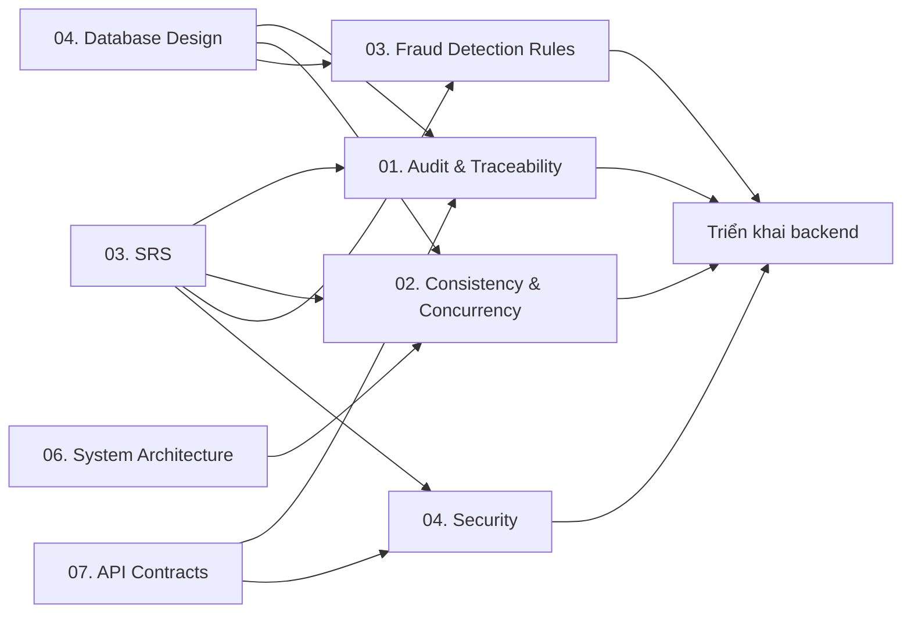

# Design Documentation

> **Dự án:** Digital Banking MVP
> **Phạm vi:** Thiết kế kỹ thuật chuyên sâu
> **Cập nhật:** 12/11/2026

## 1. Mục đích

Thư mục này chứa các thiết kế kỹ thuật chuyên sâu, nối yêu cầu trong `03. SRS` với triển khai thực tế. Mỗi tài liệu trả lời ba câu hỏi:

1. Yêu cầu nào (BR/FR/NFR/AC) đang được hiện thực hóa?
2. Thiết kế hoạt động như thế nào trong luồng bình thường và luồng lỗi?
3. Làm sao kiểm chứng thiết kế trước khi nghiệm thu?

## 2. Danh mục thiết kế

| # | Tài liệu | Mã tài liệu | Phạm vi | Trạng thái |
|---|---|---|---|---|
| 01 | [[digitalbanking-docs/docs-common/design/01. audit-traceability.md]] | `DESIGN-AUD-01` | Audit trail bất biến, hash chain, correlation ID, retention, legal hold | Hoàn thành — v1.0 |
| 02 | [[digitalbanking-docs/docs-common/design/02. consistency-concurrency.md]] | `DESIGN-CON-02` | Transaction boundary, idempotency, locking, isolation, failure recovery | Hoàn thành — v1.0 |
| 03 | [[digitalbanking-docs/docs-common/design/03. fraud-detection-rules.md]] | `DESIGN-FRD-03` | Rule gian lận, ngưỡng, flag/auto-block, fail-open | Hoàn thành — v1.0 |
| 04 | [[digitalbanking-docs/docs-common/design/04. security.md]] | `DESIGN-SEC-04` | Threat model, authn/authz, mã hóa, bảo mật dữ liệu | Hoàn thành — v1.0 |

## 3. Thứ tự đọc và quan hệ

### 3.1. Thứ tự đọc

`01. Audit & Traceability → 02. Consistency & Concurrency → 03. Fraud Detection Rules → 04. Security`

Có thể đọc `01` và `02` song song; `03` và `04` nên đọc sau `02` vì đều tham chiếu transaction boundary và money path.

### 3.2. Quan hệ với tài liệu khác

- **01 Audit & Traceability** là đầu vào cho yêu cầu audit, bằng chứng và truy vết.
- **02 Consistency & Concurrency** là thiết kế lõi của money path; các thiết kế khác tham chiếu transaction T1/T2/T3.
- **03 Fraud Detection Rules** bổ sung rule và ngưỡng cho bước đánh giá gian lận trong T2.
- **04 Security** là thiết kế xuyên suốt cho authn/authz, mã hóa, bảo mật dữ liệu và vận hành.

## 4. Cấu trúc chuẩn của một tài liệu thiết kế

Một tài liệu thiết kế nên có các phần sau (có thể gộp nếu phạm vi nhỏ):

1. Mục đích, phạm vi và cách đọc.
2. Tóm tắt thiết kế.
3. Yêu cầu và driver thiết kế (`BR/FR/NFR/AC`).
4. Kiến trúc hoặc mô hình xử lý.
5. Mô hình dữ liệu và ràng buộc.
6. Luồng xử lý, transaction boundary và thứ tự khóa.
7. Failure handling, compensation và recovery.
8. Bảo mật, quyền riêng tư và audit.
9. Observability và vận hành.
10. Kiểm thử và tiêu chí nghiệm thu.
11. Traceability.
12. Quyết định, open issues và rủi ro.
13. Appendix (SQL, pseudocode, ví dụ, glossary).

## 5. Quy ước viết

- **Mã tài liệu:** dùng dạng `DESIGN-<DOMAIN>-NN`; ghi ở khối metadata đầu tài liệu.
- **Trạng thái:** `Hoàn thành`, `Draft — chờ review`, `Đang viết`. Tài liệu chưa có nội dung phải ghi rõ **Đang viết**.
- **Traceability:** mỗi quyết định thiết kế phải liên kết tới `BR/FR/NFR/AC` và tài liệu nguồn (`03. SRS`, `04`, `06`, `07`).
- **Đề xuất vs. cam kết:** giá trị chưa chốt phải đánh dấu **Đề xuất** hoặc `[Cần xác nhận]`, kèm owner và open issue.
- **Ví dụ kỹ thuật:** SQL, pseudocode và sequence phải phản ánh đúng transaction boundary, lock order và error handling.
- **Không trùng lặp:** không sao chép nguyên khối từ SRS/BRD; chỉ giữ phần đặc thù thiết kế và liên kết tới nguồn.
- **Thay đổi:** cập nhật Change Log ở cuối tài liệu và bảng trạng thái trong README này.

## 6. Trạng thái hoàn thiện

- Toàn bộ 4 tài liệu thiết kế chuyên sâu (`01` đến `04`) đã **Hoàn thành — v1.0** và đóng vai trò là thiết kế chuẩn cho việc triển khai Backend/Frontend cũng như kiểm thử nghiệm thu.

## 7. Liên kết nhanh

| Mục đích | Tài liệu |
|---|---|
| Yêu cầu hệ thống | [[digitalbanking-docs/docs-common/03. SRS.md]] |
| Mô hình dữ liệu | [[digitalbanking-docs/docs-common/04. Database design & analysis.md]] |
| Kiến trúc hệ thống | [[digitalbanking-docs/docs-common/06. System architecture.md]] |
| Hợp đồng API | [[digitalbanking-docs/docs-common/07. API contracts.md]] |
| README docs-common | [[digitalbanking-docs/docs-common/README.md]] |
| README gốc | [[digitalbanking-docs/README.md]] |
