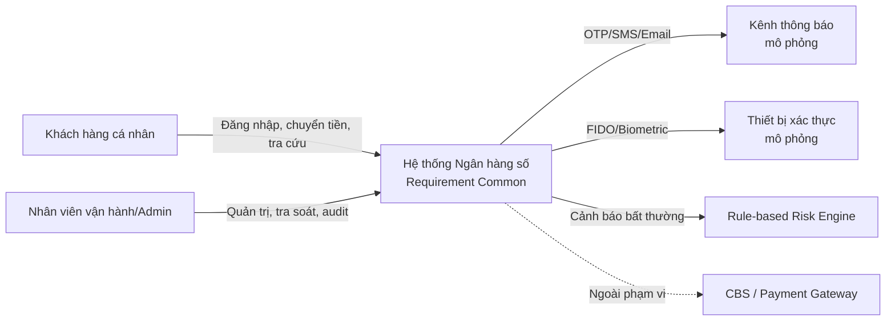
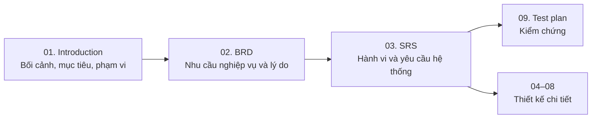

# 01. Introduction

> **Dự án:** Digital Banking
> **Ngày:** 02/11/2026  

## Mục lục

- [1. Project Overview](#1-project-overview)
- [2. Project Background and Motivation](#2-project-background-and-motivation)
- [3. Project Objectives](#3-project-objectives)
- [4. Project Scope](#4-project-scope)
- [5. Stakeholders](#5-stakeholders)
- [6. Definitions, Acronyms and Abbreviations](#6-definitions-acronyms-and-abbreviations)
- [7. Document Structure](#7-document-structure)
- [8. Document Conventions](#8-document-conventions)

---

## 1. Project Overview

### 1.1. Project Identity and Summary

**Digital Banking xây dựng một hệ thống ngân hàng số ở mức MVP, tập trung vào nhóm yêu cầu cơ bản thay vì toàn bộ nghiệp vụ ngân hàng.

Hệ thống phục vụ khách hàng cá nhân thực hiện các giao dịch chuyển tiền nội bộ, tra cứu tài khoản và lịch sử giao dịch; đồng thời cung cấp cho nhóm vận hành/audit khả năng tra soát và kiểm chứng. Trọng tâm của dự án là:

- Tính đúng đắn và nhất quán của giao dịch tiền.
- Khả năng chống gửi trùng và retry an toàn.
- Xác thực và phân quyền chặt chẽ.
- Audit bất biến và khả năng truy vết.
- Mã hóa dữ liệu khi truyền tải và khi lưu trữ.
- Khả năng phục hồi khi xảy ra lỗi.
- Phát hiện bất thường ở mức rule-based.
- Các demo bắt buộc: concurrent transfer, duplicate protection, failure/recovery, security & audit review, load test.

Hệ thống **tự quản lý tài khoản, số dư và sổ cái giao dịch nội bộ**; không phụ thuộc vào Core Banking System thật. Các tích hợp bên ngoài như SMS/Email/OTP, FIDO và fraud engine được mô phỏng hoặc tích hợp ở mức tối thiểu phục vụ demo.

### 1.2. Business Domain and Product Context

| Khía cạnh          | Mô tả                                                                |
| ------------------ | -------------------------------------------------------------------- |
| Lĩnh vực           | Ngân hàng số                                                         |
| Đối tượng chính    | Khách hàng cá nhân                                                   |
| Kênh khách hàng    | Kênh số ở mức MVP; chi tiết kênh và hành vi sẽ được chốt trong SRS   |
| Kênh vận hành      | Kênh quản trị/vận hành tối thiểu cho nhân viên được phân quyền       |
| Nguồn dữ liệu tiền | Hệ thống tự quản lý tài khoản, số dư và sổ cái nội bộ                |
| Hệ thống ngoài     | SMS/Email/OTP, FIDO, fraud engine – mô phỏng hoặc tích hợp tối thiểu |
| Nền tảng kỹ thuật  | Spring Boot + PostgreSQL (ràng buộc đã chốt)                         |

### 1.3. System Context

Hình dưới đây mô tả phạm vi tổng quan của hệ thống và các tương tác chính. Các thành phần nét đứt nằm ngoài phạm vi MVP.

**Hình 1 – System Context ở mức tổng quan**

---

## 2. Project Background and Motivation

### 2.1. Current Situation and Problem Statement

Trong hệ thống ngân hàng, chuyển tiền là nghiệp vụ nhạy cảm vì liên quan trực tiếp đến tài sản của khách hàng. Một giao dịch có thể gặp các tình huống:

- Debit thành công nhưng credit thất bại.
- Client timeout và gửi lại yêu cầu, dẫn đến nguy cơ trừ tiền hai lần.
- Service crash giữa giao dịch, để lại trạng thái không xác định.
- Thiếu audit trail khiến việc tra soát và chứng minh trách nhiệm gặp khó khăn.
- Xác thực yếu hoặc phân quyền không đầy đủ làm tăng rủi ro gian lận.

Trong phạm vi đồ án, các vấn đề trên được mô phỏng ở quy mô nhỏ để chứng minh năng lực của hệ thống đối với nhóm yêu cầu common, thay vì tái hiện đầy đủ một ngân hàng thực tế.

### 2.2. Motivation and Drivers

| Nhóm động lực | Nội dung |
|---|---|
| Học thuật | Đáp ứng yêu cầu của đề tài Requirement Common và các demo bắt buộc |
| Kỹ thuật | Chứng minh transactional consistency, idempotency, security, audit và traceability trong một luồng nghiệp vụ cô đọng |
| Nghiệp vụ | Tăng độ tin cậy của giao dịch tiền, giảm rủi ro double debit và mất dấu giao dịch |
| Vận hành | Cung cấp dữ liệu audit và công cụ tra soát tối thiểu cho nhóm vận hành |
| Tài liệu | Xây dựng bộ Introduction, BRD, SRS có liên kết và truy vết rõ ràng |

### 2.3. Expected Benefits

- **An toàn tài sản:** giao dịch debit/credit nhất quán, không phát sinh double debit khi retry.
- **Minh bạch:** khách hàng thấy được trạng thái và lịch sử giao dịch.
- **Kiểm chứng:** mọi giao dịch tiền và hành động nhạy cảm có audit trail.
- **Bảo mật:** xác thực đa yếu tố và phân quyền theo vai trò.
- **Phục hồi:** hệ thống xử lý được timeout, crash và lỗi từng phần.
- **Đo lường:** có bằng chứng định lượng qua concurrency test, duplicate test và load test.

### 2.4. Why This Project and Why Now

Chuyển tiền nội bộ là luồng nghiệp vụ đủ nhỏ để triển khai trong phạm vi đồ án nhưng chứa đầy đủ các thách thức của yêu cầu common: consistency, idempotency, authentication, authorization, audit, traceability và failure recovery. Việc tập trung vào **Common-focused MVP** giúp nhóm đi sâu vào chất lượng và bằng chứng kiểm chứng thay vì mở rộng quá nhiều tính năng.

---

## 3. Project Objectives

### 3.1. Business Objectives

> Các ID `OBJ-` dưới đây là ID khởi tạo. BRD là nguồn quản lý chính thức và sẽ tiếp tục sử dụng cùng ID khi chi tiết hóa mục tiêu.

| ID | Mục tiêu | Mô tả |
|---|---|---|
| OBJ-001 | Chuyển tiền nội bộ an toàn | Khách hàng thực hiện chuyển tiền rõ ràng, có trạng thái cuối cùng và không bị trừ tiền sai |
| OBJ-002 | Nhất quán và chống trùng | Mọi giao dịch tiền đảm bảo debit/credit nhất quán; retry không tạo giao dịch trùng |
| OBJ-003 | Xác thực và phân quyền | Hành động nhạy cảm yêu cầu xác thực phù hợp; quyền truy cập được kiểm soát theo vai trò |
| OBJ-004 | Audit và truy vết | Giao dịch tiền và hành động quan trọng có audit trail, correlation ID và khả năng tra soát |
| OBJ-005 | Phát hiện bất thường | Hệ thống gắn cờ các giao dịch có dấu hiệu bất thường để phục vụ rà soát |
| OBJ-006 | Chịu lỗi và hiệu năng | Hệ thống xử lý được các kịch bản lỗi và đáp ứng mục tiêu hiệu năng của demo |

### 3.2. Product and Quality Objectives

| Nhóm | Mục tiêu |
|---|---|
| Correctness | Kết quả giao dịch đúng, trạng thái cuối cùng rõ ràng |
| Consistency | Không có trạng thái ledger không nhất quán sau giao dịch hoặc retry |
| Idempotency | Cùng một yêu cầu được gửi lại không tạo hiệu ứng nghiệp vụ mới |
| Security | Xác thực, phân quyền, bảo vệ dữ liệu và chống lạm dụng |
| Auditability | Mọi sự kiện quan trọng được ghi nhận, có thể tra cứu và kiểm chứng |
| Recoverability | Có cơ chế phát hiện và xử lý timeout, crash, lỗi từng phần |
| Performance | Đáp ứng mục tiêu latency/throughput của kịch bản load test |
| Maintainability | Yêu cầu rõ ràng, có traceability và có thể kiểm thử |

### 3.3. High-level Success Metrics

Các giá trị dưới đây là **mục tiêu định hướng**, sẽ được chốt cụ thể trong BRD/SRS:

| ID | Chỉ số | Mục tiêu đề xuất |
|---|---|---|
| MET-001 | Giao dịch tiền có trạng thái cuối cùng rõ ràng | 100% |
| MET-002 | Double debit trong kiểm thử concurrency/idempotency | 0 |
| MET-003 | Hành động nhạy cảm có xác thực và audit | 100% |
| MET-004 | Giao dịch tiền có audit record và correlation ID | 100% |
| MET-005 | Kịch bản failure/recovery chạy thành công | 100% |
| MET-006 | Load test: throughput, latency, error rate | 20 RPS; p95 ≤ 2 giây; lỗi < 1% trong 10 phút (đề xuất) |
| MET-007 | Demo bắt buộc hoàn thành | 100% |

### 3.4. Objective-to-Benefit Mapping

| Objective | Benefit chính | Metric liên quan |
|---|---|---|
| OBJ-001 | An toàn tài sản, trải nghiệm rõ ràng | MET-001, MET-002 |
| OBJ-002 | Không double debit, dữ liệu nhất quán | MET-002 |
| OBJ-003 | Bảo vệ tài khoản, giảm rủi ro gian lận | MET-003 |
| OBJ-004 | Kiểm chứng và tra soát | MET-004 |
| OBJ-005 | Kiểm soát rủi ro giao dịch | MET-004, MET-007 |
| OBJ-006 | Độ tin cậy và khả năng chịu tải | MET-005, MET-006 |

---

## 4. Project Scope

### 4.1. In Scope

| Nhóm | Nội dung | Ghi chú |
|---|---|---|
| Authentication & Session | Đăng nhập bằng password; xác thực nhanh bằng passcode/FIDO; OTP cho tình huống step-up; khóa tài khoản theo số lần sai | PASSWORD, PASSCODE, FIDO, OTP là các phương thức khác nhau, định nghĩa tại mục 6 |
| Customer & Account | Xem thông tin khách hàng tối thiểu; danh sách tài khoản; số dư khả dụng | Không bao gồm quản lý hồ sơ nâng cao |
| Security & Encryption | Mã hóa dữ liệu khi truyền tải; mã hóa dữ liệu nhạy cảm khi lưu trữ; che dấu PII; quản lý secret ở mức cơ bản | Chuẩn mã hóa và key management chi tiết trong SRS |
| Transfer | Chuyển tiền giữa các tài khoản của cùng khách hàng; chuyển tiền nội bộ đến khách hàng khác trong hệ thống | Không bao gồm liên ngân hàng/quốc tế |
| Transfer Controls | Kiểm tra số tiền, số dư, hạn mức, tài khoản nguồn/đích; idempotency; trạng thái giao dịch; failure/recovery | Là trọng tâm của MVP |
| Transaction History | Danh sách, chi tiết, trạng thái và bộ lọc cơ bản | Phục vụ tra cứu và audit |
| Limits | Hạn mức giao dịch và hạn mức ngày; enforcement; cấu hình tối thiểu | Chi tiết rule trong BRD/SRS |
| Audit | Audit log append-only; correlation ID; tra soát giao dịch và hành động nhạy cảm | Không sửa/xóa audit record |
| Notification | Thông báo in-app/email/SMS ở mức mô phỏng | Không tích hợp nhà cung cấp thật |
| Fraud/Anomaly | Gắn cờ giao dịch lớn, tần suất cao, bất thường; phục vụ rà soát | Rule-based; không đi sâu ML |
| Administration | Quản trị người dùng/vai trò/hạn mức và tra cứu audit ở mức tối thiểu | Không phải full back-office |
| Demonstrations | Concurrent transfer, duplicate protection, failure/recovery, security & audit review, load test | Theo yêu cầu đề bài |

### 4.2. Out of Scope

- Quản lý thẻ, bill payment, mobile top-up, tax payment, loan, statement, QR payment, secure message.
- Chuyển tiền liên ngân hàng và chuyển tiền quốc tế.
- Tích hợp CBS thật, payment gateway thật, settlement thật hoặc xử lý tiền thật.
- Full back-office: product setup, fee engine, GL mapping, report center, notification template management.
- ML/AI fraud scoring nâng cao; chỉ thực hiện rule-based flagging ở mức khái quát.
- Thiết kế UI/UX chi tiết, branding, đa ngôn ngữ và accessibility nâng cao.
- Triển khai production, chứng nhận tuân thủ hoặc kiểm toán độc lập.

### 4.3. Scope Boundaries

| Khía cạnh | Ranh giới |
|---|---|
| Nguồn dữ liệu tiền | Hệ thống tự quản lý tài khoản, số dư và sổ cái nội bộ; không phụ thuộc CBS |
| Hệ thống ngoài | SMS/Email/OTP, FIDO, fraud engine được mô phỏng hoặc tích hợp tối thiểu |
| Tiền tệ | VND là giá trị mặc định đề xuất cho demo; có thể cấu hình |
| Nền tảng | Spring Boot + PostgreSQL |
| Dữ liệu | Dữ liệu demo, không phải dữ liệu khách hàng thật |
| Bảo mật | Đáp ứng yêu cầu common ở mức đồ án; không thay thế chứng nhận bảo mật |
| Tích hợp | Không phụ thuộc hệ thống thật; các interface được đặc tả để có thể thay thế sau này |

### 4.4. Assumptions and Dependencies

> Các ID `ASM-`/`DEP-` dưới đây là ID tham chiếu ban đầu. BRD là nguồn quản lý chính thức và sẽ tiếp tục sử dụng cùng ID.

| ID | Loại | Nội dung | Ảnh hưởng nếu không đúng |
|---|---|---|---|
| ASM-001 | Assumption | Đây là đồ án/MVP, không phải hệ thống production | Phạm vi NFR và compliance phải mở rộng |
| ASM-002 | Assumption | Hệ thống tự quản lý ledger; không có CBS thật | Phải bổ sung tích hợp CBS và đối soát |
| ASM-003 | Assumption | SMS/Email/OTP, FIDO, fraud engine được mô phỏng | Phải bổ sung hợp đồng tích hợp thật |
| ASM-004 | Assumption | Tiền tệ mặc định là VND; đơn vị tiền tệ có thể cấu hình | Ảnh hưởng định dạng số tiền và rule hạn mức |
| ASM-005 | Assumption | Người dùng demo có thiết bị hỗ trợ passcode/FIDO hoặc dùng phương thức fallback | Cần điều chỉnh luồng xác thực |
| ASM-006 | Assumption | Các quy tắc nghiệp vụ chi tiết sẽ được chốt trong BRD/SRS | Có thể phải cập nhật lại scope |
| DEP-001 | Dependency | Môi trường Spring Boot + PostgreSQL | Không thể triển khai demo |
| DEP-002 | Dependency | Dịch vụ mô phỏng OTP/SMS/Email/FIDO | Không thể demo xác thực |
| DEP-003 | Dependency | Bộ dữ liệu demo và tài khoản thử nghiệm | Không thể chạy test end-to-end |
| DEP-004 | Dependency | Xác nhận của nhóm/giảng viên về phạm vi và tiêu chí đánh giá | Có thể phải điều chỉnh tài liệu |

### 4.5. Phasing and Release Scope

| Giai đoạn | Nội dung | Trạng thái |
|---|---|---|
| MVP | Auth, account, transfer nội bộ, history, limits, audit, idempotency, fraud flagging cơ bản, demo bắt buộc | Trong phạm vi hiện tại |
| Extension | Rule fraud nâng cao, chuyển tiền liên ngân hàng, admin/reporting mở rộng | Ngoài phạm vi hiện tại |
| Future | ML fraud, đa ngôn ngữ, production hardening, tích hợp CBS/payment gateway thật | Ngoài phạm vi hiện tại |

---

## 5. Stakeholders

### 5.1. Stakeholder Catalog

> Các ID `STK-` dưới đây là ID khởi tạo. BRD là nguồn phân tích stakeholder chính thức và sẽ tiếp tục sử dụng cùng ID.

| ID | Stakeholder | Loại | Interest | Influence | Nhu cầu chính |
|---|---|---|---|---|---|
| STK-001 | Khách hàng cá nhân | Bên ngoài | Cao | Trung bình | Chuyển tiền an toàn, nhanh, rõ trạng thái, bảo mật |
| STK-002 | Đại diện nghiệp vụ/Product Owner | Nội bộ | Cao | Cao | Phạm vi đúng, giá trị nghiệp vụ rõ, tiêu chí thành công |
| STK-003 | Nhân viên vận hành/Admin | Nội bộ | Cao | Trung bình | Tra soát, quản lý tài khoản/hạn mức, xử lý ngoại lệ |
| STK-004 | Audit/Security/Compliance | Nội bộ | Cao | Cao | Audit trail, phân quyền, bằng chứng bảo mật |
| STK-005 | Nhóm phát triển | Nội bộ | Cao | Trung bình | Yêu cầu rõ, testable, traceability |
| STK-006 | Giảng viên/Hội đồng đánh giá | Bên ngoài | Cao | Cao | Đáp ứng đề bài, demo và bằng chứng kiểm chứng |
| STK-007 | Đối tác tích hợp mô phỏng | Bên ngoài | Trung bình | Thấp | Interface rõ ràng, hành vi mô phỏng nhất quán |

### 5.2. Roles and Responsibilities

| Vai trò | Trách nhiệm chính |
|---|---|
| Khách hàng | Thực hiện đăng nhập, chuyển tiền, tra cứu tài khoản/lịch sử |
| Đại diện nghiệp vụ | Xác nhận mục tiêu, phạm vi, business rules và tiêu chí thành công |
| Vận hành/Admin | Quản lý người dùng/vai trò/hạn mức, tra soát giao dịch |
| Audit/Security | Kiểm tra audit trail, quyền truy cập và các sự kiện bảo mật |
| Nhóm phát triển | Phân tích, thiết kế, triển khai, kiểm thử và cung cấp bằng chứng |
| Giảng viên/Hội đồng | Đánh giá mức độ đáp ứng yêu cầu và demo |

### 5.3. Communication and Engagement Needs

| Stakeholder | Nhu cầu trao đổi | Tần suất đề xuất |
|---|---|---|
| STK-001 | Hướng dẫn sử dụng, thông báo trạng thái giao dịch | Theo sự kiện |
| STK-002 | Review phạm vi, BRD, tiêu chí thành công | Theo mốc tài liệu |
| STK-003 | Hướng dẫn vận hành, quy trình tra soát | Trước demo |
| STK-004 | Báo cáo audit/security, bằng chứng kiểm thử | Theo mốc |
| STK-005 | Yêu cầu, thiết kế, test, traceability | Hàng tuần |
| STK-006 | Báo cáo tiến độ, demo, tài liệu | Theo lịch đánh giá |

---

## 6. Definitions, Acronyms and Abbreviations

### 6.1. Business Terms

| Thuật ngữ | Định nghĩa |
|---|---|
| Digital Banking | Ngân hàng số; cung cấp dịch vụ ngân hàng qua kênh số |
| Khách hàng cá nhân | Người dùng cuối sử dụng dịch vụ ngân hàng số trong phạm vi đồ án |
| Tài khoản | Tài khoản tiền gửi/thanh toán thuộc khách hàng, có số dư và trạng thái |
| Số dư khả dụng | Số tiền khách hàng có thể sử dụng cho giao dịch tại thời điểm kiểm tra |
| Chuyển tiền nội bộ | Chuyển tiền giữa các tài khoản trong cùng hệ thống |
| Giao dịch | Một yêu cầu nghiệp vụ làm thay đổi hoặc ghi nhận trạng thái tài khoản/sổ cái |
| Sổ cái nội bộ | Bản ghi debit/credit do hệ thống tự quản lý, dùng để đối chiếu và tra soát |
| Hạn mức | Giới hạn số tiền hoặc số lần giao dịch theo cấu hình |
| Audit log | Bản ghi append-only các sự kiện quan trọng phục vụ kiểm toán/tra soát |
| Tra soát | Quá trình kiểm tra, đối chiếu giao dịch và trạng thái tài khoản |

### 6.2. Technical Terms

| Thuật ngữ | Định nghĩa |
|---|---|
| Idempotency | Tính chất đảm bảo một yêu cầu được gửi lại không tạo thêm hiệu ứng nghiệp vụ |
| Idempotency key | Khóa duy nhất do client gửi kèm để nhận diện các lần retry của cùng một yêu cầu |
| Consistency | Tính nhất quán của dữ liệu và trạng thái giao dịch |
| Transaction | Đơn vị xử lý có tính nguyên tử (atomic) trong hệ thống |
| Correlation ID | Mã định danh xuyên suốt một yêu cầu/luồng xử lý để truy vết |
| Password | Mật khẩu đăng nhập của người dùng, là chuỗi ký tự theo chính sách bảo mật |
| Passcode | Mã số ngắn (ví dụ 6 chữ số) dùng cho xác thực nhanh hoặc fallback |
| OTP | One-Time Password; mã dùng một lần, thường dùng cho step-up hoặc thiết bị mới |
| FIDO | Fast Identity Online; chuẩn xác thực mạnh bằng biometric/passkey |
| Biometric | Xác thực bằng đặc điểm sinh trắc học (vân tay, khuôn mặt) |
| RBAC | Role-Based Access Control; phân quyền theo vai trò |
| Maker/Checker | Nguyên tắc tách người tạo và người phê duyệt cho hành động nhạy cảm |
| PII | Personally Identifiable Information; thông tin định danh cá nhân |
| Rule-based fraud flagging | Gắn cờ giao dịch bất thường dựa trên tập luật |
| CBS | Core Banking System; hệ thống ngân hàng lõi (ngoài phạm vi MVP) |
| Session | Phiên làm việc của người dùng sau khi đăng nhập |

### 6.3. Acronyms and Abbreviations

| Viết tắt | Diễn giải |
|---|---|
| BRD | Business Requirements Document |
| SRS | Software Requirements Specification |
| UC | Use Case |
| FR | Functional Requirement |
| NFR | Non-functional Requirement |
| AC | Acceptance Criterion |
| MVP | Minimum Viable Product |
| SLA | Service Level Agreement |
| SLO | Service Level Objective |
| PII | Personally Identifiable Information |
| RBAC | Role-Based Access Control |
| OTP | One-Time Password |
| FIDO | Fast Identity Online |
| CBS | Core Banking System |
| API | Application Programming Interface |
| DB | Database |

### 6.4. Terminology Rules

- **Password** và **passcode** là hai khái niệm khác nhau; không dùng thay thế cho nhau.
- **Chuyển tiền nội bộ** dùng để chỉ giao dịch trong cùng hệ thống; không dùng lẫn với chuyển tiền liên ngân hàng.
- **Khách hàng** là người dùng cuối; **người dùng** có thể bao gồm khách hàng, nhân viên vận hành và admin.
- **Giao dịch** trong tài liệu này mặc định là giao dịch nghiệp vụ; **transaction** kỹ thuật sẽ được nói rõ khi cần.
- Khi một thuật ngữ có định nghĩa trong mục 6, định nghĩa tại mục 6 là nguồn tham chiếu chính.

---

## 7. Document Structure

### 7.1. Structure of This Document

| Phần | Nội dung |
|---|---|
| 0. Document Control | Thông tin tài liệu, lịch sử phiên bản, phê duyệt |
| 1. Project Overview | Tổng quan dự án, bối cảnh sản phẩm, system context |
| 2. Project Background and Motivation | Vấn đề, động lực, lợi ích kỳ vọng |
| 3. Project Objectives | Mục tiêu nghiệp vụ/chất lượng và chỉ số thành công |
| 4. Project Scope | Phạm vi, ranh giới, giả định, phụ thuộc, phasing |
| 5. Stakeholders | Danh sách, vai trò, nhu cầu trao đổi |
| 6. Definitions, Acronyms and Abbreviations | Thuật ngữ và viết tắt |
| 7. Document Structure | Bản đồ tài liệu, quan hệ giữa các tài liệu, hướng dẫn đọc |
| 8. Document Conventions | Quy ước ID, ưu tiên, trạng thái, câu yêu cầu, diagram |

### 7.2. Project Document Map

| Tài liệu | Vai trò | Quan hệ |
|---|---|---|
| 01. Introduction | Bối cảnh, mục tiêu, phạm vi, stakeholder | Đầu vào cho 02 và 03 |
| 02. BRD | Nhu cầu nghiệp vụ và lý do | Đầu vào cho 03 |
| 03. SRS | Hành vi và yêu cầu hệ thống | Hiện thực hóa 02 |
| 04. Database analysis | Phân tích dữ liệu chi tiết | Hỗ trợ 03 |
| 05. System architecture | Kiến trúc hệ thống | Hỗ trợ 03 |
| 06. Technical stack | Lựa chọn công nghệ | Hỗ trợ 03/05 |
| 07. API contracts | Đặc tả API chi tiết | Hỗ trợ 03 |
| 08. Deployment infrastructure | Hạ tầng triển khai | Hỗ trợ 03/05 |
| 09. Test plan | Chiến lược và kịch bản kiểm thử | Kiểm chứng 02/03 |
| 10. Master timelines | Kế hoạch và tiến độ | Quản lý thực thi |

> Các tài liệu 04–10 sẽ được hoàn thiện ở các giai đoạn sau. Trong phạm vi hiện tại, 01–03 là bộ tài liệu phân tích và đặc tả yêu cầu trọng tâm.

### 7.3. Relationship between Introduction, BRD and SRS

**Hình 2 – Quan hệ giữa các tài liệu**

- **Introduction** trả lời: dự án là gì, vì sao có, phạm vi và các bên liên quan.
- **BRD** trả lời: nghiệp vụ cần gì và vì sao.
- **SRS** trả lời: hệ thống phải làm gì và hành vi ra sao.
- **Test plan** kiểm chứng BRD/SRS; các tài liệu 04–08 cung cấp chi tiết thiết kế.

### 7.4. Reference Documents

| Tài liệu | Loại | Cách sử dụng |
|---|---|---|
| `docs-common/Requirement Common.md` | Đề bài/yêu cầu tóm tắt | Nguồn chính cho các yêu cầu common và demo bắt buộc |
| `docs-references/BRD Individual Banking (Mobile Banking App).md` | BRD mẫu | Tham khảo cấu trúc, use case và quy tắc nghiệp vụ; **không** sử dụng bối cảnh BNF/Timor-Leste |
| `docs-references/Idempotency.md` | Tài liệu kỹ thuật | Tham khảo cơ chế idempotency key, retry và lưu kết quả |
| `docs-references/Spring transactions.md` | Tài liệu kỹ thuật | Tham khảo transaction management, propagation, isolation, rollback |
| `docs-references/Spring data JPA.md` | Tài liệu kỹ thuật | Tham khảo transaction mặc định của repository và `@Lock` |
| `docs-references/Transaction, isolation, locking.md` | Tài liệu kỹ thuật | Tham khảo MVCC, isolation levels, locking, deadlock và retry |
| `docs-references/Accouting.md` | Link-only | Chưa có nội dung; không sử dụng làm nguồn yêu cầu ở giai đoạn này |

> Mã nguồn và tài liệu triển khai hiện có trong repository không được sử dụng làm baseline cho bộ tài liệu này. Các tài liệu 01–03 được xây dựng từ yêu cầu đề bài và các reference đã nêu.

### 7.5. Reading Guide

| Đối tượng đọc | Phần nên đọc trước |
|---|---|
| Đại diện nghiệp vụ | 1, 2, 3, 4, 5 |
| Nhóm phát triển | 1, 3, 4, 6, 7, 8; sau đó đọc BRD/SRS |
| Audit/Security | 3, 4, 5, 6; sau đó đọc NFR và Audit trong SRS |
| Giảng viên/Hội đồng | 1, 2, 3, 4, 7 |
| Người mới tham gia dự án | 1, 6, 7 |

---

## 8. Document Conventions

### 8.1. ID Conventions

| Prefix | Ý nghĩa | Tài liệu sở hữu | Ví dụ |
|---|---|---|---|
| `OBJ-` | Business objective | BRD | OBJ-001 |
| `MET-` | Success metric | BRD/SRS | MET-001 |
| `STK-` | Stakeholder | BRD | STK-001 |
| `BR-` | Business requirement | BRD | BR-001 |
| `BP-` | Business process | BRD | BP-001 |
| `BRL-` | Business rule | BRD | BRL-001 |
| `CON-` | Constraint | BRD/SRS | CON-001 |
| `ASM-` | Assumption | BRD | ASM-001 |
| `DEP-` | Dependency | BRD | DEP-001 |
| `RSK-` | Risk | BRD | RSK-001 |
| `ROLE-` | Role | SRS | ROLE-001 |
| `FR-` | Functional requirement | SRS | FR-001 |
| `NFR-` | Non-functional requirement | SRS | NFR-001 |
| `UC-` | Use case | SRS | UC-001 |
| `US-` | User story | SRS | US-001 |
| `INT-` | System interface | SRS | INT-001 |
| `DR-` | Data requirement | SRS | DR-001 |
| `AC-` | Acceptance criterion | SRS | AC-001 |
| `SYS-RL-` | System enforcement rule | SRS | SYS-RL-001 |

### 8.2. Priority and Status

| Giá trị | Ý nghĩa |
|---|---|
| Must | Bắt buộc trong phạm vi hiện tại |
| Should | Nên có, có thể lùi nếu ảnh hưởng mục tiêu chính |
| Could | Có thể bổ sung nếu còn nguồn lực |
| Won't | Không thực hiện trong phạm vi hiện tại |
| Draft | Đang soạn, chưa rà soát |
| Proposed | Đã đề xuất, chờ xác nhận |
| Approved | Đã được xác nhận |
| Deferred | Tạm hoãn có lý do và người theo dõi |

### 8.3. Requirement Statement Rules

- Mỗi yêu cầu có một ID duy nhất và chỉ mô tả một yêu cầu.
- Dùng “Hệ thống phải…” cho yêu cầu bắt buộc; “Hệ thống nên…” cho yêu cầu khuyến nghị.
- Yêu cầu phải rõ ràng, có thể kiểm chứng và có nguồn/traceability.
- Không đưa quyết định thiết kế kỹ thuật vào BRD nếu chưa có căn cứ.
- NFR phải có ngưỡng đo được hoặc phương pháp kiểm chứng.
- Business rule chỉ có một nguồn chính trong BRD; SRS tham chiếu và mô tả cách thực thi.

### 8.4. Diagram and Table Conventions

- Sơ đồ quy trình/sequence/state dùng Mermaid khi cần; không dùng sơ đồ chỉ để trang trí.
- Mỗi hình/bảng quan trọng có số hiệu và chú thích.
- Bảng yêu cầu dùng cùng bộ cột trong toàn bộ tài liệu để dễ traceability.
- Các giá trị chưa chốt được đánh dấu `[Cần xác nhận]` hoặc ghi rõ là “đề xuất”.

---
