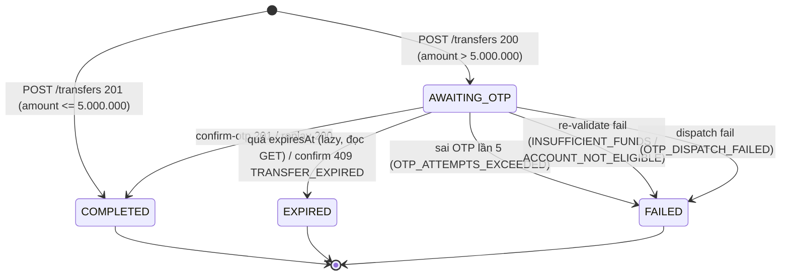

# BE3 — Handover: FE Matrix + BE-A/BE-B Notes + Load Test Status

> **Commit:** `fd3364cd3d8aa53f8820518bf2f57c011a747693` · **Ngày:** 2026-11-01
> **Phạm vi:** bàn giao nghiệm thu W3 cho FE, BE-A (identity/account), BE-B (audit/test-support).
> **Nguồn contract:** [API docs §2–§10](../plans/2.%20API%20docs.md) + behavior thực tế của commit trên.

---

## 1. State machine FE cần hiển thị

| Trạng thái | FE hiển thị | Hành động cho phép |
|---|---|---|
| `AWAITING_OTP` | Modal OTP + countdown từ `expiresAt` (chỉ là UI hint) | Nhập OTP, gửi confirm; **không** resend/cancel |
| `COMPLETED` | Biên lai thành công, số tiền, đối tác | Refresh accounts/history; không gửi lại confirm |
| `EXPIRED` | “Lệnh đã hết hạn”, không trừ tiền | Đóng modal; tạo lệnh mới (key mới) |
| `FAILED` | Hiện `failureCode` tương ứng | Đóng modal; tạo lệnh mới nếu phù hợp |

Không có path hồi sinh terminal: sau `COMPLETED`/`EXPIRED`/`FAILED`, confirm chỉ trả replay hoặc `409` — FE không được đổi trạng thái về `AWAITING_OTP`.

## 2. Boundary 5.000.000 (E1/E2)

| Amount | Response | Trạng thái | FE |
|---|---|---|---|
| **5.000.000** | `201 Created` | `COMPLETED` ngay | Không mở modal OTP |
| **5.000.001** | `200 OK` | `AWAITING_OTP`, `expiresInSeconds=120` | Mở modal OTP |

FE **không** tự quyết định path theo amount; chỉ branch theo HTTP status + body `status` (Business §6). Backend là nguồn duy nhất của boundary.

## 3. Idempotency protocol (bắt buộc)

- Sinh `Idempotency-Key` **một lần** khi user xác nhận lệnh: UUID (16–128 printable ASCII).
- Retry sau timeout/network error: **cùng key + cùng payload**, user nhập lại PIN (PIN không thuộc payload hash và được verify mỗi lần).
- **Không** sinh key mới sau timeout; **không** suy ra outcome từ timeout; **không** lưu PIN/OTP để retry tự động.
- Branch theo `code`, không theo `detail`.
- Response header: `Idempotency-Replayed: true|false`; replay trả **body gốc**.
- Same key + khác payload → `409 IDEMPOTENCY_KEY_REUSED` (không mutation). Đây là lỗi FE (key bị tái sử dụng sai) → sinh key mới cho intent mới, **không** retry mù.

## 4. Timeout = UNKNOWN + reconcile (UC-04)

Khi POST /transfers hoặc confirm-otp timeout:

1. Retry **cùng key/payload** (create) hoặc gọi lại confirm (cùng `transferId`); hoặc
2. `GET /transfers/{transferId}` để đọc trạng thái hiện tại.

| Trạng thái đọc được | Kết luận | FE |
|---|---|---|
| `COMPLETED` | Đã chuyển tiền | Hiện thành công, refresh balances/history |
| `AWAITING_OTP` | Chưa chuyển tiền; mã còn hiệu lực | Hiện modal với TTL còn lại; **không** gửi OTP mới |
| `EXPIRED` | Hết hạn, chưa chuyển tiền | Đóng modal, tạo lệnh mới nếu user muốn |
| `FAILED` | Terminal, chưa chuyển tiền | Hiện `failureCode`, đóng modal |

Không optimistic debit trước `201 COMPLETED`.

## 5. OTP attempts / expiry / cancel-resend

- `400 OTP_INVALID`: sai lần 1–4; status vẫn `AWAITING_OTP`. FE cho nhập lại; **server** track attempts, FE không tự đếm.
- Sai lần 5: `409 STATE_CONFLICT`; transfer `FAILED(OTP_ATTEMPTS_EXCEEDED)`; đóng modal, hiện thất bại.
- `409 TRANSFER_EXPIRED`: đóng modal, đề nghị tạo lệnh mới.
- Countdown chỉ là UI hint; mọi mốc theo UTC, server là thẩm quyền (`expiresAt` RFC3339).
- Filter list `from`/`to`: FE convert timezone → UTC trước khi gửi; `from` inclusive, `to` exclusive (AT-04).
- **Không có cancel/resend OTP** — không có endpoint (UC-03); FE không hiện nút.

## 6. Error matrix đầy đủ (endpoint × HTTP × code)

> Nguồn contract: API docs §2–§7; ghi chú “thực tế” chỉ rõ khác biệt đã kiểm tra trong code commit này.

### 6.1 `POST /api/v1/recipients/resolve`

| HTTP | `code` | Ý nghĩa | FE |
|---|---|---|---|
| 200 | — | Resolve thành công (masked) | Hiện recipient, cho phép tiếp tục |
| 400 | `VALIDATION_ERROR` | Account number sai format | Báo lỗi field, không gọi tiếp |
| 401 | — (Spring Security default) | Thiếu/hết hạn access token | Clear session, login lại |
| 404 | `RECIPIENT_NOT_AVAILABLE` | Không tồn tại/không ACTIVE/không VND/của chính mình/bị block (concealment) | Thông báo chung “không thể xác minh người nhận” |
| 429 | `RATE_LIMITED` | >30 request/phút/customer | Backoff theo `Retry-After`, không spam |

### 6.2 `POST /api/v1/transfers`

| HTTP | `code` | Ý nghĩa | FE |
|---|---|---|---|
| 201 | — | `COMPLETED` (small path) | Thành công, refresh accounts/history |
| 200 | — | `AWAITING_OTP` (large path) | Mở modal OTP + countdown |
| 400 | `VALIDATION_ERROR` | Thiếu/sai field, self-transfer, key sai format | Sửa form; không retry mù |
| 400 | `AMOUNT_INVALID` | Ngoài range/fraction/overflow | Hiện lỗi amount |
| 400 | `CURRENCY_MISMATCH` | Không phải VND hoặc 2 account khác currency | Hiện lỗi currency |
| 400 | `PIN_INVALID` | PIN sai lần 1–4 | Cho nhập lại PIN; server track attempts |
| 403 | `PIN_LOCKED` | PIN bị khóa (5 lần sai/15 phút) | Khóa thao tác, hướng dẫn khôi phục |
| 404 | `ACCOUNT_NOT_FOUND` | Source không tồn tại/không thuộc customer | Refresh danh sách account |
| 409 | `ACCOUNT_NOT_ELIGIBLE` | Source/destination không ACTIVE | Hiện lỗi, không retry |
| 409 | `INSUFFICIENT_FUNDS` | Số dư không đủ | Hiện số dư, không retry |
| 409 | `IDEMPOTENCY_KEY_REUSED` | Cùng key khác payload (FE bug) | Sinh key mới cho intent mới; không retry mù |
| 429 | `RATE_LIMITED` | **Contract docs có, implementation hiện chưa rate-limit POST /transfers** | Xử lý phòng thủ nếu proxy/gateway trả; xem MISMATCH M17 |
| 503 | `SERVICE_UNAVAILABLE` | DB lỗi hoặc OTP dispatch fail (large) | Retry same-key sau backoff; đối soát bằng GET nếu vẫn lỗi |

### 6.3 `POST /api/v1/transfers/{transferId}/confirm-otp`

| HTTP | `code` | Ý nghĩa | FE |
|---|---|---|---|
| 201 | — | `COMPLETED` lần đầu | Thành công, đóng modal, refresh |
| 200 | — | Replay `COMPLETED` (`Idempotency-Replayed: true`) | Coi như thành công, không gửi lại |
| 400 | `OTP_INVALID` | Sai OTP lần 1–4; vẫn `AWAITING_OTP` | Cho nhập lại |
| 400 | `VALIDATION_ERROR` | OTP sai format | Sửa input OTP |
| 404 | `TRANSFER_NOT_FOUND` | Không tồn tại hoặc actor không phải source owner (concealment) | Đóng modal, không tiết lộ |
| 409 | `STATE_CONFLICT` | Transfer `FAILED` (kể cả sai lần 5) hoặc confirm lần 5+ | Đóng modal, hiện thất bại |
| 409 | `TRANSFER_EXPIRED` | Đã hết hạn | Đóng modal, tạo lệnh mới |
| 409 | `INSUFFICIENT_FUNDS` | Re-validate dưới lock thất bại | Hiện thất bại; không retry |
| 409 | `ACCOUNT_NOT_ELIGIBLE` | Account bị block giữa chừng | Hiện thất bại; không retry |
| 503 | `SERVICE_UNAVAILABLE` | Lỗi hạ tầng | Đối soát bằng GET /transfers/{id} trước khi retry |

### 6.4 `GET /api/v1/transfers` và `GET /api/v1/transfers/{id}`

| Endpoint | HTTP | `code` | FE |
|---|---|---|---|
| List | 200 | — | Render items + `nextCursor` |
| List | 400 | `VALIDATION_ERROR` | Cursor/limit/status sai — reset filter |
| List | 400 | `INVALID_DATE_RANGE` | `from < to`; sửa filter |
| List | 401 | — | Login lại |
| Detail | 200 | — | Render theo `status` + `failureCode` |
| Detail | 404 | `TRANSFER_NOT_FOUND` | Không tồn tại/không có quyền (concealment) |

**Visibility:** source owner thấy mọi status; destination owner chỉ thấy `COMPLETED` incoming, còn lại `404` (không tiết lộ).

## 7. Handover BE-A (identity/account)

| # | Nội dung | Trạng thái | Đề nghị |
|---|---|---|---|
| A1 | Chuẩn hóa OTP lifecycle contract: `issueOtp` không gửi trong TX, `dispatchOtp` sau COMMIT, `consumeOtp` lock theo challenge id, `invalidateOtp` | Transfer đang tự dùng adapter/SQL trong `IdentityModuleApiAdapter`; API docs §8 chưa mô tả 2 method dispatch/invalidate (M15) | Expose lifecycle chuẩn ở identity API; transfer chuyển sang port khi có |
| A2 | Wrong-attempt commit trước HTTP error | **Transfer đã chứng minh** (OTP attempts commit dù 400) | Đối chiếu identity PIN: attempt sai phải commit dù response lỗi |
| A3 | PIN lockout concurrent (AC-06) | **Chưa có test phía identity** — ngoài scope transfer | Test 5 lần sai PIN đồng thời/15 phút → đúng 1 lock, `403 PIN_LOCKED`, không bypass; dùng PostgreSQL thật |
| A4 | Block-vs-confirm (CON-05) | **PASS** — transfer dùng `AccountStatusService.change` thật | Giữ semantics: block chỉ chặn lệnh tương lai, không rollback COMPLETED; giữ lock/re-validate |
| A5 | Account `status` transition guard | Transfer tin `validateTransferEligibility` dưới lock | Đảm bảo account module không cho confirm bypass status; giữ operation block có audit |

## 8. Handover BE-B (audit/test-support)

| # | Nội dung | Trạng thái | Đề nghị |
|---|---|---|---|
| B1 | Injector design `TransferFailureInjector` + Spring Profile | **Ổn định** — `NoOp` ở default, `Throwing` ở profile `transfer-failure-injection`; không lọt prod | Tái sử dụng pattern cho module khác nếu cần |
| B2 | PostgreSQL outputs CON-01..05 | **Có** — [BE3-concurrency](BE3-concurrency.md), [BE3-otp-race](BE3-otp-race.md), [BE3-rollback-timeout](BE3-rollback-timeout.md) | Dùng làm baseline invariant |
| B3 | Invariant summary + guard table | **Có** — [BE3-concurrency §3](BE3-concurrency.md#3-terminal-guard--tổng-hợp-sm-0103-task-52) | Đưa vào checklist nghiệm thu hệ thống |
| B4 | `DisposablePostgresTestSupport` (R2) | **Chưa có** trong repo; W3 giữ pattern per-class `@Testcontainers` | Quyết định: hold cho MVP; migrate khi số class tăng hoặc CI cần share container |

## 9. Load test (R5) — BLOCKED NOTE

**Trạng thái:** chưa chạy được load test 20 RPS × 10 phút trong phiên này. Không ghi PASS.

**Điều kiện đã kiểm tra:**

| Điều kiện | Kết quả |
|---|---|
| k6 binary | `k6: NOT INSTALLED` |
| Docker | Có (Testcontainers chạy được) nhưng chưa có image k6 local |
| Backend image `cloude-backend:latest` | Build lúc **2026-10-21**, trước V8/W2 → **stale**, không dùng để nghiệm thu W3 |
| Demo credentials | `.env` có **0** biến `DEMO_*`; `DemoDataSeeder` chỉ chạy profile `demo` |
| FE phối hợp | Chưa có kịch bản/credential từ FE |

**Điều kiện mở lại (để nghiệm thu bổ sung):**

1. Cài k6 hoặc dùng `grafana/k6` Docker image.
2. Rebuild backend từ commit hiện tại: `docker compose build backend` (image mới phải có Flyway V8).
3. Seed/customer + accounts + PIN + balance đủ; bật `SPRING_PROFILES_ACTIVE=local,demo` hoặc tạo data qua API (OTP mailbox local).
4. Script load: 80% small ≤5M + 20% large >5M kèm confirm OTP; mỗi request key riêng; 20 RPS × 10 phút; đo p50/p95/p99 `POST /transfers` + confirm, error rate, throughput.
5. Post-run invariant: `SELECT count(*) FROM accounts WHERE balance < 0` = 0; đối soát tổng debit với COMPLETED transfers; replay 5–10 key thủ công (Task 2.4).
6. Ghi report vào `evidence/` kèm timestamp/commit.

**Không thuộc W3 code:** blocked do hạ tầng/phối hợp, không phải do test thất bại. Khi có đủ điều kiện, chạy lại đúng kịch bản trên và cập nhật mục này.

## 10. Xác nhận bàn giao

| Bên | Nội dung cần xác nhận | Trạng thái |
|---|---|---|
| FE | State machine §1, boundary §2, idempotency §3, timeout/reconcile §4, OTP UX §5, error matrix §6 | ⏳ Chờ FE đọc + walkthrough |
| BE-A | A1–A5 §7, đặc biệt AC-06 PIN lockout concurrent và M15 contract | ⏳ Chờ BE-A |
| BE-B | B1–B4 §8 (giữ per-class Testcontainers) | ⏳ Chờ BE-B |
| QA/Acceptance | 3 evidence files + blocked-note load test §9 + MISMATCH M17 | ⏳ |
